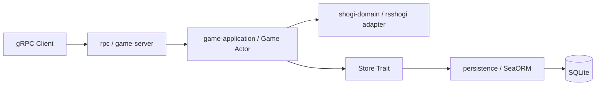
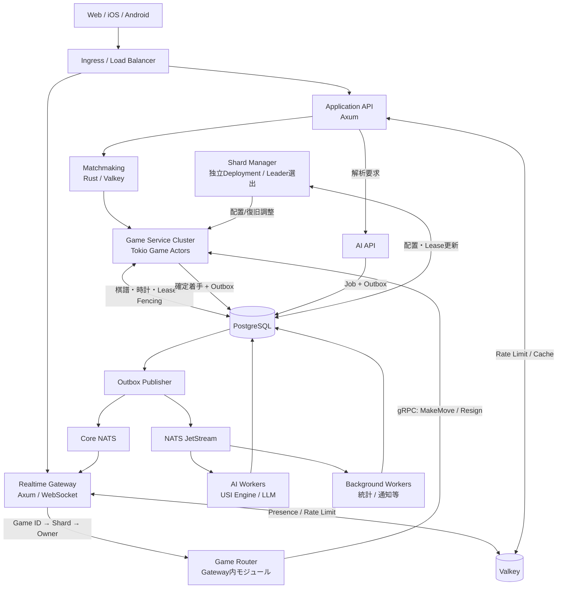
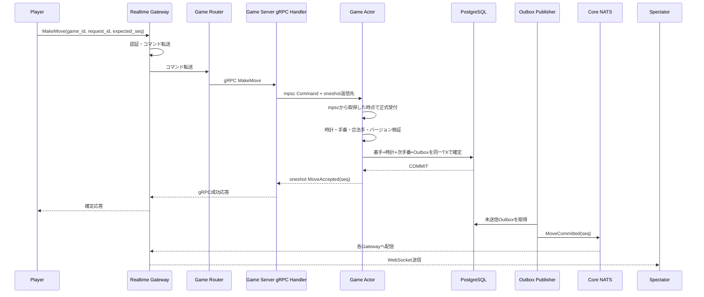
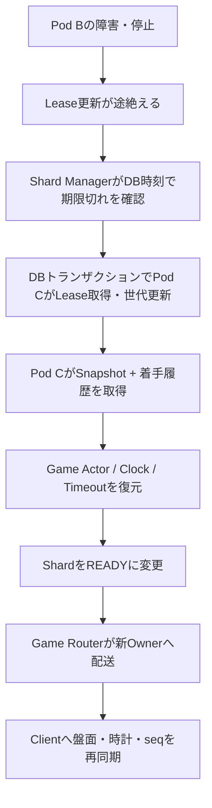
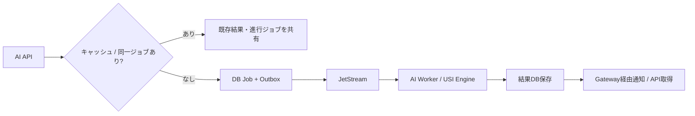
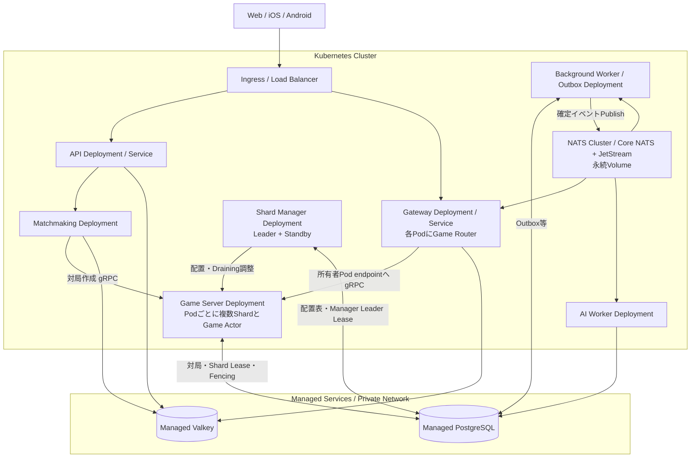

# 大規模将棋アプリ サーバーサイドアーキテクチャ設計書

- バージョン: 1.4（現行実装と将来設計）
- 更新日: 2026-11-02
- 対象: Web / iOS / Android
- 設計目標: 最大同時接続 100,000人

> **設計方針**: Rustを中心に、対局処理・リアルタイム配信・AI解析を分離する。KubernetesはPodの運用に集中させ、将来のVirtual Shardの配置・Lease・FencingはアプリケーションとDBで管理する。対局処理は特定のDB製品に依存させず、開発・テストではSQLiteを基本とする。
>
> 本文中の台数、Shard数、スループット、遅延などは**検証前の設計仮定**であり、保証性能ではない。

## 0. 現在の実装範囲

現在は、単一の`game-server`をTonic / gRPCで利用する構成である。以下が実装済みの仕様であり、以降の大規模構成図・時計・観戦・Shard・AI・Kubernetes運用は将来設計として読む。

| 実装単位 | 現在の責務 |
|---|---|
| `shogi-domain` | 局面、合法手、王手、詰み、投了。内部のrsshogiは非公開アダプターで包み、公開型を外部ライブラリから独立させる |
| `game-application` | ユーザー登録・取得、対局者の固定、対局ごとのActor、コマンド処理、永続化用`Store` Trait |
| `persistence` | SeaORMによる`Store`実装、SQLite保存、スキーマ初期化・検証 |
| `rpc` / `game-server` | gRPCでユーザー作成・取得、対局作成・Snapshot取得、着手・投了を公開し、永続化アダプターを組み立てる |



### 0.1 対局・ユーザーの仕様

- 平手初期局面から開始し、通常の駒移動、成り、持ち駒、王手回避、詰み、投了を扱う。二歩・打ち歩詰め・王手放置などの不正着手はエラーとして拒否し、対局は継続する。
- 詰みは「王手され、合法手がない」場合のみ。王手でない合法手なし局面、千日手、連続王手の千日手、入玉宣言勝ち等の判定は対象外。タイマー・時間切れも未実装である。
- 対局作成時に、登録済みの異なる2ユーザーを先手・後手へ固定する。着手側は`user_id`とこの紐付けから決める。投了は手番によらず可能である。
- ユーザーIDは呼出元の申告値であり、認証は未実装である。マッチング、Shard管理、メッセージ配信も現在のスコープに含めない。

### 0.2 確定・再送・復旧

- 1対局につきサービスの共有レジストリ内に1つのActorを置き、bounded `mpsc`と`oneshot`で逐次処理する。Snapshot取得時と変更前にはDBのversionを確認する。
- `seq`は0から始まり、受理した着手・投了ごとに1増える。変更には`expected_seq`と`request_id`が必要で、参加者以外の変更は拒否する。
- 受理済み要求だけが対局内の`request_id`を予約する。同じ種別・ユーザー・期待連番・着手内容での再送には元の結果を返し、内容が違えば拒否する。ユーザー作成・対局作成はこの再送契約の対象外である。
- 局面のコピーで変更を検証し、versionの条件付き更新、結果、受理記録を同一トランザクションで保存してからActorへ反映する。保存エラー時は履歴を再読込して照合し、結果を確認できない場合は成功・ロールバックを断定しない。応答喪失時は同じ要求を再送する。
- 再起動後は平手初期局面から受理済み履歴を再実行し、連番・参加者・合法性・各応答・最終結果を検証して復元する。DBに局面Snapshotを保存する方式ではない。

### 0.3 DB・実行環境

Domain層とApplication層はSQL・ORMに依存せず、Application層が定義する`Store`を注入する。現行の永続化アダプターで組み込み・検証しているDBドライバーはSQLiteのみであり、PostgreSQL対応を実装済みとはしない。将来のDB変更はアダプター側で対応・検証する。

ローカル実行とテストはSQLiteを基本とし、現在のコンテナ確認はDocker Composeで行う。Composeは`game-server`とSQLite用の名前付きVolumeを使い、コンテナ再作成後も対局を復元する。本番のKubernetes運用は将来の対象である。実行・再起動確認・rustdocの手順は[README](README.md)を参照する。

## 1. 要件と負荷モデル

### 1.1 主要機能

- 対人対局: マッチング、着手、合法手判定、持ち時間、秒読み、投了、勝敗、レーティング
- 観戦: 多数の同時観戦、着手イベント配信、途中参加、再接続、盤面再同期
- AI: 局面評価、候補手、対局後の棋譜解析、LLMによる自然言語解説
- 共通: 認証、ユーザー管理、棋譜履歴、通知、統計、監視

### 1.2 仮の容量モデル

| 項目 | 設計仮定 |
|---|---:|
| 最大同時接続 | 100,000 |
| 対局者 | 50,000 |
| 観戦者 | 50,000 |
| 同時対局 | 25,000 |
| 平均着手間隔 | 1対局あたり10秒 |
| 平均着手イベント | 2,500手/秒 |
| 瞬間ピーク例 | 10,000手/秒 |
| 人気対局の観戦者 | 最大20,000人/局（検証シナリオ） |

同じ10万接続でも「対局が多い」場合はGame ActorとDB書き込み、「人気対局に観戦集中」する場合はGatewayのfan-outが主要負荷になる。AIの解析同時数は別枠で容量管理する。

## 2. 技術スタック（現行と将来候補）

Valkey、NATS、AI、Kubernetes、観測基盤は将来導入する構成であり、現行サーバーの実行には不要である。

| 領域 | 採用技術 | 主な役割 |
|---|---|---|
| 言語 | **Rust** | サーバー実装 |
| Web API | **Axum（将来）** | HTTP API / 認証 |
| 非同期基盤 | **Tokio** | 現在はGame Actor。WebSocket・タイマーは将来 |
| RPC | **Tonic / gRPC** | 現在の対局・ユーザー操作。Gateway接続は将来 |
| 将棋ルール | **rsshogi** | 非公開アダプター経由で利用 |
| ORM | **SeaORM** | ユーザー・対局・受理済み履歴の保存 |
| SQL | **SeaQuery / SeaORM経由のSQLx** | スキーマ構築、トランザクション、versionの条件付き更新 |
| RDBMS | **SQLite（現行） / PostgreSQL（将来候補）** | 現在の正本はSQLite。時計・Shard Leaseは未実装 |
| 一時データ | **Valkey** | Presence、マッチング、キャッシュ、Token Bucketによるレート制限 |
| 低遅延イベント | **Core NATS** | 確定した着手等をGatewayへ配信 |
| 永続イベント/ジョブ | **NATS JetStream** | AI解析、統計、通知等の非同期ジョブ |
| 将棋AI | **やねうら王等のUSIエンジン** | 局面評価・候補手・棋譜解析 |
| 解説AI | **LLM（別Worker/外部推論）** | エンジン結果に根拠を置いた自然言語説明 |
| コンテナ | **Docker** | 環境の統一 |
| オーケストレーション | **Kubernetes** | Podの配置、再起動、水平スケーリング |
| 観測 | **OpenTelemetry、Prometheus、Grafana** | トレース、メトリクス、ダッシュボード |

**採用しないもの（初期）**: タイマー専用サービス、Shard管理専用Kubernetes Operator、Kubernetes LeaseによるShard所有権管理、独立Game Routerサービス、過剰なマイクロサービス分割。

## 3. 全体構成（将来設計）



上図は論理構成。AI完了イベントにもOutbox等を用い、通知が欠落しても結果をAPIで取得可能にする。

### 3.1 アプリケーション単位

- **Application API**: 認証、ユーザー情報、棋譜検索、レーティング、設定、AI解析受付
- **Realtime Gateway**: WebSocketの接続認証、対局/観戦購読、着手の転送、再同期、送信キュー制限
- **Game Service**: 各Game Actor、時計、合法手、結果確定、Shard復旧
- **Shard Manager（独立アプリ）**: Game Podの登録・負荷収集、Shard配置・再配置計画、障害復旧の調整
- **Matchmaking Worker**: Valkey上の待機列を使ったマッチング、二重成立防止
- **AI Worker**: USIエンジン実行・解析結果保存、必要に応じてLLM説明
- **Background Worker**: 通知、統計、監査、不正検知など

Game RouterはGateway内のRustモジュールとして実装する。**Shard Managerは独立したDeployment**で動かし、PostgreSQLによるLeader選出で1インスタンスだけがShard配置の制御を実行する。

## 4. Pod・Virtual Shard・Game Actorの関係

```text
Kubernetes Cluster
  ├─ Game Server Pod A（Rustプロセス）
  │    ├─ Virtual Shard 0
  │    │    ├─ Game Actor #100（1局）
  │    │    └─ Game Actor #101（1局）
  │    └─ Virtual Shard 12
  │         └─ Game Actor #500
  └─ Game Server Pod B（Rustプロセス）
       ├─ Virtual Shard 1
       └─ Virtual Shard 357
            ├─ Game Actor #123
            └─ Game Actor #456
```

- **Pod**: Game Serverプロセスの実行環境。Kubernetesが起動・再作成する。
- **Virtual Shard**: 対局群を束ねて配置を切り替える論理単位。原則プロセスやスレッドではない。
- **Game Actor**: 1局を担当し、手番・局面・時計・勝敗を逐次処理する実行単位。Tokio Task + Channel等で実装できる。

例として、Shard数を**1,024に固定**する。

```text
shard_id = stable_hash(game_id) % 1024
```

Shardごとの担当Podは固定式ではなく、Shard Managerが決めてPostgreSQLに保持する。Pod数が変わってもGame ID → Shard IDは変えない。

## 5. Shard Manager / Game Router / Lease

### 5.1 責務

| コンポーネント | 役割 |
|---|---|
| Shard Manager | 稼働Podと負荷を見てShard→Podの配置を決め、移動・障害復旧を調整 |
| Game Router | Game IDからShard IDを計算し、配置表から担当Podを見つけてgRPCで配送 |
| Lease | PodにShardの管理権限を期限付きで与える |
| Fencing Token | 旧所有者が復帰しても、古い世代での書き込みを拒否する |

### 5.2 配置アルゴリズム（初期案）

1. Game IDを安定ハッシュで1,024 Virtual Shardへ割り当てる。
2. 新規Shardは、健全かつ余裕のあるGame Podへ割り当てる（初期は担当Shard数や稼働対局数で判断）。
3. 現在の割り当てを原則維持し、Pod追加時も移動するShardを最小限にする。
4. Pod停止時はLeaseの期限切れを確認し、別Podに再割り当てする。
5. 後にCPU、Actorキュー長、処理時間などを加味し、ヒステリシスとクールダウンを設ける。

**通常の着手のたびにShard Managerへ問い合わせない。** Game Routerが配置表をキャッシュし、所有者変更やエラー時に更新する。

### 5.3 PostgreSQLのLease概念

```text
shard_id       = 357
owner_id       = game-pod-b / instance-uuid
lease_expires  = DB時刻による期限
generation     = 42
state          = ACTIVE / RECOVERING / DRAINING
```

Leaseを獲得し直すと世代番号を増やす。書き込み時には、**同一トランザクション**で所有者・世代番号・期限を検証し、Leaseの変更と競合しないよう適切に行ロック等を用いる。`game_moves(game_id, seq)` の一意制約と`request_id`による冪等性も併用する。

Shard Managerは**独立Deployment（通常2 Podを初期候補）**として実行し、PostgreSQLのManager専用Leader Leaseと世代番号・条件付き更新によって、同時に配置変更を行えるLeaderを1つに制限する。Manager Leader Leaseと各Shardの所有権Leaseは別物である。Game Serverは自分が所有するShardのLease更新・Fencing検証を担当し、Manager停止中も既存の対局は継続できるようにする。

## 6. 着手の確定と観戦イベント配信



- Game Actorだけが対局の状態を変更できる。
- Gatewayは通信を管理し、盤面の正本を持たない。
- Core NATSは低遅延だが永続配信ではない。**連番の欠落はSnapshotと確定着手履歴で再同期**する。
- Gatewayは、ローカル観戦者がいる対局だけNATSを購読し、受信したイベントを同Pod内の観戦者へfan-outする。
- 遅いクライアントには送信キュー上限を設け、局面更新は最新Snapshotによる再同期で復帰させる。

### 6.1 観戦途中参加 / 再接続

1. Gatewayがイベント購読を開始し、到着イベントを一時バッファする。
2. Game Serviceから現在局面のSnapshotと`seq`を取得する。
3. `seq + 1`以降を順序どおり適用する。
4. 欠落やバッファ超過があれば再度Snapshotを取得する。

この順序により、Snapshot取得中の着手を取り逃がさない。


### 6.2 Game Actorのメッセージ契約

- **Command**: `GetSnapshot`、`MakeMove`、`Resign`、`CheckTimeout`（内部再評価用。通常はActor自身のタイマー）、将来`Ready`。gRPC HandlerからActorへbounded `mpsc`で送る。
- **Reply**: Commandごとに用意した`oneshot`へ返す。`MoveAccepted`、投了成功、Snapshot、エラーなど。`mpsc.send().await`成功は処理成功ではない。
- **Domain Event**: `MoveCommitted`、`GameFinished`等を着手・結果と同一のDBトランザクションでOutboxへ書き込み、Core NATSからGateway経由で通知する。
- 成功ReplyとDomain Eventは**同じDB Commitに根拠を持つが到着順・到着可否は独立**。クライアントの盤面反映はEvent/Snapshotに一本化し、Replyは操作の送信状態とエラー管理に使う。
- `expected_seq`、`request_id`、Shard fencingを検証し、確定済み同一`request_id`には同じ結果を返す。

## 7. 対局時計（Game Clock）— 将来実装時の採用方針（未実装）

### 7.1 責務・正式受付地点

**時計・期限判定・着手受付・終局確定の権威をGame Actorに集約する。Admission Gateは設けない。**

- Realtime Gateway: 認証、WebSocket受信、Game Routerによる転送。Gatewayで観測した受信時刻は監視・性能計測には使えるが、勝敗判定の根拠にはしない。
- Game Server gRPC Handler: Requestを対象Actorの**容量上限付きTokio `mpsc`**へ投入。Handlerは時計の期限判定をしない。
- Game Actor: `mpsc::Receiver::recv()`で対象手番のCommandを**取り出した時点**を、正式な着手受付時刻とする。Actorが現在の時計と照合して時間内・時間切れを判定する。
- PostgreSQL: 確定した棋譜、時計、勝敗、Outboxの正本。DB Commit成功後にのみ成功Replyを返す。

この方式では**Gateway→Game Serverの通信時間、mpsc内の待ち時間、Actorが前のCommandを処理する時間は、着手側の消費時間に含まれる**。簡潔なMVP仕様として受け入れ、キュー遅延を測定する。`mpsc`の投入成功は正式受付・着手成功を意味しない。

### 7.2 Clockの計算と時刻の保持

**1秒ごとにDB上の残り時間を更新しない。** Actorは手番開始時刻・残り時間・秒読み等の`TimeControl`から現在の期限を算出する。

- 稼働中のActorは単調時計（`tokio::time::Instant`）で経過時間・期限を判定する。
- 着手受付時にActor内で単調時刻を採取する。クライアント・Gatewayから送られた時刻では判定しない。
- 次手番開始時刻はActorが確定処理の中で決める。**DB Commit完了時刻と完全には一致しない**ので、コミット・イベント配信遅延も監視する。
- 復旧のため`turn_started_at_utc`、両者の残り持ち時間、秒読みルール、`clock_version`、対局状態をDBに保存する。`Instant`自体はPod間で持ち運ばない。
- 初期は障害中も時計が進むポリシー。復旧後の時刻算出にはUTC時刻と運用上の時計同期が必要。厳密な障害補償は将来検討。

### 7.3 mpscとタイマーの競合・確定順序

Actorは1対局につき1つのTokio Taskで、Commandを逐次実行する。`tokio::select!`でコマンド受信と`sleep_until`を待ってよいが、**selectの分岐選択そのものを時間内判定の根拠にはしない**。ActorがCommandを実際に取り出したときの時刻と、現在の手番の期限を照合する。

1. Actorが`MakeMove`を取り出したら直ちに受付時刻を採取する。期限未満なら手番・合法性等を検証する。期限以上なら時間切れ扱いにする（境界は**`now >= deadline`で期限切れ**）。
2. タイマー発火時はActorが時計状態を再計算する。まだ期限前なら再度スケジュールする。期限到達済みなら、Actorが時間切れ結果をDBへ確定する。
3. **期限前にGame Serverに到着済みでも、mpscからの取り出しが期限後なら無効**という仕様である。別の`Admission Gate`やPendingカウンタ、Gate閉鎖要求は用いない。
4. 着手・投了・時間切れはすべてActorの逐次処理とDBのトランザクションで確定する。DB書込みにはShardのFencing世代検証も含め、二重確定を防ぐ。
5. 着手側に送る`MoveAccepted`/投了成功ReplyはDB Commit後に返す。一方`MoveCommitted`/`GameFinished`は同じCommitで保存したOutboxから非同期配信する。クライアントではReplyを操作結果の管理、Eventを盤面・時計・終局反映に使う。

タイマーが先に選択された結果、既にmpsc内にあるCommandをActorが取り出さずに時間切れ確定する状況も、**Actor取出し時点を正式受付とする仕様では許容**する。負荷による不利益を評価するため、キュー待機時間・タイマー遅延・ActorのDB処理時間を必ず観測する。

### 7.4 Pod障害時・Reply欠落時

- Admission Gateおよび永続Inboxは**採用しない**。DB未Commitの着手は障害時に失われ得る。
- クライアントがReplyを受け取れなければ、成功・失敗を断定せず**結果不明（Unknown）**にする。再接続後にSnapshot・`request_id`の確定記録を確認する。
- DB確定済みなら重複結果を返す。未確定なら**同じ`request_id`**で再試行できるが、再試行時には新たなActor正式受付時刻で判定する。元の期限内到着時刻は保証されない。
- `request_id`の確定記録はPostgreSQLで一意制約を設ける。冪等照会・結果照会とDB原子的更新を用意する。`not_found`だけで未処理の要求が今後Commitしないとは断定しない。
- Pod再起動時はPostgreSQLの確定時計状態から新しい単調時計Deadlineを再構築する。Shard所有権はLease + Fencingを検証する。

### 7.5 将来の強化候補（未採用）

競技性・負荷試験の要件が高まれば、GatewayまたはGame Serverでの受信時刻を正式受付とする方式を再検討する。ただしその場合は**未処理の期限内要求の追跡、期限確定との原子的競合制御、時計同期、Pod障害時の保証**が必要となる。現時点で`received_at`をGatewayから受け取って勝敗判定に使う設計や固定猶予だけの方式は採用しない。

## 8. Pod停止・再起動時の復旧



- Podの再起動・再作成はKubernetes、Shardの再配置はShard Manager。
- Pod再起動後も旧プロセスと同一とはみなさない。**プロセス起動単位の一意なinstance ID**を使用する。
- 旧世代からのDB更新はFencing Tokenで拒否する。
- 移動中は着手を即時確定しない。安全に再試行させるか、短時間保留する。
- 応答を失った着手がすでに確定している可能性があるため、`request_id`と`seq`で重複実行を防ぐ。
- Pod全体のReadyとShardごとの`RECOVERING / READY / DRAINING`は分けて扱う。
- 計画停止ではDrain処理とLease引き継ぎを試みる。突然の障害ではLease失効後に復旧する。

## 9. Valkey / Core NATS / JetStream / PostgreSQLの使い分け

| 技術 | 役割 | 主な利用例 |
|---|---|---|
| PostgreSQL | 正本・整合性 | 着手、時計、対局結果、Shard Lease、Fencing、Outbox |
| Valkey | 高速一時状態 | Presence、Matchmaking、Cache、Rate Limit |
| Core NATS | 揮発性の即時配信 | MoveCommitted、観戦イベント |
| JetStream | Ack・再配信つきの非同期処理 | AI解析、集計、通知、ジョブ |

Core NATSの配信漏れには連番+Snapshotで対応。JetStreamの再配信は重複実行を起こし得るためWorkerを冪等にする。PostgreSQLとメッセージブローカーの二重書き込みにはTransactional Outboxを用いる。

### 9.1 Presence（オンライン状態の共有）

- Realtime Gatewayは各WebSocket接続をローカルで管理し、Valkeyに**接続単位**のPresenceを登録する。
- 1ユーザーがWeb・スマホなど複数接続を持つことを許容し、有効な接続が1つ以上あればオンラインと判定する。
- 各接続のPresenceにはTTLを付与し、GatewayのHeartbeat等に応じて更新する。突然の切断ではTTL失効により古い接続情報を回収する。
- 接続一覧用インデックスを持つ場合は、TTLの切れた接続が参照上残らないよう、参照時の検証・定期クリーンアップ等を行う。
- **Presenceは表示・通知のための一時情報**であり、対局の進行状態や勝敗の正本ではない。対局状態はGame ServiceとPostgreSQLが担う。

### 9.2 Rate Limit（リクエスト頻度制限）

**基本アルゴリズムはValkey上のToken Bucketとする。** Fixed Window方式の単純なValkeyカウンターは、ログイン失敗回数など「指定期間内の試行回数」を管理する場面で併用する。

| 対象 | 推奨制限方式 | 補足 |
|---|---|---|
| マッチング申請 | Valkey Token Bucket | 連打を抑制しつつ適度なバーストを許容 |
| フレンド申請・チャット | Valkey Token Bucket | スパム・連投を抑制 |
| WebSocket接続確立 | Valkey Token Bucket | 再接続時の一時的バーストを考慮 |
| AI解析要求 | Valkey Token Bucket + 同時実行数上限 + 利用予算 | リクエスト回数だけでなく計算コストも制御 |
| ログイン失敗回数 | Valkeyカウンター（Fixed Window等） | 認証基盤側の防御と併用 |
| 対局中の着手 | Game Actorの手番・合法手・連番検証を基本 | 不正な連投に対する軽量なGateway制限は別途検討 |

**Token Bucketの管理方法**

- キー例：`ratelimit:user:{user_id}:matching`。未認証エンドポイントはIP等も併用し、NATや共有回線への影響を考慮する。
- Valkey Hash等に`tokens`（残トークン）と`last_refill_ms`（最終補充時刻）を保存する。
- リクエスト時、経過時間に応じてトークンを最大容量まで補充し、残量が足りれば消費して許可する。
- **補充・判定・消費・TTL更新をLuaスクリプトなどで原子的に実行**し、複数Pod間の競合を防ぐ。
- 時刻基準にはValkey側の時刻を使い、異なるAPI/Gateway Pod間の時計ずれを避ける。
- Valkeyのキーは不要になったとき自動削除できるようTTLを付ける。容量（capacity）と補充速度（refill rate）は操作別のポリシーで設定する。

**実装上の配置**：API ServerとRealtime Gatewayで共有できる`RateLimiter`をRustの共通Crateとして実装し、HTTPではAxum Middleware等から呼び出す。WebSocketメッセージごとに常にValkeyへアクセスする設計にはせず、接続ごとの軽量制限はGatewayのメモリで実施する。Ingress側にも粗い流量制限を設け、多層防御とする。

**Valkey障害時**には、操作の重要度に応じてfail-open / fail-closedを明示的に決める（例：AI解析ジョブは保守的に受付制限）。また、Token Bucketはリクエスト頻度の制限であり、AI Workerの同時実行数制御や費用クォータの代替にはならない。


## 10. AI Platform



- 対局後の解析、候補手、局面評価はUSI対応将棋エンジンを基本とする。
- LLMはエンジン出力をもとに解説し、合法手・局面評価の正本にはしない。
- 同一局面・解析深度・エンジン版・MultiPV等をキャッシュキーにする。
- 長時間解析と低遅延解析は別キュー/Worker Poolに分離する。
- 対局者へのレーティング対局中のAI助言は禁止するなど権限制御を行う。
- やねうら王等の採用時にはライセンス条件を確認する。

## 11. 永続化データモデル

### 11.1 現行のSQLiteスキーマ

| テーブル | 内容 |
|---|---|
| `users` | 登録済みユーザーID |
| `games` | 対局ID、固定された先後のユーザー、version、勝敗・終局理由 |
| `journal` | 着手・投了を含む受理済みコマンドと元の応答。対局内の連番・request_idはそれぞれ一意 |
| `schema_version` | スキーマ初期化・互換性検証用のバージョン |

`games`のversion・結果と`journal`は原子的に更新する。新規DBは起動時に初期化し、既存DBはバージョン台帳と必要テーブルの存在を確認する。列・制約の網羅的な検査は行わず、対局履歴はロード時に再実行して検証する。時計、永続Snapshot、Outbox、Leaseは保存していない。

### 11.2 将来の拡張候補

以下はPostgreSQL等で分散構成を導入する際の概念モデルであり、現行テーブル名や導入済み機能を示すものではない。

| テーブル | 内容 |
|---|---|
| `users` | ユーザー |
| `player_ratings` | ルール別レーティング |
| `games` | 対局メタ、手番、version、時計の確定状態 |
| `game_moves` | `(game_id, seq)`をキーとする確定着手履歴、request_id |
| `game_snapshots` | 局面・時計・連番の復元用Snapshot |
| `game_results` | 勝敗と終局理由 |
| `shard_leases` | shard_id、owner_id、generation、期限、状態 |
| `outbox_events` | DB確定済み・未配信イベント |
| `analysis_jobs` | AI解析要求と実行状態 |
| `analysis_results` | 局面別解析結果 |

着手永続化は、`game_moves`追加、`games`更新、`outbox_events`追加を同一トランザクションで行う。`shard_leases`の所有権・期限・世代を同TX内で検証する。

大量着手履歴については、インデックス・パーティショニング・アーカイブを計画する。単純に2,500手/秒が24時間継続すると約2億1,600万手/日となるが、これは負荷試験上の上限シナリオであって実トラフィック予測ではない。

## 12. Kubernetes上での配置・運用

### 12.1 コンポーネントとKubernetesリソース

| コンポーネント | 実行形態 | Service / 接続 | スケーリング・注意点 |
|---|---|---|---|
| Application API（Axum） | **Deployment** / 複数Pod | ClusterIP Service + Ingress / Load Balancer | ステートレス。HPAでCPU・リクエスト数等を参照 |
| Realtime Gateway（Axum / WS） | **Deployment** / 複数Pod | ClusterIP Service + WebSocket対応Ingress | 接続数・メモリ・送信キュー・帯域を監視。Graceful Drainが必要 |
| **Game Router** | **各Gateway Pod内のRustモジュール** | 独立Service不要。所有者PodへTonic / gRPC | Game ID→Shard→所有者endpointをキャッシュし、変更時再解決 |
| **Game Server / Game Service** | **Deployment** / 複数Pod | 通常Serviceに加え、所有者Podへの**直接RPC endpoint** | Game Actor・Shardを保持。汎用Serviceのランダム分散で着手を配送しない |
| **Shard Manager** | **独立Deployment** / Leader + Standby（例: 2 Pod） | Pod情報・PostgreSQLへの接続。必要なら内部gRPC | Leaderのみ配置判断。Game Serverとは別にデプロイ・拡縮 |
| Matchmaking Service / Worker | **Deployment** / 複数Pod | 内部Service / Valkey | 待機列をValkeyで共有し、原子的なマッチング予約・重複防止 |
| AI Worker | **Deployment** / 専用Worker Pool | JetStream Consumer（通常Ingress不要） | CPU/GPU、待機ジョブ数、解析コストに応じて拡縮 |
| Background Worker / Outbox Publisher | **Deployment** / 複数Pod | PostgreSQL / JetStream / Core NATS | 冪等性・Outboxの排他取得、Ackと再試行を考慮 |
| **Valkey** | **Kubernetes外のマネージドサービス推奨** | プライベートendpoint / TLS / 認証 | Redis互換プロトコル。HA・容量・フェイルオーバーを設計 |
| **PostgreSQL** | **Kubernetes外のマネージドサービス推奨** | プライベートendpoint / 接続プール | Primary中心に着手・Lease・Fencingを処理。HA / バックアップ |
| **NATS（Core NATS + JetStream）** | **Helmによるクラスタ運用**（例: 3 Pod） | NATS用ClusterIP Service | JetStreamは永続ボリュームとレプリカ構成が必要 |

**採用方針**: Game RouterはGateway内、Shard Managerは独立Deployment。**KubernetesはPodのライフサイクルを管理するが、Shardの所有権と再配置はアプリ + PostgreSQLが管理する。**

### 12.2 配置イメージ



これは実行配置の概念図であり、すべての通信を網羅しない。NATSのCore配信とJetStreamは**同じNATSサーバークラスタ上の異なる機能**である。

### 12.3 Game Server Podの発見・Shardの引き継ぎ

- Game Server Podは起動時に**毎回新しい`instance_id`**を生成し、`endpoint`・健全性・負荷情報を登録する。DeploymentのPod名・Pod IPは再作成時に変化し得る。
- Shard Manager Leaderは登録済みPodの健全性・負荷を参照し、Shard→`instance_id`の配置をPostgreSQLに記録する。
- Game RouterはShard配置表をキャッシュし、担当PodのendpointへgRPCで直接通信する。**通常のClusterIP ServiceでランダムなGame Podへ送ることはしない**。
- Pod停止時はShardのLease失効・世代番号の更新を経て新所有者がPostgreSQLから状態を復元する。旧所有者の確定書き込みはFencingで拒否する。
- スケールアウト時のShard移動は必要最小限にし、**Draining**と復元完了を確認してルーティングを切り替える。Managerの停止だけで既存ShardのLease更新が止まらない構造にする。
- StatefulSetの安定したPod DNSが必要になった場合のみ採用を再検討し、初期はDeploymentで始める。

### 12.4 可用性と更新・スケーリング

- **Application API**: Readiness / Liveness / Startup ProbeとHPAを構成する。
- **Realtime Gateway**: ローリングアップデート時は新規接続受付を停止し、既存WebSocketをDrainingしてクライアントに再接続・再同期させる。CPUだけでなく接続数・送信キュー・帯域を観測する。
- **Game Server**: Pod終了前にDrainingを開始しShardを移管する。突然の停止ではLease + Fencingで復旧。Pod追加とShard再配置を連動させるため、HPA自動化は負荷試験後に導入する。
- **Shard Manager**: LeaderとStandbyを別ノードに配置し、Leader LeaseをDB時刻で管理する。Leader切り替え中でも既存対局を継続できるようにする。
- **NATS**: 公式Helm Chart等でNATS Clusterを運用。JetStreamの永続ボリューム、ストリームのReplica、AZ分散、バックアップと復旧を確認する。
- **共通**: Resource requests / limits、PodDisruptionBudget、Topology Spread / Anti-Affinity、NetworkPolicy、TLS、Secret管理、OpenTelemetryを適用する。

### 12.5 マネージドサービスの選定

- **Valkey採用**: Presence、Token Bucket / Fixed Window、キャッシュ、Sorted Setによるマッチングに利用する。イベント配信・ジョブキューは引き続きCore NATS / JetStreamを使い、Valkey Pub/Sub / Streamsへの依存は初期設計では持たない。
- **Valkey本番**: AWSならAmazon ElastiCache for Valkey、Google CloudならMemorystore for Valkeyなど、Kubernetes基盤と同一クラウド・同一リージョンのマネージドサービスを優先する。互換コマンド・Lua・クラスタのキースロット制約を検証する。
- **Valkeyローカル**: Docker ComposeでValkeyを起動。RustではRedisプロトコルに対応する`redis` crate等を利用可能。
- **PostgreSQL本番**: RDS / Cloud SQL / Azure Database for PostgreSQL等のマネージドHAを優先。Lease・FencingのトランザクションはPrimaryへ送る。
- **自前Kubernetes運用の代替**: ValkeyやPostgreSQLをStatefulSet / Operatorで動かすことも可能だが、初期は運用負担を抑えるため採用しない。

### 12.6 Namespace / 実装単位の例

```text
Kubernetes Cluster
├── shogi-app
│   ├── api-server                (Deployment + Service)
│   ├── realtime-gateway          (Deployment + Service; Game Router内蔵)
│   ├── game-server               (Deployment; Pod固有gRPC endpoint)
│   ├── shard-manager             (独立Deployment; Leader + Standby)
│   ├── matchmaking-worker        (Deployment)
│   ├── ai-worker                 (Deployment)
│   ├── background-worker         (Deployment)
│   └── outbox-publisher          (Deployment、またはBackground Worker内実装)
├── messaging
│   └── nats-cluster              (Helm; Core NATS + JetStream)
├── observability
│   └── otel-collector / prometheus / grafana
└── kube-system

Kubernetes外: Managed Valkey / Managed PostgreSQL
```

Namespaceは権限・運用分離の単位であり、Namespaceを分けるだけでネットワーク隔離されるわけではない。NetworkPolicy等を併用する。

### 12.7 負荷試験のPod数の出発点（確定値ではない）

| 対象 | 仮の試験開始値 | 主な指標 |
|---|---:|---|
| API | 3 Pod | HTTPレイテンシ・CPU |
| Gateway | 20〜30 Pod | 10万接続時の接続密度・送信帯域 |
| Game Server | 8 Pod | 25,000局時のActor負荷・着手p99 |
| Shard Manager | 2 Pod（Leader + Standby） | リーダー切替・再配置遅延 |
| Matchmaking | 2〜3 Pod | 待機人数・成立までの時間 |
| AI Worker | 可変 | JetStream滞留・CPU/GPU予算 |
| Background Worker | 2〜3 Pod | ジョブ処理時間・再試行 |
| NATS | 3 Pod | Core配信・JetStreamレプリカ |

いずれも初期の**検証用仮定**であり、SLOや負荷試験なしに必要台数を保証するものではない。

## 13. 可用性・性能・セキュリティ

### 13.1 主要な対策

- PostgreSQLのHA構成、バックアップ、リストア試験
- Valkey / NATSの冗長化とクライアント再接続
- Game ServerのLease失効、Fencing、Snapshot再生
- Gateway送信キューの上限、遅延観戦者の再同期
- WebSocketの認証、Origin確認、権限検証、Valkey Token Bucketを中心としたレート制限
- 着手の`expected_seq`、`request_id`、サーバー側合法手・時間判定
- AI解析のクォータ、同時実行制限、キャッシュ共有

### 13.2 観測すべきメトリクス

| 領域 | 指標 |
|---|---|
| API/Gateway | 接続数、切断率、再接続率、送信キュー滞留、送信帯域 |
| Game Actor | 着手処理p50/p95/p99、Actorキュー長、タイマー遅延 |
| Shard | 配置偏り、Lease更新失敗、Shard復旧時間、世代衝突 |
| PostgreSQL | Commit遅延、ロック待ち、WAL量、接続数、レプリカ遅延 |
| NATS | 配信遅延、購読数、欠落・再同期回数 |
| JetStream | 未Ack件数、滞留、再配信、デッドレタージョブ |
| AI | 解析待ち時間、実行時間、CPU/GPU利用率 |

SLO候補として、着手確定と観戦配信のp99を定義する。ただしネットワーク往復や地域を明示してから正式な数値目標を確定する。

### 13.3 負荷試験

- 1万 / 5万 / 10万WebSocket同時接続
- 25,000同時対局、平均2,500着手/秒・ピーク10,000着手/秒（仮定）
- 人気対局に観戦者20,000人集中
- 大量再接続とイベント欠落からの復帰
- Game Pod強制停止、Shard引き継ぎ、時計復元
- PostgreSQLフェイルオーバー、NATS切断、AI解析急増

## 14. 開発フェーズ

### Phase 1: 対局MVP

現在はRust / Tokio / Tonic / SeaORM / SQLiteで、単一Game Service、Game Actor（bounded mpsc + oneshot）、通常の合法手・詰み・投了、ユーザー登録・対局者固定、履歴永続化と再起動復元、受理済み要求の冪等再送まで実装済みである。

次の拡張は認証、時計などを個別にスコープ決定して進める。時計の導入時には第7章の方針に従い、期限境界、mpsc待機、タイマー競合を検証する。AxumやPostgreSQLの導入は現行MVPの前提ではない。

### Phase 2: リアルタイム分離

Realtime Gatewayを独立させ、WebSocket購読、Core NATS、ValkeyによるPresence/マッチングを導入。Snapshot + Sequence再同期を実装。

### Phase 3: AIと非同期処理

JetStream、Outbox Publisher、AI Worker、解析ジョブ共有、自然言語解説を追加。

### Phase 4: 10万人規模

Virtual Shard、Shard Manager、Lease/Fencing、Kubernetes水平展開、マルチAZ、復旧・負荷試験を実施。Pod数は接続数だけではなくCPU・RAM・ネットワーク帯域・DB性能で決定。

## 15. Rustモノレポ構成

現行Workspaceの実装単位は`apps/game-server`と、`crates/shogi-domain`、`game-application`、`persistence`、`rpc`である。スキーマ処理は`crates/persistence/src/schema.rs`、gRPC定義は`proto/game.proto`に置く。ルートの`Dockerfile`と`compose.yaml`でコンテナ確認を行う。

以下は将来拡張を含む配置案であり、すべてのディレクトリが存在するわけではない。

```text
shogi-backend/
├── Cargo.toml
├── apps/
│   ├── api-server/
│   ├── realtime-gateway/
│   ├── game-server/
│   ├── shard-manager/
│   ├── matchmaking-worker/
│   ├── ai-worker/
│   └── background-worker/
├── crates/
│   ├── shogi-domain/         # 局面・合法手・詰み・投了（時計は未実装）
│   ├── game-application/     # Game Actorとユースケース
│   ├── shard-management/     # Shard / Lease / Fencing
│   ├── game-routing/         # Game ID → 担当Pod
│   ├── persistence/          # SeaORM / SQL / Outbox
│   ├── messaging/            # Core NATS / JetStream
│   ├── cache/                # Valkey / Presence
│   ├── rate-limit/           # Token Bucket / Fixed Window
│   ├── rpc/                  # Tonic
│   └── common/
├── proto/
├── migrations/
├── deploy/
│   ├── docker/
│   └── kubernetes/
└── tests/
    ├── unit/
    ├── integration/
    ├── failure/
    └── load/
```

Domain層はAxum、SeaORM、Valkey、NATSなどに依存させない。Game Actorと永続化の境界をTraitで切り、単一プロセス版から分散版へ進化できるようにする。

## 16. 今後の未決定事項

1. **時計の公平性の将来改善**: MVPはActorがmpscから取得した時点を正式受付とする。サーバー内キュー待ち・転送遅延が競技性に与える影響、通知遅延補正、障害時の時計補償は負荷試験後に再検討する。
2. **Shard Leaseパラメータ**: 更新間隔、期限、Failover時間目標、DB負荷、所有者切替方式。
3. **サービス負荷の実測**: 1 Gateway PodあたりWebSocket数、1 Game PodあたりActor数、fan-out帯域。
4. **追加ルールの導入範囲**: 現在対象外の時計、千日手、連続王手の千日手、入玉宣言勝ち等を導入する時期と判定詳細。
5. **AI予算とSLO**: 解析深度、同時実行、課金/制限、エンジンのライセンス。
6. **DB拡張**: SQLite以外のアダプター検証、本番DBの選定、レプリカ、パーティショニング、アーカイブの導入タイミング。

## 17. 設計方針のまとめ（将来構成）

- **対局の権威**: Rust/TokioのGame Actor（mpsc + oneshot、Actor取出し時点で正式受付、Admission Gateなし）
- **分散配置**: Virtual Shard + **独立DeploymentのRust Shard Manager（Leader / Standby）**
- **所有権の整合性**: PostgreSQL Lease + Fencing Token
- **リクエスト配送**: Gateway内のGame Router + gRPC
- **観戦リアルタイム配信**: WebSocket + Core NATS + Snapshot/Sequence
- **非同期AI**: JetStream + 専用AI Worker
- **データの正本**: 現在はSQLite。将来の分散構成ではPostgreSQLを候補とし、Domain / Application層はDB製品に依存させない
- **一時状態・マッチング・Presence**: Valkey
- **レート制限**: Valkey Token Bucketを基本、ログイン失敗等はカウンター方式を併用
- **運用**: Kubernetes（アプリDeployment・NATSクラスタ）+ Managed Valkey / PostgreSQL

**最初は単一Game ServiceのMVPを正しく作り、境界を保ったまま分散化する。** これが複雑さを抑えつつ10万人規模を狙う基本方針。
