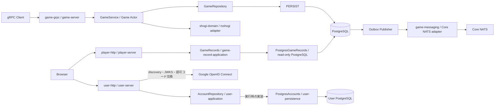
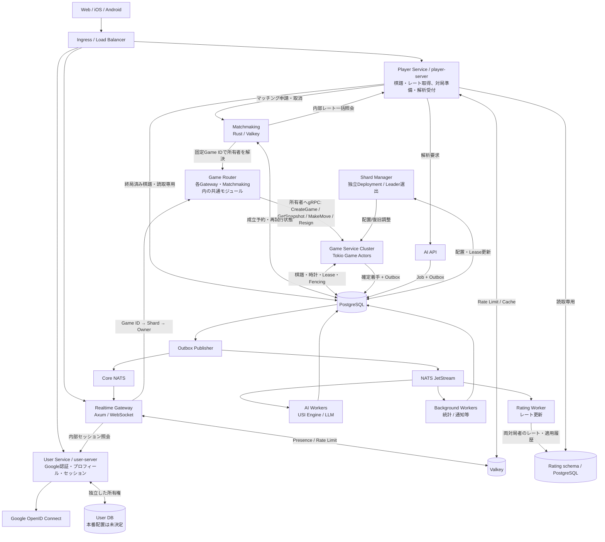
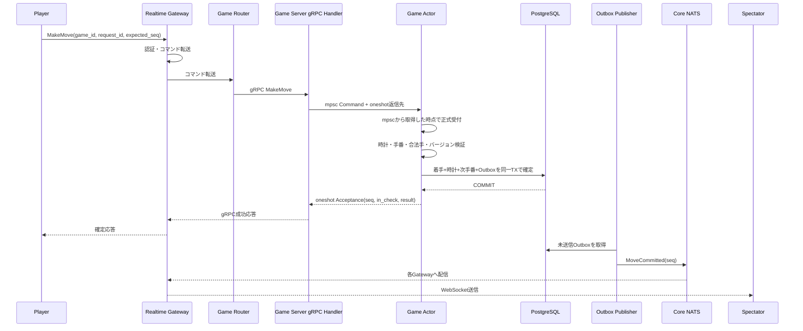
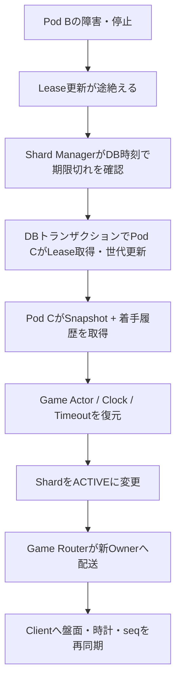
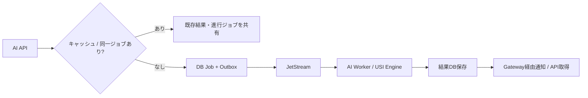
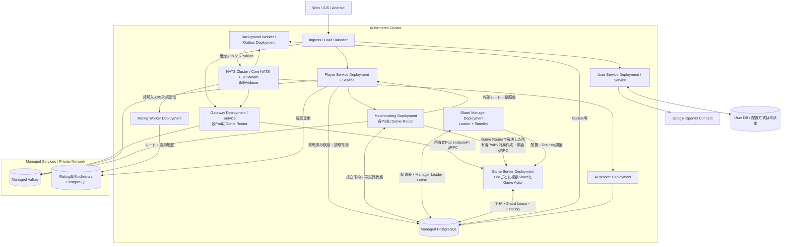

# 大規模将棋アプリ サーバーサイドアーキテクチャ設計書

- バージョン: 1.9（現行実装と将来設計）
- 更新日: 2026-11-03
- 対象: Web / iOS / Android
- 設計目標: 最大同時接続 100,000人

> **設計方針**: Rustを中心に、対局処理・リアルタイム配信・AI解析を分離する。KubernetesはPodの運用に集中させ、将来のVirtual Shardの配置・Lease・FencingはアプリケーションとDBで管理する。対局処理は特定のDB製品に依存させず、本番・開発・テストの永続化にはPostgreSQLを使う。
>
> 本文中の台数、Shard数、スループット、遅延などは**検証前の設計仮定**であり、保証性能ではない。

## 0. 現在の実装範囲

現在は、`user-server`がHTTPでGoogle認証・ユーザー管理を提供し、単一の`game-server`をTonic / gRPCで利用する。独立したOutbox PublisherからCore NATSへ確定イベントを配信する。`player-server`は新規対局の終局済み公開棋譜を匿名HTTPで検索・取得する。以下が実装済みの仕様であり、以降の大規模構成図・時計・観戦・Shard・AI・Kubernetes運用は将来設計として読む。

Google OpenID Connect の認可コードフロー、PKCE、独自 Cookie セッションの採用理由と現行の保証範囲は[ユーザー認証の設計](user-authentication.md)を参照する。

| 実装単位 | 現在の責務 |
|---|---|
| `shogi-domain` | 局面、合法手、王手、詰み、投了。内部のrsshogiは非公開アダプターで包み、公開型を外部ライブラリから独立させる |
| `user-id` | 内部ユーザーIDの検証済み値型。対局とユーザーサービスで共有する |
| `user-application` | プロフィール・表示名・検証済み外部識別子・ログイン試行・セッションの型と、`AccountRepository` の契約 |
| `user-persistence` | `AccountRepository` の実装。ユーザー専用PostgreSQL、スキーマ検証、試行消費・登録・セッションの保存 |
| `user-http` | Google OpenID Connect、HTTPルート、ログイン処理の組み立て、Cookie・Origin検証 |
| `user-server` | 設定読込、永続化とGoogleプロバイダーの組み立て、HTTP待ち受け |
| `game-application` | 対局操作、Actor、保存前のDomain Event生成・固定、Repositoryとイベント配信のTrait、逐次Outbox配信ユースケース |
| `game-persistence` | SeaORMによるGameRepository、対局用接続プール、PostgreSQL保存、Outboxの原子的追加・配信状態・Publisher排他、スキーマ更新・検証、専用読取接続による公開棋譜照会 |
| `game-record-application` | 終局済み公開棋譜の検索条件・公開型・読取Repositoryと照会ユースケース |
| `player-http` / `player-server` | 匿名HTTPの棋譜一覧・詳細、入力検証、読取専用アダプターの組み立て |
| `game-messaging` / `outbox-publisher` | Core NATSのSubject・JSON変換と送信、独立プロセスによる未配信イベントの処理 |
| `game-grpc` / `game-server` | gRPCで対局作成・Snapshot取得、着手・投了を公開し、永続化アダプターを組み立てる |



上図は実行時の呼出関係である。IDトークンの署名・claim検証は取得した鍵を使ってサービス内で行う。Rustの依存は `user-http → user-application` と `user-persistence → user-application` であり、`user-application` はHTTP・ORM・具体的な保存実装に依存しない。`user-server` が両アダプターを組み立てる。

### 0.1 対局・ユーザーの仕様

- 平手初期局面から開始し、通常の駒移動、成り、持ち駒、王手回避、詰み、投了を扱う。二歩・打ち歩詰め・王手放置などの不正着手はエラーとして拒否し、対局は継続する。
- 詰みは「王手され、合法手がない」場合のみ。王手でない合法手なし局面、千日手、連続王手の千日手、入玉宣言勝ち等の判定は対象外。タイマー・時間切れも未実装である。
- 対局作成時に、異なる2ユーザーIDを先手・後手へ固定する。ユーザーDBへの存在確認は行わない。着手側は`user_id`とこの紐付けから決める。投了は手番によらず可能である。
- Google認証とユーザー管理は独立したHTTPサービスで提供する。対局gRPCのユーザーIDは依然として呼出元の申告値であり、信頼できる内部ネットワークで利用する。HTTPログインは対局gRPCやWSを認証しない。マッチング、レート更新・取得、Shard管理、Lease、Game Router、Gateway、クライアントへの観戦配信は現在のスコープに含めない。

### 0.2 確定・再送・復旧

- 1対局につき`GameService`の共有レジストリ内に1つのActorを置き、容量64のbounded `mpsc`と要求ごとの`oneshot`で逐次処理する。`GameService`のcloneはレジストリを共有するが、別途生成したサービス間でActorの一意性を保証する仕組みやLease・Fencingはない。
- Snapshot取得時と変更前にはDBのversionを確認し、キャッシュが未復元・無効、またはversionが異なる場合に履歴を再読込する。キャッシュがあってもDB読込エラーは返す。
- `seq`は0から始まり、受理した着手・投了ごとに1増える。上限は`i64::MAX`である。変更には`expected_seq`と`request_id`が必要で、参加者以外の変更は拒否する。
- 受理済み要求だけが対局内の`request_id`を予約する。同じ種別・ユーザー・期待連番・着手内容での再送には元の結果を返し、内容が違えば拒否する。対局作成はこの再送契約の対象外である。
- 局面のコピーで変更を検証し、versionの条件付き更新、結果、受理記録、Domain Eventを同一トランザクションで保存してからActorへ反映する。保存エラー時は履歴を再読込して照合し、結果を確認できない場合は成功・ロールバックを断定しない。応答喪失時は同じ要求を再送する。
- 再起動後は平手初期局面から受理済み履歴を再実行し、連番・参加者・合法性・各応答・最終結果を検証して復元する。DBに局面Snapshotを保存する方式ではない。
- キュー投入後の呼出元のキャンセルや返信先の破棄では処理を取り消さない。メッセージ契約は[6.2節](#62-game-actorのメッセージ契約)を参照する。

### 0.3 DB・実行環境

Domain層とApplication層はSQL・ORMに依存しない。対局は`GameRepository`と`SeaOrmStore`、ユーザー管理は独立したRepositoryとPostgreSQL接続を使う。共有するのは`user-id`の値型のみであり、DB接続やユーザー外部キーを共有しない。プロフィール変更は対局履歴を変更しない。アカウント削除APIは未実装である。現行DBドライバーはPostgreSQLのみである。認証方式は[ユーザー認証の設計](user-authentication.md)、設定と起動は [user-server の README](../../apps/user-server/README.md) を参照する。

永続化アダプターの通常の検索・登録・更新・削除はSeaQueryで構築し、テーブルとインデックスの定義にもSeaQueryのビルダーを使う。入力値はSQL本文と分けて渡す。SeaORMの接続・トランザクションでは生成したStatementを直接実行し、棋譜読取とOutboxの専用SQLx接続では`sea-query-sqlx`でSQLとバインド値へ変換する。手書きSQLはPostgreSQLのadvisory lock、接続設定、システムカタログ検査、schema管理、`COLLATE "C"`などのDB固有処理に限定する。テストの故障注入と変更前スキーマの互換性確認用SQLは別に保持する。

ローカル実行とテストはPostgreSQLを基本とし、現在のコンテナ確認はDocker Composeで行う。Composeは既定で`game-server`、`outbox-publisher`、Core NATS、PostgreSQLを起動する。`auth` profileで`user-server`、`records` profileで`player-server`を追加する。対局とOutboxは`shogi` DB、ユーザー情報は独立した`users` DBに保存する。PostgreSQLの永続領域は`pg-data` Volumeである。テストは`TEST_DATABASE_URL`の管理接続からテストごとに独立したDBを作成する。本番のKubernetes運用は将来の対象である。実行・再起動確認・rustdocの手順は[README](../../README.md)を参照する。

### 0.4 ユーザー認証・プロフィールの現行仕様

- Google OpenID Connectの認可コードフローとPKCE S256を採用する。stateと試行用Cookieで開始元ブラウザーを照合し、nonceとIDトークンの署名・issuer・audience・期限等を検証する。
- 検証済みのGoogle識別子 `(issuer, subject)` を内部 `UserId` に対応付ける。初回ログイン時に登録し、同じ識別子の再ログインでは既存アカウントを使う。メールアドレスから自動連携しない。
- ログイン後は独自のCookieセッションを使い、DBにはトークンのハッシュと固定期限を保存する。Googleのトークンをアプリケーションのセッションに使わない。プロフィール取得、表示名変更、現在のセッションのログアウトを提供する。
- 本番Cookieは `Secure`、`HttpOnly`、`SameSite=Lax`、host-onlyとし、表示名変更とログアウトは公開originとの一致を検証する。Google側のログアウトと独自セッションの失効は連動しない。
- 起動時とコード交換時のdiscovery・JWKS取得はGoogleへの外部通信に依存する。既存セッションの照会はユーザーDBだけを使う。HTTPログインと対局gRPC・将来のWS認証の接続は未実装である。

処理のトランザクション境界・失敗時動作は[ユーザー認証の設計](user-authentication.md)、環境変数・起動・検証コマンドは [user-serverのREADME](../../apps/user-server/README.md) を正本とする。本書はサービス間の責務と実装状況を記述する。

## 1. 要件と負荷モデル

### 1.1 主要機能

以下は目標機能の全体像であり、実装済みの範囲は第0章に示す。

- 対人対局: マッチング、着手、合法手判定、持ち時間、秒読み、投了、勝敗、レーティング
- 観戦: 多数の同時観戦、着手イベント配信、途中参加、再接続、盤面再同期
- AI: 局面評価、候補手、対局後の棋譜解析、LLMによる自然言語解説
- 共通: 認証、ユーザー管理、棋譜履歴、通知、統計、監視

### 1.2 仮の容量モデル

| 項目 | 設計仮定 |
|---|---:|
| 最大同時接続 | 100,000 |
| 対局者 | 50,000 |
| 観戦者 | 50,000 |
| 同時対局 | 25,000 |
| 平均着手間隔 | 1対局あたり10秒 |
| 平均着手イベント | 2,500手/秒 |
| 瞬間ピーク例 | 10,000手/秒 |
| 人気対局の観戦者 | 最大20,000人/局（検証シナリオ） |

同じ10万接続でも「対局が多い」場合はGame ActorとDB書き込み、「人気対局に観戦集中」する場合はGatewayのfan-outが主要負荷になる。AIの解析同時数は別枠で容量管理する。

## 2. 技術スタック（現行と将来候補）

Core NATSへの確定イベント配信と、AxumによるGoogle認証・ユーザー管理は実装済みである。Valkey、NATS JetStream、AI、Kubernetes、観測基盤は将来構成である。対局の受理はPublisherやNATSの稼働を必要としない。

| 領域 | 採用技術 | 主な役割 |
|---|---|---|
| 言語 | **Rust** | サーバー実装 |
| Web API | **Axum** | 現在は独立したユーザーHTTPサービス。棋譜・レート取得や対局準備のPlayer Serviceは将来 |
| ユーザー認証 | **Google OpenID Connect / openidconnect** | 認可コードフロー・PKCE・IDトークン検証。アプリセッションは専用PostgreSQLで管理 |
| 非同期基盤 | **Tokio** | 現在はGame ActorとHTTP・外部通信。WebSocket・タイマーは将来 |
| RPC | **Tonic / gRPC** | 現在の対局操作。Gateway接続は将来 |
| 将棋ルール | **rsshogi** | 非公開アダプター経由で利用 |
| ORM | **SeaORM** | ユーザー・対局・受理済み履歴の保存 |
| SQL | **SeaQuery / SeaORM経由のSQLx** | スキーマ構築、トランザクション、versionの条件付き更新 |
| RDBMS | **PostgreSQL** | 現在の正本はPostgreSQL。時計・Shard Leaseは未実装 |
| 一時データ | **Valkey** | Presence、マッチング、キャッシュ、Token Bucketによるレート制限 |
| 低遅延イベント | **Core NATS** | 現在は確定イベントを発行。Gatewayへの配信は将来 |
| 永続イベント/ジョブ | **NATS JetStream** | レーティング更新、AI解析、統計、通知等の非同期ジョブ |
| 将棋AI | **やねうら王等のUSIエンジン** | 局面評価・候補手・棋譜解析 |
| 解説AI | **LLM（別Worker/外部推論）** | エンジン結果に根拠を置いた自然言語説明 |
| コンテナ | **Docker** | 環境の統一 |
| オーケストレーション | **Kubernetes** | Podの配置、再起動、水平スケーリング |
| 観測 | **OpenTelemetry、Prometheus、Grafana** | トレース、メトリクス、ダッシュボード |

**採用しないもの（初期）**: タイマー専用サービス、Shard管理専用Kubernetes Operator、Kubernetes LeaseによるShard所有権管理、独立Game Routerサービス、過剰なマイクロサービス分割。

## 3. 全体構成（将来設計）



上図は将来の論理構成であり、現行の独立したUser ServiceとユーザーDBの所有権を維持する。Player Serviceへ認証を再統合しない。Gatewayの認証境界は3.2節の将来方針に従い、現行のHTTPログインだけでWSを認証できるとはしない。AI完了イベントにもOutbox等を用い、通知が欠落しても結果をAPIで取得可能にする。

### 3.1 アプリケーション単位

- **User Service**: Google認証、登録、プロフィール、独自セッション。現行の `user-server` の責務を維持する
- **Player Service（`player-server`）**: 対局者・観戦者向けHTTPの照会と受付。棋譜検索・詳細、レート取得、対局設定、マッチング申請・取消、AI解析受付・結果取得を各領域の契約で提供する。取得専用サービスではなく、対局準備の要求も受け付ける。詳細は3.3節
- **Realtime Gateway**: WebSocketの接続認証、対局/観戦購読、着手の転送、再同期、送信キュー制限
- **Game Service**: 各Game Actor、時計、合法手、結果確定、Shard復旧
- **Shard Manager（独立アプリ）**: Game Podの登録・負荷収集、Shard配置・再配置計画、障害復旧の調整
- **Matchmaking Worker**: Valkey上の待機列から候補を選び、9.3節の永続予約と対局作成の照合により成立を確定する
- **Rating Worker**: 永続配信された終局結果から両対局者のレートを更新する。計算、適用履歴、重複排除、復旧はRating領域が所有する。取得はPlayer Serviceが担当する。詳細は9.4節
- **AI Worker**: USIエンジン実行・解析結果保存、必要に応じてLLM説明
- **Background Worker**: 通知、統計、監査、不正検知など

Game RouterはGatewayとMatchmaking Workerが共有するRustモジュールとして実装し、各プロセス内で動かす。上図のGame Routerは共通の配送ロジックを表し、独立したサービスやGateway経由の中継を意味しない。**Shard Managerは独立したDeployment**で動かし、PostgreSQLによるLeader選出で1インスタンスだけがShard配置の制御を実行する。対局作成RPCの中継は担わない。

### 3.2 Gatewayの認証境界（将来設計・未実装）

初期Web構成では、User ServiceとRealtime Gatewayを同じ公開origin配下に配置する。ブラウザーのWebSocket接続開始時に、Gatewayは許可したOriginと一致することを確認し、セッションCookieを使ってUser Serviceへ内部セッション照会を行う。セッションDBと検証処理の所有権はUser Serviceに残し、GatewayはユーザーDBへ直接アクセスしない。照会が失敗した場合は、認証済み接続として受け付けない。

User Serviceは有効なセッションに対応する内部UserIdと有効期限を返す。GatewayはこのUserIdを接続に対応付け、着手・投了を認証された内部RPC経路でGame Serviceへ渡す。クライアントが申告したUserIdや外部からの本人情報ヘッダーで上書きしない。Game Serviceは内部の送信元を認証し、操作ごとに対局参加者との対応を確認する。購読要求にも公開範囲・参加者等の権限を検証する。

接続開始時の認証だけで、接続中の権限を無期限に維持しない。Gatewayはセッションの有効期限を超えて認証済み接続を継続せず、定期的な内部照会でログアウト等による失効を反映する。再検証に失敗した接続も、認証済みとして継続しない。再検証間隔・照会タイムアウト・最大失効反映遅延を設定項目として定め、Gateway公開前にその上限と障害時動作を検証する。全着手でUser Serviceへ照会する方式は前提にしない。

この方針は初期Webクライアントを対象とする。iOS・Androidのログインと資格情報の受け渡しは別途設計し、WebのCookie方式で対応済みとはしない。内部セッション照会API、内部RPCの送信元認証、WS接続への認証情報の対応付けは未実装である。

### 3.3 Player Serviceと棋譜取得（棋譜HTTPは実装済み）

現行の`player-server`は終局済み公開棋譜だけを匿名HTTPで検索・取得する。レート・マッチング・対局準備・AI解析は未実装である。ユーザーサービスへの認証照会やユーザーDB接続は持たない。新規対局はGame側が`standard`と`public`を明示して作成する。参加者限定棋譜の公開や公開範囲変更APIを導入する場合は、Game側の変更契約と検証済み本人情報による認可を別途実装する。

`game-record-application`が検索条件、公開棋譜型、照会ユースケースと読取専用Repository契約を所有する。Game Actorの操作・復旧契約には依存しない。`game-persistence::PostgresGameRecords`がPrimaryの確定済みデータを読み、`player-http`がHTTPとの変換を担当する。`apps/player-server`が両者を組み立てる。検索DBやイベント投影は追加しない。進行中の同期・観戦はこのAPIの対象外である。

Player Serviceは専用のPostgreSQL接続プールを使い、全接続の`default_transaction_read_only`を有効にする。DBロールにもSELECTだけを許可し、テーブル書込み権限や所有権を与えない。Game Serviceの書込Repositoryや初期化処理は呼ばない。Game側が現行スキーマv5を初期化した後、読取側は対応版と必要なテーブル・列を検証する。Composeの`records`プロファイルは専用ロール`shogi_reader`で接続する。共有ファイルやDBボリュームのマウントは不要である。

`GET /game-records`は`games`のメタデータだけを選択する。参加者は黒白どちらかへの一致、ルールは`standard`、結果は勝者色と終局理由、期間は終局時刻の`[from,to)`、手数は投了を除く最終着手数の上下限で絞る。全条件を同時に指定でき、公開・終局の条件と検索条件をSQLのLIMIT前に適用する。`from`・`to`は非負のUTCマイクロ秒で必須、期間上限は366日、件数は既定30・最大100である。

一覧は`(finished_at DESC, id COLLATE BINARY DESC)`で整列し、末尾キーで次ページを取得する。カーソルは版・キー・正規化した検索条件のダイジェストを含み、条件が変わる継続要求を400にする。件数だけは変更できる。カーソルは署名のない未信頼入力であり、認証情報や改ざん防止機構ではない。ページごとに公開条件を再評価し、複数リクエストにまたがる固定Snapshotは保証しない。総件数は返さない。

`GET /game-records/{id}`は参加者、ルール、勝敗・終局理由、終局時刻、終局seq、最終着手数と順序付き公開履歴を一つのDB読取Snapshotから返す。履歴の連番、USI構文、参加者と色、着手の手番、投了と詰みの終端条件、最終手数を検証し、不整合なら部分成功を返さない。合法手の全再実行は行わない。seqは投了を含む受理済み操作数であり、着手数と区別する。Actor復旧用`GameRepository::load_game`や受理記録はHTTPへ流用せず、request_id・expected_seq・再送結果・Outboxを公開しない。

履歴上限は4096操作、JSON応答上限は1MiB、HTTP同時処理数は16、PostgreSQL接続数は4である。接続取得とSQL実行にそれぞれ2秒の上限を設け、PostgreSQLの`statement_timeout`で長いクエリを中断する。入力不正は400、存在しない・進行中・非公開の対局は同じ404、履歴上限超過は422、保存不整合は500、DB利用不可・期限超過・同時処理上限は503を返す。処理した応答は`Cache-Control: no-store`とする。

スキーマv5では`rule`・`visibility`・`final_move_ply`を必須とし、終局済み対局には`finished_at`と勝敗・終局理由を必須にする。新規対局の着手数はMoveだけ増加し、終局時刻はwriterのUTC時計によるcommit準備時刻としてjournal・version・Outboxと同じトランザクションに保存する。受理済み操作の再送では値を変更しない。

設定・JSON形式・実行例は[player-serverのREADME](../../apps/player-server/README.md)を参照する。

## 4. Pod・Virtual Shard・Game Actorの関係

本章と第5章は将来の分散配置設計である。現行のActorレジストリは0.2節の範囲に限られる。

```text
Kubernetes Cluster
  ├─ Game Server Pod A（Rustプロセス）
  │    ├─ Virtual Shard 0
  │    │    ├─ Game Actor #100（1局）
  │    │    └─ Game Actor #101（1局）
  │    └─ Virtual Shard 12
  │         └─ Game Actor #500
  └─ Game Server Pod B（Rustプロセス）
       ├─ Virtual Shard 1
       └─ Virtual Shard 357
            ├─ Game Actor #123
            └─ Game Actor #456
```

- **Pod**: Game Serverプロセスの実行環境。Kubernetesが起動・再作成する。
- **Virtual Shard**: 対局群を束ねて配置を切り替える論理単位。原則プロセスやスレッドではない。
- **Game Actor**: 1局を担当し、手番・局面・時計・勝敗を逐次処理する実行単位。Tokio Task + Channel等で実装できる。

例として、Shard数を**1,024に固定**する。

```text
shard_id = stable_hash(game_id) % 1024
```

Shardごとの担当Podは固定式ではなく、Shard Managerが決めてPostgreSQLに保持する。Pod数が変わってもGame ID → Shard IDは変えない。

## 5. Shard Manager / Game Router / Lease

### 5.1 責務

| コンポーネント | 役割 |
|---|---|
| Shard Manager | 稼働Podと負荷を見てShard→Podの配置を決め、移動・障害復旧を調整 |
| Game Router | Gateway・Matchmaking内でGame IDからShard IDを計算し、配置表から担当Podを見つけて対局作成・照会・操作をgRPCで配送 |
| Lease | PodにShardの管理権限を期限付きで与える |
| Fencing Token | 旧所有者が復帰しても、古い世代での書き込みを拒否する |

### 5.2 配置アルゴリズム（初期案）

1. Game IDを安定ハッシュで1,024 Virtual Shardへ割り当てる。
2. 新規Shardは、健全かつ余裕のあるGame Podへ割り当てる（初期は担当Shard数や稼働対局数で判断）。
3. 現在の割り当てを原則維持し、Pod追加時も移動するShardを最小限にする。
4. Pod停止時はLeaseの期限切れを確認し、別Podに再割り当てする。
5. 後にCPU、Actorキュー長、処理時間などを加味し、ヒステリシスとクールダウンを設ける。

対局作成・照会・着手の各要求をShard Manager経由で中継しない。Game RouterがPostgreSQLの配置表を参照・キャッシュし、所有者変更やエラー時に更新する。新規対局も作成前に固定したGame IDからShardを計算できるため、作成済みの対局レコードを配送先の解決条件にしない。

### 5.3 PostgreSQLのLease概念

```text
shard_id       = 357
owner_id       = game-pod-b / instance-uuid
lease_expires  = DB時刻による期限
generation     = 42
state          = ACTIVE / RECOVERING / DRAINING
```

Leaseを獲得し直すと世代番号を増やす。書き込み時には、**同一トランザクション**で所有者・世代番号・期限を検証し、Leaseの変更と競合しないよう適切に行ロック等を用いる。`game_moves(game_id, seq)` の一意制約と`request_id`による冪等性も併用する。

Shard Managerは**独立Deployment（通常2 Podを初期候補）**として実行し、PostgreSQLのManager専用Leader Leaseと世代番号・条件付き更新によって、同時に配置変更を行えるLeaderを1つに制限する。Manager Leader Leaseと各Shardの所有権Leaseは別物である。Game Serverは自分が所有するShardのLease更新・Fencing検証を担当し、Manager停止中も既存の対局は継続できるようにする。

## 6. 着手の確定と観戦イベント配信

以下の図と6.1節のGateway、時計、分散構成は将来設計である。現在はgRPCの要求・応答と、PostgreSQLのTransactional OutboxからCore NATSへの配信を提供する。現行のメッセージ契約は6.2節、Publisherの契約は6.3節に示す。



- Game Actorだけが対局の状態を変更できる。
- Gatewayは通信を管理し、盤面の正本を持たない。
- Core NATSは低遅延だが永続配信ではない。**連番の欠落はSnapshotと確定着手履歴で再同期**する。
- Gatewayは、ローカル観戦者がいる対局だけNATSを購読し、受信したイベントを同Pod内の観戦者へfan-outする。
- 遅いクライアントには送信キュー上限を設け、局面更新は最新Snapshotによる再同期で復帰させる。

### 6.1 観戦途中参加 / 再接続

1. Gatewayがイベント購読を開始し、到着イベントを容量上限付きのバッファにためる。
2. NATSサーバーが購読登録を処理したことを確認する。確認が失敗した場合はSnapshotとの合流へ進まず、購読をやり直す。
3. Game Serviceから現在局面のSnapshotと`seq`を取得する。
4. Snapshotの`seq`以下の盤面更新は再適用せず、それより新しい更新を連番順に適用する。
5. 欠落やバッファ超過があれば再度Snapshotを取得する。

購読登録の完了確認をSnapshot取得より先に行い、購読準備中の更新をSnapshotと通知の両方で取り逃す競合を防ぐ。現行の購読検証例でも、購読後に[`server_barrier`](../../crates/game-grpc/examples/outbox_proof.rs)を呼び出して準備完了を確認している。この手順だけでCore NATSの配信欠落すべてを検知・回復できるとはしない。

`seq`は確定した操作の連番であり、イベントごとに異なる番号ではない。詰みの着手は、同じ`seq`の`MoveCommitted`と`GameFinished`を生成する。購読開始後の重複排除には`(game_id, seq, event_kind)`を使い、同じ`seq`を受信したことだけを理由に別種のイベントを破棄しない。盤面は同じ操作で二度更新しない。`MoveCommitted`に含まれる終局結果も盤面状態へ反映する。Snapshotに取り込まれた過去の通知を全件再現する保証は持たず、イベントを全件処理する必要のある用途は別の永続配信経路を使う。

終局など最後のイベントだけを失うと、後続の連番が来ないため番号の飛びから欠落を検知できない。このため、接続を維持している場合も次の二段階で状態を照合する。

- Gatewayは購読中の対局ごとにGame Serviceの最新の確定`seq`を定期照会し、ローカルで連続して反映できた`seq`と比較する。遅れがあればSnapshotを取り直す。照会はGateway内の同一対局の観戦者で共有し、観戦者ごとにGame Serviceへ問い合わせない。
- 各観戦画面は最後に反映した`seq`を接続ごとに定期報告する。Gatewayは画面ごとの反映番号を比較し、遅れている画面をSnapshotで再同期させる。送信済みであることだけを画面への反映完了とはみなさない。

正しさの基準はGame Serviceの確定状態であり、Gatewayとの一致だけで最新状態を保証しない。Game Serviceへの照会に失敗した場合は、画面にも最新状態を確認できていないことを伝える。照会・報告の間隔、応答待ちの上限、再同期を開始する条件は許容する表示遅延と負荷試験に基づいて決める。通常の配信中にも一時的な遅れは生じるため、番号差の一度の観測だけで通知喪失とは断定しない。

NATSへ再接続した場合は、切断中の欠落を前提に購読を再登録し、準備完了を確認してから購読中の対局を再同期する。WebSocketの再接続時も6.1節の手順を実行する。定期照合は末尾欠落からの復帰を担い、イベント全件の受信保証には使わない。


### 6.2 Game Actorのメッセージ契約

以下は現行実装の契約である。時計・Gatewayへの配信・Shard Fencingは将来設計として区別する。

- `GameService`は、Snapshot取得を`Command::Snapshot`、着手・投了を`Command::Mutate`へ変換し、bounded `mpsc`で対象Actorへ送る。
- Actorは要求を逐次処理し、要求ごとの`oneshot`へ`Snapshot`または`Acceptance`、失敗時は`ApplicationError`を返す。着手・投了に共通の`Acceptance`は、受理時の連番・王手状態・対局結果を持つ。
- `mpsc`への投入成功は処理成功を意味しない。投入後に呼出元がキャンセルされても処理は続き、送信側がすべて閉じた後も投入済み要求を処理して終了する。
- 変更要求は参加者、`expected_seq`、`request_id`、対局ルールを検証する。受理済み要求の同一内容での再送には元の応答を返し、同じ`request_id`で内容が異なる要求は拒否する。
- 成功応答は永続化の確定を根拠とする。応答喪失や保存結果が不明な場合は、元の`expected_seq`を含む同一内容・同一`request_id`で再送する。確定・復旧の方針は0.2節に示す。
- Actorが`StagedGameChange::new(game_id, receipt)`を呼び、保存前に受理記録からDomain Eventを生成・固定する。着手は`MoveCommitted`、投了は`GameFinished`、詰みの着手はその順で両方を生成する。対局作成・拒否・受理済み要求の再送・履歴復元では新しいイベントを生成しない。
- `GameRepository::commit_change(&change)`は渡された受理記録・生成済みイベントとメタデータを同じDBトランザクションで保存し、イベントを生成しない。ActorからNATSへ直接送信しない。応答とイベントの到着順・到着可否は独立とする。`CheckTimeout`と`Ready`は未実装である。

実装の定義は[Actor](../../crates/game-application/src/actor.rs)、[要求・応答型](../../crates/game-application/src/types.rs)、[gRPC定義](../../proto/game.proto)を参照する。

### 6.3 現行Outbox Publisherの契約

生成・保存・配信の責務とPostgreSQLの運用制約は[Domain EventとTransactional Outboxの設計](domain-events.md)を参照する。

- `game-application`が保存前のイベント生成・内容の固定、型付きイベント、配信ユースケース・Traitを所有する。`game-persistence`が渡された受理記録・イベントの原子的保存、未配信行の取得、配信済み記録を担う。`game-messaging`がCore NATSのSubject・JSON変換と送信を担い、`outbox-publisher`が独立プロセスとして組み立てる。
- イベント識別子は`(game_id, seq, event_kind)`である。詰みの着手では同じ`seq`の2イベントを種別で区別する。ペイロードには元の`request_id`と`user_id`も保持する。
- Publisherは未配信行を挿入順に1件ずつ処理する。イベントのSubjectを購読してから送信し、同じ接続で同一ペイロードのechoを確認して、その行だけを配信済みとする。このためイベントSubjectへのPublishとSubscribeの権限が必要である。ソケットのflushだけをサーバー処理の確認に使わない。接続を自動で張り直さず、失敗時はプロセスを終了し、Composeの再起動で未配信行から再開する。送信成功後の記録失敗などでは同じ識別子を再送し得る。
- PostgreSQLでは単一Publisherを使う。`PostgresOutbox`が専用接続でセッションadvisory lockを保持し、同じ対局DBへの二重起動を拒否する。キューの読取と配信済み記録にもこの接続を使い、接続喪失時は配信を継続しない。配信待ちの間にDBトランザクションを保持せず、ShardやLeaseを導入しない。終了時は通信処理を停止してから接続を閉じる。
- Subjectは`shogi.games.<game_idのUTF-8バイト列の小文字hex>.events`である。JSONの`schema_version`は1、`type`は`move_committed`または`game_finished`で、`game_id`は元の値を保持する。
- Publisher自身のecho受信は、他の購読者の受信・永続化の確認ではない。購読者不在や切断中の配信は失われる。購読者は完全なイベント識別子で重複を排除し、欠落時はSnapshotで再同期する。接続障害をまたぐ遅延重複や到着順の逆転も許容する。
- 配信済み行は削除しない。先頭行が失敗すると後続行も待機する。複数ホスト間のPublisher排他、Outboxの掃除、Gatewayによる再同期は今後の対象である。

## 7. 対局時計（Game Clock）— 将来実装時の採用方針（未実装）

### 7.1 責務・正式受付地点

**時計・期限判定・着手受付・終局確定の権威をGame Actorに集約する。Admission Gateは設けない。**

- Realtime Gateway: 認証、WebSocket受信、Game Routerによる転送。Gatewayで観測した受信時刻は監視・性能計測には使えるが、勝敗判定の根拠にはしない。
- Game Server gRPC Handler: Requestを対象Actorの**容量上限付きTokio `mpsc`**へ投入。Handlerは時計の期限判定をしない。
- Game Actor: `mpsc::Receiver::recv()`で対象手番のCommandを**取り出した時点**を、正式な着手受付時刻とする。Actorが現在の時計と照合して時間内・時間切れを判定する。
- PostgreSQL: 確定した棋譜、時計、勝敗、Outboxの正本。DB Commit成功後にのみ成功Replyを返す。

この方式では**Gateway→Game Serverの通信時間、mpsc内の待ち時間、Actorが前のCommandを処理する時間は、着手側の消費時間に含まれる**。簡潔なMVP仕様として受け入れ、キュー遅延を測定する。`mpsc`の投入成功は正式受付・着手成功を意味しない。

### 7.2 Clockの計算と時刻の保持

**1秒ごとにDB上の残り時間を更新しない。** Actorは手番開始時刻・残り時間・秒読み等の`TimeControl`から現在の期限を算出する。

- 稼働中のActorは単調時計（`tokio::time::Instant`）で経過時間・期限を判定する。
- 着手受付時にActor内で単調時刻を採取する。クライアント・Gatewayから送られた時刻では判定しない。
- 次手番がある着手では、Actorが合法性検証後に保存用の変更を固定する時点で、次手番開始の単調時刻と対応するUTC時刻を採取する。着手・残り時間・次手番・開始時刻・Outboxを同じDBトランザクションで保存し、確定を確認してからActorの状態へ反映する。開始時刻はDB Commit完了時刻や相手への通知時刻ではない。保存が成功した場合、その後のDB Commit・配信待ち時間も次の対局者の消費時間に含まれるため、これらの遅延を監視する。
- 復旧のため`turn_started_at_utc`、両者の残り持ち時間、秒読みルール、`clock_version`、対局状態をDBに保存する。`Instant`自体はPod間で持ち運ばない。
- 初期は障害中も時計が進むポリシー。復旧後の時刻算出にはUTC時刻と運用上の時計同期が必要。厳密な障害補償は将来検討。

### 7.3 mpscとタイマーの競合・確定順序

Actorは1対局につき1つのTokio Taskで、Commandを逐次実行する。`tokio::select!`でコマンド受信と`sleep_until`を待ってよいが、**selectの分岐選択そのものを時間内判定の根拠にはしない**。ActorがCommandを実際に取り出したときの時刻と、現在の手番の期限を照合する。

1. Actorが着手・投了要求を取り出したら直ちに受付時刻を採取する。認証されたユーザーと対局参加者の対応を確認し、対局内の`request_id`を受理済み記録と照合する。同じ種別・ユーザー・`expected_seq`・着手内容で確定済みなら、現在の手番・期限・終局状態で再判定せず元の応答を返す。同じ`request_id`で内容が異なる要求は拒否する。
   未受理の新しい`MakeMove`だけを、採取した受付時刻と現在の手番の期限で判定する。期限未満なら手番・合法性等を検証する。期限以上なら時間切れ扱いにする（境界は**`now >= deadline`で期限切れ**）。
2. タイマー発火時はActorが時計状態を再計算する。まだ期限前なら再度スケジュールする。期限到達済みなら、Actorが時間切れ結果をDBへ確定する。
3. 未受理の新しい着手は、**期限前にGame Serverに到着済みでも、mpscからの取り出しが期限後なら無効**という仕様である。確定済み要求の再送には手順1の照合を適用する。別の`Admission Gate`やPendingカウンタ、Gate閉鎖要求は用いない。
4. 着手・投了・時間切れはすべてActorの逐次処理とDBのトランザクションで確定する。DB書込みにはShardのFencing世代検証も含め、二重確定を防ぐ。
5. 着手側に送る`MoveAccepted`/投了成功ReplyはDB Commit後に返す。一方`MoveCommitted`/`GameFinished`は同じCommitで保存したOutboxから非同期配信する。クライアントではReplyを操作結果の管理、Eventを盤面・時計・終局反映に使う。

タイマーが先に選択された結果、既にmpsc内にあるCommandをActorが取り出さずに時間切れ確定する状況も、**Actor取出し時点を正式受付とする仕様では許容**する。負荷による不利益を評価するため、キュー待機時間・タイマー遅延・ActorのDB処理時間を必ず観測する。

### 7.4 Pod障害時・Reply欠落時

- Admission Gateおよび永続Inboxは**採用しない**。DB未Commitの着手は障害時に失われ得る。
- 保存用の着手と次手番の時計は、確定前には仮の状態として扱う。DBのロールバックを確認できた場合は仮の変更を破棄し、元の手番を維持する。障害中も時計が進む方針に従い、保存待ち・再試行待ちの間も元の対局者の時計は進む。再試行の受付が期限後なら時間切れになり得る。
- DB保存中の通信切断・タイムアウトだけではロールバックを断定しない。結果不明の場合はDBの受理記録と確定状態を再確認し、確定済みなら保存した次手番開始時刻を使って復旧する。未確定と確認できるまでは、仮の変更を確定状態として公開せず、元の手番で処理を再開することもしない。
- クライアントがReplyを受け取れなければ、成功・失敗を断定せず**結果不明（Unknown）**にする。再接続後にSnapshot・`request_id`の確定記録を確認する。
- DB確定済みなら、7.3節の参加者・要求内容の照合後に元の応答を返す。再送が期限後に到着しても、確定済みの操作を時間切れで拒否しない。未確定なら**同じ`request_id`**で再試行できるが、再試行時には新たなActor正式受付時刻で判定する。元の期限内到着時刻は保証されない。
- `request_id`の確定記録はPostgreSQLで一意制約を設ける。冪等照会・結果照会とDB原子的更新を用意する。`not_found`だけで未処理の要求が今後Commitしないとは断定しない。
- Pod再起動時はPostgreSQLの確定時計状態から新しい単調時計Deadlineを再構築する。Shard所有権はLease + Fencingを検証する。

### 7.5 将来の強化候補（未採用）

競技性・負荷試験の要件が高まれば、GatewayまたはGame Serverでの受信時刻を正式受付とする方式を再検討する。ただしその場合は**未処理の期限内要求の追跡、期限確定との原子的競合制御、時計同期、Pod障害時の保証**が必要となる。現時点で`received_at`をGatewayから受け取って勝敗判定に使う設計や固定猶予だけの方式は採用しない。

## 8. Pod停止・再起動時の復旧（将来の分散構成）

本章はShard・Lease・時計・永続Snapshotを導入した後の設計である。現行の復旧は0.2節のとおり、平手初期局面から受理済み履歴を再実行する。



- Podの再起動・再作成はKubernetes、Shardの再配置はShard Manager。
- Pod再起動後も旧プロセスと同一とはみなさない。**プロセス起動単位の一意なinstance ID**を使用する。
- 旧世代からのDB更新はFencing Tokenで拒否する。
- 移動中は着手を即時確定しない。安全に再試行させるか、短時間保留する。
- 応答を失った着手がすでに確定している可能性があるため、`request_id`と`seq`で重複実行を防ぐ。
- Pod全体のReadinessとShardごとの`ACTIVE / RECOVERING / DRAINING`は分けて扱う。
- 計画停止ではDrain処理とLease引き継ぎを試みる。突然の障害ではLease失効後に復旧する。

## 9. Valkey / Core NATS / JetStream / PostgreSQLの使い分け

本章は将来構成での役割分担を示す。現在の正本はPostgreSQLであり、現行スキーマは11.1節に示す。

| 技術 | 役割 | 主な利用例 |
|---|---|---|
| PostgreSQL | 正本・整合性 | 着手、時計、対局結果、レート・適用履歴、Shard Lease、Fencing、Outbox |
| Valkey | 高速一時状態 | Presence、Matchmaking、Cache、Rate Limit |
| Core NATS | 揮発性の即時配信 | MoveCommitted、観戦イベント |
| JetStream | Ack・再配信つきの非同期処理 | レーティング更新、AI解析、集計、通知、ジョブ |

Core NATSの配信漏れには連番+Snapshotで対応する。最後のイベントの欠落にも対応するため、6.1節の定期照合と再接続時の再同期を行う。JetStreamの再配信は重複実行を起こし得るためWorkerを冪等にする。PostgreSQLとメッセージブローカーの二重書き込みにはTransactional Outboxを用いる。

### 9.1 Presence（オンライン状態の共有）

- Realtime Gatewayは各WebSocket接続をローカルで管理し、Valkeyに**接続単位**のPresenceを登録する。
- 1ユーザーがWeb・スマホなど複数接続を持つことを許容し、有効な接続が1つ以上あればオンラインと判定する。
- 各接続のPresenceにはTTLを付与し、GatewayのHeartbeat等に応じて更新する。突然の切断ではTTL失効により古い接続情報を回収する。
- 接続一覧用インデックスを持つ場合は、TTLの切れた接続が参照上残らないよう、参照時の検証・定期クリーンアップ等を行う。
- **Presenceは表示・通知のための一時情報**であり、対局の進行状態や勝敗の正本ではない。対局状態はGame ServiceとPostgreSQLが担う。

### 9.2 Rate Limit（リクエスト頻度制限）

**基本アルゴリズムはValkey上のToken Bucketとする。** Fixed Window方式の単純なValkeyカウンターは、ログイン失敗回数など「指定期間内の試行回数」を管理する場面で併用する。

| 対象 | 推奨制限方式 | 補足 |
|---|---|---|
| マッチング申請 | Valkey Token Bucket | 連打を抑制しつつ適度なバーストを許容 |
| フレンド申請・チャット | Valkey Token Bucket | スパム・連投を抑制 |
| WebSocket接続確立 | Valkey Token Bucket | 再接続時の一時的バーストを考慮 |
| AI解析要求 | Valkey Token Bucket + 同時実行数上限 + 利用予算 | リクエスト回数だけでなく計算コストも制御 |
| ログイン失敗回数 | Valkeyカウンター（Fixed Window等） | 認証基盤側の防御と併用 |
| 対局中の着手 | Game Actorの手番・合法手・連番検証を基本 | 不正な連投に対する軽量なGateway制限は別途検討 |

**Token Bucketの管理方法**

- キー例：`ratelimit:user:{user_id}:matching`。未認証エンドポイントはIP等も併用し、NATや共有回線への影響を考慮する。
- Valkey Hash等に`tokens`（残トークン）と`last_refill_ms`（最終補充時刻）を保存する。
- リクエスト時、経過時間に応じてトークンを最大容量まで補充し、残量が足りれば消費して許可する。
- **補充・判定・消費・TTL更新をLuaスクリプトなどで原子的に実行**し、複数Pod間の競合を防ぐ。
- 時刻基準にはValkey側の時刻を使い、異なるAPI/Gateway Pod間の時計ずれを避ける。
- Valkeyのキーは不要になったとき自動削除できるようTTLを付ける。容量（capacity）と補充速度（refill rate）は操作別のポリシーで設定する。

**実装上の配置**：Player ServiceとRealtime Gatewayで共有できる`RateLimiter`をRustの共通Crateとして実装し、HTTPではAxum Middleware等から呼び出す。WebSocketメッセージごとに常にValkeyへアクセスする設計にはせず、接続ごとの軽量制限はGatewayのメモリで実施する。Ingress側にも粗い流量制限を設け、多層防御とする。

**Valkey障害時**には、操作の重要度に応じてfail-open / fail-closedを明示的に決める（例：AI解析ジョブは保守的に受付制限）。また、Token Bucketはリクエスト頻度の制限であり、AI Workerの同時実行数制御や費用クォータの代替にはならない。


### 9.3 マッチング成立と対局作成（将来設計・未実装）

Valkeyは待機列と候補選択に使い、成立の正本はDBの永続予約とする。予約には`match_id`、固定した`game_id`、参加者、対局ルール、状態を保存する。同一ユーザーが複数の有効な予約へ参加しないようDBの一意制約で保護し、Valkey上の原子的処理だけに重複防止を依存させない。

分散構成では、Matchmaking Worker内のGame Routerが固定した`game_id`からShardを計算し、配置表で解決した所有者Podへ`CreateGame`を直接gRPC送信する。Shard ManagerはShardの配置を管理し、作成要求を中継しない。所有者が未配置・復旧中の場合は再試行可能な状態として待ち、任意のPodへ作成する代替経路は設けない。

Game Serviceは対局作成時も、対象Shardの所有者・Lease期限・Fencing世代を対局保存と同じトランザクションで検証し、所有権を持たないPodでは作成しない。配送先が古い場合はRouterが配置表を再解決する。再照会・作成再試行も同じ`game_id`を使い、その時点の所有者へ配送する。これらは将来の分散構成の契約であり、現行の単一Game ServiceにはRouterやShard所有権検証はない。

予約は次の状態で扱い、遷移はDBの現在状態を条件に更新する。

| 状態 | 意味・遷移条件 |
|---|---|
| `RESERVED` | 参加者を予約済み。作成開始時に`CREATING`へ移す。作成開始前のキャンセル・期限切れは`CANCELLED`へ移して予約を解放する |
| `CREATING` | 固定した`game_id`で対局作成中。結果不明もこの状態に残し、照会・再試行で解決する |
| `MATCHED` | 予約内容と一致する対局の作成を確認済み。同じ成立結果を返す |
| `CANCELLED` | 対局作成を開始せず予約を取消済み。この予約からの作成を許可しない |

Game Serviceには、同じ`match_id`・`game_id`・参加者・ルールで対局作成を再試行すると既存の同じ結果を返し、内容が異なれば拒否する契約を追加する。現行の`CreateGame`はこの契約を実装していない。応答を失っても新しいIDで別の対局を作らず、保存済みIDで再照会・再試行する。

作成開始とキャンセルが競合した場合は、`RESERVED`からの条件付き遷移で先に確定した操作を有効にする。`CREATING`へ進んだ予約は、期限切れや照会時の`not_found`だけを根拠に取り消して参加者を再割当てしない。作成が進行中の可能性を解消してから結果を確定し、成立済みならキャンセル済みとは返さない。

永続予約と対局作成を同じDBトランザクションで確定できる配置を優先する。異なる処理境界になる場合は、Workerが保存済みの予約状態と対局を照合して処理を再開する。Worker再起動やValkey状態喪失の後も、未解決の永続予約を回収して同じ対局へ収束させる。DBへ成立状態を保存できない場合は、Valkeyの処理成功だけで成立を返さない。

レーティング対局の候補選択には、9.4節の内部一括取得APIから得たpool別の値・評価状態・versionを使い、予約に取得値と取得時刻を記録する。レーティング対象の可否、pool、判定ポリシー版も予約と対局作成の一致条件に含める。クライアントの申告値を採用せず、取得失敗は未評価者や初期値として扱わず待機・再試行する。

### 9.4 レーティングの更新と取得（将来設計・未実装）

レート更新と取得は、同じRating領域の契約を使う別の実行単位に分ける。既存の将来Player Serviceに取得を置き、更新は独立したRating Workerで処理する。取得専用サービスを追加する案は、独立した負荷・運用上の要件が生じた時点で検討する。

| 実行単位 | 責務・境界 |
|---|---|
| Rating Worker（`rating-worker`） | 確定済み終局結果の検証、レート計算、両対局者の原子的更新、適用履歴と再送・復旧。Ratingデータの唯一の書込み担当 |
| Player Service（`player-server`） | 公開HTTPでのユーザー別取得と、Matchmaking向け内部一括取得。Ratingの照会契約と読取専用DB権限を使う |
| Game Service | 参加者・ルール・対象判定・終局結果の正本。終局と更新入力を同じトランザクションで確定し、レート計算は行わない |
| User Service | 認証・プロフィール・セッションを維持する。Ratingは内部UserIdで参照し、ユーザーDBのテーブル・接続・スキーマ管理を共有しない |

#### 更新入力と永続配信

poolはルール・持ち時間等で分けるレーティング区分を表す。信頼されたMatchmakingの予約に基づき、対局作成時に両参加者、pool、対象判定とそのポリシー版を固定する。Game Serviceは終局時に、これらと勝敗・終局理由、終局seq・確定時刻、イベントID・通信形式版をOutboxへ固定する。計算には適用直前の両者のレートを使い、マッチング時の表示値で上書きしない。

現行の`CreateGame`と`GameFinished`には、この設定や両参加者を含む更新入力が揃っていない。導入時に作成契約・保存形式・通信形式を拡張する。現行イベントの`user_id`は操作した参加者であり、両対局者を示さない。入力の不足する旧イベントを推測で適用せず、初期導入は新契約で作成した対象対局から開始する。既存履歴の遡及計算は別途移行を設計する。

終局入力はGame側OutboxからJetStreamの永続ストリームへ直接発行する。Core NATSの購読から転送する経路に依存しない。Publisherはストリームへの永続化確認Ackを受けてから配信済みを記録し、Ack不明時は同じID・内容で再送する。観戦用Core NATSとJetStreamでは配信状態・取得・再試行を分け、一方の完了や停止が他方の未配信結果を消したり配信を止めたりしないようにする。これは6.3節の現行Core NATS Publisherとは別に必要な拡張である。

#### 適用の一意性・順序・復旧

Rating Workerはdurable consumerで受信し、Rating専用schema内の一つのDBトランザクションで、poolの状態行をロックし、適用済み確認、両参加者の初期行作成・現在値更新、入力と更新前後の値・計算版・適用番号の記録を行う。`(世代, game_id)`を一意にし、イベントIDや申告poolが変わっても同じ対局を再加算しない。同一対局の異なる入力や未知の形式は適用せず、永続的に隔離・警報して調査する。対象外という判定も記録する。

ConsumerへのAckはDB Commit後に返す。Commit前の停止は再実行し、Commit後からAckまでの停止は適用履歴で重複排除する。結果不明のCommitは同じキーで照合する。両者を別トランザクションで更新せず、ブローカーの重複排除期間だけに依存しない。

初期は逐次処理とし、DBのpool単位の排他でも重複稼働・同一ユーザーの複数対局による更新消失を防ぐ。適用順はpoolごとのDB確定順とし、同じトランザクションで単調増加する適用番号を採番する。終局時刻順や複数Game Actorを横断したseq順は保証せず、遅着した結果は後から適用する。再構築には保存した順序・入力・計算版を使う。同じpoolの水平並列化や時刻順への変更は、計算結果と競合制御を検証してから導入する。

ストリームの保持期限・障害による欠落に備え、配信済みフラグにかかわらずGame側の確定入力全件とRatingの適用履歴を定期照合し、未適用の対局を同じIDで再投入する。確定入力と計算版は再構築可能な期間だけ保存・アーカイブし、削除前に適用完了と復旧対象期間を照合する。ストリームの保持容量、DBのバックアップ・復元、停止中に蓄積した結果の回収を運用要件とする。結果訂正や計算方式変更による再計算は通常の再送と分離する。別世代への再構築・検証・切替には、並行して到着する新結果を取りこぼさない境界と追従手順が必要であり、導入前に具体化する。

#### 取得とMatchmakingの整合性

公開取得はUserIdとpoolを指定し、値、未評価・暫定等の評価状態、適用対局数、レートのversion・計算版・最終適用番号・更新時刻を返す。認可はAPI境界で行い、本人のセッションはUser Serviceの内部照会で検証する。レート未作成と存在しないユーザーを区別するため、将来の内部ユーザー照会契約も用意する。存在する未評価者にはpool設定の初期状態を返し、初回対象対局の適用時に必要な行を原子的に作成する。認証・プロフィール登録のトランザクションにレート作成を加えない。

終局確定と更新は非同期であり、終局の成功応答はレート更新完了を意味しない。取得は適用済みの値とその版を返し、更新待ち中は以前の値を返し得る。初期はRating schemaのPrimaryを読み、内部一括取得は一つのDB読取Snapshotで行う。Matchmakingは予約時の確定済み値による候補選択を許容し、その後の更新で予約を取り消さない。前局反映前の再マッチを禁止する保証は持たない。キャッシュや読取レプリカを導入する際は許容する反映遅延を定め、障害や遅延を未評価・初期値で隠さない。

更新APIは信頼された終局入力の処理に限定し、クライアントが勝敗や更新後のレートを直接指定するAPIは公開しない。計算式、初期値、暫定期間、pool分割、引分け・無効局・不正対局の扱いは16章の未決定事項とし、レーティング対局の公開前に確定する。

## 10. AI Platform



- 対局後の解析、候補手、局面評価はUSI対応将棋エンジンを基本とする。
- LLMはエンジン出力をもとに解説し、合法手・局面評価の正本にはしない。
- 同一局面・解析深度・エンジン版・MultiPV等をキャッシュキーにする。
- 長時間解析と低遅延解析は別キュー/Worker Poolに分離する。
- 対局者へのレーティング対局中のAI助言は禁止するなど権限制御を行う。
- やねうら王等の採用時にはライセンス条件を確認する。

## 11. 永続化データモデル

### 11.1 現行の対局用PostgreSQLスキーマ

| テーブル | 内容 |
|---|---|
| `games` | 対局ID、固定された先後のユーザー、version、勝敗・終局理由、ルール、公開範囲、終局時刻、着手数 |
| `journal` | 着手・投了を含む受理済みコマンドと元の応答。対局内の連番・request_idはそれぞれ一意 |
| `outbox_events` | 確定時に固定した型付きイベント、符号化バージョン、対局・連番・種別の一意性、配信済み状態 |
| `schema_version` | スキーマ初期化・互換性検証用のバージョン |

`games`のversion・結果・棋譜メタデータ、`journal`、`outbox_events`は原子的に更新する。対局スキーマバージョンは5であり、空のDBには台帳・テーブル・制約・インデックスを同一トランザクションで作成する。既存DBは現行バージョン台帳と必要テーブルを検証し、非対応・不完全な形式は変更せず起動を拒否する。既存データの更新・再構築・削除や旧形式からの移行は行わない。ユーザーサービスの別DBは変更しない。対局履歴はロード時に再実行して検証する。時計、永続Snapshot、Leaseは保存していない。

### 11.2 現行のユーザー用PostgreSQLスキーマ

ユーザーDBは対局DBと別のPostgreSQLデータベース・接続プール・スキーマ台帳を持つ。

| テーブル | 内容 |
|---|---|
| `accounts` | 内部ユーザーID、表示名、作成時刻 |
| `external_identities` | Googleのissuer・subjectと内部IDの対応。issuerとsubjectの組が主キー |
| `login_attempts` | stateとブラウザー対応付け値のハッシュ、nonce、PKCE verifier、有効期限 |
| `sessions` | 独自セッショントークンのハッシュ、内部ID、有効期限 |
| `account_schema_version` | ユーザーDBのスキーマ台帳。現行バージョンは1 |

外部識別子の解決、新規アカウントの作成、新セッションの追加は一つのトランザクションで行う。試行の一度限りの消費、Google通信、旧セッション削除は別の操作であり、callback全体は単一トランザクションではない。ユーザーDB起動時には台帳とPostgreSQLカタログのテーブル・インデックス・制約を検証する。この検証は11.1節の対局DBの起動検証とは別実装である。

### 11.3 将来の拡張候補

以下はPostgreSQL等で分散構成を導入する際の概念モデルであり、現行テーブル名や導入済み機能を示すものではない。ユーザー・外部識別子・セッションは11.2節の独立したユーザーDBに残し、対局DBへ統合しない。

| テーブル | 内容 |
|---|---|
| `rating_pool_state` | Rating領域所有。poolの設定・計算版、有効世代、適用番号。pool単位の更新排他にも使う |
| `player_ratings` | Rating領域所有。`(世代, user_id, pool_id)`ごとの現在値、評価状態、対局数、version |
| `rating_applications` | Rating領域所有。`(世代, game_id)`が一意。固定入力、pool、両者の更新前後の状態、計算版・適用番号、対象外判定を保持する適用台帳 |
| `match_reservations` | 永続match_id、固定game_id、参加者・ルール・レーティング設定、候補照会時のレートとversion、成立予約の状態。状態遷移と作成照合は9.3節に従う |
| `match_participants` | 予約への参加者対応。同一ユーザーの有効予約をDB制約で一意に保つ |
| `games` | 参加者・ルール・pool・対象判定等の対局メタ、手番、version、時計の確定状態。3.3節の棋譜検索に必要な時刻・公開範囲もGame側で管理 |
| `game_moves` | `(game_id, seq)`をキーとする確定着手履歴、request_id |
| `game_snapshots` | 局面・時計・連番の復元用Snapshot |
| `game_results` | Game領域所有。勝敗・終局理由と9.4節の固定した更新入力。レート未適用結果の照合・再投入元 |
| `shard_leases` | shard_id、owner_id、generation、期限、状態 |
| `outbox_events` | DB確定済みイベント。Core NATS・JetStream等の送信先別に配信状態と再試行を管理 |
| `analysis_jobs` | AI解析要求と実行状態 |
| `analysis_results` | 局面別解析結果 |

着手永続化は、`game_moves`追加、`games`更新、`outbox_events`追加を同一トランザクションで行う。`shard_leases`の所有権・期限・世代を同TX内で検証する。

Ratingのテーブルは専用schemaと独立したスキーマ管理・DB権限で分離する。初期はGame領域と同じPostgreSQLに配置できるが、更新はRating Worker、取得はPlayer Serviceの読取専用契約に限定する。ユーザーDBへの外部キーや直接接続は持たない。Ratingの更新トランザクションと、Game Serviceによる結果・Outboxの確定トランザクションは独立する。

大量着手履歴については、インデックス・パーティショニング・アーカイブを計画する。単純に2,500手/秒が24時間継続すると約2億1,600万手/日となるが、これは負荷試験上の上限シナリオであって実トラフィック予測ではない。

## 12. Kubernetes上での配置・運用（将来設計）

以下は未実装の配置案である。現行のローカル構成は0.3節のDocker Composeを参照する。

### 12.1 コンポーネントとKubernetesリソース

| コンポーネント | 実行形態 | Service / 接続 | スケーリング・注意点 |
|---|---|---|---|
| User Service（`user-server`） | **独立Deployment候補** | 専用のHTTP ServiceとIngress、GoogleへのHTTPS通信 | 独立したユーザーDBへ接続。認証設定、接続数、複数Podの運用条件は別途検証 |
| Player Service（Axum） | **Deployment** / 複数Pod | ClusterIP Service + Ingress / Load Balancer | ステートレス。HPAでCPU・リクエスト数等を参照 |
| Realtime Gateway（Axum / WS） | **Deployment** / 複数Pod | ClusterIP Service + WebSocket対応Ingress | 接続数・メモリ・送信キュー・帯域を監視。Graceful Drainが必要 |
| **Game Router** | **各Gateway・Matchmaking Pod内の共通Rustモジュール** | 独立Service不要。所有者PodへTonic / gRPC | 対局作成・照会・操作に共通のGame ID→Shard→所有者解決を使い、変更時に再解決 |
| **Game Server / Game Service** | **Deployment** / 複数Pod | 通常Serviceに加え、所有者Podへの**直接RPC endpoint** | Game Actor・Shardを保持。対局作成・照会・着手は汎用Serviceのランダム分散で配送しない |
| **Shard Manager** | **独立Deployment** / Leader + Standby（例: 2 Pod） | Pod情報・PostgreSQLへの接続。必要なら内部gRPC | Leaderのみ配置判断。Game Serverとは別にデプロイ・拡縮 |
| Matchmaking Service / Worker | **Deployment** / 複数Pod | 内部Service / Valkey / PostgreSQL | 待機列はValkey、成立予約はDB。9.3節の一意制約・条件付き遷移・作成再試行で重複を防ぐ |
| Rating Worker | **独立Deployment** | JetStream durable consumer / Rating schema。公開Ingress不要 | 初期は逐次適用。DBでもpool単位に直列化し、滞留だけを理由に同一poolのWriterを増やさない |
| AI Worker | **Deployment** / 専用Worker Pool | JetStream Consumer（通常Ingress不要） | CPU/GPU、待機ジョブ数、解析コストに応じて拡縮 |
| Background Worker / Outbox Publisher | **Deployment** / 複数Pod | PostgreSQL / JetStream / Core NATS | 冪等性・Outboxの排他取得、Ackと再試行を考慮 |
| **Valkey** | **Kubernetes外のマネージドサービス推奨** | プライベートendpoint / TLS / 認証 | Redis互換プロトコル。HA・容量・フェイルオーバーを設計 |
| **PostgreSQL** | **Kubernetes外のマネージドサービス推奨** | プライベートendpoint / 接続プール | Primary中心に着手・Lease・Fencingを処理。HA / バックアップ |
| **NATS（Core NATS + JetStream）** | **Helmによるクラスタ運用**（例: 3 Pod） | NATS用ClusterIP Service | JetStreamは永続ボリュームとレプリカ構成が必要 |

**採用方針**: Game RouterはGateway・Matchmaking内の共通モジュール、Shard Managerは独立Deployment。**KubernetesはPodのライフサイクルを管理するが、Shardの所有権と再配置はアプリ + PostgreSQLが管理する。**

### 12.2 配置イメージ



図のRating専用schemaはGame領域と同じManaged PostgreSQL内に配置でき、別クラスタを必須としない。User Serviceの接続先も将来配置の検討対象であり、独立したユーザーDBにはPostgreSQLを使い、本番配置と複数Podの運用条件は別途決める。これは実行配置の概念図であり、すべての通信を網羅しない。NATSのCore配信とJetStreamは**同じNATSサーバークラスタ上の異なる機能**である。

### 12.3 Game Server Podの発見・Shardの引き継ぎ

- Game Server Podは起動時に**毎回新しい`instance_id`**を生成し、`endpoint`・健全性・負荷情報を登録する。DeploymentのPod名・Pod IPは再作成時に変化し得る。
- Shard Manager Leaderは登録済みPodの健全性・負荷を参照し、Shard→`instance_id`の配置をPostgreSQLに記録する。
- Game RouterはShard配置表をキャッシュし、担当PodのendpointへgRPCで直接通信する。**通常のClusterIP ServiceでランダムなGame Podへ送ることはしない**。
- Pod停止時はShardのLease失効・世代番号の更新を経て新所有者がPostgreSQLから状態を復元する。旧所有者の確定書き込みはFencingで拒否する。
- スケールアウト時のShard移動は必要最小限にし、**Draining**と復元完了を確認してルーティングを切り替える。Managerの停止だけで既存ShardのLease更新が止まらない構造にする。
- StatefulSetの安定したPod DNSが必要になった場合のみ採用を再検討し、初期はDeploymentで始める。

### 12.4 可用性と更新・スケーリング

- **User Service**: 独立したユーザーDBの永続化とバックアップを設計する。複数Pod運用は対応するDBアダプターと競合制御を検証してから決定する。Googleへのdiscovery依存も起動・ログインの可用性条件に含める。
- **Player Service**: Readiness / Liveness / Startup ProbeとHPAを構成する。
- **Realtime Gateway**: ローリングアップデート時は新規接続受付を停止し、既存WebSocketをDrainingしてクライアントに再接続・再同期させる。CPUだけでなく接続数・送信キュー・帯域を観測する。
- **Game Server**: Pod終了前にDrainingを開始しShardを移管する。突然の停止ではLease + Fencingで復旧。Pod追加とShard再配置を連動させるため、HPA自動化は負荷試験後に導入する。
- **Shard Manager**: LeaderとStandbyを別ノードに配置し、Leader LeaseをDB時刻で管理する。Leader切り替え中でも既存対局を継続できるようにする。
- **Rating Worker**: 終局から適用までの遅延と未適用結果を監視する。停止・再配信・DB復元後は確定入力と適用台帳を照合する。更新停止は対局の結果確定を妨げないが、取得値の反映は遅れる。
- **NATS**: 公式Helm Chart等でNATS Clusterを運用。JetStreamの永続ボリューム、ストリームのReplica、AZ分散、バックアップと復旧を確認する。
- **共通**: Resource requests / limits、PodDisruptionBudget、Topology Spread / Anti-Affinity、NetworkPolicy、TLS、Secret管理、OpenTelemetryを適用する。

### 12.5 マネージドサービスの選定

- **Valkey採用**: Presence、Token Bucket / Fixed Window、キャッシュ、Sorted Setによるマッチングに利用する。イベント配信・ジョブキューは引き続きCore NATS / JetStreamを使い、Valkey Pub/Sub / Streamsへの依存は初期設計では持たない。
- **Valkey本番**: AWSならAmazon ElastiCache for Valkey、Google CloudならMemorystore for Valkeyなど、Kubernetes基盤と同一クラウド・同一リージョンのマネージドサービスを優先する。互換コマンド・Lua・クラスタのキースロット制約を検証する。
- **Valkeyローカル**: 導入時にDocker ComposeへValkeyを追加する。現行の`compose.yaml`は既定の対局・Outbox・Core NATSに加え、`auth` profileの`user-server`と専用のユーザーDBとPostgreSQLの`pg-data` Volumeを定義する。RustではRedisプロトコルに対応する`redis` crate等を利用可能。
- **PostgreSQL本番**: RDS / Cloud SQL / Azure Database for PostgreSQL等のマネージドHAを優先。Lease・FencingのトランザクションはPrimaryへ送る。
- **自前Kubernetes運用の代替**: ValkeyやPostgreSQLをStatefulSet / Operatorで動かすことも可能だが、初期は運用負担を抑えるため採用しない。

### 12.6 Namespace / 実装単位の例

```text
Kubernetes Cluster
├── shogi-app
│   ├── user-server               (独立Deployment候補 + Service; DB配置は未決定)
│   ├── player-server             (Deployment + Service)
│   ├── realtime-gateway          (Deployment + Service; Game Router内蔵)
│   ├── game-server               (Deployment; Pod固有gRPC endpoint)
│   ├── shard-manager             (独立Deployment; Leader + Standby)
│   ├── matchmaking-worker        (Deployment; Game Router内蔵)
│   ├── rating-worker             (独立Deployment; JetStream Consumer)
│   ├── ai-worker                 (Deployment)
│   ├── background-worker         (Deployment)
│   └── outbox-publisher          (Deployment、またはBackground Worker内実装)
├── messaging
│   └── nats-cluster              (Helm; Core NATS + JetStream)
├── observability
│   └── otel-collector / prometheus / grafana
└── kube-system

Kubernetes外: Managed Valkey / Managed PostgreSQL
```

Namespaceは権限・運用分離の単位であり、Namespaceを分けるだけでネットワーク隔離されるわけではない。NetworkPolicy等を併用する。

### 12.7 負荷試験のPod数の出発点（確定値ではない）

| 対象 | 仮の試験開始値 | 主な指標 |
|---|---:|---|
| User Service | 未決定 | Google通信、セッションDB照会、DB配置と競合制御 |
| Player Service | 3 Pod | HTTPレイテンシ・CPU |
| Gateway | 20〜30 Pod | 10万接続時の接続密度・送信帯域 |
| Game Server | 8 Pod | 25,000局時のActor負荷・着手p99 |
| Shard Manager | 2 Pod（Leader + Standby） | リーダー切替・再配置遅延 |
| Matchmaking | 2〜3 Pod | 待機人数・成立までの時間 |
| Rating Worker | 初期は逐次処理 | 最古の未適用結果の経過時間、適用時間、poolのDBロック待ち。台数は負荷試験で決定 |
| AI Worker | 可変 | JetStream滞留・CPU/GPU予算 |
| Background Worker | 2〜3 Pod | ジョブ処理時間・再試行 |
| NATS | 3 Pod | Core配信・JetStreamレプリカ |

いずれも初期の**検証用仮定**であり、SLOや負荷試験なしに必要台数を保証するものではない。

## 13. 可用性・性能・セキュリティ

### 13.1 現行の認証・権限検証

ユーザーHTTPサービスでは、Google OIDCとPKCE、ブラウザーに対応付いた一度限りの試行、IDトークン検証、DB保存型セッション、Cookie属性、変更要求のOrigin検証を実装している。GoogleのAPIトークンは永続化しない。詳細と制約は[ユーザー認証の設計](user-authentication.md)にまとめる。

対局gRPCは依然として内部の呼出元を信頼し、申告されたIDと参加者の対応を確認する。HTTPセッションをgRPCやWSへ渡す認証境界は未実装である。`expected_seq`、`request_id`、合法手の検証は現行機能だが、時計、分散Lease、Valkeyレート制限、WS認証は将来機能である。

### 13.2 将来構成の対策

- PostgreSQLのHA構成、バックアップ、リストア試験
- Valkey / NATSの冗長化とクライアント再接続
- Game ServerのLease失効、Fencing、Snapshot再生
- Gateway送信キューの上限、遅延観戦者の再同期
- 3.2節の内部セッション照会、WebSocketのOrigin・購読権限確認、期限・失効の反映、内部RPCの送信元認証
- Valkey Token Bucketを中心としたレート制限
- 着手の`expected_seq`、`request_id`、サーバー側合法手・時間判定
- AI解析のクォータ、同時実行制限、キャッシュ共有

### 13.3 観測すべきメトリクス（未導入）

| 領域 | 指標 |
|---|---|
| User Service | ログイン成否、Google通信失敗、セッションDB照会・書き込み、起動時discovery失敗 |
| API/Gateway | 接続数、切断率、再接続率、送信キュー滞留、送信帯域 |
| Game Actor | 着手処理p50/p95/p99、Actorキュー長、タイマー遅延 |
| Shard | 配置偏り、Lease更新失敗、Shard復旧時間、世代衝突 |
| PostgreSQL | Commit遅延、ロック待ち、WAL量、接続数、レプリカ遅延 |
| NATS | 配信遅延、購読数、欠落・再同期回数 |
| JetStream | 未Ack件数、滞留、再配信、デッドレタージョブ |
| Rating | 終局から適用までの遅延、未適用件数・最古時刻、重複・不整合・隔離件数、照合で回収した件数、取得失敗 |
| AI | 解析待ち時間、実行時間、CPU/GPU利用率 |

SLO候補として、着手確定と観戦配信のp99を定義する。ただしネットワーク往復や地域を明示してから正式な数値目標を確定する。

### 13.4 負荷試験（未実施の計画）

- 1万 / 5万 / 10万WebSocket同時接続
- 25,000同時対局、平均2,500着手/秒・ピーク10,000着手/秒（仮定）
- 人気対局に観戦者20,000人集中
- 大量再接続とイベント欠落からの復帰
- 後続イベントがない終局通知の欠落、Gatewayと各画面の反映番号の違い、定期照会失敗、通常の配信遅延からの再同期
- 対局作成後の応答喪失、マッチングWorker停止、作成とキャンセルの競合、Valkey状態喪失からの永続予約の回収
- レート更新のCommit前後・Ack前の停止、重複・遅着・同一ユーザーの複数対局、初回行の競合、未知形式と異なる入力の隔離、取得時の未評価・未反映・障害の区別
- 棋譜の検索・詳細・履歴に共通した認可、ページ間の版変更・公開範囲変更、終局seqと履歴の整合、最大取得量とタイムアウト、初期化の原子性と再起動時の現行データ保持
- 終局Outboxの送信先別障害、ストリーム保持期限超過、DB復元後の確定入力との照合・再投入、順序を保存したレート再構築と並行更新中の世代切替
- Shard所有者切替中の対局作成、旧所有者による作成拒否、配送先再解決後の同一IDでの再送
- Game Pod強制停止、Shard引き継ぎ、時計復元
- PostgreSQLフェイルオーバー、NATS切断、AI解析急増

## 14. 開発フェーズ

### Phase 1: 対局MVP

現在はRust / Tokio / Tonic / SeaORM / PostgreSQLで、単一Game Service、Game Actor（bounded mpsc + oneshot）、通常の合法手・詰み・投了、対局者固定、履歴永続化と再起動復元、受理済み要求の冪等再送まで実装済みである。

Google認証・ユーザー管理も、独立したAxumサービスと専用PostgreSQLで実装済みである。登録、プロフィール、固定期限のCookieセッション、ログアウトを提供する。実Googleログインの成功は利用者による手動確認として記録している。次の拡張は時計などを個別にスコープ決定して進める。時計の導入時には第7章の方針に従い、期限境界、mpsc待機、タイマー競合を検証する。本番・開発・テストはいずれもPostgreSQLを使う。

### Phase 2: リアルタイム分離

Transactional Outboxと独立Outbox Publisher、Core NATSへの確定イベント配信は実装済みである。次にRealtime Gateway、WebSocket購読、ValkeyによるPresence/マッチング、Snapshot + Sequence再同期を個別に導入する。

Gatewayの公開前に、3.2節の認証境界を実装する。セッション照会失敗時の接続拒否、外部からのUserId上書き拒否、操作・購読権限、セッション期限、ログアウト後の最大失効反映遅延を検証する。ネイティブクライアントの認証対応は別途スコープを決める。

マッチング導入時には、9.3節の永続予約と冪等な対局作成契約を実装する。待機列の原子的操作だけで成立を確定せず、応答喪失・Worker停止・キャンセル競合・Valkey状態喪失から同じ成立結果へ復旧できることを検証する。

レーティング対局の公開前に、9.4節の固定入力・作成契約の拡張、JetStreamへの永続配信、Rating Worker、取得API、欠落照合と復旧検証を揃える。AI機能の導入時期とは独立した前提とする。

Player Serviceの匿名公開棋譜は3.3節の範囲で実装済みである。参加者限定・追加ルールは、公開方針と認可の契約を拡張してから導入する。

### Phase 3: AIと非同期処理

AI向けのJetStream利用、AI Worker、解析ジョブ共有、自然言語解説を追加。OutboxとPublisherを解析ジョブ・完了通知にも拡張する。

### Phase 4: 10万人規模

Virtual Shard、Shard Manager、Lease/Fencing、Kubernetes水平展開、マルチAZ、復旧・負荷試験を実施。Pod数は接続数だけではなくCPU・RAM・ネットワーク帯域・DB性能で決定。

## 15. Rustモノレポ構成

現行Workspaceは`apps/game-server`、`apps/outbox-publisher`、`apps/user-server`、`apps/player-server`と、対局・棋譜照会用の各crate、`user-id`、`user-application`、`user-persistence`、`user-http`、`player-http`からなる。対局スキーマは`crates/game-persistence/src/schema.rs`、ユーザースキーマは`crates/user-persistence/src/lib.rs`、gRPC定義は`proto/game.proto`に置く。ルートの`Dockerfile`と`compose.yaml`でコンテナ確認を行う。

実行名は対象領域と役割で表し、`user-server`・`game-server`・`player-server`は接尾辞を`-server`で揃える。通信方式は責務の説明とアダプター名で表す。

crate名はOSS製品名よりも、所有する領域と責務を優先して表す。`game-persistence`は対局とOutboxの永続化、`game-messaging`は対局イベントのメッセージングを所有する。現行の`game-messaging`はCore NATSのSubject・JSON変換と送信を担う。`game-grpc`と`user-http`のgRPC・HTTPは製品名ではなく、公開するプロトコル境界を表す。`shogi-domain`は将棋ルールを、`game-application`は対局ユースケースを所有する。`user-id`は対局とユーザー管理で共有する値型として独立させる。

### 15.1 現行Workspaceとユーザーサービスの公開境界

以下はソースから生成する現在の一覧である。crateの依存は本番用の内部path依存だけを示し、テスト専用依存は含めない。

<!-- architecture-inventory:start -->
Cargoマニフェストとユーザーサービスのソースから生成。更新は `python3 scripts/check-architecture.py --write` を実行する。

| Workspaceパッケージ | マニフェスト | 本番の内部依存 |
|---|---|---|
| `game-application` | [crates/game-application/Cargo.toml](../../crates/game-application/Cargo.toml) | `shogi-domain`, `user-id` |
| `game-grpc` | [crates/game-grpc/Cargo.toml](../../crates/game-grpc/Cargo.toml) | `game-application`, `shogi-domain` |
| `game-messaging` | [crates/game-messaging/Cargo.toml](../../crates/game-messaging/Cargo.toml) | `game-application`, `shogi-domain` |
| `game-persistence` | [crates/game-persistence/Cargo.toml](../../crates/game-persistence/Cargo.toml) | `game-application`, `game-record-application`, `shogi-domain` |
| `game-record-application` | [crates/game-record-application/Cargo.toml](../../crates/game-record-application/Cargo.toml) | `shogi-domain`, `user-id` |
| `game-server` | [apps/game-server/Cargo.toml](../../apps/game-server/Cargo.toml) | `game-application`, `game-grpc`, `game-persistence` |
| `outbox-publisher` | [apps/outbox-publisher/Cargo.toml](../../apps/outbox-publisher/Cargo.toml) | `game-application`, `game-messaging`, `game-persistence` |
| `pg-test-support` | [crates/pg-test-support/Cargo.toml](../../crates/pg-test-support/Cargo.toml) | なし |
| `player-http` | [crates/player-http/Cargo.toml](../../crates/player-http/Cargo.toml) | `game-record-application` |
| `player-server` | [apps/player-server/Cargo.toml](../../apps/player-server/Cargo.toml) | `game-persistence`, `game-record-application`, `player-http` |
| `shogi-domain` | [crates/shogi-domain/Cargo.toml](../../crates/shogi-domain/Cargo.toml) | なし |
| `user-application` | [crates/user-application/Cargo.toml](../../crates/user-application/Cargo.toml) | `user-id` |
| `user-http` | [crates/user-http/Cargo.toml](../../crates/user-http/Cargo.toml) | `user-application` |
| `user-id` | [crates/user-id/Cargo.toml](../../crates/user-id/Cargo.toml) | なし |
| `user-persistence` | [crates/user-persistence/Cargo.toml](../../crates/user-persistence/Cargo.toml) | `user-application` |
| `user-server` | [apps/user-server/Cargo.toml](../../apps/user-server/Cargo.toml) | `user-application`, `user-http`, `user-persistence` |

ユーザーHTTPのルートパス。定義は `crates/user-http/src/lib.rs`。

- `/auth/google/callback`
- `/auth/google/start`
- `/auth/logout`
- `/me`
- `/openapi.json`

ユーザーPostgreSQLのテーブル。定義は `crates/user-persistence/src/lib.rs`（テストコードを除く）。

- `account_schema_version`
- `accounts`
- `external_identities`
- `login_attempts`
- `sessions`
<!-- architecture-inventory:end -->

### 15.2 将来拡張を含む配置案

以下は将来拡張を含む配置案であり、すべてのディレクトリが存在するわけではない。

```text
shogi-backend/
├── Cargo.toml
├── apps/
│   ├── user-server/        # 現行のユーザーHTTPサービス
│   ├── outbox-publisher/   # 現行の確定イベント配信
│   ├── player-server/      # 棋譜・レート取得、対局準備・解析受付
│   ├── realtime-gateway/
│   ├── game-server/
│   ├── shard-manager/
│   ├── matchmaking-worker/ # マッチング処理の組み立て・実行
│   ├── rating-worker/      # レート更新・永続イベント処理
│   ├── ai-worker/
│   └── background-worker/
├── crates/
│   ├── shogi-domain/       # 局面・合法手・詰み・投了（時計は未実装）
│   ├── game-application/   # Game Actorとユースケース
│   ├── game-record-application/
│   ├── user-id/            # 現行の共有ID値型
│   ├── user-application/   # 現行のユーザー型・Repository契約
│   ├── user-persistence/   # 現行の専用PostgreSQL
│   ├── user-http/          # 現行のGoogle OIDC・HTTP
│   ├── matchmaking-application/
│   ├── rating-application/ # レート計算・更新と取得の契約
│   ├── rating-persistence/ # Rating専用schemaの更新・読取
│   ├── rating-messaging/   # 終局入力の検証・変換とAck
│   ├── shard-management/   # Shard / Lease / Fencing
│   ├── game-routing/       # Gateway・Matchmaking共通のGame ID → 担当Pod解決
│   ├── game-persistence/   # 対局・Outbox保存と棋譜の読取アダプター
│   ├── game-messaging/     # Core NATS / JetStream
│   ├── cache/              # Valkey / Presence
│   ├── rate-limit/         # Token Bucket / Fixed Window
│   ├── game-grpc/          # Tonic
│   └── common/
├── proto/
├── deploy/
│   ├── docker/
│   └── kubernetes/
└── tests/
    ├── unit/
    ├── integration/
    ├── failure/
    └── load/
```

`matchmaking-application`は、9.3節の候補選定、永続予約の状態遷移、固定した`game_id`での対局作成要求と結果の照合・再試行・復旧を所有する。待機列・予約保存・対局作成に必要な契約もこのcrateに置く。`apps/matchmaking-worker`は、このユースケースと待機列・永続化の実装、`game-routing`を使う対局作成アダプターを組み立てて実行する。いずれも将来の配置案であり、現行Workspaceには含めない。

`game-record-application`は棋譜の検索・取得だけの契約を持ち、Game Actorの操作・復旧契約から独立させる。`game-persistence`がこの契約を実装し、保存形式・スキーマ管理はGame領域内に保つ。`apps/player-server`は現在、棋譜の読取アダプターと`player-http`のHTTP境界を組み立てる。Ratingの照会、Matchmaking・AI APIへの要求は将来追加する。棋譜用の別DB・永続化crateは初期には追加しない。

`rating-application`は版付きの計算、更新・取得ユースケースとRepository契約を所有する。`rating-persistence`がRating専用schemaを、`rating-messaging`が終局入力の受信を実装する。`apps/rating-worker`が更新側を、`apps/player-server`が読取専用の取得側を組み立てる。終局入力の生成と発行はGame側が所有し、Ratingの計算をGame Actorへ持ち込まない。これらも将来案であり、現行の15.1節の一覧には追加しない。

Domain層はAxum、SeaORM、Valkey、NATSなどに依存させない。Game Actorと永続化の境界をTraitで切り、単一プロセス版から分散版へ進化できるようにする。

## 16. 今後の未決定事項

1. **時計の公平性の将来改善**: 時計導入時はActorがmpscから取得した時点を正式受付とする方針である。サーバー内キュー待ち・転送遅延が競技性に与える影響、通知遅延補正、障害時の時計補償は負荷試験後に再検討する。
2. **Shard Leaseパラメータ**: 更新間隔、期限、Failover時間目標、DB負荷、所有者切替方式。
3. **サービス負荷の実測**: 1 Gateway PodあたりWebSocket数、1 Game PodあたりActor数、fan-out帯域。
4. **追加ルールの導入範囲**: 現在対象外の時計、千日手、連続王手の千日手、入玉宣言勝ち等を導入する時期と判定詳細。
5. **AI予算とSLO**: 解析深度、同時実行、課金/制限、エンジンのライセンス。
6. **DB拡張**: PostgreSQLの本番配置、レプリカ、パーティショニング、アーカイブの導入タイミング。ユーザーDBの本番配置と複数Pod方式も独立して決める。
7. **認証境界の拡張**: HTTPセッションを利用する画面の配置、将来のGateway・WS接続認証・内部サービスへの本人情報の伝達方法。ユーザー管理の所有権を維持して設計する。
8. **レーティング制度と公開条件**: 計算式・パラメーター版、初期値・暫定期間、pool・シーズンの区分、引分け・無効局・不正対局、公開範囲と内部照会の認証、許容反映遅延。初期のDB確定順による適用の競技上の妥当性、結果訂正・再計算・世代切替、既存履歴の移行範囲も導入前に決める。
9. **棋譜公開の拡張**: 3.3節の匿名公開APIを前提に、参加者限定の認可・公開範囲変更・追加ルール・4096操作を超える履歴の分割取得を導入する条件を決める。

## 17. 設計方針のまとめ（将来構成）

- **ユーザー管理・認証**: 独立した `user-server`、Google OIDCとPKCE、専用DBのCookieセッション。Player Service・Game Serviceへ再統合しない
- **対局の権威**: Rust/TokioのGame Actor（mpsc + oneshot、Actor取出し時点で正式受付、Admission Gateなし）
- **分散配置**: Virtual Shard + **独立DeploymentのRust Shard Manager（Leader / Standby）**
- **所有権の整合性**: PostgreSQL Lease + Fencing Token
- **リクエスト配送**: Gateway・Matchmaking内の共通Game Router + 所有者PodへのgRPC。対局作成にも同じ配送規則を使う
- **観戦リアルタイム配信**: WebSocket + Core NATS + Snapshot/Sequence
- **非同期AI**: JetStream + 専用AI Worker
- **レーティング**: Rating Workerで非同期更新、Player Serviceで取得。永続終局入力、両者の原子的更新、適用台帳で再送・復旧を扱う
- **データの正本**: 現在はPostgreSQL。Domain / Application層はDB製品に依存させない
- **一時状態・マッチング・Presence**: Valkey
- **レート制限**: Valkey Token Bucketを基本、ログイン失敗等はカウンター方式を併用
- **運用**: Kubernetes（アプリDeployment・NATSクラスタ）+ Managed Valkey / PostgreSQL

**最初は単一Game ServiceのMVPを正しく作り、境界を保ったまま分散化する。** これが複雑さを抑えつつ10万人規模を狙う基本方針。

## 18. 実装変更に合わせた更新と検証

本書はサービス境界・現行実装状況・将来構想を所有する。認証フローの詳細は[ユーザー認証の設計](user-authentication.md)、設定・起動は [user-serverのREADME](../../apps/user-server/README.md)、HTTPの操作一覧は [user-httpのREADME](../../crates/user-http/README.md) に置く。詳細を本書へ複製せず、対応する正本を同じ変更で更新する。

15.1節の一覧は [`scripts/check-architecture.py`](../../scripts/check-architecture.py) で生成する。Python 3.11以上を使い、リポジトリのルートで実行する。

```sh
python3 scripts/check-architecture.py --write
python3 scripts/check-architecture.py --check
```

CIはソースと生成一覧の不一致を拒否する。検査対象はWorkspace・本番内部依存・ユーザーHTTPのルートパス・ユーザーDBのテーブル一覧であり、文章の意味や将来構想の正しさまで自動では保証しない。

| 実装で変わったもの | 同じ変更で確認・更新する箇所 |
|---|---|
| crateの追加・削除・内部依存 | 第0章の責務、15.1節の生成一覧、15.2節の配置案 |
| ユーザーHTTPルート・セッション・Google検証 | 0.4節、第13章、認証設計、HTTP APIのREADME |
| DB所有権・スキーマ・登録と対局の関係 | 0.3節、第11章、現行・将来の構成図 |
| Compose profile・Volume・待ち受け | 0.3節、user-serverのREADME、compose.yamlとの整合 |
| 将来機能の実装完了 | 第0章、第2章、該当する将来設計章、第14章。実装済みと未実装を両方更新する |

文章の照合先は現行のソースとテストである。将来構想を実装済みの根拠にしない。設定値と操作手順はREADME、認証の保証範囲は認証設計と対応テストで確認する。
