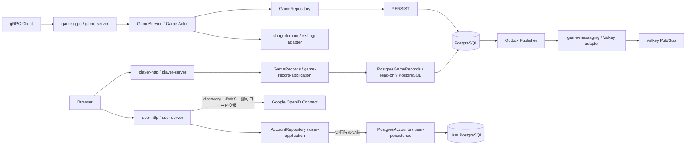
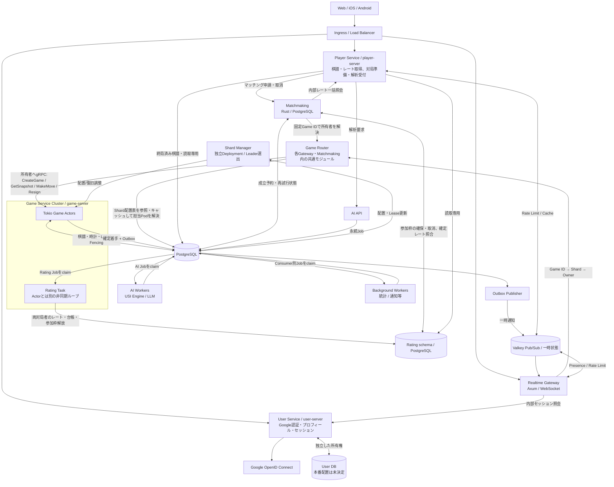
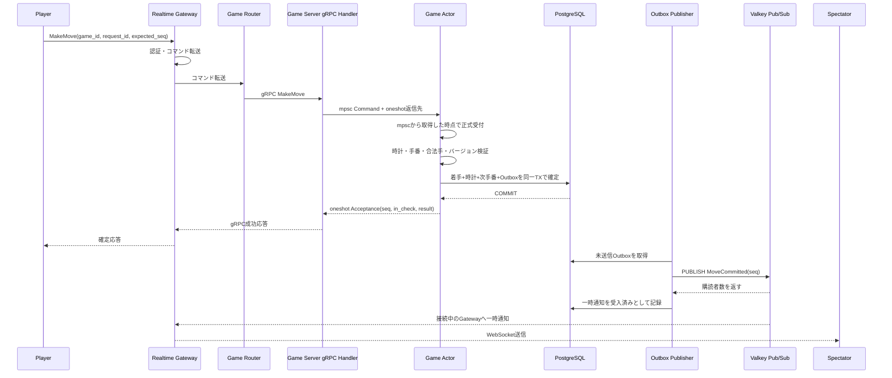
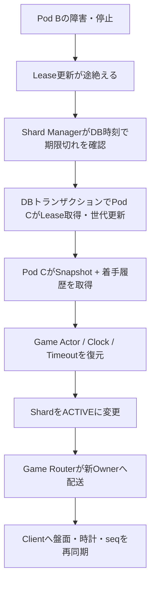
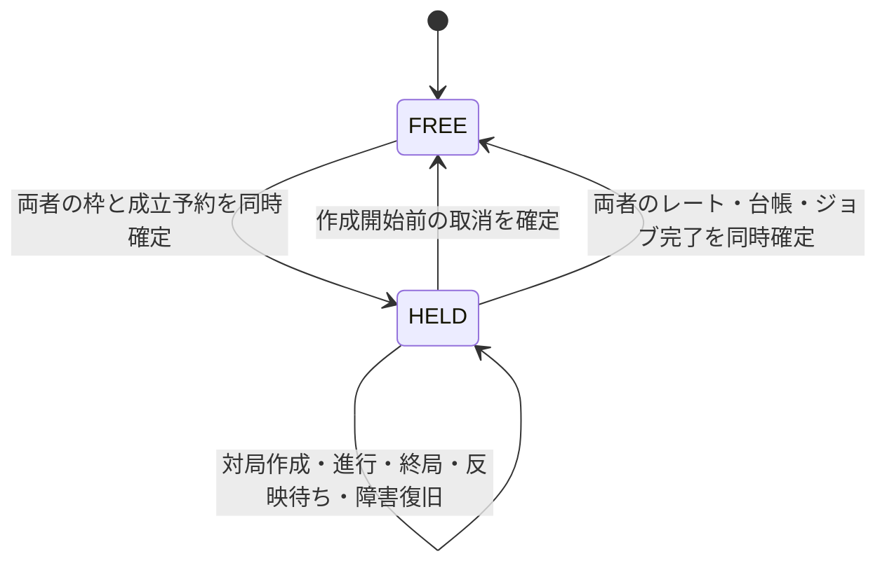
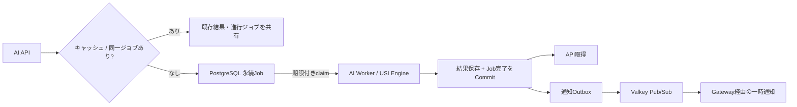
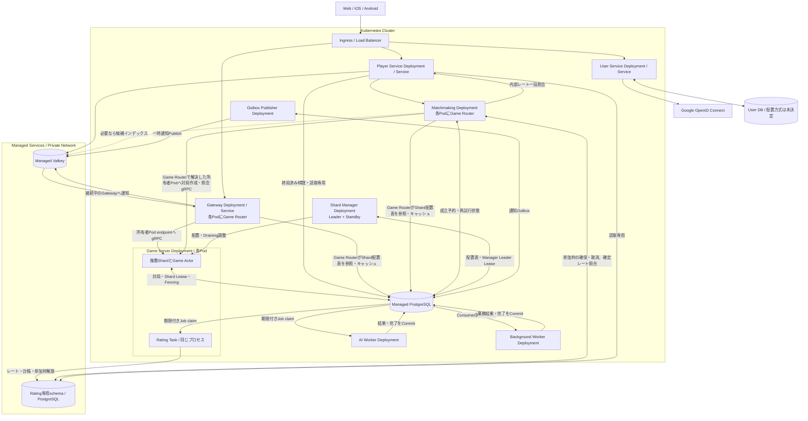

# 大規模将棋アプリ サーバーサイドアーキテクチャ設計書

- バージョン: 2.0（現行実装と将来設計）
- 更新日: 2026-11-05
- 対象: Web / iOS / Android
- 設計目標: 最大同時接続 100,000人

> **設計方針**: Rustを中心に、対局処理・リアルタイム配信・AI解析を分離する。KubernetesはPodの運用に集中させ、将来のVirtual Shardの配置・Lease・FencingはアプリケーションとDBで管理する。対局処理は特定のDB製品に依存させず、本番・開発・テストの永続化にはPostgreSQLを使う。
>
> 本文中の台数、Shard数、スループット、遅延などは**検証前の設計仮定**であり、保証性能ではない。

## 0. 現在の実装範囲

現在は、`user-server`がHTTPでGoogle認証・ユーザー管理を提供し、単一の`game-server`をTonic / gRPCで利用する。独立したOutbox PublisherからValkey Pub/Subへ確定イベントの一時通知を配信する。`player-server`は新規対局の終局済み公開棋譜を匿名HTTPで検索・取得する。以下が実装済みの仕様であり、以降の大規模構成図・時計・観戦・Shard・AI・Kubernetes運用は将来設計として読む。

Google OpenID Connect の認可コードフロー、PKCE、独自 Cookie セッションの採用理由と現行の保証範囲は[ユーザー認証の設計](user-authentication.md)を参照する。

| 実装単位 | 現在の責務 |
|---|---|
| `shogi-domain` | 局面、合法手、王手、詰み、投了。内部のrsshogiは非公開アダプターで包み、公開型を外部ライブラリから独立させる |
| `user-id` | 内部ユーザーIDの検証済み値型。対局とユーザーサービスで共有する |
| `user-application` | プロフィール・表示名・検証済み外部識別子・ログイン試行・セッションの型と、`AccountRepository` の契約 |
| `user-persistence` | `AccountRepository` の実装。ユーザー専用PostgreSQL、スキーマ検証、試行消費・登録・セッションの保存 |
| `user-http` | Google OpenID Connect、HTTPルート、ログイン処理の組み立て、Cookie・Origin検証 |
| `user-server` | 設定読込、永続化とGoogleプロバイダーの組み立て、HTTP待ち受け |
| `game-application` | 対局操作、Actor、保存前のDomain Event生成・固定、Repositoryとイベント配信のTrait、逐次Outbox配信ユースケース |
| `game-persistence` | SeaORMによるGameRepository、対局用接続プール、PostgreSQL保存、Outboxの原子的追加・配信状態・Publisher排他、スキーマ更新・検証、専用読取接続による公開棋譜照会 |
| `game-record-application` | 終局済み公開棋譜の検索条件・公開型・読取Repositoryと照会ユースケース |
| `player-http` / `player-server` | 匿名HTTPの棋譜一覧・詳細、入力検証、読取専用アダプターの組み立て |
| `game-messaging` / `outbox-publisher` | Valkey Pub/SubのChannel・JSON変換と送信、独立プロセスによる未配信イベントの処理 |
| `game-grpc` / `game-server` | gRPCで対局作成・Snapshot取得、着手・投了を公開し、永続化アダプターを組み立てる |



上図は実行時の呼出関係である。IDトークンの署名・claim検証は取得した鍵を使ってサービス内で行う。Rustの依存は `user-http → user-application` と `user-persistence → user-application` であり、`user-application` はHTTP・ORM・具体的な保存実装に依存しない。`user-server` が両アダプターを組み立てる。

### 0.1 対局・ユーザーの仕様

- 平手初期局面から開始し、通常の駒移動、成り、持ち駒、王手回避、詰み、投了を扱う。二歩・打ち歩詰め・王手放置などの不正着手はエラーとして拒否し、対局は継続する。
- 詰みは「王手され、合法手がない」場合のみ。王手でない合法手なし局面、千日手、連続王手の千日手、入玉宣言勝ち等の判定は対象外。タイマー・時間切れも未実装である。
- 対局作成時に、異なる2ユーザーIDを先手・後手へ固定する。ユーザーDBへの存在確認は行わない。着手側は`user_id`とこの紐付けから決める。投了は手番によらず可能である。
- Google認証とユーザー管理は独立したHTTPサービスで提供する。対局gRPCのユーザーIDは依然として呼出元の申告値であり、信頼できる内部ネットワークで利用する。HTTPログインは対局gRPCやWSを認証しない。マッチング、レート更新・取得、Shard管理、Lease、Game Router、Gateway、クライアントへの観戦配信は現在のスコープに含めない。

### 0.2 確定・再送・復旧

- 1対局につき`GameService`の共有レジストリ内に1つのActorを置き、容量64のbounded `mpsc`と要求ごとの`oneshot`で逐次処理する。`GameService`のcloneはレジストリを共有するが、別途生成したサービス間でActorの一意性を保証する仕組みやLease・Fencingはない。
- Snapshot取得時と変更前にはDBのversionを確認し、キャッシュが未復元・無効、またはversionが異なる場合に履歴を再読込する。キャッシュがあってもDB読込エラーは返す。
- `seq`は0から始まり、受理した着手・投了ごとに1増える。上限は`i64::MAX`である。変更には`expected_seq`と`request_id`が必要で、参加者以外の変更は拒否する。
- 受理済み要求だけが対局内の`request_id`を予約する。同じ種別・ユーザー・期待連番・着手内容での再送には元の結果を返し、内容が違えば拒否する。対局作成はこの再送契約の対象外である。
- 局面のコピーで変更を検証し、versionの条件付き更新、結果、受理記録、Domain Eventを同一トランザクションで保存してからActorへ反映する。保存エラー時は履歴を再読込して照合し、結果を確認できない場合は成功・ロールバックを断定しない。応答喪失時は同じ要求を再送する。
- 再起動後は平手初期局面から受理済み履歴を再実行し、連番・参加者・合法性・各応答・最終結果を検証して復元する。DBに局面Snapshotを保存する方式ではない。
- キュー投入後の呼出元のキャンセルや返信先の破棄では処理を取り消さない。メッセージ契約は[6.2節](#62-game-actorのメッセージ契約)を参照する。

### 0.3 DB・実行環境

Domain層とApplication層はSQL・ORMに依存しない。対局は`GameRepository`と`SeaOrmStore`、ユーザー管理は独立したRepositoryとPostgreSQL接続を使う。共有するのは`user-id`の値型のみであり、DB接続やユーザー外部キーを共有しない。プロフィール変更は対局履歴を変更しない。アカウント削除APIは未実装である。現行DBドライバーはPostgreSQLのみである。認証方式は[ユーザー認証の設計](user-authentication.md)、設定と起動は [user-server の README](../../apps/user-server/README.md) を参照する。

永続化アダプターの通常の検索・登録・更新・削除はSeaQueryで構築し、テーブルとインデックスの定義にもSeaQueryのビルダーを使う。入力値はSQL本文と分けて渡す。SeaORMの接続・トランザクションでは生成したStatementを直接実行し、棋譜読取とOutboxの専用SQLx接続では`sea-query-sqlx`でSQLとバインド値へ変換する。手書きSQLはPostgreSQLのadvisory lock、接続設定、システムカタログ検査、schema管理、`COLLATE "C"`などのDB固有処理に限定する。テストの故障注入と変更前スキーマの互換性確認用SQLは別に保持する。

ローカル実行とテストはPostgreSQLを基本とし、現在のコンテナ確認はDocker Composeで行う。Composeは既定で`game-server`、`outbox-publisher`、Valkey、PostgreSQLを起動する。`auth` profileで`user-server`、`records` profileで`player-server`を追加する。対局とOutboxは`shogi` DB、ユーザー情報は独立した`users` DBに保存する。PostgreSQLの永続領域は`pg-data` Volumeである。テストは`TEST_DATABASE_URL`の管理接続からテストごとに独立したDBを作成する。本番のKubernetes運用は将来の対象である。実行・再起動確認・rustdocの手順は[README](../../README.md)を参照する。

### 0.4 ユーザー認証・プロフィールの現行仕様

- Google OpenID Connectの認可コードフローとPKCE S256を採用する。stateと試行用Cookieで開始元ブラウザーを照合し、nonceとIDトークンの署名・issuer・audience・期限等を検証する。
- 検証済みのGoogle識別子 `(issuer, subject)` を内部 `UserId` に対応付ける。初回ログイン時に登録し、同じ識別子の再ログインでは既存アカウントを使う。メールアドレスから自動連携しない。
- ログイン後は独自のCookieセッションを使い、DBにはトークンのハッシュと固定期限を保存する。Googleのトークンをアプリケーションのセッションに使わない。プロフィール取得、表示名変更、現在のセッションのログアウトを提供する。
- 本番Cookieは `Secure`、`HttpOnly`、`SameSite=Lax`、host-onlyとし、表示名変更とログアウトは公開originとの一致を検証する。Google側のログアウトと独自セッションの失効は連動しない。
- 起動時とコード交換時のdiscovery・JWKS取得はGoogleへの外部通信に依存する。既存セッションの照会はユーザーDBだけを使う。HTTPログインと対局gRPC・将来のWS認証の接続は未実装である。

処理のトランザクション境界・失敗時動作は[ユーザー認証の設計](user-authentication.md)、環境変数・起動・検証コマンドは [user-serverのREADME](../../apps/user-server/README.md) を正本とする。本書はサービス間の責務と実装状況を記述する。

## 1. 要件と負荷モデル

### 1.1 主要機能

以下は目標機能の全体像であり、実装済みの範囲は第0章に示す。

- 対人対局: マッチング、着手、合法手判定、持ち時間、秒読み、投了、勝敗、レーティング
- 観戦: 多数の同時観戦、着手イベント配信、途中参加、再接続、盤面再同期
- AI: 局面評価、候補手、対局後の棋譜解析、LLMによる自然言語解説
- 共通: 認証、ユーザー管理、棋譜履歴、通知、統計、監視

### 1.2 仮の容量モデル

| 項目 | 設計仮定 |
|---|---:|
| 最大同時接続 | 100,000 |
| 対局者 | 50,000 |
| 観戦者 | 50,000 |
| 同時対局 | 25,000 |
| 平均着手間隔 | 1対局あたり10秒 |
| 平均着手イベント | 2,500手/秒 |
| 瞬間ピーク例 | 10,000手/秒 |
| 人気対局の観戦者 | 最大20,000人/局（検証シナリオ） |

同じ10万接続でも「対局が多い」場合はGame ActorとDB書き込み、「人気対局に観戦集中」する場合はGatewayのfan-outが主要負荷になる。AIの解析同時数は別枠で容量管理する。

## 2. 技術スタック（現行と将来候補）

Valkey Pub/Subへの確定イベントの一時通知と、AxumによるGoogle認証・ユーザー管理は実装済みである。Gateway、Presence、マッチング、PostgreSQLの永続ジョブ、Rating、AI、Kubernetes、観測基盤は将来構成である。対局の受理はPublisherやValkeyの稼働を必要としない。

| 領域 | 採用技術 | 主な役割 |
|---|---|---|
| 言語 | **Rust** | サーバー実装 |
| Web API | **Axum** | 現在は独立したユーザーHTTPサービス。棋譜・レート取得や対局準備のPlayer Serviceは将来 |
| ユーザー認証 | **Google OpenID Connect / openidconnect** | 認可コードフロー・PKCE・IDトークン検証。アプリセッションは専用PostgreSQLで管理 |
| 非同期基盤 | **Tokio** | 現在はGame ActorとHTTP・外部通信。WebSocket・タイマーは将来 |
| RPC | **Tonic / gRPC** | 現在の対局操作。Gateway接続は将来 |
| 将棋ルール | **rsshogi** | 非公開アダプター経由で利用 |
| ORM | **SeaORM** | ユーザー・対局・受理済み履歴の保存 |
| SQL | **SeaQuery / SeaORM経由のSQLx** | スキーマ構築、トランザクション、versionの条件付き更新 |
| RDBMS | **PostgreSQL** | 現在の正本はPostgreSQL。時計・Shard Leaseは未実装 |
| 一時データ | **Valkey** | Presence、候補選択用インデックス、キャッシュ、Token Bucketによるレート制限は将来 |
| 低遅延イベント | **Valkey Pub/Sub** | 現在は確定イベントの一時通知。Gatewayへの配信は将来 |
| 永続ジョブ | **PostgreSQLのジョブテーブル** | レーティング更新、AI解析、統計、通知等。Consumer別のclaim・再試行・完了管理は将来 |
| 将棋AI | **やねうら王等のUSIエンジン** | 局面評価・候補手・棋譜解析 |
| 解説AI | **LLM（別Worker/外部推論）** | エンジン結果に根拠を置いた自然言語説明 |
| コンテナ | **Docker** | 環境の統一 |
| オーケストレーション | **Kubernetes** | Podの配置、再起動、水平スケーリング |
| 観測 | **OpenTelemetry、Prometheus、Grafana** | トレース、メトリクス、ダッシュボード |

**採用しないもの（初期）**: タイマー専用サービス、Shard管理専用Kubernetes Operator、Kubernetes LeaseによるShard所有権管理、独立Game Routerサービス、過剰なマイクロサービス分割。

## 3. 全体構成（将来設計）



上図は将来の論理構成であり、現行の独立したUser ServiceとユーザーDBの所有権を維持する。Player Serviceへ認証を再統合しない。Gatewayの認証境界は3.2節の将来方針に従い、現行のHTTPログインだけでWSを認証できるとはしない。永続ジョブの作成・処理完了はPostgreSQLで管理する。AI完了の一時通知にはOutbox等を用い、通知が欠落しても結果をAPIで取得可能にする。Rating Taskは初期には各game-serverプロセス内で動かす。Rating schemaも対局と同じDB内に置く。更新の責務・トランザクション境界は9.4節に従う。

### 3.1 アプリケーション単位

- **User Service**: Google認証、登録、プロフィール、独自セッション。現行の `user-server` の責務を維持する
- **Player Service（`player-server`）**: 対局者・観戦者向けHTTPの照会と受付。棋譜検索・詳細、レート取得、対局設定、マッチング申請・取消、AI解析受付・結果取得を各領域の契約で提供する。取得専用サービスではなく、対局準備の要求も受け付ける。詳細は3.3節
- **Realtime Gateway**: WebSocketの接続認証、対局/観戦購読、着手の転送、再同期、送信キュー制限
- **Game Service**: 各Game Actor、時計、合法手、結果確定、Shard復旧。初期はRating Taskも同じプロセスで実行する
- **Shard Manager（独立アプリ）**: Game Podの登録・負荷収集、Shard配置・再配置計画、障害復旧の調整
- **Matchmaking Worker**: 初期はPostgreSQLの待機データから候補を選び、9.3節の永続予約と対局作成の照合により成立を確定する
- **Rating Task（Game Service内）**: PostgreSQLに保存した終局入力のジョブから両対局者のレートを更新する。計算、適用履歴、重複排除、復旧はRatingモジュールが所有する。Game Actorの要求処理とは別に実行し、取得はPlayer Serviceが担当する。独立Deploymentへの分離条件は9.4節
- **AI Worker**: USIエンジン実行・解析結果保存、必要に応じてLLM説明
- **Background Worker**: 通知、統計、監査、不正検知など

Game RouterはGatewayとMatchmaking Workerが共有するRustモジュールとして実装し、各プロセス内で動かす。上図のGame Routerは共通の配送ロジックを表し、独立したサービスやGateway経由の中継を意味しない。**Shard Managerは独立したDeployment**で動かし、PostgreSQLによるLeader選出で1インスタンスだけがShard配置の制御を実行する。対局作成RPCの中継は担わない。

### 3.2 Gatewayの認証境界（将来設計・未実装）

初期Web構成では、User ServiceとRealtime Gatewayを同じ公開origin配下に配置する。ブラウザーのWebSocket接続開始時に、Gatewayは許可したOriginと一致することを確認し、セッションCookieを使ってUser Serviceへ内部セッション照会を行う。セッションDBと検証処理の所有権はUser Serviceに残し、GatewayはユーザーDBへ直接アクセスしない。照会が失敗した場合は、認証済み接続として受け付けない。

User Serviceは有効なセッションに対応する内部UserIdと有効期限を返す。GatewayはこのUserIdを接続に対応付け、着手・投了を認証された内部RPC経路でGame Serviceへ渡す。クライアントが申告したUserIdや外部からの本人情報ヘッダーで上書きしない。Game Serviceは内部の送信元を認証し、操作ごとに対局参加者との対応を確認する。購読要求にも公開範囲・参加者等の権限を検証する。

接続開始時の認証だけで、接続中の権限を無期限に維持しない。Gatewayはセッションの有効期限を超えて認証済み接続を継続せず、定期的な内部照会でログアウト等による失効を反映する。再検証に失敗した接続も、認証済みとして継続しない。再検証間隔・照会タイムアウト・最大失効反映遅延を設定項目として定め、Gateway公開前にその上限と障害時動作を検証する。全着手でUser Serviceへ照会する方式は前提にしない。

この方針は初期Webクライアントを対象とする。iOS・Androidのログインと資格情報の受け渡しは別途設計し、WebのCookie方式で対応済みとはしない。内部セッション照会API、内部RPCの送信元認証、WS接続への認証情報の対応付けは未実装である。

### 3.3 Player Serviceと棋譜取得（棋譜HTTPは実装済み）

現行の`player-server`は終局済み公開棋譜だけを匿名HTTPで検索・取得する。レート・マッチング・対局準備・AI解析は未実装である。ユーザーサービスへの認証照会やユーザーDB接続は持たない。新規対局はGame側が`standard`と`public`を明示して作成する。参加者限定棋譜の公開や公開範囲変更APIを導入する場合は、Game側の変更契約と検証済み本人情報による認可を別途実装する。

`game-record-application`が検索条件、公開棋譜型、照会ユースケースと読取専用Repository契約を所有する。Game Actorの操作・復旧契約には依存しない。`game-persistence::PostgresGameRecords`がPrimaryの確定済みデータを読み、`player-http`がHTTPとの変換を担当する。`apps/player-server`が両者を組み立てる。検索DBやイベント投影は追加しない。進行中の同期・観戦はこのAPIの対象外である。

Player Serviceは専用のPostgreSQL接続プールを使い、全接続の`default_transaction_read_only`を有効にする。DBロールにもSELECTだけを許可し、テーブル書込み権限や所有権を与えない。Game Serviceの書込Repositoryや初期化処理は呼ばない。Game側が現行スキーマv5を初期化した後、読取側は対応版と必要なテーブル・列を検証する。Composeの`records`プロファイルは専用ロール`shogi_reader`で接続する。共有ファイルやDBボリュームのマウントは不要である。

`GET /game-records`は`games`のメタデータだけを選択する。参加者は黒白どちらかへの一致、ルールは`standard`、結果は勝者色と終局理由、期間は終局時刻の`[from,to)`、手数は投了を除く最終着手数の上下限で絞る。全条件を同時に指定でき、公開・終局の条件と検索条件をSQLのLIMIT前に適用する。`from`・`to`は非負のUTCマイクロ秒で必須、期間上限は366日、件数は既定30・最大100である。

一覧は`(finished_at DESC, id COLLATE BINARY DESC)`で整列し、末尾キーで次ページを取得する。カーソルは版・キー・正規化した検索条件のダイジェストを含み、条件が変わる継続要求を400にする。件数だけは変更できる。カーソルは署名のない未信頼入力であり、認証情報や改ざん防止機構ではない。ページごとに公開条件を再評価し、複数リクエストにまたがる固定Snapshotは保証しない。総件数は返さない。

`GET /game-records/{id}`は参加者、ルール、勝敗・終局理由、終局時刻、終局seq、最終着手数と順序付き公開履歴を一つのDB読取Snapshotから返す。履歴の連番、USI構文、参加者と色、着手の手番、投了と詰みの終端条件、最終手数を検証し、不整合なら部分成功を返さない。合法手の全再実行は行わない。seqは投了を含む受理済み操作数であり、着手数と区別する。Actor復旧用`GameRepository::load_game`や受理記録はHTTPへ流用せず、request_id・expected_seq・再送結果・Outboxを公開しない。

履歴上限は4096操作、JSON応答上限は1MiB、HTTP同時処理数は16、PostgreSQL接続数は4である。接続取得とSQL実行にそれぞれ2秒の上限を設け、PostgreSQLの`statement_timeout`で長いクエリを中断する。入力不正は400、存在しない・進行中・非公開の対局は同じ404、履歴上限超過は422、保存不整合は500、DB利用不可・期限超過・同時処理上限は503を返す。処理した応答は`Cache-Control: no-store`とする。

スキーマv5では`rule`・`visibility`・`final_move_ply`を必須とし、終局済み対局には`finished_at`と勝敗・終局理由を必須にする。新規対局の着手数はMoveだけ増加し、終局時刻はwriterのUTC時計によるcommit準備時刻としてjournal・version・Outboxと同じトランザクションに保存する。受理済み操作の再送では値を変更しない。

設定・JSON形式・実行例は[player-serverのREADME](../../apps/player-server/README.md)を参照する。

## 4. Pod・Virtual Shard・Game Actorの関係

本章と第5章は将来の分散配置設計である。現行のActorレジストリは0.2節の範囲に限られる。

```text
Kubernetes Cluster
  ├─ Game Server Pod A（Rustプロセス）
  │    ├─ Virtual Shard 0
  │    │    ├─ Game Actor #100（1局）
  │    │    └─ Game Actor #101（1局）
  │    └─ Virtual Shard 12
  │         └─ Game Actor #500
  └─ Game Server Pod B（Rustプロセス）
       ├─ Virtual Shard 1
       └─ Virtual Shard 357
            ├─ Game Actor #123
            └─ Game Actor #456
```

- **Pod**: Game Serverプロセスの実行環境。Kubernetesが起動・再作成する。
- **Virtual Shard**: 対局群を束ねて配置を切り替える論理単位。原則プロセスやスレッドではない。
- **Game Actor**: 1局を担当し、手番・局面・時計・勝敗を逐次処理する実行単位。Tokio Task + Channel等で実装できる。

例として、Shard数を**1,024に固定**する。

```text
shard_id = stable_hash(game_id) % 1024
```

Shardごとの担当Podは固定式ではなく、Shard Managerが決めてPostgreSQLに保持する。Pod数が変わってもGame ID → Shard IDは変えない。

## 5. Shard Manager / Game Router / Lease

### 5.1 責務

| コンポーネント | 役割 |
|---|---|
| Shard Manager | 稼働Podと負荷を見てShard→Podの配置を決め、移動・障害復旧を調整 |
| Game Router | Gateway・Matchmaking内でGame IDからShard IDを計算し、配置表から担当Podを見つけて対局作成・照会・操作をgRPCで配送 |
| Lease | PodにShardの管理権限を期限付きで与える |
| Fencing Token | 旧所有者が復帰しても、古い世代での書き込みを拒否する |

### 5.2 配置アルゴリズム（初期案）

1. Game IDを安定ハッシュで1,024 Virtual Shardへ割り当てる。
2. 新規Shardは、健全かつ余裕のあるGame Podへ割り当てる（初期は担当Shard数や稼働対局数で判断）。
3. 現在の割り当てを原則維持し、Pod追加時も移動するShardを最小限にする。
4. Pod停止時はLeaseの期限切れを確認し、別Podに再割り当てする。
5. 後にCPU、Actorキュー長、処理時間などを加味し、ヒステリシスとクールダウンを設ける。

対局作成・照会・着手の各要求をShard Manager経由で中継しない。Game RouterがPostgreSQLの配置表を参照・キャッシュし、所有者変更やエラー時に更新する。新規対局も作成前に固定したGame IDからShardを計算できるため、作成済みの対局レコードを配送先の解決条件にしない。

### 5.3 PostgreSQLのLease概念

```text
shard_id       = 357
owner_id       = game-pod-b / instance-uuid
lease_expires  = DB時刻による期限
generation     = 42
state          = ACTIVE / RECOVERING / DRAINING
```

Leaseを獲得し直すと世代番号を増やす。書き込み時には、**同一トランザクション**で所有者・世代番号・期限を検証し、Leaseの変更と競合しないよう適切に行ロック等を用いる。`game_moves(game_id, seq)` の一意制約と`request_id`による冪等性も併用する。

Shard Managerは**独立Deployment（通常2 Podを初期候補）**として実行し、PostgreSQLのManager専用Leader Leaseと世代番号・条件付き更新によって、同時に配置変更を行えるLeaderを1つに制限する。Manager Leader Leaseと各Shardの所有権Leaseは別物である。Game Serverは自分が所有するShardのLease更新・Fencing検証を担当し、Manager停止中も既存の対局は継続できるようにする。

## 6. 着手の確定と観戦イベント配信

以下の図と6.1節のGateway、時計、分散構成は将来設計である。現在はgRPCの要求・応答と、PostgreSQLのTransactional OutboxからValkey Pub/Subへの一時通知を提供する。現行のメッセージ契約は6.2節、Publisherの契約は6.3節に示す。



- Game Actorだけが対局の状態を変更できる。
- Gatewayは通信を管理し、盤面の正本を持たない。
- Valkey Pub/Subは永続配信ではない。**連番の欠落はSnapshotと確定着手履歴で再同期**する。
- Gatewayは、ローカル観戦者がいる対局のValkey Channelだけを購読し、受信したイベントを同Pod内の観戦者へfan-outする。
- 遅いクライアントには送信キュー上限を設け、局面更新は最新Snapshotによる再同期で復帰させる。

### 6.1 観戦途中参加 / 再接続

1. Gatewayがイベント購読を開始し、到着イベントを容量上限付きのバッファにためる。
2. Valkeyから対象Channelのsubscribe acknowledgementを受け、購読登録の完了を確認する。確認が失敗した場合はSnapshotとの合流へ進まず、購読をやり直す。
3. Game Serviceから現在局面のSnapshotと`seq`を取得する。
4. Snapshotの`seq`以下の盤面更新は再適用せず、それより新しい更新を連番順に適用する。
5. 欠落やバッファ超過があれば再度Snapshotを取得する。

subscribe acknowledgementをSnapshot取得より先に待ち、購読準備中の更新をSnapshotと通知の両方で取り逃す競合を防ぐ。[購読検証例](../../crates/game-grpc/examples/outbox_proof.rs)も購読完了を待ってから対局操作を開始する。この手順だけでPub/Subの通知欠落すべてを検知・回復できるとはしない。Gateway自体は未実装である。

`seq`は確定した操作の連番であり、イベントごとに異なる番号ではない。詰みの着手は、同じ`seq`の`MoveCommitted`と`GameFinished`を生成する。購読開始後の重複排除には`(game_id, seq, event_kind)`を使い、同じ`seq`を受信したことだけを理由に別種のイベントを破棄しない。盤面は同じ操作で二度更新しない。`MoveCommitted`に含まれる終局結果も盤面状態へ反映する。Snapshotに取り込まれた過去の通知を全件再現する保証は持たず、イベントを全件処理する必要のある用途は別の永続配信経路を使う。

終局など最後のイベントだけを失うと、後続の連番が来ないため番号の飛びから欠落を検知できない。このため、接続を維持している場合も次の二段階で状態を照合する。

- Gatewayは購読中の対局ごとにGame Serviceの最新の確定`seq`を定期照会し、ローカルで連続して反映できた`seq`と比較する。遅れがあればSnapshotを取り直す。照会はGateway内の同一対局の観戦者で共有し、観戦者ごとにGame Serviceへ問い合わせない。
- 各観戦画面は最後に反映した`seq`を接続ごとに定期報告する。Gatewayは画面ごとの反映番号を比較し、遅れている画面をSnapshotで再同期させる。送信済みであることだけを画面への反映完了とはみなさない。

正しさの基準はGame Serviceの確定状態であり、Gatewayとの一致だけで最新状態を保証しない。Game Serviceへの照会に失敗した場合は、画面にも最新状態を確認できていないことを伝える。照会・報告の間隔、応答待ちの上限、再同期を開始する条件は許容する表示遅延と負荷試験に基づいて決める。通常の配信中にも一時的な遅れは生じるため、番号差の一度の観測だけで通知喪失とは断定しない。

GatewayがValkeyへ再接続した場合は、切断中の欠落を前提に購読を再登録し、準備完了を確認してから購読中の対局を再同期する。WebSocketの再接続時も6.1節の手順を実行する。定期照合は末尾欠落からの復帰を担い、イベント全件の受信保証には使わない。


### 6.2 Game Actorのメッセージ契約

以下は現行実装の契約である。時計・Gatewayへの配信・Shard Fencingは将来設計として区別する。

- `GameService`は、Snapshot取得を`Command::Snapshot`、着手・投了を`Command::Mutate`へ変換し、bounded `mpsc`で対象Actorへ送る。
- Actorは要求を逐次処理し、要求ごとの`oneshot`へ`Snapshot`または`Acceptance`、失敗時は`ApplicationError`を返す。着手・投了に共通の`Acceptance`は、受理時の連番・王手状態・対局結果を持つ。
- `mpsc`への投入成功は処理成功を意味しない。投入後に呼出元がキャンセルされても処理は続き、送信側がすべて閉じた後も投入済み要求を処理して終了する。
- 変更要求は参加者、`expected_seq`、`request_id`、対局ルールを検証する。受理済み要求の同一内容での再送には元の応答を返し、同じ`request_id`で内容が異なる要求は拒否する。
- 成功応答は永続化の確定を根拠とする。応答喪失や保存結果が不明な場合は、元の`expected_seq`を含む同一内容・同一`request_id`で再送する。確定・復旧の方針は0.2節に示す。
- Actorが`StagedGameChange::new(game_id, receipt)`を呼び、保存前に受理記録からDomain Eventを生成・固定する。着手は`MoveCommitted`、投了は`GameFinished`、詰みの着手はその順で両方を生成する。対局作成・拒否・受理済み要求の再送・履歴復元では新しいイベントを生成しない。
- `GameRepository::commit_change(&change)`は渡された受理記録・生成済みイベントとメタデータを同じDBトランザクションで保存し、イベントを生成しない。ActorからValkeyへ直接送信しない。応答とイベントの到着順・到着可否は独立とする。`CheckTimeout`と`Ready`は未実装である。

実装の定義は[Actor](../../crates/game-application/src/actor.rs)、[要求・応答型](../../crates/game-application/src/types.rs)、[gRPC定義](../../proto/game.proto)を参照する。

### 6.3 現行Outbox Publisherの契約

生成・保存・配信の責務とPostgreSQLの運用制約は[Domain EventとTransactional Outboxの設計](domain-events.md)を参照する。

- `game-application`が保存前のイベント生成・固定、型付きイベント、配信ユースケース・`NotificationPublisher` Traitを所有する。`game-persistence`が受理記録・イベントの原子的保存、未配信行の取得、受入済み記録を担う。`game-messaging`がValkeyのChannel・JSON変換と送信を担い、`outbox-publisher`が独立プロセスとして組み立てる。
- `NotificationPublisher`の成功はブローカーによる一時通知の受入を意味する。購読者の受信・永続化・処理完了は保証しない。この契約を永続ジョブの送信・完了確認に流用しない。
- イベント識別子は`(game_id, seq, event_kind)`である。詰みの着手では同じ`seq`の2イベントを種別で区別する。ペイロードには元の`request_id`と`user_id`も保持する。
- Publisherは未配信行を挿入順に1件ずつ処理する。`ValkeyEventPublisher`は`redis` crateで`PUBLISH`を送り、非負整数応答が0の場合も成功とする。サーバーエラー・通信失敗・タイムアウトでは行を未配信のままにし、接続を破棄してプロセスを終了する。自動再接続は行わず、Composeの再起動で未配信行から再開する。送信成功後の記録失敗などでは同じ識別子を再送し得る。
- PostgreSQLでは単一Publisherを使う。`PostgresOutbox`が専用接続でセッションadvisory lockを保持し、同じ対局DBへの二重起動を拒否する。読取と受入済み記録にもこの接続を使い、接続喪失後のキュー操作は失敗する。Publisherはその失敗を検知して終了する。通信待ちにDBトランザクションを保持しない。終了時はTokio runtimeを破棄してローカルの通信処理を停止してから、この接続を解放する。
- runtimeの停止やadvisory lockは、送信済みの`PUBLISH`がValkey上で後から実行されることを防げない。PostgreSQLのセッション喪失後に通知が届いても受入済み記録は失敗し、行は未配信のまま残り得る。別Publisherによる再送との遅延重複・順序逆転を許容し、ホスト間の厳密な送信Fencingは保証しない。
- Channelは`shogi.games.<game_idのUTF-8バイト列の小文字hex>.events`である。JSONの`schema_version`は1、`type`は`move_committed`または`game_finished`で、`game_id`は元の値を保持する。設定は`VALKEY_URL`で、既定値は`redis://127.0.0.1:6379`である。
- 購読者不在や切断中の通知は失われる。購読者は完全なイベント識別子で重複を排除し、欠落時はSnapshotと定期照合で再同期する。接続障害をまたぐ遅延重複や到着順の逆転も許容する。
- 現行の`outbox_events.published`は一時通知の受入状態だけであり、RatingやAI等の処理完了ではない。配信済み行は削除せず、先頭行が失敗すると後続行も待機する。Outboxの掃除、Publisherの高可用性、Gatewayによる再同期は今後の対象である。

## 7. 対局時計（Game Clock）— 将来実装時の採用方針（未実装）

### 7.1 責務・正式受付地点

**時計・期限判定・着手受付・終局確定の権威をGame Actorに集約する。Admission Gateは設けない。**

- Realtime Gateway: 認証、WebSocket受信、Game Routerによる転送。Gatewayで観測した受信時刻は監視・性能計測には使えるが、勝敗判定の根拠にはしない。
- Game Server gRPC Handler: Requestを対象Actorの**容量上限付きTokio `mpsc`**へ投入。Handlerは時計の期限判定をしない。
- Game Actor: `mpsc::Receiver::recv()`で対象手番のCommandを**取り出した時点**を、正式な着手受付時刻とする。Actorが現在の時計と照合して時間内・時間切れを判定する。
- PostgreSQL: 確定した棋譜、時計、勝敗、Outboxの正本。DB Commit成功後にのみ成功Replyを返す。

この方式では**Gateway→Game Serverの通信時間、mpsc内の待ち時間、Actorが前のCommandを処理する時間は、着手側の消費時間に含まれる**。簡潔なMVP仕様として受け入れ、キュー遅延を測定する。`mpsc`の投入成功は正式受付・着手成功を意味しない。

### 7.2 Clockの計算と時刻の保持

**1秒ごとにDB上の残り時間を更新しない。** Actorは手番開始時刻・残り時間・秒読み等の`TimeControl`から現在の期限を算出する。

- 稼働中のActorは単調時計（`tokio::time::Instant`）で経過時間・期限を判定する。
- 着手受付時にActor内で単調時刻を採取する。クライアント・Gatewayから送られた時刻では判定しない。
- 次手番がある着手では、Actorが合法性検証後に保存用の変更を固定する時点で、次手番開始の単調時刻と対応するUTC時刻を採取する。着手・残り時間・次手番・開始時刻・Outboxを同じDBトランザクションで保存し、確定を確認してからActorの状態へ反映する。開始時刻はDB Commit完了時刻や相手への通知時刻ではない。保存が成功した場合、その後のDB Commit・配信待ち時間も次の対局者の消費時間に含まれるため、これらの遅延を監視する。
- 復旧のため`turn_started_at_utc`、両者の残り持ち時間、秒読みルール、`clock_version`、対局状態をDBに保存する。`Instant`自体はPod間で持ち運ばない。
- 初期は障害中も時計が進むポリシー。復旧後の時刻算出にはUTC時刻と運用上の時計同期が必要。厳密な障害補償は将来検討。

### 7.3 mpscとタイマーの競合・確定順序

Actorは1対局につき1つのTokio Taskで、Commandを逐次実行する。`tokio::select!`でコマンド受信と`sleep_until`を待ってよいが、**selectの分岐選択そのものを時間内判定の根拠にはしない**。ActorがCommandを実際に取り出したときの時刻と、現在の手番の期限を照合する。

1. Actorが着手・投了要求を取り出したら直ちに受付時刻を採取する。認証されたユーザーと対局参加者の対応を確認し、対局内の`request_id`を受理済み記録と照合する。同じ種別・ユーザー・`expected_seq`・着手内容で確定済みなら、現在の手番・期限・終局状態で再判定せず元の応答を返す。同じ`request_id`で内容が異なる要求は拒否する。
   未受理の新しい`MakeMove`だけを、採取した受付時刻と現在の手番の期限で判定する。期限未満なら手番・合法性等を検証する。期限以上なら時間切れ扱いにする（境界は**`now >= deadline`で期限切れ**）。
2. タイマー発火時はActorが時計状態を再計算する。まだ期限前なら再度スケジュールする。期限到達済みなら、Actorが時間切れ結果をDBへ確定する。
3. 未受理の新しい着手は、**期限前にGame Serverに到着済みでも、mpscからの取り出しが期限後なら無効**という仕様である。確定済み要求の再送には手順1の照合を適用する。別の`Admission Gate`やPendingカウンタ、Gate閉鎖要求は用いない。
4. 着手・投了・時間切れはすべてActorの逐次処理とDBのトランザクションで確定する。DB書込みにはShardのFencing世代検証も含め、二重確定を防ぐ。
5. 着手側に送る`MoveAccepted`/投了成功ReplyはDB Commit後に返す。一方`MoveCommitted`/`GameFinished`は同じCommitで保存したOutboxから非同期配信する。クライアントではReplyを操作結果の管理、Eventを盤面・時計・終局反映に使う。

タイマーが先に選択された結果、既にmpsc内にあるCommandをActorが取り出さずに時間切れ確定する状況も、**Actor取出し時点を正式受付とする仕様では許容**する。負荷による不利益を評価するため、キュー待機時間・タイマー遅延・ActorのDB処理時間を必ず観測する。

### 7.4 Pod障害時・Reply欠落時

- Admission Gateおよび永続Inboxは**採用しない**。DB未Commitの着手は障害時に失われ得る。
- 保存用の着手と次手番の時計は、確定前には仮の状態として扱う。DBのロールバックを確認できた場合は仮の変更を破棄し、元の手番を維持する。障害中も時計が進む方針に従い、保存待ち・再試行待ちの間も元の対局者の時計は進む。再試行の受付が期限後なら時間切れになり得る。
- DB保存中の通信切断・タイムアウトだけではロールバックを断定しない。結果不明の場合はDBの受理記録と確定状態を再確認し、確定済みなら保存した次手番開始時刻を使って復旧する。未確定と確認できるまでは、仮の変更を確定状態として公開せず、元の手番で処理を再開することもしない。
- クライアントがReplyを受け取れなければ、成功・失敗を断定せず**結果不明（Unknown）**にする。再接続後にSnapshot・`request_id`の確定記録を確認する。
- DB確定済みなら、7.3節の参加者・要求内容の照合後に元の応答を返す。再送が期限後に到着しても、確定済みの操作を時間切れで拒否しない。未確定なら**同じ`request_id`**で再試行できるが、再試行時には新たなActor正式受付時刻で判定する。元の期限内到着時刻は保証されない。
- `request_id`の確定記録はPostgreSQLで一意制約を設ける。冪等照会・結果照会とDB原子的更新を用意する。`not_found`だけで未処理の要求が今後Commitしないとは断定しない。
- Pod再起動時はPostgreSQLの確定時計状態から新しい単調時計Deadlineを再構築する。Shard所有権はLease + Fencingを検証する。

### 7.5 将来の強化候補（未採用）

競技性・負荷試験の要件が高まれば、GatewayまたはGame Serverでの受信時刻を正式受付とする方式を再検討する。ただしその場合は**未処理の期限内要求の追跡、期限確定との原子的競合制御、時計同期、Pod障害時の保証**が必要となる。現時点で`received_at`をGatewayから受け取って勝敗判定に使う設計や固定猶予だけの方式は採用しない。

## 8. Pod停止・再起動時の復旧（将来の分散構成）

本章はShard・Lease・時計・永続Snapshotを導入した後の設計である。現行の復旧は0.2節のとおり、平手初期局面から受理済み履歴を再実行する。



- Podの再起動・再作成はKubernetes、Shardの再配置はShard Manager。
- Pod再起動後も旧プロセスと同一とはみなさない。**プロセス起動単位の一意なinstance ID**を使用する。
- 旧世代からのDB更新はFencing Tokenで拒否する。
- 移動中は着手を即時確定しない。安全に再試行させるか、短時間保留する。
- 応答を失った着手がすでに確定している可能性があるため、`request_id`と`seq`で重複実行を防ぐ。
- Pod全体のReadinessとShardごとの`ACTIVE / RECOVERING / DRAINING`は分けて扱う。
- 計画停止ではDrain処理とLease引き継ぎを試みる。突然の障害ではLease失効後に復旧する。

## 9. PostgreSQLとValkeyの使い分け

現在はPostgreSQLを正本に、Valkey Pub/Subを確定イベントの一時通知に使う。本章のPresence、マッチング、永続ジョブ、Ratingは将来設計であり、現行スキーマは11.1節に示す。

| 技術 | 役割 | 主な利用例 |
|---|---|---|
| PostgreSQL | 正本・整合性・永続ジョブ | 着手、時計、対局結果、レート・適用履歴、マッチング予約、Shard Lease、Fencing、Outbox、Consumer別ジョブ |
| Valkeyのデータ型 | 再構築可能な一時状態 | Presence、Cache、Rate Limit、必要になった場合のマッチング候補インデックス |
| Valkey Pub/Sub | 揮発性の即時通知 | MoveCommitted、GameFinished、観戦通知、結果が別途取得できるAI完了通知 |

Pub/Subの通知欠落には連番とSnapshotで対応する。最後の通知の欠落も検知するため、6.1節の定期照合と再接続時の再同期を行う。一時通知の受入は永続処理の代替にならない。

永続ジョブはConsumer別に一意キー、状態、claim所有者・世代・期限、再試行時刻・回数、最終エラー、完了記録を持つ。Workerは短いトランザクションで実行可能な行を排他的にclaimし、長い処理の間はトランザクションを保持しない。claimは期限付きとし、期限切れ後の回収と古い世代による更新拒否を条件付き更新で制御する。再試行間隔と上限を定め、未知の形式や繰り返し失敗するジョブを永続的に隔離して他のジョブを進める。

ジョブ完了の根拠は業務結果のDB Commitとする。同じDB境界の業務更新とジョブ完了は、claim所有者・世代・期限を検証した同じトランザクションで確定する。別DB境界の完了記録は業務Commit後に行う。再実行は業務側の一意制約や適用台帳でも冪等にする。外部処理の完了が不明なら、完了扱いせず同じ処理IDで照合する。処理の重複・未処理はDBの正本と照合して回復する。永続ジョブをPub/Subから中継して作成する経路は設けない。

### 9.1 Presence（オンライン状態の共有）

- Realtime Gatewayは各WebSocket接続をローカルで管理し、Valkeyに**接続単位**のPresenceを登録する。
- 1ユーザーがWeb・スマホなど複数接続を持つことを許容し、有効な接続が1つ以上あればオンラインと判定する。
- 各接続のPresenceにはTTLを付与し、GatewayのHeartbeat等に応じて更新する。突然の切断ではTTL失効により古い接続情報を回収する。
- 接続一覧用インデックスを持つ場合は、TTLの切れた接続が参照上残らないよう、参照時の検証・定期クリーンアップ等を行う。
- **Presenceは表示・通知のための一時情報**であり、対局の進行状態や勝敗の正本ではない。対局状態はGame ServiceとPostgreSQLが担う。

### 9.2 Rate Limit（リクエスト頻度制限）

**基本アルゴリズムはValkey上のToken Bucketとする。** Fixed Window方式の単純なValkeyカウンターは、ログイン失敗回数など「指定期間内の試行回数」を管理する場面で併用する。

| 対象 | 推奨制限方式 | 補足 |
|---|---|---|
| マッチング申請 | Valkey Token Bucket | 連打を抑制しつつ適度なバーストを許容 |
| フレンド申請・チャット | Valkey Token Bucket | スパム・連投を抑制 |
| WebSocket接続確立 | Valkey Token Bucket | 再接続時の一時的バーストを考慮 |
| AI解析要求 | Valkey Token Bucket + 同時実行数上限 + 利用予算 | リクエスト回数だけでなく計算コストも制御 |
| ログイン失敗回数 | Valkeyカウンター（Fixed Window等） | 認証基盤側の防御と併用 |
| 対局中の着手 | Game Actorの手番・合法手・連番検証を基本 | 不正な連投に対する軽量なGateway制限は別途検討 |

**Token Bucketの管理方法**

- キー例：`ratelimit:user:{user_id}:matching`。未認証エンドポイントはIP等も併用し、NATや共有回線への影響を考慮する。
- Valkey Hash等に`tokens`（残トークン）と`last_refill_ms`（最終補充時刻）を保存する。
- リクエスト時、経過時間に応じてトークンを最大容量まで補充し、残量が足りれば消費して許可する。
- **補充・判定・消費・TTL更新をLuaスクリプトなどで原子的に実行**し、複数Pod間の競合を防ぐ。
- 時刻基準にはValkey側の時刻を使い、異なるAPI/Gateway Pod間の時計ずれを避ける。
- Valkeyのキーは不要になったとき自動削除できるようTTLを付ける。容量（capacity）と補充速度（refill rate）は操作別のポリシーで設定する。

**実装上の配置**：Player ServiceとRealtime Gatewayで共有できる`RateLimiter`をRustの共通Crateとして実装し、HTTPではAxum Middleware等から呼び出す。WebSocketメッセージごとに常にValkeyへアクセスする設計にはせず、接続ごとの軽量制限はGatewayのメモリで実施する。Ingress側にも粗い流量制限を設け、多層防御とする。

**Valkey障害時**には、操作の重要度に応じてfail-open / fail-closedを明示的に決める（例：AI解析ジョブは保守的に受付制限）。また、Token Bucketはリクエスト頻度の制限であり、AI Workerの同時実行数制御や費用クォータの代替にはならない。


### 9.3 マッチング成立と対局作成（将来設計・未実装）

初期はPostgreSQLに待機データと成立予約を保存し、候補を選ぶ。候補検索が負荷要件を満たさないと実測した場合だけ、Valkeyに再構築可能な候補インデックスを追加する。成立の正本は常にDBの永続予約とする。予約には`match_id`、固定した`game_id`、参加者、対局ルール、状態を保存する。同一ユーザーが同じ対局区分で複数の有効予約へ参加しないようDBの一意制約で保護し、Valkey上の原子的処理だけに重複防止を依存させない。レーティング対局では、予約中から終局後のレート反映まで9.4節の参加枠も保持する。予約の成立確認だけでは参加枠を解放しない。

分散構成では、Matchmaking Worker内のGame Routerが固定した`game_id`からShardを計算し、配置表で解決した所有者Podへ`CreateGame`を直接gRPC送信する。Shard ManagerはShardの配置を管理し、作成要求を中継しない。所有者が未配置・復旧中の場合は再試行可能な状態として待ち、任意のPodへ作成する代替経路は設けない。

Game Serviceは対局作成時も、対象Shardの所有者・Lease期限・Fencing世代を対局保存と同じトランザクションで検証し、所有権を持たないPodでは作成しない。配送先が古い場合はRouterが配置表を再解決する。再照会・作成再試行も同じ`game_id`を使い、その時点の所有者へ配送する。これらは将来の分散構成の契約であり、現行の単一Game ServiceにはRouterやShard所有権検証はない。

予約は次の状態で扱い、遷移はDBの現在状態を条件に更新する。

| 状態 | 意味・遷移条件 |
|---|---|
| `RESERVED` | 参加者を予約済み。作成開始時に`CREATING`へ移す。作成開始前のキャンセル・期限切れは`CANCELLED`へ移して予約を解放する |
| `CREATING` | 固定した`game_id`で対局作成中。結果不明もこの状態に残し、照会・再試行で解決する |
| `MATCHED` | 予約内容と一致する対局の作成を確認済み。同じ成立結果を返す。レーティング参加枠の解放を意味しない |
| `CANCELLED` | 対局作成を開始せず予約を取消済み。この予約からの作成を許可しない |

Game Serviceには、同じ`match_id`・`game_id`・参加者・ルールで対局作成を再試行すると既存の同じ結果を返し、内容が異なれば拒否する契約を追加する。現行の`CreateGame`はこの契約を実装していない。応答を失っても新しいIDで別の対局を作らず、保存済みIDで再照会・再試行する。

作成開始とキャンセルが競合した場合は、`RESERVED`からの条件付き遷移で先に確定した操作を有効にする。`CREATING`へ進んだ予約は、期限切れや照会時の`not_found`だけを根拠に取り消して参加者を再割当てしない。作成が進行中の可能性を解消してから結果を確定し、成立済みならキャンセル済みとは返さない。

永続予約と対局作成を同じDBトランザクションで確定できる配置を優先する。異なる処理境界になる場合は、Workerが保存済みの予約状態と対局を照合して処理を再開する。Worker再起動やValkey状態喪失の後も、未解決の永続予約を回収して同じ対局へ収束させる。DBへ成立状態を保存できない場合は、Valkeyの処理成功だけで成立を返さない。

レーティング対局の候補選択には、9.4節の内部一括取得APIから得たpool別の値・評価状態・versionを使い、予約に取得値と取得時刻を記録する。レーティング対象の可否、pool、判定ポリシー版も予約と対局作成の一致条件に含める。クライアントの申告値を採用せず、取得失敗は未評価者や初期値として扱わず待機・再試行する。

レーティング対局の成立予約は、同じDBトランザクションで両参加者の参加枠を確保してから作成する。候補照会の値をそのまま開始レートにせず、参加枠の行ロック下でPrimaryの確定値・versionを再照合する。変化していれば候補条件を再評価し、条件を満たす場合だけ最新値で予約する。開始入力には両者のレート状態・version・直前の適用IDと、有効世代・計算版・必要な時刻等を固定する。

すべてのレーティング対象の`CreateGame`は、同じ`match_id`・`game_id`・参加者・pool・開始入力に対応する`CREATING`の永続予約と両参加枠を、対局保存と同じトランザクションで検証する。直接RPCでもこの検証を省略しない。初期の同一DB構成では、対局保存・ShardのFencing検証・予約の`CREATING → MATCHED`を同時に確定する。Workerは保存済み結果を照合して応答する。既存対局への同一内容の作成再送は、参加枠が後続対局へ移っていても元の結果を返す。既存対局の同一性確認を、新規作成用の参加枠検証より先に行う。

### 9.4 レーティングの更新と取得（将来設計・未実装）

初期はGame Service内のRating Taskで非同期に更新し、Player Serviceで取得する。Ratingの計算・保存契約はGame Actorから分離するが、更新用の独立プロセス・Deploymentは追加しない。独立したRating Workerは、実測した負荷や障害隔離の要件に応じて選ぶ配置とする。

#### 必要な境界と実行配置

対局結果は1局の状態である一方、レートは複数の対局・Shardをまたぐユーザーの状態である。そのため、対局を所有するActorだけではレート更新を排他できない。必要な保証は次のとおりとする。

- 終局結果と更新入力を原子的に保存し、プロセス停止後も未処理入力を回収する。
- 両対局者のレートと適用台帳を原子的に更新し、同じ対局を重複適用しない。
- 同じユーザー・poolの次局は、前局のレート反映後にだけ予約する。ジョブの到着順でその人の適用順を変えない。
- レート更新のロック待ち・再試行を終局応答や次の着手の処理経路に入れない。
- 更新済みのレートをPlayer ServiceとMatchmakingから取得できるようにする。

これらをDBの永続ジョブ・トランザクションとRatingモジュールの契約で実現する。別Deploymentであること自体は、競合・重複・順序を解決しない。配置は次の3案を比較する。

| 配置案 | 得られる性質 | 負担・制約 | 初期の判断 |
|---|---|---|---|
| Game Actorの終局トランザクションで同期更新 | 終局応答時にレートも確定する | レート計算の失敗が終局確定を待たせる。共有レートをActorの処理経路へ持ち込む | 採用しない。終局は先に確定し、次局の予約を反映完了まで待たせる |
| game-server内のRating Taskで非同期更新 | 終局と適用を分離し、既存Deploymentで実行できる | CPU・メモリ・プロセス障害・リリースをGame Actorと共有する | 採用する。永続ジョブで再開し、処理量を制限する |
| 独立Rating Workerで非同期更新 | 更新処理の資源・再起動・リリースを独立させられる | Deployment・監視・配布設定が増える。共有DBの競合制御は引き続き必要 | 分離条件を満たした場合に採用する |

レート計算の処理時間・終局件数は未計測であり、同居で目標負荷を処理できるという性能保証は置かない。独立した取得サービスや別DBも初期の前提にしない。

| モジュール・実行単位 | 責務・境界 |
|---|---|
| Ratingモジュール / Rating Task | 確定済み終局結果の検証、レート計算、両対局者の原子的更新、適用履歴と再送・復旧。Ratingデータの書込みはこの契約に限定し、初期はgame-server内で実行する |
| Player Service（`player-server`） | 公開HTTPでのユーザー別取得と、Matchmaking向け内部一括取得。Ratingの照会契約と読取専用DB権限を使う |
| Game Actor / Game永続化 | 参加者・ルール・対象判定・終局結果の正本。終局と更新入力・ジョブを同じトランザクションで確定する。Rating Taskの適用完了を待たずに応答する |
| User Service | 認証・プロフィール・セッションを維持する。Ratingは内部UserIdで参照し、ユーザーDBのテーブル・接続・スキーマ管理を共有しない |

#### 競技上の順序と参加枠

同じユーザー・poolでは、レーティング対局を1局だけ進行可能とし、前局のレート反映が完了するまで次局の成立予約を作らない。終局応答は先に返すが、画面は「レート反映待ち」を示し、同じpoolの再マッチを待たせる。異なるpoolは独立したレートを持つ。非レーティング対局の同時進行可否は別の対局ポリシーで決める。

| 順序の決め方 | 性質・制約 | 判断 |
|---|---|---|
| pool全体の終局確定順を採番して順番に適用 | 同時進行を許容できるが、全対局の採番・欠番管理が必要。先頭の障害がpool全体を待たせる | 初期は採用しない |
| ユーザー別に前局反映後の次局を予約 | その人の対局順と適用順が一致する。反映待ちの利用者は次局を開始できない | 採用する。1人1局という対局条件に対応する |
| 固定期間の結果をまとめて計算 | 期間内の個別の適用順を制度から除けるが、反映時期と計算制度を変更する必要がある | 初期は採用しない |

`rated_participations`は`(user_id, pool_id)`をキーとする永続参加枠であり、`FREE`か`HELD(match_id, game_id)`のいずれかとする。世代変更で同じ人に別枠を作らないため、キーにレートの世代を含めない。初回予約も一意キーで行を作成してロックし、同時に複数の枠を作れないようにする。両者が`FREE`であることの確認、両枠の確保、永続予約を一つのトランザクションで確定する。



`HELD`はプロセスのLeaseではなく業務上の参加枠であり、TTL・Pod停止・Shard移動・ジョブclaim期限切れでは解放しない。作成前の取消は、予約が`RESERVED`であることと両枠が同じ予約を指すことを確認し、`CANCELLED`への遷移と同時に両枠を解放する。`CREATING`の結果不明時は9.3節の照合・再試行を継続し、作成済みか不明なまま枠を解放しない。対局開始後は、対象外・無効局も確定した判定を台帳に保存してから解放する。

順序保証の対象は、各ユーザー・poolの対局間の因果関係とする。例えばA対Bの反映後にA対Cを開始する。独立したD対Eは、どちらを先に処理しても各利用者のレートが同じになる計算契約に限定する。pool全体の終局時刻順や、すべての利用者に共通する適用順は必要としない。

このため、計算は両者の固定した開始状態、確定結果、版付きの制度設定だけから決まる関数とする。時刻依存の補正が必要なら基準時刻を入力に固定する。Workerの実行時刻、ジョブ取得順、poolの処理件数、他ユーザーの順位や途中状態を計算に使わない。この条件を満たさない計算方式や同一poolでの同時対局を導入する場合は、期間集計等も含めて順序保証を再設計する。

#### Eloの採用と計算契約

レーティング計算方式は、1局ごとに更新するEloを採用する。期待得点には底10・レート差の尺度400のロジスティック式を使う。この期待得点式は[Rosenthalの研究報告のChess Ratings and Expected Scores節](https://probability.ca/jeff/ftpdir/chessstreaksadd.pdf)を参照する。本アプリでは次の式を計算契約とする。

```text
E_A = 1 / (1 + 10^((R_B - R_A) / 400))
E_B = 1 - E_A
R_A_new = R_A + K_A * (S_A - E_A)
R_B_new = R_B + K_B * (S_B - E_B)
```

`R_A`と`R_B`は予約確定時に固定した両者の開始レート、`E`は期待得点、`S`は確定結果の得点、`K`は更新幅を決める係数である。勝ちを1、負けを0とし、引分けを評価対象にする場合は両者を0.5とする。対象外・無効局には引分けの得点を代入せず、前述の値を変えない適用として記録する。両者の期待得点・更新量を同じ開始状態から計算し、片方の更新後の値をもう片方の計算に使わない。

`K_A`と`K_B`は版付きの制度設定と各人の開始状態から決め、更新入力に固定する。暫定期間や対局数でKを変える場合も、その判定に必要な状態を開始入力に含める。適用時の現在時刻や、その後に集まった対局数からKを再選択しない。参考として[FIDEの2022年規則8.3節](https://handbook.fide.com/chapter/B022022)には期間集計とKの規則があるが、本アプリは1局単位の更新とし、その期間集計・Kの具体値・丸め規則は採用条件に含めない。

このEloは両者の開始状態・結果・固定したKだけで計算できるため、前述の計算契約に適合する。参加者が重ならない対局は更新対象も計算入力も重ならず、処理順を入れ替えても同じ結果になる。同じユーザーの連続対局ではEloも適用順に依存するが、参加枠を前局の反映まで保持することで、その人の対局順に計算できる。

再送・再構築で同じ結果を得るため、計算版には数値の保存精度、指数計算の方法と精度、中間値と最終値の丸め位置・規則も含める。表示用の丸め値を次局の入力に使わない。Kが両者で異なる場合や、丸め・レート下限を設ける場合は、増減の合計が0になると仮定しない。Kの具体値・選択規則、初期値、暫定期間、保存精度・丸め、レート差の上限制限・レート下限の有無は導入前に確定する。採用する数値実装には、同点・勝敗反転・大きなレート差・丸め境界・暫定状態の境界を含む既知の入出力を用意し、対応する実行環境で再現性を検証する。

#### 更新入力と永続ジョブ

poolはルール・持ち時間等で分けるレーティング区分を表す。信頼されたMatchmakingの予約に基づき、対局作成時に両参加者、pool、対象判定とそのポリシー版、両者の開始状態・version・直前の適用ID、有効世代・計算版を固定する。Game Serviceは終局時に、これらと勝敗・終局理由、終局seq・確定時刻、入力ID・入力形式版をGame領域の確定入力として同じトランザクションで固定する。適用時の現在値が開始versionと一致することを検証し、計算には固定した開始状態を使う。候補選択時の古い表示値やクライアントの申告値を使わない。

現行の`CreateGame`と`GameFinished`には、この設定や両参加者を含む更新入力が揃っていない。導入時に作成契約・保存形式・通信形式を拡張する。現行イベントの`user_id`は操作した参加者であり、両対局者を示さない。入力の不足する旧イベントを推測で適用せず、初期導入は新契約で作成した対象対局から開始する。既存履歴の遡及計算は別途移行を設計する。

初期は対局・Rating schema・ジョブを同じPostgreSQLの同じDBへ配置し、終局・固定入力・Rating用ジョブを原子的に保存する。Game Actorの保存経路はジョブ作成までを担い、Ratingの値・適用履歴を更新しない。Rating Taskは永続ジョブを定期走査する。メモリ内のキューや通知を追加する場合も起床の補助に限定し、再起動後はDBから再開する。

将来、DBも分割する場合は、専用OutboxからRating側の永続Inboxへ同じ入力ID・内容を送り、受信側がInboxとジョブを原子的に保存した後にだけ受入確認を返す。送信元は確認後に宛先別の受入済み状態を記録し、確認不明時は同じIDで再送する。受信側は入力IDで重複を排除し、同一IDの異なる内容を隔離する。ただし、この中継だけでは成立予約と参加枠の原子性を維持できない。別DB化は予約・枠確保・解放の分散プロトコルも具体化して検証するまで採用しない。実行プロセスだけの分離は同じDBとジョブを維持できる。

この永続受入は、Ratingの業務完了とも、観戦通知用の`outbox_events.published`とも別の状態である。一時通知の完了・停止がRatingジョブの作成・再試行を消したり止めたりしないようにする。Pub/Subの購読からジョブへ転送する経路は使わない。現行の単一通知フラグは変更せず、永続ジョブの導入時に専用の状態と保存契約を実装する。

#### 適用の一意性・順序・復旧

Rating Taskは期限付きclaimでジョブを取得し、有効なclaimを検証した一つのDBトランザクションで適用する。まず`(世代, game_id)`の台帳を照合し、同じ固定入力の適用済み対局ならレート・参加枠を変更せず完了を照合する。これにより、古い再送で後続対局の参加枠を解放しない。同じ対局の異なる入力や未知の形式は適用せず隔離・警報する。

未適用の対局では、行ロック取得後にも台帳を再確認し、未適用なら両参加枠が同じ予約・対局を保持すること、両者の現在version・直前の適用IDが固定入力と一致すること、世代・計算版が有効であることを検証する。両者の初期行作成・レート更新、更新前後の状態と因果関係を持つ適用台帳、ジョブ完了、両参加枠の解放を同時にCommitする。台帳は`(世代, game_id)`を一意とし、イベントIDや申告poolが変わっても再加算しない。対象外・無効局も値を変えない適用として記録し、両者のversionと直前の適用IDを進めてから解放する。初回のレート行なしは、制度で定めた初期状態・version 0・直前の適用IDなしとして検証する。通常適用以外の手動更新やプロフィール処理で、この契約を迂回してレートを書き換えない。

予約・取消・対局作成・適用で複数行をロックする場合は、pool設定、成立予約、UserIdの固定順による参加枠、同じ順のレート行という共通の順序を使う。pool設定は共有ロックで読んで検証し、通常適用では書き換えない。新規成立予約は`OPEN`のときだけ許可する。既存予約の対局作成・取消・適用は`DRAINING`でも継続できるようにする。pool全体の排他ロックや全体適用番号の採番を通常経路に置かず、参加者の重ならない対局は並列に適用できるようにする。ロック待ちには上限を設けて再試行する。claimの取得トランザクションは先に終了し、業務トランザクションの完了時には所有者・世代・期限を条件付き更新で再検証する。旧claimの処理が失効していれば業務更新全体をロールバックする。

各Game Podは同時処理数を制限したRating Taskを動かし、全Game Shard共通のジョブを取得する。Rating専用のShardは設けず、ジョブを終局したPodやGame Shardの所有権に紐付けない。Game ShardのLease・Fencing世代をジョブclaimや参加枠に流用しない。Pod停止後は別Podが期限切れclaimを回収し、同じ入力を適用する。Commit前の停止は再試行し、Commit結果不明は台帳で照合する。ジョブの実行順を変えても、同じユーザー・poolの後続レーティング対局は前局反映前に存在しないため追い越せない。

入力・version・参加枠の不一致や未知形式は隔離し、未適用の当該対局が保持する枠を解放せず調査する。古い対局の不正な再送で、別の対局が持つ枠を変更しない。タイムアウトだけで適用を飛ばしたり枠を解放したりしない。正常な別参加者の対局は処理を続ける。障害中にレート適用が止まっても終局結果は確定できるが、その利用者の同じpoolでの次局は待機する。

DB復元後はマッチング受付と適用を止め、成立予約・対局・確定入力・適用台帳・参加枠を同じ復旧境界で照合してから再開する。未適用の確定入力は同じIDで再投入する。処理済みフラグだけを根拠に枠を解放せず、未解決の作成や終局後の枠欠落は受付再開前に回復する。確定入力・開始状態・計算版・因果関係は再構築可能な期間だけ保存・アーカイブする。

再構築は台帳に保存した両者それぞれの直前の適用IDを先行条件とし、両先行対局の再構築後に当該対局を計算する。依存のない対局間の順序は問わない。結果訂正や制度変更は通常再送で上書きせず別世代で再計算する。訂正・制度変更の再計算では、新世代の先行対局から開始状態を再生成する。元の開始状態・入力は旧世代の監査証跡として保持する。初期の世代切替ではpoolを`DRAINING`にして新規成立予約を止め、既存の予約・対局・未適用結果が解決して全参加枠が`FREE`になるまで待つ。その後poolを`FROZEN`にし、因果関係に沿う再構築・検証と有効世代の切替を行ってから`OPEN`へ戻す。設定状態の変更はpool設定の排他ロック下で行い、予約・適用時の共有ロックと競合させる。停止せずに再計算・切替する方式は初期には採用しない。

#### 取得とMatchmakingの整合性

公開取得はUserIdとpoolを指定し、値、未評価・暫定等の評価状態、適用対局数、レートのversion・計算版・最終適用ID・更新時刻を返す。本人の取得には参加枠に基づく予約中・対局中・反映待ち・要調査の状態も含める。これらは予約・対局・ジョブの正本から判断し、公開プロフィールへ予約ID等を漏らさない。認可はAPI境界で行い、本人のセッションはUser Serviceの内部照会で検証する。レート未作成と存在しないユーザーを区別するため、将来の内部ユーザー照会契約も用意する。存在する未評価者にはpool設定の初期状態を返し、初回対象対局の適用時に必要な行を原子的に作成する。認証・プロフィール登録のトランザクションにレート作成を加えない。

終局確定と更新は非同期であり、終局の成功応答はレート更新完了を意味しない。取得は適用済みの値とその版を返し、更新待ち中は以前の値と反映待ち状態を返す。初期はPrimaryを読み、内部一括取得は一つのDB読取Snapshotで行う。Matchmakingは参加枠を持つ利用者を同じpoolで予約せず、9.3節の成立トランザクションで最終確認する。HTTP画面の判定や読取Snapshotだけを予約の根拠にしない。キャッシュや読取レプリカを導入しても枠確保の判定はPrimaryで行い、障害や遅延を未評価・初期値で隠さない。

更新APIは信頼された終局入力の処理に限定し、クライアントが勝敗や更新後のレートを直接指定するAPIは公開しない。計算方式は前述のEloに確定する。Kの規則、初期値、暫定期間、数値精度・丸め、pool分割、引分け・無効局・不正対局の扱いは16章の未決定事項とし、レーティング対局の公開前に確定する。

#### 同居時の運用と分離条件

Rating Taskには対局操作用とは別の上限付きDB接続プール、同時処理数、走査間隔、DB操作のタイムアウトを設ける。Game Pod数を増やす際は、Rating用接続・走査も増えるためDB全体の接続予算を検証する。計算は版を固定した短い処理とし、大量再計算を通常のTaskで走らせない。対局終了のたびに無制限のTaskを起動する方式は採用しない。

再試行可能な更新エラーはTask内で扱い、Taskの異常終了は監視して再起動する。Ratingだけの滞留を理由にGame PodのReadinessを落としたり、Pod全体を再起動したりしない。計画停止では新規claimを止め、実行中の短いトランザクションを終了させる。強制停止時も永続ジョブとclaim期限から回収する。

この配置ではCPU・メモリ・プロセス障害を共有する。Rating Taskの暴走やOOMが対局を停止させる可能性は残り、接続プールの分離だけでは共有DBのI/O・ロック競合も隔離できない。レート更新を止めても終局を確定できるという保証は、プロセスとDBが稼働している範囲の業務上の分離である。

次のいずれかが必要になった場合は、Rating Taskを独立した`rating-worker` Deploymentへ移す。

- 処理量・接続数を制限しても着手や時計の遅延目標を満たせず、Rating負荷との関係を負荷試験で確認した場合。
- 対局と異なるCPU・メモリ配分、拡縮、更新・ロールバック周期が必要な場合。
- Game Podがすべて停止していてもレート適用を継続する必要がある場合、またはRatingの障害を対局プロセスから隔離する必要がある場合。

分離時も固定入力・ジョブ・適用台帳・取得契約を維持する。旧Taskの新規claimを止め、処理完了またはclaim期限切れを待って新Workerへ引き継ぐ。切替中の重複稼働も同じDBのclaim・poolロック・一意制約で保護する。別DB化は独立した判断であり、Workerの分離と同時には要求しない。

## 10. AI Platform

本章は未実装の設計である。解析受付時にPostgreSQLへジョブを保存し、Workerは9章のclaim・再試行・隔離の契約に従う。エンジン実行中はDBトランザクションを保持しない。必要なら短い操作でclaim期限を更新し、期限切れや所有権喪失後の結果を新しい試行へ上書きしない。結果とジョブ完了は有効なclaimを検証した同じトランザクションで確定し、必要な一時通知のOutboxもそこで追加する。通知欠落時も結果をAPIから取得できる。



- 対局後の解析、候補手、局面評価はUSI対応将棋エンジンを基本とする。
- LLMはエンジン出力をもとに解説し、合法手・局面評価の正本にはしない。
- 同一局面・解析深度・エンジン版・MultiPV等をキャッシュキーにする。
- 長時間解析と低遅延解析は別キュー/Worker Poolに分離する。
- 対局者へのレーティング対局中のAI助言は禁止するなど権限制御を行う。
- やねうら王等の採用時にはライセンス条件を確認する。

## 11. 永続化データモデル

### 11.1 現行の対局用PostgreSQLスキーマ

| テーブル | 内容 |
|---|---|
| `games` | 対局ID、固定された先後のユーザー、version、勝敗・終局理由、ルール、公開範囲、終局時刻、着手数 |
| `journal` | 着手・投了を含む受理済みコマンドと元の応答。対局内の連番・request_idはそれぞれ一意 |
| `outbox_events` | 確定時に固定した型付きイベント、符号化バージョン、対局・連番・種別の一意性、配信済み状態 |
| `schema_version` | スキーマ初期化・互換性検証用のバージョン |

`games`のversion・結果・棋譜メタデータ、`journal`、`outbox_events`は原子的に更新する。対局スキーマバージョンは5であり、空のDBには台帳・テーブル・制約・インデックスを同一トランザクションで作成する。既存DBは現行バージョン台帳と必要テーブルを検証し、非対応・不完全な形式は変更せず起動を拒否する。既存データの更新・再構築・削除や旧形式からの移行は行わない。ユーザーサービスの別DBは変更しない。対局履歴はロード時に再実行して検証する。時計、永続Snapshot、Leaseは保存していない。

### 11.2 現行のユーザー用PostgreSQLスキーマ

ユーザーDBは対局DBと別のPostgreSQLデータベース・接続プール・スキーマ台帳を持つ。

| テーブル | 内容 |
|---|---|
| `accounts` | 内部ユーザーID、表示名、作成時刻 |
| `external_identities` | Googleのissuer・subjectと内部IDの対応。issuerとsubjectの組が主キー |
| `login_attempts` | stateとブラウザー対応付け値のハッシュ、nonce、PKCE verifier、有効期限 |
| `sessions` | 独自セッショントークンのハッシュ、内部ID、有効期限 |
| `account_schema_version` | ユーザーDBのスキーマ台帳。現行バージョンは1 |

外部識別子の解決、新規アカウントの作成、新セッションの追加は一つのトランザクションで行う。試行の一度限りの消費、Google通信、旧セッション削除は別の操作であり、callback全体は単一トランザクションではない。ユーザーDB起動時には台帳とPostgreSQLカタログのテーブル・インデックス・制約を検証する。この検証は11.1節の対局DBの起動検証とは別実装である。

### 11.3 将来の拡張候補

以下はPostgreSQL等で分散構成を導入する際の概念モデルであり、現行テーブル名や導入済み機能を示すものではない。ユーザー・外部識別子・セッションは11.2節の独立したユーザーDBに残し、対局DBへ統合しない。

| テーブル | 内容 |
|---|---|
| `rating_pool_state` | Rating領域所有。poolの版付き設定・計算版、有効世代、`OPEN / DRAINING / FROZEN`。通常は共有ロックで検証し、受付停止・切替だけ排他更新する |
| `player_ratings` | Rating領域所有。`(世代, user_id, pool_id)`ごとの現在値、評価状態、対局数、version、最終適用ID |
| `rated_participations` | Rating領域所有。`(user_id, pool_id)`が一意。`FREE`または`HELD(match_id, game_id)`。予約確定からレート反映まで保持し、TTLでは解放しない |
| `rating_applications` | Rating領域所有。`(世代, game_id)`が一意。固定入力、pool、両者の更新前後の状態・version・先行適用ID、計算版、対象外判定を保持する適用台帳 |
| `match_reservations` | 永続match_id、固定game_id、参加者・ルール・レーティング設定、候補照会値と予約時の確定開始状態・version・先行適用ID、成立予約の状態。9.3節の成立時に参加枠と原子的に保存する |
| `match_participants` | 予約への参加者対応。同一ユーザーの同じ対局区分の有効予約をDB制約で一意に保つ。終局後のレート反映待ちは参加枠で保護する |
| `games` | 参加者・ルール・pool・対象判定等の対局メタ、手番、version、時計の確定状態。3.3節の棋譜検索に必要な時刻・公開範囲もGame側で管理 |
| `game_moves` | `(game_id, seq)`をキーとする確定着手履歴、request_id |
| `game_snapshots` | 局面・時計・連番の復元用Snapshot |
| `game_results` | Game領域所有。勝敗・終局理由と9.4節の固定した更新入力。レート未適用結果の照合・再投入元 |
| `shard_leases` | shard_id、owner_id、generation、期限、状態 |
| `outbox_events` | Valkey Pub/Subへの一時通知と受入状態。Consumerの業務完了には使わない |
| `rating_jobs` / `analysis_jobs` / Consumer別ジョブ | 一意な処理ID、固定入力、状態、claim所有者・世代・期限、再試行時刻・回数、隔離・完了状態 |
| `delivery_outbox` / `consumer_inbox` | 別DB境界が必要な場合だけ使う永続受入。宛先別の受入状態、入力IDの重複排除。通知用Outboxから独立 |
| `analysis_results` | 局面別解析結果 |

着手永続化は、`game_moves`追加、`games`更新、`outbox_events`追加を同一トランザクションで行う。`shard_leases`の所有権・期限・世代を同TX内で検証する。

Ratingのテーブルは専用schemaと独立したスキーマ管理・DB権限で分離する。初期はGame領域と同じPostgreSQLの同じDBに置く。レート値・適用台帳の更新と終局後の参加枠解放はgame-server内のRating Taskだけが担う。Matchmakingには枠確保・作成前取消と必要な読取に限定した契約・DB権限を与え、レート値・台帳の更新権限は与えない。Gameの作成保存には予約・枠の検証と予約状態の確定に必要な権限を与える。Player Serviceの取得は読取専用契約を使い、ユーザーDBへの外部キーや直接接続は持たない。Ratingの適用トランザクションと、Game Actorの結果・固定入力・ジョブ作成の確定トランザクションは独立する。同じgame-serverプロセスが双方のDB資格情報を持つため、この権限分離は独立プロセス間のセキュリティ境界にはならない。

大量着手履歴については、インデックス・パーティショニング・アーカイブを計画する。単純に2,500手/秒が24時間継続すると約2億1,600万手/日となるが、これは負荷試験上の上限シナリオであって実トラフィック予測ではない。

## 12. Kubernetes上での配置・運用（将来設計）

以下は未実装の配置案である。現行のローカル構成は0.3節のDocker Composeを参照する。

### 12.1 コンポーネントとKubernetesリソース

| コンポーネント | 実行形態 | Service / 接続 | スケーリング・注意点 |
|---|---|---|---|
| User Service（`user-server`） | **独立Deployment候補** | 専用のHTTP ServiceとIngress、GoogleへのHTTPS通信 | 独立したユーザーDBへ接続。認証設定、接続数、複数Podの運用条件は別途検証 |
| Player Service（Axum） | **Deployment** / 複数Pod | ClusterIP Service + Ingress / Load Balancer | ステートレス。HPAでCPU・リクエスト数等を参照 |
| Realtime Gateway（Axum / WS） | **Deployment** / 複数Pod | ClusterIP Service + WebSocket対応Ingress | 接続数・メモリ・送信キュー・帯域を監視。Graceful Drainが必要 |
| **Game Router** | **各Gateway・Matchmaking Pod内の共通Rustモジュール** | 独立Service不要。所有者PodへTonic / gRPC | 対局作成・照会・操作に共通のGame ID→Shard→所有者解決を使い、変更時に再解決 |
| **Game Server / Game Service** | **Deployment** / 複数Pod | 通常Serviceに加え、所有者Podへの**直接RPC endpoint** | Game Actor・ShardとRating Taskを実行。対局作成・照会・着手は汎用Serviceのランダム分散で配送しない |
| **Shard Manager** | **独立Deployment** / Leader + Standby（例: 2 Pod） | Pod情報・PostgreSQLへの接続。必要なら内部gRPC | Leaderのみ配置判断。Game Serverとは別にデプロイ・拡縮 |
| Matchmaking Service / Worker | **Deployment** / 複数Pod | 内部Service / PostgreSQL、必要ならValkey | 初期は待機データも予約もDB。9.3節の一意制約・条件付き遷移・作成再試行で重複を防ぐ |
| Rating Task | **各game-serverプロセス内の非同期Task** | 同じDBのRating Job / Rating schema。独立Service不要 | 同時処理数と専用DBプールを制限。両参加枠をDBで排他し、参加者の異なる対局は並列適用。独立Deploymentへの分離条件は9.4節 |
| AI Worker | **Deployment** / 専用Worker Pool | PostgreSQLのAI Job（通常Ingress不要） | CPU/GPU、待機ジョブ数、解析コストに応じて拡縮 |
| Background Worker | **Deployment** / 複数Pod | PostgreSQLのConsumer別ジョブ | 期限付きclaim・再試行・隔離・冪等な業務更新 |
| Outbox Publisher | **Deployment** / 初期1 Pod | PostgreSQL / Valkey Pub/Sub | 現行の単一Publisher排他を維持。複数Worker化は取得・順序保証を設計してから導入 |
| **Valkey** | **Kubernetes外のマネージドサービス推奨** | プライベートendpoint / TLS / 認証 | Redis互換プロトコル。HA・容量・フェイルオーバーを設計 |
| **PostgreSQL** | **Kubernetes外のマネージドサービス推奨** | プライベートendpoint / 接続プール | Primary中心に着手・Lease・Fencingを処理。HA / バックアップ |

**採用方針**: Game RouterはGateway・Matchmaking内の共通モジュール、Shard Managerは独立Deployment。**KubernetesはPodのライフサイクルを管理するが、Shardの所有権と再配置はアプリ + PostgreSQLが管理する。**

### 12.2 配置イメージ



図のRating専用schemaは初期にはGame領域と同じManaged PostgreSQLの同じDBに置く。Rating TaskもGame Serverと同じプロセス・Deploymentで動かす。User Serviceの接続先も将来配置の検討対象であり、独立したユーザーDBにはPostgreSQLを使い、本番配置と複数Podの運用条件は別途決める。これは実行配置の概念図であり、すべての通信を網羅しない。永続ジョブはPostgreSQLが保持し、Valkey Pub/Subは一時通知だけを扱う。

### 12.3 Game Server Podの発見・Shardの引き継ぎ

- Game Server Podは起動時に**毎回新しい`instance_id`**を生成し、`endpoint`・健全性・負荷情報を登録する。DeploymentのPod名・Pod IPは再作成時に変化し得る。
- Shard Manager Leaderは登録済みPodの健全性・負荷を参照し、Shard→`instance_id`の配置をPostgreSQLに記録する。
- Game RouterはShard配置表をキャッシュし、担当PodのendpointへgRPCで直接通信する。**通常のClusterIP ServiceでランダムなGame Podへ送ることはしない**。
- Pod停止時はShardのLease失効・世代番号の更新を経て新所有者がPostgreSQLから状態を復元する。旧所有者の確定書き込みはFencingで拒否する。
- スケールアウト時のShard移動は必要最小限にし、**Draining**と復元完了を確認してルーティングを切り替える。Managerの停止だけで既存ShardのLease更新が止まらない構造にする。
- StatefulSetの安定したPod DNSが必要になった場合のみ採用を再検討し、初期はDeploymentで始める。

### 12.4 可用性と更新・スケーリング

- **User Service**: 独立したユーザーDBの永続化とバックアップを設計する。複数Pod運用は対応するDBアダプターと競合制御を検証してから決定する。Googleへのdiscovery依存も起動・ログインの可用性条件に含める。
- **Player Service**: Readiness / Liveness / Startup ProbeとHPAを構成する。
- **Realtime Gateway**: ローリングアップデート時は新規接続受付を停止し、既存WebSocketをDrainingしてクライアントに再接続・再同期させる。CPUだけでなく接続数・送信キュー・帯域を観測する。
- **Game Server**: Pod終了前にDrainingを開始しShardを移管する。突然の停止ではLease + Fencingで復旧。Pod追加とShard再配置を連動させるため、HPA自動化は負荷試験後に導入する。
- **Shard Manager**: LeaderとStandbyを別ノードに配置し、Leader LeaseをDB時刻で管理する。Leader切り替え中でも既存対局を継続できるようにする。
- **Rating Task**: 終局から適用までの遅延と未適用結果を監視する。停止・再配信・DB復元後は確定入力と適用台帳を照合する。Task単独の更新停止中もGame Actorは結果を確定できる。全Game Podの停止中は適用も停止する。同居の資源・障害共有、Task監視と停止手順は9.4節に従う。
- **永続ジョブ**: PostgreSQLの滞留・claim期限切れ・再試行・隔離を監視し、DB復元後は業務台帳と照合する。RatingとAI等のConsumerごとに完了状態を保持する。
- **Valkey**: Pub/Subの切断を前提にGatewayを再同期する。通知停止中も業務更新と永続ジョブを継続できるよう、障害境界を分ける。
- **共通**: Resource requests / limits、PodDisruptionBudget、Topology Spread / Anti-Affinity、NetworkPolicy、TLS、Secret管理、OpenTelemetryを適用する。

### 12.5 マネージドサービスの選定

- **Valkey採用**: Pub/Subによる一時通知は実装済みである。Presence、Token Bucket、Fixed Window、キャッシュは将来導入する。マッチングはPostgreSQLから始め、必要なら再構築可能なValkeyの候補インデックスを追加する。永続ジョブはPostgreSQLに保存する。
- **Valkey本番**: AWSならAmazon ElastiCache for Valkey、Google CloudならMemorystore for Valkeyなど、Kubernetes基盤と同一クラウド・同一リージョンのマネージドサービスを優先する。互換コマンド・Lua・クラスタのキースロット制約を検証する。
- **Valkeyローカル**: 現行の`compose.yaml`は`valkey/valkey:8.1-alpine`を使い、対局・Outbox・PostgreSQLと一緒に起動する。`auth` profileで`user-server`、`records` profileで`player-server`を追加する。RustのValkeyアダプターは`redis` crateを使い、`VALKEY_URL`で接続先を指定する。PostgreSQLの永続領域は`pg-data` Volumeである。
- **PostgreSQL本番**: RDS / Cloud SQL / Azure Database for PostgreSQL等のマネージドHAを優先。Lease・FencingのトランザクションはPrimaryへ送る。
- **自前Kubernetes運用の代替**: ValkeyやPostgreSQLをStatefulSet / Operatorで動かすことも可能だが、初期は運用負担を抑えるため採用しない。

### 12.6 Namespace / 実装単位の例

```text
Kubernetes Cluster
├── shogi-app
│   ├── user-server               (独立Deployment候補 + Service; DB配置は未決定)
│   ├── player-server             (Deployment + Service)
│   ├── realtime-gateway          (Deployment + Service; Game Router内蔵)
│   ├── game-server               (Deployment; Pod固有gRPC endpoint; Rating Task内蔵)
│   ├── shard-manager             (独立Deployment; Leader + Standby)
│   ├── matchmaking-worker        (Deployment; Game Router内蔵)
│   ├── ai-worker                 (Deployment)
│   ├── background-worker         (Deployment)
│   └── outbox-publisher          (Deployment、またはBackground Worker内実装)
├── observability
│   └── otel-collector / prometheus / grafana
└── kube-system

Kubernetes外: Managed Valkey / Managed PostgreSQL
```

Namespaceは権限・運用分離の単位であり、Namespaceを分けるだけでネットワーク隔離されるわけではない。NetworkPolicy等を併用する。

### 12.7 負荷試験のPod数の出発点（確定値ではない）

| 対象 | 仮の試験開始値 | 主な指標 |
|---|---:|---|
| User Service | 未決定 | Google通信、セッションDB照会、DB配置と競合制御 |
| Player Service | 3 Pod | HTTPレイテンシ・CPU |
| Gateway | 20〜30 Pod | 10万接続時の接続密度・送信帯域 |
| Game Server | 8 Pod | 25,000局時のActor負荷・着手p99 |
| Shard Manager | 2 Pod（Leader + Standby） | リーダー切替・再配置遅延 |
| Matchmaking | 2〜3 Pod | 待機人数・成立までの時間 |
| Rating Task | Game Server各Pod内。同時処理数は制限 | 最古の未適用結果の経過時間、適用時間、参加枠・レート行のDBロック待ち、次局待機時間、着手p99への影響。独立Podは初期には置かない |
| AI Worker | 可変 | PostgreSQLジョブ滞留・CPU/GPU予算 |
| Background Worker | 2〜3 Pod | ジョブ処理時間・再試行 |

いずれも初期の**検証用仮定**であり、SLOや負荷試験なしに必要台数を保証するものではない。

## 13. 可用性・性能・セキュリティ

### 13.1 現行の認証・権限検証

ユーザーHTTPサービスでは、Google OIDCとPKCE、ブラウザーに対応付いた一度限りの試行、IDトークン検証、DB保存型セッション、Cookie属性、変更要求のOrigin検証を実装している。GoogleのAPIトークンは永続化しない。詳細と制約は[ユーザー認証の設計](user-authentication.md)にまとめる。

対局gRPCは依然として内部の呼出元を信頼し、申告されたIDと参加者の対応を確認する。HTTPセッションをgRPCやWSへ渡す認証境界は未実装である。`expected_seq`、`request_id`、合法手の検証は現行機能だが、時計、分散Lease、Valkeyレート制限、WS認証は将来機能である。

### 13.2 将来構成の対策

- PostgreSQLのHA構成、バックアップ、リストア試験
- Valkeyの冗長化とGatewayの再接続・再同期。現行Publisherは失敗時に終了して再起動する
- Game ServerのLease失効、Fencing、Snapshot再生
- Gateway送信キューの上限、遅延観戦者の再同期
- 3.2節の内部セッション照会、WebSocketのOrigin・購読権限確認、期限・失効の反映、内部RPCの送信元認証
- Valkey Token Bucketを中心としたレート制限
- 着手の`expected_seq`、`request_id`、サーバー側合法手・時間判定
- AI解析のクォータ、同時実行制限、キャッシュ共有

### 13.3 観測すべきメトリクス（未導入）

| 領域 | 指標 |
|---|---|
| User Service | ログイン成否、Google通信失敗、セッションDB照会・書き込み、起動時discovery失敗 |
| API/Gateway | 接続数、切断率、再接続率、送信キュー滞留、送信帯域 |
| Game Actor | 着手処理p50/p95/p99、Actorキュー長、タイマー遅延 |
| Shard | 配置偏り、Lease更新失敗、Shard復旧時間、世代衝突 |
| PostgreSQL | Commit遅延、ロック待ち、WAL量、接続数、レプリカ遅延 |
| Valkey Pub/Sub | 通知の受入遅延・失敗、購読数、欠落・再同期回数 |
| PostgreSQL Job | Consumer別滞留・最古時刻、claim期限切れ、再試行、隔離、完了までの時間 |
| Rating | 終局から適用までの遅延、反映待ち人数・次局待機時間、保持中・隔離中の参加枠、未適用件数・最古時刻、重複・不整合・隔離件数、照合で回収した件数、取得失敗 |
| AI | 解析待ち時間、実行時間、CPU/GPU利用率 |

SLO候補として、着手確定と観戦配信のp99を定義する。ただしネットワーク往復や地域を明示してから正式な数値目標を確定する。

### 13.4 負荷試験（未実施の計画）

- 1万 / 5万 / 10万WebSocket同時接続
- 25,000同時対局、平均2,500着手/秒・ピーク10,000着手/秒（仮定）
- 人気対局に観戦者20,000人集中
- 大量再接続とイベント欠落からの復帰
- 後続イベントがない終局通知の欠落、Gatewayと各画面の反映番号の違い、定期照会失敗、通常の配信遅延からの再同期
- 対局作成後の応答喪失、マッチングWorker停止、作成とキャンセルの競合、Valkey状態喪失からの永続予約の回収
- レート更新のCommit前後の停止、重複・遅着、同一ユーザーの同じpoolでの競合予約・初回枠作成競合、開始version再照合、直接作成による参加枠検証の迂回拒否、未知形式・異なる入力の隔離、未評価・反映待ち・障害の区別
- 棋譜の検索・詳細・履歴に共通した認可、ページ間の版変更・公開範囲変更、終局seqと履歴の整合、最大取得量とタイムアウト、初期化の原子性と再起動時の現行データ保持
- Ratingジョブ作成の原子性、複数Game Podでの両者更新・台帳・完了・参加枠解放の原子性、別Podによる期限切れclaim回収、古い再送で後続対局の枠を解放しないこと、反映前の次局拒否、独立対局の適用順を入れ替えた同一結果、Task再起動、Rating停止中の終局確定と再マッチ待機、同居負荷、DB復元後の枠・台帳照合、因果関係に沿う再構築と受付停止中の世代切替。別DB化する場合は永続受入と参加枠の分散制御も検証する
- Shard所有者切替中の対局作成、旧所有者による作成拒否、配送先再解決後の同一IDでの再送
- Game Pod強制停止、Shard引き継ぎ、時計復元
- PostgreSQLフェイルオーバー、Valkey切断、AI解析急増

## 14. 開発フェーズ

### Phase 1: 対局MVP

現在はRust / Tokio / Tonic / SeaORM / PostgreSQLで、単一Game Service、Game Actor（bounded mpsc + oneshot）、通常の合法手・詰み・投了、対局者固定、履歴永続化と再起動復元、受理済み要求の冪等再送まで実装済みである。

Google認証・ユーザー管理も、独立したAxumサービスと専用PostgreSQLで実装済みである。登録、プロフィール、固定期限のCookieセッション、ログアウトを提供する。実Googleログインの成功は利用者による手動確認として記録している。次の拡張は時計などを個別にスコープ決定して進める。時計の導入時には第7章の方針に従い、期限境界、mpsc待機、タイマー競合を検証する。本番・開発・テストはいずれもPostgreSQLを使う。

### Phase 2: リアルタイム分離

Transactional Outboxと独立Outbox Publisher、Valkey Pub/Subへの確定イベントの一時通知は実装済みである。次にRealtime Gateway、WebSocket購読、ValkeyによるPresence、PostgreSQLによるマッチング、SnapshotとSequenceによる再同期を個別に導入する。

Gatewayの公開前に、3.2節の認証境界を実装する。セッション照会失敗時の接続拒否、外部からのUserId上書き拒否、操作・購読権限、セッション期限、ログアウト後の最大失効反映遅延を検証する。ネイティブクライアントの認証対応は別途スコープを決める。

マッチング導入時には、9.3節の永続予約と冪等な対局作成契約を実装する。待機列の原子的操作だけで成立を確定せず、応答喪失・Worker停止・キャンセル競合・Valkey状態喪失から同じ成立結果へ復旧できることを検証する。

レーティング対局の公開前に、9.4節の参加枠と開始入力を持つ作成契約、終局と原子的に保存するRatingジョブ、game-server内のRating Task、取得API、欠落照合と復旧検証を揃える。前局反映前の再マッチ拒否、両者の適用と参加枠解放の原子性、同居負荷とTask停止の影響も検証する。独立Rating Deploymentや別DB向けの永続受入は初期の公開条件に含めない。AI機能の導入時期とは独立した前提とする。

Player Serviceの匿名公開棋譜は3.3節の範囲で実装済みである。参加者限定・追加ルールは、公開方針と認可の契約を拡張してから導入する。

### Phase 3: AIと非同期処理

PostgreSQLのAIジョブ、AI Worker、解析ジョブ共有、自然言語解説を追加する。長時間解析はDBトランザクションの外で実行し、結果・完了・一時通知Outboxを原子的に保存する。

### Phase 4: 10万人規模

Virtual Shard、Shard Manager、Lease/Fencing、Kubernetes水平展開、マルチAZ、復旧・負荷試験を実施。Pod数は接続数だけではなくCPU・RAM・ネットワーク帯域・DB性能で決定。

## 15. Rustモノレポ構成

現行Workspaceは`apps/game-server`、`apps/outbox-publisher`、`apps/user-server`、`apps/player-server`と、対局・棋譜照会用の各crate、`user-id`、`user-application`、`user-persistence`、`user-http`、`player-http`からなる。対局スキーマは`crates/game-persistence/src/schema.rs`、ユーザースキーマは`crates/user-persistence/src/lib.rs`、gRPC定義は`proto/game.proto`に置く。ルートの`Dockerfile`と`compose.yaml`でコンテナ確認を行う。

実行名は対象領域と役割で表し、`user-server`・`game-server`・`player-server`は接尾辞を`-server`で揃える。通信方式は責務の説明とアダプター名で表す。

crate名はOSS製品名よりも、所有する領域と責務を優先して表す。`game-persistence`は対局とOutboxの永続化、`game-messaging`は対局イベントのメッセージングを所有する。現行の`game-messaging`はValkey Pub/SubのChannel・JSON変換と送信を担う。`game-grpc`と`user-http`のgRPC・HTTPは製品名ではなく、公開するプロトコル境界を表す。`shogi-domain`は将棋ルールを、`game-application`は対局ユースケースを所有する。`user-id`は対局とユーザー管理で共有する値型として独立させる。

### 15.1 現行Workspaceとユーザーサービスの公開境界

以下はソースから生成する現在の一覧である。crateの依存は本番用の内部path依存だけを示し、テスト専用依存は含めない。

<!-- architecture-inventory:start -->
Cargoマニフェストとユーザーサービスのソースから生成。更新は `python3 scripts/check-architecture.py --write` を実行する。

| Workspaceパッケージ | マニフェスト | 本番の内部依存 |
|---|---|---|
| `game-application` | [crates/game-application/Cargo.toml](../../crates/game-application/Cargo.toml) | `shogi-domain`, `user-id` |
| `game-grpc` | [crates/game-grpc/Cargo.toml](../../crates/game-grpc/Cargo.toml) | `game-application`, `shogi-domain` |
| `game-messaging` | [crates/game-messaging/Cargo.toml](../../crates/game-messaging/Cargo.toml) | `game-application`, `shogi-domain` |
| `game-persistence` | [crates/game-persistence/Cargo.toml](../../crates/game-persistence/Cargo.toml) | `game-application`, `game-record-application`, `shogi-domain` |
| `game-record-application` | [crates/game-record-application/Cargo.toml](../../crates/game-record-application/Cargo.toml) | `shogi-domain`, `user-id` |
| `game-server` | [apps/game-server/Cargo.toml](../../apps/game-server/Cargo.toml) | `game-application`, `game-grpc`, `game-persistence` |
| `outbox-publisher` | [apps/outbox-publisher/Cargo.toml](../../apps/outbox-publisher/Cargo.toml) | `game-application`, `game-messaging`, `game-persistence` |
| `pg-test-support` | [crates/pg-test-support/Cargo.toml](../../crates/pg-test-support/Cargo.toml) | なし |
| `player-http` | [crates/player-http/Cargo.toml](../../crates/player-http/Cargo.toml) | `game-record-application` |
| `player-server` | [apps/player-server/Cargo.toml](../../apps/player-server/Cargo.toml) | `game-persistence`, `game-record-application`, `player-http` |
| `shogi-domain` | [crates/shogi-domain/Cargo.toml](../../crates/shogi-domain/Cargo.toml) | なし |
| `user-application` | [crates/user-application/Cargo.toml](../../crates/user-application/Cargo.toml) | `user-id` |
| `user-http` | [crates/user-http/Cargo.toml](../../crates/user-http/Cargo.toml) | `user-application` |
| `user-id` | [crates/user-id/Cargo.toml](../../crates/user-id/Cargo.toml) | なし |
| `user-persistence` | [crates/user-persistence/Cargo.toml](../../crates/user-persistence/Cargo.toml) | `user-application` |
| `user-server` | [apps/user-server/Cargo.toml](../../apps/user-server/Cargo.toml) | `user-application`, `user-http`, `user-persistence` |

ユーザーHTTPのルートパス。定義は `crates/user-http/src/lib.rs`。

- `/auth/google/callback`
- `/auth/google/start`
- `/auth/logout`
- `/me`
- `/openapi.json`

ユーザーPostgreSQLのテーブル。定義は `crates/user-persistence/src/lib.rs`（テストコードを除く）。

- `account_schema_version`
- `accounts`
- `external_identities`
- `login_attempts`
- `sessions`
<!-- architecture-inventory:end -->

### 15.2 将来拡張を含む配置案

以下は将来拡張を含む配置案であり、すべてのディレクトリが存在するわけではない。

```text
shogi-backend/
├── Cargo.toml
├── apps/
│   ├── user-server/        # 現行のユーザーHTTPサービス
│   ├── outbox-publisher/   # 現行の確定イベント配信
│   ├── player-server/      # 棋譜・レート取得、対局準備・解析受付
│   ├── realtime-gateway/
│   ├── game-server/        # Game ActorとRating Taskの組み立て・実行
│   ├── shard-manager/
│   ├── matchmaking-worker/ # マッチング処理の組み立て・実行
│   ├── ai-worker/
│   └── background-worker/
├── crates/
│   ├── shogi-domain/       # 局面・合法手・詰み・投了（時計は未実装）
│   ├── game-application/   # Game Actorとユースケース
│   ├── game-record-application/
│   ├── user-id/            # 現行の共有ID値型
│   ├── user-application/   # 現行のユーザー型・Repository契約
│   ├── user-persistence/   # 現行の専用PostgreSQL
│   ├── user-http/          # 現行のGoogle OIDC・HTTP
│   ├── matchmaking-application/
│   ├── rating-application/ # レート計算・更新と取得の契約
│   ├── rating-persistence/ # Rating専用schemaの更新・読取、ジョブclaim・完了
│   ├── shard-management/   # Shard / Lease / Fencing
│   ├── game-routing/       # Gateway・Matchmaking共通のGame ID → 担当Pod解決
│   ├── game-persistence/   # 対局・Outbox保存と棋譜の読取アダプター
│   ├── game-messaging/     # Valkey Pub/Subの一時通知
│   ├── cache/              # Valkey / Presence
│   ├── rate-limit/         # Token Bucket / Fixed Window
│   ├── game-grpc/          # Tonic
│   └── common/
├── proto/
├── deploy/
│   ├── docker/
│   └── kubernetes/
└── tests/
    ├── unit/
    ├── integration/
    ├── failure/
    └── load/
```

`matchmaking-application`は、9.3節の候補選定、永続予約の状態遷移、固定した`game_id`での対局作成要求と結果の照合・再試行・復旧を所有する。待機列・予約保存・対局作成に必要な契約もこのcrateに置く。`apps/matchmaking-worker`は、このユースケースと待機列・永続化の実装、`game-routing`を使う対局作成アダプターを組み立てて実行する。いずれも将来の配置案であり、現行Workspaceには含めない。

`game-record-application`は棋譜の検索・取得だけの契約を持ち、Game Actorの操作・復旧契約から独立させる。`game-persistence`がこの契約を実装し、保存形式・スキーマ管理はGame領域内に保つ。`apps/player-server`は現在、棋譜の読取アダプターと`player-http`のHTTP境界を組み立てる。Ratingの照会、Matchmaking・AI APIへの要求は将来追加する。棋譜用の別DB・永続化crateは初期には追加しない。

`rating-application`は版付きの計算、参加枠・適用・取得の契約を所有する。`rating-persistence`がRating専用schemaの保存・読取、参加枠のロック、ジョブclaim・完了を実装する。成立予約と両参加枠を一つのトランザクションで確定する永続化契約をMatchmakingへ提供する。`apps/game-server`が適用ユースケースを独立した非同期Taskとして組み立て、`apps/player-server`が読取専用の取得側を組み立てる。終局入力の固定とジョブ作成はGame側の保存契約に含め、Ratingの計算をGame Actorへ持ち込まない。初期には`apps/rating-worker`や`rating-jobs`専用crateを追加しない。実行部分の独立配置と別DB化は9.4節の条件に従う。これらも将来案であり、現行の15.1節の一覧には追加しない。

Domain層はAxum、SeaORM、Valkeyなどに依存させない。Game Actorと永続化の境界をTraitで切り、単一プロセス版から分散版へ進化できるようにする。

## 16. 今後の未決定事項

1. **時計の公平性の将来改善**: 時計導入時はActorがmpscから取得した時点を正式受付とする方針である。サーバー内キュー待ち・転送遅延が競技性に与える影響、通知遅延補正、障害時の時計補償は負荷試験後に再検討する。
2. **Shard Leaseパラメータ**: 更新間隔、期限、Failover時間目標、DB負荷、所有者切替方式。
3. **サービス負荷の実測**: 1 Gateway PodあたりWebSocket数、1 Game PodあたりActor数、fan-out帯域。
4. **追加ルールの導入範囲**: 現在対象外の時計、千日手、連続王手の千日手、入玉宣言勝ち等を導入する時期と判定詳細。
5. **AI予算とSLO**: 解析深度、同時実行、課金/制限、エンジンのライセンス。
6. **DB拡張**: PostgreSQLの本番配置、レプリカ、パーティショニング、アーカイブの導入タイミング。ユーザーDBの本番配置と複数Pod方式も独立して決める。
7. **認証境界の拡張**: HTTPセッションを利用する画面の配置、将来のGateway・WS接続認証・内部サービスへの本人情報の伝達方法。ユーザー管理の所有権を維持して設計する。
8. **レーティング制度と公開条件**: 計算方式は9.4節の1局単位のEloを採用する。Kの具体値・選択規則、初期値・暫定期間、数値精度・指数計算・丸め、レート差の上限制限・レート下限、pool・シーズンの区分、引分け・無効局・不正対局、公開範囲と内部照会の認証、許容反映遅延と次局待機時間は導入前に決める。ユーザー・poolごとの1局制限と前局反映後の次局予約は9.4節で確定する。結果訂正の承認・再計算範囲、受付停止を伴う世代切替の運用手順、既存履歴の移行範囲も導入前に決める。
9. **棋譜公開の拡張**: 3.3節の匿名公開APIを前提に、参加者限定の認可・公開範囲変更・追加ルール・4096操作を超える履歴の分割取得を導入する条件を決める。

## 17. 設計方針のまとめ（将来構成）

- **ユーザー管理・認証**: 独立した `user-server`、Google OIDCとPKCE、専用DBのCookieセッション。Player Service・Game Serviceへ再統合しない
- **対局の権威**: Rust/TokioのGame Actor（mpsc + oneshot、Actor取出し時点で正式受付、Admission Gateなし）
- **分散配置**: Virtual Shard + **独立DeploymentのRust Shard Manager（Leader / Standby）**
- **所有権の整合性**: PostgreSQL Lease + Fencing Token
- **リクエスト配送**: Gateway・Matchmaking内の共通Game Router + 所有者PodへのgRPC。対局作成にも同じ配送規則を使う
- **観戦リアルタイム配信**: WebSocket + Valkey Pub/Sub + Snapshot・Sequence・定期照合
- **非同期AI**: PostgreSQLジョブ + 専用AI Worker
- **レーティング**: 1局単位のEloを採用し、初期はGame Service内のRating Taskで非同期更新、Player Serviceで取得。同じユーザー・poolでは前局の反映後に次局を予約する。両者の更新・適用台帳・参加枠解放を原子的に確定し、再送・復旧を扱う。必要時に独立Workerへ移す
- **データの正本**: 現在はPostgreSQL。Domain / Application層はDB製品に依存させない
- **一時状態・Presence**: Valkey。マッチング待機データ・成立予約はPostgreSQLから始める
- **レート制限**: Valkey Token Bucketを基本、ログイン失敗等はカウンター方式を併用
- **運用**: KubernetesのアプリDeployment + Managed Valkey・PostgreSQL

**最初は単一Game ServiceのMVPを正しく作り、境界を保ったまま分散化する。** これが複雑さを抑えつつ10万人規模を狙う基本方針。

## 18. 実装変更に合わせた更新と検証

本書はサービス境界・現行実装状況・将来構想を所有する。認証フローの詳細は[ユーザー認証の設計](user-authentication.md)、設定・起動は [user-serverのREADME](../../apps/user-server/README.md)、HTTPの操作一覧は [user-httpのREADME](../../crates/user-http/README.md) に置く。詳細を本書へ複製せず、対応する正本を同じ変更で更新する。

15.1節の一覧は [`scripts/check-architecture.py`](../../scripts/check-architecture.py) で生成する。Python 3.11以上を使い、リポジトリのルートで実行する。

```sh
python3 scripts/check-architecture.py --write
python3 scripts/check-architecture.py --check
```

CIはソースと生成一覧の不一致を拒否する。検査対象はWorkspace・本番内部依存・ユーザーHTTPのルートパス・ユーザーDBのテーブル一覧であり、文章の意味や将来構想の正しさまで自動では保証しない。

| 実装で変わったもの | 同じ変更で確認・更新する箇所 |
|---|---|
| crateの追加・削除・内部依存 | 第0章の責務、15.1節の生成一覧、15.2節の配置案 |
| ユーザーHTTPルート・セッション・Google検証 | 0.4節、第13章、認証設計、HTTP APIのREADME |
| DB所有権・スキーマ・登録と対局の関係 | 0.3節、第11章、現行・将来の構成図 |
| Compose profile・Volume・待ち受け | 0.3節、user-serverのREADME、compose.yamlとの整合 |
| 将来機能の実装完了 | 第0章、第2章、該当する将来設計章、第14章。実装済みと未実装を両方更新する |

文章の照合先は現行のソースとテストである。将来構想を実装済みの根拠にしない。設定値と操作手順はREADME、認証の保証範囲は認証設計と対応テストで確認する。
