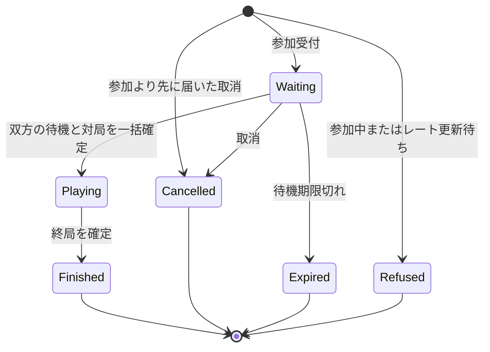

# マッチメイキング

この文書は実装済みの状態モデル、受付と対局作成のトランザクション契約を記述する。
ユーザーがルールを選んで待機し、近いレーティングの相手と対局を開始できるようにする。
全ルールを通じ、1ユーザーの待機または進行中の対局は合計1つに制限する。

## 利用者から見た動作

1. ログイン済みのユーザーがルールを選び、待機チケットを作る。
2. 待機中は状態の取得と有効期限の更新を行う。取消もできる。
3. サーバーが同じルールの相手を選び、双方の待機を同じ対局へ切り替える。
4. 状態取得で対局IDと先後を受け取り、既存の `/ws/games/{game_id}` に接続する。
5. 再読込後は自分の状態を取得し、待機または対局へ戻る。

相手、先後、対局ID、レーティングはサーバーが決める。
クライアントはルールとチケットIDだけを指定する。
初版は既存の `ten_minute_30` と `byoyomi_30` のレート対局を対象にする。
カジュアル対局用の新しい受付は追加しない。
持ち時間はルール識別に使い、時計の進行、時間切れ、切断による敗北は実装しない。

## 現行実装との接続

現行の `rating_slots` は `(user_id, pool)` を主キーとする。
ルールごとのレート枠を終局後もレート反映まで保持する。
全ルール共通の同時参加制限は `matchmaking_tickets` で管理する。
したがって、このテーブルを全ルール共通の待機・対局制限に転用しない。

`game-persistence::matchmaking` は対局、開始時レート、双方のレート枠とチケットを同一トランザクションで作る。
`GameRepository::commit_change` は終局結果、受理記録、outbox、レート更新ジョブを同時に確定する。
新しい受付はこのDB境界を利用する。
Game actor は保存済み対局を遅延復元できるため、マッチ成立時のactor起動を成功条件にしない。

Gateway は User Service の `/me` でCookieを認証し、認証結果のUserIdで内部gRPCを呼ぶ。
GatewayにDB接続を追加しない。
公開棋譜とレーティングを返す `player-http` は読み取り専用のまま扱う。

根拠は [参加とレート更新の保存処理](../../crates/game-persistence/src/rating.rs)、[対局の確定処理](../../crates/game-persistence/src/lib.rs)、[Gatewayの認証](../../crates/realtime-gateway/src/auth.rs)、[依存境界の検査](../../scripts/check-boundaries.py)にある。

## チケットを状態機械として保存する

待機と進行中の対局を同じチケットの状態で表す。
レート更新用の `rating_slots` は独立して残す。



新設する `matchmaking_tickets` は次の情報を持つ。

| 情報 | 用途 |
| --- | --- |
| `user_id`, `ticket_id` | 所有者とクライアント生成UUIDの複合主キー。再送時にも維持する。 |
| `pool` | 選んだルール。参加受付後は変更しない。先行取消の記録だけは未指定を許す。 |
| `state` | `waiting`, `playing`, `finished`, `cancelled`, `expired`, `refused`。 |
| `enqueued_at`, `expires_at` | DB時刻による待機順と期限。 |
| `rating`, `completed` | 待機受付時に読んだ当該ルールの確定レート。未対局は実効1500。 |
| `game_id`, `side` | マッチ成立時に確定する対局と先後。終局後も保持する。 |
| `refusal_reason` | `already_waiting`, `already_playing`, `rating_pending` の保存済み拒否理由。 |
| `heartbeat_seq` | 最後に受理した期限更新の連番。待機開始時は0。 |

`user_id` に、`state IN ('waiting', 'playing')` の部分一意インデックスを設ける。
これが全ルール共通の同時参加制限になる。
同一ユーザーによる異なるルール・異なるチケットの並行参加もDBが拒否する。
状態ごとの必須項目をCHECK制約で固定し、`game_id` に外部キーを付ける。
`(game_id, side)` も一意にし、1対局の同じ先後に複数チケットを割り当てない。
待機検索用にルール・受付順とルール・レートの部分インデックスを設ける。

`Model the Domain` に従い、待機と対局の独立したフラグを作らず、排他的な状態と一意制約で表す。
`Foundational Thinking` に従い、ユーザー別の復帰、相手選択、終局時の解放をこの構造から導く。
別の全ルール共通参加枠テーブルは設けない。

## APIと再送

ブラウザー向けにGatewayへ次のHTTP APIを追加する。
全操作でCookieを認証し、IDを認証済み所有者の範囲で解釈する。
照会で自分のチケットがなければ404とし、他人の同じUUIDについての情報は返さない。
変更要求はOrigin・Hostを検証し、クロスサイトから受け付けない。
GETは状態の取得だけを行い、待機期限を更新しない。

| 操作 | 要求 | 成功時の意味 |
| --- | --- | --- |
| 参加 | `PUT /matchmaking/tickets/{ticket_id}` と `{ "pool": "ten_minute_30" }` | 新しい待機、または同一要求の保存済み状態を返す。 |
| 自分の状態 | `GET /matchmaking/me` | `idle`, `waiting`, `playing` のいずれかを返す。 |
| チケット照会 | `GET /matchmaking/tickets/{ticket_id}` | 終端状態を含め、その要求の現在の結果を返す。 |
| 待機継続 | `POST /matchmaking/tickets/{ticket_id}/heartbeat` と `{ "sequence": 1 }` | 新しい連番に限って有効な待機の期限を延ばす。 |
| 取消 | `DELETE /matchmaking/tickets/{ticket_id}` | 対象チケットだけを取り消す。 |

内部gRPCには対応する参加・状態取得・期限更新・取消を追加する。
候補選択や対局作成を直接呼べるRPCは公開しない。
`deploy/realtime.Caddyfile` に `/matchmaking/*` のGateway転送を追加する。

同じ所有者・チケットID・ルールの参加再送は、保存済みチケットを返す。
再送によって受付順や期限を更新しない。
取消済み・期限切れ・対局終了済みでも再入場させない。
同じIDでルールを変えた要求は409とする。
他の有効チケットがある場合は409の `already_waiting` または `already_playing` とする。
当該ルールのレート枠が残る場合は409の `rating_pending` とする。
これらの受付拒否も終端状態の `refused` チケットとして保存し、同じIDの再送には同じ409と拒否理由を返す。
先の待機やレート更新が終わっても、古い拒否要求を再入場させない。
改めて参加する際は新しいIDを使う。
参加成功は初回201、同じIDの成功再送は200とし、現在の状態を返す。
取消・期限切れ・終了済みの再送も200でその状態を返す。
503や応答喪失の場合は同じIDで再送または照会して結果を確かめる。

マッチ成立後の取消は409の `already_matched` とし、確定した対局IDを返す。
取消済み・期限切れの取消再送はその終端状態を返す。
存在しない所有者内のIDへの取消は `cancelled` の記録を作って200を返す。
参加より取消が先に届いても、後着の同じIDの参加を実行しない。
この先行取消だけはルール未指定で保存し、後着の参加はルールにかかわらず取消済みとして返す。
他ユーザーの同じUUIDとは所有者別の要求として扱う。
古いチケットへの取消・heartbeatは、新しいチケットを変更しない。

`Make Operations Idempotent` に従い、保存済みチケットを再送結果の根拠にする。
初版では受け付けたチケットの終端履歴を削除しない。
削除を導入する際は、古い参加要求の再実行を防ぐ保存期間と契約を別途決める。
`/me` の `idle` はレート更新の完了を意味しない。

## レーティングによる相手選択

次の値は初期案であり、性能測定や利用実績に基づく値ではない。

- 同じルール同士だけを組み合わせる。
- レーティングはクライアント入力を使わず、当該ルールの確定値を使う。未対局者は1500とする。
- 各ユーザーの許容レート差は受付時に100とし、待機30秒ごとに50ずつ広げ、上限を400とする。
- 双方の許容差を満たす場合だけ成立させる。長時間待った側の許容差を新規参加者に強制しない。
- 相手がいるチケットのうち、受付順が最も古いものを起点にする。
- 起点の相手はレート差が最小のチケットとする。同値なら受付順、チケットID順で決める。
- 起点に相手がいなければ次のチケットを調べる。先頭1件の不成立でルール全体を停止させない。
- 先後は公平な乱数で決め、マッチ成立時に保存する。再取得時には変更しない。

許容差に上限を設けるため、相手がいなければ成立を保証しない。
レート差は `i128` で計算し、既存の `i64` レート範囲で差分があふれないようにする。
初版の検索は正しい受付順を優先する。
候補件数を固定して先頭だけを繰り返す方式は採用しない。
待機者が多い場合の検索コストは未検証であり、必要になれば公平性を維持したページ走査を設計する。

## 期限と定期処理

待機期限は最終heartbeatから30秒、heartbeatの推奨間隔は10秒を初期案とする。
heartbeatは有効な `waiting` に限って更新する。
クライアントはチケット内で増加する連番を付け、同じ要求の再送には同じ連番を使う。
連番は1から `i64::MAX` までとし、入力境界で検証する。
保存済み以下の連番は状態を返すだけで期限を延ばさない。
より大きい連番を受理したときだけ、ロック取得後のDB時刻から30秒へ更新する。
再読込時は保存済み連番を取得して続ける。受付順は変えない。
期限切れのチケットを復活させず、新しく参加する場合は新しいIDを使う。
更新と判定には、必要なロックの取得後に読む `clock_timestamp()` を使う。
トランザクション開始時刻を固定する `now()` または `CURRENT_TIMESTAMP` を使わない。

Gatewayの切断だけでは待機を取り消さない。
切断検出に依存せず、未更新の待機は期限切れにする。
切断直後でも有効期限内なら成立する可能性がある。
`playing` へ遷移した後はheartbeatと待機期限の対象から外す。
対局中の切断で枠を解放せず、現行の終局手段である詰みまたは投了まで保持する。
時計がスコープ外であるため、操作されない対局は自動終了しない。

`game-server` 内に両ルールを処理する定期ループを置く。
初期案では1秒ごとに期限切れ処理と相手選択を試み、新しい参加がなくても許容差の拡大を反映する。
ルールの処理順を交互にし、1回の起動で最大32組まで、1組ごとに別トランザクションで確定する。
一方のルールだけで処理を使い切らないよう、成立を試すルールを組ごとに切り替える。
これは実行間隔の設定であり、1秒以内の成立を保証するものではない。
DB障害時は成立を確定せず、復旧後に保存済み状態から続ける。
ループの連続失敗をログと稼働状態から確認できるようにする。
初版の結果通知は状態ポーリングとし、新しいValkey購読や通知イベントは追加しない。

## トランザクションと競合

初版は両ルール共通のPostgreSQL advisory transaction lockで参加に関する更新を直列化する。
参加、取消、heartbeat、期限切れ、マッチ成立、終局のトランザクションが最初にこのロックを取る。
通常の着手とレートワーカーは取得しない。
ロックキーはスキーマ初期化用の既存キーと区別する。
複数の `game-server` が動いても同じロックを共有する。
全ルール共通の部分一意制約も残し、更新処理の誤りでも重複を拒否する。
対局行やチケット行をロックしてから、この共通ロックを取りに行かない。

参加受付では、まず共通ロック下で保存済みの同一要求を照合する。
既存要求が期限切れの待機なら、終端化して `expired` を返す。
新規参加なら同じユーザーの期限切れ待機を行ロック下で終端化する。
次に有効チケットと、レート状態をロックして当該ルールの枠がないことを確認する。
チケットの挿入と受付時レートの保存を同一トランザクションで行う。
拒否の場合も理由を同じトランザクションで保存してから応答する。
一意制約違反などで再試行する場合も、単なる照会で拒否を返さず、要求の保存まで完了させる。

マッチ成立は以下を同一トランザクションで行う。

1. 共通ロックを取り、期限切れを終端化して成立候補を検索する。
2. 双方のチケットを `(user_id, ticket_id)` 順でロックする。
3. ロック後のDB時刻で、双方がまだ有効な待機であることを確認する。
4. 双方のレート状態を既存処理と同じUserId順でロックし、当該ルールの枠と開始レートを再確認する。
   開始レートは `rating` と `completed` の両方を受付時の完全な `RatingState` と照合する。
5. 全ロック待ちの後にDB時刻を取り直して期限と双方の許容差を再確認する。ここを成立判断時点とする。
6. 対局IDと先後を決め、対局、開始レート、双方の `rating_slots` を作る。
7. 双方のチケットを同じ対局の `playing` に切り替える。
8. 全体をコミットする。不明な応答はチケットから回復する。

途中で失敗した場合は双方とも待機のままで、片側だけの対局や枠を残さない。
既存のトランザクションを開く `rating::admit` を後から別呼び出しする構成にはしない。
同じトランザクションを受け取る非公開の対局作成処理へ整理する。
チケットを持たない任意の2人から対局を作る公開メソッドは残さない。

終局は共通ロックを最初に取り、既存の対局行を更新した後、双方のチケットを同じ複合キー順でロックする。
当該対局の `playing` を `finished` へ切り替える。
結果、受理記録、outbox、レートジョブと同じトランザクションで全ルール共通の制限を解放する。
通知やactor終了のコールバックから解放しない。
双方2件が正しい対局を参照することを検証し、不整合なら全体をロールバックする。
既存の終局再送は受理記録から返し、新しいチケットには触れない。

取消、heartbeat、期限切れ処理も共通ロックを先に取り、対象のチケットをロックして状態を再確認する。
マッチと取消は先に確定した方が有効になる。
マッチ側がロックを取るまでに期限が過ぎていれば成立させない。
期限切れの掃除が遅れていても、状態取得で期限切れを検出したら共通ロック下で再確認して終端化し、結果を読み直す。
次の参加も古い待機を終端化してから受け付ける。

ロック順は、マッチが共通ロック、チケット複合キー順、レートUserId順、新規対局作成の順となる。
終局は共通ロック、既存対局、チケット複合キー順となる。
レートワーカーは現行どおりジョブ、レートUserId順を使い、チケットをロックしない。
マッチ側は既存対局をロックしないため、終局の対局ロックと循環させない。
デッドロックまたはシリアライズ失敗は、トランザクション全体を再試行する。

## 終局とレート更新の関係

終局時にチケットを `finished` にしても、`rating_slots` は削除しない。
既存ワーカーが開始時レートを検証し、双方のレートと台帳を更新してから削除する。

したがって、終局後は別ルールへ参加できる。
同じルールへはレート反映まで `rating_pending` を返す。
これにより、古いレートを開始値にして次の同ルール対局を作ることを防ぐ。
レートジョブが隔離された場合も、そのルールの参加は復旧まで停止する。
全ルールの対局枠をレート更新待ちのために保持し続ける方式は採らない。

## モジュールと型の案

`game-application::matchmaking` に型、純粋な相手選択規則、受付契約を置く。
`game-persistence::matchmaking` が受付とマッチ成立のトランザクションを所有する。
`game-grpc` は内部通信、`realtime-gateway` はCookie認証とHTTPへの変換を担う。
`apps/game-server` が既存のストアを使って定期処理を起動する。
新しいサービス、DB、broker、crateは追加しない案とする。

次はインターフェースのスケッチであり、Rustの実装ではない。

```rust
enum TicketState {
	Waiting { pool: Pool, enqueued_at: DbTime, expires_at: DbTime },
	Playing { game_id: GameId, side: Player },
	Finished { game_id: GameId, side: Player },
	Cancelled,
	Expired,
	Refused(RefusalReason),
}

enum Participation {
	Idle,
	Waiting(Ticket),
	Playing { ticket_id: TicketId, game_id: GameId, side: Player },
}

trait MatchmakingRepository {
	async fn join(&self, user: UserId, ticket: TicketId, pool: Pool) -> Result<Ticket, MatchmakingError>;
	async fn current(&self, user: &UserId) -> Result<Participation, MatchmakingError>;
	async fn ticket(&self, user: &UserId, ticket: &TicketId) -> Result<Ticket, MatchmakingError>;
	async fn heartbeat(&self, user: &UserId, ticket: &TicketId, sequence: HeartbeatSequence) -> Result<Ticket, MatchmakingError>;
	async fn cancel(&self, user: &UserId, ticket: &TicketId) -> Result<Ticket, MatchmakingError>;
	async fn tick(&self, pool: Pool) -> Result<MatchProgress, MatchmakingError>;
}
```

対局作成、開始値の固定、待機の消費はこの契約の内側に隠す。
呼び出し側に複数の更新を順番に呼ばせない。

## 直接対局作成APIの削除

`CreateGame` と `CreateRatedGame` のRPC、要求型、ハンドラを削除する。
`GameService::create`, `create_rated` と、任意参加者による公開repository作成メソッドも削除する。
`GetRatedGame` の旧作成照合用途はチケット照会に置き換え、他の用途がなければRPCを削除する。
レート処理に必要な保存済み対局情報の内部取得は残す。

`play`, `persistence_proof`, `outbox_proof`, `rating_proof` のサンプルを待機経由へ移す。
TCPテスト、Gatewayのテスト用RPC転送、repository wrapper、契約テストも更新する。
低層テストで必要な保存データの構築はテスト側に閉じ、製品APIに迂回路を残さない。
特に「異なるルールなら同じユーザーで同時対局可能」という既存テストを、新しい禁止契約へ変更する。
README、API仕様、レーティング仕様、OpenAPI生成も受付方式に合わせる。

削除範囲は `rg -n 'create_game|create_rated|CreateGame|CreateRated'` で確認する。
同じ実装変更の中で呼び出し側まで移行し、旧APIとの併存期間を作らない。

## スキーマと導入

現行の新規DB初期化方針を維持し、スキーマをバージョン7へ進める案とする。
バージョン6からの自動移行やデータ削除は追加しない。
既存DBは変更せずに起動を拒否し、新しい空DBを用意する既存手順を更新する。
既存データを継続利用する導入が必要なら、移行と稼働中対局の整合確認を実装前に別途設計する。
旧writerと新writerを同じDBへ混在させない。
新テーブルへのSELECT権限を公開readerへ与えない。
スキーマ検証、fixture、権限・デプロイ検査を更新する。

## 比較と設計判断

| 構成 | 評価 |
| --- | --- |
| 既存writer内の定期処理とチケット状態機械 | 採用候補。待機消費と対局作成を一括確定し、新サービスを増やさない。 |
| 独立coordinatorと参加枠・要求履歴 | 同じDBを使えば一括確定できるが、参加枠の同期と配備対象が増える。 |
| Valkeyの待機列から直接対局作成RPCを呼ぶ | 待機消費と対局作成の間に障害点ができ、DBをまたぐ回復手順が必要になる。 |

`Laziness Protocol` に従い、同じ原子性を既存writerで実現できるため独立coordinatorを追加しない。
基案は候補Aの単一チケット、共通ロック、拒否履歴、先行取消、既存writer内の定期処理とする。
候補Bからはレート差の `i128` 計算、最も近いレートを選ぶ規則、ロック待ち後の時刻確認を取り込む。
独立した設計レビューも候補Aを推奨した。
ルール単位のロック分割は、共通ロックの競合を計測してから検討する。
この案は少ないAPIの内側に、重複防止、候補選択、対局作成、再送回復をまとめる。
待機件数が多い場合の性能と、終端チケットを保持し続ける容量は未検証である。
共通ロックによるheartbeatや終局の待ち時間も未検証であり、初版の負荷確認に含める。

## 実装順序と検証

実装前の停止条件は、この設計の確認である。
先に状態・制約・トランザクション境界を確定し、次の単位で進める。

1. 状態型、純粋な候補選択、スキーマと受付・取消・期限更新を作り、DBの重複制約を確認する。
2. マッチ成立と終局解放を一括確定し、実PostgreSQLで並行操作と再起動を確認する。
3. 内部gRPCとGateway、Caddy経路を接続し、ブラウザーの認証と状態回復を確認する。
4. 直接作成APIと呼び出し側を同じ変更で移行・削除し、契約・ドキュメント・配備検査を通す。

保存処理はチケットと対局・レートを横断するため、1つの担当が整合性を所有する。
契約確定後にHTTP変換とドキュメントを独立して進められる。
同じ作業ツリー内の保存処理を複数の担当が同時編集しない。

実装の完了条件は次の観測可能な振る舞いとする。

- 同一ユーザーの別ルール参加が競合しても、有効チケットは1つだけになる。
- 同じ相手候補に複数workerが競合しても、対局と双方のチケットは1組だけ確定する。
- 成立の途中失敗で、片側チケット、対局、開始レート、レート枠の部分確定がない。
- 参加・成立の応答喪失とサーバー再起動後に、同じIDまたは自分の状態から復帰できる。
- 拒否済み要求の再送が後から参加せず、参加より先に届いた取消も再入場を防ぐ。
- 取消・期限更新・期限切れ・成立の競合が規定どおり決まり、古い操作が次の参加を変更しない。
- 同じまたは古い連番のheartbeatで期限が延びず、ロック待ち中に期限が過ぎた待機が成立しない。
- 新規参加なしで許容差が拡大し、先頭の不成立が後ろの成立可能な組を止めない。
- 未対局者、許容差境界、双方の許容差、同値時の順序、レート極値を正しく扱う。
- 終局後は全ルール共通制限を解放し、同ルールはレート反映後、別ルールは反映前でも参加できる。
- レートジョブの再試行・隔離・適用済み照合が、新しいチケットとレート枠を壊さない。
- 未認証、他人のチケット、クロスサイト変更を拒否し、公開readerの権限と依存境界を維持する。
- 本番向けRPCと公開Rust APIに直接作成の迂回路が残らず、サンプルも待機経由で動く。

状態型、純粋な選択規則、DB制約、受付・成立・終局、内部RPC、Gateway、定期処理を実装した。
旧直接作成APIと呼び出し側を同じ変更で移行・削除し、実PostgreSQLの競合・ロールバック・回復テストで契約を検証する。
