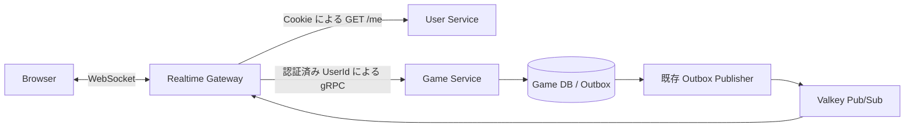

# Realtime Gateway の設計案

本書は確認済みの設計と初版の実装範囲を記録する。実際の通信形式と起動方法は [Gateway README](../../apps/realtime-gateway/README.md) を参照する。
ブラウザーから認証済みユーザーが着手・投了し、対局者と観戦者が同じ対局の更新を受信するための Gateway を追加する。
設計確認後に実装した。

## 対象と利用方法

同一 origin の `GET /ws/games/{game_id}` で WebSocket を開く。
一つの接続は一つの対局を扱う。複数の対局を見る場合は接続を分ける。
接続時に現在局面を受け取り、以降は着手と終局の通知を受け取る。
対局者は同じ接続から着手・投了できる。観戦者は読み取りのみとなる。

初版の観戦方針は、ログイン済みユーザーが公開対局を観戦でき、非公開対局は対局者だけが閲覧できるものとする。
匿名観戦と観戦一覧検索は含めない。
対局作成は既存の内部 API を使う。

配信の並列化、定期的な局面同期、マッチング、Presence、Shard、Lease・Fencing、Game Router は対象外とする。
Game Service の接続先は設定された一つの gRPC endpoint に固定する。

## 既存の契約

- [対局 gRPC](../../crates/game-grpc/README.md) は内部呼出元の `user_id` を信頼する。Gateway が認証結果から設定する必要がある。
- [ユーザー認証](../adr/0002-browser-authentication.md) は不透明な Cookie とサーバー側セッションを使う。既存の `GET /me` が失効・有効期限を確認してユーザーを返す。
- [イベント生成](../../crates/game-application/src/events.rs) は着手受理と同時に確定する。詰みの着手は同じ `seq` の `move_committed` と `game_finished` を生成する。
- [配信アダプター](../../crates/game-messaging/src/lib.rs) は対局別の Valkey Pub/Sub channel に通知する。通知は重複・欠落し得る。
- [DB](../../crates/game-persistence/src/schema.rs) は `public` と `private` を保持する。現在の `GetSnapshot` は閲覧者と公開範囲を扱わない。

## 構成と責務



Gateway は認証、通信形式の変換、購読と接続の管理を所有する。
合法手、手番、参加者の判定、操作の冪等性、保存は Game Service が所有する。
Gateway はユーザー DB と対局 DB の資格情報を持たない。

新規追加は `apps/realtime-gateway` と `crates/realtime-gateway` を基本とする。
app は設定と起動・終了を扱い、crate の非公開モジュールが protocol、connection、認証 HTTP、対局 gRPC、購読を扱う。
状態機械をテストできる小さな境界を設けるが、単なる転送用の application crate は追加しない。
`game-messaging` に既存通知形式の decoder と購読アダプターを追加し、送受信の契約を同じ場所で検証する。

## 認証と接続後の失効

本番では認証 HTTP と WebSocket を同じ HTTPS origin の reverse proxy 配下に置く。
`__Host-user_session` の発行元 host と WebSocket の host を合わせる。
開発時だけ、既存と同じ明示的な loopback HTTP 設定と `user_session` を使う。

Upgrade 前に設定済み origin との完全一致を確認する。
Origin の欠落・重複・不一致と、不整合な `Sec-Fetch-Site` を拒否する。
セッション Cookie は一個だけを許可し、既存形式に合う値だけを受け付ける。
URL、メッセージ、クライアント指定の `user_id` で認証しない。

Gateway は固定の内部 User Service URL に、対象セッション Cookie だけを転送して `GET /me` を呼ぶ。
リダイレクトは追跡せず、応答サイズとタイムアウトを制限する。
Cookie はログとエラーに含めない。Google への通信や新しいトークン発行は追加しない。

接続時、受信した操作の実行直前、送信待ちキューから局面・通知・受理結果を取り出して送る直前にセッションを確認する。
返却された UserId は接続時の UserId と一致する必要がある。
認証結果はキャッシュしない。失効・期限切れは接続を閉じ、User Service 障害時も認証済みとして続行しない。

定期的な認証タイマーも初版には追加しない。
ログアウト後の無通信接続は残り得るが、次の操作やデータ送信時に再確認する。
確認が成功した直後のログアウトと、既に進行している一件の送信・操作との競合は許容する。
ログアウト完了と同時に全接続を閉じる保証は含めない。

## 閲覧権限を Game Service で判定する

内部 API に次の二つを追加する案とする。

| API | 入力 | 結果と責務 |
| --- | --- | --- |
| `GetSnapshotForViewer` | `game_id`, `viewer_user_id` | 公開範囲と参加者を確認して Snapshot を返す。存在しない対局と閲覧不可は同じ NotFound にする。 |
| `CheckViewAccess` | `game_id`, `viewer_user_id` | 局面を取得せずに同じ閲覧規則を確認する。通知送信前の確認に使う。 |

両 API は同じ application の閲覧ポリシーを使用する。
公開ならログイン済みの閲覧者、非公開なら対局者だけを許可する。
公開範囲は repository から毎回読み、局面の `seq` が変わらないことを理由に過去の権限を使わない。
`GetSnapshotForViewer` は一貫した DB 読取りで参加者・公開範囲・履歴を取得し、その結果から権限と Snapshot を構築する。
初版はこの閲覧用要求に既存 actor の seq のみのキャッシュを使わず、権限を確認した履歴から復元する案とする。
失敗時に過去の権限や局面で代用しない。

通知送信前にも `CheckViewAccess` を呼ぶ。権限がなくなった接続は閉じる。
権限確認後にすでに始まった送信と公開範囲変更との競合は、認証と同様に許容する。
公開範囲変更 API は今回追加しない。
この提案は、既存の棋譜公開範囲をリアルタイム観戦にも適用するという製品上の選択を含む。

着手・投了の参加者チェックは既存 Game Service が行う。
Gateway はクライアントから UserId や先後を受け取らず、認証結果の UserId を設定する。
既存の未認証 gRPC は公開せず、Gateway などの信頼された内部呼出元だけが到達できる配置を維持する。

## ブラウザーとのメッセージ

WebSocket subprotocol は `shogi.realtime.v1` とする。
以下はメッセージの形の例であり、実装時に全フィールドとエラーを protocol の仕様に固定する。
64 bit の `seq` と `expected_seq` は、JavaScript で精度を失わないよう JSON の十進文字列にする。

```json
{"type":"move","request_id":"client-generated-id","expected_seq":"0","usi":"7g7f"}
```

| 方向 | type | 主な内容 |
| --- | --- | --- |
| Client → Gateway | `move` | `request_id`, `expected_seq`, `usi` |
| Client → Gateway | `resign` | `request_id`, `expected_seq` |
| Gateway → Client | `snapshot` | `game_id`, `seq`, 盤面、持駒、手番、王手、結果、合法手、対局者 |
| Gateway → Client | `accepted` | 対応する `request_id`, `seq`, 王手、結果 |
| Gateway → Client | `event` | `event_id`, `game_id`, `seq`, 種別、着手または終局結果 |
| Gateway → Client | `error` | 対応する要求 ID があればそれと安定したエラーコード。古い seq には `actual_seq` を含む。 |
| Gateway → Client | `resync_required` | 再接続が必要な理由。送信不能ならそのまま close する。 |

内部イベントの `request_id` と操作ユーザーの識別子をそのまま観戦者へ転送しない。
通知 DTO はブラウザー向けに変換する。参加者 ID は Snapshot の既存情報として含める。
通知は一件ずつ渡すため、通常時には相手の着手 USI を取得できる。

`accepted` は保存済みの操作結果であり、局面ストリームを進める通知ではない。
ブラウザーは `snapshot` と `event` で局面を更新し、`accepted` で要求の完了を管理する。
通知が受理応答より先に来てもよい。
タイムアウトや応答欠落では、同じ `request_id`・元の `expected_seq`・同じ操作を再送する。
Gateway は不明な結果を拒否済みと断定せず、別 ID で再実行しない。
切断は実行中の操作の取り消しを意味しない。

不正入力、非参加者、要求 ID の内容不一致、古い seq、手番・合法手などの拒否、結果不明な障害を区別する。
保存破損や内部エラーは内部詳細を漏らさず接続を閉じる。
古い seq を受け取ったクライアントは再接続して Snapshot を取得する。

## 購読と局面取得の競合

接続ごとに一つの正確な対局 channel を購読する。
全対局の pattern subscribe と、購読を共有する中央 registry は導入しない。
一つの接続内の通知配信は直列にする。
複数接続を扱う I/O タスクは必要だが、Publisher の並列化や分散 fanout は追加しない。

1. 認証と閲覧権限を確認する。
2. Valkey の SUBSCRIBE 完了応答を待つ。
3. 上限付きキューで通知を受信しながら `GetSnapshotForViewer` を呼ぶ。
4. Snapshot を最初に送る。送信前にも認証を確認する。
5. Snapshot の `seq = N` 以下の通知を捨て、後続を順に送る。N 以下の終局も Snapshot の結果に含まれる。

データ形は `ConnectionState = Bootstrapping | Live(Cursor) | Closing` とする。
`Cursor` は Snapshot の境界、最後の操作 seq、同じ seq で既に見たイベント種別・内容と終局状態を保持する。
同じ seq で保持するイベントは最大二件であり、接続中の全履歴を保持しない。
状態遷移とイベント検証を純粋な関数として検証する。

通常の着手と投了は `last_seq + 1` を受け付ける。
単独で seq を進める `game_finished` は投了結果に限る。
詰みの着手に続く `game_finished` は同じ seq で受け付ける。
重複は `(game_id, seq, kind)` で判定する。`seq` だけでは判定しない。
古い通知は局面を巻き戻さず捨てる。
連番の飛び、詰みの着手を欠いた終局、種別と結果の矛盾、未知の schema は再同期が必要な状態として扱う。
同じイベントの矛盾した内容も通常の重複として扱わない。
再同期が必要なら接続を閉じ、再接続時に新しい Snapshot を送る。

Valkey 切断を自動再接続で隠してストリームを継続しない。
切断・キュー溢れ・購読異常ではブラウザーの接続も閉じる。
再接続時の指数 backoff と jitter はクライアント契約に含める。

定期同期がないため、最後の通知だけが欠落し、後続通知も切断検知もない場合は検出できない。
接続中の全イベントの受信、全着手の履歴復元、最終局面への自動収束は保証しない。
初期局面の取得、検出できた欠落からの復旧、利用者が再接続することによる現在局面の取得までが今回の保証となる。

## 上限と障害時の扱い

初期値案は、受信メッセージ 4 KiB、送信 Snapshot 256 KiB、購読キュー 64 件、送信キュー 64 件とする。
接続総数 256、ユーザー単位 8 接続、接続単位の未完了操作は一件を上限とする。
これらは性能測定結果ではなく、設定可能な資源保護の初期値である。
受信レート上限も設け、軽量な不正入力で認証 HTTP を無制限に呼ばせない。

依存サービスの要求と WebSocket 書込みには期限を設ける。
キューの件数だけでなく、入力フレームと通知のサイズにも上限を設ける。
受信タスクは外部 RPC や遅い socket 書込みを待たず、満杯になったら接続を閉じる。
無制限の task spawn やコマンド待ち行列を作らない。
socket の writer は一つにし、送信直前の認証・閲覧確認と順序をそこに集約する。
終了時は新規 Upgrade を止め、接続・購読・タスクを期限内に終了する。

この構成はブラウザー接続数に比例して Valkey 接続数と認証要求が増える。
大量観戦への最適化よりも、接続ごとの状態と障害を独立させることを初版で優先する。

## 比較した構成と統合判断

| 案 | 利点 | 今回の判断 |
| --- | --- | --- |
| 接続別購読と差分イベント | 着手ごとに USI を届け、購読開始の競合を接続内で管理できる | 基本案に採用する。 |
| 接続別購読と通知ごとの Snapshot 取得 | 差分の適用順序を減らせる | 複数の着手を一局面にまとめ得るため、相手の着手受信には差分案を選ぶ。 |
| 共有購読と単一 dispatcher | 同一対局の観戦者が多いと Valkey 接続を節約できる | registry、購読参照数、再接続世代を追加するため後回しにする。 |
| Gateway からユーザー DB を読む | 認証 HTTP の往復を省ける | セッションの所有境界を維持するため採用しない。 |
| Gateway から対局 DB の公開範囲を読む | 既存 gRPC を変更せずに済む | 閲覧規則を Game Service に集約するため採用しない。 |

独立した二案を比較し、差分イベント案を基本にした。
第三のエージェントによる比較レビューも同案を支持した。
レビューで指摘された同一 seq の順序と重複判定は、結果種別の検証と最大二件の内容保持で補った。
Snapshot 案から、定期タイマーを増やさず送信直前に認証する方式と、Game Service 側で閲覧を管理する方針を取り入れた。
Boundary Discipline に従い、認証済み UserId と外部入力の検証を Gateway の境界に置く。
Model the Domain に従い、購読開始・配信中・切断中を状態と Cursor で表す。

## 実装順と確認項目

設計確認が最初の工程となる。その後は次の単位で実装・検証する。

1. 閲覧ポリシーと内部 API、ブラウザー向け protocol、通知 decoder の契約を確定する。
2. 認証付き Upgrade と接続状態機械を実装する。
3. gRPC による着手・投了、Valkey 購読、初期 Snapshot と差分通知を接続する。
4. Compose、Dockerfile、README、未完成項目を更新し、実サービスを使う結合テストを行う。

認証とイベント変換は契約確定後に独立して作業できる。
共有する接続状態機械と公開 protocol の変更は一人の実装担当に集約する。
今回の設計文書は親エージェントだけが編集し、比較案は別ファイルに分けた。

検証には次を含める。

- 実 Cookie による接続、Origin 不正、Cookie 重複、失効、期限切れ、送信待ち中のログアウト、認証障害。
- 対局者の着手・投了、観戦者の操作拒否、UserId 偽装、非公開対局と不存在の識別不能性。
- 購読完了と局面取得の間の着手、同じ seq の詰みと終局、重複、順序の乱れ、飛んだ seq。
- 操作応答を失った後の同一要求再送と、受理通知が先に来る場合。
- Valkey 切断、遅い閲覧者、キュー上限、巨大フレーム、依存サービスのタイムアウト、終了処理。
- 最後の通知だけを失ったケースでは自動復旧を主張せず、再接続で保存済み局面を取得できること。

性能検証と本番ネットワークの検証は、この文書を書いた時点では行っていない。
初版では Valkey 購読に RESP3 の上限付き push receiver を使う。Redis ライブラリがフレームを復号する前のメモリ使用量はここで制限できない。ブラウザー向けの通知は復号後に 4 KiB を上限として検証する。
