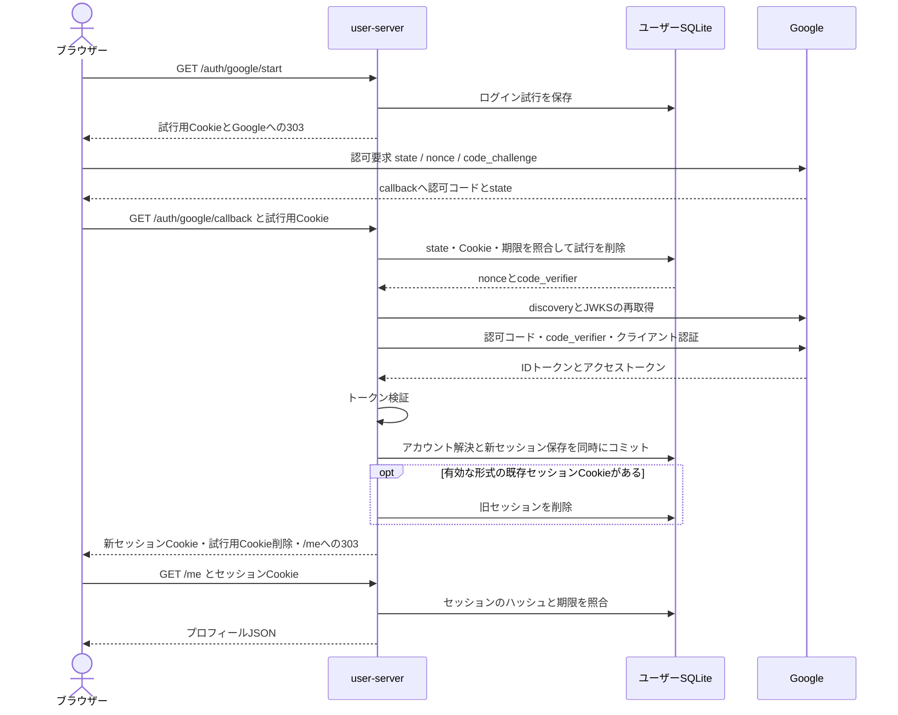

# ユーザー認証の設計

更新日: 2026-11-03。現行実装の採用方式と責務を説明する。Google クライアントの設定、`.env`、起動手順は [user-server の README](../../apps/user-server/README.md) にまとめる。

## 採用方式

Google OpenID Connect の Authorization Code Flow に PKCE S256 を組み合わせる。ブラウザーを Google へリダイレクトし、戻された認可コードをバックエンドでトークンへ交換する。検証済みの Google 識別子から内部アカウントを解決し、アプリケーション独自の Cookie セッションを発行する。

Google による本人確認と、このアプリケーションへのログイン状態は別に管理する。Google の ID トークンやアクセストークンを、以後のアプリケーション API の認証資格情報には使わない。Google の方式は[公式 OpenID Connect ドキュメント](https://developers.google.com/identity/openid-connect/openid-connect)、PKCE の仕様は [RFC 7636](https://www.rfc-editor.org/rfc/rfc7636)を参照する。

この設計が扱うのは、初回ログイン時の登録、再ログイン、プロフィール取得・表示名変更、ログアウトである。ユーザー管理の公開インターフェースは HTTP とする。対局処理とは独立したプロセス・crate・SQLite を持つ。

### この方式を選んだ理由

| 判断 | 採用理由と引き受ける制約 |
| --- | --- |
| バックエンドで認可コードを交換する | Google とのコード交換とトークン検証をサーバー側に集約する。フロントエンドに Google トークンの取得・送信処理を要求しない。一方で、リダイレクトと一時的なログイン試行の保存が必要になる。 |
| PKCE、state、nonce を併用する | コード交換、ブラウザーとの対応、ID トークンとの対応をそれぞれ検証する。クライアントシークレットだけに依存しない。 |
| 独自の不透明なセッションを使う | DB の行を削除してログアウトでき、有効期限もサーバー側で確認できる。自己完結した JWT セッションと比較して、保護された要求ごとの DB 照会が必要になる。 |
| 初回ログインを登録と兼ねる | 呼出元が任意の内部ユーザー ID を登録する API をなくし、Google で確認した識別子にアカウントを対応付ける。 |
| ユーザー DB を対局 DB から分離する | 認証・プロフィール・セッションの保存をユーザーサービスが所有する。対局作成とアカウント存在確認を単一 DB トランザクションで保証する構成は採用しない。 |
| ユーザー管理に gRPC を追加しない | 現在の利用者はブラウザーのログインとプロフィール API であり、HTTP で必要な操作を提供できる。内部サービス向けの新しい利用要件は今回の対象に含めない。 |

## 識別子と資格情報

| 値 | 意味と使い方 |
| --- | --- |
| Google の `iss` と `sub` | 外部アカウントの識別子。検証後の組を内部アカウントへ対応付ける。現在の issuer は `https://accounts.google.com` に固定する。 |
| 内部 `UserId` | 初回登録時に UUID v4 で生成するアプリケーションの識別子。プロフィールと対局参加者が参照する。これ自体には認証能力がない。 |
| ID トークン | Google が発行した本人確認情報。バックエンドで検証して外部識別子と初期表示名を取り出す。アプリケーションのセッションとして保存しない。 |
| Google のアクセストークン | コード交換レスポンスに含まれる Google 用のトークン。`at_hash` がある場合の検証に使い、検証後は保持しない。Google API の呼び出しには使わない。 |
| アプリケーションのセッショントークン | ログイン後に生成するランダムな値。ブラウザーの Cookie が保持し、DB は SHA-256 ハッシュだけを保存する。 |

認可要求の scope は `openid profile` である。メールアドレスを要求・保存せず、アカウントの照合にも使わない。表示名は本人識別のキーではなく、初回登録時の初期値である。以後の Google ログインで、ユーザーが変更した表示名を上書きしない。

## サービスと crate の境界

| 実装単位 | 所有する責務 |
| --- | --- |
| [`user-id`](../../crates/user-id/src/lib.rs) | 検証済みの `UserId` 値型。ユーザー管理と対局が共有する。 |
| [`user-application`](../../crates/user-application/src/lib.rs) | `Profile`、`DisplayName`、`VerifiedIdentity`、`LoginAttempt`、`NewSession` と `AccountRepository` の契約。HTTP、Google ライブラリ、ORM には依存しない。 |
| [`user-http`](../../crates/user-http/src/lib.rs) | HTTP 入出力、Cookie、Origin 検証、ログイン処理の組み立て。 |
| [`GoogleProvider`](../../crates/user-http/src/google.rs) | Google の discovery、認可 URL、PKCE、コード交換、ID トークン検証。`openidconnect` 4.1 を利用する。 |
| [`user-persistence`](../../crates/user-persistence/src/lib.rs) | 独立した SQLite、スキーマ検証、ログイン試行の一度限りの消費、アカウント解決とセッション保存のトランザクション。 |
| [`user-server`](../../apps/user-server/src/main.rs) | 環境変数、DB と GoogleProvider の初期化、HTTP 待ち受け、終了処理。 |

`IdentityProvider` は Google との通信を、`AccountRepository` は永続化を分離する境界である。テストではプロバイダーを差し替えられるが、実サービスは固定した Google issuer を使う。

対局側と共有するのは `UserId` の値型だけである。DB 接続、アカウントテーブル、Google ライブラリ、セッションを共有しない。全体構成は[アーキテクチャ設計書](architecture.md)を参照する。

## ログインと登録の流れ

### ログイン試行の開始

`GET /auth/google/start` は、ランダムな state と nonce、PKCE の verifier と challenge、ブラウザー対応付け用の値を生成する。DB には state とブラウザー対応付け用の値をハッシュ化して保存し、nonce と verifier は検証・コード交換に必要な値として保存する。有効期間は 600 秒である。

ブラウザーには対応付け用の Cookie を設定し、Google の認可エンドポイントへリダイレクトする。コールバック URL は設定した公開 origin に `/auth/google/callback` を加えた固定値であり、要求パラメーターから変更できない。ログイン後の戻り先も `/me` に固定する。

### コールバックの照合と消費

コールバックでは state のハッシュ、試行用 Cookie のハッシュ、`expires_at > 現在時刻` を条件に、`DELETE ... RETURNING` で試行を取り出す。照合と削除は一つの SQL 文で実行する。並行した同一コールバックで成功できるのは一つだけである。

試行の消費は Google とのコード交換より前に行う。Google がエラーを返した場合も、有効な対応関係の試行は消費する。コード交換やその後の保存が失敗した場合、同じコールバックを再送して復旧する方式ではない。新しくログインを開始する。

一つのブラウザーで試行用 Cookie は一つだけ保持する。複数タブでログインを開始すると、後から設定された Cookie が以前の値を上書きする。以前の試行は DB に残っていても、新しい Cookie では照合できない。

### Google のトークン検証

コード交換はクライアント ID・シークレットと、保存していた PKCE verifier を使ってバックエンドから行う。Google から受け取った ID トークンを、ブラウザーが申告したユーザー ID として扱わず、以下を検証する。

| 対象 | 現行実装の検証 |
| --- | --- |
| 署名 | discovery で取得した JWKS とライブラリの署名アルゴリズム制約で検証する。 |
| `iss` | 設定した Google issuer と一致することを確認する。 |
| `aud` | 設定したクライアント ID を対象とすることを確認する。追加 audience の扱いもライブラリの既定の検証に従う。 |
| `exp` | 有効期限を検証する。 |
| `nonce` | 消費したログイン試行の nonce と照合する。 |
| `azp` | 存在する場合はクライアント ID と一致させる。複数 audience で `azp` がない場合も拒否する。ライブラリの検証に加えてアプリケーションで明示的に確認する。 |
| `at_hash` | 存在する場合、同じレスポンスのアクセストークンから算出したハッシュと照合する。 |
| `sub` | 空文字を拒否し、検証済みの issuer と組にして内部アカウントを検索する。 |

検証処理は [`verify_response`](../../crates/user-http/src/google.rs) にある。トークンがない場合や検証に失敗した場合、アカウント・セッションの保存へ進まない。

### 初回登録と再ログイン

検証済みの `(issuer, subject)` にアカウントがなければ、内部 ID と初期表示名を生成する。Google の表示名が取得できない場合や表示名の検証に通らない場合は `Player` を使う。既存アカウントがあれば、同じ内部 ID と保存済みのプロフィールを使う。

SQLite の即時トランザクション内でアカウント解決、必要な新規行の作成、新セッション保存を行う。`external_identities` の `(issuer, subject)` 主キーと書き込みの直列化により、同じ Google アカウントの並行した初回ログインは同一アカウントへ収束する。それぞれのログインは別のセッションを発行できる。

アカウント解決・新セッション保存と、既存 Cookie の旧セッション削除は別の操作である。旧セッション削除や応答の送信が失敗すると、新アカウント・新セッションだけが保存されている場合がある。全体を一つの原子的ログイン処理とは扱わない。再度ログインすれば既存アカウントへ収束し、ブラウザーに届かなかったセッションも固定期限で失効する。

## セッションとプロフィール操作

セッショントークンは二つの UUID v4 を連結した 64 桁の十六進文字列である。ランダムな資格情報の原文を Cookie に持たせ、DB にはその SHA-256 ハッシュを保存する。これはユーザーのパスワードではなく、サーバーが生成する高エントロピーの値である。

`GET /me` と `PATCH /me` は Cookie を取り出し、ハッシュと有効期限を DB で照合して内部ユーザーを確定する。要求本文から対象ユーザー ID を受け取らない。Cookie の形式不正と同名 Cookie の重複は認証に使わない。

有効期間は発行時からの固定期限であり、アクセスによる自動延長はしない。既定値は 86,400 秒、設定可能範囲は 60 秒から 2,592,000 秒である。Google のトークン期限とは別に管理し、セッション利用時に毎回 Google へ問い合わせない。Google 側のログアウト・失効をこのセッションへ即時反映する仕組みはない。

`POST /auth/logout` は Origin 検証後、有効な形式のセッション Cookie があれば対応するセッション行を削除する。その後 Cookie を削除し、`204` を返す。Cookie がない場合や形式不正・重複の場合も、DB 行を削除せずに Cookie の削除と `204` を返す。他端末のセッションや Google へのログイン状態は変更しない。DB 操作に失敗した場合は成功として返さない。削除されたセッションの新しい照会は拒否されるが、処理中の要求を取り消す仕組みではない。

表示名変更は、セッション照会と更新を同じ即時トランザクションで行う。表示名は前後の空白を除去した後で 1 文字から 80 文字とし、制御文字を拒否する。

### Cookie と CSRF 対策

| 設定 | 本番 HTTPS | 明示的な loopback HTTP 開発モード |
| --- | --- | --- |
| セッション Cookie | `__Host-user_session` | `user_session` |
| 試行用 Cookie | `__Host-user_login` | `user_login` |
| 属性 | `Secure; HttpOnly; SameSite=Lax; Path=/`。Domain は指定しない。 | `HttpOnly; SameSite=Lax; Path=/`。Domain は指定しない。 |
| Max-Age | セッションは設定した有効期間、試行用は 600 秒。 | 本番と同じ。 |

試行用 Cookie と state の照合で、Google からの戻りをログイン開始元のブラウザーに対応付ける。`SameSite=Lax` は Google からのトップレベルの GET リダイレクトで Cookie を使う構成に合わせている。

状態を変更する `PATCH /me` と `POST /auth/logout` は、`Origin` と設定した公開 origin の一致を必須にする。`Sec-Fetch-Site` が付いている場合は `same-origin` も要求する。この実装は同一 origin のブラウザー利用を対象とし、別 origin のフロントエンド向け CORS は提供しない。

ルーターのレスポンスには `Cache-Control: no-store`、`Referrer-Policy: no-referrer`、`X-Content-Type-Options: nosniff` を設定する。Cookie とトークンをログに残さないことは、TLS 終端やリバースプロキシ側にも必要な運用条件である。

## 永続化と外部通信

| テーブル | 保存内容と制約 |
| --- | --- |
| `accounts` | 内部 ID、表示名、作成時刻。内部 ID が主キー。 |
| `external_identities` | issuer、subject、内部 ID。issuer と subject の組が主キー。内部 ID は accounts を参照する。 |
| `login_attempts` | state とブラウザー対応付け値のハッシュ、nonce、PKCE verifier、有効期限。state のハッシュが主キー。 |
| `sessions` | セッショントークンのハッシュ、内部 ID、有効期限。トークンのハッシュが主キー。内部 ID は accounts を参照する。 |
| `account_schema_version` | ユーザー DB 独自のスキーマ台帳。現行バージョンは 1。 |

DB は SeaORM 経由の SQLite を使う。外部キーを有効化し、ファイル DB は WAL、同期設定は FULL、busy timeout は 5 秒とする。起動時は台帳と保存されたテーブル・インデックスの SQL 定義を期待値と比較し、不整合があれば起動を継続しない。任意にスキーマを変更して運用する前提ではない。

期限切れの試行とセッションは新しいログイン試行を保存するときに削除する。定期クリーンアップの常駐処理はない。行が残っていても期限条件で利用を拒否する。DB には一時的に nonce と PKCE verifier が残るため、DB ファイルとバックアップも秘密情報を含む保存先として管理する。

Google の discovery と JWKS は起動時と各コード交換時に取得する。これにより起動時の鍵だけに固定せず、Google の鍵更新を反映する。一方で、各ログインは外部通信に依存する。起動時に取得できなければ待ち受け開始前に失敗し、ログイン時に取得できなければその試行は成功しない。保存済みセッションの照会は Google への通信を必要としない。

Google 向け HTTP クライアントは HTTPS のみを許可し、リダイレクトを追わない。接続タイムアウトは 5 秒、要求ごとのタイムアウトは 10 秒である。複数の外部要求を含むログイン全体に対する 10 秒の制限ではない。

HTTP アダプターのアプリケーションエラーは、認証失敗を `401`、入力不正を `400`、DB・discovery の利用不能やスキーマ不整合を `503` に対応付ける。現行のコード交換要求では、通信失敗も含めた交換エラーを `401` にまとめる。JSON やクエリの構文不正は Axum の抽出処理が拒否するため、すべてのエラー応答が同一の JSON 形式になるわけではない。

## 対局サービスとの関係と適用範囲

対局 DB はユーザーへの外部キーやアカウントテーブルを持たない。参加者は内部 `UserId` で識別し、アカウント情報は独立したユーザー DB に保存する。

現在の対局 gRPC は、呼出元が申告したユーザー ID を受け付ける信頼された内部 API である。対局作成では異なる ID を要求するが、アカウントの存在をユーザーサービスへ問い合わせない。着手・投了では対局参加者との一致を確認する。この Cookie セッションによって対局 gRPC が認証されるわけではない。

WS 認証、Realtime Gateway、Game Router、Valkey の Presence・マッチングは対象外である。アカウント削除・管理者向け操作・既存アカウントの連携・全端末ログアウトも実装していない。ネイティブアプリ向けの認証フローや、別 origin の画面との統合は、このブラウザー向け方式とは別に設計する。

## 検証と根拠

実装時の自動検証に加え、2026-11-03 に利用者から実 Google アカウントでログインできたとの報告を受けた。後者は利用者による手動確認であり、自動テストや本ドキュメント作成時の独立した再実行とは区別する。本番の TLS・プロキシ設定まで検証したという意味ではない。

| 根拠となるテスト | 確認する動作 |
| --- | --- |
| [`google/tests.rs`](../../crates/user-http/src/google/tests.rs) | `openid profile`、state、nonce、PKCE S256 の認可要求と verifier を含む実 HTTP のコード交換。RSA 署名付きトークンを使った issuer・audience・nonce・exp・azp・署名・at_hash の検証。 |
| [`user-http/src/tests.rs`](../../crates/user-http/src/tests.rs) | 試行のブラウザー対応と再利用拒否、Cookie、Origin、プロフィール、再起動、ログアウト。ローカル TCP での一連のブラウザーフロー。 |
| [`user-persistence`](../../crates/user-persistence/src/lib.rs) | 試行とセッションの期限境界、並行した初回登録とコールバック消費、スキーマ不整合の拒否。 |
| [`game-persistence/tests/contracts.rs`](../../crates/game-persistence/tests/contracts.rs) | 対局 DB の初期化、再起動時の棋譜と Outbox の保持、ユーザー DB に依存しない対局作成。 |

自動テストは実 Google アカウントの継続的な可用性を保証しない。再実行コマンドは [user-server の検証手順](../../apps/user-server/README.md#verification)、手動ログインの入口は[ローカル起動手順](../../apps/user-server/README.md#run-locally)に置く。
