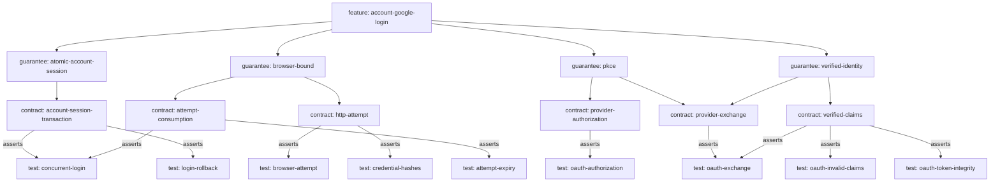

# Google によるブラウザーログイン

このページは `python3 scripts/traceability.py render` で生成する。

元データは [crates/user-http/src/account-google-login.trace.json](../../../crates/user-http/src/account-google-login.trace.json)。
[全機能の一覧](../feature-traceability.md)。

## 対象機能

| ID | 機能 | 仕様 |
| --- | --- | --- |
| account-google-login | Google によるブラウザーログイン | [crates/user-http/src/lib.rs](../../../crates/user-http/src/lib.rs#L280) |

## 保証の成立条件と構成

1. GET /auth/google/start は IdentityProvider が生成した state・nonce・PKCE verifier とブラウザー Cookie を、10 分で期限切れとなる試行に結び付ける。
2. GET /auth/google/callback はブラウザーに一致する未使用の試行を PostgreSQL から消費してからコードを交換する。GoogleProvider は署名と本人確認の claims を検証する。
3. PostgresAccounts::login は issuer・subject でアカウントを解決し、アカウント・外部 ID・新セッションを同じトランザクションで保存する。HTTP はセッション Cookie を発行して /me に移動する。

以下の保証には、各行に示す契約が必要となる。テストの assertions は記載した事例の範囲に限られる。

| ID | アプリケーションの保証と条件 | 必要な契約 |
| --- | --- | --- |
| atomic-account-session | 同じ issuer・subject の同時初回ログインは一つのアカウントに収束し、新しい本人識別情報とセッションはまとめて保存される。 | [account-session-transaction](#contract-account-session-transaction) |
| browser-bound | ログイン試行はブラウザーに結び付き、有効期限を過ぎた試行や使用済みの試行はコード交換に使えない。 | [http-attempt](#contract-http-attempt), [attempt-consumption](#contract-attempt-consumption) |
| pkce | 認可要求は openid・profile と state・nonce・S256 PKCE を使い、コード交換は保存した verifier を送る。 | [provider-authorization](#contract-provider-authorization), [provider-exchange](#contract-provider-exchange) |
| verified-identity | Google の署名、issuer、audience、nonce、有効期限、authorized party と、存在する場合の access-token hash を検証してから issuer・subject を本人識別に使う。 | [verified-claims](#contract-verified-claims), [provider-exchange](#contract-provider-exchange) |

## 宣言した対応関係

矢印は著者が宣言した関係を示す。asserts は記載した事例への直接の assertion、exercises は処理を通る関係を示す。



## コンポーネント契約と根拠

<a id="contract-account-session-transaction"></a>

### account-session-transaction

PostgresAccounts::login は issuer・subject のロック下で既存プロフィールを再利用するかアカウントと外部 ID を作成し、セッション挿入と一緒にコミットする。

実装位置: [crates/user-persistence/src/lib.rs](../../../crates/user-persistence/src/lib.rs#L382)。

- [concurrent-login](#test-concurrent-login) (asserts): 同じ本人識別で同時ログインした結果が一致し、両セッションが同一ユーザーを認証し、accounts が一行であることを確認する。
- [login-rollback](#test-login-rollback) (asserts): 新 subject のセッション挿入を重複キーで失敗させ、accounts が増えず、別 token で再試行でき、元 token の本人識別が維持されることを確認する。

未検証: issuer だけが異なる場合の分離や、コミット時失敗などすべてのトランザクション障害は列挙していない。

<a id="contract-attempt-consumption"></a>

### attempt-consumption

PostgresAccounts::consume_attempt は state・browser の両ハッシュが一致し expires_at &gt; now の行を DELETE RETURNING で一度だけ取得する。

実装位置: [crates/user-persistence/src/lib.rs](../../../crates/user-persistence/src/lib.rs#L349)。

- [attempt-expiry](#test-attempt-expiry) (asserts): 期限ちょうどの試行と不一致ブラウザーを Unauthorized とし、有効な試行は一度だけ消費できることを確認する。
- [concurrent-login](#test-concurrent-login) (asserts): 二つの接続から同じ試行を同時消費して、成功が一つだけであることを確認する。

<a id="contract-http-attempt"></a>

### http-attempt

start は state とブラウザー値の SHA-256 と nonce・verifier を保存する。callback は一致する試行を消費した後に provider の交換を呼び、新セッションを保存して /me への 303 と Cookie を返す。

実装位置: [crates/user-http/src/lib.rs](../../../crates/user-http/src/lib.rs#L280)。

- [browser-attempt](#test-browser-attempt) (asserts): ブラウザー Cookie の欠落・不一致では交換回数 0、成功後の再利用は 401、失敗コードでの交換後も再試行不可であることを確認する。
- [credential-hashes](#test-credential-hashes) (asserts): start が保存する state_hash・browser_hash が生値と異なり SHA-256 に一致すること、callback が 303 を返しセッションもハッシュで保存することを確認する。

未検証: callback の state/code 長境界、provider error、code 欠落、重複ログイン Cookie、保存失敗時の HTTP 応答は未確認。既存セッション Cookie を送ると旧セッションを logout する実装だが、そのローテーションを確認する assertion はない。

<a id="contract-provider-authorization"></a>

### provider-authorization

GoogleProvider::authorize は state・nonce とランダムな S256 PKCE challenge/verifier を生成し、openid・profile の認可 URL を返す。

実装位置: [crates/user-http/src/google.rs](../../../crates/user-http/src/google.rs#L85)。

- [oauth-authorization](#test-oauth-authorization) (asserts): scope、response_type、state、nonce、S256 と verifier から再計算した challenge の一致、連続する state の相違を確認する。

<a id="contract-provider-exchange"></a>

### provider-exchange

exchange_code は保存済み PKCE verifier を token endpoint に送り、取得した ID token を verify_response に渡す。

実装位置: [crates/user-http/src/google.rs](../../../crates/user-http/src/google.rs#L128)。

- [oauth-exchange](#test-oauth-exchange) (asserts): ローカル HTTP token endpoint に送る grant_type・code・verifier・redirect_uri と、署名済み応答からの subject を確認する。

未検証: GoogleProvider::exchange の再ディスカバリー、実 Google 通信、HTTPS 専用クライアントのタイムアウトとリダイレクト拒否をこのテストは通らない。

<a id="contract-verified-claims"></a>

### verified-claims

verify_response はライブラリーの署名・issuer・audience・nonce・期限検証に加えて azp と access-token hash を検証し、空でない subject と固定 Google issuer を返す。

実装位置: [crates/user-http/src/google.rs](../../../crates/user-http/src/google.rs#L145)。

- [oauth-invalid-claims](#test-oauth-invalid-claims) (asserts): 誤った issuer・audience・nonce、nonce 欠落、期限切れ、誤った azp、複数 audience かつ azp 欠落を拒否し、一致する azp は受け入れる。
- [oauth-token-integrity](#test-oauth-token-integrity) (asserts): access token の置換と ID token 署名の改変を Unauthorized とする。
- [oauth-exchange](#test-oauth-exchange) (asserts): 正しく署名した応答を実際の検証関数に通して stable-subject を返すことを確認する。

未検証: 空 subject の拒否、ID token 欠落、名前がない場合や不正な名前の場合の Player へのフォールバックはこの記録のテストでは直接確認していない。

## 実在するテストと実行コマンド

コマンドは個別テストを厳密一致で選択する。保存層テストには TEST_DATABASE_URL と TEST_VALKEY_URL が必要な場合がある。

<a id="test-attempt-expiry"></a>

### attempt-expiry

テスト位置: [crates/user-persistence/src/lib.rs](../../../crates/user-persistence/src/lib.rs#L574)。

範囲: 実 PostgreSQL repository に指定時刻を渡し、試行の期限・ブラウザー一致・単回消費を確認する。HTTP は通らない。

```sh
cargo test --locked -p user-persistence --lib tests::expired_attempts_and_sessions_cannot_be_used -- --exact --format pretty --color never
```

<a id="test-browser-attempt"></a>

### browser-attempt

テスト位置: [crates/user-http/src/tests.rs](../../../crates/user-http/src/tests.rs#L247)。

範囲: 実 Axum ルーターと PostgreSQL。交換回数を数える偽 IdentityProvider を使い、実 Google には接続しない。

```sh
cargo test --locked -p user-http --lib tests::login_is_browser_bound_and_consumed_before_any_exchange -- --exact --format pretty --color never
```

<a id="test-concurrent-login"></a>

### concurrent-login

テスト位置: [crates/user-persistence/src/lib.rs](../../../crates/user-persistence/src/lib.rs#L626)。

範囲: 実 PostgreSQL の二つの接続で login と consume_attempt を競合させる。HTTP と Google は通らない。

```sh
cargo test --locked -p user-persistence --lib tests::concurrent_first_logins_and_callback_consumption_converge -- --exact --format pretty --color never
```

<a id="test-credential-hashes"></a>

### credential-hashes

テスト位置: [crates/user-http/src/tests.rs](../../../crates/user-http/src/tests.rs#L473)。

範囲: 実ルーターと PostgreSQL の保存行を比較する。本人確認は偽 provider。

```sh
cargo test --locked -p user-http --lib tests::persisted_browser_credentials_are_hashes_not_cookie_values -- --exact --format pretty --color never
```

<a id="test-login-rollback"></a>

### login-rollback

テスト位置: [crates/user-persistence/src/lib.rs](../../../crates/user-persistence/src/lib.rs#L662)。

範囲: 実 PostgreSQL の重複 session key による失敗と再試行を確認する。HTTP のエラー変換は通らない。

```sh
cargo test --locked -p user-persistence --lib tests::failed_session_insert_rolls_back_a_new_identity -- --exact --format pretty --color never
```

<a id="test-oauth-authorization"></a>

### oauth-authorization

テスト位置: [crates/user-http/src/google/tests.rs](../../../crates/user-http/src/google/tests.rs#L126)。

範囲: ローカル metadata から構成した実 GoogleProvider。認可 URL の生成を確認し、ネットワークは使わない。

```sh
cargo test --locked -p user-http --lib google::tests::authorization_uses_openid_profile_state_nonce_and_s256_pkce -- --exact --format pretty --color never
```

<a id="test-oauth-exchange"></a>

### oauth-exchange

テスト位置: [crates/user-http/src/google/tests.rs](../../../crates/user-http/src/google/tests.rs#L153)。

範囲: ローカル HTTP token endpoint とテスト RSA 署名を使う exchange_code。discovery とブラウザールートは通らない。

```sh
cargo test --locked -p user-http --lib google::tests::code_exchange_sends_pkce_and_verifies_signed_token_over_http -- --exact --format pretty --color never
```

<a id="test-oauth-invalid-claims"></a>

### oauth-invalid-claims

テスト位置: [crates/user-http/src/google/tests.rs](../../../crates/user-http/src/google/tests.rs#L83)。

範囲: テスト RSA で署名した claims を verify_response に渡す。実プロバイダーと DB は使わない。

```sh
cargo test --locked -p user-http --lib google::tests::signed_wrong_issuer_audience_nonce_expiry_or_azp_is_rejected -- --exact --format pretty --color never
```

<a id="test-oauth-token-integrity"></a>

### oauth-token-integrity

テスト位置: [crates/user-http/src/google/tests.rs](../../../crates/user-http/src/google/tests.rs#L102)。

範囲: 署名済みテスト応答の access token と署名を個別に改変して検証する。

```sh
cargo test --locked -p user-http --lib google::tests::substituted_access_token_and_tampered_signature_are_rejected -- --exact --format pretty --color never
```

## 検査と根拠の限界

check はグラフ、ファイル内の一意なテキスト位置、package と target ごとのコンパイル済みテスト名、生成文書の一致を検査する。
run は check の後に共有された Cargo テストを一度ずつ実行し、厳密一致の 1 件が成功し、失敗と無視が 0 件であることを検査する。
この文書には実行済みの成功状態を保存しない。CI の workspace テスト実行結果は、その実行時点の結果となる。
位置の検査は Rust の構文解析ではなく、テスト名と指定したソース位置が同じ定義を指すことも証明しない。
宣言した関連の意味と網羅性はレビューが必要となる。検出できる関連の削除は、必須の関連数、参照先、孤立ノードの規則に違反するものに限られる。

- 実 Google の discovery・認可・コード交換からブラウザー Cookie までを通す end-to-end テストはない。署名検証、ローカル token endpoint、偽 provider の HTTP フローは別々の証拠である。
- ログイン成功時の既存セッションローテーションは未確認。registration_profile_update_csrf_logout_and_restart の二回目のログインは既存セッション Cookie を送らないため、その根拠にはできない。
- Cookie 属性とセッションの利用・失効は account-session、プロフィールと表示名は account-profile、設定・startup・schema は別の機能記録が扱う。
- リンクの成立とテストの成功は、記述した保証の意味や網羅性の証明ではない。保証・契約・関連の削除や根拠の過大評価はレビューで確認する。
