# Google によるブラウザーログイン

このページは `python3 scripts/traceability.py render` で生成する。

元データは [crates/user-http/src/trace/account-google-login/feature.rs](../../../crates/user-http/src/trace/account-google-login/feature.rs)。
[全機能の一覧](../feature-traceability.md)。

## 対象機能

| ID | 機能 | 仕様 |
| --- | --- | --- |
| account-google-login | Google によるブラウザーログイン | [crates/user-http/src/lib.rs](../../../crates/user-http/src/lib.rs#L280) |

## 保証の成立条件と構成

1. GET /auth/google/start は IdentityProvider が生成した state・nonce・PKCE verifier とブラウザー Cookie を、10 分で期限切れとなる試行に結び付ける。
2. GET /auth/google/callback はブラウザーに一致する未使用の試行を PostgreSQL から消費してからコードを交換する。GoogleProvider は署名と本人確認の claims を検証する。
3. PostgresAccounts::login は issuer・subject でアカウントを解決し、アカウント・外部 ID・新セッションを同じトランザクションで保存する。HTTP はセッション Cookie を発行して /me に移動する。

以下の保証には、各行に示す契約が必要となる。テストによる検証は記載した事例の範囲に限られる。

| ID | アプリケーションの保証と条件 | 必要な契約 |
| --- | --- | --- |
| atomic-account-session | 同じ issuer・subject の同時初回ログインは一つのアカウントに収束し、新しい本人識別情報とセッションはまとめて保存される。 | [account-session-transaction](#contract-account-session-transaction) |
| browser-bound | ログイン試行はブラウザーに結び付き、有効期限を過ぎた試行や使用済みの試行はコード交換に使えない。 | [http-attempt](#contract-http-attempt), [attempt-consumption](#contract-attempt-consumption) |
| pkce | 認可要求は openid・profile と state・nonce・S256 PKCE を使い、コード交換は保存した verifier を送る。 | [provider-authorization](#contract-provider-authorization), [provider-exchange](#contract-provider-exchange) |
| verified-identity | Google の署名、issuer、audience、nonce、有効期限、authorized party と、存在する場合の access-token hash を検証してから issuer・subject を本人識別に使う。 | [verified-claims](#contract-verified-claims), [provider-exchange](#contract-provider-exchange) |

## 宣言した対応関係

矢印は著者が宣言した関係を示す。「事例を直接検証」は記載した事例を直接確かめる関係、「処理を通る」は対象の処理を実行する関係を示す。「所属のみ・未レビュー」は契約ディレクトリへの配置だけで分類した関係を示す。

```mermaid
flowchart TD
    n0["機能: account-google-login"]
    n1["保証: atomic-account-session"]
    n2["保証: browser-bound"]
    n3["保証: pkce"]
    n4["保証: verified-identity"]
    n5["契約: account-session-transaction"]
    n6["契約: attempt-consumption"]
    n7["契約: http-attempt"]
    n8["契約: provider-authorization"]
    n9["契約: provider-exchange"]
    n10["契約: verified-claims"]
    n11["テスト: test-user-http-lib-user-http-google-tests-account-google-login-provider-authorization-authorization-uses-openid-profile-state-nonce-and-s256-pkce"]
    n12["テスト: test-user-http-lib-user-http-google-tests-account-google-login-provider-exchange-code-exchange-sends-pkce-and-verifies-signed-token-over-http"]
    n13["テスト: test-user-http-lib-user-http-google-tests-account-google-login-verified-claims-signed-valid-token-resolves-only-issuer-and-subject"]
    n14["テスト: test-user-http-lib-user-http-google-tests-account-google-login-verified-claims-signed-wrong-issuer-audience-nonce-expiry-or-azp-is-rejected"]
    n15["テスト: test-user-http-lib-user-http-google-tests-account-google-login-verified-claims-substituted-access-token-and-tampered-signature-are-rejected"]
    n16["テスト: test-user-http-lib-user-http-tests-account-google-login-http-attempt-browser-flow-over-real-tcp-http-routes"]
    n17["テスト: test-user-http-lib-user-http-tests-account-google-login-http-attempt-login-is-browser-bound-and-consumed-before-any-exchange"]
    n18["テスト: test-user-http-lib-user-http-tests-account-google-login-http-attempt-persisted-browser-credentials-are-hashes-not-cookie-values"]
    n19["テスト: test-user-persistence-lib-user-persistence-tests-account-google-login-account-session-transaction-concurrent-first-logins-and-callback-consumption-converge"]
    n20["テスト: test-user-persistence-lib-user-persistence-tests-account-google-login-account-session-transaction-failed-session-insert-rolls-back-a-new-identity"]
    n21["テスト: test-user-persistence-lib-user-persistence-tests-account-google-login-attempt-consumption-expired-attempts-and-sessions-cannot-be-used"]
    n0 --> n1
    n1 --> n5
    n0 --> n2
    n2 --> n7
    n2 --> n6
    n0 --> n3
    n3 --> n8
    n3 --> n9
    n0 --> n4
    n4 --> n10
    n4 --> n9
    n5 -->|事例を直接検証| n19
    n5 -->|事例を直接検証| n20
    n6 -->|事例を直接検証| n19
    n6 -->|事例を直接検証| n21
    n7 -->|所属のみ・未レビュー| n16
    n7 -->|事例を直接検証| n17
    n7 -->|事例を直接検証| n18
    n8 -->|事例を直接検証| n11
    n9 -->|事例を直接検証| n12
    n10 -->|事例を直接検証| n12
    n10 -->|所属のみ・未レビュー| n13
    n10 -->|事例を直接検証| n14
    n10 -->|事例を直接検証| n15
```



## コンポーネント契約と根拠

<a id="contract-account-session-transaction"></a>

### account-session-transaction

PostgresAccounts::login は issuer・subject のロック下で既存プロフィールを再利用するかアカウントと外部 ID を作成し、セッション挿入と一緒にコミットする。

実装位置: [crates/user-persistence/src/lib.rs](../../../crates/user-persistence/src/lib.rs#L382)。

- [test-user-persistence-lib-user-persistence-tests-account-google-login-account-session-transaction-concurrent-first-logins-and-callback-consumption-converge](#test-test-user-persistence-lib-user-persistence-tests-account-google-login-account-session-transaction-concurrent-first-logins-and-callback-consumption-converge) (事例を直接検証): 同じ本人識別で同時ログインした結果が一致し、両セッションが同一ユーザーを認証し、accounts が一行であることを確認する。
- [test-user-persistence-lib-user-persistence-tests-account-google-login-account-session-transaction-failed-session-insert-rolls-back-a-new-identity](#test-test-user-persistence-lib-user-persistence-tests-account-google-login-account-session-transaction-failed-session-insert-rolls-back-a-new-identity) (事例を直接検証): 新 subject のセッション挿入を重複キーで失敗させ、accounts が増えず、別 token で再試行でき、元 token の本人識別が維持されることを確認する。

未検証: issuer だけが異なる場合の分離や、コミット時失敗などすべてのトランザクション障害は列挙していない。

<a id="contract-attempt-consumption"></a>

### attempt-consumption

PostgresAccounts::consume_attempt は state・browser の両ハッシュが一致し expires_at &gt; now の行を DELETE RETURNING で一度だけ取得する。

実装位置: [crates/user-persistence/src/lib.rs](../../../crates/user-persistence/src/lib.rs#L349)。

- [test-user-persistence-lib-user-persistence-tests-account-google-login-account-session-transaction-concurrent-first-logins-and-callback-consumption-converge](#test-test-user-persistence-lib-user-persistence-tests-account-google-login-account-session-transaction-concurrent-first-logins-and-callback-consumption-converge) (事例を直接検証): 二つの接続から同じ試行を同時消費して、成功が一つだけであることを確認する。
- [test-user-persistence-lib-user-persistence-tests-account-google-login-attempt-consumption-expired-attempts-and-sessions-cannot-be-used](#test-test-user-persistence-lib-user-persistence-tests-account-google-login-attempt-consumption-expired-attempts-and-sessions-cannot-be-used) (事例を直接検証): 期限ちょうどの試行と不一致ブラウザーを Unauthorized とし、有効な試行は一度だけ消費できることを確認する。

<a id="contract-http-attempt"></a>

### http-attempt

start は state とブラウザー値の SHA-256 と nonce・verifier を保存する。callback は一致する試行を消費した後に provider の交換を呼び、新セッションを保存して /me への 303 と Cookie を返す。

実装位置: [crates/user-http/src/lib.rs](../../../crates/user-http/src/lib.rs#L280)。

- [test-user-http-lib-user-http-tests-account-google-login-http-attempt-browser-flow-over-real-tcp-http-routes](#test-test-user-http-lib-user-http-tests-account-google-login-http-attempt-browser-flow-over-real-tcp-http-routes) (所属のみ・未レビュー): 配置先からこのテストの契約への所属を宣言している。実装を実行することと検証の十分さはレビューが必要。
- [test-user-http-lib-user-http-tests-account-google-login-http-attempt-login-is-browser-bound-and-consumed-before-any-exchange](#test-test-user-http-lib-user-http-tests-account-google-login-http-attempt-login-is-browser-bound-and-consumed-before-any-exchange) (事例を直接検証): ブラウザー Cookie の欠落・不一致では交換回数 0、成功後の再利用は 401、失敗コードでの交換後も再試行不可であることを確認する。
- [test-user-http-lib-user-http-tests-account-google-login-http-attempt-persisted-browser-credentials-are-hashes-not-cookie-values](#test-test-user-http-lib-user-http-tests-account-google-login-http-attempt-persisted-browser-credentials-are-hashes-not-cookie-values) (事例を直接検証): start が保存する state_hash・browser_hash が生値と異なり SHA-256 に一致すること、callback が 303 を返しセッションもハッシュで保存することを確認する。

未検証: callback の state/code 長境界、provider error、code 欠落、重複ログイン Cookie、保存失敗時の HTTP 応答は未確認。既存セッション Cookie を送ると旧セッションを logout する実装だが、そのローテーションを確認する assertion はない。

<a id="contract-provider-authorization"></a>

### provider-authorization

GoogleProvider::authorize は state・nonce とランダムな S256 PKCE challenge/verifier を生成し、openid・profile の認可 URL を返す。

実装位置: [crates/user-http/src/google.rs](../../../crates/user-http/src/google.rs#L85)。

- [test-user-http-lib-user-http-google-tests-account-google-login-provider-authorization-authorization-uses-openid-profile-state-nonce-and-s256-pkce](#test-test-user-http-lib-user-http-google-tests-account-google-login-provider-authorization-authorization-uses-openid-profile-state-nonce-and-s256-pkce) (事例を直接検証): scope、response_type、state、nonce、S256 と verifier から再計算した challenge の一致、連続する state の相違を確認する。

<a id="contract-provider-exchange"></a>

### provider-exchange

exchange_code は保存済み PKCE verifier を token endpoint に送り、取得した ID token を verify_response に渡す。

実装位置: [crates/user-http/src/google.rs](../../../crates/user-http/src/google.rs#L128)。

- [test-user-http-lib-user-http-google-tests-account-google-login-provider-exchange-code-exchange-sends-pkce-and-verifies-signed-token-over-http](#test-test-user-http-lib-user-http-google-tests-account-google-login-provider-exchange-code-exchange-sends-pkce-and-verifies-signed-token-over-http) (事例を直接検証): ローカル HTTP token endpoint に送る grant_type・code・verifier・redirect_uri と、署名済み応答からの subject を確認する。

未検証: GoogleProvider::exchange の再ディスカバリー、実 Google 通信、HTTPS 専用クライアントのタイムアウトとリダイレクト拒否をこのテストは通らない。

<a id="contract-verified-claims"></a>

### verified-claims

verify_response はライブラリーの署名・issuer・audience・nonce・期限検証に加えて azp と access-token hash を検証し、空でない subject と固定 Google issuer を返す。

実装位置: [crates/user-http/src/google.rs](../../../crates/user-http/src/google.rs#L145)。

- [test-user-http-lib-user-http-google-tests-account-google-login-provider-exchange-code-exchange-sends-pkce-and-verifies-signed-token-over-http](#test-test-user-http-lib-user-http-google-tests-account-google-login-provider-exchange-code-exchange-sends-pkce-and-verifies-signed-token-over-http) (事例を直接検証): 正しく署名した応答を実際の検証関数に通して stable-subject を返すことを確認する。
- [test-user-http-lib-user-http-google-tests-account-google-login-verified-claims-signed-valid-token-resolves-only-issuer-and-subject](#test-test-user-http-lib-user-http-google-tests-account-google-login-verified-claims-signed-valid-token-resolves-only-issuer-and-subject) (所属のみ・未レビュー): 配置先からこのテストの契約への所属を宣言している。実装を実行することと検証の十分さはレビューが必要。
- [test-user-http-lib-user-http-google-tests-account-google-login-verified-claims-signed-wrong-issuer-audience-nonce-expiry-or-azp-is-rejected](#test-test-user-http-lib-user-http-google-tests-account-google-login-verified-claims-signed-wrong-issuer-audience-nonce-expiry-or-azp-is-rejected) (事例を直接検証): 誤った issuer・audience・nonce、nonce 欠落、期限切れ、誤った azp、複数 audience かつ azp 欠落を拒否し、一致する azp は受け入れる。
- [test-user-http-lib-user-http-google-tests-account-google-login-verified-claims-substituted-access-token-and-tampered-signature-are-rejected](#test-test-user-http-lib-user-http-google-tests-account-google-login-verified-claims-substituted-access-token-and-tampered-signature-are-rejected) (事例を直接検証): access token の置換と ID token 署名の改変を Unauthorized とする。

未検証: 空 subject の拒否、ID token 欠落、名前がない場合や不正な名前の場合の Player へのフォールバックはこの記録のテストでは直接確認していない。

## 実在するテストと実行コマンド

コマンドは個別テストを厳密一致で選択する。保存層テストには TEST_DATABASE_URL と TEST_VALKEY_URL が必要な場合がある。

<a id="test-test-user-http-lib-user-http-google-tests-account-google-login-provider-authorization-authorization-uses-openid-profile-state-nonce-and-s256-pkce"></a>

### test-user-http-lib-user-http-google-tests-account-google-login-provider-authorization-authorization-uses-openid-profile-state-nonce-and-s256-pkce

テスト位置: [crates/user-http/src/trace/account-google-login/provider-authorization/tests.rs](../../../crates/user-http/src/trace/account-google-login/provider-authorization/tests.rs#L11)。

範囲: ローカル metadata から構成した実 GoogleProvider。認可 URL の生成を確認し、ネットワークは使わない。

```sh
cargo test --locked -p user-http --lib google::tests::account_google_login_provider_authorization::authorization_uses_openid_profile_state_nonce_and_s256_pkce -- --exact --format pretty --color never
```

<a id="test-test-user-http-lib-user-http-google-tests-account-google-login-provider-exchange-code-exchange-sends-pkce-and-verifies-signed-token-over-http"></a>

### test-user-http-lib-user-http-google-tests-account-google-login-provider-exchange-code-exchange-sends-pkce-and-verifies-signed-token-over-http

テスト位置: [crates/user-http/src/trace/account-google-login/provider-exchange/tests.rs](../../../crates/user-http/src/trace/account-google-login/provider-exchange/tests.rs#L11)。

範囲: ローカル HTTP token endpoint とテスト RSA 署名を使う exchange_code。discovery とブラウザールートは通らない。

```sh
cargo test --locked -p user-http --lib google::tests::account_google_login_provider_exchange::code_exchange_sends_pkce_and_verifies_signed_token_over_http -- --exact --format pretty --color never
```

<a id="test-test-user-http-lib-user-http-google-tests-account-google-login-verified-claims-signed-valid-token-resolves-only-issuer-and-subject"></a>

### test-user-http-lib-user-http-google-tests-account-google-login-verified-claims-signed-valid-token-resolves-only-issuer-and-subject

テスト位置: [crates/user-http/src/trace/account-google-login/verified-claims/tests.rs](../../../crates/user-http/src/trace/account-google-login/verified-claims/tests.rs#L4)。

範囲: 契約ディレクトリへの所属のみを示す。実行時の依存関係と検証内容は未レビュー。

```sh
cargo test --locked -p user-http --lib google::tests::account_google_login_verified_claims::signed_valid_token_resolves_only_issuer_and_subject -- --exact --format pretty --color never
```

<a id="test-test-user-http-lib-user-http-google-tests-account-google-login-verified-claims-signed-wrong-issuer-audience-nonce-expiry-or-azp-is-rejected"></a>

### test-user-http-lib-user-http-google-tests-account-google-login-verified-claims-signed-wrong-issuer-audience-nonce-expiry-or-azp-is-rejected

テスト位置: [crates/user-http/src/trace/account-google-login/verified-claims/tests.rs](../../../crates/user-http/src/trace/account-google-login/verified-claims/tests.rs#L19)。

範囲: テスト RSA で署名した claims を verify_response に渡す。実プロバイダーと DB は使わない。

```sh
cargo test --locked -p user-http --lib google::tests::account_google_login_verified_claims::signed_wrong_issuer_audience_nonce_expiry_or_azp_is_rejected -- --exact --format pretty --color never
```

<a id="test-test-user-http-lib-user-http-google-tests-account-google-login-verified-claims-substituted-access-token-and-tampered-signature-are-rejected"></a>

### test-user-http-lib-user-http-google-tests-account-google-login-verified-claims-substituted-access-token-and-tampered-signature-are-rejected

テスト位置: [crates/user-http/src/trace/account-google-login/verified-claims/tests.rs](../../../crates/user-http/src/trace/account-google-login/verified-claims/tests.rs#L47)。

範囲: 署名済みテスト応答の access token と署名を個別に改変して検証する。

```sh
cargo test --locked -p user-http --lib google::tests::account_google_login_verified_claims::substituted_access_token_and_tampered_signature_are_rejected -- --exact --format pretty --color never
```

<a id="test-test-user-http-lib-user-http-tests-account-google-login-http-attempt-browser-flow-over-real-tcp-http-routes"></a>

### test-user-http-lib-user-http-tests-account-google-login-http-attempt-browser-flow-over-real-tcp-http-routes

テスト位置: [crates/user-http/src/trace/account-google-login/http-attempt/tests.rs](../../../crates/user-http/src/trace/account-google-login/http-attempt/tests.rs#L69)。

範囲: 契約ディレクトリへの所属のみを示す。実行時の依存関係と検証内容は未レビュー。

```sh
cargo test --locked -p user-http --lib tests::account_google_login_http_attempt::browser_flow_over_real_tcp_http_routes -- --exact --format pretty --color never
```

<a id="test-test-user-http-lib-user-http-tests-account-google-login-http-attempt-login-is-browser-bound-and-consumed-before-any-exchange"></a>

### test-user-http-lib-user-http-tests-account-google-login-http-attempt-login-is-browser-bound-and-consumed-before-any-exchange

テスト位置: [crates/user-http/src/trace/account-google-login/http-attempt/tests.rs](../../../crates/user-http/src/trace/account-google-login/http-attempt/tests.rs#L11)。

範囲: 実 Axum ルーターと PostgreSQL。交換回数を数える偽 IdentityProvider を使い、実 Google には接続しない。

```sh
cargo test --locked -p user-http --lib tests::account_google_login_http_attempt::login_is_browser_bound_and_consumed_before_any_exchange -- --exact --format pretty --color never
```

<a id="test-test-user-http-lib-user-http-tests-account-google-login-http-attempt-persisted-browser-credentials-are-hashes-not-cookie-values"></a>

### test-user-http-lib-user-http-tests-account-google-login-http-attempt-persisted-browser-credentials-are-hashes-not-cookie-values

テスト位置: [crates/user-http/src/trace/account-google-login/http-attempt/tests.rs](../../../crates/user-http/src/trace/account-google-login/http-attempt/tests.rs#L161)。

範囲: 実ルーターと PostgreSQL の保存行を比較する。本人確認は偽 provider。

```sh
cargo test --locked -p user-http --lib tests::account_google_login_http_attempt::persisted_browser_credentials_are_hashes_not_cookie_values -- --exact --format pretty --color never
```

<a id="test-test-user-persistence-lib-user-persistence-tests-account-google-login-account-session-transaction-concurrent-first-logins-and-callback-consumption-converge"></a>

### test-user-persistence-lib-user-persistence-tests-account-google-login-account-session-transaction-concurrent-first-logins-and-callback-consumption-converge

テスト位置: [crates/user-persistence/src/trace/account-google-login/account-session-transaction/tests.rs](../../../crates/user-persistence/src/trace/account-google-login/account-session-transaction/tests.rs#L11)。

範囲: 実 PostgreSQL の二つの接続で login と consume_attempt を競合させる。HTTP と Google は通らない。

```sh
cargo test --locked -p user-persistence --lib tests::account_google_login_account_session_transaction::concurrent_first_logins_and_callback_consumption_converge -- --exact --format pretty --color never
```

<a id="test-test-user-persistence-lib-user-persistence-tests-account-google-login-account-session-transaction-failed-session-insert-rolls-back-a-new-identity"></a>

### test-user-persistence-lib-user-persistence-tests-account-google-login-account-session-transaction-failed-session-insert-rolls-back-a-new-identity

テスト位置: [crates/user-persistence/src/trace/account-google-login/account-session-transaction/tests.rs](../../../crates/user-persistence/src/trace/account-google-login/account-session-transaction/tests.rs#L56)。

範囲: 実 PostgreSQL の重複 session key による失敗と再試行を確認する。HTTP のエラー変換は通らない。

```sh
cargo test --locked -p user-persistence --lib tests::account_google_login_account_session_transaction::failed_session_insert_rolls_back_a_new_identity -- --exact --format pretty --color never
```

<a id="test-test-user-persistence-lib-user-persistence-tests-account-google-login-attempt-consumption-expired-attempts-and-sessions-cannot-be-used"></a>

### test-user-persistence-lib-user-persistence-tests-account-google-login-attempt-consumption-expired-attempts-and-sessions-cannot-be-used

テスト位置: [crates/user-persistence/src/trace/account-google-login/attempt-consumption/tests.rs](../../../crates/user-persistence/src/trace/account-google-login/attempt-consumption/tests.rs#L11)。

範囲: 実 PostgreSQL repository に指定時刻を渡し、試行の期限・ブラウザー一致・単回消費を確認する。HTTP は通らない。

```sh
cargo test --locked -p user-persistence --lib tests::account_google_login_attempt_consumption::expired_attempts_and_sessions_cannot_be_used -- --exact --format pretty --color never
```

## 検査と根拠の限界

check はグラフ、ファイル内の一意なテキスト位置、パッケージとターゲットごとのコンパイル済みテスト名、生成文書の一致を検査する。
run は check の後に共有された Cargo テストを一度ずつ実行し、厳密一致の 1 件が成功し、失敗と無視が 0 件であることを検査する。
この文書には実行済みの成功状態を保存しない。CI のワークスペース全体のテスト実行結果は、その実行時点の結果となる。
宣言した関連の意味と網羅性はレビューが必要となる。検出できる関連の削除は、必須の関連数、参照先、孤立ノードの規則に違反するものに限られる。

- 実 Google の discovery・認可・コード交換からブラウザー Cookie までを通す end-to-end テストはない。署名検証、ローカル token endpoint、偽 provider の HTTP フローは別々の証拠である。
- ログイン成功時の既存セッションローテーションは未確認。registration_profile_update_csrf_logout_and_restart の二回目のログインは既存セッション Cookie を送らないため、その根拠にはできない。
- Cookie 属性とセッションの利用・失効は account-session、プロフィールと表示名は account-profile、設定・startup・schema は別の機能記録が扱う。
- リンクの成立とテストの成功は、記述した保証の意味や網羅性の証明ではない。保証・契約・関連の削除や根拠の過大評価はレビューで確認する。

## ディレクトリ方式の検査範囲

Rust 宣言、通常のモジュールと文字列リテラルの include! から物理ファイルの所属、パッケージ、ターゲット、完全なテスト名と位置を抽出する。ホスト環境で Cargo の既定の機能フラグを使い、ワークスペースのライブラリ、バイナリ、結合テストの全テスト一覧と一致させる。別のターゲット、機能フラグ、cfg の組合せは対象外。
src/trace/<feature> と tests/trace/<feature> は新規機能も探索し、未宣言または未到達のファイルを拒否する。契約内の通常テストは「所属のみ・未レビュー」として追加する。「事例を直接検証」または「処理を通る」のレビュー済み根拠がない契約には未検証事項の gap 宣言が必要。
全ターゲットの未分類テストは拒否する。trace ディレクトリ内の未対応の項目マクロと cfg は直接拒否し、外側の未対応構文が生成した実行対象テストはコンパイル済み一覧との差として拒否する。テスト実行補助と基盤の検査の明示分類および理由は全機能の一覧に示す。
