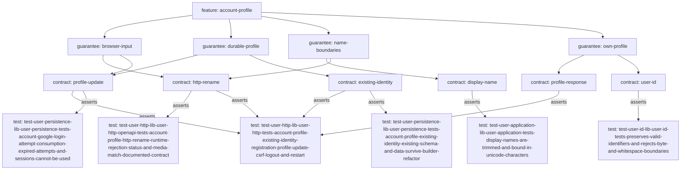

# 自分のプロフィール取得と表示名変更

このページは `python3 scripts/traceability.py render` で生成する。

元データは [crates/user-http/src/trace/account-profile/feature.rs](../../../crates/user-http/src/trace/account-profile/feature.rs)。
[全機能の一覧](../feature-traceability.md)。

## 対象機能

| ID | 機能 | 仕様 |
| --- | --- | --- |
| account-profile | 自分のプロフィール取得と表示名変更 | [crates/user-http/src/lib.rs](../../../crates/user-http/src/lib.rs#L387) |

## 保証の成立条件と構成

1. GET /me はセッションに対応する Profile を取得し、id・display_name・created_at の JSON に変換する。外部から内部ユーザー ID を指定して読み書きする操作はない。
2. PATCH /me は JSON 構造と同一 Origin を検証し、DisplayName で前後の空白と Unicode 文字数・制御文字を扱ってから、セッションに対応するアカウントを更新する。
3. PostgresAccounts は表示名を保存し、次回の同じ issuer・subject のログインでも既存プロフィールを維持する。共有 UserId は各サービス間の内部本人識別を表す。

以下の保証には、各行に示す契約が必要となる。テストの assertions は記載した事例の範囲に限られる。

| ID | アプリケーションの保証と条件 | 必要な契約 |
| --- | --- | --- |
| browser-input | 表示名変更には同一 Origin と認証済みセッションが必要で、不正な JSON や未知フィールドは拒否する。 | [http-rename](#contract-http-rename), [profile-update](#contract-profile-update) |
| durable-profile | 変更した表示名は store の再接続と後続の同じ本人識別によるログインで維持される。 | [profile-update](#contract-profile-update), [existing-identity](#contract-existing-identity) |
| name-boundaries | 表示名は前後の空白を除いた後、1〜80 Unicode 文字で制御文字を含まない値だけを受け入れる。 | [display-name](#contract-display-name), [http-rename](#contract-http-rename) |
| own-profile | 認証された自分のプロフィールを id・display_name・created_at として返す。内部 ID は空でなく 128 UTF-8 バイト以内で Unicode 空白を含まない。 | [profile-response](#contract-profile-response), [user-id](#contract-user-id) |

## 宣言した対応関係

矢印は著者が宣言した関係を示す。asserts は記載した事例への直接の assertion、exercises は処理を通る関係を示す。



## コンポーネント契約と根拠

<a id="contract-display-name"></a>

### display-name

DisplayName::new は trim 後の文字列を保持し、空文字・80 Unicode 文字超過・制御文字を InvalidInput とする。

実装位置: [crates/user-application/src/lib.rs](../../../crates/user-application/src/lib.rs#L14)。

- [test-user-application-lib-user-application-tests-display-names-are-trimmed-and-bound-in-unicode-characters](#test-test-user-application-lib-user-application-tests-display-names-are-trimmed-and-bound-in-unicode-characters) (asserts): 日本語名の trim、80 文字の受け入れ、空文字・空白・81 文字・改行・NUL の拒否を直接確認する。

<a id="contract-existing-identity"></a>

### existing-identity

PostgresAccounts::login は既存 issuer・subject の Profile を再利用し、provider の initial_name で既存表示名を置き換えない。

実装位置: [crates/user-persistence/src/lib.rs](../../../crates/user-persistence/src/lib.rs#L382)。

- [test-user-http-lib-user-http-tests-account-profile-existing-identity-registration-profile-update-csrf-logout-and-restart](#test-test-user-http-lib-user-http-tests-account-profile-existing-identity-registration-profile-update-csrf-logout-and-restart) (asserts): New Name に変更した後、初期名 Google Player を返す偽 provider で再ログインしてもプロフィール全体が維持されることを確認する。
- [test-user-persistence-lib-user-persistence-tests-account-profile-existing-identity-existing-schema-and-data-survive-builder-refactor](#test-test-user-persistence-lib-user-persistence-tests-account-profile-existing-identity-existing-schema-and-data-survive-builder-refactor) (asserts): 既存 schema の Existing プロフィールに対して initial_name が Player の login を行い、同じプロフィールと再接続後の認証結果を確認する。

<a id="contract-http-rename"></a>

### http-rename

rename は serde の未知フィールド拒否を持つ JSON を抽出し、same_origin と DisplayName::new が成功した後、Cookie のハッシュに対応するプロフィールを repository で更新する。

実装位置: [crates/user-http/src/lib.rs](../../../crates/user-http/src/lib.rs#L387)。

- [test-user-http-lib-user-http-openapi-tests-account-profile-http-rename-runtime-rejection-status-and-media-match-documented-contract](#test-test-user-http-lib-user-http-openapi-tests-account-profile-http-rename-runtime-rejection-status-and-media-match-documented-contract) (asserts): 不正 JSON 400、本文過大 413、Content-Type 欠落 415、未知フィールドを持つ構造 422 の text/plain と、空白名 400 の application/json を確認する。
- [test-user-http-lib-user-http-tests-account-profile-existing-identity-registration-profile-update-csrf-logout-and-restart](#test-test-user-http-lib-user-http-tests-account-profile-existing-identity-registration-profile-update-csrf-logout-and-restart) (asserts): 有効な session で Origin 欠落と hostile Origin を 401、空白だけの名前を 400 とし、同一 Origin の有効な名前は応答と保存内容に反映する。

未検証: cross-site の Sec-Fetch-Site、正しい JSON・Origin に対する未認証 PATCH、HTTP を通した 80 文字・制御文字・trim 境界の assertion はない。

<a id="contract-profile-response"></a>

### profile-response

GET /me は Cookie による認証結果を ProfileBody の id・display_name・created_at に変換する。

実装位置: [crates/user-http/src/lib.rs](../../../crates/user-http/src/lib.rs#L339)。

- [test-user-http-lib-user-http-tests-account-profile-existing-identity-registration-profile-update-csrf-logout-and-restart](#test-test-user-http-lib-user-http-tests-account-profile-existing-identity-registration-profile-update-csrf-logout-and-restart) (asserts): 初回プロフィールの Google Player と UUID、名前変更後・再接続後・同じ本人識別の次回ログイン後の JSON 全体の一致を確認する。

未検証: created_at の値・型・単位を runtime で独立に確認する assertion はなく、変更前後の全体比較に含まれるだけである。Cookie の認証・期限・重複は account-session が扱う。

<a id="contract-profile-update"></a>

### profile-update

PostgresAccounts::rename は有効期限内のセッションからアカウントを解決し、表示名更新をトランザクションで保存して更新済み Profile を返す。

実装位置: [crates/user-persistence/src/lib.rs](../../../crates/user-persistence/src/lib.rs#L489)。

- [test-user-http-lib-user-http-tests-account-profile-existing-identity-registration-profile-update-csrf-logout-and-restart](#test-test-user-http-lib-user-http-tests-account-profile-existing-identity-registration-profile-update-csrf-logout-and-restart) (asserts): 実ルーターで New Name に更新し、store の再接続後の GET /me が同じプロフィールとなることを確認する。
- [test-user-persistence-lib-user-persistence-tests-account-google-login-attempt-consumption-expired-attempts-and-sessions-cannot-be-used](#test-test-user-persistence-lib-user-persistence-tests-account-google-login-attempt-consumption-expired-attempts-and-sessions-cannot-be-used) (asserts): 期限ちょうどの session で rename が Unauthorized となることを直接確認する。

未検証: 名前更新の保存失敗・コミット失敗・別アカウントへの非干渉は直接確認していない。

<a id="contract-user-id"></a>

### user-id

UserId::new は空でなく 128 UTF-8 バイト以内で Unicode 空白を含まない内部 ID を保持する。

実装位置: [crates/user-id/src/lib.rs](../../../crates/user-id/src/lib.rs#L16)。

- [test-user-id-lib-user-id-tests-preserves-valid-identifiers-and-rejects-byte-and-whitespace-boundaries](#test-test-user-id-lib-user-id-tests-preserves-valid-identifiers-and-rejects-byte-and-whitespace-boundaries) (asserts): ASCII・日本語・128 バイトの保持と、空文字・ASCII/Unicode 空白・129 バイト・多バイト長超過の拒否を直接確認する。

## 実在するテストと実行コマンド

コマンドは個別テストを厳密一致で選択する。保存層テストには TEST_DATABASE_URL と TEST_VALKEY_URL が必要な場合がある。

<a id="test-test-user-application-lib-user-application-tests-display-names-are-trimmed-and-bound-in-unicode-characters"></a>

### test-user-application-lib-user-application-tests-display-names-are-trimmed-and-bound-in-unicode-characters

テスト位置: [crates/user-application/src/trace/account-profile/display-name/tests.rs](../../../crates/user-application/src/trace/account-profile/display-name/tests.rs#L10)。

範囲: DisplayName の値と境界を直接確認する。HTTP と保存層は通らない。

```sh
cargo test --locked -p user-application --lib tests::display_names_are_trimmed_and_bound_in_unicode_characters -- --exact --format pretty --color never
```

<a id="test-test-user-http-lib-user-http-openapi-tests-account-profile-http-rename-runtime-rejection-status-and-media-match-documented-contract"></a>

### test-user-http-lib-user-http-openapi-tests-account-profile-http-rename-runtime-rejection-status-and-media-match-documented-contract

テスト位置: [crates/user-http/src/trace/account-profile/http-rename/tests.rs](../../../crates/user-http/src/trace/account-profile/http-rename/tests.rs#L11)。

範囲: 実ルーターで JSON 抽出と入力拒否を確認する。repository と provider は呼ばれると panic する偽物で、成功する rename は通らない。

```sh
cargo test --locked -p user-http --lib openapi_tests::account_profile_http_rename::runtime_rejection_status_and_media_match_documented_contract -- --exact --format pretty --color never
```

<a id="test-test-user-http-lib-user-http-tests-account-profile-existing-identity-registration-profile-update-csrf-logout-and-restart"></a>

### test-user-http-lib-user-http-tests-account-profile-existing-identity-registration-profile-update-csrf-logout-and-restart

テスト位置: [crates/user-http/src/trace/account-profile/existing-identity/tests.rs](../../../crates/user-http/src/trace/account-profile/existing-identity/tests.rs#L11)。

範囲: 実 Axum ルーターと PostgreSQL、偽 provider。プロフィール取得・CSRF・名前更新・再接続・同じ本人識別の再ログインを通る。

```sh
cargo test --locked -p user-http --lib tests::account_profile_existing_identity::registration_profile_update_csrf_logout_and_restart -- --exact --format pretty --color never
```

<a id="test-test-user-id-lib-user-id-tests-preserves-valid-identifiers-and-rejects-byte-and-whitespace-boundaries"></a>

### test-user-id-lib-user-id-tests-preserves-valid-identifiers-and-rejects-byte-and-whitespace-boundaries

テスト位置: [crates/user-id/src/trace/account-profile/user-id/tests.rs](../../../crates/user-id/src/trace/account-profile/user-id/tests.rs#L10)。

範囲: 共有 UserId の保持とバイト長・空白境界を直接確認する。公開 HTTP に任意 ID を送るテストではない。

```sh
cargo test --locked -p user-id --lib tests::preserves_valid_identifiers_and_rejects_byte_and_whitespace_boundaries -- --exact --format pretty --color never
```

<a id="test-test-user-persistence-lib-user-persistence-tests-account-google-login-attempt-consumption-expired-attempts-and-sessions-cannot-be-used"></a>

### test-user-persistence-lib-user-persistence-tests-account-google-login-attempt-consumption-expired-attempts-and-sessions-cannot-be-used

テスト位置: [crates/user-persistence/src/trace/account-google-login/attempt-consumption/tests.rs](../../../crates/user-persistence/src/trace/account-google-login/attempt-consumption/tests.rs#L11)。

範囲: 実 PostgreSQL repository に時刻を渡し、期限切れセッションの rename 拒否を確認する。HTTP は通らない。

```sh
cargo test --locked -p user-persistence --lib tests::account_google_login_attempt_consumption::expired_attempts_and_sessions_cannot_be_used -- --exact --format pretty --color never
```

<a id="test-test-user-persistence-lib-user-persistence-tests-account-profile-existing-identity-existing-schema-and-data-survive-builder-refactor"></a>

### test-user-persistence-lib-user-persistence-tests-account-profile-existing-identity-existing-schema-and-data-survive-builder-refactor

テスト位置: [crates/user-persistence/src/trace/account-profile/existing-identity/tests.rs](../../../crates/user-persistence/src/trace/account-profile/existing-identity/tests.rs#L11)。

範囲: 既存 schema fixture と実 PostgreSQL でプロフィール再利用と再接続後の認証を確認する。HTTP と provider は通らない。

```sh
cargo test --locked -p user-persistence --lib tests::account_profile_existing_identity::existing_schema_and_data_survive_builder_refactor -- --exact --format pretty --color never
```

## 検査と根拠の限界

check はグラフ、ファイル内の一意なテキスト位置、package と target ごとのコンパイル済みテスト名、生成文書の一致を検査する。
run は check の後に共有された Cargo テストを一度ずつ実行し、厳密一致の 1 件が成功し、失敗と無視が 0 件であることを検査する。
この文書には実行済みの成功状態を保存しない。CI の workspace テスト実行結果は、その実行時点の結果となる。
宣言した関連の意味と網羅性はレビューが必要となる。検出できる関連の削除は、必須の関連数、参照先、孤立ノードの規則に違反するものに限られる。

- 表示名境界のドメインテスト、JSON 拒否の HTTP テスト、成功した更新と永続化の統合テストは別々の証拠であり、全入力境界を HTTP から DB まで通していない。
- OpenAPI のプロフィール schema は public-api-documents、セッションの本人確認・Cookie と失効は account-session が扱う。
- リンクの成立とテストの成功は、記述した保証の意味や網羅性の証明ではない。保証・契約・関連の削除や根拠の過大評価はレビューで確認する。

## ディレクトリ方式の検査範囲

Rust 宣言、通常のモジュールとリテラル include! から物理ファイルの所属、package、target、完全なテスト名と位置を抽出する。ホストのデフォルト Cargo feature 構成で workspace の lib、bin、integration test の全テスト一覧と一致させる。別 target、feature、cfg の組合せは対象外。
src/trace/<feature> と tests/trace/<feature> は新規機能も探索し、未宣言または未到達のファイルを拒否する。契約内の通常テストは unreviewed として追加する。asserts または exercises のレビュー済み根拠がない契約には gap が必要。
全 target の未分類テストは拒否する。trace ディレクトリ内の未対応の item macro と cfg は直接拒否し、外側の未対応構文が生成した実行対象テストはコンパイル済み一覧との差として拒否する。テスト補助とインフラの明示分類および理由は全機能の一覧に示す。
