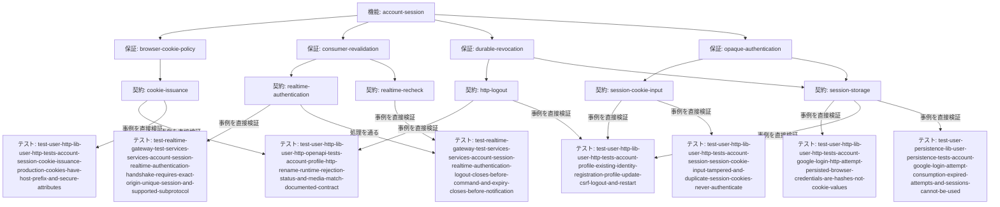

# ブラウザーセッションの認証と失効

このページは `python3 scripts/traceability.py render` で生成する。

元データは [crates/user-http/src/trace/account-session/feature.rs](../../../crates/user-http/src/trace/account-session/feature.rs)。
[全機能の一覧](../feature-traceability.md)。

## 対象機能

| ID | 機能 | 仕様 |
| --- | --- | --- |
| account-session | ブラウザーセッションの認証と失効 | [crates/user-http/src/lib.rs](../../../crates/user-http/src/lib.rs#L418) |

## 保証の成立条件と構成

1. GET /me は一意な不透明セッション Cookie を検証し、SHA-256 を使って PostgreSQL の未失効セッションからプロフィールを取得する。
2. POST /auth/logout はブラウザーの Origin を検証し、有効な形式の Cookie があれば保存済みセッションを削除して Cookie を消去する。
3. realtime-gateway は user HTTP の /me で本人識別を解決し、コマンドや通知の処理時に同じセッションの本人識別を再確認する。

以下の保証には、各行に示す契約が必要となる。テストによる検証は記載した事例の範囲に限られる。

| ID | アプリケーションの保証と条件 | 必要な契約 |
| --- | --- | --- |
| browser-cookie-policy | 発行 Cookie は Path=/・HttpOnly・SameSite=Lax を使い、本番 HTTPS ではホスト専用 __Host- 名と Secure を使う。 | [cookie-issuance](#contract-cookie-issuance) |
| consumer-revalidation | realtime の認証は /me が返す本人識別を使い、失効または期限切れを再確認した接続ではその後のコマンドや通知を継続しない。 | [realtime-authentication](#contract-realtime-authentication), [realtime-recheck](#contract-realtime-recheck) |
| durable-revocation | 同一 Origin からのログアウトは指定セッションを失効させる。失効は store の再接続後も維持され、別セッションは引き続き使える。 | [http-logout](#contract-http-logout), [session-storage](#contract-session-storage) |
| opaque-authentication | GET /me は一意な 64 文字の hex Cookie を要求し、そのハッシュに一致する有効期限内のセッションだけを認証する。 | [session-cookie-input](#contract-session-cookie-input), [session-storage](#contract-session-storage) |

## 宣言した対応関係

矢印は著者が宣言した関係を示す。「事例を直接検証」は記載した事例を直接確かめる関係、「処理を通る」は対象の処理を実行する関係を示す。「所属のみ・未レビュー」は契約ディレクトリへの配置だけで分類した関係を示す。



## コンポーネント契約と根拠

<a id="contract-cookie-issuance"></a>

### cookie-issuance

set_cookie は Domain を付けず Path=/・HttpOnly・SameSite=Lax・指定 Max-Age を使い、secure 構成では Secure を付ける。BrowserConfig は本番と開発用の Cookie 名を選ぶ。

実装位置: [crates/user-http/src/lib.rs](../../../crates/user-http/src/lib.rs#L159)。

- [test-user-http-lib-user-http-openapi-tests-account-profile-http-rename-runtime-rejection-status-and-media-match-documented-contract](#test-test-user-http-lib-user-http-openapi-tests-account-profile-http-rename-runtime-rejection-status-and-media-match-documented-contract) (事例を直接検証): 開発用の logout Cookie が user_session=; で始まることを確認する。
- [test-user-http-lib-user-http-tests-account-session-cookie-issuance-production-cookies-have-host-prefix-and-secure-attributes](#test-test-user-http-lib-user-http-tests-account-session-cookie-issuance-production-cookies-have-host-prefix-and-secure-attributes) (事例を直接検証): 本番のログイン Cookie が __Host-user_login で始まり Secure・HttpOnly・SameSite=Lax・Path=/・Max-Age=600 を持ち、Domain がないことを確認する。

未検証: 本番のセッション Cookie の属性と Max-Age、ログアウトの Max-Age=0 を直接比較する assertion はない。ログイン Cookie と共有する helper の証拠を本番セッションの直接検証と扱わない。

<a id="contract-http-logout"></a>

### http-logout

logout は Origin の完全一致と、存在する場合の Sec-Fetch-Site: same-origin を要求する。有効な形式の Cookie は repository から削除し、欠落や不正形式でも Cookie を消去して 204 を返す。

実装位置: [crates/user-http/src/lib.rs](../../../crates/user-http/src/lib.rs#L418)。

- [test-user-http-lib-user-http-openapi-tests-account-profile-http-rename-runtime-rejection-status-and-media-match-documented-contract](#test-test-user-http-lib-user-http-openapi-tests-account-profile-http-rename-runtime-rejection-status-and-media-match-documented-contract) (事例を直接検証): セッション Cookie のない同一 Origin の POST が 204 と空の開発用セッション Cookie を返すことを確認する。
- [test-user-http-lib-user-http-tests-account-profile-existing-identity-registration-profile-update-csrf-logout-and-restart](#test-test-user-http-lib-user-http-tests-account-profile-existing-identity-registration-profile-update-csrf-logout-and-restart) (事例を直接検証): Origin 欠落の 401、正しい Origin の 204、対象 token の 401 と別 token の 200 を確認する。

未検証: ログアウトの hostile Origin、cross-site の Sec-Fetch-Site、不正形式 Cookie、repository 削除失敗を直接確認する assertion はない。

<a id="contract-realtime-authentication"></a>

### realtime-authentication

AuthClient::authenticate はセッション Cookie を user HTTP の /me に送り、200 の JSON にある型付き UserId を本人識別として使う。401 は認証失敗、他の異常は unavailable として扱う。

実装位置: [crates/realtime-gateway/src/auth.rs](../../../crates/realtime-gateway/src/auth.rs#L87)。

- [test-realtime-gateway-test-services-services-account-session-realtime-authentication-handshake-requires-exact-origin-unique-session-and-supported-subprotocol](#test-test-realtime-gateway-test-services-services-account-session-realtime-authentication-handshake-requires-exact-origin-unique-session-and-supported-subprotocol) (事例を直接検証): 存在しないが形式の正しい token は実 user HTTP に問い合わせて 401 となり、欠落・不正・重複 Cookie もハンドシェイクで拒否する。
- [test-realtime-gateway-test-services-services-account-session-realtime-authentication-logout-closes-before-command-and-expiry-closes-before-notification](#test-test-realtime-gateway-test-services-services-account-session-realtime-authentication-logout-closes-before-command-and-expiry-closes-before-notification) (処理を通る): 有効な user HTTP セッションで WebSocket 接続する。

未検証: user HTTP のリダイレクト、非 200/401、壊れた・大きすぎる JSON、通信失敗の分岐をこの記録のテストは直接確認していない。

<a id="contract-realtime-recheck"></a>

### realtime-recheck

AuthClient::recheck は保存した Cookie で再認証し、接続開始時の UserId と同じであることを要求する。

実装位置: [crates/realtime-gateway/src/auth.rs](../../../crates/realtime-gateway/src/auth.rs#L121)。

- [test-realtime-gateway-test-services-services-account-session-realtime-authentication-logout-closes-before-command-and-expiry-closes-before-notification](#test-test-realtime-gateway-test-services-services-account-session-realtime-authentication-logout-closes-before-command-and-expiry-closes-before-notification) (事例を直接検証): 実 HTTP logout の後のコマンドで接続が閉じ game seq が変わらず、DB で期限切れにした viewer は次の通知で閉じ、双方の再接続も 401 となることを確認する。

未検証: 別 UserId を返す応答と idle 接続の定期失効確認は直接確認しない。再確認は既存のコマンド・通知処理時の証拠である。

<a id="contract-session-cookie-input"></a>

### session-cookie-input

user HTTP の cookie は対象 Cookie を全 Cookie ヘッダーから探し、重複・非 hex・64 文字以外・欠落を Unauthorized とする。GET /me は受け取った値の SHA-256 だけを repository に渡す。

実装位置: [crates/user-http/src/lib.rs](../../../crates/user-http/src/lib.rs#L136)。

- [test-user-http-lib-user-http-tests-account-profile-existing-identity-registration-profile-update-csrf-logout-and-restart](#test-test-user-http-lib-user-http-tests-account-profile-existing-identity-registration-profile-update-csrf-logout-and-restart) (事例を直接検証): Cookie のない GET /me が 401 となることを確認し、有効な Cookie でプロフィール取得を通る。
- [test-user-http-lib-user-http-tests-account-session-session-cookie-input-tampered-and-duplicate-session-cookies-never-authenticate](#test-test-user-http-lib-user-http-tests-account-session-session-cookie-input-tampered-and-duplicate-session-cookies-never-authenticate) (事例を直接検証): 発行済み token の一文字改変と同じヘッダー内の重複 Cookie を GET /me の 401 で確認する。

未検証: user HTTP 自体の複数 Cookie ヘッダー、非 hex と長さ境界は直接確認していない。realtime の Cookie 検証は別実装である。

<a id="contract-session-storage"></a>

### session-storage

auth_query は token_hash と expires_at &gt; now で session と account を結合する。HTTP が保存するセッションの識別値は生の Cookie ではなく SHA-256 となる。

実装位置: [crates/user-persistence/src/lib.rs](../../../crates/user-persistence/src/lib.rs#L292)。

- [test-user-http-lib-user-http-tests-account-google-login-http-attempt-persisted-browser-credentials-are-hashes-not-cookie-values](#test-test-user-http-lib-user-http-tests-account-google-login-http-attempt-persisted-browser-credentials-are-hashes-not-cookie-values) (事例を直接検証): 保存済み token_hash が Cookie の生値と異なり、その SHA-256 と一致することを確認する。
- [test-user-http-lib-user-http-tests-account-profile-existing-identity-registration-profile-update-csrf-logout-and-restart](#test-test-user-http-lib-user-http-tests-account-profile-existing-identity-registration-profile-update-csrf-logout-and-restart) (事例を直接検証): 実ルーターでログアウトした token が store の再接続後も 401 で、別 token は 200 であることを確認する。
- [test-user-persistence-lib-user-persistence-tests-account-google-login-attempt-consumption-expired-attempts-and-sessions-cannot-be-used](#test-test-user-persistence-lib-user-persistence-tests-account-google-login-attempt-consumption-expired-attempts-and-sessions-cannot-be-used) (事例を直接検証): 期限の一秒前は認証でき、期限ちょうどは Unauthorized、logout 後は以前の時刻を渡しても認証できないことを確認する。

未検証: 破損プロフィールの decode と保存層障害の HTTP 503 変換はこの記録のテストで直接確認していない。

## 実在するテストと実行コマンド

コマンドは個別テストを厳密一致で選択する。保存層テストには TEST_DATABASE_URL と TEST_VALKEY_URL が必要な場合がある。

<a id="test-test-realtime-gateway-test-services-services-account-session-realtime-authentication-handshake-requires-exact-origin-unique-session-and-supported-subprotocol"></a>

### test-realtime-gateway-test-services-services-account-session-realtime-authentication-handshake-requires-exact-origin-unique-session-and-supported-subprotocol

テスト位置: [crates/realtime-gateway/tests/trace/account-session/realtime-authentication/tests.rs](../../../crates/realtime-gateway/tests/trace/account-session/realtime-authentication/tests.rs#L11)。

範囲: 実 user HTTP・PostgreSQL・gRPC・Valkey と WebSocket ハンドシェイク。未知 token の本人確認を含む。

```sh
cargo test --locked -p realtime-gateway --test services services::account_session_realtime_authentication::handshake_requires_exact_origin_unique_session_and_supported_subprotocol -- --exact --format pretty --color never
```

<a id="test-test-realtime-gateway-test-services-services-account-session-realtime-authentication-logout-closes-before-command-and-expiry-closes-before-notification"></a>

### test-realtime-gateway-test-services-services-account-session-realtime-authentication-logout-closes-before-command-and-expiry-closes-before-notification

テスト位置: [crates/realtime-gateway/tests/trace/account-session/realtime-authentication/tests.rs](../../../crates/realtime-gateway/tests/trace/account-session/realtime-authentication/tests.rs#L76)。

範囲: 実サービス群と WebSocket。HTTP logout と SQL による期限切れを起こし、次のコマンド・通知の拒否を確認する。

```sh
cargo test --locked -p realtime-gateway --test services services::account_session_realtime_authentication::logout_closes_before_command_and_expiry_closes_before_notification -- --exact --format pretty --color never
```

<a id="test-test-user-http-lib-user-http-openapi-tests-account-profile-http-rename-runtime-rejection-status-and-media-match-documented-contract"></a>

### test-user-http-lib-user-http-openapi-tests-account-profile-http-rename-runtime-rejection-status-and-media-match-documented-contract

テスト位置: [crates/user-http/src/trace/account-profile/http-rename/tests.rs](../../../crates/user-http/src/trace/account-profile/http-rename/tests.rs#L11)。

範囲: 依存先が呼ばれると panic する実ルーター。Cookie のない同一 Origin logout と入力拒否を確認する。

```sh
cargo test --locked -p user-http --lib openapi_tests::account_profile_http_rename::runtime_rejection_status_and_media_match_documented_contract -- --exact --format pretty --color never
```

<a id="test-test-user-http-lib-user-http-tests-account-google-login-http-attempt-persisted-browser-credentials-are-hashes-not-cookie-values"></a>

### test-user-http-lib-user-http-tests-account-google-login-http-attempt-persisted-browser-credentials-are-hashes-not-cookie-values

テスト位置: [crates/user-http/src/trace/account-google-login/http-attempt/tests.rs](../../../crates/user-http/src/trace/account-google-login/http-attempt/tests.rs#L161)。

範囲: 偽 provider の実ルーターから PostgreSQL に保存された credential hash を読む。

```sh
cargo test --locked -p user-http --lib tests::account_google_login_http_attempt::persisted_browser_credentials_are_hashes_not_cookie_values -- --exact --format pretty --color never
```

<a id="test-test-user-http-lib-user-http-tests-account-profile-existing-identity-registration-profile-update-csrf-logout-and-restart"></a>

### test-user-http-lib-user-http-tests-account-profile-existing-identity-registration-profile-update-csrf-logout-and-restart

テスト位置: [crates/user-http/src/trace/account-profile/existing-identity/tests.rs](../../../crates/user-http/src/trace/account-profile/existing-identity/tests.rs#L11)。

範囲: 実 Axum ルーターと PostgreSQL。偽 provider で二つのセッションを作り、logout と再接続後の失効を確認する。

```sh
cargo test --locked -p user-http --lib tests::account_profile_existing_identity::registration_profile_update_csrf_logout_and_restart -- --exact --format pretty --color never
```

<a id="test-test-user-http-lib-user-http-tests-account-session-cookie-issuance-production-cookies-have-host-prefix-and-secure-attributes"></a>

### test-user-http-lib-user-http-tests-account-session-cookie-issuance-production-cookies-have-host-prefix-and-secure-attributes

テスト位置: [crates/user-http/src/trace/account-session/cookie-issuance/tests.rs](../../../crates/user-http/src/trace/account-session/cookie-issuance/tests.rs#L11)。

範囲: HTTPS BrowserConfig の start 応答。ログイン Cookie のみを確認し、callback とセッション Cookie は通らない。

```sh
cargo test --locked -p user-http --lib tests::account_session_cookie_issuance::production_cookies_have_host_prefix_and_secure_attributes -- --exact --format pretty --color never
```

<a id="test-test-user-http-lib-user-http-tests-account-session-session-cookie-input-tampered-and-duplicate-session-cookies-never-authenticate"></a>

### test-user-http-lib-user-http-tests-account-session-session-cookie-input-tampered-and-duplicate-session-cookies-never-authenticate

テスト位置: [crates/user-http/src/trace/account-session/session-cookie-input/tests.rs](../../../crates/user-http/src/trace/account-session/session-cookie-input/tests.rs#L11)。

範囲: 実ルーターと PostgreSQL。発行 token の改変と同一ヘッダーの重複を確認する。

```sh
cargo test --locked -p user-http --lib tests::account_session_session_cookie_input::tampered_and_duplicate_session_cookies_never_authenticate -- --exact --format pretty --color never
```

<a id="test-test-user-persistence-lib-user-persistence-tests-account-google-login-attempt-consumption-expired-attempts-and-sessions-cannot-be-used"></a>

### test-user-persistence-lib-user-persistence-tests-account-google-login-attempt-consumption-expired-attempts-and-sessions-cannot-be-used

テスト位置: [crates/user-persistence/src/trace/account-google-login/attempt-consumption/tests.rs](../../../crates/user-persistence/src/trace/account-google-login/attempt-consumption/tests.rs#L11)。

範囲: 実 PostgreSQL に指定時刻を渡す repository の期限・失効検証。HTTP は通らない。

```sh
cargo test --locked -p user-persistence --lib tests::account_google_login_attempt_consumption::expired_attempts_and_sessions_cannot_be_used -- --exact --format pretty --color never
```

## 検査と根拠の限界

check はグラフ、ファイル内の一意なテキスト位置、パッケージとターゲットごとのコンパイル済みテスト名、生成文書の一致を検査する。
run は check の後に共有された Cargo テストを一度ずつ実行し、厳密一致の 1 件が成功し、失敗と無視が 0 件であることを検査する。
この文書には実行済みの成功状態を保存しない。CI のワークスペース全体のテスト実行結果は、その実行時点の結果となる。
宣言した関連の意味と網羅性はレビューが必要となる。検出できる関連の削除は、必須の関連数、参照先、孤立ノードの規則に違反するものに限られる。

- 一般的なブラウザーの Cookie jar、SameSite や Secure のブラウザーによる実際の強制を試すテストではない。
- 既存セッションを送ったログインでのローテーションの検証不足は account-google-login に記録する。セッションの固定 TTL 設定と startup は別の機能記録が扱う。
- リンクの成立とテストの成功は、記述した保証の意味や網羅性の証明ではない。保証・契約・関連の削除や根拠の過大評価はレビューで確認する。

## ディレクトリ方式の検査範囲

Rust 宣言、通常のモジュールと文字列リテラルの include! から物理ファイルの所属、パッケージ、ターゲット、完全なテスト名と位置を抽出する。ホスト環境で Cargo の既定の機能フラグを使い、ワークスペースのライブラリ、バイナリ、結合テストの全テスト一覧と一致させる。別のターゲット、機能フラグ、cfg の組合せは対象外。
src/trace/<feature> と tests/trace/<feature> は新規機能も探索し、未宣言または未到達のファイルを拒否する。契約内の通常テストは「所属のみ・未レビュー」として追加する。「事例を直接検証」または「処理を通る」のレビュー済み根拠がない契約には未検証事項の gap 宣言が必要。
全ターゲットの未分類テストは拒否する。trace ディレクトリ内の未対応の項目マクロと cfg は直接拒否し、外側の未対応構文が生成した実行対象テストはコンパイル済み一覧との差として拒否する。テスト実行補助と基盤の検査の明示分類および理由は全機能の一覧に示す。
