# 対局イベントの永続化と順序付き配信

このページは `python3 scripts/traceability.py render` で生成する。

元データは [crates/game-application/src/trace/durable-event-dispatch/feature.rs](../../../crates/game-application/src/trace/durable-event-dispatch/feature.rs)。
[全機能の一覧](../feature-traceability.md)。

## 対象機能

| ID | 機能 | 仕様 |
| --- | --- | --- |
| durable-event-dispatch | 対局イベントの永続化と順序付き配信 | [crates/game-application/src/events.rs](../../../crates/game-application/src/events.rs#L238) |

## 保証の成立条件と構成

1. StagedGameChange freezes canonical facts from an accepted receipt, and the PostgreSQL commit writes the receipt and outbox rows atomically.
2. An exclusively locked PostgreSQL session supplies the earliest pending row without holding a transaction across publication.
3. OutboxPublisher sends version-one JSON to the exact game channel and marks only the selected row after confirmed transport acceptance.
4. An uncertain send or acknowledgement leaves a retryable identity that can be published again.

以下の保証には、各行に示す契約が必要となる。テストの assertions は記載した事例の範囲に限られる。

| ID | アプリケーションの保証と条件 | 必要な契約 |
| --- | --- | --- |
| atomic-facts | Accepted receipts and canonical frozen outbox facts commit together. Rejection and same-request replay do not enqueue extra facts. | [canonical-facts](#contract-canonical-facts), [atomic-outbox](#contract-atomic-outbox) |
| confirmed-acceptance | An exact row is marked only after a nonnegative PUBLISH integer response, including zero subscribers. This confirms transport acceptance rather than subscriber delivery or durable broker storage. | [confirmed-dispatch](#contract-confirmed-dispatch) |
| exclusive-fail-closed | One PostgreSQL session owns the publisher lock. Losing that session fails closed, and no database transaction stays open at the delivery boundary. | [exclusive-queue](#contract-exclusive-queue) |
| ordered-identity | Dispatch preserves queue order and stable identity (game_id, seq, kind). Uncertain send or marking can duplicate an identity without skipping pending work. | [exclusive-queue](#contract-exclusive-queue), [confirmed-dispatch](#contract-confirmed-dispatch), [wire-format](#contract-wire-format) |
| process-dispatch | The publisher process owns the queue and transport, polls pending work and stops on dispatch failure or Ctrl-C. | [publisher-process](#contract-publisher-process) |

## 宣言した対応関係

矢印は著者が宣言した関係を示す。asserts は記載した事例への直接の assertion、exercises は処理を通る関係を示す。

```mermaid
flowchart TD
    n0["feature: durable-event-dispatch"]
    n1["guarantee: atomic-facts"]
    n2["guarantee: confirmed-acceptance"]
    n3["guarantee: exclusive-fail-closed"]
    n4["guarantee: ordered-identity"]
    n5["guarantee: process-dispatch"]
    n6["contract: atomic-outbox"]
    n7["contract: canonical-facts"]
    n8["contract: confirmed-dispatch"]
    n9["contract: exclusive-queue"]
    n10["contract: publisher-process"]
    n11["contract: wire-format"]
    n12["test: test-game-application-lib-game-application-events-tests-canonical-facts-canonical-move-mate-and-resignation-events"]
    n13["test: test-game-application-lib-game-application-events-tests-canonical-facts-staging-checks-sequence-bounds-before-continuity"]
    n14["test: test-game-application-lib-game-application-events-tests-confirmed-dispatch-failed-publish-and-uncertain-mark-preserve-identity-and-order"]
    n15["test: test-game-messaging-lib-game-messaging-tests-wire-format-channels-encode-every-id-byte-without-collisions-or-glob-metacharacters"]
    n16["test: test-game-messaging-lib-game-messaging-tests-wire-format-version-one-json-has-explicit-moves-results-and-identity"]
    n17["test: test-game-messaging-lib-game-messaging-transport-tests-confirmed-dispatch-cancelled-publication-cannot-reuse-a-connection-or-reconnect"]
    n18["test: test-game-messaging-lib-game-messaging-transport-tests-confirmed-dispatch-outbox-marks-only-after-a-valid-publish-response-including-no-subscribers"]
    n19["test: test-game-messaging-lib-game-messaging-transport-tests-confirmed-dispatch-publication-timeout-leaves-the-outbox-pending"]
    n20["test: test-game-persistence-test-outbox-atomic-outbox-failed-enqueue-rolls-back-metadata-journal-and-events"]
    n21["test: test-game-persistence-test-outbox-atomic-outbox-retry-rejection-restoration-and-frozen-payload"]
    n22["test: test-game-persistence-test-outbox-atomic-outbox-uncertain-commit-and-retry-enqueue-once"]
    n23["test: test-game-persistence-test-outbox-exclusive-queue-frozen-events-preserve-identifiers-with-nul-and-backslashes"]
    n24["test: test-game-persistence-test-outbox-exclusive-queue-lost-publisher-session-fails-closed-and-pending-work-can-be-reopened"]
    n25["test: test-game-persistence-test-outbox-exclusive-queue-publisher-holds-no-transaction-while-awaiting-delivery-and-writes-continue"]
    n26["test: test-game-persistence-test-outbox-exclusive-queue-publisher-session-lock-excludes-a-second-process-and-releases-on-drop"]
    n27["test: test-game-persistence-test-outbox-exclusive-queue-unsupported-frozen-encoding-fails-closed"]
    n0 --> n1
    n1 --> n7
    n1 --> n6
    n0 --> n2
    n2 --> n8
    n0 --> n3
    n3 --> n9
    n0 --> n4
    n4 --> n9
    n4 --> n8
    n4 --> n11
    n0 --> n5
    n5 --> n10
    n6 -->|asserts| n20
    n6 -->|asserts| n21
    n6 -->|asserts| n22
    n7 -->|asserts| n12
    n7 -->|asserts| n13
    n8 -->|asserts| n14
    n8 -->|asserts| n17
    n8 -->|asserts| n18
    n8 -->|asserts| n19
    n9 -->|asserts| n21
    n9 -->|asserts| n23
    n9 -->|asserts| n24
    n9 -->|asserts| n25
    n9 -->|asserts| n26
    n9 -->|asserts| n27
    n11 -->|asserts| n15
    n11 -->|asserts| n16
```



## コンポーネント契約と根拠

<a id="contract-atomic-outbox"></a>

### atomic-outbox

The repository commit persists the accepted receipt and frozen outbox rows in the same transaction and guards the game update with its expected sequence. Application receipt replay avoids a duplicate commit.

実装位置: [crates/game-persistence/src/lib.rs](../../../crates/game-persistence/src/lib.rs#L388)。

- [test-game-persistence-test-outbox-atomic-outbox-failed-enqueue-rolls-back-metadata-journal-and-events](#test-test-game-persistence-test-outbox-atomic-outbox-failed-enqueue-rolls-back-metadata-journal-and-events) (asserts): An enqueue-failing trigger rolls back game metadata, journal and outbox.
- [test-game-persistence-test-outbox-atomic-outbox-retry-rejection-restoration-and-frozen-payload](#test-test-game-persistence-test-outbox-atomic-outbox-retry-rejection-restoration-and-frozen-payload) (asserts): Real database assertions count events after replay, rejection and restoration and prove payload remains frozen after journal mutation.
- [test-game-persistence-test-outbox-atomic-outbox-uncertain-commit-and-retry-enqueue-once](#test-test-game-persistence-test-outbox-atomic-outbox-uncertain-commit-and-retry-enqueue-once) (asserts): Retry after an uncertain real commit yields one outbox row.

<a id="contract-canonical-facts"></a>

### canonical-facts

StagedGameChange validates sequence bounds and action/result consistency and freezes move-then-finish or resignation-only-finish facts.

実装位置: [crates/game-application/src/events.rs](../../../crates/game-application/src/events.rs#L92)。

- [test-game-application-lib-game-application-events-tests-canonical-facts-canonical-move-mate-and-resignation-events](#test-test-game-application-lib-game-application-events-tests-canonical-facts-canonical-move-mate-and-resignation-events) (asserts): Direct assertions compare canonical move, mate and resignation facts and reject inconsistent action/result combinations.
- [test-game-application-lib-game-application-events-tests-canonical-facts-staging-checks-sequence-bounds-before-continuity](#test-test-game-application-lib-game-application-events-tests-canonical-facts-staging-checks-sequence-bounds-before-continuity) (asserts): Direct sequence cases check storage limits before continuity and reject nonconsecutive accepted sequences.

<a id="contract-confirmed-dispatch"></a>

### confirmed-dispatch

OutboxPublisher publishes before marking. The Valkey adapter accepts only valid nonnegative PUBLISH integers and invalidates a cancelled or timed-out connection.

実装位置: [crates/game-application/src/events.rs](../../../crates/game-application/src/events.rs#L238)。

- [test-game-application-lib-game-application-events-tests-confirmed-dispatch-failed-publish-and-uncertain-mark-preserve-identity-and-order](#test-test-game-application-lib-game-application-events-tests-confirmed-dispatch-failed-publish-and-uncertain-mark-preserve-identity-and-order) (asserts): Fake queue and transport assert publication sequence order after failed send and uncertain mark, including duplicate publication.
- [test-game-messaging-lib-game-messaging-transport-tests-confirmed-dispatch-cancelled-publication-cannot-reuse-a-connection-or-reconnect](#test-test-game-messaging-lib-game-messaging-transport-tests-confirmed-dispatch-cancelled-publication-cannot-reuse-a-connection-or-reconnect) (asserts): Cancelling publication prevents connection reuse or automatic reconnection.
- [test-game-messaging-lib-game-messaging-transport-tests-confirmed-dispatch-outbox-marks-only-after-a-valid-publish-response-including-no-subscribers](#test-test-game-messaging-lib-game-messaging-transport-tests-confirmed-dispatch-outbox-marks-only-after-a-valid-publish-response-including-no-subscribers) (asserts): A TCP RESP fixture and actual Redis client show marking waits for the response and accepts zero subscribers but rejects invalid responses.
- [test-game-messaging-lib-game-messaging-transport-tests-confirmed-dispatch-publication-timeout-leaves-the-outbox-pending](#test-test-game-messaging-lib-game-messaging-transport-tests-confirmed-dispatch-publication-timeout-leaves-the-outbox-pending) (asserts): Response timeout preserves the pending outbox event.

未検証: Transport tests use a controlled TCP RESP fixture and fake repository, not a deployed Valkey instance or subscriber.

<a id="contract-exclusive-queue"></a>

### exclusive-queue

PostgresOutbox uses one nonreconnecting advisory-locked session for ordered reads and exact-row idempotent marking, rejects unsupported frozen encodings, and leaves no open transaction during transport wait.

実装位置: [crates/game-persistence/src/outbox.rs](../../../crates/game-persistence/src/outbox.rs#L118)。

- [test-game-persistence-test-outbox-atomic-outbox-retry-rejection-restoration-and-frozen-payload](#test-test-game-persistence-test-outbox-atomic-outbox-retry-rejection-restoration-and-frozen-payload) (asserts): Real PostgreSQL returns the frozen move before the sequence-two finish; marking the first row twice still leaves the finish pending.
- [test-game-persistence-test-outbox-exclusive-queue-frozen-events-preserve-identifiers-with-nul-and-backslashes](#test-test-game-persistence-test-outbox-exclusive-queue-frozen-events-preserve-identifiers-with-nul-and-backslashes) (asserts): A real queue round trip preserves game, request and participant identifiers containing NUL and backslashes.
- [test-game-persistence-test-outbox-exclusive-queue-lost-publisher-session-fails-closed-and-pending-work-can-be-reopened](#test-test-game-persistence-test-outbox-exclusive-queue-lost-publisher-session-fails-closed-and-pending-work-can-be-reopened) (asserts): Terminating the owning database session causes the old queue to fail; a replacement resumes the same pending event.
- [test-game-persistence-test-outbox-exclusive-queue-publisher-holds-no-transaction-while-awaiting-delivery-and-writes-continue](#test-test-game-persistence-test-outbox-exclusive-queue-publisher-holds-no-transaction-while-awaiting-delivery-and-writes-continue) (asserts): At the delivery boundary PostgreSQL reports no open transaction and another writer can commit.
- [test-game-persistence-test-outbox-exclusive-queue-publisher-session-lock-excludes-a-second-process-and-releases-on-drop](#test-test-game-persistence-test-outbox-exclusive-queue-publisher-session-lock-excludes-a-second-process-and-releases-on-drop) (asserts): A child process cannot acquire the publisher lock until the owner drops it.
- [test-game-persistence-test-outbox-exclusive-queue-unsupported-frozen-encoding-fails-closed](#test-test-game-persistence-test-outbox-exclusive-queue-unsupported-frozen-encoding-fails-closed) (asserts): Changing a persisted event encoding version to 99 makes next_pending return Corrupt.

未検証: The delivery-boundary fixture observes database state and subsequent writes. It is not an all-components test stalled on a real broker.

<a id="contract-publisher-process"></a>

### publisher-process

The binary acquires queue ownership, drops its runtime before dropping the queue, and runs an idle-delayed Ctrl-C-aware dispatch loop.

実装位置: [apps/outbox-publisher/src/main.rs](../../../apps/outbox-publisher/src/main.rs#L17)。


未検証: No mapped test starts this binary or asserts its environment parsing, 100 ms idle delay, error exit, Ctrl-C handling, runtime teardown or process restart behavior.

<a id="contract-wire-format"></a>

### wire-format

The messaging adapter encodes schema-version-one JSON with explicit event identity and a channel derived from every game-ID byte.

実装位置: [crates/game-messaging/src/lib.rs](../../../crates/game-messaging/src/lib.rs#L281)。

- [test-game-messaging-lib-game-messaging-tests-wire-format-channels-encode-every-id-byte-without-collisions-or-glob-metacharacters](#test-test-game-messaging-lib-game-messaging-tests-wire-format-channels-encode-every-id-byte-without-collisions-or-glob-metacharacters) (asserts): Channel examples encode every ID byte without collisions or Pub/Sub glob characters.
- [test-game-messaging-lib-game-messaging-tests-wire-format-version-one-json-has-explicit-moves-results-and-identity](#test-test-game-messaging-lib-game-messaging-tests-wire-format-version-one-json-has-explicit-moves-results-and-identity) (asserts): JSON shape, event IDs, move/drop values and terminal results are directly compared.

未検証: Subscriber delivery, subscription lifecycle and notification rejection are mapped by realtime-gameplay rather than asserted by these publication examples.

## 実在するテストと実行コマンド

コマンドは個別テストを厳密一致で選択する。保存層テストには TEST_DATABASE_URL と TEST_VALKEY_URL が必要な場合がある。

<a id="test-test-game-application-lib-game-application-events-tests-canonical-facts-canonical-move-mate-and-resignation-events"></a>

### test-game-application-lib-game-application-events-tests-canonical-facts-canonical-move-mate-and-resignation-events

テスト位置: [crates/game-application/src/trace/durable-event-dispatch/canonical-facts/tests.rs](../../../crates/game-application/src/trace/durable-event-dispatch/canonical-facts/tests.rs#L11)。

範囲: Pure receipt-to-event construction, no PostgreSQL or transport.

```sh
cargo test --locked -p game-application --lib events::tests::canonical_facts::canonical_move_mate_and_resignation_events -- --exact --format pretty --color never
```

<a id="test-test-game-application-lib-game-application-events-tests-canonical-facts-staging-checks-sequence-bounds-before-continuity"></a>

### test-game-application-lib-game-application-events-tests-canonical-facts-staging-checks-sequence-bounds-before-continuity

テスト位置: [crates/game-application/src/trace/durable-event-dispatch/canonical-facts/tests.rs](../../../crates/game-application/src/trace/durable-event-dispatch/canonical-facts/tests.rs#L73)。

範囲: Pure staged sequence boundary and continuity cases.

```sh
cargo test --locked -p game-application --lib events::tests::canonical_facts::staging_checks_sequence_bounds_before_continuity -- --exact --format pretty --color never
```

<a id="test-test-game-application-lib-game-application-events-tests-confirmed-dispatch-failed-publish-and-uncertain-mark-preserve-identity-and-order"></a>

### test-game-application-lib-game-application-events-tests-confirmed-dispatch-failed-publish-and-uncertain-mark-preserve-identity-and-order

テスト位置: [crates/game-application/src/trace/durable-event-dispatch/confirmed-dispatch/tests.rs](../../../crates/game-application/src/trace/durable-event-dispatch/confirmed-dispatch/tests.rs#L11)。

範囲: Application publisher with fake queue and transport, including uncertain outcomes.

```sh
cargo test --locked -p game-application --lib events::tests::confirmed_dispatch::failed_publish_and_uncertain_mark_preserve_identity_and_order -- --exact --format pretty --color never
```

<a id="test-test-game-messaging-lib-game-messaging-tests-wire-format-channels-encode-every-id-byte-without-collisions-or-glob-metacharacters"></a>

### test-game-messaging-lib-game-messaging-tests-wire-format-channels-encode-every-id-byte-without-collisions-or-glob-metacharacters

テスト位置: [crates/game-messaging/src/trace/durable-event-dispatch/wire-format/tests.rs](../../../crates/game-messaging/src/trace/durable-event-dispatch/wire-format/tests.rs#L79)。

範囲: Pure exact-channel byte encoding examples.

```sh
cargo test --locked -p game-messaging --lib tests::wire_format::channels_encode_every_id_byte_without_collisions_or_glob_metacharacters -- --exact --format pretty --color never
```

<a id="test-test-game-messaging-lib-game-messaging-tests-wire-format-version-one-json-has-explicit-moves-results-and-identity"></a>

### test-game-messaging-lib-game-messaging-tests-wire-format-version-one-json-has-explicit-moves-results-and-identity

テスト位置: [crates/game-messaging/src/trace/durable-event-dispatch/wire-format/tests.rs](../../../crates/game-messaging/src/trace/durable-event-dispatch/wire-format/tests.rs#L11)。

範囲: Pure version-one wire JSON encoding, no socket.

```sh
cargo test --locked -p game-messaging --lib tests::wire_format::version_one_json_has_explicit_moves_results_and_identity -- --exact --format pretty --color never
```

<a id="test-test-game-messaging-lib-game-messaging-transport-tests-confirmed-dispatch-cancelled-publication-cannot-reuse-a-connection-or-reconnect"></a>

### test-game-messaging-lib-game-messaging-transport-tests-confirmed-dispatch-cancelled-publication-cannot-reuse-a-connection-or-reconnect

テスト位置: [crates/game-messaging/src/trace/durable-event-dispatch/confirmed-dispatch/tests.rs](../../../crates/game-messaging/src/trace/durable-event-dispatch/confirmed-dispatch/tests.rs#L52)。

範囲: TCP RESP fixture checks cancellation and absence of connection reuse/reconnect.

```sh
cargo test --locked -p game-messaging --lib transport_tests::confirmed_dispatch::cancelled_publication_cannot_reuse_a_connection_or_reconnect -- --exact --format pretty --color never
```

<a id="test-test-game-messaging-lib-game-messaging-transport-tests-confirmed-dispatch-outbox-marks-only-after-a-valid-publish-response-including-no-subscribers"></a>

### test-game-messaging-lib-game-messaging-transport-tests-confirmed-dispatch-outbox-marks-only-after-a-valid-publish-response-including-no-subscribers

テスト位置: [crates/game-messaging/src/trace/durable-event-dispatch/confirmed-dispatch/tests.rs](../../../crates/game-messaging/src/trace/durable-event-dispatch/confirmed-dispatch/tests.rs#L11)。

範囲: TCP RESP fixture plus actual Redis client/ValkeyEventPublisher and fake outbox, no deployed Valkey.

```sh
cargo test --locked -p game-messaging --lib transport_tests::confirmed_dispatch::outbox_marks_only_after_a_valid_publish_response_including_no_subscribers -- --exact --format pretty --color never
```

<a id="test-test-game-messaging-lib-game-messaging-transport-tests-confirmed-dispatch-publication-timeout-leaves-the-outbox-pending"></a>

### test-game-messaging-lib-game-messaging-transport-tests-confirmed-dispatch-publication-timeout-leaves-the-outbox-pending

テスト位置: [crates/game-messaging/src/trace/durable-event-dispatch/confirmed-dispatch/tests.rs](../../../crates/game-messaging/src/trace/durable-event-dispatch/confirmed-dispatch/tests.rs#L75)。

範囲: TCP RESP fixture checks publication response timeout and pending state.

```sh
cargo test --locked -p game-messaging --lib transport_tests::confirmed_dispatch::publication_timeout_leaves_the_outbox_pending -- --exact --format pretty --color never
```

<a id="test-test-game-persistence-test-outbox-atomic-outbox-failed-enqueue-rolls-back-metadata-journal-and-events"></a>

### test-game-persistence-test-outbox-atomic-outbox-failed-enqueue-rolls-back-metadata-journal-and-events

テスト位置: [crates/game-persistence/tests/trace/durable-event-dispatch/atomic-outbox/tests.rs](../../../crates/game-persistence/tests/trace/durable-event-dispatch/atomic-outbox/tests.rs#L76)。

範囲: Real PostgreSQL trigger-injected enqueue failure and rollback.

```sh
cargo test --locked -p game-persistence --test outbox atomic_outbox::failed_enqueue_rolls_back_metadata_journal_and_events -- --exact --format pretty --color never
```

<a id="test-test-game-persistence-test-outbox-atomic-outbox-retry-rejection-restoration-and-frozen-payload"></a>

### test-game-persistence-test-outbox-atomic-outbox-retry-rejection-restoration-and-frozen-payload

テスト位置: [crates/game-persistence/tests/trace/durable-event-dispatch/atomic-outbox/tests.rs](../../../crates/game-persistence/tests/trace/durable-event-dispatch/atomic-outbox/tests.rs#L11)。

範囲: Real PostgreSQL writer/outbox persistence, replay, rejection, restoration and frozen payload.

```sh
cargo test --locked -p game-persistence --test outbox atomic_outbox::retry_rejection_restoration_and_frozen_payload -- --exact --format pretty --color never
```

<a id="test-test-game-persistence-test-outbox-atomic-outbox-uncertain-commit-and-retry-enqueue-once"></a>

### test-game-persistence-test-outbox-atomic-outbox-uncertain-commit-and-retry-enqueue-once

テスト位置: [crates/game-persistence/tests/trace/durable-event-dispatch/atomic-outbox/tests.rs](../../../crates/game-persistence/tests/trace/durable-event-dispatch/atomic-outbox/tests.rs#L104)。

範囲: Real PostgreSQL uncertain commit injection and idempotent retry.

```sh
cargo test --locked -p game-persistence --test outbox atomic_outbox::uncertain_commit_and_retry_enqueue_once -- --exact --format pretty --color never
```

<a id="test-test-game-persistence-test-outbox-exclusive-queue-frozen-events-preserve-identifiers-with-nul-and-backslashes"></a>

### test-game-persistence-test-outbox-exclusive-queue-frozen-events-preserve-identifiers-with-nul-and-backslashes

テスト位置: [crates/game-persistence/tests/trace/durable-event-dispatch/exclusive-queue/tests.rs](../../../crates/game-persistence/tests/trace/durable-event-dispatch/exclusive-queue/tests.rs#L139)。

範囲: Real PostgreSQL frozen-event identifier preservation and exact-row marking.

```sh
cargo test --locked -p game-persistence --test outbox exclusive_queue::frozen_events_preserve_identifiers_with_nul_and_backslashes -- --exact --format pretty --color never
```

<a id="test-test-game-persistence-test-outbox-exclusive-queue-lost-publisher-session-fails-closed-and-pending-work-can-be-reopened"></a>

### test-game-persistence-test-outbox-exclusive-queue-lost-publisher-session-fails-closed-and-pending-work-can-be-reopened

テスト位置: [crates/game-persistence/tests/trace/durable-event-dispatch/exclusive-queue/tests.rs](../../../crates/game-persistence/tests/trace/durable-event-dispatch/exclusive-queue/tests.rs#L84)。

範囲: Real PostgreSQL session termination and replacement queue.

```sh
cargo test --locked -p game-persistence --test outbox exclusive_queue::lost_publisher_session_fails_closed_and_pending_work_can_be_reopened -- --exact --format pretty --color never
```

<a id="test-test-game-persistence-test-outbox-exclusive-queue-publisher-holds-no-transaction-while-awaiting-delivery-and-writes-continue"></a>

### test-game-persistence-test-outbox-exclusive-queue-publisher-holds-no-transaction-while-awaiting-delivery-and-writes-continue

テスト位置: [crates/game-persistence/tests/trace/durable-event-dispatch/exclusive-queue/tests.rs](../../../crates/game-persistence/tests/trace/durable-event-dispatch/exclusive-queue/tests.rs#L49)。

範囲: Real PostgreSQL delivery-boundary observation with a test publisher.

```sh
cargo test --locked -p game-persistence --test outbox exclusive_queue::publisher_holds_no_transaction_while_awaiting_delivery_and_writes_continue -- --exact --format pretty --color never
```

<a id="test-test-game-persistence-test-outbox-exclusive-queue-publisher-session-lock-excludes-a-second-process-and-releases-on-drop"></a>

### test-game-persistence-test-outbox-exclusive-queue-publisher-session-lock-excludes-a-second-process-and-releases-on-drop

テスト位置: [crates/game-persistence/tests/trace/durable-event-dispatch/exclusive-queue/tests.rs](../../../crates/game-persistence/tests/trace/durable-event-dispatch/exclusive-queue/tests.rs#L11)。

範囲: Real PostgreSQL lock owner and spawned lock-probe process; registers the driver rather than the inert helper.

```sh
cargo test --locked -p game-persistence --test outbox exclusive_queue::publisher_session_lock_excludes_a_second_process_and_releases_on_drop -- --exact --format pretty --color never
```

<a id="test-test-game-persistence-test-outbox-exclusive-queue-unsupported-frozen-encoding-fails-closed"></a>

### test-game-persistence-test-outbox-exclusive-queue-unsupported-frozen-encoding-fails-closed

テスト位置: [crates/game-persistence/tests/trace/durable-event-dispatch/exclusive-queue/tests.rs](../../../crates/game-persistence/tests/trace/durable-event-dispatch/exclusive-queue/tests.rs#L118)。

範囲: Real PostgreSQL pending-event decoding rejects an unsupported encoding version.

```sh
cargo test --locked -p game-persistence --test outbox exclusive_queue::unsupported_frozen_encoding_fails_closed -- --exact --format pretty --color never
```

## 検査と根拠の限界

check はグラフ、ファイル内の一意なテキスト位置、package と target ごとのコンパイル済みテスト名、生成文書の一致を検査する。
run は check の後に共有された Cargo テストを一度ずつ実行し、厳密一致の 1 件が成功し、失敗と無視が 0 件であることを検査する。
この文書には実行済みの成功状態を保存しない。CI の workspace テスト実行結果は、その実行時点の結果となる。
宣言した関連の意味と網羅性はレビューが必要となる。検出できる関連の削除は、必須の関連数、参照先、孤立ノードの規則に違反するものに限られる。

- No mapped test traverses a real database, deployed Valkey and live subscriber together. No subscriber delivery or broker persistence is promised.
- Standalone process startup, restart and signal behavior remain explicit gaps even though queue-lock and adapter cancellation behavior have dedicated tests.
- Schema validation and database-role policy are mapped by startup-schema-isolation.
- Source links and successful test execution establish traceable evidence, not semantic proof or complete coverage of these guarantees.

## ディレクトリ方式の検査範囲

Rust 宣言、通常のモジュールとリテラル include! から物理ファイルの所属、package、target、完全なテスト名と位置を抽出する。ホストのデフォルト Cargo feature 構成で workspace の lib、bin、integration test の全テスト一覧と一致させる。別 target、feature、cfg の組合せは対象外。
src/trace/<feature> と tests/trace/<feature> は新規機能も探索し、未宣言または未到達のファイルを拒否する。契約内の通常テストは unreviewed として追加する。asserts または exercises のレビュー済み根拠がない契約には gap が必要。
全 target の未分類テストは拒否する。trace ディレクトリ内の未対応の item macro と cfg は直接拒否し、外側の未対応構文が生成した実行対象テストはコンパイル済み一覧との差として拒否する。テスト補助とインフラの明示分類および理由は全機能の一覧に示す。
