# 対局イベントの永続化と順序付き配信

このページは `python3 scripts/traceability.py render` で生成する。

元データは [crates/game-application/src/trace/durable-event-dispatch/feature.rs](../../../crates/game-application/src/trace/durable-event-dispatch/feature.rs)。
[全機能の一覧](../feature-traceability.md)。

## 対象機能

| ID | 機能 | 仕様 |
| --- | --- | --- |
| durable-event-dispatch | 対局イベントの永続化と順序付き配信 | [crates/game-application/src/events.rs](../../../crates/game-application/src/events.rs#L238) |

## 保証の成立条件と構成

1. StagedGameChange は受理記録から正規のイベントを固定し、PostgreSQL のコミット処理は受理記録と Outbox の行を原子的に書き込む。
2. 排他ロックを持つ PostgreSQL セッションが、配信中にトランザクションを保持せず、最も古い未処理行を取得する。
3. OutboxPublisher はバージョン 1 の JSON を正確な対局チャネルに送り、通信先による受け入れを確認してから、選択した一行だけを処理済みにする。
4. 送信または確認の成否が不明な場合も、同じ識別子で再試行して再配信できる。

以下の保証には、各行に示す契約が必要となる。テストによる検証は記載した事例の範囲に限られる。

| ID | アプリケーションの保証と条件 | 必要な契約 |
| --- | --- | --- |
| atomic-facts | 受理記録と、固定された正規の Outbox イベントを一緒にコミットする。拒否と同一リクエストの再試行ではイベントを追加しない。 | [canonical-facts](#contract-canonical-facts), [atomic-outbox](#contract-atomic-outbox) |
| confirmed-acceptance | 購読者数 0 を含む非負整数の PUBLISH 応答を受け取った後にだけ、対象の一行を処理済みにする。これは通信先による受け入れの確認であり、購読者への到達やブローカーの永続保存の確認ではない。 | [confirmed-dispatch](#contract-confirmed-dispatch) |
| exclusive-fail-closed | 一つの PostgreSQL セッションが配信ロックを所有する。そのセッションを失ったら処理を止め、配信を呼ぶ境界ではデータベースのトランザクションを開いたままにしない。 | [exclusive-queue](#contract-exclusive-queue) |
| ordered-identity | 配信はキューの順序と安定した識別子 (game_id, seq, kind) を保持する。送信または処理済み更新の成否不明時には、未処理の仕事を飛ばさず、同じ識別子を重複配信する場合がある。 | [exclusive-queue](#contract-exclusive-queue), [confirmed-dispatch](#contract-confirmed-dispatch), [wire-format](#contract-wire-format) |
| process-dispatch | 配信プロセスはキューと通信先を所有し、未処理イベントを定期的に確認する。配信の失敗または Ctrl-C で停止する。 | [publisher-process](#contract-publisher-process) |

## 宣言した対応関係

矢印は著者が宣言した関係を示す。「事例を直接検証」は記載した事例を直接確かめる関係、「処理を通る」は対象の処理を実行する関係を示す。「所属のみ・未レビュー」は契約ディレクトリへの配置だけで分類した関係を示す。

```mermaid
flowchart TD
    n0["機能: durable-event-dispatch"]
    n1["保証: atomic-facts"]
    n2["保証: confirmed-acceptance"]
    n3["保証: exclusive-fail-closed"]
    n4["保証: ordered-identity"]
    n5["保証: process-dispatch"]
    n6["契約: atomic-outbox"]
    n7["契約: canonical-facts"]
    n8["契約: confirmed-dispatch"]
    n9["契約: exclusive-queue"]
    n10["契約: publisher-process"]
    n11["契約: wire-format"]
    n12["テスト: test-game-application-lib-game-application-events-tests-canonical-facts-canonical-move-mate-and-resignation-events"]
    n13["テスト: test-game-application-lib-game-application-events-tests-canonical-facts-staging-checks-sequence-bounds-before-continuity"]
    n14["テスト: test-game-application-lib-game-application-events-tests-confirmed-dispatch-failed-publish-and-uncertain-mark-preserve-identity-and-order"]
    n15["テスト: test-game-messaging-lib-game-messaging-tests-wire-format-channels-encode-every-id-byte-without-collisions-or-glob-metacharacters"]
    n16["テスト: test-game-messaging-lib-game-messaging-tests-wire-format-version-one-json-has-explicit-moves-results-and-identity"]
    n17["テスト: test-game-messaging-lib-game-messaging-transport-tests-confirmed-dispatch-cancelled-publication-cannot-reuse-a-connection-or-reconnect"]
    n18["テスト: test-game-messaging-lib-game-messaging-transport-tests-confirmed-dispatch-outbox-marks-only-after-a-valid-publish-response-including-no-subscribers"]
    n19["テスト: test-game-messaging-lib-game-messaging-transport-tests-confirmed-dispatch-publication-timeout-leaves-the-outbox-pending"]
    n20["テスト: test-game-persistence-test-outbox-outbox-atomic-outbox-failed-enqueue-rolls-back-metadata-journal-and-events"]
    n21["テスト: test-game-persistence-test-outbox-outbox-atomic-outbox-retry-rejection-restoration-and-frozen-payload"]
    n22["テスト: test-game-persistence-test-outbox-outbox-atomic-outbox-uncertain-commit-and-retry-enqueue-once"]
    n23["テスト: test-game-persistence-test-outbox-outbox-exclusive-queue-frozen-events-preserve-identifiers-with-nul-and-backslashes"]
    n24["テスト: test-game-persistence-test-outbox-outbox-exclusive-queue-lost-publisher-session-fails-closed-and-pending-work-can-be-reopened"]
    n25["テスト: test-game-persistence-test-outbox-outbox-exclusive-queue-publisher-holds-no-transaction-while-awaiting-delivery-and-writes-continue"]
    n26["テスト: test-game-persistence-test-outbox-outbox-exclusive-queue-publisher-session-lock-excludes-a-second-process-and-releases-on-drop"]
    n27["テスト: test-game-persistence-test-outbox-outbox-exclusive-queue-unsupported-frozen-encoding-fails-closed"]
    n0 --> n1
    n1 --> n7
    n1 --> n6
    n0 --> n2
    n2 --> n8
    n0 --> n3
    n3 --> n9
    n0 --> n4
    n4 --> n9
    n4 --> n8
    n4 --> n11
    n0 --> n5
    n5 --> n10
    n6 -->|事例を直接検証| n20
    n6 -->|事例を直接検証| n21
    n6 -->|事例を直接検証| n22
    n7 -->|事例を直接検証| n12
    n7 -->|事例を直接検証| n13
    n8 -->|事例を直接検証| n14
    n8 -->|事例を直接検証| n17
    n8 -->|事例を直接検証| n18
    n8 -->|事例を直接検証| n19
    n9 -->|事例を直接検証| n21
    n9 -->|事例を直接検証| n23
    n9 -->|事例を直接検証| n24
    n9 -->|事例を直接検証| n25
    n9 -->|事例を直接検証| n26
    n9 -->|事例を直接検証| n27
    n11 -->|事例を直接検証| n15
    n11 -->|事例を直接検証| n16
```



## コンポーネント契約と根拠

<a id="contract-atomic-outbox"></a>

### atomic-outbox

リポジトリのコミット処理は、予想シーケンスで対局更新を保護し、受理記録と固定された Outbox 行を同一トランザクションで保存する。アプリケーションの受理記録再試行は、重複コミットを防ぐ。

実装位置: [crates/game-persistence/src/lib.rs](../../../crates/game-persistence/src/lib.rs#L388)。

- [test-game-persistence-test-outbox-outbox-atomic-outbox-failed-enqueue-rolls-back-metadata-journal-and-events](#test-test-game-persistence-test-outbox-outbox-atomic-outbox-failed-enqueue-rolls-back-metadata-journal-and-events) (事例を直接検証): キューへの追加を失敗させるトリガーによって、対局メタデータ・履歴・Outbox をロールバックする。
- [test-game-persistence-test-outbox-outbox-atomic-outbox-retry-rejection-restoration-and-frozen-payload](#test-test-game-persistence-test-outbox-outbox-atomic-outbox-retry-rejection-restoration-and-frozen-payload) (事例を直接検証): 実データベースで、再試行・拒否・復元後のイベント数を確認し、履歴を書き換えてもイベント内容が固定されたままであることを検証する。
- [test-game-persistence-test-outbox-outbox-atomic-outbox-uncertain-commit-and-retry-enqueue-once](#test-test-game-persistence-test-outbox-outbox-atomic-outbox-uncertain-commit-and-retry-enqueue-once) (事例を直接検証): 実際のコミットの成否が不明となった後に再試行しても、Outbox の行は一件となる。

<a id="contract-canonical-facts"></a>

### canonical-facts

StagedGameChange はシーケンスの境界と操作・結果の整合性を検証し、着手に続く終局、または投了だけの終局のイベントを固定する。

実装位置: [crates/game-application/src/events.rs](../../../crates/game-application/src/events.rs#L92)。

- [test-game-application-lib-game-application-events-tests-canonical-facts-canonical-move-mate-and-resignation-events](#test-test-game-application-lib-game-application-events-tests-canonical-facts-canonical-move-mate-and-resignation-events) (事例を直接検証): 正規の着手・詰み・投了のイベントを直接比較し、矛盾する操作と結果の組み合わせを拒否する。
- [test-game-application-lib-game-application-events-tests-canonical-facts-staging-checks-sequence-bounds-before-continuity](#test-test-game-application-lib-game-application-events-tests-canonical-facts-staging-checks-sequence-bounds-before-continuity) (事例を直接検証): 受理シーケンスを直接与え、連続性より先に保存範囲の上限を確認し、連続しないシーケンスを拒否する。

<a id="contract-confirmed-dispatch"></a>

### confirmed-dispatch

OutboxPublisher は配信してから処理済みにする。Valkey アダプターは有効な非負整数の PUBLISH 応答だけを受け入れ、取消またはタイムアウトした接続を無効化する。

実装位置: [crates/game-application/src/events.rs](../../../crates/game-application/src/events.rs#L238)。

- [test-game-application-lib-game-application-events-tests-confirmed-dispatch-failed-publish-and-uncertain-mark-preserve-identity-and-order](#test-test-game-application-lib-game-application-events-tests-confirmed-dispatch-failed-publish-and-uncertain-mark-preserve-identity-and-order) (事例を直接検証): テスト用キューと通信先を使い、送信失敗と成否不明の処理済み更新の後も、重複配信を含めた配信シーケンス順を検証する。
- [test-game-messaging-lib-game-messaging-transport-tests-confirmed-dispatch-cancelled-publication-cannot-reuse-a-connection-or-reconnect](#test-test-game-messaging-lib-game-messaging-transport-tests-confirmed-dispatch-cancelled-publication-cannot-reuse-a-connection-or-reconnect) (事例を直接検証): 配信をキャンセルすると、接続を再利用できず、自動再接続もしない。
- [test-game-messaging-lib-game-messaging-transport-tests-confirmed-dispatch-outbox-marks-only-after-a-valid-publish-response-including-no-subscribers](#test-test-game-messaging-lib-game-messaging-transport-tests-confirmed-dispatch-outbox-marks-only-after-a-valid-publish-response-including-no-subscribers) (事例を直接検証): TCP上のRESP応答を返すテスト用サーバーと実際のRedisクライアントを使い、配信済みの記録が応答を待つこと、購読者数0は受け入れて不正な応答は拒否することを確認する。
- [test-game-messaging-lib-game-messaging-transport-tests-confirmed-dispatch-publication-timeout-leaves-the-outbox-pending](#test-test-game-messaging-lib-game-messaging-transport-tests-confirmed-dispatch-publication-timeout-leaves-the-outbox-pending) (事例を直接検証): 応答がタイムアウトしても、Outboxの未配信イベントを保持する。

未検証: 通信テストは制御可能な TCP RESP のテスト用実装とテスト用リポジトリを使う。起動済み Valkey や購読者は使わない。

<a id="contract-exclusive-queue"></a>

### exclusive-queue

PostgresOutbox は自動再接続しない一つのアドバイザリーロック付きセッションを使い、順序付き読み取りと対象行だけの冪等な処理済み更新を行う。未対応の固定イベント符号化を拒否し、通信待ち中はトランザクションを開いたままにしない。

実装位置: [crates/game-persistence/src/outbox.rs](../../../crates/game-persistence/src/outbox.rs#L118)。

- [test-game-persistence-test-outbox-outbox-atomic-outbox-retry-rejection-restoration-and-frozen-payload](#test-test-game-persistence-test-outbox-outbox-atomic-outbox-retry-rejection-restoration-and-frozen-payload) (事例を直接検証): 実際の PostgreSQL は、シーケンス 2 の終局より先に、固定された着手を返す。最初の行を二度処理済みにしても、終局イベントは未処理のまま残る。
- [test-game-persistence-test-outbox-outbox-exclusive-queue-frozen-events-preserve-identifiers-with-nul-and-backslashes](#test-test-game-persistence-test-outbox-outbox-exclusive-queue-frozen-events-preserve-identifiers-with-nul-and-backslashes) (事例を直接検証): 実際のキューを往復しても、NUL とバックスラッシュを含む対局・リクエスト・参加者の識別子を保持する。
- [test-game-persistence-test-outbox-outbox-exclusive-queue-lost-publisher-session-fails-closed-and-pending-work-can-be-reopened](#test-test-game-persistence-test-outbox-outbox-exclusive-queue-lost-publisher-session-fails-closed-and-pending-work-can-be-reopened) (事例を直接検証): 所有するデータベースセッションを強制終了すると、古いキューは失敗する。代替キューは同じ未処理イベントから再開する。
- [test-game-persistence-test-outbox-outbox-exclusive-queue-publisher-holds-no-transaction-while-awaiting-delivery-and-writes-continue](#test-test-game-persistence-test-outbox-outbox-exclusive-queue-publisher-holds-no-transaction-while-awaiting-delivery-and-writes-continue) (事例を直接検証): 配信を呼び出す境界で、PostgreSQL に開いたトランザクションがないことと、別の書き込み処理がコミットできることを確認する。
- [test-game-persistence-test-outbox-outbox-exclusive-queue-publisher-session-lock-excludes-a-second-process-and-releases-on-drop](#test-test-game-persistence-test-outbox-outbox-exclusive-queue-publisher-session-lock-excludes-a-second-process-and-releases-on-drop) (事例を直接検証): 所有者が配信ロックを解放するまで、子プロセスはそのロックを取得できない。
- [test-game-persistence-test-outbox-outbox-exclusive-queue-unsupported-frozen-encoding-fails-closed](#test-test-game-persistence-test-outbox-outbox-exclusive-queue-unsupported-frozen-encoding-fails-closed) (事例を直接検証): 保存済みイベントの符号化バージョンを 99 に変えると、next_pending が Corrupt を返す。

未検証: 配信呼び出しの境界に置くテスト用実装で、データベース状態と後続の書き込みを観測する。実際のブローカーで待機する、全コンポーネントを通したテストではない。

<a id="contract-publisher-process"></a>

### publisher-process

実行ファイルはキューの所有権を取得し、キューを破棄する前にランタイムを破棄する。待機時に遅延を入れ、Ctrl-Cを扱う配信ループを実行する。

実装位置: [apps/outbox-publisher/src/main.rs](../../../apps/outbox-publisher/src/main.rs#L17)。


未検証: 対応付けたテストには、この実行ファイルを起動するものや、環境変数の解析、100ミリ秒の待機遅延、エラー終了、Ctrl-Cの処理、ランタイムの終了処理、プロセスの再起動時の動作を検証するものはない。

<a id="contract-wire-format"></a>

### wire-format

メッセージングアダプターは、スキーマのバージョンが1のJSONにイベント識別子を明示し、対局IDの全バイトから配信先チャネルを生成する。

実装位置: [crates/game-messaging/src/lib.rs](../../../crates/game-messaging/src/lib.rs#L281)。

- [test-game-messaging-lib-game-messaging-tests-wire-format-channels-encode-every-id-byte-without-collisions-or-glob-metacharacters](#test-test-game-messaging-lib-game-messaging-tests-wire-format-channels-encode-every-id-byte-without-collisions-or-glob-metacharacters) (事例を直接検証): IDの全バイトをチャネル名に変換し、衝突やPub/Subのグロブ文字を生じない事例を確認する。
- [test-game-messaging-lib-game-messaging-tests-wire-format-version-one-json-has-explicit-moves-results-and-identity](#test-test-game-messaging-lib-game-messaging-tests-wire-format-version-one-json-has-explicit-moves-results-and-identity) (事例を直接検証): JSONの構造、イベントID、着手・駒打ちの値、終局結果を直接比較する。

未検証: 購読者への配信、購読のライフサイクル、通知の拒否は realtime-gameplay 側で対応付けており、これらの配信例では検証しない。

## 実在するテストと実行コマンド

コマンドは個別テストを厳密一致で選択する。保存層テストには TEST_DATABASE_URL と TEST_VALKEY_URL が必要な場合がある。

<a id="test-test-game-application-lib-game-application-events-tests-canonical-facts-canonical-move-mate-and-resignation-events"></a>

### test-game-application-lib-game-application-events-tests-canonical-facts-canonical-move-mate-and-resignation-events

テスト位置: [crates/game-application/src/trace/durable-event-dispatch/canonical-facts/tests.rs](../../../crates/game-application/src/trace/durable-event-dispatch/canonical-facts/tests.rs#L11)。

範囲: 受理記録からイベントを作る外部依存のない処理を検証し、PostgreSQL や通信は使わない。

```sh
cargo test --locked -p game-application --lib events::tests::canonical_facts::canonical_move_mate_and_resignation_events -- --exact --format pretty --color never
```

<a id="test-test-game-application-lib-game-application-events-tests-canonical-facts-staging-checks-sequence-bounds-before-continuity"></a>

### test-game-application-lib-game-application-events-tests-canonical-facts-staging-checks-sequence-bounds-before-continuity

テスト位置: [crates/game-application/src/trace/durable-event-dispatch/canonical-facts/tests.rs](../../../crates/game-application/src/trace/durable-event-dispatch/canonical-facts/tests.rs#L73)。

範囲: 外部依存のない、ステージ済みシーケンスの境界と連続性の事例を検証する。

```sh
cargo test --locked -p game-application --lib events::tests::canonical_facts::staging_checks_sequence_bounds_before_continuity -- --exact --format pretty --color never
```

<a id="test-test-game-application-lib-game-application-events-tests-confirmed-dispatch-failed-publish-and-uncertain-mark-preserve-identity-and-order"></a>

### test-game-application-lib-game-application-events-tests-confirmed-dispatch-failed-publish-and-uncertain-mark-preserve-identity-and-order

テスト位置: [crates/game-application/src/trace/durable-event-dispatch/confirmed-dispatch/tests.rs](../../../crates/game-application/src/trace/durable-event-dispatch/confirmed-dispatch/tests.rs#L11)。

範囲: 成否不明の結果も含め、テスト用キューと通信先を使うアプリケーションの配信処理。

```sh
cargo test --locked -p game-application --lib events::tests::confirmed_dispatch::failed_publish_and_uncertain_mark_preserve_identity_and_order -- --exact --format pretty --color never
```

<a id="test-test-game-messaging-lib-game-messaging-tests-wire-format-channels-encode-every-id-byte-without-collisions-or-glob-metacharacters"></a>

### test-game-messaging-lib-game-messaging-tests-wire-format-channels-encode-every-id-byte-without-collisions-or-glob-metacharacters

テスト位置: [crates/game-messaging/src/trace/durable-event-dispatch/wire-format/tests.rs](../../../crates/game-messaging/src/trace/durable-event-dispatch/wire-format/tests.rs#L79)。

範囲: チャネル名を正確なバイト列へ変換する純粋な処理の事例。

```sh
cargo test --locked -p game-messaging --lib tests::wire_format::channels_encode_every_id_byte_without_collisions_or_glob_metacharacters -- --exact --format pretty --color never
```

<a id="test-test-game-messaging-lib-game-messaging-tests-wire-format-version-one-json-has-explicit-moves-results-and-identity"></a>

### test-game-messaging-lib-game-messaging-tests-wire-format-version-one-json-has-explicit-moves-results-and-identity

テスト位置: [crates/game-messaging/src/trace/durable-event-dispatch/wire-format/tests.rs](../../../crates/game-messaging/src/trace/durable-event-dispatch/wire-format/tests.rs#L11)。

範囲: バージョン1の通信用JSONを生成する純粋な処理。ソケットは使わない。

```sh
cargo test --locked -p game-messaging --lib tests::wire_format::version_one_json_has_explicit_moves_results_and_identity -- --exact --format pretty --color never
```

<a id="test-test-game-messaging-lib-game-messaging-transport-tests-confirmed-dispatch-cancelled-publication-cannot-reuse-a-connection-or-reconnect"></a>

### test-game-messaging-lib-game-messaging-transport-tests-confirmed-dispatch-cancelled-publication-cannot-reuse-a-connection-or-reconnect

テスト位置: [crates/game-messaging/src/trace/durable-event-dispatch/confirmed-dispatch/tests.rs](../../../crates/game-messaging/src/trace/durable-event-dispatch/confirmed-dispatch/tests.rs#L52)。

範囲: TCP上のRESP応答を返すテスト用サーバーを使い、キャンセル時に接続を再利用せず、再接続もしないことを確認する。

```sh
cargo test --locked -p game-messaging --lib transport_tests::confirmed_dispatch::cancelled_publication_cannot_reuse_a_connection_or_reconnect -- --exact --format pretty --color never
```

<a id="test-test-game-messaging-lib-game-messaging-transport-tests-confirmed-dispatch-outbox-marks-only-after-a-valid-publish-response-including-no-subscribers"></a>

### test-game-messaging-lib-game-messaging-transport-tests-confirmed-dispatch-outbox-marks-only-after-a-valid-publish-response-including-no-subscribers

テスト位置: [crates/game-messaging/src/trace/durable-event-dispatch/confirmed-dispatch/tests.rs](../../../crates/game-messaging/src/trace/durable-event-dispatch/confirmed-dispatch/tests.rs#L11)。

範囲: TCP上のRESP応答を返すテスト用サーバー、実際のRedisクライアントとValkeyEventPublisher、テスト用Outboxを使う。稼働中のValkeyは使わない。

```sh
cargo test --locked -p game-messaging --lib transport_tests::confirmed_dispatch::outbox_marks_only_after_a_valid_publish_response_including_no_subscribers -- --exact --format pretty --color never
```

<a id="test-test-game-messaging-lib-game-messaging-transport-tests-confirmed-dispatch-publication-timeout-leaves-the-outbox-pending"></a>

### test-game-messaging-lib-game-messaging-transport-tests-confirmed-dispatch-publication-timeout-leaves-the-outbox-pending

テスト位置: [crates/game-messaging/src/trace/durable-event-dispatch/confirmed-dispatch/tests.rs](../../../crates/game-messaging/src/trace/durable-event-dispatch/confirmed-dispatch/tests.rs#L75)。

範囲: TCP上のRESP応答を返すテスト用サーバーを使い、配信応答のタイムアウトと未配信状態を確認する。

```sh
cargo test --locked -p game-messaging --lib transport_tests::confirmed_dispatch::publication_timeout_leaves_the_outbox_pending -- --exact --format pretty --color never
```

<a id="test-test-game-persistence-test-outbox-outbox-atomic-outbox-failed-enqueue-rolls-back-metadata-journal-and-events"></a>

### test-game-persistence-test-outbox-outbox-atomic-outbox-failed-enqueue-rolls-back-metadata-journal-and-events

テスト位置: [crates/game-persistence/tests/trace/durable-event-dispatch/atomic-outbox/tests.rs](../../../crates/game-persistence/tests/trace/durable-event-dispatch/atomic-outbox/tests.rs#L76)。

範囲: 実際の PostgreSQL で、トリガーによるキュー追加失敗の注入とロールバックを検証する。

```sh
cargo test --locked -p game-persistence --test outbox outbox::atomic_outbox::failed_enqueue_rolls_back_metadata_journal_and_events -- --exact --format pretty --color never
```

<a id="test-test-game-persistence-test-outbox-outbox-atomic-outbox-retry-rejection-restoration-and-frozen-payload"></a>

### test-game-persistence-test-outbox-outbox-atomic-outbox-retry-rejection-restoration-and-frozen-payload

テスト位置: [crates/game-persistence/tests/trace/durable-event-dispatch/atomic-outbox/tests.rs](../../../crates/game-persistence/tests/trace/durable-event-dispatch/atomic-outbox/tests.rs#L11)。

範囲: 実際の PostgreSQL の書き込みと Outbox の永続化、再試行、拒否、復元、固定されたイベント内容を検証する。

```sh
cargo test --locked -p game-persistence --test outbox outbox::atomic_outbox::retry_rejection_restoration_and_frozen_payload -- --exact --format pretty --color never
```

<a id="test-test-game-persistence-test-outbox-outbox-atomic-outbox-uncertain-commit-and-retry-enqueue-once"></a>

### test-game-persistence-test-outbox-outbox-atomic-outbox-uncertain-commit-and-retry-enqueue-once

テスト位置: [crates/game-persistence/tests/trace/durable-event-dispatch/atomic-outbox/tests.rs](../../../crates/game-persistence/tests/trace/durable-event-dispatch/atomic-outbox/tests.rs#L104)。

範囲: 実際の PostgreSQL で、成否不明のコミットを注入し、冪等な再試行を検証する。

```sh
cargo test --locked -p game-persistence --test outbox outbox::atomic_outbox::uncertain_commit_and_retry_enqueue_once -- --exact --format pretty --color never
```

<a id="test-test-game-persistence-test-outbox-outbox-exclusive-queue-frozen-events-preserve-identifiers-with-nul-and-backslashes"></a>

### test-game-persistence-test-outbox-outbox-exclusive-queue-frozen-events-preserve-identifiers-with-nul-and-backslashes

テスト位置: [crates/game-persistence/tests/trace/durable-event-dispatch/exclusive-queue/tests.rs](../../../crates/game-persistence/tests/trace/durable-event-dispatch/exclusive-queue/tests.rs#L139)。

範囲: 実際の PostgreSQL で、固定イベントの識別子の保持と、対象行だけの処理済み更新を検証する。

```sh
cargo test --locked -p game-persistence --test outbox outbox::exclusive_queue::frozen_events_preserve_identifiers_with_nul_and_backslashes -- --exact --format pretty --color never
```

<a id="test-test-game-persistence-test-outbox-outbox-exclusive-queue-lost-publisher-session-fails-closed-and-pending-work-can-be-reopened"></a>

### test-game-persistence-test-outbox-outbox-exclusive-queue-lost-publisher-session-fails-closed-and-pending-work-can-be-reopened

テスト位置: [crates/game-persistence/tests/trace/durable-event-dispatch/exclusive-queue/tests.rs](../../../crates/game-persistence/tests/trace/durable-event-dispatch/exclusive-queue/tests.rs#L84)。

範囲: 実際の PostgreSQL で、セッションの強制終了と代替キューを検証する。

```sh
cargo test --locked -p game-persistence --test outbox outbox::exclusive_queue::lost_publisher_session_fails_closed_and_pending_work_can_be_reopened -- --exact --format pretty --color never
```

<a id="test-test-game-persistence-test-outbox-outbox-exclusive-queue-publisher-holds-no-transaction-while-awaiting-delivery-and-writes-continue"></a>

### test-game-persistence-test-outbox-outbox-exclusive-queue-publisher-holds-no-transaction-while-awaiting-delivery-and-writes-continue

テスト位置: [crates/game-persistence/tests/trace/durable-event-dispatch/exclusive-queue/tests.rs](../../../crates/game-persistence/tests/trace/durable-event-dispatch/exclusive-queue/tests.rs#L49)。

範囲: テスト用配信先を使い、実際の PostgreSQL を配信呼び出しの境界で観測する。

```sh
cargo test --locked -p game-persistence --test outbox outbox::exclusive_queue::publisher_holds_no_transaction_while_awaiting_delivery_and_writes_continue -- --exact --format pretty --color never
```

<a id="test-test-game-persistence-test-outbox-outbox-exclusive-queue-publisher-session-lock-excludes-a-second-process-and-releases-on-drop"></a>

### test-game-persistence-test-outbox-outbox-exclusive-queue-publisher-session-lock-excludes-a-second-process-and-releases-on-drop

テスト位置: [crates/game-persistence/tests/trace/durable-event-dispatch/exclusive-queue/tests.rs](../../../crates/game-persistence/tests/trace/durable-event-dispatch/exclusive-queue/tests.rs#L11)。

範囲: 実際の PostgreSQL のロック所有者と起動したロック確認用プロセスを検証する。何もしない補助テストではなく、それを駆動するテストを登録する。

```sh
cargo test --locked -p game-persistence --test outbox outbox::exclusive_queue::publisher_session_lock_excludes_a_second_process_and_releases_on_drop -- --exact --format pretty --color never
```

<a id="test-test-game-persistence-test-outbox-outbox-exclusive-queue-unsupported-frozen-encoding-fails-closed"></a>

### test-game-persistence-test-outbox-outbox-exclusive-queue-unsupported-frozen-encoding-fails-closed

テスト位置: [crates/game-persistence/tests/trace/durable-event-dispatch/exclusive-queue/tests.rs](../../../crates/game-persistence/tests/trace/durable-event-dispatch/exclusive-queue/tests.rs#L118)。

範囲: 実際の PostgreSQL で、未処理イベントの復号が未対応の符号化バージョンを拒否することを検証する。

```sh
cargo test --locked -p game-persistence --test outbox outbox::exclusive_queue::unsupported_frozen_encoding_fails_closed -- --exact --format pretty --color never
```

## 検査と根拠の限界

check はグラフ、ファイル内の一意なテキスト位置、パッケージとターゲットごとのコンパイル済みテスト名、生成文書の一致を検査する。
run は check の後に共有された Cargo テストを一度ずつ実行し、厳密一致の 1 件が成功し、失敗と無視が 0 件であることを検査する。
この文書には実行済みの成功状態を保存しない。CI のワークスペース全体のテスト実行結果は、その実行時点の結果となる。
宣言した関連の意味と網羅性はレビューが必要となる。検出できる関連の削除は、必須の関連数、参照先、孤立ノードの規則に違反するものに限られる。

- 実データベース、起動済み Valkey、稼働中の購読者を一緒に通る対応テストはない。購読者への到達やブローカーの永続保存は保証しない。
- キューロックやアダプターの取消には専用テストがあるが、独立したプロセスの起動・再起動・シグナル処理は未検証事項として残る。
- スキーマ検証とデータベースのロール方針は startup-schema-isolation に関連付ける。
- ソースへのリンクとテストの実行成功は、追跡できる根拠を示すものであり、これらの保証の意味上の証明や完全な網羅性を示すものではない。

## ディレクトリ方式の検査範囲

Rust 宣言、通常のモジュールと文字列リテラルの include! から物理ファイルの所属、パッケージ、ターゲット、完全なテスト名と位置を抽出する。ホスト環境で Cargo の既定の機能フラグを使い、ワークスペースのライブラリ、バイナリ、結合テストの全テスト一覧と一致させる。別のターゲット、機能フラグ、cfg の組合せは対象外。
src/trace/<feature> と tests/trace/<feature> は新規機能も探索し、未宣言または未到達のファイルを拒否する。契約内の通常テストは「所属のみ・未レビュー」として追加する。「事例を直接検証」または「処理を通る」のレビュー済み根拠がない契約には未検証事項の gap 宣言が必要。
全ターゲットの未分類テストは拒否する。trace ディレクトリ内の未対応の項目マクロと cfg は直接拒否し、外側の未対応構文が生成した実行対象テストはコンパイル済み一覧との差として拒否する。テスト実行補助と基盤の検査の明示分類および理由は全機能の一覧に示す。
