# 対局操作の再試行・永続化・復旧

このページは `python3 scripts/traceability.py render` で生成する。

元データは [crates/game-application/src/trace/game-command-recovery/feature.rs](../../../crates/game-application/src/trace/game-command-recovery/feature.rs)。
[全機能の一覧](../feature-traceability.md)。

## 対象機能

| ID | 機能 | 仕様 |
| --- | --- | --- |
| game-command-recovery | 対局操作の再試行・永続化・復旧 | [crates/game-application/src/actor.rs](../../../crates/game-application/src/actor.rs#L178) |

## 保証の成立条件と構成

1. The per-game actor refreshes durable history and checks participant membership, exact accepted request replay, then expected sequence before staging a cloned legal candidate.
2. StagedGameChange freezes the acceptance and canonical event batch; commit_change performs version comparison and persists metadata, one receipt and those events atomically.
3. After an uncertain/conflicting commit the actor reloads durable receipts, returns the original acceptance when present and otherwise reports conflict/unavailability while fencing uncertain local state.
4. Caller cancellation after enqueue leaves the actor transaction running; restart reconstructs receipts, and dropping the final service sender lets queued commands drain.

以下の保証には、各行に示す契約が必要となる。テストの assertions は記載した事例の範囲に限られる。

| ID | アプリケーションの保証と条件 | 必要な契約 |
| --- | --- | --- |
| atomic-events | Candidate position becomes visible only after confirmed commit. Metadata, receipt and supplied canonical events commit together: move emits MoveCommitted, mate appends GameFinished at the same sequence, resignation emits GameFinished. Replay/rejection/restore emit nothing new. | [actor-apply](#contract-actor-apply), [durable-commit](#contract-durable-commit), [canonical-events](#contract-canonical-events) |
| cancellation | The 64-slot per-game mailbox bounds queued commands. Cancellation after enqueue does not undo execution; cancellation before enqueue does not execute, and closed senders allow queued work to drain. | [mailbox](#contract-mailbox) |
| exact-retry | Only acceptance reserves a per-game request identity. After participant checks, an exact typed action/user/original expected-sequence retry returns the original acceptance before stale/finished checks, even after restart; changed accepted content conflicts. | [replay](#contract-replay), [actor-apply](#contract-actor-apply) |
| sequence | Each new committed command advances sequence once through i64::MAX. Per-game actor processing and repository CAS serialize competing service instances and refresh losing state. | [actor-apply](#contract-actor-apply), [durable-commit](#contract-durable-commit), [sequence-cap](#contract-sequence-cap) |
| uncertain-recovery | An error may follow a durable commit. The actor reconciles a matching stored receipt or invalidates its state until a later successful durable refresh; failed reads never authorize continued cached mutation. | [actor-apply](#contract-actor-apply), [reconciliation](#contract-reconciliation) |

## 宣言した対応関係

矢印は著者が宣言した関係を示す。asserts は記載した事例への直接の assertion、exercises は処理を通る関係を示す。

```mermaid
flowchart TD
    n0["feature: game-command-recovery"]
    n1["guarantee: atomic-events"]
    n2["guarantee: cancellation"]
    n3["guarantee: exact-retry"]
    n4["guarantee: sequence"]
    n5["guarantee: uncertain-recovery"]
    n6["contract: actor-apply"]
    n7["contract: canonical-events"]
    n8["contract: durable-commit"]
    n9["contract: mailbox"]
    n10["contract: reconciliation"]
    n11["contract: replay"]
    n12["contract: sequence-cap"]
    n13["test: test-game-application-lib-game-application-actor-tests-actor-supplies-events-before-commit-change-and-skips-retries-and-rejections"]
    n14["test: test-game-application-lib-game-application-actor-tests-cancelled-call-after-enqueue-executes-and-before-enqueue-does-not"]
    n15["test: test-game-application-lib-game-application-actor-tests-cancelled-reply-and-closed-mailbox-still-drain-commands"]
    n16["test: test-game-application-lib-game-application-actor-tests-closed-actor-is-recovered-from-store-and-last-service-drop-closes-senders"]
    n17["test: test-game-application-lib-game-application-actor-tests-exhausted-state-still-checks-expected-sequence-before-advancing"]
    n18["test: test-game-application-lib-game-application-actor-tests-mutation-errors-prioritize-request-conflict-then-sequence-mismatch-then-game-finished"]
    n19["test: test-game-application-lib-game-application-actor-tests-sequence-cap-is-portable"]
    n20["test: test-game-application-lib-game-application-events-tests-canonical-facts-canonical-move-mate-and-resignation-events"]
    n21["test: test-game-application-lib-game-application-events-tests-canonical-facts-staging-checks-sequence-bounds-before-continuity"]
    n22["test: test-game-grpc-test-tcp-exact-replay-returns-original-receipt-after-finish-and-conflicts-are-rejected"]
    n23["test: test-game-grpc-test-tcp-generated-tcp-client-restores-database-across-two-server-restarts"]
    n24["test: test-game-grpc-test-tcp-independent-tcp-clients-serialize-competing-commands-and-retry-identically"]
    n25["test: test-game-persistence-test-contracts-direct-store-constraints-and-sequence-overflow-leave-no-changes"]
    n26["test: test-game-persistence-test-contracts-independent-instances-cas-refresh-and-identical-concurrent-replay"]
    n27["test: test-game-persistence-test-contracts-real-statement-and-commit-failures-roll-back-both-metadata-and-receipt"]
    n28["test: test-game-persistence-test-contracts-uncertain-outcomes-reconcile-durable-receipts-or-fence-until-recovery"]
    n29["test: test-game-persistence-test-matchmaking-missing-both-terminal-tickets-rolls-back-result-receipt-events-and-job"]
    n30["test: test-game-persistence-test-outbox-atomic-outbox-failed-enqueue-rolls-back-metadata-journal-and-events"]
    n31["test: test-game-persistence-test-outbox-atomic-outbox-retry-rejection-restoration-and-frozen-payload"]
    n32["test: test-game-persistence-test-service-competing-commands-at-one-sequence-accept-exactly-one"]
    n33["test: test-game-persistence-test-service-concurrent-identical-retries-all-receive-original-acceptance"]
    n34["test: test-game-persistence-test-service-every-rejection-preserves-snapshot-and-does-not-reserve-id"]
    n35["test: test-game-persistence-test-service-games-and-independent-services-have-separate-id-namespaces"]
    n36["test: test-game-persistence-test-service-replay-precedes-stale-and-finished-checks-and-fingerprint-is-exact"]
    n0 --> n1
    n1 --> n6
    n1 --> n8
    n1 --> n7
    n0 --> n2
    n2 --> n9
    n0 --> n3
    n3 --> n11
    n3 --> n6
    n0 --> n4
    n4 --> n6
    n4 --> n8
    n4 --> n12
    n0 --> n5
    n5 --> n6
    n5 --> n10
    n6 -->|asserts| n13
    n6 -->|asserts| n18
    n6 -->|unreviewed| n24
    n6 -->|asserts| n26
    n6 -->|asserts| n28
    n6 -->|unreviewed| n32
    n7 -->|asserts| n20
    n7 -->|asserts| n21
    n7 -->|asserts| n31
    n8 -->|unreviewed| n25
    n8 -->|asserts| n26
    n8 -->|asserts| n27
    n8 -->|asserts| n29
    n8 -->|asserts| n30
    n9 -->|asserts| n14
    n9 -->|asserts| n15
    n9 -->|asserts| n16
    n10 -->|asserts| n28
    n11 -->|asserts| n22
    n11 -->|asserts| n23
    n11 -->|unreviewed| n33
    n11 -->|asserts| n34
    n11 -->|asserts| n35
    n11 -->|unreviewed| n36
    n12 -->|asserts| n17
    n12 -->|asserts| n19
```



## コンポーネント契約と根拠

<a id="contract-actor-apply"></a>

### actor-apply

Mutation refreshes state, applies replay before expected sequence checks, stages a cloned candidate and supplied events, and publishes in-memory candidate only after commit confirmation.

実装位置: [crates/game-application/src/actor.rs](../../../crates/game-application/src/actor.rs#L178)。

- [test-game-application-lib-game-application-actor-tests-actor-supplies-events-before-commit-change-and-skips-retries-and-rejections](#test-test-game-application-lib-game-application-actor-tests-actor-supplies-events-before-commit-change-and-skips-retries-and-rejections) (asserts): Fake repository observes exact staged move/resignation events before commit and only two writes despite replay/rejection.
- [test-game-application-lib-game-application-actor-tests-mutation-errors-prioritize-request-conflict-then-sequence-mismatch-then-game-finished](#test-test-game-application-lib-game-application-actor-tests-mutation-errors-prioritize-request-conflict-then-sequence-mismatch-then-game-finished) (asserts): Synthetic actor cases assert request-conflict before sequence mismatch before finished-game rejection.
- [test-game-grpc-test-tcp-independent-tcp-clients-serialize-competing-commands-and-retry-identically](#test-test-game-grpc-test-tcp-independent-tcp-clients-serialize-competing-commands-and-retry-identically) (unreviewed): Directory ownership declares this test belongs to the contract; execution of the implementation and strength of assertions require review.
- [test-game-persistence-test-contracts-independent-instances-cas-refresh-and-identical-concurrent-replay](#test-test-game-persistence-test-contracts-independent-instances-cas-refresh-and-identical-concurrent-replay) (asserts): Independent real store/service instances serialize CAS conflicts and identical concurrent retries.
- [test-game-persistence-test-contracts-uncertain-outcomes-reconcile-durable-receipts-or-fence-until-recovery](#test-test-game-persistence-test-contracts-uncertain-outcomes-reconcile-durable-receipts-or-fence-until-recovery) (asserts): Commit-after-error reconciles receipt; precommit failure fences until durable reads recover.
- [test-game-persistence-test-service-competing-commands-at-one-sequence-accept-exactly-one](#test-test-game-persistence-test-service-competing-commands-at-one-sequence-accept-exactly-one) (unreviewed): Directory ownership declares this test belongs to the contract; execution of the implementation and strength of assertions require review.

<a id="contract-canonical-events"></a>

### canonical-events

StagedGameChange validates sequence bounds/continuity and action/result combinations, then freezes normal move, move-plus-checkmate or resignation event order.

実装位置: [crates/game-application/src/events.rs](../../../crates/game-application/src/events.rs#L92)。

- [test-game-application-lib-game-application-events-tests-canonical-facts-canonical-move-mate-and-resignation-events](#test-test-game-application-lib-game-application-events-tests-canonical-facts-canonical-move-mate-and-resignation-events) (asserts): Exact normal move, same-sequence move-then-mate-finish and resignation batches are compared; inconsistent action/result cases reject.
- [test-game-application-lib-game-application-events-tests-canonical-facts-staging-checks-sequence-bounds-before-continuity](#test-test-game-application-lib-game-application-events-tests-canonical-facts-staging-checks-sequence-bounds-before-continuity) (asserts): Zero/noncontiguous/max/out-of-range acceptance and expected sequence boundaries are checked.
- [test-game-persistence-test-outbox-atomic-outbox-retry-rejection-restoration-and-frozen-payload](#test-test-game-persistence-test-outbox-atomic-outbox-retry-rejection-restoration-and-frozen-payload) (asserts): Persisted event payload stays frozen; retry/rejection/restoration add no duplicate events.

<a id="contract-durable-commit"></a>

### durable-commit

PostgreSQL commit_change compares expected version and atomically saves metadata, receipt, frozen supplied events and terminal dependent records; no partial success is exposed.

実装位置: [crates/game-persistence/src/lib.rs](../../../crates/game-persistence/src/lib.rs#L388)。

- [test-game-persistence-test-contracts-direct-store-constraints-and-sequence-overflow-leave-no-changes](#test-test-game-persistence-test-contracts-direct-store-constraints-and-sequence-overflow-leave-no-changes) (unreviewed): Directory ownership declares this test belongs to the contract; execution of the implementation and strength of assertions require review.
- [test-game-persistence-test-contracts-independent-instances-cas-refresh-and-identical-concurrent-replay](#test-test-game-persistence-test-contracts-independent-instances-cas-refresh-and-identical-concurrent-replay) (asserts): Independent service/store instances CAS and refresh correctly.
- [test-game-persistence-test-contracts-real-statement-and-commit-failures-roll-back-both-metadata-and-receipt](#test-test-game-persistence-test-contracts-real-statement-and-commit-failures-roll-back-both-metadata-and-receipt) (asserts): Injected actual statement/commit errors leave both metadata and receipt unchanged.
- [test-game-persistence-test-matchmaking-missing-both-terminal-tickets-rolls-back-result-receipt-events-and-job](#test-test-game-persistence-test-matchmaking-missing-both-terminal-tickets-rolls-back-result-receipt-events-and-job) (asserts): Missing both terminal ticket records prevents result/receipt/outbox/job writes together.
- [test-game-persistence-test-outbox-atomic-outbox-failed-enqueue-rolls-back-metadata-journal-and-events](#test-test-game-persistence-test-outbox-atomic-outbox-failed-enqueue-rolls-back-metadata-journal-and-events) (asserts): Outbox enqueue failure rolls back game metadata, journal and events.

<a id="contract-mailbox"></a>

### mailbox

The per-game facade uses a 64-command bounded channel; actor execution outlives dropped reply receivers and drains closed queues.

実装位置: [crates/game-application/src/lib.rs](../../../crates/game-application/src/lib.rs#L59)。

- [test-game-application-lib-game-application-actor-tests-cancelled-call-after-enqueue-executes-and-before-enqueue-does-not](#test-test-game-application-lib-game-application-actor-tests-cancelled-call-after-enqueue-executes-and-before-enqueue-does-not) (asserts): A capacity-blocked cancelled send does not execute while an enqueued cancelled call does.
- [test-game-application-lib-game-application-actor-tests-cancelled-reply-and-closed-mailbox-still-drain-commands](#test-test-game-application-lib-game-application-actor-tests-cancelled-reply-and-closed-mailbox-still-drain-commands) (asserts): Dropped response and closed mailbox still execute queued commands.
- [test-game-application-lib-game-application-actor-tests-closed-actor-is-recovered-from-store-and-last-service-drop-closes-senders](#test-test-game-application-lib-game-application-actor-tests-closed-actor-is-recovered-from-store-and-last-service-drop-closes-senders) (asserts): Closed actor reloads durable store and final service drop closes senders.

未検証: 64 bounds queued slots, excluding in-progress work and waiting senders. No global known-game actor registry bound or fairness guarantee is established.

<a id="contract-reconciliation"></a>

### reconciliation

Reload clears local state before reading/validating durable history; failed reconciliation leaves it unavailable until a later refresh can restore it.

実装位置: [crates/game-application/src/actor.rs](../../../crates/game-application/src/actor.rs#L141)。

- [test-game-persistence-test-contracts-uncertain-outcomes-reconcile-durable-receipts-or-fence-until-recovery](#test-test-game-persistence-test-contracts-uncertain-outcomes-reconcile-durable-receipts-or-fence-until-recovery) (asserts): Fault adapter around real PostgreSQL tests commit-after-error receipt recovery, precommit failure, unreadable fencing and later recovery.

未検証: The fault adapter controls representative outcome paths; arbitrary process/crash interleavings are not proven.

<a id="contract-replay"></a>

### replay

Replay first checks participant membership then compares the complete MutationRequest under the game-scoped accepted ID and returns its original Acceptance.

実装位置: [crates/game-application/src/actor.rs](../../../crates/game-application/src/actor.rs#L111)。

- [test-game-grpc-test-tcp-exact-replay-returns-original-receipt-after-finish-and-conflicts-are-rejected](#test-test-game-grpc-test-tcp-exact-replay-returns-original-receipt-after-finish-and-conflicts-are-rejected) (asserts): Exact move/resign retries after finish return original acceptances; changed sequence/user/move/action conflict with no extra advance.
- [test-game-grpc-test-tcp-generated-tcp-client-restores-database-across-two-server-restarts](#test-test-game-grpc-test-tcp-generated-tcp-client-restores-database-across-two-server-restarts) (asserts): Original receipts survive ongoing and finished state across two server restarts.
- [test-game-persistence-test-service-concurrent-identical-retries-all-receive-original-acceptance](#test-test-game-persistence-test-service-concurrent-identical-retries-all-receive-original-acceptance) (unreviewed): Directory ownership declares this test belongs to the contract; execution of the implementation and strength of assertions require review.
- [test-game-persistence-test-service-every-rejection-preserves-snapshot-and-does-not-reserve-id](#test-test-game-persistence-test-service-every-rejection-preserves-snapshot-and-does-not-reserve-id) (asserts): Every tested rejection preserves full snapshot and leaves the request ID reusable.
- [test-game-persistence-test-service-games-and-independent-services-have-separate-id-namespaces](#test-test-game-persistence-test-service-games-and-independent-services-have-separate-id-namespaces) (asserts): Same request identity in separate games/services remains independent.
- [test-game-persistence-test-service-replay-precedes-stale-and-finished-checks-and-fingerprint-is-exact](#test-test-game-persistence-test-service-replay-precedes-stale-and-finished-checks-and-fingerprint-is-exact) (unreviewed): Directory ownership declares this test belongs to the contract; execution of the implementation and strength of assertions require review.

<a id="contract-sequence-cap"></a>

### sequence-cap

next_sequence rejects advancing i64::MAX; stale expected sequence is checked before attempting an exhausted advance.

実装位置: [crates/game-application/src/actor.rs](../../../crates/game-application/src/actor.rs#L43)。

- [test-game-application-lib-game-application-actor-tests-exhausted-state-still-checks-expected-sequence-before-advancing](#test-test-game-application-lib-game-application-actor-tests-exhausted-state-still-checks-expected-sequence-before-advancing) (asserts): Synthetic exhausted actor distinguishes stale SequenceMismatch from SequenceExhausted.
- [test-game-application-lib-game-application-actor-tests-sequence-cap-is-portable](#test-test-game-application-lib-game-application-actor-tests-sequence-cap-is-portable) (asserts): Direct helper asserts portable maximum and exhausted boundary.

未検証: Tests synthesize maximum state; they do not prove the rules engine supports billions of actual moves.

## 実在するテストと実行コマンド

コマンドは個別テストを厳密一致で選択する。保存層テストには TEST_DATABASE_URL と TEST_VALKEY_URL が必要な場合がある。

<a id="test-test-game-application-lib-game-application-actor-tests-actor-supplies-events-before-commit-change-and-skips-retries-and-rejections"></a>

### test-game-application-lib-game-application-actor-tests-actor-supplies-events-before-commit-change-and-skips-retries-and-rejections

テスト位置: [crates/game-application/src/trace/game-command-recovery/actor-apply/actor_supplies_events_before_commit_change_and_skips_retries_and_rejections.rs](../../../crates/game-application/src/trace/game-command-recovery/actor-apply/actor_supplies_events_before_commit_change_and_skips_retries_and_rejections.rs#L9)。

範囲: Actor with an in-memory recording repository; asserts staged values before commit, not PostgreSQL atomicity.

```sh
cargo test --locked -p game-application --lib actor::tests::actor_supplies_events_before_commit_change_and_skips_retries_and_rejections -- --exact --format pretty --color never
```

<a id="test-test-game-application-lib-game-application-actor-tests-cancelled-call-after-enqueue-executes-and-before-enqueue-does-not"></a>

### test-game-application-lib-game-application-actor-tests-cancelled-call-after-enqueue-executes-and-before-enqueue-does-not

テスト位置: [crates/game-application/src/trace/game-command-recovery/mailbox/cancelled_call_after_enqueue_executes_and_before_enqueue_does_not.rs](../../../crates/game-application/src/trace/game-command-recovery/mailbox/cancelled_call_after_enqueue_executes_and_before_enqueue_does_not.rs#L9)。

範囲: Controlled fake repository/channel capacity boundary.

```sh
cargo test --locked -p game-application --lib actor::tests::cancelled_call_after_enqueue_executes_and_before_enqueue_does_not -- --exact --format pretty --color never
```

<a id="test-test-game-application-lib-game-application-actor-tests-cancelled-reply-and-closed-mailbox-still-drain-commands"></a>

### test-game-application-lib-game-application-actor-tests-cancelled-reply-and-closed-mailbox-still-drain-commands

テスト位置: [crates/game-application/src/trace/game-command-recovery/mailbox/cancelled_reply_and_closed_mailbox_still_drain_commands.rs](../../../crates/game-application/src/trace/game-command-recovery/mailbox/cancelled_reply_and_closed_mailbox_still_drain_commands.rs#L9)。

範囲: Actor/fake repository and channel lifecycle; no process shutdown signal.

```sh
cargo test --locked -p game-application --lib actor::tests::cancelled_reply_and_closed_mailbox_still_drain_commands -- --exact --format pretty --color never
```

<a id="test-test-game-application-lib-game-application-actor-tests-closed-actor-is-recovered-from-store-and-last-service-drop-closes-senders"></a>

### test-game-application-lib-game-application-actor-tests-closed-actor-is-recovered-from-store-and-last-service-drop-closes-senders

テスト位置: [crates/game-application/src/trace/game-command-recovery/mailbox/closed_actor_is_recovered_from_store_and_last_service_drop_closes_senders.rs](../../../crates/game-application/src/trace/game-command-recovery/mailbox/closed_actor_is_recovered_from_store_and_last_service_drop_closes_senders.rs#L9)。

範囲: In-memory RecordStore and sender lifecycle, not process restart.

```sh
cargo test --locked -p game-application --lib actor::tests::closed_actor_is_recovered_from_store_and_last_service_drop_closes_senders -- --exact --format pretty --color never
```

<a id="test-test-game-application-lib-game-application-actor-tests-exhausted-state-still-checks-expected-sequence-before-advancing"></a>

### test-game-application-lib-game-application-actor-tests-exhausted-state-still-checks-expected-sequence-before-advancing

テスト位置: [crates/game-application/src/trace/game-command-recovery/sequence-cap/exhausted_state_still_checks_expected_sequence_before_advancing.rs](../../../crates/game-application/src/trace/game-command-recovery/sequence-cap/exhausted_state_still_checks_expected_sequence_before_advancing.rs#L9)。

範囲: Actor state is directly set to maximum sequence for error precedence.

```sh
cargo test --locked -p game-application --lib actor::tests::exhausted_state_still_checks_expected_sequence_before_advancing -- --exact --format pretty --color never
```

<a id="test-test-game-application-lib-game-application-actor-tests-mutation-errors-prioritize-request-conflict-then-sequence-mismatch-then-game-finished"></a>

### test-game-application-lib-game-application-actor-tests-mutation-errors-prioritize-request-conflict-then-sequence-mismatch-then-game-finished

テスト位置: [crates/game-application/src/trace/game-command-recovery/actor-apply/mutation_errors_prioritize_request_conflict_then_sequence_mismatch_then_game_finished.rs](../../../crates/game-application/src/trace/game-command-recovery/actor-apply/mutation_errors_prioritize_request_conflict_then_sequence_mismatch_then_game_finished.rs#L9)。

範囲: Actor with synthetic durable record and fake repository; direct error precedence.

```sh
cargo test --locked -p game-application --lib actor::tests::mutation_errors_prioritize_request_conflict_then_sequence_mismatch_then_game_finished -- --exact --format pretty --color never
```

<a id="test-test-game-application-lib-game-application-actor-tests-sequence-cap-is-portable"></a>

### test-game-application-lib-game-application-actor-tests-sequence-cap-is-portable

テスト位置: [crates/game-application/src/trace/game-command-recovery/sequence-cap/sequence_cap_is_portable.rs](../../../crates/game-application/src/trace/game-command-recovery/sequence-cap/sequence_cap_is_portable.rs#L9)。

範囲: Direct sequence helper, synthetic maximum; no rules execution or DB.

```sh
cargo test --locked -p game-application --lib actor::tests::sequence_cap_is_portable -- --exact --format pretty --color never
```

<a id="test-test-game-application-lib-game-application-events-tests-canonical-facts-canonical-move-mate-and-resignation-events"></a>

### test-game-application-lib-game-application-events-tests-canonical-facts-canonical-move-mate-and-resignation-events

テスト位置: [crates/game-application/src/trace/durable-event-dispatch/canonical-facts/tests.rs](../../../crates/game-application/src/trace/durable-event-dispatch/canonical-facts/tests.rs#L11)。

範囲: Direct StagedGameChange construction with synthetic receipts; no played checkmate or database.

```sh
cargo test --locked -p game-application --lib events::tests::canonical_facts::canonical_move_mate_and_resignation_events -- --exact --format pretty --color never
```

<a id="test-test-game-application-lib-game-application-events-tests-canonical-facts-staging-checks-sequence-bounds-before-continuity"></a>

### test-game-application-lib-game-application-events-tests-canonical-facts-staging-checks-sequence-bounds-before-continuity

テスト位置: [crates/game-application/src/trace/durable-event-dispatch/canonical-facts/tests.rs](../../../crates/game-application/src/trace/durable-event-dispatch/canonical-facts/tests.rs#L73)。

範囲: Direct synthetic receipt sequence boundaries.

```sh
cargo test --locked -p game-application --lib events::tests::canonical_facts::staging_checks_sequence_bounds_before_continuity -- --exact --format pretty --color never
```

<a id="test-test-game-grpc-test-tcp-exact-replay-returns-original-receipt-after-finish-and-conflicts-are-rejected"></a>

### test-game-grpc-test-tcp-exact-replay-returns-original-receipt-after-finish-and-conflicts-are-rejected

テスト位置: [crates/game-grpc/tests/trace/game-command-recovery/replay/exact_replay_returns_original_receipt_after_finish_and_conflicts_are_rejected.rs](../../../crates/game-grpc/tests/trace/game-command-recovery/replay/exact_replay_returns_original_receipt_after_finish_and_conflicts_are_rejected.rs#L9)。

範囲: Generated gRPC client over TCP, GameRpc, application and real PostgreSQL; test-only game seeding is fixture setup.

```sh
cargo test --locked -p game-grpc --test tcp exact_replay_returns_original_receipt_after_finish_and_conflicts_are_rejected -- --exact --format pretty --color never
```

<a id="test-test-game-grpc-test-tcp-generated-tcp-client-restores-database-across-two-server-restarts"></a>

### test-game-grpc-test-tcp-generated-tcp-client-restores-database-across-two-server-restarts

テスト位置: [crates/game-grpc/tests/trace/game-command-recovery/replay/generated_tcp_client_restores_database_across_two_server_restarts.rs](../../../crates/game-grpc/tests/trace/game-command-recovery/replay/generated_tcp_client_restores_database_across_two_server_restarts.rs#L9)。

範囲: Generated gRPC client over TCP, GameRpc, application and real PostgreSQL; test-only game seeding is fixture setup.

```sh
cargo test --locked -p game-grpc --test tcp generated_tcp_client_restores_database_across_two_server_restarts -- --exact --format pretty --color never
```

<a id="test-test-game-grpc-test-tcp-independent-tcp-clients-serialize-competing-commands-and-retry-identically"></a>

### test-game-grpc-test-tcp-independent-tcp-clients-serialize-competing-commands-and-retry-identically

テスト位置: [crates/game-grpc/tests/trace/game-command-recovery/actor-apply/independent_tcp_clients_serialize_competing_commands_and_retry_identically.rs](../../../crates/game-grpc/tests/trace/game-command-recovery/actor-apply/independent_tcp_clients_serialize_competing_commands_and_retry_identically.rs#L2)。

範囲: Contract-directory membership only; runtime dependencies and assertions have not been reviewed.

```sh
cargo test --locked -p game-grpc --test tcp independent_tcp_clients_serialize_competing_commands_and_retry_identically -- --exact --format pretty --color never
```

<a id="test-test-game-persistence-test-contracts-direct-store-constraints-and-sequence-overflow-leave-no-changes"></a>

### test-game-persistence-test-contracts-direct-store-constraints-and-sequence-overflow-leave-no-changes

テスト位置: [crates/game-persistence/tests/trace/game-command-recovery/durable-commit/direct_store_constraints_and_sequence_overflow_leave_no_changes.rs](../../../crates/game-persistence/tests/trace/game-command-recovery/durable-commit/direct_store_constraints_and_sequence_overflow_leave_no_changes.rs#L2)。

範囲: Contract-directory membership only; runtime dependencies and assertions have not been reviewed.

```sh
cargo test --locked -p game-persistence --test contracts direct_store_constraints_and_sequence_overflow_leave_no_changes -- --exact --format pretty --color never
```

<a id="test-test-game-persistence-test-contracts-independent-instances-cas-refresh-and-identical-concurrent-replay"></a>

### test-game-persistence-test-contracts-independent-instances-cas-refresh-and-identical-concurrent-replay

テスト位置: [crates/game-persistence/tests/trace/game-command-recovery/actor-apply/independent_instances_cas_refresh_and_identical_concurrent_replay.rs](../../../crates/game-persistence/tests/trace/game-command-recovery/actor-apply/independent_instances_cas_refresh_and_identical_concurrent_replay.rs#L9)。

範囲: Real PostgreSQL with SeaOrmStore and application operations; no browser or RPC transport. Separate real store/service instances.

```sh
cargo test --locked -p game-persistence --test contracts independent_instances_cas_refresh_and_identical_concurrent_replay -- --exact --format pretty --color never
```

<a id="test-test-game-persistence-test-contracts-real-statement-and-commit-failures-roll-back-both-metadata-and-receipt"></a>

### test-game-persistence-test-contracts-real-statement-and-commit-failures-roll-back-both-metadata-and-receipt

テスト位置: [crates/game-persistence/tests/trace/game-command-recovery/durable-commit/real_statement_and_commit_failures_roll_back_both_metadata_and_receipt.rs](../../../crates/game-persistence/tests/trace/game-command-recovery/durable-commit/real_statement_and_commit_failures_roll_back_both_metadata_and_receipt.rs#L9)。

範囲: Real PostgreSQL with SeaOrmStore and application operations; no browser or RPC transport. Real SQL and commit failure injection.

```sh
cargo test --locked -p game-persistence --test contracts real_statement_and_commit_failures_roll_back_both_metadata_and_receipt -- --exact --format pretty --color never
```

<a id="test-test-game-persistence-test-contracts-uncertain-outcomes-reconcile-durable-receipts-or-fence-until-recovery"></a>

### test-game-persistence-test-contracts-uncertain-outcomes-reconcile-durable-receipts-or-fence-until-recovery

テスト位置: [crates/game-persistence/tests/trace/game-command-recovery/actor-apply/uncertain_outcomes_reconcile_durable_receipts_or_fence_until_recovery.rs](../../../crates/game-persistence/tests/trace/game-command-recovery/actor-apply/uncertain_outcomes_reconcile_durable_receipts_or_fence_until_recovery.rs#L9)。

範囲: Real PostgreSQL with SeaOrmStore and application operations; no browser or RPC transport. FaultStore wraps real PostgreSQL to control return/read failures.

```sh
cargo test --locked -p game-persistence --test contracts uncertain_outcomes_reconcile_durable_receipts_or_fence_until_recovery -- --exact --format pretty --color never
```

<a id="test-test-game-persistence-test-matchmaking-missing-both-terminal-tickets-rolls-back-result-receipt-events-and-job"></a>

### test-game-persistence-test-matchmaking-missing-both-terminal-tickets-rolls-back-result-receipt-events-and-job

テスト位置: [crates/game-persistence/tests/trace/game-command-recovery/durable-commit/missing_both_terminal_tickets_rolls_back_result_receipt_events_and_job.rs](../../../crates/game-persistence/tests/trace/game-command-recovery/durable-commit/missing_both_terminal_tickets_rolls_back_result_receipt_events_and_job.rs#L9)。

範囲: Real PostgreSQL with SeaOrmStore and application operations; no browser or RPC transport. Terminal invariant failure via direct DB fixture changes.

```sh
cargo test --locked -p game-persistence --test matchmaking missing_both_terminal_tickets_rolls_back_result_receipt_events_and_job -- --exact --format pretty --color never
```

<a id="test-test-game-persistence-test-outbox-atomic-outbox-failed-enqueue-rolls-back-metadata-journal-and-events"></a>

### test-game-persistence-test-outbox-atomic-outbox-failed-enqueue-rolls-back-metadata-journal-and-events

テスト位置: [crates/game-persistence/tests/trace/durable-event-dispatch/atomic-outbox/tests.rs](../../../crates/game-persistence/tests/trace/durable-event-dispatch/atomic-outbox/tests.rs#L76)。

範囲: Real PostgreSQL with SeaOrmStore and application operations; no browser or RPC transport. Injected outbox enqueue failure.

```sh
cargo test --locked -p game-persistence --test outbox atomic_outbox::failed_enqueue_rolls_back_metadata_journal_and_events -- --exact --format pretty --color never
```

<a id="test-test-game-persistence-test-outbox-atomic-outbox-retry-rejection-restoration-and-frozen-payload"></a>

### test-game-persistence-test-outbox-atomic-outbox-retry-rejection-restoration-and-frozen-payload

テスト位置: [crates/game-persistence/tests/trace/durable-event-dispatch/atomic-outbox/tests.rs](../../../crates/game-persistence/tests/trace/durable-event-dispatch/atomic-outbox/tests.rs#L11)。

範囲: Real PostgreSQL with SeaOrmStore and application operations; no browser or RPC transport. Reads canonical persisted events; no broker delivery guarantee.

```sh
cargo test --locked -p game-persistence --test outbox atomic_outbox::retry_rejection_restoration_and_frozen_payload -- --exact --format pretty --color never
```

<a id="test-test-game-persistence-test-service-competing-commands-at-one-sequence-accept-exactly-one"></a>

### test-game-persistence-test-service-competing-commands-at-one-sequence-accept-exactly-one

テスト位置: [crates/game-persistence/tests/trace/game-command-recovery/actor-apply/competing_commands_at_one_sequence_accept_exactly_one.rs](../../../crates/game-persistence/tests/trace/game-command-recovery/actor-apply/competing_commands_at_one_sequence_accept_exactly_one.rs#L2)。

範囲: Contract-directory membership only; runtime dependencies and assertions have not been reviewed.

```sh
cargo test --locked -p game-persistence --test service competing_commands_at_one_sequence_accept_exactly_one -- --exact --format pretty --color never
```

<a id="test-test-game-persistence-test-service-concurrent-identical-retries-all-receive-original-acceptance"></a>

### test-game-persistence-test-service-concurrent-identical-retries-all-receive-original-acceptance

テスト位置: [crates/game-persistence/tests/trace/game-command-recovery/replay/concurrent_identical_retries_all_receive_original_acceptance.rs](../../../crates/game-persistence/tests/trace/game-command-recovery/replay/concurrent_identical_retries_all_receive_original_acceptance.rs#L2)。

範囲: Contract-directory membership only; runtime dependencies and assertions have not been reviewed.

```sh
cargo test --locked -p game-persistence --test service concurrent_identical_retries_all_receive_original_acceptance -- --exact --format pretty --color never
```

<a id="test-test-game-persistence-test-service-every-rejection-preserves-snapshot-and-does-not-reserve-id"></a>

### test-game-persistence-test-service-every-rejection-preserves-snapshot-and-does-not-reserve-id

テスト位置: [crates/game-persistence/tests/trace/game-command-recovery/replay/every_rejection_preserves_snapshot_and_does_not_reserve_id.rs](../../../crates/game-persistence/tests/trace/game-command-recovery/replay/every_rejection_preserves_snapshot_and_does_not_reserve_id.rs#L9)。

範囲: Real PostgreSQL with SeaOrmStore and application operations; no browser or RPC transport.

```sh
cargo test --locked -p game-persistence --test service every_rejection_preserves_snapshot_and_does_not_reserve_id -- --exact --format pretty --color never
```

<a id="test-test-game-persistence-test-service-games-and-independent-services-have-separate-id-namespaces"></a>

### test-game-persistence-test-service-games-and-independent-services-have-separate-id-namespaces

テスト位置: [crates/game-persistence/tests/trace/game-command-recovery/replay/games_and_independent_services_have_separate_id_namespaces.rs](../../../crates/game-persistence/tests/trace/game-command-recovery/replay/games_and_independent_services_have_separate_id_namespaces.rs#L9)。

範囲: Real PostgreSQL with SeaOrmStore and application operations; no browser or RPC transport.

```sh
cargo test --locked -p game-persistence --test service games_and_independent_services_have_separate_id_namespaces -- --exact --format pretty --color never
```

<a id="test-test-game-persistence-test-service-replay-precedes-stale-and-finished-checks-and-fingerprint-is-exact"></a>

### test-game-persistence-test-service-replay-precedes-stale-and-finished-checks-and-fingerprint-is-exact

テスト位置: [crates/game-persistence/tests/trace/game-command-recovery/replay/replay_precedes_stale_and_finished_checks_and_fingerprint_is_exact.rs](../../../crates/game-persistence/tests/trace/game-command-recovery/replay/replay_precedes_stale_and_finished_checks_and_fingerprint_is_exact.rs#L2)。

範囲: Contract-directory membership only; runtime dependencies and assertions have not been reviewed.

```sh
cargo test --locked -p game-persistence --test service replay_precedes_stale_and_finished_checks_and_fingerprint_is_exact -- --exact --format pretty --color never
```

## 検査と根拠の限界

check はグラフ、ファイル内の一意なテキスト位置、package と target ごとのコンパイル済みテスト名、生成文書の一致を検査する。
run は check の後に共有された Cargo テストを一度ずつ実行し、厳密一致の 1 件が成功し、失敗と無視が 0 件であることを検査する。
この文書には実行済みの成功状態を保存しない。CI の workspace テスト実行結果は、その実行時点の結果となる。
宣言した関連の意味と網羅性はレビューが必要となる。検出できる関連の削除は、必須の関連数、参照先、孤立ノードの規則に違反するものに限られる。

- Successful representative fault/concurrency tests do not prove all crash schedules or durable infrastructure guarantees.
- Game command trace owns canonical event production and atomic enqueue; publication, subscriber delivery and rating application are separate feature records.
- Actor/mailbox fairness, total memory for known-game registries and an upper bound on waiting callers are not promised.
- Links and passing tests do not establish semantic completeness; changes to guarantees, evidence strength and decomposition require review.

## ディレクトリ方式の検査範囲

Rust 宣言、通常のモジュールとリテラル include! から物理ファイルの所属、package、target、完全なテスト名と位置を抽出する。ホストのデフォルト Cargo feature 構成で workspace の lib、bin、integration test の全テスト一覧と一致させる。別 target、feature、cfg の組合せは対象外。
src/trace/<feature> と tests/trace/<feature> は新規機能も探索し、未宣言または未到達のファイルを拒否する。契約内の通常テストは unreviewed として追加する。asserts または exercises のレビュー済み根拠がない契約には gap が必要。
全 target の未分類テストは拒否する。trace ディレクトリ内の未対応の item macro と cfg は直接拒否し、外側の未対応構文が生成した実行対象テストはコンパイル済み一覧との差として拒否する。テスト補助とインフラの明示分類および理由は全機能の一覧に示す。
