# 対局操作の再試行・永続化・復旧

このページは `python3 scripts/traceability.py render` で生成する。

元データは [crates/game-application/src/trace/game-command-recovery/feature.rs](../../../crates/game-application/src/trace/game-command-recovery/feature.rs)。
[全機能の一覧](../feature-traceability.md)。

## 対象機能

| ID | 機能 | 仕様 |
| --- | --- | --- |
| game-command-recovery | 対局操作の再試行・永続化・復旧 | [crates/game-application/src/actor.rs](../../../crates/game-application/src/actor.rs#L178) |

## 保証の成立条件と構成

1. 対局ごとのアクターは永続履歴を更新し、参加者への所属、受理済みリクエストの完全一致による再試行、予想シーケンスの順に確認してから、複製した合法な候補局面をステージする。
2. StagedGameChange は受理結果と正規のイベント列を固定する。commit_change はバージョンを比較し、メタデータ、一件の受理記録、そのイベントを原子的に永続化する。
3. 成否不明または競合したコミットの後、アクターは永続受理記録を再読み込みする。一致する記録があれば元の受理結果を返し、なければ不確かなローカル状態を使わせず、競合または利用不能を返す。
4. キュー追加後に呼び出し元が取り消しても、アクターのトランザクションは続行する。再起動時には受理記録を復元し、最後のサービス送信元を破棄すると、残るキュー内の操作を処理して終了する。

以下の保証には、各行に示す契約が必要となる。テストによる検証は記載した事例の範囲に限られる。

| ID | アプリケーションの保証と条件 | 必要な契約 |
| --- | --- | --- |
| atomic-events | 候補局面はコミット確認後にだけ公開する。メタデータ・受理記録・渡された正規イベントを一緒にコミットする。着手は MoveCommitted を生成し、詰みでは同一シーケンスに GameFinished を追加し、投了は GameFinished を生成する。再試行・拒否・復元では新しいイベントを生成しない。 | [actor-apply](#contract-actor-apply), [durable-commit](#contract-durable-commit), [canonical-events](#contract-canonical-events) |
| cancellation | 対局ごとの 64 件のメールボックスが、キューに入る操作数を制限する。追加後の取消は実行を取り消さず、追加前の取消では実行しない。送信元が閉じた後も、キュー内の操作を処理して終了する。 | [mailbox](#contract-mailbox) |
| exact-retry | 対局ごとのリクエスト識別子は、受理時にだけ確保する。参加者確認後、型付き操作・ユーザー・元の予想シーケンスが一致する再試行は、再起動後も古いシーケンスや終局の確認より先に元の受理結果を返す。受理済みの内容を変更すると競合する。 | [replay](#contract-replay), [actor-apply](#contract-actor-apply) |
| sequence | 新たに受理した操作ごとに、シーケンスを i64::MAX まで一度ずつ進める。対局ごとのアクター処理とリポジトリの CAS が、競合するサービスインスタンスを直列化し、競合に負けた側の状態を更新する。 | [actor-apply](#contract-actor-apply), [durable-commit](#contract-durable-commit), [sequence-cap](#contract-sequence-cap) |
| uncertain-recovery | 永続コミットの後にエラーが返る場合がある。アクターは一致する保存済み受理記録と照合するか、後の永続状態の再読み込みが成功するまで自身の状態を無効化する。読み込み失敗時にキャッシュを使って変更を続けることはない。 | [actor-apply](#contract-actor-apply), [reconciliation](#contract-reconciliation) |

## 宣言した対応関係

矢印は著者が宣言した関係を示す。「事例を直接検証」は記載した事例を直接確かめる関係、「処理を通る」は対象の処理を実行する関係を示す。「所属のみ・未レビュー」は契約ディレクトリへの配置だけで分類した関係を示す。

```mermaid
flowchart TD
    n0["機能: game-command-recovery"]
    n1["保証: atomic-events"]
    n2["保証: cancellation"]
    n3["保証: exact-retry"]
    n4["保証: sequence"]
    n5["保証: uncertain-recovery"]
    n6["契約: actor-apply"]
    n7["契約: canonical-events"]
    n8["契約: durable-commit"]
    n9["契約: mailbox"]
    n10["契約: reconciliation"]
    n11["契約: replay"]
    n12["契約: sequence-cap"]
    n13["テスト: test-game-application-lib-game-application-actor-tests-game-command-recovery-actor-apply-actor-supplies-events-before-commit-change-and-skips-retries-and-rejections"]
    n14["テスト: test-game-application-lib-game-application-actor-tests-game-command-recovery-actor-apply-mutation-errors-prioritize-request-conflict-then-sequence-mismatch-then-game-finished"]
    n15["テスト: test-game-application-lib-game-application-actor-tests-game-command-recovery-mailbox-cancelled-call-after-enqueue-executes-and-before-enqueue-does-not"]
    n16["テスト: test-game-application-lib-game-application-actor-tests-game-command-recovery-mailbox-cancelled-reply-and-closed-mailbox-still-drain-commands"]
    n17["テスト: test-game-application-lib-game-application-actor-tests-game-command-recovery-mailbox-closed-actor-is-recovered-from-store-and-last-service-drop-closes-senders"]
    n18["テスト: test-game-application-lib-game-application-actor-tests-game-command-recovery-sequence-cap-exhausted-state-still-checks-expected-sequence-before-advancing"]
    n19["テスト: test-game-application-lib-game-application-actor-tests-game-command-recovery-sequence-cap-sequence-cap-is-portable"]
    n20["テスト: test-game-application-lib-game-application-events-tests-canonical-facts-canonical-move-mate-and-resignation-events"]
    n21["テスト: test-game-application-lib-game-application-events-tests-canonical-facts-staging-checks-sequence-bounds-before-continuity"]
    n22["テスト: test-game-grpc-test-tcp-tcp-game-command-recovery-actor-apply-independent-tcp-clients-serialize-competing-commands-and-retry-identically"]
    n23["テスト: test-game-grpc-test-tcp-tcp-game-command-recovery-replay-exact-replay-returns-original-receipt-after-finish-and-conflicts-are-rejected"]
    n24["テスト: test-game-grpc-test-tcp-tcp-game-command-recovery-replay-generated-tcp-client-restores-database-across-two-server-restarts"]
    n25["テスト: test-game-persistence-test-contracts-contracts-game-command-recovery-actor-apply-independent-instances-cas-refresh-and-identical-concurrent-replay"]
    n26["テスト: test-game-persistence-test-contracts-contracts-game-command-recovery-actor-apply-uncertain-outcomes-reconcile-durable-receipts-or-fence-until-recovery"]
    n27["テスト: test-game-persistence-test-contracts-contracts-game-command-recovery-durable-commit-direct-store-constraints-and-sequence-overflow-leave-no-changes"]
    n28["テスト: test-game-persistence-test-contracts-contracts-game-command-recovery-durable-commit-real-statement-and-commit-failures-roll-back-both-metadata-and-receipt"]
    n29["テスト: test-game-persistence-test-matchmaking-selection-game-command-recovery-durable-commit-missing-both-terminal-tickets-rolls-back-result-receipt-events-and-job"]
    n30["テスト: test-game-persistence-test-outbox-outbox-atomic-outbox-failed-enqueue-rolls-back-metadata-journal-and-events"]
    n31["テスト: test-game-persistence-test-outbox-outbox-atomic-outbox-retry-rejection-restoration-and-frozen-payload"]
    n32["テスト: test-game-persistence-test-service-service-game-command-recovery-actor-apply-competing-commands-at-one-sequence-accept-exactly-one"]
    n33["テスト: test-game-persistence-test-service-service-game-command-recovery-replay-concurrent-identical-retries-all-receive-original-acceptance"]
    n34["テスト: test-game-persistence-test-service-service-game-command-recovery-replay-every-rejection-preserves-snapshot-and-does-not-reserve-id"]
    n35["テスト: test-game-persistence-test-service-service-game-command-recovery-replay-games-and-independent-services-have-separate-id-namespaces"]
    n36["テスト: test-game-persistence-test-service-service-game-command-recovery-replay-replay-precedes-stale-and-finished-checks-and-fingerprint-is-exact"]
    n0 --> n1
    n1 --> n6
    n1 --> n8
    n1 --> n7
    n0 --> n2
    n2 --> n9
    n0 --> n3
    n3 --> n11
    n3 --> n6
    n0 --> n4
    n4 --> n6
    n4 --> n8
    n4 --> n12
    n0 --> n5
    n5 --> n6
    n5 --> n10
    n6 -->|事例を直接検証| n13
    n6 -->|事例を直接検証| n14
    n6 -->|所属のみ・未レビュー| n22
    n6 -->|事例を直接検証| n25
    n6 -->|事例を直接検証| n26
    n6 -->|所属のみ・未レビュー| n32
    n7 -->|事例を直接検証| n20
    n7 -->|事例を直接検証| n21
    n7 -->|事例を直接検証| n31
    n8 -->|事例を直接検証| n25
    n8 -->|所属のみ・未レビュー| n27
    n8 -->|事例を直接検証| n28
    n8 -->|事例を直接検証| n29
    n8 -->|事例を直接検証| n30
    n9 -->|事例を直接検証| n15
    n9 -->|事例を直接検証| n16
    n9 -->|事例を直接検証| n17
    n10 -->|事例を直接検証| n26
    n11 -->|事例を直接検証| n23
    n11 -->|事例を直接検証| n24
    n11 -->|所属のみ・未レビュー| n33
    n11 -->|事例を直接検証| n34
    n11 -->|事例を直接検証| n35
    n11 -->|所属のみ・未レビュー| n36
    n12 -->|事例を直接検証| n18
    n12 -->|事例を直接検証| n19
```



## コンポーネント契約と根拠

<a id="contract-actor-apply"></a>

### actor-apply

変更処理は状態を更新し、予想シーケンスの確認より先に再試行を扱う。複製した候補局面と渡すイベントをステージし、コミット確認後にだけメモリー内の候補を公開する。

実装位置: [crates/game-application/src/actor.rs](../../../crates/game-application/src/actor.rs#L178)。

- [test-game-application-lib-game-application-actor-tests-game-command-recovery-actor-apply-actor-supplies-events-before-commit-change-and-skips-retries-and-rejections](#test-test-game-application-lib-game-application-actor-tests-game-command-recovery-actor-apply-actor-supplies-events-before-commit-change-and-skips-retries-and-rejections) (事例を直接検証): テスト用リポジトリで、コミット前の着手と投了のステージ済みイベントが正確であり、再試行と拒否があっても書き込みは二回だけであることを確認する。
- [test-game-application-lib-game-application-actor-tests-game-command-recovery-actor-apply-mutation-errors-prioritize-request-conflict-then-sequence-mismatch-then-game-finished](#test-test-game-application-lib-game-application-actor-tests-game-command-recovery-actor-apply-mutation-errors-prioritize-request-conflict-then-sequence-mismatch-then-game-finished) (事例を直接検証): 合成したアクターの事例で、リクエスト競合、シーケンス不一致、終局後の拒否の順に優先されることを検証する。
- [test-game-grpc-test-tcp-tcp-game-command-recovery-actor-apply-independent-tcp-clients-serialize-competing-commands-and-retry-identically](#test-test-game-grpc-test-tcp-tcp-game-command-recovery-actor-apply-independent-tcp-clients-serialize-competing-commands-and-retry-identically) (所属のみ・未レビュー): 配置先からこのテストの契約への所属を宣言している。実装を実行することと検証の十分さはレビューが必要。
- [test-game-persistence-test-contracts-contracts-game-command-recovery-actor-apply-independent-instances-cas-refresh-and-identical-concurrent-replay](#test-test-game-persistence-test-contracts-contracts-game-command-recovery-actor-apply-independent-instances-cas-refresh-and-identical-concurrent-replay) (事例を直接検証): 独立した実際のストアとサービスのインスタンスで、CAS の競合と同じ内容の同時再試行を直列化する。
- [test-game-persistence-test-contracts-contracts-game-command-recovery-actor-apply-uncertain-outcomes-reconcile-durable-receipts-or-fence-until-recovery](#test-test-game-persistence-test-contracts-contracts-game-command-recovery-actor-apply-uncertain-outcomes-reconcile-durable-receipts-or-fence-until-recovery) (事例を直接検証): コミット後にエラーが返る場合は受理記録と照合する。コミット前の失敗では、永続状態の読み込みが回復するまでローカル状態の使用を止める。
- [test-game-persistence-test-service-service-game-command-recovery-actor-apply-competing-commands-at-one-sequence-accept-exactly-one](#test-test-game-persistence-test-service-service-game-command-recovery-actor-apply-competing-commands-at-one-sequence-accept-exactly-one) (所属のみ・未レビュー): 配置先からこのテストの契約への所属を宣言している。実装を実行することと検証の十分さはレビューが必要。

<a id="contract-canonical-events"></a>

### canonical-events

StagedGameChange はシーケンスの境界と連続性、操作と結果の組み合わせを検証し、通常着手、着手と詰み、投了のイベント順を固定する。

実装位置: [crates/game-application/src/events.rs](../../../crates/game-application/src/events.rs#L92)。

- [test-game-application-lib-game-application-events-tests-canonical-facts-canonical-move-mate-and-resignation-events](#test-test-game-application-lib-game-application-events-tests-canonical-facts-canonical-move-mate-and-resignation-events) (事例を直接検証): 通常の着手、同一シーケンスでの着手と詰みによる終局、投了の各イベント列を完全に比較する。矛盾する操作と結果は拒否する。
- [test-game-application-lib-game-application-events-tests-canonical-facts-staging-checks-sequence-bounds-before-continuity](#test-test-game-application-lib-game-application-events-tests-canonical-facts-staging-checks-sequence-bounds-before-continuity) (事例を直接検証): 0・不連続・最大値・範囲外の受理シーケンスと、予想シーケンスの境界を確認する。
- [test-game-persistence-test-outbox-outbox-atomic-outbox-retry-rejection-restoration-and-frozen-payload](#test-test-game-persistence-test-outbox-outbox-atomic-outbox-retry-rejection-restoration-and-frozen-payload) (事例を直接検証): 永続化したイベントの内容は固定され、再試行・拒否・復元でイベントを重複追加しない。

<a id="contract-durable-commit"></a>

### durable-commit

PostgreSQL の commit_change は予想バージョンを比較し、メタデータ・受理記録・渡された固定イベント・終局に付随する記録を原子的に保存する。部分的な成功は公開しない。

実装位置: [crates/game-persistence/src/lib.rs](../../../crates/game-persistence/src/lib.rs#L388)。

- [test-game-persistence-test-contracts-contracts-game-command-recovery-actor-apply-independent-instances-cas-refresh-and-identical-concurrent-replay](#test-test-game-persistence-test-contracts-contracts-game-command-recovery-actor-apply-independent-instances-cas-refresh-and-identical-concurrent-replay) (事例を直接検証): 独立したサービスとストアのインスタンスで、CAS と状態更新が正しく動く。
- [test-game-persistence-test-contracts-contracts-game-command-recovery-durable-commit-direct-store-constraints-and-sequence-overflow-leave-no-changes](#test-test-game-persistence-test-contracts-contracts-game-command-recovery-durable-commit-direct-store-constraints-and-sequence-overflow-leave-no-changes) (所属のみ・未レビュー): 配置先からこのテストの契約への所属を宣言している。実装を実行することと検証の十分さはレビューが必要。
- [test-game-persistence-test-contracts-contracts-game-command-recovery-durable-commit-real-statement-and-commit-failures-roll-back-both-metadata-and-receipt](#test-test-game-persistence-test-contracts-contracts-game-command-recovery-durable-commit-real-statement-and-commit-failures-roll-back-both-metadata-and-receipt) (事例を直接検証): 実際の文実行やコミットにエラーを注入しても、メタデータと受理記録の両方が変更されない。
- [test-game-persistence-test-matchmaking-selection-game-command-recovery-durable-commit-missing-both-terminal-tickets-rolls-back-result-receipt-events-and-job](#test-test-game-persistence-test-matchmaking-selection-game-command-recovery-durable-commit-missing-both-terminal-tickets-rolls-back-result-receipt-events-and-job) (事例を直接検証): 終端チケットの記録が両方とも欠けている場合、結果・受理記録・Outbox・ジョブの書き込みをすべて止める。
- [test-game-persistence-test-outbox-outbox-atomic-outbox-failed-enqueue-rolls-back-metadata-journal-and-events](#test-test-game-persistence-test-outbox-outbox-atomic-outbox-failed-enqueue-rolls-back-metadata-journal-and-events) (事例を直接検証): Outbox への追加失敗は、対局メタデータ・履歴・イベントをロールバックする。

<a id="contract-mailbox"></a>

### mailbox

対局ごとの操作窓口は、操作 64 件の有界チャネルを使う。応答の受信側が破棄されてもアクターは実行を続け、閉じたキュー内の操作を処理して終了する。

実装位置: [crates/game-application/src/lib.rs](../../../crates/game-application/src/lib.rs#L59)。

- [test-game-application-lib-game-application-actor-tests-game-command-recovery-mailbox-cancelled-call-after-enqueue-executes-and-before-enqueue-does-not](#test-test-game-application-lib-game-application-actor-tests-game-command-recovery-mailbox-cancelled-call-after-enqueue-executes-and-before-enqueue-does-not) (事例を直接検証): 容量待ちの間に取り消した送信は実行されず、キューへの追加後に取り消した呼び出しは実行される。
- [test-game-application-lib-game-application-actor-tests-game-command-recovery-mailbox-cancelled-reply-and-closed-mailbox-still-drain-commands](#test-test-game-application-lib-game-application-actor-tests-game-command-recovery-mailbox-cancelled-reply-and-closed-mailbox-still-drain-commands) (事例を直接検証): 応答の受信側を破棄した場合も、メールボックスを閉じた場合も、キューに入った操作は実行する。
- [test-game-application-lib-game-application-actor-tests-game-command-recovery-mailbox-closed-actor-is-recovered-from-store-and-last-service-drop-closes-senders](#test-test-game-application-lib-game-application-actor-tests-game-command-recovery-mailbox-closed-actor-is-recovered-from-store-and-last-service-drop-closes-senders) (事例を直接検証): 終了したアクターは永続ストアから再読み込みし、最後のサービスを破棄すると送信元を閉じる。

未検証: 64 件の上限は処理中の操作と送信待ちの呼び出しを除いたキュー内の件数に適用する。既知の対局を保持するアクター登録簿全体の上限や公平性は保証していない。

<a id="contract-reconciliation"></a>

### reconciliation

再読み込みは、永続履歴の読み取りと検証の前にローカル状態を消去する。照合に失敗すると、後の再読み込みで復元できるまで利用不能のままとなる。

実装位置: [crates/game-application/src/actor.rs](../../../crates/game-application/src/actor.rs#L141)。

- [test-game-persistence-test-contracts-contracts-game-command-recovery-actor-apply-uncertain-outcomes-reconcile-durable-receipts-or-fence-until-recovery](#test-test-game-persistence-test-contracts-contracts-game-command-recovery-actor-apply-uncertain-outcomes-reconcile-durable-receipts-or-fence-until-recovery) (事例を直接検証): 実際の PostgreSQL を包む障害注入アダプターで、コミット後のエラーからの受理記録の復旧、コミット前の失敗、読み込み不能時の状態使用停止、その後の復旧を検証する。

未検証: 障害注入アダプターは代表的な結果経路を制御するが、任意のプロセス実行やクラッシュの割り込み順序は証明しない。

<a id="contract-replay"></a>

### replay

再試行処理は最初に参加者への所属を確認し、対局ごとに受理済みの ID に対応する MutationRequest 全体を比較して、元の Acceptance を返す。

実装位置: [crates/game-application/src/actor.rs](../../../crates/game-application/src/actor.rs#L111)。

- [test-game-grpc-test-tcp-tcp-game-command-recovery-replay-exact-replay-returns-original-receipt-after-finish-and-conflicts-are-rejected](#test-test-game-grpc-test-tcp-tcp-game-command-recovery-replay-exact-replay-returns-original-receipt-after-finish-and-conflicts-are-rejected) (事例を直接検証): 終局後の着手・投了の完全に同じ再試行は元の受理結果を返す。連番・ユーザー・着手・操作種別を変更すると競合になり、追加で進行しない。
- [test-game-grpc-test-tcp-tcp-game-command-recovery-replay-generated-tcp-client-restores-database-across-two-server-restarts](#test-test-game-grpc-test-tcp-tcp-game-command-recovery-replay-generated-tcp-client-restores-database-across-two-server-restarts) (事例を直接検証): サーバーを2回再起動しても、進行中・終局済みの状態で元の受理記録を保持する。
- [test-game-persistence-test-service-service-game-command-recovery-replay-concurrent-identical-retries-all-receive-original-acceptance](#test-test-game-persistence-test-service-service-game-command-recovery-replay-concurrent-identical-retries-all-receive-original-acceptance) (所属のみ・未レビュー): 配置先からこのテストの契約への所属を宣言している。実装を実行することと検証の十分さはレビューが必要。
- [test-game-persistence-test-service-service-game-command-recovery-replay-every-rejection-preserves-snapshot-and-does-not-reserve-id](#test-test-game-persistence-test-service-service-game-command-recovery-replay-every-rejection-preserves-snapshot-and-does-not-reserve-id) (事例を直接検証): 検証対象のすべての拒否で、スナップショット全体を保持し、リクエスト ID を再利用できる。
- [test-game-persistence-test-service-service-game-command-recovery-replay-games-and-independent-services-have-separate-id-namespaces](#test-test-game-persistence-test-service-service-game-command-recovery-replay-games-and-independent-services-have-separate-id-namespaces) (事例を直接検証): 別の対局やサービスで同じリクエスト識別子を使っても、それぞれ独立している。
- [test-game-persistence-test-service-service-game-command-recovery-replay-replay-precedes-stale-and-finished-checks-and-fingerprint-is-exact](#test-test-game-persistence-test-service-service-game-command-recovery-replay-replay-precedes-stale-and-finished-checks-and-fingerprint-is-exact) (所属のみ・未レビュー): 配置先からこのテストの契約への所属を宣言している。実装を実行することと検証の十分さはレビューが必要。

<a id="contract-sequence-cap"></a>

### sequence-cap

next_sequence は i64::MAX から先への更新を拒否する。上限到達後の更新を試す前に、古い予想シーケンスを確認する。

実装位置: [crates/game-application/src/actor.rs](../../../crates/game-application/src/actor.rs#L43)。

- [test-game-application-lib-game-application-actor-tests-game-command-recovery-sequence-cap-exhausted-state-still-checks-expected-sequence-before-advancing](#test-test-game-application-lib-game-application-actor-tests-game-command-recovery-sequence-cap-exhausted-state-still-checks-expected-sequence-before-advancing) (事例を直接検証): 合成した上限到達済みのアクターで、古いシーケンスに対する SequenceMismatch と SequenceExhausted を区別する。
- [test-game-application-lib-game-application-actor-tests-game-command-recovery-sequence-cap-sequence-cap-is-portable](#test-test-game-application-lib-game-application-actor-tests-game-command-recovery-sequence-cap-sequence-cap-is-portable) (事例を直接検証): 直接呼び出した補助関数で、移植可能な最大値と使い切った境界を検証する。

未検証: テストは最大状態を合成する。ルールエンジンが実際に何十億手もの着手を処理できることは証明しない。

## 実在するテストと実行コマンド

コマンドは個別テストを厳密一致で選択する。保存層テストには TEST_DATABASE_URL と TEST_VALKEY_URL が必要な場合がある。

<a id="test-test-game-application-lib-game-application-actor-tests-game-command-recovery-actor-apply-actor-supplies-events-before-commit-change-and-skips-retries-and-rejections"></a>

### test-game-application-lib-game-application-actor-tests-game-command-recovery-actor-apply-actor-supplies-events-before-commit-change-and-skips-retries-and-rejections

テスト位置: [crates/game-application/src/trace/game-command-recovery/actor-apply/tests.rs](../../../crates/game-application/src/trace/game-command-recovery/actor-apply/tests.rs#L11)。

範囲: 記録用のメモリー内リポジトリを使ったアクター。コミット前のステージ済み値を検証し、PostgreSQL の原子性は検証しない。

```sh
cargo test --locked -p game-application --lib actor::tests::game_command_recovery_actor_apply::actor_supplies_events_before_commit_change_and_skips_retries_and_rejections -- --exact --format pretty --color never
```

<a id="test-test-game-application-lib-game-application-actor-tests-game-command-recovery-actor-apply-mutation-errors-prioritize-request-conflict-then-sequence-mismatch-then-game-finished"></a>

### test-game-application-lib-game-application-actor-tests-game-command-recovery-actor-apply-mutation-errors-prioritize-request-conflict-then-sequence-mismatch-then-game-finished

テスト位置: [crates/game-application/src/trace/game-command-recovery/actor-apply/tests.rs](../../../crates/game-application/src/trace/game-command-recovery/actor-apply/tests.rs#L80)。

範囲: 合成した永続記録とテスト用リポジトリを使ったアクターで、エラーの優先順位を直接検証する。

```sh
cargo test --locked -p game-application --lib actor::tests::game_command_recovery_actor_apply::mutation_errors_prioritize_request_conflict_then_sequence_mismatch_then_game_finished -- --exact --format pretty --color never
```

<a id="test-test-game-application-lib-game-application-actor-tests-game-command-recovery-mailbox-cancelled-call-after-enqueue-executes-and-before-enqueue-does-not"></a>

### test-game-application-lib-game-application-actor-tests-game-command-recovery-mailbox-cancelled-call-after-enqueue-executes-and-before-enqueue-does-not

テスト位置: [crates/game-application/src/trace/game-command-recovery/mailbox/tests.rs](../../../crates/game-application/src/trace/game-command-recovery/mailbox/tests.rs#L52)。

範囲: 制御可能なテスト用リポジトリとチャネルを使い、容量の境界を検証する。

```sh
cargo test --locked -p game-application --lib actor::tests::game_command_recovery_mailbox::cancelled_call_after_enqueue_executes_and_before_enqueue_does_not -- --exact --format pretty --color never
```

<a id="test-test-game-application-lib-game-application-actor-tests-game-command-recovery-mailbox-cancelled-reply-and-closed-mailbox-still-drain-commands"></a>

### test-game-application-lib-game-application-actor-tests-game-command-recovery-mailbox-cancelled-reply-and-closed-mailbox-still-drain-commands

テスト位置: [crates/game-application/src/trace/game-command-recovery/mailbox/tests.rs](../../../crates/game-application/src/trace/game-command-recovery/mailbox/tests.rs#L11)。

範囲: アクター・テスト用リポジトリ・チャネルのライフサイクルを対象とし、プロセスの停止シグナルは扱わない。

```sh
cargo test --locked -p game-application --lib actor::tests::game_command_recovery_mailbox::cancelled_reply_and_closed_mailbox_still_drain_commands -- --exact --format pretty --color never
```

<a id="test-test-game-application-lib-game-application-actor-tests-game-command-recovery-mailbox-closed-actor-is-recovered-from-store-and-last-service-drop-closes-senders"></a>

### test-game-application-lib-game-application-actor-tests-game-command-recovery-mailbox-closed-actor-is-recovered-from-store-and-last-service-drop-closes-senders

テスト位置: [crates/game-application/src/trace/game-command-recovery/mailbox/tests.rs](../../../crates/game-application/src/trace/game-command-recovery/mailbox/tests.rs#L93)。

範囲: メモリー内の RecordStore と送信元のライフサイクルを対象とし、プロセス再起動は扱わない。

```sh
cargo test --locked -p game-application --lib actor::tests::game_command_recovery_mailbox::closed_actor_is_recovered_from_store_and_last_service_drop_closes_senders -- --exact --format pretty --color never
```

<a id="test-test-game-application-lib-game-application-actor-tests-game-command-recovery-sequence-cap-exhausted-state-still-checks-expected-sequence-before-advancing"></a>

### test-game-application-lib-game-application-actor-tests-game-command-recovery-sequence-cap-exhausted-state-still-checks-expected-sequence-before-advancing

テスト位置: [crates/game-application/src/trace/game-command-recovery/sequence-cap/tests.rs](../../../crates/game-application/src/trace/game-command-recovery/sequence-cap/tests.rs#L32)。

範囲: エラーの優先順位を確認するため、アクターの状態を最大シーケンスに直接設定する。

```sh
cargo test --locked -p game-application --lib actor::tests::game_command_recovery_sequence_cap::exhausted_state_still_checks_expected_sequence_before_advancing -- --exact --format pretty --color never
```

<a id="test-test-game-application-lib-game-application-actor-tests-game-command-recovery-sequence-cap-sequence-cap-is-portable"></a>

### test-game-application-lib-game-application-actor-tests-game-command-recovery-sequence-cap-sequence-cap-is-portable

テスト位置: [crates/game-application/src/trace/game-command-recovery/sequence-cap/tests.rs](../../../crates/game-application/src/trace/game-command-recovery/sequence-cap/tests.rs#L11)。

範囲: 合成した最大値でシーケンス補助関数を直接検証する。ルール実行や DB は使わない。

```sh
cargo test --locked -p game-application --lib actor::tests::game_command_recovery_sequence_cap::sequence_cap_is_portable -- --exact --format pretty --color never
```

<a id="test-test-game-application-lib-game-application-events-tests-canonical-facts-canonical-move-mate-and-resignation-events"></a>

### test-game-application-lib-game-application-events-tests-canonical-facts-canonical-move-mate-and-resignation-events

テスト位置: [crates/game-application/src/trace/durable-event-dispatch/canonical-facts/tests.rs](../../../crates/game-application/src/trace/durable-event-dispatch/canonical-facts/tests.rs#L11)。

範囲: 合成した受理記録から StagedGameChange を直接構築する。詰みに至る実際の対局やデータベースは使わない。

```sh
cargo test --locked -p game-application --lib events::tests::canonical_facts::canonical_move_mate_and_resignation_events -- --exact --format pretty --color never
```

<a id="test-test-game-application-lib-game-application-events-tests-canonical-facts-staging-checks-sequence-bounds-before-continuity"></a>

### test-game-application-lib-game-application-events-tests-canonical-facts-staging-checks-sequence-bounds-before-continuity

テスト位置: [crates/game-application/src/trace/durable-event-dispatch/canonical-facts/tests.rs](../../../crates/game-application/src/trace/durable-event-dispatch/canonical-facts/tests.rs#L73)。

範囲: 合成した受理記録でシーケンス境界を直接検証する。

```sh
cargo test --locked -p game-application --lib events::tests::canonical_facts::staging_checks_sequence_bounds_before_continuity -- --exact --format pretty --color never
```

<a id="test-test-game-grpc-test-tcp-tcp-game-command-recovery-actor-apply-independent-tcp-clients-serialize-competing-commands-and-retry-identically"></a>

### test-game-grpc-test-tcp-tcp-game-command-recovery-actor-apply-independent-tcp-clients-serialize-competing-commands-and-retry-identically

テスト位置: [crates/game-grpc/tests/trace/game-command-recovery/actor-apply/tests.rs](../../../crates/game-grpc/tests/trace/game-command-recovery/actor-apply/tests.rs#L4)。

範囲: 契約ディレクトリへの所属のみを示す。実行時の依存関係と検証内容は未レビュー。

```sh
cargo test --locked -p game-grpc --test tcp tcp::game_command_recovery_actor_apply::independent_tcp_clients_serialize_competing_commands_and_retry_identically -- --exact --format pretty --color never
```

<a id="test-test-game-grpc-test-tcp-tcp-game-command-recovery-replay-exact-replay-returns-original-receipt-after-finish-and-conflicts-are-rejected"></a>

### test-game-grpc-test-tcp-tcp-game-command-recovery-replay-exact-replay-returns-original-receipt-after-finish-and-conflicts-are-rejected

テスト位置: [crates/game-grpc/tests/trace/game-command-recovery/replay/tests.rs](../../../crates/game-grpc/tests/trace/game-command-recovery/replay/tests.rs#L11)。

範囲: 生成されたgRPCクライアントをTCP経由で使い、GameRpc、アプリケーション、実際のPostgreSQLを通る。テスト専用の対局作成処理は事前準備として使う。

```sh
cargo test --locked -p game-grpc --test tcp tcp::game_command_recovery_replay::exact_replay_returns_original_receipt_after_finish_and_conflicts_are_rejected -- --exact --format pretty --color never
```

<a id="test-test-game-grpc-test-tcp-tcp-game-command-recovery-replay-generated-tcp-client-restores-database-across-two-server-restarts"></a>

### test-game-grpc-test-tcp-tcp-game-command-recovery-replay-generated-tcp-client-restores-database-across-two-server-restarts

テスト位置: [crates/game-grpc/tests/trace/game-command-recovery/replay/tests.rs](../../../crates/game-grpc/tests/trace/game-command-recovery/replay/tests.rs#L65)。

範囲: 生成されたgRPCクライアントをTCP経由で使い、GameRpc、アプリケーション、実際のPostgreSQLを通る。テスト専用の対局作成処理は事前準備として使う。

```sh
cargo test --locked -p game-grpc --test tcp tcp::game_command_recovery_replay::generated_tcp_client_restores_database_across_two_server_restarts -- --exact --format pretty --color never
```

<a id="test-test-game-persistence-test-contracts-contracts-game-command-recovery-actor-apply-independent-instances-cas-refresh-and-identical-concurrent-replay"></a>

### test-game-persistence-test-contracts-contracts-game-command-recovery-actor-apply-independent-instances-cas-refresh-and-identical-concurrent-replay

テスト位置: [crates/game-persistence/tests/trace/game-command-recovery/actor-apply/contracts.rs](../../../crates/game-persistence/tests/trace/game-command-recovery/actor-apply/contracts.rs#L11)。

範囲: 実際の PostgreSQL、SeaOrmStore、アプリケーション操作を使う。ブラウザーや RPC 通信は通らない。実際のストアとサービスをそれぞれ独立したインスタンスで実行する。

```sh
cargo test --locked -p game-persistence --test contracts contracts::game_command_recovery_actor_apply::independent_instances_cas_refresh_and_identical_concurrent_replay -- --exact --format pretty --color never
```

<a id="test-test-game-persistence-test-contracts-contracts-game-command-recovery-actor-apply-uncertain-outcomes-reconcile-durable-receipts-or-fence-until-recovery"></a>

### test-game-persistence-test-contracts-contracts-game-command-recovery-actor-apply-uncertain-outcomes-reconcile-durable-receipts-or-fence-until-recovery

テスト位置: [crates/game-persistence/tests/trace/game-command-recovery/actor-apply/contracts.rs](../../../crates/game-persistence/tests/trace/game-command-recovery/actor-apply/contracts.rs#L59)。

範囲: 実際の PostgreSQL、SeaOrmStore、アプリケーション操作を使う。ブラウザーや RPC 通信は通らない。FaultStore が実際の PostgreSQL を包み、返す結果と読み込み失敗を制御する。

```sh
cargo test --locked -p game-persistence --test contracts contracts::game_command_recovery_actor_apply::uncertain_outcomes_reconcile_durable_receipts_or_fence_until_recovery -- --exact --format pretty --color never
```

<a id="test-test-game-persistence-test-contracts-contracts-game-command-recovery-durable-commit-direct-store-constraints-and-sequence-overflow-leave-no-changes"></a>

### test-game-persistence-test-contracts-contracts-game-command-recovery-durable-commit-direct-store-constraints-and-sequence-overflow-leave-no-changes

テスト位置: [crates/game-persistence/tests/trace/game-command-recovery/durable-commit/contracts.rs](../../../crates/game-persistence/tests/trace/game-command-recovery/durable-commit/contracts.rs#L41)。

範囲: 契約ディレクトリへの所属のみを示す。実行時の依存関係と検証内容は未レビュー。

```sh
cargo test --locked -p game-persistence --test contracts contracts::game_command_recovery_durable_commit::direct_store_constraints_and_sequence_overflow_leave_no_changes -- --exact --format pretty --color never
```

<a id="test-test-game-persistence-test-contracts-contracts-game-command-recovery-durable-commit-real-statement-and-commit-failures-roll-back-both-metadata-and-receipt"></a>

### test-game-persistence-test-contracts-contracts-game-command-recovery-durable-commit-real-statement-and-commit-failures-roll-back-both-metadata-and-receipt

テスト位置: [crates/game-persistence/tests/trace/game-command-recovery/durable-commit/contracts.rs](../../../crates/game-persistence/tests/trace/game-command-recovery/durable-commit/contracts.rs#L11)。

範囲: 実際の PostgreSQL、SeaOrmStore、アプリケーション操作を使う。ブラウザーや RPC 通信は通らない。実際の SQL とコミットの失敗を注入する。

```sh
cargo test --locked -p game-persistence --test contracts contracts::game_command_recovery_durable_commit::real_statement_and_commit_failures_roll_back_both_metadata_and_receipt -- --exact --format pretty --color never
```

<a id="test-test-game-persistence-test-matchmaking-selection-game-command-recovery-durable-commit-missing-both-terminal-tickets-rolls-back-result-receipt-events-and-job"></a>

### test-game-persistence-test-matchmaking-selection-game-command-recovery-durable-commit-missing-both-terminal-tickets-rolls-back-result-receipt-events-and-job

テスト位置: [crates/game-persistence/tests/trace/game-command-recovery/durable-commit/selection.rs](../../../crates/game-persistence/tests/trace/game-command-recovery/durable-commit/selection.rs#L11)。

範囲: 実際の PostgreSQL、SeaOrmStore、アプリケーション操作を使う。ブラウザーや RPC 通信は通らない。データベースのテスト用データを直接変更し、終局の不変条件を破る。

```sh
cargo test --locked -p game-persistence --test matchmaking selection::game_command_recovery_durable_commit::missing_both_terminal_tickets_rolls_back_result_receipt_events_and_job -- --exact --format pretty --color never
```

<a id="test-test-game-persistence-test-outbox-outbox-atomic-outbox-failed-enqueue-rolls-back-metadata-journal-and-events"></a>

### test-game-persistence-test-outbox-outbox-atomic-outbox-failed-enqueue-rolls-back-metadata-journal-and-events

テスト位置: [crates/game-persistence/tests/trace/durable-event-dispatch/atomic-outbox/tests.rs](../../../crates/game-persistence/tests/trace/durable-event-dispatch/atomic-outbox/tests.rs#L76)。

範囲: 実際の PostgreSQL、SeaOrmStore、アプリケーション操作を使う。ブラウザーや RPC 通信は通らない。Outbox への追加失敗を注入する。

```sh
cargo test --locked -p game-persistence --test outbox outbox::atomic_outbox::failed_enqueue_rolls_back_metadata_journal_and_events -- --exact --format pretty --color never
```

<a id="test-test-game-persistence-test-outbox-outbox-atomic-outbox-retry-rejection-restoration-and-frozen-payload"></a>

### test-game-persistence-test-outbox-outbox-atomic-outbox-retry-rejection-restoration-and-frozen-payload

テスト位置: [crates/game-persistence/tests/trace/durable-event-dispatch/atomic-outbox/tests.rs](../../../crates/game-persistence/tests/trace/durable-event-dispatch/atomic-outbox/tests.rs#L11)。

範囲: 実際の PostgreSQL、SeaOrmStore、アプリケーション操作を使う。ブラウザーや RPC 通信は通らない。永続化した正規イベントを読み取るが、ブローカー経由の配信は保証しない。

```sh
cargo test --locked -p game-persistence --test outbox outbox::atomic_outbox::retry_rejection_restoration_and_frozen_payload -- --exact --format pretty --color never
```

<a id="test-test-game-persistence-test-service-service-game-command-recovery-actor-apply-competing-commands-at-one-sequence-accept-exactly-one"></a>

### test-game-persistence-test-service-service-game-command-recovery-actor-apply-competing-commands-at-one-sequence-accept-exactly-one

テスト位置: [crates/game-persistence/tests/trace/game-command-recovery/actor-apply/service.rs](../../../crates/game-persistence/tests/trace/game-command-recovery/actor-apply/service.rs#L4)。

範囲: 契約ディレクトリへの所属のみを示す。実行時の依存関係と検証内容は未レビュー。

```sh
cargo test --locked -p game-persistence --test service service::game_command_recovery_actor_apply::competing_commands_at_one_sequence_accept_exactly_one -- --exact --format pretty --color never
```

<a id="test-test-game-persistence-test-service-service-game-command-recovery-replay-concurrent-identical-retries-all-receive-original-acceptance"></a>

### test-game-persistence-test-service-service-game-command-recovery-replay-concurrent-identical-retries-all-receive-original-acceptance

テスト位置: [crates/game-persistence/tests/trace/game-command-recovery/replay/tests.rs](../../../crates/game-persistence/tests/trace/game-command-recovery/replay/tests.rs#L4)。

範囲: 契約ディレクトリへの所属のみを示す。実行時の依存関係と検証内容は未レビュー。

```sh
cargo test --locked -p game-persistence --test service service::game_command_recovery_replay::concurrent_identical_retries_all_receive_original_acceptance -- --exact --format pretty --color never
```

<a id="test-test-game-persistence-test-service-service-game-command-recovery-replay-every-rejection-preserves-snapshot-and-does-not-reserve-id"></a>

### test-game-persistence-test-service-service-game-command-recovery-replay-every-rejection-preserves-snapshot-and-does-not-reserve-id

テスト位置: [crates/game-persistence/tests/trace/game-command-recovery/replay/tests.rs](../../../crates/game-persistence/tests/trace/game-command-recovery/replay/tests.rs#L39)。

範囲: 実際の PostgreSQL、SeaOrmStore、アプリケーション操作を使う。ブラウザーや RPC 通信は通らない。

```sh
cargo test --locked -p game-persistence --test service service::game_command_recovery_replay::every_rejection_preserves_snapshot_and_does_not_reserve_id -- --exact --format pretty --color never
```

<a id="test-test-game-persistence-test-service-service-game-command-recovery-replay-games-and-independent-services-have-separate-id-namespaces"></a>

### test-game-persistence-test-service-service-game-command-recovery-replay-games-and-independent-services-have-separate-id-namespaces

テスト位置: [crates/game-persistence/tests/trace/game-command-recovery/replay/tests.rs](../../../crates/game-persistence/tests/trace/game-command-recovery/replay/tests.rs#L145)。

範囲: 実際の PostgreSQL、SeaOrmStore、アプリケーション操作を使う。ブラウザーや RPC 通信は通らない。

```sh
cargo test --locked -p game-persistence --test service service::game_command_recovery_replay::games_and_independent_services_have_separate_id_namespaces -- --exact --format pretty --color never
```

<a id="test-test-game-persistence-test-service-service-game-command-recovery-replay-replay-precedes-stale-and-finished-checks-and-fingerprint-is-exact"></a>

### test-game-persistence-test-service-service-game-command-recovery-replay-replay-precedes-stale-and-finished-checks-and-fingerprint-is-exact

テスト位置: [crates/game-persistence/tests/trace/game-command-recovery/replay/tests.rs](../../../crates/game-persistence/tests/trace/game-command-recovery/replay/tests.rs#L90)。

範囲: 契約ディレクトリへの所属のみを示す。実行時の依存関係と検証内容は未レビュー。

```sh
cargo test --locked -p game-persistence --test service service::game_command_recovery_replay::replay_precedes_stale_and_finished_checks_and_fingerprint_is_exact -- --exact --format pretty --color never
```

## 検査と根拠の限界

check はグラフ、ファイル内の一意なテキスト位置、パッケージとターゲットごとのコンパイル済みテスト名、生成文書の一致を検査する。
run は check の後に共有された Cargo テストを一度ずつ実行し、厳密一致の 1 件が成功し、失敗と無視が 0 件であることを検査する。
この文書には実行済みの成功状態を保存しない。CI のワークスペース全体のテスト実行結果は、その実行時点の結果となる。
宣言した関連の意味と網羅性はレビューが必要となる。検出できる関連の削除は、必須の関連数、参照先、孤立ノードの規則に違反するものに限られる。

- 代表的な障害・並行処理テストの成功は、すべてのクラッシュの順序や永続基盤の保証を証明しない。
- 対局操作の対応関係は、正規イベントの生成と原子的なキュー追加を扱う。配信・購読者への到達・レーティング適用は、それぞれ別の機能の記録で扱う。
- アクターやメールボックスの公平性、既知の対局を保持する登録簿の総メモリー量、待機中の呼び出し元数の上限は保証しない。
- リンクとテスト成功だけでは意味上の完全性は成立しない。保証、根拠の強さ、分割の変更にはレビューが必要となる。

## ディレクトリ方式の検査範囲

Rust 宣言、通常のモジュールと文字列リテラルの include! から物理ファイルの所属、パッケージ、ターゲット、完全なテスト名と位置を抽出する。ホスト環境で Cargo の既定の機能フラグを使い、ワークスペースのライブラリ、バイナリ、結合テストの全テスト一覧と一致させる。別のターゲット、機能フラグ、cfg の組合せは対象外。
src/trace/<feature> と tests/trace/<feature> は新規機能も探索し、未宣言または未到達のファイルを拒否する。契約内の通常テストは「所属のみ・未レビュー」として追加する。「事例を直接検証」または「処理を通る」のレビュー済み根拠がない契約には未検証事項の gap 宣言が必要。
全ターゲットの未分類テストは拒否する。trace ディレクトリ内の未対応の項目マクロと cfg は直接拒否し、外側の未対応構文が生成した実行対象テストはコンパイル済み一覧との差として拒否する。テスト実行補助と基盤の検査の明示分類および理由は全機能の一覧に示す。
