# 対局操作の再試行・永続化・復旧

このページは `python3 scripts/traceability.py render` で生成する。

元データは [crates/game-application/src/game-command-recovery.trace.json](../../../crates/game-application/src/game-command-recovery.trace.json)。
[全機能の一覧](../feature-traceability.md)。

## 対象機能

| ID | 機能 | 仕様 |
| --- | --- | --- |
| game-command-recovery | 対局操作の再試行・永続化・復旧 | [crates/game-application/src/actor.rs](../../../crates/game-application/src/actor.rs#L178) |

## 保証の成立条件と構成

1. The per-game actor refreshes durable history and checks participant membership, exact accepted request replay, then expected sequence before staging a cloned legal candidate.
2. StagedGameChange freezes the acceptance and canonical event batch; commit_change performs version comparison and persists metadata, one receipt and those events atomically.
3. After an uncertain/conflicting commit the actor reloads durable receipts, returns the original acceptance when present and otherwise reports conflict/unavailability while fencing uncertain local state.
4. Caller cancellation after enqueue leaves the actor transaction running; restart reconstructs receipts, and dropping the final service sender lets queued commands drain.

以下の保証には、各行に示す契約が必要となる。テストの assertions は記載した事例の範囲に限られる。

| ID | アプリケーションの保証と条件 | 必要な契約 |
| --- | --- | --- |
| atomic-events | Candidate position becomes visible only after confirmed commit. Metadata, receipt and supplied canonical events commit together: move emits MoveCommitted, mate appends GameFinished at the same sequence, resignation emits GameFinished. Replay/rejection/restore emit nothing new. | [actor-apply](#contract-actor-apply), [durable-commit](#contract-durable-commit), [canonical-events](#contract-canonical-events) |
| cancellation | The 64-slot per-game mailbox bounds queued commands. Cancellation after enqueue does not undo execution; cancellation before enqueue does not execute, and closed senders allow queued work to drain. | [mailbox](#contract-mailbox) |
| exact-retry | Only acceptance reserves a per-game request identity. After participant checks, an exact typed action/user/original expected-sequence retry returns the original acceptance before stale/finished checks, even after restart; changed accepted content conflicts. | [replay](#contract-replay), [actor-apply](#contract-actor-apply) |
| sequence | Each new committed command advances sequence once through i64::MAX. Per-game actor processing and repository CAS serialize competing service instances and refresh losing state. | [actor-apply](#contract-actor-apply), [durable-commit](#contract-durable-commit), [sequence-cap](#contract-sequence-cap) |
| uncertain-recovery | An error may follow a durable commit. The actor reconciles a matching stored receipt or invalidates its state until a later successful durable refresh; failed reads never authorize continued cached mutation. | [actor-apply](#contract-actor-apply), [reconciliation](#contract-reconciliation) |

## 宣言した対応関係

矢印は著者が宣言した関係を示す。asserts は記載した事例への直接の assertion、exercises は処理を通る関係を示す。

```mermaid
flowchart TD
    n0["feature: game-command-recovery"]
    n1["guarantee: atomic-events"]
    n2["guarantee: cancellation"]
    n3["guarantee: exact-retry"]
    n4["guarantee: sequence"]
    n5["guarantee: uncertain-recovery"]
    n6["contract: actor-apply"]
    n7["contract: canonical-events"]
    n8["contract: durable-commit"]
    n9["contract: mailbox"]
    n10["contract: reconciliation"]
    n11["contract: replay"]
    n12["contract: sequence-cap"]
    n13["test: actor-events"]
    n14["test: cap"]
    n15["test: cas"]
    n16["test: drain"]
    n17["test: enqueue-cancel"]
    n18["test: event-bounds"]
    n19["test: events"]
    n20["test: exhausted"]
    n21["test: lifecycle"]
    n22["test: namespaces"]
    n23["test: outbox-once"]
    n24["test: outbox-rollback"]
    n25["test: priority"]
    n26["test: reject-id"]
    n27["test: restart"]
    n28["test: retry"]
    n29["test: rollback"]
    n30["test: terminal-rollback"]
    n31["test: uncertain"]
    n0 --> n1
    n1 --> n6
    n1 --> n8
    n1 --> n7
    n0 --> n2
    n2 --> n9
    n0 --> n3
    n3 --> n11
    n3 --> n6
    n0 --> n4
    n4 --> n6
    n4 --> n8
    n4 --> n12
    n0 --> n5
    n5 --> n6
    n5 --> n10
    n6 -->|asserts| n13
    n6 -->|asserts| n25
    n6 -->|asserts| n15
    n6 -->|asserts| n31
    n7 -->|asserts| n19
    n7 -->|asserts| n18
    n7 -->|asserts| n23
    n8 -->|asserts| n15
    n8 -->|asserts| n29
    n8 -->|asserts| n24
    n8 -->|asserts| n30
    n9 -->|asserts| n16
    n9 -->|asserts| n17
    n9 -->|asserts| n21
    n10 -->|asserts| n31
    n11 -->|asserts| n28
    n11 -->|asserts| n27
    n11 -->|asserts| n22
    n11 -->|asserts| n26
    n12 -->|asserts| n14
    n12 -->|asserts| n20
```



## コンポーネント契約と根拠

<a id="contract-actor-apply"></a>

### actor-apply

Mutation refreshes state, applies replay before expected sequence checks, stages a cloned candidate and supplied events, and publishes in-memory candidate only after commit confirmation.

実装位置: [crates/game-application/src/actor.rs](../../../crates/game-application/src/actor.rs#L178)。

- [actor-events](#test-actor-events) (asserts): Fake repository observes exact staged move/resignation events before commit and only two writes despite replay/rejection.
- [priority](#test-priority) (asserts): Synthetic actor cases assert request-conflict before sequence mismatch before finished-game rejection.
- [cas](#test-cas) (asserts): Independent real store/service instances serialize CAS conflicts and identical concurrent retries.
- [uncertain](#test-uncertain) (asserts): Commit-after-error reconciles receipt; precommit failure fences until durable reads recover.

<a id="contract-canonical-events"></a>

### canonical-events

StagedGameChange validates sequence bounds/continuity and action/result combinations, then freezes normal move, move-plus-checkmate or resignation event order.

実装位置: [crates/game-application/src/events.rs](../../../crates/game-application/src/events.rs#L92)。

- [events](#test-events) (asserts): Exact normal move, same-sequence move-then-mate-finish and resignation batches are compared; inconsistent action/result cases reject.
- [event-bounds](#test-event-bounds) (asserts): Zero/noncontiguous/max/out-of-range acceptance and expected sequence boundaries are checked.
- [outbox-once](#test-outbox-once) (asserts): Persisted event payload stays frozen; retry/rejection/restoration add no duplicate events.

<a id="contract-durable-commit"></a>

### durable-commit

PostgreSQL commit_change compares expected version and atomically saves metadata, receipt, frozen supplied events and terminal dependent records; no partial success is exposed.

実装位置: [crates/game-persistence/src/lib.rs](../../../crates/game-persistence/src/lib.rs#L388)。

- [cas](#test-cas) (asserts): Independent service/store instances CAS and refresh correctly.
- [rollback](#test-rollback) (asserts): Injected actual statement/commit errors leave both metadata and receipt unchanged.
- [outbox-rollback](#test-outbox-rollback) (asserts): Outbox enqueue failure rolls back game metadata, journal and events.
- [terminal-rollback](#test-terminal-rollback) (asserts): Missing both terminal ticket records prevents result/receipt/outbox/job writes together.

<a id="contract-mailbox"></a>

### mailbox

The per-game facade uses a 64-command bounded channel; actor execution outlives dropped reply receivers and drains closed queues.

実装位置: [crates/game-application/src/lib.rs](../../../crates/game-application/src/lib.rs#L59)。

- [drain](#test-drain) (asserts): Dropped response and closed mailbox still execute queued commands.
- [enqueue-cancel](#test-enqueue-cancel) (asserts): A capacity-blocked cancelled send does not execute while an enqueued cancelled call does.
- [lifecycle](#test-lifecycle) (asserts): Closed actor reloads durable store and final service drop closes senders.

未検証: 64 bounds queued slots, excluding in-progress work and waiting senders. No global known-game actor registry bound or fairness guarantee is established.

<a id="contract-reconciliation"></a>

### reconciliation

Reload clears local state before reading/validating durable history; failed reconciliation leaves it unavailable until a later refresh can restore it.

実装位置: [crates/game-application/src/actor.rs](../../../crates/game-application/src/actor.rs#L141)。

- [uncertain](#test-uncertain) (asserts): Fault adapter around real PostgreSQL tests commit-after-error receipt recovery, precommit failure, unreadable fencing and later recovery.

未検証: The fault adapter controls representative outcome paths; arbitrary process/crash interleavings are not proven.

<a id="contract-replay"></a>

### replay

Replay first checks participant membership then compares the complete MutationRequest under the game-scoped accepted ID and returns its original Acceptance.

実装位置: [crates/game-application/src/actor.rs](../../../crates/game-application/src/actor.rs#L111)。

- [retry](#test-retry) (asserts): Exact move/resign retries after finish return original acceptances; changed sequence/user/move/action conflict with no extra advance.
- [restart](#test-restart) (asserts): Original receipts survive ongoing and finished state across two server restarts.
- [namespaces](#test-namespaces) (asserts): Same request identity in separate games/services remains independent.
- [reject-id](#test-reject-id) (asserts): Every tested rejection preserves full snapshot and leaves the request ID reusable.

<a id="contract-sequence-cap"></a>

### sequence-cap

next_sequence rejects advancing i64::MAX; stale expected sequence is checked before attempting an exhausted advance.

実装位置: [crates/game-application/src/actor.rs](../../../crates/game-application/src/actor.rs#L43)。

- [cap](#test-cap) (asserts): Direct helper asserts portable maximum and exhausted boundary.
- [exhausted](#test-exhausted) (asserts): Synthetic exhausted actor distinguishes stale SequenceMismatch from SequenceExhausted.

未検証: Tests synthesize maximum state; they do not prove the rules engine supports billions of actual moves.

## 実在するテストと実行コマンド

コマンドは個別テストを厳密一致で選択する。保存層テストには TEST_DATABASE_URL と TEST_VALKEY_URL が必要な場合がある。

<a id="test-actor-events"></a>

### actor-events

テスト位置: [crates/game-application/src/actor/tests.rs](../../../crates/game-application/src/actor/tests.rs#L82)。

範囲: Actor with an in-memory recording repository; asserts staged values before commit, not PostgreSQL atomicity.

```sh
cargo test --locked -p game-application --lib actor::tests::actor_supplies_events_before_commit_change_and_skips_retries_and_rejections -- --exact --format pretty --color never
```

<a id="test-cap"></a>

### cap

テスト位置: [crates/game-application/src/actor/tests.rs](../../../crates/game-application/src/actor/tests.rs#L143)。

範囲: Direct sequence helper, synthetic maximum; no rules execution or DB.

```sh
cargo test --locked -p game-application --lib actor::tests::sequence_cap_is_portable -- --exact --format pretty --color never
```

<a id="test-cas"></a>

### cas

テスト位置: [crates/game-persistence/tests/contracts.rs](../../../crates/game-persistence/tests/contracts.rs#L145)。

範囲: Real PostgreSQL with SeaOrmStore and application operations; no browser or RPC transport. Separate real store/service instances.

```sh
cargo test --locked -p game-persistence --test contracts independent_instances_cas_refresh_and_identical_concurrent_replay -- --exact --format pretty --color never
```

<a id="test-drain"></a>

### drain

テスト位置: [crates/game-application/src/actor/tests.rs](../../../crates/game-application/src/actor/tests.rs#L156)。

範囲: Actor/fake repository and channel lifecycle; no process shutdown signal.

```sh
cargo test --locked -p game-application --lib actor::tests::cancelled_reply_and_closed_mailbox_still_drain_commands -- --exact --format pretty --color never
```

<a id="test-enqueue-cancel"></a>

### enqueue-cancel

テスト位置: [crates/game-application/src/actor/tests.rs](../../../crates/game-application/src/actor/tests.rs#L189)。

範囲: Controlled fake repository/channel capacity boundary.

```sh
cargo test --locked -p game-application --lib actor::tests::cancelled_call_after_enqueue_executes_and_before_enqueue_does_not -- --exact --format pretty --color never
```

<a id="test-event-bounds"></a>

### event-bounds

テスト位置: [crates/game-application/src/events.rs](../../../crates/game-application/src/events.rs#L355)。

範囲: Direct synthetic receipt sequence boundaries.

```sh
cargo test --locked -p game-application --lib events::tests::staging_checks_sequence_bounds_before_continuity -- --exact --format pretty --color never
```

<a id="test-events"></a>

### events

テスト位置: [crates/game-application/src/events.rs](../../../crates/game-application/src/events.rs#L301)。

範囲: Direct StagedGameChange construction with synthetic receipts; no played checkmate or database.

```sh
cargo test --locked -p game-application --lib events::tests::canonical_move_mate_and_resignation_events -- --exact --format pretty --color never
```

<a id="test-exhausted"></a>

### exhausted

テスト位置: [crates/game-application/src/actor/tests.rs](../../../crates/game-application/src/actor/tests.rs#L320)。

範囲: Actor state is directly set to maximum sequence for error precedence.

```sh
cargo test --locked -p game-application --lib actor::tests::exhausted_state_still_checks_expected_sequence_before_advancing -- --exact --format pretty --color never
```

<a id="test-lifecycle"></a>

### lifecycle

テスト位置: [crates/game-application/src/actor/tests.rs](../../../crates/game-application/src/actor/tests.rs#L222)。

範囲: In-memory RecordStore and sender lifecycle, not process restart.

```sh
cargo test --locked -p game-application --lib actor::tests::closed_actor_is_recovered_from_store_and_last_service_drop_closes_senders -- --exact --format pretty --color never
```

<a id="test-namespaces"></a>

### namespaces

テスト位置: [crates/game-persistence/tests/service.rs](../../../crates/game-persistence/tests/service.rs#L253)。

範囲: Real PostgreSQL with SeaOrmStore and application operations; no browser or RPC transport.

```sh
cargo test --locked -p game-persistence --test service games_and_independent_services_have_separate_id_namespaces -- --exact --format pretty --color never
```

<a id="test-outbox-once"></a>

### outbox-once

テスト位置: [crates/game-persistence/tests/outbox.rs](../../../crates/game-persistence/tests/outbox.rs#L56)。

範囲: Real PostgreSQL with SeaOrmStore and application operations; no browser or RPC transport. Reads canonical persisted events; no broker delivery guarantee.

```sh
cargo test --locked -p game-persistence --test outbox retry_rejection_restoration_and_frozen_payload -- --exact --format pretty --color never
```

<a id="test-outbox-rollback"></a>

### outbox-rollback

テスト位置: [crates/game-persistence/tests/outbox.rs](../../../crates/game-persistence/tests/outbox.rs#L112)。

範囲: Real PostgreSQL with SeaOrmStore and application operations; no browser or RPC transport. Injected outbox enqueue failure.

```sh
cargo test --locked -p game-persistence --test outbox failed_enqueue_rolls_back_metadata_journal_and_events -- --exact --format pretty --color never
```

<a id="test-priority"></a>

### priority

テスト位置: [crates/game-application/src/actor/tests.rs](../../../crates/game-application/src/actor/tests.rs#L266)。

範囲: Actor with synthetic durable record and fake repository; direct error precedence.

```sh
cargo test --locked -p game-application --lib actor::tests::mutation_errors_prioritize_request_conflict_then_sequence_mismatch_then_game_finished -- --exact --format pretty --color never
```

<a id="test-reject-id"></a>

### reject-id

テスト位置: [crates/game-persistence/tests/service.rs](../../../crates/game-persistence/tests/service.rs#L155)。

範囲: Real PostgreSQL with SeaOrmStore and application operations; no browser or RPC transport.

```sh
cargo test --locked -p game-persistence --test service every_rejection_preserves_snapshot_and_does_not_reserve_id -- --exact --format pretty --color never
```

<a id="test-restart"></a>

### restart

テスト位置: [crates/game-grpc/tests/tcp.rs](../../../crates/game-grpc/tests/tcp.rs#L574)。

範囲: Generated gRPC client over TCP, GameRpc, application and real PostgreSQL; test-only game seeding is fixture setup.

```sh
cargo test --locked -p game-grpc --test tcp generated_tcp_client_restores_database_across_two_server_restarts -- --exact --format pretty --color never
```

<a id="test-retry"></a>

### retry

テスト位置: [crates/game-grpc/tests/tcp.rs](../../../crates/game-grpc/tests/tcp.rs#L454)。

範囲: Generated gRPC client over TCP, GameRpc, application and real PostgreSQL; test-only game seeding is fixture setup.

```sh
cargo test --locked -p game-grpc --test tcp exact_replay_returns_original_receipt_after_finish_and_conflicts_are_rejected -- --exact --format pretty --color never
```

<a id="test-rollback"></a>

### rollback

テスト位置: [crates/game-persistence/tests/contracts.rs](../../../crates/game-persistence/tests/contracts.rs#L185)。

範囲: Real PostgreSQL with SeaOrmStore and application operations; no browser or RPC transport. Real SQL and commit failure injection.

```sh
cargo test --locked -p game-persistence --test contracts real_statement_and_commit_failures_roll_back_both_metadata_and_receipt -- --exact --format pretty --color never
```

<a id="test-terminal-rollback"></a>

### terminal-rollback

テスト位置: [crates/game-persistence/tests/matchmaking.rs](../../../crates/game-persistence/tests/matchmaking.rs#L410)。

範囲: Real PostgreSQL with SeaOrmStore and application operations; no browser or RPC transport. Terminal invariant failure via direct DB fixture changes.

```sh
cargo test --locked -p game-persistence --test matchmaking missing_both_terminal_tickets_rolls_back_result_receipt_events_and_job -- --exact --format pretty --color never
```

<a id="test-uncertain"></a>

### uncertain

テスト位置: [crates/game-persistence/tests/contracts.rs](../../../crates/game-persistence/tests/contracts.rs#L364)。

範囲: Real PostgreSQL with SeaOrmStore and application operations; no browser or RPC transport. FaultStore wraps real PostgreSQL to control return/read failures.

```sh
cargo test --locked -p game-persistence --test contracts uncertain_outcomes_reconcile_durable_receipts_or_fence_until_recovery -- --exact --format pretty --color never
```

## 検査と根拠の限界

check はグラフ、ファイル内の一意なテキスト位置、package と target ごとのコンパイル済みテスト名、生成文書の一致を検査する。
run は check の後に共有された Cargo テストを一度ずつ実行し、厳密一致の 1 件が成功し、失敗と無視が 0 件であることを検査する。
この文書には実行済みの成功状態を保存しない。CI の workspace テスト実行結果は、その実行時点の結果となる。
位置の検査は Rust の構文解析ではなく、テスト名と指定したソース位置が同じ定義を指すことも証明しない。
宣言した関連の意味と網羅性はレビューが必要となる。検出できる関連の削除は、必須の関連数、参照先、孤立ノードの規則に違反するものに限られる。

- Successful representative fault/concurrency tests do not prove all crash schedules or durable infrastructure guarantees.
- Game command trace owns canonical event production and atomic enqueue; publication, subscriber delivery and rating application are separate feature records.
- Actor/mailbox fairness, total memory for known-game registries and an upper bound on waiting callers are not promised.
- Links and passing tests do not establish semantic completeness; changes to guarantees, evidence strength and decomposition require review.
