# 着手・将棋ルール・詰み・投了

このページは `python3 scripts/traceability.py render` で生成する。

元データは [crates/game-application/src/trace/game-play/feature.rs](../../../crates/game-application/src/trace/game-play/feature.rs)。
[全機能の一覧](../feature-traceability.md)。

## 対象機能

| ID | 機能 | 仕様 |
| --- | --- | --- |
| game-play | 着手・将棋ルール・詰み・投了 | [crates/shogi-domain/src/lib.rs](../../../crates/shogi-domain/src/lib.rs#L68) |

## 保証の成立条件と構成

1. MakeMove and Resign validate wire IDs and required expected sequence; move input is parsed as strict USI before entering the application.
2. The actor derives the side from immutable participant bindings and stages a cloned game; domain rules apply only legal moves, and errors preserve observable state.
3. The rules adapter generates legal moves including promotion/drop/king safety restrictions; domain logic recognizes checkmate or participant resignation and retains terminal position.
4. Accepted candidate state enters the atomic receipt/event commit path traced in game-command-recovery; RPC conversion exposes stable acceptance and rejection statuses.

以下の保証には、各行に示す契約が必要となる。テストの assertions は記載した事例の範囲に限られる。

| ID | アプリケーションの保証と条件 | 必要な契約 |
| --- | --- | --- |
| adjudication-scope | Repetition and perpetual-check positions remain playable. There is no clock, timeout, entering-king/declaration or repetition adjudication; pool names do not turn these on. | [domain-play](#contract-domain-play) |
| atomic-rejection | Domain rejection preserves the whole game, and the application exposes no committed position change from rejected commands. Rules-engine failure remains distinct from ordinary illegality. | [legal-moves](#contract-legal-moves), [domain-play](#contract-domain-play), [rpc-errors](#contract-rpc-errors) |
| participant-input | Only the bound participants may mutate. The side comes from permanent bindings, moves use strict USI and malformed wire values fail before changing the game. | [rpc-move](#contract-rpc-move), [rpc-resign](#contract-rpc-resign), [binding](#contract-binding), [notation](#contract-notation) |
| shogi-rules | Legal play supports movement for all ordinary/promoted pieces, blockers, capture/demotion into hand, drops, nifu, dead-rank restrictions, optional/mandatory promotion, king safety/check evasion and pawn-drop-mate rejection. | [legal-moves](#contract-legal-moves), [domain-play](#contract-domain-play) |
| terminal | Checkmate ends the game with the mating side as winner; no moves without check does not cause a loss. Either side may resign off turn, making the opponent winner. Finished games reject new moves/resignations and expose no legal moves. | [domain-play](#contract-domain-play), [domain-resign](#contract-domain-resign), [rpc-errors](#contract-rpc-errors) |

## 宣言した対応関係

矢印は著者が宣言した関係を示す。asserts は記載した事例への直接の assertion、exercises は処理を通る関係を示す。

```mermaid
flowchart TD
    n0["feature: game-play"]
    n1["guarantee: adjudication-scope"]
    n2["guarantee: atomic-rejection"]
    n3["guarantee: participant-input"]
    n4["guarantee: shogi-rules"]
    n5["guarantee: terminal"]
    n6["contract: binding"]
    n7["contract: domain-play"]
    n8["contract: domain-resign"]
    n9["contract: legal-moves"]
    n10["contract: notation"]
    n11["contract: rpc-errors"]
    n12["contract: rpc-move"]
    n13["contract: rpc-resign"]
    n14["test: test-game-application-lib-game-application-types-tests-participant-bindings-are-distinct-and-preserve-sides"]
    n15["test: test-game-grpc-lib-game-grpc-conversion-tests-checkmate-result-preserves-winner-and-reason"]
    n16["test: test-game-grpc-lib-game-grpc-conversion-tests-infrastructure-and-rules-errors-have-stable-status-codes"]
    n17["test: test-game-grpc-test-tcp-tcp-game-play-binding-id-bindings-and-permission-statuses-are-enforced-at-the-wire"]
    n18["test: test-game-grpc-test-tcp-tcp-game-play-domain-play-generated-client-plays-capture-promotion-recapture-drop-and-resignation"]
    n19["test: test-game-grpc-test-tcp-tcp-game-play-notation-malformed-wire-values-are-invalid-arguments-without-changes"]
    n20["test: test-game-grpc-test-tcp-tcp-game-play-rpc-errors-statuses-sequence-metadata-and-rejected-request-correction"]
    n21["test: test-game-persistence-test-contracts-contracts-game-play-binding-distinct-ids-create-games-without-accounts-and-bindings-are-immutable"]
    n22["test: test-game-persistence-test-contracts-contracts-game-play-binding-identifiers-with-nul-and-backslashes-round-trip-without-collisions"]
    n23["test: test-game-persistence-test-service-service-game-play-binding-concurrent-creation-has-exactly-one-winner-and-shared-state"]
    n24["test: test-game-persistence-test-service-service-game-play-binding-ids-validate-bytes-and-unicode-whitespace"]
    n25["test: test-shogi-domain-lib-shogi-domain-tests-game-play-domain-play-checkmate-finishes-and-finished-precedes-turn-or-legality"]
    n26["test: test-shogi-domain-lib-shogi-domain-tests-game-play-domain-play-no-legal-moves-without-check-is-not-checkmate"]
    n27["test: test-shogi-domain-lib-shogi-domain-tests-game-play-domain-play-public-errors-implement-standard-error"]
    n28["test: test-shogi-domain-lib-shogi-domain-tests-game-play-domain-play-rejection-preserves-all-observable-state"]
    n29["test: test-shogi-domain-lib-shogi-domain-tests-game-play-domain-play-repeated-positions-and-perpetual-check-remain-playable"]
    n30["test: test-shogi-domain-lib-shogi-domain-tests-game-play-domain-resign-either-player-can-resign-on-or-off-turn"]
    n31["test: test-shogi-domain-lib-shogi-domain-tests-game-play-legal-moves-capture-demotes-every-promoted-kind-and-drop-consumes-hand"]
    n32["test: test-shogi-domain-lib-shogi-domain-tests-game-play-legal-moves-counter-failure-is-distinct-and-atomic"]
    n33["test: test-shogi-domain-lib-shogi-domain-tests-game-play-legal-moves-dead-rank-drops-for-both-players"]
    n34["test: test-shogi-domain-lib-shogi-domain-tests-game-play-legal-moves-every-piece-has-the-expected-moves-for-both-colors"]
    n35["test: test-shogi-domain-lib-shogi-domain-tests-game-play-legal-moves-king-safety-pins-check-evasions-and-double-check"]
    n36["test: test-shogi-domain-lib-shogi-domain-tests-game-play-legal-moves-nifu-promoted-pawn-exception-occupied-and-missing-drops"]
    n37["test: test-shogi-domain-lib-shogi-domain-tests-game-play-legal-moves-ordinary-pawn-advance-mate-is-accepted"]
    n38["test: test-shogi-domain-lib-shogi-domain-tests-game-play-legal-moves-pawn-drop-mate-is-rejected-but-checking-pawn-with-escape-is-allowed"]
    n39["test: test-shogi-domain-lib-shogi-domain-tests-game-play-legal-moves-promotion-can-start-in-zone-and-end-outside-it"]
    n40["test: test-shogi-domain-lib-shogi-domain-tests-game-play-legal-moves-promotions-include-optional-nonpromotions-and-require-dead-rank-promotion"]
    n41["test: test-shogi-domain-lib-shogi-domain-tests-game-play-legal-moves-sliders-stop-at-friendly-and-enemy-blockers"]
    n42["test: test-shogi-domain-lib-shogi-domain-tests-game-play-notation-square-bounds-and-notation-are-strict"]
    n0 --> n1
    n1 --> n7
    n0 --> n2
    n2 --> n9
    n2 --> n7
    n2 --> n11
    n0 --> n3
    n3 --> n12
    n3 --> n13
    n3 --> n6
    n3 --> n10
    n0 --> n4
    n4 --> n9
    n4 --> n7
    n0 --> n5
    n5 --> n7
    n5 --> n8
    n5 --> n11
    n6 -->|unreviewed| n14
    n6 -->|asserts| n17
    n6 -->|unreviewed| n21
    n6 -->|unreviewed| n22
    n6 -->|unreviewed| n23
    n6 -->|unreviewed| n24
    n7 -->|exercises| n18
    n7 -->|asserts| n25
    n7 -->|asserts| n26
    n7 -->|unreviewed| n27
    n7 -->|asserts| n28
    n7 -->|asserts| n29
    n8 -->|asserts| n18
    n8 -->|asserts| n30
    n9 -->|asserts| n31
    n9 -->|asserts| n32
    n9 -->|asserts| n33
    n9 -->|asserts| n34
    n9 -->|asserts| n35
    n9 -->|asserts| n36
    n9 -->|asserts| n37
    n9 -->|asserts| n38
    n9 -->|asserts| n39
    n9 -->|asserts| n40
    n9 -->|asserts| n41
    n10 -->|asserts| n19
    n10 -->|asserts| n42
    n11 -->|asserts| n15
    n11 -->|asserts| n16
    n11 -->|asserts| n20
    n12 -->|asserts| n18
    n12 -->|asserts| n19
    n13 -->|asserts| n17
    n13 -->|asserts| n18
    n13 -->|asserts| n19
```



## コンポーネント契約と根拠

<a id="contract-binding"></a>

### binding

The actor checks participant membership before accepted-receipt lookup and derives command side from immutable Participants rather than a caller side choice.

実装位置: [crates/game-application/src/actor.rs](../../../crates/game-application/src/actor.rs#L111)。

- [test-game-application-lib-game-application-types-tests-participant-bindings-are-distinct-and-preserve-sides](#test-test-game-application-lib-game-application-types-tests-participant-bindings-are-distinct-and-preserve-sides) (unreviewed): Directory ownership declares this test belongs to the contract; execution of the implementation and strength of assertions require review.
- [test-game-grpc-test-tcp-tcp-game-play-binding-id-bindings-and-permission-statuses-are-enforced-at-the-wire](#test-test-game-grpc-test-tcp-tcp-game-play-binding-id-bindings-and-permission-statuses-are-enforced-at-the-wire) (asserts): Outsider move/resign return PermissionDenied, including when reusing a known request ID; seeded distinct participant bindings remain exposed.
- [test-game-persistence-test-contracts-contracts-game-play-binding-distinct-ids-create-games-without-accounts-and-bindings-are-immutable](#test-test-game-persistence-test-contracts-contracts-game-play-binding-distinct-ids-create-games-without-accounts-and-bindings-are-immutable) (unreviewed): Directory ownership declares this test belongs to the contract; execution of the implementation and strength of assertions require review.
- [test-game-persistence-test-contracts-contracts-game-play-binding-identifiers-with-nul-and-backslashes-round-trip-without-collisions](#test-test-game-persistence-test-contracts-contracts-game-play-binding-identifiers-with-nul-and-backslashes-round-trip-without-collisions) (unreviewed): Directory ownership declares this test belongs to the contract; execution of the implementation and strength of assertions require review.
- [test-game-persistence-test-service-service-game-play-binding-concurrent-creation-has-exactly-one-winner-and-shared-state](#test-test-game-persistence-test-service-service-game-play-binding-concurrent-creation-has-exactly-one-winner-and-shared-state) (unreviewed): Directory ownership declares this test belongs to the contract; execution of the implementation and strength of assertions require review.
- [test-game-persistence-test-service-service-game-play-binding-ids-validate-bytes-and-unicode-whitespace](#test-test-game-persistence-test-service-service-game-play-binding-ids-validate-bytes-and-unicode-whitespace) (unreviewed): Directory ownership declares this test belongs to the contract; execution of the implementation and strength of assertions require review.

<a id="contract-domain-play"></a>

### domain-play

Game::play rejects finished or wrong-turn commands, delegates legality, and declares checkmate only when the next side is checked with no legal moves. Repetition/perpetual check are not adjudicated.

実装位置: [crates/shogi-domain/src/lib.rs](../../../crates/shogi-domain/src/lib.rs#L68)。

- [test-game-grpc-test-tcp-tcp-game-play-domain-play-generated-client-plays-capture-promotion-recapture-drop-and-resignation](#test-test-game-grpc-test-tcp-tcp-game-play-domain-play-generated-client-plays-capture-promotion-recapture-drop-and-resignation) (exercises): A legal TCP sequence asserts accepted capture/promotion/recapture/drop outcomes.
- [test-shogi-domain-lib-shogi-domain-tests-game-play-domain-play-checkmate-finishes-and-finished-precedes-turn-or-legality](#test-test-shogi-domain-lib-shogi-domain-tests-game-play-domain-play-checkmate-finishes-and-finished-precedes-turn-or-legality) (asserts): Checkmate returns the terminal winner/reason and later errors prioritize GameFinished.
- [test-shogi-domain-lib-shogi-domain-tests-game-play-domain-play-no-legal-moves-without-check-is-not-checkmate](#test-test-shogi-domain-lib-shogi-domain-tests-game-play-domain-play-no-legal-moves-without-check-is-not-checkmate) (asserts): A side with no legal moves but no check does not automatically lose.
- [test-shogi-domain-lib-shogi-domain-tests-game-play-domain-play-public-errors-implement-standard-error](#test-test-shogi-domain-lib-shogi-domain-tests-game-play-domain-play-public-errors-implement-standard-error) (unreviewed): Directory ownership declares this test belongs to the contract; execution of the implementation and strength of assertions require review.
- [test-shogi-domain-lib-shogi-domain-tests-game-play-domain-play-rejection-preserves-all-observable-state](#test-test-shogi-domain-lib-shogi-domain-tests-game-play-domain-play-rejection-preserves-all-observable-state) (asserts): Rejections compare all observable state.
- [test-shogi-domain-lib-shogi-domain-tests-game-play-domain-play-repeated-positions-and-perpetual-check-remain-playable](#test-test-shogi-domain-lib-shogi-domain-tests-game-play-domain-play-repeated-positions-and-perpetual-check-remain-playable) (asserts): Repeated and perpetual-check positions continue.

未検証: No clock, timeout, entering-king or declaration adjudicator exists; tests do not enumerate every unsupported adjudication scenario.

<a id="contract-domain-resign"></a>

### domain-resign

Either participant side may resign while ongoing; result names the opposite side, retains position/turn and rejects later commands.

実装位置: [crates/shogi-domain/src/lib.rs](../../../crates/shogi-domain/src/lib.rs#L95)。

- [test-game-grpc-test-tcp-tcp-game-play-domain-play-generated-client-plays-capture-promotion-recapture-drop-and-resignation](#test-test-game-grpc-test-tcp-tcp-game-play-domain-play-generated-client-plays-capture-promotion-recapture-drop-and-resignation) (asserts): TCP resignation checks winner/reason and retained board/hands/turn with empty legal moves.
- [test-shogi-domain-lib-shogi-domain-tests-game-play-domain-resign-either-player-can-resign-on-or-off-turn](#test-test-shogi-domain-lib-shogi-domain-tests-game-play-domain-resign-either-player-can-resign-on-or-off-turn) (asserts): Both sides and on/off-turn combinations assert winner and terminal behavior.

<a id="contract-legal-moves"></a>

### legal-moves

The adapter generates complete legal moves, looks up the typed request in that set and applies a fallible atomic rules-engine update.

実装位置: [crates/shogi-domain/src/adapter.rs](../../../crates/shogi-domain/src/adapter.rs#L45)。

- [test-shogi-domain-lib-shogi-domain-tests-game-play-legal-moves-capture-demotes-every-promoted-kind-and-drop-consumes-hand](#test-test-shogi-domain-lib-shogi-domain-tests-game-play-legal-moves-capture-demotes-every-promoted-kind-and-drop-consumes-hand) (asserts): Captures demote every promoted kind into hand and a drop consumes a held piece.
- [test-shogi-domain-lib-shogi-domain-tests-game-play-legal-moves-counter-failure-is-distinct-and-atomic](#test-test-shogi-domain-lib-shogi-domain-tests-game-play-legal-moves-counter-failure-is-distinct-and-atomic) (asserts): RulesFailure is distinct and preserves state on a rules-engine counter failure.
- [test-shogi-domain-lib-shogi-domain-tests-game-play-legal-moves-dead-rank-drops-for-both-players](#test-test-shogi-domain-lib-shogi-domain-tests-game-play-legal-moves-dead-rank-drops-for-both-players) (asserts): Pawn/lance/knight dead-rank drops are rejected for both sides.
- [test-shogi-domain-lib-shogi-domain-tests-game-play-legal-moves-every-piece-has-the-expected-moves-for-both-colors](#test-test-shogi-domain-lib-shogi-domain-tests-game-play-legal-moves-every-piece-has-the-expected-moves-for-both-colors) (asserts): Every ordinary/promoted piece movement is compared for both colors.
- [test-shogi-domain-lib-shogi-domain-tests-game-play-legal-moves-king-safety-pins-check-evasions-and-double-check](#test-test-shogi-domain-lib-shogi-domain-tests-game-play-legal-moves-king-safety-pins-check-evasions-and-double-check) (asserts): Pins, legal check evasions and double-check legal moves are asserted.
- [test-shogi-domain-lib-shogi-domain-tests-game-play-legal-moves-nifu-promoted-pawn-exception-occupied-and-missing-drops](#test-test-shogi-domain-lib-shogi-domain-tests-game-play-legal-moves-nifu-promoted-pawn-exception-occupied-and-missing-drops) (asserts): Nifu, promoted-pawn exception, occupied-square and unavailable-hand drop cases are asserted.
- [test-shogi-domain-lib-shogi-domain-tests-game-play-legal-moves-ordinary-pawn-advance-mate-is-accepted](#test-test-shogi-domain-lib-shogi-domain-tests-game-play-legal-moves-ordinary-pawn-advance-mate-is-accepted) (asserts): An ordinary advancing pawn may legally checkmate.
- [test-shogi-domain-lib-shogi-domain-tests-game-play-legal-moves-pawn-drop-mate-is-rejected-but-checking-pawn-with-escape-is-allowed](#test-test-shogi-domain-lib-shogi-domain-tests-game-play-legal-moves-pawn-drop-mate-is-rejected-but-checking-pawn-with-escape-is-allowed) (asserts): Pawn-drop mate is rejected while a checking pawn drop with an escape remains legal.
- [test-shogi-domain-lib-shogi-domain-tests-game-play-legal-moves-promotion-can-start-in-zone-and-end-outside-it](#test-test-shogi-domain-lib-shogi-domain-tests-game-play-legal-moves-promotion-can-start-in-zone-and-end-outside-it) (asserts): Promotion is allowed when a move starts in the zone and exits it.
- [test-shogi-domain-lib-shogi-domain-tests-game-play-legal-moves-promotions-include-optional-nonpromotions-and-require-dead-rank-promotion](#test-test-shogi-domain-lib-shogi-domain-tests-game-play-legal-moves-promotions-include-optional-nonpromotions-and-require-dead-rank-promotion) (asserts): Optional nonpromotions remain legal and dead-rank moves require promotion.
- [test-shogi-domain-lib-shogi-domain-tests-game-play-legal-moves-sliders-stop-at-friendly-and-enemy-blockers](#test-test-shogi-domain-lib-shogi-domain-tests-game-play-legal-moves-sliders-stop-at-friendly-and-enemy-blockers) (asserts): Sliders stop at friendly pieces and cannot move beyond captured enemies.

未検証: Representative direct fixtures cover each supported rule family, not every reachable position or every rule through a network client.

<a id="contract-notation"></a>

### notation

Move parsing accepts exactly board USI with optional trailing + or uppercase unpromoted hand-piece drops, with board-bounded squares and no whitespace/extra bytes.

実装位置: [crates/shogi-domain/src/notation.rs](../../../crates/shogi-domain/src/notation.rs#L45)。

- [test-game-grpc-test-tcp-tcp-game-play-notation-malformed-wire-values-are-invalid-arguments-without-changes](#test-test-game-grpc-test-tcp-tcp-game-play-notation-malformed-wire-values-are-invalid-arguments-without-changes) (asserts): Malformed USI over TCP yields InvalidArgument and unchanged snapshots.
- [test-shogi-domain-lib-shogi-domain-tests-game-play-notation-square-bounds-and-notation-are-strict](#test-test-shogi-domain-lib-shogi-domain-tests-game-play-notation-square-bounds-and-notation-are-strict) (asserts): Square and move invalid forms reject and valid syntax round-trips.

<a id="contract-rpc-errors"></a>

### rpc-errors

Application/domain errors map to stable gRPC classes, including FailedPrecondition for ordinary rejection, PermissionDenied for nonparticipant, Aborted with actual-seq for stale sequence and Internal for rules/infrastructure-internal errors.

実装位置: [crates/game-grpc/src/conversion.rs](../../../crates/game-grpc/src/conversion.rs#L6)。

- [test-game-grpc-lib-game-grpc-conversion-tests-checkmate-result-preserves-winner-and-reason](#test-test-game-grpc-lib-game-grpc-conversion-tests-checkmate-result-preserves-winner-and-reason) (asserts): Checkmate result conversion preserves winner and reason.
- [test-game-grpc-lib-game-grpc-conversion-tests-infrastructure-and-rules-errors-have-stable-status-codes](#test-test-game-grpc-lib-game-grpc-conversion-tests-infrastructure-and-rules-errors-have-stable-status-codes) (asserts): Direct conversion assertions distinguish infrastructure, corruption, rules failure, sequence exhaustion and sequence mismatch status classes.
- [test-game-grpc-test-tcp-tcp-game-play-rpc-errors-statuses-sequence-metadata-and-rejected-request-correction](#test-test-game-grpc-test-tcp-tcp-game-play-rpc-errors-statuses-sequence-metadata-and-rejected-request-correction) (asserts): NotFound, wrong-turn/illegal FailedPrecondition, stale Aborted metadata, request correction and post-finish rejection are asserted with unchanged state.

<a id="contract-rpc-move"></a>

### rpc-move

MakeMove validates game/request/user IDs, requires expected_seq, parses USI and forwards a typed application command.

実装位置: [crates/game-grpc/src/service.rs](../../../crates/game-grpc/src/service.rs#L150)。

- [test-game-grpc-test-tcp-tcp-game-play-domain-play-generated-client-plays-capture-promotion-recapture-drop-and-resignation](#test-test-game-grpc-test-tcp-tcp-game-play-domain-play-generated-client-plays-capture-promotion-recapture-drop-and-resignation) (asserts): Generated TCP client accepts capture/promotion/recapture/drop with sequence and result agreement.
- [test-game-grpc-test-tcp-tcp-game-play-notation-malformed-wire-values-are-invalid-arguments-without-changes](#test-test-game-grpc-test-tcp-tcp-game-play-notation-malformed-wire-values-are-invalid-arguments-without-changes) (asserts): Malformed IDs, absent sequence and malformed USI are InvalidArgument with no snapshot change.

<a id="contract-rpc-resign"></a>

### rpc-resign

Resign validates game/request/user IDs and required expected sequence, then delegates the authenticated-at-gateway participant claim to the application.

実装位置: [crates/game-grpc/src/service.rs](../../../crates/game-grpc/src/service.rs#L172)。

- [test-game-grpc-test-tcp-tcp-game-play-binding-id-bindings-and-permission-statuses-are-enforced-at-the-wire](#test-test-game-grpc-test-tcp-tcp-game-play-binding-id-bindings-and-permission-statuses-are-enforced-at-the-wire) (asserts): Outsider resignation is PermissionDenied.
- [test-game-grpc-test-tcp-tcp-game-play-domain-play-generated-client-plays-capture-promotion-recapture-drop-and-resignation](#test-test-game-grpc-test-tcp-tcp-game-play-domain-play-generated-client-plays-capture-promotion-recapture-drop-and-resignation) (asserts): TCP resignation returns expected acceptance and terminal result.
- [test-game-grpc-test-tcp-tcp-game-play-notation-malformed-wire-values-are-invalid-arguments-without-changes](#test-test-game-grpc-test-tcp-tcp-game-play-notation-malformed-wire-values-are-invalid-arguments-without-changes) (asserts): Malformed resignation fields reject without changes.

## 実在するテストと実行コマンド

コマンドは個別テストを厳密一致で選択する。保存層テストには TEST_DATABASE_URL と TEST_VALKEY_URL が必要な場合がある。

<a id="test-test-game-application-lib-game-application-types-tests-participant-bindings-are-distinct-and-preserve-sides"></a>

### test-game-application-lib-game-application-types-tests-participant-bindings-are-distinct-and-preserve-sides

テスト位置: [crates/game-application/src/trace/game-play/binding/tests.rs](../../../crates/game-application/src/trace/game-play/binding/tests.rs#L4)。

範囲: Contract-directory membership only; runtime dependencies and assertions have not been reviewed.

```sh
cargo test --locked -p game-application --lib types::tests::participant_bindings_are_distinct_and_preserve_sides -- --exact --format pretty --color never
```

<a id="test-test-game-grpc-lib-game-grpc-conversion-tests-checkmate-result-preserves-winner-and-reason"></a>

### test-game-grpc-lib-game-grpc-conversion-tests-checkmate-result-preserves-winner-and-reason

テスト位置: [crates/game-grpc/src/trace/game-play/rpc-errors/tests.rs](../../../crates/game-grpc/src/trace/game-play/rpc-errors/tests.rs#L50)。

範囲: Direct terminal-result enum conversion; does not play a network checkmate sequence.

```sh
cargo test --locked -p game-grpc --lib conversion::tests::checkmate_result_preserves_winner_and_reason -- --exact --format pretty --color never
```

<a id="test-test-game-grpc-lib-game-grpc-conversion-tests-infrastructure-and-rules-errors-have-stable-status-codes"></a>

### test-game-grpc-lib-game-grpc-conversion-tests-infrastructure-and-rules-errors-have-stable-status-codes

テスト位置: [crates/game-grpc/src/trace/game-play/rpc-errors/tests.rs](../../../crates/game-grpc/src/trace/game-play/rpc-errors/tests.rs#L12)。

範囲: Direct error-to-Status conversion; no network, database or injected infrastructure failure.

```sh
cargo test --locked -p game-grpc --lib conversion::tests::infrastructure_and_rules_errors_have_stable_status_codes -- --exact --format pretty --color never
```

<a id="test-test-game-grpc-test-tcp-tcp-game-play-binding-id-bindings-and-permission-statuses-are-enforced-at-the-wire"></a>

### test-game-grpc-test-tcp-tcp-game-play-binding-id-bindings-and-permission-statuses-are-enforced-at-the-wire

テスト位置: [crates/game-grpc/tests/trace/game-play/binding/tests.rs](../../../crates/game-grpc/tests/trace/game-play/binding/tests.rs#L11)。

範囲: Generated gRPC client over TCP, GameRpc, application and real PostgreSQL; test-only game seeding is fixture setup.

```sh
cargo test --locked -p game-grpc --test tcp tcp::game_play_binding::id_bindings_and_permission_statuses_are_enforced_at_the_wire -- --exact --format pretty --color never
```

<a id="test-test-game-grpc-test-tcp-tcp-game-play-domain-play-generated-client-plays-capture-promotion-recapture-drop-and-resignation"></a>

### test-game-grpc-test-tcp-tcp-game-play-domain-play-generated-client-plays-capture-promotion-recapture-drop-and-resignation

テスト位置: [crates/game-grpc/tests/trace/game-play/domain-play/tests.rs](../../../crates/game-grpc/tests/trace/game-play/domain-play/tests.rs#L11)。

範囲: Generated gRPC client over TCP, GameRpc, application and real PostgreSQL; test-only game seeding is fixture setup.

```sh
cargo test --locked -p game-grpc --test tcp tcp::game_play_domain_play::generated_client_plays_capture_promotion_recapture_drop_and_resignation -- --exact --format pretty --color never
```

<a id="test-test-game-grpc-test-tcp-tcp-game-play-notation-malformed-wire-values-are-invalid-arguments-without-changes"></a>

### test-game-grpc-test-tcp-tcp-game-play-notation-malformed-wire-values-are-invalid-arguments-without-changes

テスト位置: [crates/game-grpc/tests/trace/game-play/notation/tests.rs](../../../crates/game-grpc/tests/trace/game-play/notation/tests.rs#L11)。

範囲: Generated gRPC client over TCP, GameRpc, application and real PostgreSQL; test-only game seeding is fixture setup.

```sh
cargo test --locked -p game-grpc --test tcp tcp::game_play_notation::malformed_wire_values_are_invalid_arguments_without_changes -- --exact --format pretty --color never
```

<a id="test-test-game-grpc-test-tcp-tcp-game-play-rpc-errors-statuses-sequence-metadata-and-rejected-request-correction"></a>

### test-game-grpc-test-tcp-tcp-game-play-rpc-errors-statuses-sequence-metadata-and-rejected-request-correction

テスト位置: [crates/game-grpc/tests/trace/game-play/rpc-errors/tests.rs](../../../crates/game-grpc/tests/trace/game-play/rpc-errors/tests.rs#L11)。

範囲: Generated gRPC client over TCP, GameRpc, application and real PostgreSQL; test-only game seeding is fixture setup.

```sh
cargo test --locked -p game-grpc --test tcp tcp::game_play_rpc_errors::statuses_sequence_metadata_and_rejected_request_correction -- --exact --format pretty --color never
```

<a id="test-test-game-persistence-test-contracts-contracts-game-play-binding-distinct-ids-create-games-without-accounts-and-bindings-are-immutable"></a>

### test-game-persistence-test-contracts-contracts-game-play-binding-distinct-ids-create-games-without-accounts-and-bindings-are-immutable

テスト位置: [crates/game-persistence/tests/trace/game-play/binding/contracts.rs](../../../crates/game-persistence/tests/trace/game-play/binding/contracts.rs#L4)。

範囲: Contract-directory membership only; runtime dependencies and assertions have not been reviewed.

```sh
cargo test --locked -p game-persistence --test contracts contracts::game_play_binding::distinct_ids_create_games_without_accounts_and_bindings_are_immutable -- --exact --format pretty --color never
```

<a id="test-test-game-persistence-test-contracts-contracts-game-play-binding-identifiers-with-nul-and-backslashes-round-trip-without-collisions"></a>

### test-game-persistence-test-contracts-contracts-game-play-binding-identifiers-with-nul-and-backslashes-round-trip-without-collisions

テスト位置: [crates/game-persistence/tests/trace/game-play/binding/contracts.rs](../../../crates/game-persistence/tests/trace/game-play/binding/contracts.rs#L40)。

範囲: Contract-directory membership only; runtime dependencies and assertions have not been reviewed.

```sh
cargo test --locked -p game-persistence --test contracts contracts::game_play_binding::identifiers_with_nul_and_backslashes_round_trip_without_collisions -- --exact --format pretty --color never
```

<a id="test-test-game-persistence-test-service-service-game-play-binding-concurrent-creation-has-exactly-one-winner-and-shared-state"></a>

### test-game-persistence-test-service-service-game-play-binding-concurrent-creation-has-exactly-one-winner-and-shared-state

テスト位置: [crates/game-persistence/tests/trace/game-play/binding/service.rs](../../../crates/game-persistence/tests/trace/game-play/binding/service.rs#L24)。

範囲: Contract-directory membership only; runtime dependencies and assertions have not been reviewed.

```sh
cargo test --locked -p game-persistence --test service service::game_play_binding::concurrent_creation_has_exactly_one_winner_and_shared_state -- --exact --format pretty --color never
```

<a id="test-test-game-persistence-test-service-service-game-play-binding-ids-validate-bytes-and-unicode-whitespace"></a>

### test-game-persistence-test-service-service-game-play-binding-ids-validate-bytes-and-unicode-whitespace

テスト位置: [crates/game-persistence/tests/trace/game-play/binding/service.rs](../../../crates/game-persistence/tests/trace/game-play/binding/service.rs#L4)。

範囲: Contract-directory membership only; runtime dependencies and assertions have not been reviewed.

```sh
cargo test --locked -p game-persistence --test service service::game_play_binding::ids_validate_bytes_and_unicode_whitespace -- --exact --format pretty --color never
```

<a id="test-test-shogi-domain-lib-shogi-domain-tests-game-play-domain-play-checkmate-finishes-and-finished-precedes-turn-or-legality"></a>

### test-shogi-domain-lib-shogi-domain-tests-game-play-domain-play-checkmate-finishes-and-finished-precedes-turn-or-legality

テスト位置: [crates/shogi-domain/src/trace/game-play/domain-play/tests.rs](../../../crates/shogi-domain/src/trace/game-play/domain-play/tests.rs#L33)。

範囲: Direct shogi-domain fixture and observable game state; no persistence, authentication or network transport. Mate sets expected winner/reason and finished-state rejection precedes turn/legality checks.

```sh
cargo test --locked -p shogi-domain --lib tests::game_play_domain_play::checkmate_finishes_and_finished_precedes_turn_or_legality -- --exact --format pretty --color never
```

<a id="test-test-shogi-domain-lib-shogi-domain-tests-game-play-domain-play-no-legal-moves-without-check-is-not-checkmate"></a>

### test-shogi-domain-lib-shogi-domain-tests-game-play-domain-play-no-legal-moves-without-check-is-not-checkmate

テスト位置: [crates/shogi-domain/src/trace/game-play/domain-play/tests.rs](../../../crates/shogi-domain/src/trace/game-play/domain-play/tests.rs#L66)。

範囲: Direct shogi-domain fixture and observable game state; no persistence, authentication or network transport. No legal moves without check leaves game ongoing.

```sh
cargo test --locked -p shogi-domain --lib tests::game_play_domain_play::no_legal_moves_without_check_is_not_checkmate -- --exact --format pretty --color never
```

<a id="test-test-shogi-domain-lib-shogi-domain-tests-game-play-domain-play-public-errors-implement-standard-error"></a>

### test-shogi-domain-lib-shogi-domain-tests-game-play-domain-play-public-errors-implement-standard-error

テスト位置: [crates/shogi-domain/src/trace/game-play/domain-play/tests.rs](../../../crates/shogi-domain/src/trace/game-play/domain-play/tests.rs#L116)。

範囲: Contract-directory membership only; runtime dependencies and assertions have not been reviewed.

```sh
cargo test --locked -p shogi-domain --lib tests::game_play_domain_play::public_errors_implement_standard_error -- --exact --format pretty --color never
```

<a id="test-test-shogi-domain-lib-shogi-domain-tests-game-play-domain-play-rejection-preserves-all-observable-state"></a>

### test-shogi-domain-lib-shogi-domain-tests-game-play-domain-play-rejection-preserves-all-observable-state

テスト位置: [crates/shogi-domain/src/trace/game-play/domain-play/tests.rs](../../../crates/shogi-domain/src/trace/game-play/domain-play/tests.rs#L11)。

範囲: Direct shogi-domain fixture and observable game state; no persistence, authentication or network transport. Wrong-turn/illegal rejections preserve board, hands, turn, check, result and legal moves.

```sh
cargo test --locked -p shogi-domain --lib tests::game_play_domain_play::rejection_preserves_all_observable_state -- --exact --format pretty --color never
```

<a id="test-test-shogi-domain-lib-shogi-domain-tests-game-play-domain-play-repeated-positions-and-perpetual-check-remain-playable"></a>

### test-shogi-domain-lib-shogi-domain-tests-game-play-domain-play-repeated-positions-and-perpetual-check-remain-playable

テスト位置: [crates/shogi-domain/src/trace/game-play/domain-play/tests.rs](../../../crates/shogi-domain/src/trace/game-play/domain-play/tests.rs#L95)。

範囲: Direct shogi-domain fixture and observable game state; no persistence, authentication or network transport. Repeated positions and perpetual check continue without automatic adjudication.

```sh
cargo test --locked -p shogi-domain --lib tests::game_play_domain_play::repeated_positions_and_perpetual_check_remain_playable -- --exact --format pretty --color never
```

<a id="test-test-shogi-domain-lib-shogi-domain-tests-game-play-domain-resign-either-player-can-resign-on-or-off-turn"></a>

### test-shogi-domain-lib-shogi-domain-tests-game-play-domain-resign-either-player-can-resign-on-or-off-turn

テスト位置: [crates/shogi-domain/src/trace/game-play/domain-resign/tests.rs](../../../crates/shogi-domain/src/trace/game-play/domain-resign/tests.rs#L11)。

範囲: Direct shogi-domain fixture and observable game state; no persistence, authentication or network transport. Both players can resign on/off turn, with opponent winner and subsequent terminal rejection.

```sh
cargo test --locked -p shogi-domain --lib tests::game_play_domain_resign::either_player_can_resign_on_or_off_turn -- --exact --format pretty --color never
```

<a id="test-test-shogi-domain-lib-shogi-domain-tests-game-play-legal-moves-capture-demotes-every-promoted-kind-and-drop-consumes-hand"></a>

### test-shogi-domain-lib-shogi-domain-tests-game-play-legal-moves-capture-demotes-every-promoted-kind-and-drop-consumes-hand

テスト位置: [crates/shogi-domain/src/trace/game-play/legal-moves/tests.rs](../../../crates/shogi-domain/src/trace/game-play/legal-moves/tests.rs#L129)。

範囲: Direct shogi-domain fixture and observable game state; no persistence, authentication or network transport. Captures demote every promoted kind into hand and a drop consumes a held piece.

```sh
cargo test --locked -p shogi-domain --lib tests::game_play_legal_moves::capture_demotes_every_promoted_kind_and_drop_consumes_hand -- --exact --format pretty --color never
```

<a id="test-test-shogi-domain-lib-shogi-domain-tests-game-play-legal-moves-counter-failure-is-distinct-and-atomic"></a>

### test-shogi-domain-lib-shogi-domain-tests-game-play-legal-moves-counter-failure-is-distinct-and-atomic

テスト位置: [crates/shogi-domain/src/trace/game-play/legal-moves/tests.rs](../../../crates/shogi-domain/src/trace/game-play/legal-moves/tests.rs#L413)。

範囲: Direct shogi-domain fixture and observable game state; no persistence, authentication or network transport. RulesFailure is distinct and preserves state on a rules-engine counter failure.

```sh
cargo test --locked -p shogi-domain --lib tests::game_play_legal_moves::counter_failure_is_distinct_and_atomic -- --exact --format pretty --color never
```

<a id="test-test-shogi-domain-lib-shogi-domain-tests-game-play-legal-moves-dead-rank-drops-for-both-players"></a>

### test-shogi-domain-lib-shogi-domain-tests-game-play-legal-moves-dead-rank-drops-for-both-players

テスト位置: [crates/shogi-domain/src/trace/game-play/legal-moves/tests.rs](../../../crates/shogi-domain/src/trace/game-play/legal-moves/tests.rs#L302)。

範囲: Direct shogi-domain fixture and observable game state; no persistence, authentication or network transport. Pawn/lance/knight dead-rank drops are rejected for both sides.

```sh
cargo test --locked -p shogi-domain --lib tests::game_play_legal_moves::dead_rank_drops_for_both_players -- --exact --format pretty --color never
```

<a id="test-test-shogi-domain-lib-shogi-domain-tests-game-play-legal-moves-every-piece-has-the-expected-moves-for-both-colors"></a>

### test-shogi-domain-lib-shogi-domain-tests-game-play-legal-moves-every-piece-has-the-expected-moves-for-both-colors

テスト位置: [crates/shogi-domain/src/trace/game-play/legal-moves/tests.rs](../../../crates/shogi-domain/src/trace/game-play/legal-moves/tests.rs#L11)。

範囲: Direct shogi-domain fixture and observable game state; no persistence, authentication or network transport. Every ordinary/promoted piece movement is compared for both colors.

```sh
cargo test --locked -p shogi-domain --lib tests::game_play_legal_moves::every_piece_has_the_expected_moves_for_both_colors -- --exact --format pretty --color never
```

<a id="test-test-shogi-domain-lib-shogi-domain-tests-game-play-legal-moves-king-safety-pins-check-evasions-and-double-check"></a>

### test-shogi-domain-lib-shogi-domain-tests-game-play-legal-moves-king-safety-pins-check-evasions-and-double-check

テスト位置: [crates/shogi-domain/src/trace/game-play/legal-moves/tests.rs](../../../crates/shogi-domain/src/trace/game-play/legal-moves/tests.rs#L342)。

範囲: Direct shogi-domain fixture and observable game state; no persistence, authentication or network transport. Pins, legal check evasions and double-check legal moves are asserted.

```sh
cargo test --locked -p shogi-domain --lib tests::game_play_legal_moves::king_safety_pins_check_evasions_and_double_check -- --exact --format pretty --color never
```

<a id="test-test-shogi-domain-lib-shogi-domain-tests-game-play-legal-moves-nifu-promoted-pawn-exception-occupied-and-missing-drops"></a>

### test-shogi-domain-lib-shogi-domain-tests-game-play-legal-moves-nifu-promoted-pawn-exception-occupied-and-missing-drops

テスト位置: [crates/shogi-domain/src/trace/game-play/legal-moves/tests.rs](../../../crates/shogi-domain/src/trace/game-play/legal-moves/tests.rs#L262)。

範囲: Direct shogi-domain fixture and observable game state; no persistence, authentication or network transport. Nifu, promoted-pawn exception, occupied-square and unavailable-hand drop cases are asserted.

```sh
cargo test --locked -p shogi-domain --lib tests::game_play_legal_moves::nifu_promoted_pawn_exception_occupied_and_missing_drops -- --exact --format pretty --color never
```

<a id="test-test-shogi-domain-lib-shogi-domain-tests-game-play-legal-moves-ordinary-pawn-advance-mate-is-accepted"></a>

### test-shogi-domain-lib-shogi-domain-tests-game-play-legal-moves-ordinary-pawn-advance-mate-is-accepted

テスト位置: [crates/shogi-domain/src/trace/game-play/legal-moves/tests.rs](../../../crates/shogi-domain/src/trace/game-play/legal-moves/tests.rs#L428)。

範囲: Direct shogi-domain fixture and observable game state; no persistence, authentication or network transport. An ordinary advancing pawn may legally checkmate.

```sh
cargo test --locked -p shogi-domain --lib tests::game_play_legal_moves::ordinary_pawn_advance_mate_is_accepted -- --exact --format pretty --color never
```

<a id="test-test-shogi-domain-lib-shogi-domain-tests-game-play-legal-moves-pawn-drop-mate-is-rejected-but-checking-pawn-with-escape-is-allowed"></a>

### test-shogi-domain-lib-shogi-domain-tests-game-play-legal-moves-pawn-drop-mate-is-rejected-but-checking-pawn-with-escape-is-allowed

テスト位置: [crates/shogi-domain/src/trace/game-play/legal-moves/tests.rs](../../../crates/shogi-domain/src/trace/game-play/legal-moves/tests.rs#L393)。

範囲: Direct shogi-domain fixture and observable game state; no persistence, authentication or network transport. Pawn-drop mate is rejected while a checking pawn drop with an escape remains legal.

```sh
cargo test --locked -p shogi-domain --lib tests::game_play_legal_moves::pawn_drop_mate_is_rejected_but_checking_pawn_with_escape_is_allowed -- --exact --format pretty --color never
```

<a id="test-test-shogi-domain-lib-shogi-domain-tests-game-play-legal-moves-promotion-can-start-in-zone-and-end-outside-it"></a>

### test-shogi-domain-lib-shogi-domain-tests-game-play-legal-moves-promotion-can-start-in-zone-and-end-outside-it

テスト位置: [crates/shogi-domain/src/trace/game-play/legal-moves/tests.rs](../../../crates/shogi-domain/src/trace/game-play/legal-moves/tests.rs#L450)。

範囲: Direct shogi-domain fixture and observable game state; no persistence, authentication or network transport. Promotion is allowed when a move starts in the zone and exits it.

```sh
cargo test --locked -p shogi-domain --lib tests::game_play_legal_moves::promotion_can_start_in_zone_and_end_outside_it -- --exact --format pretty --color never
```

<a id="test-test-shogi-domain-lib-shogi-domain-tests-game-play-legal-moves-promotions-include-optional-nonpromotions-and-require-dead-rank-promotion"></a>

### test-shogi-domain-lib-shogi-domain-tests-game-play-legal-moves-promotions-include-optional-nonpromotions-and-require-dead-rank-promotion

テスト位置: [crates/shogi-domain/src/trace/game-play/legal-moves/tests.rs](../../../crates/shogi-domain/src/trace/game-play/legal-moves/tests.rs#L185)。

範囲: Direct shogi-domain fixture and observable game state; no persistence, authentication or network transport. Optional nonpromotions remain legal and dead-rank moves require promotion.

```sh
cargo test --locked -p shogi-domain --lib tests::game_play_legal_moves::promotions_include_optional_nonpromotions_and_require_dead_rank_promotion -- --exact --format pretty --color never
```

<a id="test-test-shogi-domain-lib-shogi-domain-tests-game-play-legal-moves-sliders-stop-at-friendly-and-enemy-blockers"></a>

### test-shogi-domain-lib-shogi-domain-tests-game-play-legal-moves-sliders-stop-at-friendly-and-enemy-blockers

テスト位置: [crates/shogi-domain/src/trace/game-play/legal-moves/tests.rs](../../../crates/shogi-domain/src/trace/game-play/legal-moves/tests.rs#L104)。

範囲: Direct shogi-domain fixture and observable game state; no persistence, authentication or network transport. Sliders stop at friendly pieces and cannot move beyond captured enemies.

```sh
cargo test --locked -p shogi-domain --lib tests::game_play_legal_moves::sliders_stop_at_friendly_and_enemy_blockers -- --exact --format pretty --color never
```

<a id="test-test-shogi-domain-lib-shogi-domain-tests-game-play-notation-square-bounds-and-notation-are-strict"></a>

### test-shogi-domain-lib-shogi-domain-tests-game-play-notation-square-bounds-and-notation-are-strict

テスト位置: [crates/shogi-domain/src/trace/game-play/notation/tests.rs](../../../crates/shogi-domain/src/trace/game-play/notation/tests.rs#L11)。

範囲: Direct shogi-domain fixture and observable game state; no persistence, authentication or network transport. Coordinates and strict USI forms round-trip or reject invalid syntax.

```sh
cargo test --locked -p shogi-domain --lib tests::game_play_notation::square_bounds_and_notation_are_strict -- --exact --format pretty --color never
```

## 検査と根拠の限界

check はグラフ、ファイル内の一意なテキスト位置、package と target ごとのコンパイル済みテスト名、生成文書の一致を検査する。
run は check の後に共有された Cargo テストを一度ずつ実行し、厳密一致の 1 件が成功し、失敗と無視が 0 件であることを検査する。
この文書には実行済みの成功状態を保存しない。CI の workspace テスト実行結果は、その実行時点の結果となる。
宣言した関連の意味と網羅性はレビューが必要となる。検出できる関連の削除は、必須の関連数、参照先、孤立ノードの規則に違反するものに限られる。

- All supported rule families have direct fixture evidence; the selected real-network test covers a representative legal sequence and resignation, not every rule or a full checkmate sequence.
- SFEN construction is test-only fixture support, not a public import/editor feature. There is no supported client-controlled game creation RPC.
- gRPC caller identities are trusted claims. Browser authentication and spoof rejection are traced in realtime-session-commands-limits.
- Links and passing tests do not establish semantic completeness; changes to guarantees, evidence strength and decomposition require review.

## ディレクトリ方式の検査範囲

Rust 宣言、通常のモジュールとリテラル include! から物理ファイルの所属、package、target、完全なテスト名と位置を抽出する。ホストのデフォルト Cargo feature 構成で workspace の lib、bin、integration test の全テスト一覧と一致させる。別 target、feature、cfg の組合せは対象外。
src/trace/<feature> と tests/trace/<feature> は新規機能も探索し、未宣言または未到達のファイルを拒否する。契約内の通常テストは unreviewed として追加する。asserts または exercises のレビュー済み根拠がない契約には gap が必要。
全 target の未分類テストは拒否する。trace ディレクトリ内の未対応の item macro と cfg は直接拒否し、外側の未対応構文が生成した実行対象テストはコンパイル済み一覧との差として拒否する。テスト補助とインフラの明示分類および理由は全機能の一覧に示す。
