# 着手・将棋ルール・詰み・投了

このページは `python3 scripts/traceability.py render` で生成する。

元データは [crates/game-application/src/game-play.trace.json](../../../crates/game-application/src/game-play.trace.json)。
[全機能の一覧](../feature-traceability.md)。

## 対象機能

| ID | 機能 | 仕様 |
| --- | --- | --- |
| game-play | 着手・将棋ルール・詰み・投了 | [crates/shogi-domain/src/lib.rs](../../../crates/shogi-domain/src/lib.rs#L68) |

## 保証の成立条件と構成

1. MakeMove and Resign validate wire IDs and required expected sequence; move input is parsed as strict USI before entering the application.
2. The actor derives the side from immutable participant bindings and stages a cloned game; domain rules apply only legal moves, and errors preserve observable state.
3. The rules adapter generates legal moves including promotion/drop/king safety restrictions; domain logic recognizes checkmate or participant resignation and retains terminal position.
4. Accepted candidate state enters the atomic receipt/event commit path traced in game-command-recovery; RPC conversion exposes stable acceptance and rejection statuses.

以下の保証には、各行に示す契約が必要となる。テストの assertions は記載した事例の範囲に限られる。

| ID | アプリケーションの保証と条件 | 必要な契約 |
| --- | --- | --- |
| adjudication-scope | Repetition and perpetual-check positions remain playable. There is no clock, timeout, entering-king/declaration or repetition adjudication; pool names do not turn these on. | [domain-play](#contract-domain-play) |
| atomic-rejection | Domain rejection preserves the whole game, and the application exposes no committed position change from rejected commands. Rules-engine failure remains distinct from ordinary illegality. | [legal-moves](#contract-legal-moves), [domain-play](#contract-domain-play), [rpc-errors](#contract-rpc-errors) |
| participant-input | Only the bound participants may mutate. The side comes from permanent bindings, moves use strict USI and malformed wire values fail before changing the game. | [rpc-move](#contract-rpc-move), [rpc-resign](#contract-rpc-resign), [binding](#contract-binding), [notation](#contract-notation) |
| shogi-rules | Legal play supports movement for all ordinary/promoted pieces, blockers, capture/demotion into hand, drops, nifu, dead-rank restrictions, optional/mandatory promotion, king safety/check evasion and pawn-drop-mate rejection. | [legal-moves](#contract-legal-moves), [domain-play](#contract-domain-play) |
| terminal | Checkmate ends the game with the mating side as winner; no moves without check does not cause a loss. Either side may resign off turn, making the opponent winner. Finished games reject new moves/resignations and expose no legal moves. | [domain-play](#contract-domain-play), [domain-resign](#contract-domain-resign), [rpc-errors](#contract-rpc-errors) |

## 宣言した対応関係

矢印は著者が宣言した関係を示す。asserts は記載した事例への直接の assertion、exercises は処理を通る関係を示す。

```mermaid
flowchart TD
    n0["feature: game-play"]
    n1["guarantee: adjudication-scope"]
    n2["guarantee: atomic-rejection"]
    n3["guarantee: participant-input"]
    n4["guarantee: shogi-rules"]
    n5["guarantee: terminal"]
    n6["contract: binding"]
    n7["contract: domain-play"]
    n8["contract: domain-resign"]
    n9["contract: legal-moves"]
    n10["contract: notation"]
    n11["contract: rpc-errors"]
    n12["contract: rpc-move"]
    n13["contract: rpc-resign"]
    n14["test: atomic-rejection-test"]
    n15["test: blockers"]
    n16["test: capture"]
    n17["test: dead-drops"]
    n18["test: drops"]
    n19["test: engine-failure"]
    n20["test: mate"]
    n21["test: mate-conversion"]
    n22["test: notation-test"]
    n23["test: pawn-advance-mate"]
    n24["test: pawn-mate"]
    n25["test: pieces"]
    n26["test: play-rpc"]
    n27["test: promotion"]
    n28["test: repetition"]
    n29["test: resign"]
    n30["test: safety"]
    n31["test: stalemate"]
    n32["test: status-map"]
    n33["test: wire-binding"]
    n34["test: wire-invalid"]
    n35["test: wire-status"]
    n36["test: zone-exit"]
    n0 --> n1
    n1 --> n7
    n0 --> n2
    n2 --> n9
    n2 --> n7
    n2 --> n11
    n0 --> n3
    n3 --> n12
    n3 --> n13
    n3 --> n6
    n3 --> n10
    n0 --> n4
    n4 --> n9
    n4 --> n7
    n0 --> n5
    n5 --> n7
    n5 --> n8
    n5 --> n11
    n6 -->|asserts| n33
    n7 -->|asserts| n14
    n7 -->|asserts| n20
    n7 -->|asserts| n31
    n7 -->|asserts| n28
    n7 -->|exercises| n26
    n8 -->|asserts| n29
    n8 -->|asserts| n26
    n9 -->|asserts| n25
    n9 -->|asserts| n15
    n9 -->|asserts| n16
    n9 -->|asserts| n27
    n9 -->|asserts| n18
    n9 -->|asserts| n17
    n9 -->|asserts| n30
    n9 -->|asserts| n24
    n9 -->|asserts| n19
    n9 -->|asserts| n23
    n9 -->|asserts| n36
    n10 -->|asserts| n22
    n10 -->|asserts| n34
    n11 -->|asserts| n35
    n11 -->|asserts| n32
    n11 -->|asserts| n21
    n12 -->|asserts| n34
    n12 -->|asserts| n26
    n13 -->|asserts| n34
    n13 -->|asserts| n26
    n13 -->|asserts| n33
```



## コンポーネント契約と根拠

<a id="contract-binding"></a>

### binding

The actor checks participant membership before accepted-receipt lookup and derives command side from immutable Participants rather than a caller side choice.

実装位置: [crates/game-application/src/actor.rs](../../../crates/game-application/src/actor.rs#L111)。

- [wire-binding](#test-wire-binding) (asserts): Outsider move/resign return PermissionDenied, including when reusing a known request ID; seeded distinct participant bindings remain exposed.

<a id="contract-domain-play"></a>

### domain-play

Game::play rejects finished or wrong-turn commands, delegates legality, and declares checkmate only when the next side is checked with no legal moves. Repetition/perpetual check are not adjudicated.

実装位置: [crates/shogi-domain/src/lib.rs](../../../crates/shogi-domain/src/lib.rs#L68)。

- [atomic-rejection-test](#test-atomic-rejection-test) (asserts): Rejections compare all observable state.
- [mate](#test-mate) (asserts): Checkmate returns the terminal winner/reason and later errors prioritize GameFinished.
- [stalemate](#test-stalemate) (asserts): A side with no legal moves but no check does not automatically lose.
- [repetition](#test-repetition) (asserts): Repeated and perpetual-check positions continue.
- [play-rpc](#test-play-rpc) (exercises): A legal TCP sequence asserts accepted capture/promotion/recapture/drop outcomes.

未検証: No clock, timeout, entering-king or declaration adjudicator exists; tests do not enumerate every unsupported adjudication scenario.

<a id="contract-domain-resign"></a>

### domain-resign

Either participant side may resign while ongoing; result names the opposite side, retains position/turn and rejects later commands.

実装位置: [crates/shogi-domain/src/lib.rs](../../../crates/shogi-domain/src/lib.rs#L95)。

- [resign](#test-resign) (asserts): Both sides and on/off-turn combinations assert winner and terminal behavior.
- [play-rpc](#test-play-rpc) (asserts): TCP resignation checks winner/reason and retained board/hands/turn with empty legal moves.

<a id="contract-legal-moves"></a>

### legal-moves

The adapter generates complete legal moves, looks up the typed request in that set and applies a fallible atomic rules-engine update.

実装位置: [crates/shogi-domain/src/adapter.rs](../../../crates/shogi-domain/src/adapter.rs#L45)。

- [pieces](#test-pieces) (asserts): Every ordinary/promoted piece movement is compared for both colors.
- [blockers](#test-blockers) (asserts): Sliders stop at friendly pieces and cannot move beyond captured enemies.
- [capture](#test-capture) (asserts): Captures demote every promoted kind into hand and a drop consumes a held piece.
- [promotion](#test-promotion) (asserts): Optional nonpromotions remain legal and dead-rank moves require promotion.
- [drops](#test-drops) (asserts): Nifu, promoted-pawn exception, occupied-square and unavailable-hand drop cases are asserted.
- [dead-drops](#test-dead-drops) (asserts): Pawn/lance/knight dead-rank drops are rejected for both sides.
- [safety](#test-safety) (asserts): Pins, legal check evasions and double-check legal moves are asserted.
- [pawn-mate](#test-pawn-mate) (asserts): Pawn-drop mate is rejected while a checking pawn drop with an escape remains legal.
- [engine-failure](#test-engine-failure) (asserts): RulesFailure is distinct and preserves state on a rules-engine counter failure.
- [pawn-advance-mate](#test-pawn-advance-mate) (asserts): An ordinary advancing pawn may legally checkmate.
- [zone-exit](#test-zone-exit) (asserts): Promotion is allowed when a move starts in the zone and exits it.

未検証: Representative direct fixtures cover each supported rule family, not every reachable position or every rule through a network client.

<a id="contract-notation"></a>

### notation

Move parsing accepts exactly board USI with optional trailing + or uppercase unpromoted hand-piece drops, with board-bounded squares and no whitespace/extra bytes.

実装位置: [crates/shogi-domain/src/notation.rs](../../../crates/shogi-domain/src/notation.rs#L45)。

- [notation-test](#test-notation-test) (asserts): Square and move invalid forms reject and valid syntax round-trips.
- [wire-invalid](#test-wire-invalid) (asserts): Malformed USI over TCP yields InvalidArgument and unchanged snapshots.

<a id="contract-rpc-errors"></a>

### rpc-errors

Application/domain errors map to stable gRPC classes, including FailedPrecondition for ordinary rejection, PermissionDenied for nonparticipant, Aborted with actual-seq for stale sequence and Internal for rules/infrastructure-internal errors.

実装位置: [crates/game-grpc/src/conversion.rs](../../../crates/game-grpc/src/conversion.rs#L6)。

- [wire-status](#test-wire-status) (asserts): NotFound, wrong-turn/illegal FailedPrecondition, stale Aborted metadata, request correction and post-finish rejection are asserted with unchanged state.
- [status-map](#test-status-map) (asserts): Direct conversion assertions distinguish infrastructure, corruption, rules failure, sequence exhaustion and sequence mismatch status classes.
- [mate-conversion](#test-mate-conversion) (asserts): Checkmate result conversion preserves winner and reason.

<a id="contract-rpc-move"></a>

### rpc-move

MakeMove validates game/request/user IDs, requires expected_seq, parses USI and forwards a typed application command.

実装位置: [crates/game-grpc/src/service.rs](../../../crates/game-grpc/src/service.rs#L150)。

- [wire-invalid](#test-wire-invalid) (asserts): Malformed IDs, absent sequence and malformed USI are InvalidArgument with no snapshot change.
- [play-rpc](#test-play-rpc) (asserts): Generated TCP client accepts capture/promotion/recapture/drop with sequence and result agreement.

<a id="contract-rpc-resign"></a>

### rpc-resign

Resign validates game/request/user IDs and required expected sequence, then delegates the authenticated-at-gateway participant claim to the application.

実装位置: [crates/game-grpc/src/service.rs](../../../crates/game-grpc/src/service.rs#L172)。

- [wire-invalid](#test-wire-invalid) (asserts): Malformed resignation fields reject without changes.
- [play-rpc](#test-play-rpc) (asserts): TCP resignation returns expected acceptance and terminal result.
- [wire-binding](#test-wire-binding) (asserts): Outsider resignation is PermissionDenied.

## 実在するテストと実行コマンド

コマンドは個別テストを厳密一致で選択する。保存層テストには TEST_DATABASE_URL と TEST_VALKEY_URL が必要な場合がある。

<a id="test-atomic-rejection-test"></a>

### atomic-rejection-test

テスト位置: [crates/shogi-domain/src/tests.rs](../../../crates/shogi-domain/src/tests.rs#L108)。

範囲: Direct shogi-domain fixture and observable game state; no persistence, authentication or network transport. Wrong-turn/illegal rejections preserve board, hands, turn, check, result and legal moves.

```sh
cargo test --locked -p shogi-domain --lib tests::rejection_preserves_all_observable_state -- --exact --format pretty --color never
```

<a id="test-blockers"></a>

### blockers

テスト位置: [crates/shogi-domain/src/tests.rs](../../../crates/shogi-domain/src/tests.rs#L257)。

範囲: Direct shogi-domain fixture and observable game state; no persistence, authentication or network transport. Sliders stop at friendly pieces and cannot move beyond captured enemies.

```sh
cargo test --locked -p shogi-domain --lib tests::sliders_stop_at_friendly_and_enemy_blockers -- --exact --format pretty --color never
```

<a id="test-capture"></a>

### capture

テスト位置: [crates/shogi-domain/src/tests.rs](../../../crates/shogi-domain/src/tests.rs#L274)。

範囲: Direct shogi-domain fixture and observable game state; no persistence, authentication or network transport. Captures demote every promoted kind into hand and a drop consumes a held piece.

```sh
cargo test --locked -p shogi-domain --lib tests::capture_demotes_every_promoted_kind_and_drop_consumes_hand -- --exact --format pretty --color never
```

<a id="test-dead-drops"></a>

### dead-drops

テスト位置: [crates/shogi-domain/src/tests.rs](../../../crates/shogi-domain/src/tests.rs#L423)。

範囲: Direct shogi-domain fixture and observable game state; no persistence, authentication or network transport. Pawn/lance/knight dead-rank drops are rejected for both sides.

```sh
cargo test --locked -p shogi-domain --lib tests::dead_rank_drops_for_both_players -- --exact --format pretty --color never
```

<a id="test-drops"></a>

### drops

テスト位置: [crates/shogi-domain/src/tests.rs](../../../crates/shogi-domain/src/tests.rs#L391)。

範囲: Direct shogi-domain fixture and observable game state; no persistence, authentication or network transport. Nifu, promoted-pawn exception, occupied-square and unavailable-hand drop cases are asserted.

```sh
cargo test --locked -p shogi-domain --lib tests::nifu_promoted_pawn_exception_occupied_and_missing_drops -- --exact --format pretty --color never
```

<a id="test-engine-failure"></a>

### engine-failure

テスト位置: [crates/shogi-domain/src/tests.rs](../../../crates/shogi-domain/src/tests.rs#L608)。

範囲: Direct shogi-domain fixture and observable game state; no persistence, authentication or network transport. RulesFailure is distinct and preserves state on a rules-engine counter failure.

```sh
cargo test --locked -p shogi-domain --lib tests::counter_failure_is_distinct_and_atomic -- --exact --format pretty --color never
```

<a id="test-mate"></a>

### mate

テスト位置: [crates/shogi-domain/src/tests.rs](../../../crates/shogi-domain/src/tests.rs#L510)。

範囲: Direct shogi-domain fixture and observable game state; no persistence, authentication or network transport. Mate sets expected winner/reason and finished-state rejection precedes turn/legality checks.

```sh
cargo test --locked -p shogi-domain --lib tests::checkmate_finishes_and_finished_precedes_turn_or_legality -- --exact --format pretty --color never
```

<a id="test-mate-conversion"></a>

### mate-conversion

テスト位置: [crates/game-grpc/src/conversion.rs](../../../crates/game-grpc/src/conversion.rs#L181)。

範囲: Direct terminal-result enum conversion; does not play a network checkmate sequence.

```sh
cargo test --locked -p game-grpc --lib conversion::tests::checkmate_result_preserves_winner_and_reason -- --exact --format pretty --color never
```

<a id="test-notation-test"></a>

### notation-test

テスト位置: [crates/shogi-domain/src/tests.rs](../../../crates/shogi-domain/src/tests.rs#L74)。

範囲: Direct shogi-domain fixture and observable game state; no persistence, authentication or network transport. Coordinates and strict USI forms round-trip or reject invalid syntax.

```sh
cargo test --locked -p shogi-domain --lib tests::square_bounds_and_notation_are_strict -- --exact --format pretty --color never
```

<a id="test-pawn-advance-mate"></a>

### pawn-advance-mate

テスト位置: [crates/shogi-domain/src/tests.rs](../../../crates/shogi-domain/src/tests.rs#L632)。

範囲: Direct shogi-domain fixture and observable game state; no persistence, authentication or network transport. An ordinary advancing pawn may legally checkmate.

```sh
cargo test --locked -p shogi-domain --lib tests::ordinary_pawn_advance_mate_is_accepted -- --exact --format pretty --color never
```

<a id="test-pawn-mate"></a>

### pawn-mate

テスト位置: [crates/shogi-domain/src/tests.rs](../../../crates/shogi-domain/src/tests.rs#L498)。

範囲: Direct shogi-domain fixture and observable game state; no persistence, authentication or network transport. Pawn-drop mate is rejected while a checking pawn drop with an escape remains legal.

```sh
cargo test --locked -p shogi-domain --lib tests::pawn_drop_mate_is_rejected_but_checking_pawn_with_escape_is_allowed -- --exact --format pretty --color never
```

<a id="test-pieces"></a>

### pieces

テスト位置: [crates/shogi-domain/src/tests.rs](../../../crates/shogi-domain/src/tests.rs#L172)。

範囲: Direct shogi-domain fixture and observable game state; no persistence, authentication or network transport. Every ordinary/promoted piece movement is compared for both colors.

```sh
cargo test --locked -p shogi-domain --lib tests::every_piece_has_the_expected_moves_for_both_colors -- --exact --format pretty --color never
```

<a id="test-play-rpc"></a>

### play-rpc

テスト位置: [crates/game-grpc/tests/tcp.rs](../../../crates/game-grpc/tests/tcp.rs#L203)。

範囲: Generated gRPC client over TCP, GameRpc, application and real PostgreSQL; test-only game seeding is fixture setup.

```sh
cargo test --locked -p game-grpc --test tcp generated_client_plays_capture_promotion_recapture_drop_and_resignation -- --exact --format pretty --color never
```

<a id="test-promotion"></a>

### promotion

テスト位置: [crates/shogi-domain/src/tests.rs](../../../crates/shogi-domain/src/tests.rs#L322)。

範囲: Direct shogi-domain fixture and observable game state; no persistence, authentication or network transport. Optional nonpromotions remain legal and dead-rank moves require promotion.

```sh
cargo test --locked -p shogi-domain --lib tests::promotions_include_optional_nonpromotions_and_require_dead_rank_promotion -- --exact --format pretty --color never
```

<a id="test-repetition"></a>

### repetition

テスト位置: [crates/shogi-domain/src/tests.rs](../../../crates/shogi-domain/src/tests.rs#L588)。

範囲: Direct shogi-domain fixture and observable game state; no persistence, authentication or network transport. Repeated positions and perpetual check continue without automatic adjudication.

```sh
cargo test --locked -p shogi-domain --lib tests::repeated_positions_and_perpetual_check_remain_playable -- --exact --format pretty --color never
```

<a id="test-resign"></a>

### resign

テスト位置: [crates/shogi-domain/src/tests.rs](../../../crates/shogi-domain/src/tests.rs#L556)。

範囲: Direct shogi-domain fixture and observable game state; no persistence, authentication or network transport. Both players can resign on/off turn, with opponent winner and subsequent terminal rejection.

```sh
cargo test --locked -p shogi-domain --lib tests::either_player_can_resign_on_or_off_turn -- --exact --format pretty --color never
```

<a id="test-safety"></a>

### safety

テスト位置: [crates/shogi-domain/src/tests.rs](../../../crates/shogi-domain/src/tests.rs#L455)。

範囲: Direct shogi-domain fixture and observable game state; no persistence, authentication or network transport. Pins, legal check evasions and double-check legal moves are asserted.

```sh
cargo test --locked -p shogi-domain --lib tests::king_safety_pins_check_evasions_and_double_check -- --exact --format pretty --color never
```

<a id="test-stalemate"></a>

### stalemate

テスト位置: [crates/shogi-domain/src/tests.rs](../../../crates/shogi-domain/src/tests.rs#L535)。

範囲: Direct shogi-domain fixture and observable game state; no persistence, authentication or network transport. No legal moves without check leaves game ongoing.

```sh
cargo test --locked -p shogi-domain --lib tests::no_legal_moves_without_check_is_not_checkmate -- --exact --format pretty --color never
```

<a id="test-status-map"></a>

### status-map

テスト位置: [crates/game-grpc/src/conversion.rs](../../../crates/game-grpc/src/conversion.rs#L151)。

範囲: Direct error-to-Status conversion; no network, database or injected infrastructure failure.

```sh
cargo test --locked -p game-grpc --lib conversion::tests::infrastructure_and_rules_errors_have_stable_status_codes -- --exact --format pretty --color never
```

<a id="test-wire-binding"></a>

### wire-binding

テスト位置: [crates/game-grpc/tests/tcp.rs](../../../crates/game-grpc/tests/tcp.rs#L538)。

範囲: Generated gRPC client over TCP, GameRpc, application and real PostgreSQL; test-only game seeding is fixture setup.

```sh
cargo test --locked -p game-grpc --test tcp id_bindings_and_permission_statuses_are_enforced_at_the_wire -- --exact --format pretty --color never
```

<a id="test-wire-invalid"></a>

### wire-invalid

テスト位置: [crates/game-grpc/tests/tcp.rs](../../../crates/game-grpc/tests/tcp.rs#L290)。

範囲: Generated gRPC client over TCP, GameRpc, application and real PostgreSQL; test-only game seeding is fixture setup.

```sh
cargo test --locked -p game-grpc --test tcp malformed_wire_values_are_invalid_arguments_without_changes -- --exact --format pretty --color never
```

<a id="test-wire-status"></a>

### wire-status

テスト位置: [crates/game-grpc/tests/tcp.rs](../../../crates/game-grpc/tests/tcp.rs#L356)。

範囲: Generated gRPC client over TCP, GameRpc, application and real PostgreSQL; test-only game seeding is fixture setup.

```sh
cargo test --locked -p game-grpc --test tcp statuses_sequence_metadata_and_rejected_request_correction -- --exact --format pretty --color never
```

<a id="test-zone-exit"></a>

### zone-exit

テスト位置: [crates/shogi-domain/src/tests.rs](../../../crates/shogi-domain/src/tests.rs#L646)。

範囲: Direct shogi-domain fixture and observable game state; no persistence, authentication or network transport. Promotion is allowed when a move starts in the zone and exits it.

```sh
cargo test --locked -p shogi-domain --lib tests::promotion_can_start_in_zone_and_end_outside_it -- --exact --format pretty --color never
```

## 検査と根拠の限界

check はグラフ、ファイル内の一意なテキスト位置、package と target ごとのコンパイル済みテスト名、生成文書の一致を検査する。
run は check の後に共有された Cargo テストを一度ずつ実行し、厳密一致の 1 件が成功し、失敗と無視が 0 件であることを検査する。
この文書には実行済みの成功状態を保存しない。CI の workspace テスト実行結果は、その実行時点の結果となる。
位置の検査は Rust の構文解析ではなく、テスト名と指定したソース位置が同じ定義を指すことも証明しない。
宣言した関連の意味と網羅性はレビューが必要となる。検出できる関連の削除は、必須の関連数、参照先、孤立ノードの規則に違反するものに限られる。

- All supported rule families have direct fixture evidence; the selected real-network test covers a representative legal sequence and resignation, not every rule or a full checkmate sequence.
- SFEN construction is test-only fixture support, not a public import/editor feature. There is no supported client-controlled game creation RPC.
- gRPC caller identities are trusted claims. Browser authentication and spoof rejection are traced in realtime-session-commands-limits.
- Links and passing tests do not establish semantic completeness; changes to guarantees, evidence strength and decomposition require review.
