# 着手・将棋ルール・詰み・投了

このページは `python3 scripts/traceability.py render` で生成する。

元データは [crates/game-application/src/trace/game-play/feature.rs](../../../crates/game-application/src/trace/game-play/feature.rs)。
[全機能の一覧](../feature-traceability.md)。

## 対象機能

| ID | 機能 | 仕様 |
| --- | --- | --- |
| game-play | 着手・将棋ルール・詰み・投了 | [crates/shogi-domain/src/lib.rs](../../../crates/shogi-domain/src/lib.rs#L68) |

## 保証の成立条件と構成

1. MakeMove と Resign は通信上の ID と必須の予想シーケンスを検証する。着手入力はアプリケーションに入る前に厳密な USI として解析する。
2. アクターは不変の参加者割り当てから先後を導出し、複製した対局をステージする。ドメインのルールは合法手だけを適用し、エラー時には観測可能な状態を保持する。
3. ルールアダプターは、成り・駒打ち・玉の安全の制限を含む合法手を生成する。ドメイン処理は詰みまたは参加者の投了を認識し、終局局面を保持する。
4. 受理候補の状態は game-command-recovery で追跡する受理記録・イベントの原子的なコミット処理へ進み、RPC 変換は安定した受理・拒否のステータスを公開する。

以下の保証には、各行に示す契約が必要となる。テストによる検証は記載した事例の範囲に限られる。

| ID | アプリケーションの保証と条件 | 必要な契約 |
| --- | --- | --- |
| adjudication-scope | 千日手や連続王手の局面でも対局を続行できる。時計、時間切れ、入玉・宣言、千日手の裁定はない。プール名はこれらを有効にしない。 | [domain-play](#contract-domain-play) |
| atomic-rejection | ドメインが操作を拒否すると対局全体を保持し、アプリケーションは拒否した操作による局面変更をコミット済みとして公開しない。ルールエンジンの失敗は通常の非合法手と区別する。 | [legal-moves](#contract-legal-moves), [domain-play](#contract-domain-play), [rpc-errors](#contract-rpc-errors) |
| participant-input | 割り当てられた参加者だけが変更できる。先後は固定された割り当てから決まり、着手は厳密な USI を使う。不正な通信上の値は対局変更前に失敗する。 | [rpc-move](#contract-rpc-move), [rpc-resign](#contract-rpc-resign), [binding](#contract-binding), [notation](#contract-notation) |
| shogi-rules | 合法手処理は、すべての通常駒・成駒の移動、移動を遮る駒、捕獲と持ち駒への生駒化、駒打ち、二歩、行き所のない駒の制限、任意・強制の成り、玉の安全と王手回避、打ち歩詰めの拒否に対応する。 | [legal-moves](#contract-legal-moves), [domain-play](#contract-domain-play) |
| terminal | 詰みは詰ませた側を勝者として対局を終了する。王手でないときに合法手がなくても敗北とはしない。どちらの側も手番外で投了でき、相手が勝者となる。終局後は新しい着手と投了を拒否し、合法手を返さない。 | [domain-play](#contract-domain-play), [domain-resign](#contract-domain-resign), [rpc-errors](#contract-rpc-errors) |

## 宣言した対応関係

矢印は著者が宣言した関係を示す。「事例を直接検証」は記載した事例を直接確かめる関係、「処理を通る」は対象の処理を実行する関係を示す。「所属のみ・未レビュー」は契約ディレクトリへの配置だけで分類した関係を示す。

```mermaid
flowchart TD
    n0["機能: game-play"]
    n1["保証: adjudication-scope"]
    n2["保証: atomic-rejection"]
    n3["保証: participant-input"]
    n4["保証: shogi-rules"]
    n5["保証: terminal"]
    n6["契約: binding"]
    n7["契約: domain-play"]
    n8["契約: domain-resign"]
    n9["契約: legal-moves"]
    n10["契約: notation"]
    n11["契約: rpc-errors"]
    n12["契約: rpc-move"]
    n13["契約: rpc-resign"]
    n14["テスト: test-game-application-lib-game-application-types-tests-participant-bindings-are-distinct-and-preserve-sides"]
    n15["テスト: test-game-grpc-lib-game-grpc-conversion-tests-checkmate-result-preserves-winner-and-reason"]
    n16["テスト: test-game-grpc-lib-game-grpc-conversion-tests-infrastructure-and-rules-errors-have-stable-status-codes"]
    n17["テスト: test-game-grpc-test-tcp-tcp-game-play-binding-id-bindings-and-permission-statuses-are-enforced-at-the-wire"]
    n18["テスト: test-game-grpc-test-tcp-tcp-game-play-domain-play-generated-client-plays-capture-promotion-recapture-drop-and-resignation"]
    n19["テスト: test-game-grpc-test-tcp-tcp-game-play-notation-malformed-wire-values-are-invalid-arguments-without-changes"]
    n20["テスト: test-game-grpc-test-tcp-tcp-game-play-rpc-errors-statuses-sequence-metadata-and-rejected-request-correction"]
    n21["テスト: test-game-persistence-test-contracts-contracts-game-play-binding-distinct-ids-create-games-without-accounts-and-bindings-are-immutable"]
    n22["テスト: test-game-persistence-test-contracts-contracts-game-play-binding-identifiers-with-nul-and-backslashes-round-trip-without-collisions"]
    n23["テスト: test-game-persistence-test-service-service-game-play-binding-concurrent-creation-has-exactly-one-winner-and-shared-state"]
    n24["テスト: test-game-persistence-test-service-service-game-play-binding-ids-validate-bytes-and-unicode-whitespace"]
    n25["テスト: test-shogi-domain-lib-shogi-domain-tests-game-play-domain-play-checkmate-finishes-and-finished-precedes-turn-or-legality"]
    n26["テスト: test-shogi-domain-lib-shogi-domain-tests-game-play-domain-play-no-legal-moves-without-check-is-not-checkmate"]
    n27["テスト: test-shogi-domain-lib-shogi-domain-tests-game-play-domain-play-public-errors-implement-standard-error"]
    n28["テスト: test-shogi-domain-lib-shogi-domain-tests-game-play-domain-play-rejection-preserves-all-observable-state"]
    n29["テスト: test-shogi-domain-lib-shogi-domain-tests-game-play-domain-play-repeated-positions-and-perpetual-check-remain-playable"]
    n30["テスト: test-shogi-domain-lib-shogi-domain-tests-game-play-domain-resign-either-player-can-resign-on-or-off-turn"]
    n31["テスト: test-shogi-domain-lib-shogi-domain-tests-game-play-legal-moves-capture-demotes-every-promoted-kind-and-drop-consumes-hand"]
    n32["テスト: test-shogi-domain-lib-shogi-domain-tests-game-play-legal-moves-counter-failure-is-distinct-and-atomic"]
    n33["テスト: test-shogi-domain-lib-shogi-domain-tests-game-play-legal-moves-dead-rank-drops-for-both-players"]
    n34["テスト: test-shogi-domain-lib-shogi-domain-tests-game-play-legal-moves-every-piece-has-the-expected-moves-for-both-colors"]
    n35["テスト: test-shogi-domain-lib-shogi-domain-tests-game-play-legal-moves-king-safety-pins-check-evasions-and-double-check"]
    n36["テスト: test-shogi-domain-lib-shogi-domain-tests-game-play-legal-moves-nifu-promoted-pawn-exception-occupied-and-missing-drops"]
    n37["テスト: test-shogi-domain-lib-shogi-domain-tests-game-play-legal-moves-ordinary-pawn-advance-mate-is-accepted"]
    n38["テスト: test-shogi-domain-lib-shogi-domain-tests-game-play-legal-moves-pawn-drop-mate-is-rejected-but-checking-pawn-with-escape-is-allowed"]
    n39["テスト: test-shogi-domain-lib-shogi-domain-tests-game-play-legal-moves-promotion-can-start-in-zone-and-end-outside-it"]
    n40["テスト: test-shogi-domain-lib-shogi-domain-tests-game-play-legal-moves-promotions-include-optional-nonpromotions-and-require-dead-rank-promotion"]
    n41["テスト: test-shogi-domain-lib-shogi-domain-tests-game-play-legal-moves-sliders-stop-at-friendly-and-enemy-blockers"]
    n42["テスト: test-shogi-domain-lib-shogi-domain-tests-game-play-notation-square-bounds-and-notation-are-strict"]
    n0 --> n1
    n1 --> n7
    n0 --> n2
    n2 --> n9
    n2 --> n7
    n2 --> n11
    n0 --> n3
    n3 --> n12
    n3 --> n13
    n3 --> n6
    n3 --> n10
    n0 --> n4
    n4 --> n9
    n4 --> n7
    n0 --> n5
    n5 --> n7
    n5 --> n8
    n5 --> n11
    n6 -->|所属のみ・未レビュー| n14
    n6 -->|事例を直接検証| n17
    n6 -->|所属のみ・未レビュー| n21
    n6 -->|所属のみ・未レビュー| n22
    n6 -->|所属のみ・未レビュー| n23
    n6 -->|所属のみ・未レビュー| n24
    n7 -->|処理を通る| n18
    n7 -->|事例を直接検証| n25
    n7 -->|事例を直接検証| n26
    n7 -->|所属のみ・未レビュー| n27
    n7 -->|事例を直接検証| n28
    n7 -->|事例を直接検証| n29
    n8 -->|事例を直接検証| n18
    n8 -->|事例を直接検証| n30
    n9 -->|事例を直接検証| n31
    n9 -->|事例を直接検証| n32
    n9 -->|事例を直接検証| n33
    n9 -->|事例を直接検証| n34
    n9 -->|事例を直接検証| n35
    n9 -->|事例を直接検証| n36
    n9 -->|事例を直接検証| n37
    n9 -->|事例を直接検証| n38
    n9 -->|事例を直接検証| n39
    n9 -->|事例を直接検証| n40
    n9 -->|事例を直接検証| n41
    n10 -->|事例を直接検証| n19
    n10 -->|事例を直接検証| n42
    n11 -->|事例を直接検証| n15
    n11 -->|事例を直接検証| n16
    n11 -->|事例を直接検証| n20
    n12 -->|事例を直接検証| n18
    n12 -->|事例を直接検証| n19
    n13 -->|事例を直接検証| n17
    n13 -->|事例を直接検証| n18
    n13 -->|事例を直接検証| n19
```



## コンポーネント契約と根拠

<a id="contract-binding"></a>

### binding

アクターは受理済み記録の検索より先に参加者への所属を確認し、呼び出し元が選んだ先後ではなく、不変の Participants から操作する側を導出する。

実装位置: [crates/game-application/src/actor.rs](../../../crates/game-application/src/actor.rs#L111)。

- [test-game-application-lib-game-application-types-tests-participant-bindings-are-distinct-and-preserve-sides](#test-test-game-application-lib-game-application-types-tests-participant-bindings-are-distinct-and-preserve-sides) (所属のみ・未レビュー): 配置先からこのテストの契約への所属を宣言している。実装を実行することと検証の十分さはレビューが必要。
- [test-game-grpc-test-tcp-tcp-game-play-binding-id-bindings-and-permission-statuses-are-enforced-at-the-wire](#test-test-game-grpc-test-tcp-tcp-game-play-binding-id-bindings-and-permission-statuses-are-enforced-at-the-wire) (事例を直接検証): 参加者以外の着手・投了は、既知のリクエストIDを再利用してもPermissionDeniedとなる。事前に作成した異なる参加者の割り当ても公開結果に保持される。
- [test-game-persistence-test-contracts-contracts-game-play-binding-distinct-ids-create-games-without-accounts-and-bindings-are-immutable](#test-test-game-persistence-test-contracts-contracts-game-play-binding-distinct-ids-create-games-without-accounts-and-bindings-are-immutable) (所属のみ・未レビュー): 配置先からこのテストの契約への所属を宣言している。実装を実行することと検証の十分さはレビューが必要。
- [test-game-persistence-test-contracts-contracts-game-play-binding-identifiers-with-nul-and-backslashes-round-trip-without-collisions](#test-test-game-persistence-test-contracts-contracts-game-play-binding-identifiers-with-nul-and-backslashes-round-trip-without-collisions) (所属のみ・未レビュー): 配置先からこのテストの契約への所属を宣言している。実装を実行することと検証の十分さはレビューが必要。
- [test-game-persistence-test-service-service-game-play-binding-concurrent-creation-has-exactly-one-winner-and-shared-state](#test-test-game-persistence-test-service-service-game-play-binding-concurrent-creation-has-exactly-one-winner-and-shared-state) (所属のみ・未レビュー): 配置先からこのテストの契約への所属を宣言している。実装を実行することと検証の十分さはレビューが必要。
- [test-game-persistence-test-service-service-game-play-binding-ids-validate-bytes-and-unicode-whitespace](#test-test-game-persistence-test-service-service-game-play-binding-ids-validate-bytes-and-unicode-whitespace) (所属のみ・未レビュー): 配置先からこのテストの契約への所属を宣言している。実装を実行することと検証の十分さはレビューが必要。

<a id="contract-domain-play"></a>

### domain-play

Game::play は終局後または手番の異なる操作を拒否し、合法性の判定を委譲する。次の側が王手で合法手を持たない場合だけ詰みとする。千日手と連続王手の裁定は行わない。

実装位置: [crates/shogi-domain/src/lib.rs](../../../crates/shogi-domain/src/lib.rs#L68)。

- [test-game-grpc-test-tcp-tcp-game-play-domain-play-generated-client-plays-capture-promotion-recapture-drop-and-resignation](#test-test-game-grpc-test-tcp-tcp-game-play-domain-play-generated-client-plays-capture-promotion-recapture-drop-and-resignation) (処理を通る): TCP経由の合法な手順で、駒取り・成り・取り返し・駒打ちの受理結果を検証する。
- [test-shogi-domain-lib-shogi-domain-tests-game-play-domain-play-checkmate-finishes-and-finished-precedes-turn-or-legality](#test-test-shogi-domain-lib-shogi-domain-tests-game-play-domain-play-checkmate-finishes-and-finished-precedes-turn-or-legality) (事例を直接検証): 詰みでは終局の勝者・理由を返し、その後のエラーはGameFinishedを優先する。
- [test-shogi-domain-lib-shogi-domain-tests-game-play-domain-play-no-legal-moves-without-check-is-not-checkmate](#test-test-shogi-domain-lib-shogi-domain-tests-game-play-domain-play-no-legal-moves-without-check-is-not-checkmate) (事例を直接検証): 合法手がなくても王手されていなければ、自動的に負けにはならない。
- [test-shogi-domain-lib-shogi-domain-tests-game-play-domain-play-public-errors-implement-standard-error](#test-test-shogi-domain-lib-shogi-domain-tests-game-play-domain-play-public-errors-implement-standard-error) (所属のみ・未レビュー): 配置先からこのテストの契約への所属を宣言している。実装を実行することと検証の十分さはレビューが必要。
- [test-shogi-domain-lib-shogi-domain-tests-game-play-domain-play-rejection-preserves-all-observable-state](#test-test-shogi-domain-lib-shogi-domain-tests-game-play-domain-play-rejection-preserves-all-observable-state) (事例を直接検証): 拒否された場合に、観測可能な状態をすべて比較する。
- [test-shogi-domain-lib-shogi-domain-tests-game-play-domain-play-repeated-positions-and-perpetual-check-remain-playable](#test-test-shogi-domain-lib-shogi-domain-tests-game-play-domain-play-repeated-positions-and-perpetual-check-remain-playable) (事例を直接検証): 同一局面の繰り返しと連続王手の局面でも対局を継続する。

未検証: 時計、時間切れ、入玉、宣言による裁定は存在しない。テストは未対応の裁定の全事例を列挙していない。

<a id="contract-domain-resign"></a>

### domain-resign

進行中はどちらの参加者も投了できる。結果は反対側を勝者とし、盤面と手番を保持して以後の操作を拒否する。

実装位置: [crates/shogi-domain/src/lib.rs](../../../crates/shogi-domain/src/lib.rs#L95)。

- [test-game-grpc-test-tcp-tcp-game-play-domain-play-generated-client-plays-capture-promotion-recapture-drop-and-resignation](#test-test-game-grpc-test-tcp-tcp-game-play-domain-play-generated-client-plays-capture-promotion-recapture-drop-and-resignation) (事例を直接検証): TCP経由の投了について、勝者・終局理由と、盤面・持ち駒・手番の保持、合法手が空になることを確認する。
- [test-shogi-domain-lib-shogi-domain-tests-game-play-domain-resign-either-player-can-resign-on-or-off-turn](#test-test-shogi-domain-lib-shogi-domain-tests-game-play-domain-resign-either-player-can-resign-on-or-off-turn) (事例を直接検証): 先後両方について、自分の手番・相手の手番での投了の組み合わせから、勝者と終局時の動作を検証する。

<a id="contract-legal-moves"></a>

### legal-moves

アダプターは合法手をすべて生成し、その集合から型付きリクエストを検索し、失敗可能で原子的なルールエンジンの更新を適用する。

実装位置: [crates/shogi-domain/src/adapter.rs](../../../crates/shogi-domain/src/adapter.rs#L45)。

- [test-shogi-domain-lib-shogi-domain-tests-game-play-legal-moves-capture-demotes-every-promoted-kind-and-drop-consumes-hand](#test-test-shogi-domain-lib-shogi-domain-tests-game-play-legal-moves-capture-demotes-every-promoted-kind-and-drop-consumes-hand) (事例を直接検証): 成駒を取ると、すべての種類で成る前の駒として持ち駒に加わる。駒打ちでは持ち駒を1枚消費する。
- [test-shogi-domain-lib-shogi-domain-tests-game-play-legal-moves-counter-failure-is-distinct-and-atomic](#test-test-shogi-domain-lib-shogi-domain-tests-game-play-legal-moves-counter-failure-is-distinct-and-atomic) (事例を直接検証): ルールエンジンのカウンター処理が失敗した場合は、RulesFailureとして区別し、状態を保持する。
- [test-shogi-domain-lib-shogi-domain-tests-game-play-legal-moves-dead-rank-drops-for-both-players](#test-test-shogi-domain-lib-shogi-domain-tests-game-play-legal-moves-dead-rank-drops-for-both-players) (事例を直接検証): 先後両方で、歩・香・桂の行き所がなくなる段への駒打ちを拒否する。
- [test-shogi-domain-lib-shogi-domain-tests-game-play-legal-moves-every-piece-has-the-expected-moves-for-both-colors](#test-test-shogi-domain-lib-shogi-domain-tests-game-play-legal-moves-every-piece-has-the-expected-moves-for-both-colors) (事例を直接検証): 通常の駒と成駒の全種類の動きを、先後両方で比較する。
- [test-shogi-domain-lib-shogi-domain-tests-game-play-legal-moves-king-safety-pins-check-evasions-and-double-check](#test-test-shogi-domain-lib-shogi-domain-tests-game-play-legal-moves-king-safety-pins-check-evasions-and-double-check) (事例を直接検証): ピンされた駒、合法な王手回避、両王手での合法手を検証する。
- [test-shogi-domain-lib-shogi-domain-tests-game-play-legal-moves-nifu-promoted-pawn-exception-occupied-and-missing-drops](#test-test-shogi-domain-lib-shogi-domain-tests-game-play-legal-moves-nifu-promoted-pawn-exception-occupied-and-missing-drops) (事例を直接検証): 二歩、成った歩の例外、駒のある升への駒打ち、持っていない駒の駒打ちを検証する。
- [test-shogi-domain-lib-shogi-domain-tests-game-play-legal-moves-ordinary-pawn-advance-mate-is-accepted](#test-test-shogi-domain-lib-shogi-domain-tests-game-play-legal-moves-ordinary-pawn-advance-mate-is-accepted) (事例を直接検証): 通常の歩の前進で詰ますことは合法とする。
- [test-shogi-domain-lib-shogi-domain-tests-game-play-legal-moves-pawn-drop-mate-is-rejected-but-checking-pawn-with-escape-is-allowed](#test-test-shogi-domain-lib-shogi-domain-tests-game-play-legal-moves-pawn-drop-mate-is-rejected-but-checking-pawn-with-escape-is-allowed) (事例を直接検証): 打ち歩詰めを拒否し、逃げ道のある王手の歩打ちは合法とする。
- [test-shogi-domain-lib-shogi-domain-tests-game-play-legal-moves-promotion-can-start-in-zone-and-end-outside-it](#test-test-shogi-domain-lib-shogi-domain-tests-game-play-legal-moves-promotion-can-start-in-zone-and-end-outside-it) (事例を直接検証): 敵陣内から敵陣外へ動く手でも、成りを許可する。
- [test-shogi-domain-lib-shogi-domain-tests-game-play-legal-moves-promotions-include-optional-nonpromotions-and-require-dead-rank-promotion](#test-test-shogi-domain-lib-shogi-domain-tests-game-play-legal-moves-promotions-include-optional-nonpromotions-and-require-dead-rank-promotion) (事例を直接検証): 成らなくてもよい場合の不成は合法とし、行き所がなくなる段への着手では成りを必須とする。
- [test-shogi-domain-lib-shogi-domain-tests-game-play-legal-moves-sliders-stop-at-friendly-and-enemy-blockers](#test-test-shogi-domain-lib-shogi-domain-tests-game-play-legal-moves-sliders-stop-at-friendly-and-enemy-blockers) (事例を直接検証): 飛び駒は味方の駒の前で止まり、相手の駒を取ってその先へ進むことはできない。

未検証: 代表的なテスト用局面で、対応する各ルール系統を直接検証する。到達可能な全局面や、ネットワーククライアント経由の全ルールは扱わない。

<a id="contract-notation"></a>

### notation

着手の解析は、末尾に任意の + を持つ盤上 USI、または大文字の生駒による駒打ちだけを受け入れる。升目は盤内に限り、空白や余分なバイトは許可しない。

実装位置: [crates/shogi-domain/src/notation.rs](../../../crates/shogi-domain/src/notation.rs#L45)。

- [test-game-grpc-test-tcp-tcp-game-play-notation-malformed-wire-values-are-invalid-arguments-without-changes](#test-test-game-grpc-test-tcp-tcp-game-play-notation-malformed-wire-values-are-invalid-arguments-without-changes) (事例を直接検証): TCP経由の不正なUSIはInvalidArgumentとなり、スナップショットは変化しない。
- [test-shogi-domain-lib-shogi-domain-tests-game-play-notation-square-bounds-and-notation-are-strict](#test-test-shogi-domain-lib-shogi-domain-tests-game-play-notation-square-bounds-and-notation-are-strict) (事例を直接検証): 升と着手の不正な形式を拒否し、正しい構文は相互変換して元に戻る。

<a id="contract-rpc-errors"></a>

### rpc-errors

アプリケーションとドメインのエラーを安定した gRPC 区分へ変換する。通常の拒否は FailedPrecondition、非参加者は PermissionDenied、古いシーケンスは actual-seq 付き Aborted、ルール処理や基盤の内部エラーは Internal とする。

実装位置: [crates/game-grpc/src/conversion.rs](../../../crates/game-grpc/src/conversion.rs#L6)。

- [test-game-grpc-lib-game-grpc-conversion-tests-checkmate-result-preserves-winner-and-reason](#test-test-game-grpc-lib-game-grpc-conversion-tests-checkmate-result-preserves-winner-and-reason) (事例を直接検証): 詰みの結果を変換しても、勝者と終局理由を保持する。
- [test-game-grpc-lib-game-grpc-conversion-tests-infrastructure-and-rules-errors-have-stable-status-codes](#test-test-game-grpc-lib-game-grpc-conversion-tests-infrastructure-and-rules-errors-have-stable-status-codes) (事例を直接検証): 直接変換の検証で、基盤障害、破損、ルール処理の失敗、連番の上限到達、連番の不一致に対応するステータスを区別する。
- [test-game-grpc-test-tcp-tcp-game-play-rpc-errors-statuses-sequence-metadata-and-rejected-request-correction](#test-test-game-grpc-test-tcp-tcp-game-play-rpc-errors-statuses-sequence-metadata-and-rejected-request-correction) (事例を直接検証): NotFound、手番違い・非合法手のFailedPrecondition、古い連番に対するAbortedのメタデータ、リクエストの訂正、終局後の拒否を検証し、状態が変化しないことも確認する。

<a id="contract-rpc-move"></a>

### rpc-move

MakeMove は対局・リクエスト・ユーザー ID を検証し、expected_seq を必須とし、USI を解析して型付きのアプリケーション操作を渡す。

実装位置: [crates/game-grpc/src/service.rs](../../../crates/game-grpc/src/service.rs#L150)。

- [test-game-grpc-test-tcp-tcp-game-play-domain-play-generated-client-plays-capture-promotion-recapture-drop-and-resignation](#test-test-game-grpc-test-tcp-tcp-game-play-domain-play-generated-client-plays-capture-promotion-recapture-drop-and-resignation) (事例を直接検証): 生成されたTCPクライアントで、駒取り・成り・取り返し・駒打ちが受理され、連番と結果が一致することを確認する。
- [test-game-grpc-test-tcp-tcp-game-play-notation-malformed-wire-values-are-invalid-arguments-without-changes](#test-test-game-grpc-test-tcp-tcp-game-play-notation-malformed-wire-values-are-invalid-arguments-without-changes) (事例を直接検証): 不正なID、連番の欠落、不正なUSIはInvalidArgumentとなり、スナップショットは変化しない。

<a id="contract-rpc-resign"></a>

### rpc-resign

Resign は対局・リクエスト・ユーザー ID と必須の予想シーケンスを検証し、ゲートウェイで認証済みの参加者の申告をアプリケーションへ委譲する。

実装位置: [crates/game-grpc/src/service.rs](../../../crates/game-grpc/src/service.rs#L172)。

- [test-game-grpc-test-tcp-tcp-game-play-binding-id-bindings-and-permission-statuses-are-enforced-at-the-wire](#test-test-game-grpc-test-tcp-tcp-game-play-binding-id-bindings-and-permission-statuses-are-enforced-at-the-wire) (事例を直接検証): 参加者以外の投了はPermissionDeniedとなる。
- [test-game-grpc-test-tcp-tcp-game-play-domain-play-generated-client-plays-capture-promotion-recapture-drop-and-resignation](#test-test-game-grpc-test-tcp-tcp-game-play-domain-play-generated-client-plays-capture-promotion-recapture-drop-and-resignation) (事例を直接検証): TCP経由の投了が、期待した受理結果と終局結果を返す。
- [test-game-grpc-test-tcp-tcp-game-play-notation-malformed-wire-values-are-invalid-arguments-without-changes](#test-test-game-grpc-test-tcp-tcp-game-play-notation-malformed-wire-values-are-invalid-arguments-without-changes) (事例を直接検証): 不正な投了フィールドを、状態を変更せずに拒否する。

## 実在するテストと実行コマンド

コマンドは個別テストを厳密一致で選択する。保存層テストには TEST_DATABASE_URL と TEST_VALKEY_URL が必要な場合がある。

<a id="test-test-game-application-lib-game-application-types-tests-participant-bindings-are-distinct-and-preserve-sides"></a>

### test-game-application-lib-game-application-types-tests-participant-bindings-are-distinct-and-preserve-sides

テスト位置: [crates/game-application/src/trace/game-play/binding/tests.rs](../../../crates/game-application/src/trace/game-play/binding/tests.rs#L4)。

範囲: 契約ディレクトリへの所属のみを示す。実行時の依存関係と検証内容は未レビュー。

```sh
cargo test --locked -p game-application --lib types::tests::participant_bindings_are_distinct_and_preserve_sides -- --exact --format pretty --color never
```

<a id="test-test-game-grpc-lib-game-grpc-conversion-tests-checkmate-result-preserves-winner-and-reason"></a>

### test-game-grpc-lib-game-grpc-conversion-tests-checkmate-result-preserves-winner-and-reason

テスト位置: [crates/game-grpc/src/trace/game-play/rpc-errors/tests.rs](../../../crates/game-grpc/src/trace/game-play/rpc-errors/tests.rs#L50)。

範囲: 終局結果の列挙型を直接変換する。ネットワーク経由で詰みの手順を進めるものではない。

```sh
cargo test --locked -p game-grpc --lib conversion::tests::checkmate_result_preserves_winner_and_reason -- --exact --format pretty --color never
```

<a id="test-test-game-grpc-lib-game-grpc-conversion-tests-infrastructure-and-rules-errors-have-stable-status-codes"></a>

### test-game-grpc-lib-game-grpc-conversion-tests-infrastructure-and-rules-errors-have-stable-status-codes

テスト位置: [crates/game-grpc/src/trace/game-play/rpc-errors/tests.rs](../../../crates/game-grpc/src/trace/game-play/rpc-errors/tests.rs#L12)。

範囲: エラーからStatusへの直接変換。ネットワーク、データベース、基盤障害の注入は使わない。

```sh
cargo test --locked -p game-grpc --lib conversion::tests::infrastructure_and_rules_errors_have_stable_status_codes -- --exact --format pretty --color never
```

<a id="test-test-game-grpc-test-tcp-tcp-game-play-binding-id-bindings-and-permission-statuses-are-enforced-at-the-wire"></a>

### test-game-grpc-test-tcp-tcp-game-play-binding-id-bindings-and-permission-statuses-are-enforced-at-the-wire

テスト位置: [crates/game-grpc/tests/trace/game-play/binding/tests.rs](../../../crates/game-grpc/tests/trace/game-play/binding/tests.rs#L11)。

範囲: 生成されたgRPCクライアントをTCP経由で使い、GameRpc、アプリケーション、実際のPostgreSQLを通る。テスト専用の対局作成処理は事前準備として使う。

```sh
cargo test --locked -p game-grpc --test tcp tcp::game_play_binding::id_bindings_and_permission_statuses_are_enforced_at_the_wire -- --exact --format pretty --color never
```

<a id="test-test-game-grpc-test-tcp-tcp-game-play-domain-play-generated-client-plays-capture-promotion-recapture-drop-and-resignation"></a>

### test-game-grpc-test-tcp-tcp-game-play-domain-play-generated-client-plays-capture-promotion-recapture-drop-and-resignation

テスト位置: [crates/game-grpc/tests/trace/game-play/domain-play/tests.rs](../../../crates/game-grpc/tests/trace/game-play/domain-play/tests.rs#L11)。

範囲: 生成されたgRPCクライアントをTCP経由で使い、GameRpc、アプリケーション、実際のPostgreSQLを通る。テスト専用の対局作成処理は事前準備として使う。

```sh
cargo test --locked -p game-grpc --test tcp tcp::game_play_domain_play::generated_client_plays_capture_promotion_recapture_drop_and_resignation -- --exact --format pretty --color never
```

<a id="test-test-game-grpc-test-tcp-tcp-game-play-notation-malformed-wire-values-are-invalid-arguments-without-changes"></a>

### test-game-grpc-test-tcp-tcp-game-play-notation-malformed-wire-values-are-invalid-arguments-without-changes

テスト位置: [crates/game-grpc/tests/trace/game-play/notation/tests.rs](../../../crates/game-grpc/tests/trace/game-play/notation/tests.rs#L11)。

範囲: 生成されたgRPCクライアントをTCP経由で使い、GameRpc、アプリケーション、実際のPostgreSQLを通る。テスト専用の対局作成処理は事前準備として使う。

```sh
cargo test --locked -p game-grpc --test tcp tcp::game_play_notation::malformed_wire_values_are_invalid_arguments_without_changes -- --exact --format pretty --color never
```

<a id="test-test-game-grpc-test-tcp-tcp-game-play-rpc-errors-statuses-sequence-metadata-and-rejected-request-correction"></a>

### test-game-grpc-test-tcp-tcp-game-play-rpc-errors-statuses-sequence-metadata-and-rejected-request-correction

テスト位置: [crates/game-grpc/tests/trace/game-play/rpc-errors/tests.rs](../../../crates/game-grpc/tests/trace/game-play/rpc-errors/tests.rs#L11)。

範囲: 生成されたgRPCクライアントをTCP経由で使い、GameRpc、アプリケーション、実際のPostgreSQLを通る。テスト専用の対局作成処理は事前準備として使う。

```sh
cargo test --locked -p game-grpc --test tcp tcp::game_play_rpc_errors::statuses_sequence_metadata_and_rejected_request_correction -- --exact --format pretty --color never
```

<a id="test-test-game-persistence-test-contracts-contracts-game-play-binding-distinct-ids-create-games-without-accounts-and-bindings-are-immutable"></a>

### test-game-persistence-test-contracts-contracts-game-play-binding-distinct-ids-create-games-without-accounts-and-bindings-are-immutable

テスト位置: [crates/game-persistence/tests/trace/game-play/binding/contracts.rs](../../../crates/game-persistence/tests/trace/game-play/binding/contracts.rs#L4)。

範囲: 契約ディレクトリへの所属のみを示す。実行時の依存関係と検証内容は未レビュー。

```sh
cargo test --locked -p game-persistence --test contracts contracts::game_play_binding::distinct_ids_create_games_without_accounts_and_bindings_are_immutable -- --exact --format pretty --color never
```

<a id="test-test-game-persistence-test-contracts-contracts-game-play-binding-identifiers-with-nul-and-backslashes-round-trip-without-collisions"></a>

### test-game-persistence-test-contracts-contracts-game-play-binding-identifiers-with-nul-and-backslashes-round-trip-without-collisions

テスト位置: [crates/game-persistence/tests/trace/game-play/binding/contracts.rs](../../../crates/game-persistence/tests/trace/game-play/binding/contracts.rs#L40)。

範囲: 契約ディレクトリへの所属のみを示す。実行時の依存関係と検証内容は未レビュー。

```sh
cargo test --locked -p game-persistence --test contracts contracts::game_play_binding::identifiers_with_nul_and_backslashes_round_trip_without_collisions -- --exact --format pretty --color never
```

<a id="test-test-game-persistence-test-service-service-game-play-binding-concurrent-creation-has-exactly-one-winner-and-shared-state"></a>

### test-game-persistence-test-service-service-game-play-binding-concurrent-creation-has-exactly-one-winner-and-shared-state

テスト位置: [crates/game-persistence/tests/trace/game-play/binding/service.rs](../../../crates/game-persistence/tests/trace/game-play/binding/service.rs#L24)。

範囲: 契約ディレクトリへの所属のみを示す。実行時の依存関係と検証内容は未レビュー。

```sh
cargo test --locked -p game-persistence --test service service::game_play_binding::concurrent_creation_has_exactly_one_winner_and_shared_state -- --exact --format pretty --color never
```

<a id="test-test-game-persistence-test-service-service-game-play-binding-ids-validate-bytes-and-unicode-whitespace"></a>

### test-game-persistence-test-service-service-game-play-binding-ids-validate-bytes-and-unicode-whitespace

テスト位置: [crates/game-persistence/tests/trace/game-play/binding/service.rs](../../../crates/game-persistence/tests/trace/game-play/binding/service.rs#L4)。

範囲: 契約ディレクトリへの所属のみを示す。実行時の依存関係と検証内容は未レビュー。

```sh
cargo test --locked -p game-persistence --test service service::game_play_binding::ids_validate_bytes_and_unicode_whitespace -- --exact --format pretty --color never
```

<a id="test-test-shogi-domain-lib-shogi-domain-tests-game-play-domain-play-checkmate-finishes-and-finished-precedes-turn-or-legality"></a>

### test-shogi-domain-lib-shogi-domain-tests-game-play-domain-play-checkmate-finishes-and-finished-precedes-turn-or-legality

テスト位置: [crates/shogi-domain/src/trace/game-play/domain-play/tests.rs](../../../crates/shogi-domain/src/trace/game-play/domain-play/tests.rs#L33)。

範囲: shogi-domainを直接使うテスト用データと、観測可能な対局状態を検証する。永続化、認証、ネットワーク通信は使わない。 詰みでは終局の勝者・理由を返し、その後のエラーはGameFinishedを優先する。

```sh
cargo test --locked -p shogi-domain --lib tests::game_play_domain_play::checkmate_finishes_and_finished_precedes_turn_or_legality -- --exact --format pretty --color never
```

<a id="test-test-shogi-domain-lib-shogi-domain-tests-game-play-domain-play-no-legal-moves-without-check-is-not-checkmate"></a>

### test-shogi-domain-lib-shogi-domain-tests-game-play-domain-play-no-legal-moves-without-check-is-not-checkmate

テスト位置: [crates/shogi-domain/src/trace/game-play/domain-play/tests.rs](../../../crates/shogi-domain/src/trace/game-play/domain-play/tests.rs#L66)。

範囲: shogi-domainを直接使うテスト用データと、観測可能な対局状態を検証する。永続化、認証、ネットワーク通信は使わない。 合法手がなくても王手されていなければ、自動的に負けにはならない。

```sh
cargo test --locked -p shogi-domain --lib tests::game_play_domain_play::no_legal_moves_without_check_is_not_checkmate -- --exact --format pretty --color never
```

<a id="test-test-shogi-domain-lib-shogi-domain-tests-game-play-domain-play-public-errors-implement-standard-error"></a>

### test-shogi-domain-lib-shogi-domain-tests-game-play-domain-play-public-errors-implement-standard-error

テスト位置: [crates/shogi-domain/src/trace/game-play/domain-play/tests.rs](../../../crates/shogi-domain/src/trace/game-play/domain-play/tests.rs#L116)。

範囲: 契約ディレクトリへの所属のみを示す。実行時の依存関係と検証内容は未レビュー。

```sh
cargo test --locked -p shogi-domain --lib tests::game_play_domain_play::public_errors_implement_standard_error -- --exact --format pretty --color never
```

<a id="test-test-shogi-domain-lib-shogi-domain-tests-game-play-domain-play-rejection-preserves-all-observable-state"></a>

### test-shogi-domain-lib-shogi-domain-tests-game-play-domain-play-rejection-preserves-all-observable-state

テスト位置: [crates/shogi-domain/src/trace/game-play/domain-play/tests.rs](../../../crates/shogi-domain/src/trace/game-play/domain-play/tests.rs#L11)。

範囲: shogi-domainを直接使うテスト用データと、観測可能な対局状態を検証する。永続化、認証、ネットワーク通信は使わない。 拒否された場合に、観測可能な状態をすべて比較する。

```sh
cargo test --locked -p shogi-domain --lib tests::game_play_domain_play::rejection_preserves_all_observable_state -- --exact --format pretty --color never
```

<a id="test-test-shogi-domain-lib-shogi-domain-tests-game-play-domain-play-repeated-positions-and-perpetual-check-remain-playable"></a>

### test-shogi-domain-lib-shogi-domain-tests-game-play-domain-play-repeated-positions-and-perpetual-check-remain-playable

テスト位置: [crates/shogi-domain/src/trace/game-play/domain-play/tests.rs](../../../crates/shogi-domain/src/trace/game-play/domain-play/tests.rs#L95)。

範囲: shogi-domainを直接使うテスト用データと、観測可能な対局状態を検証する。永続化、認証、ネットワーク通信は使わない。 同一局面の繰り返しと連続王手の局面でも対局を継続する。

```sh
cargo test --locked -p shogi-domain --lib tests::game_play_domain_play::repeated_positions_and_perpetual_check_remain_playable -- --exact --format pretty --color never
```

<a id="test-test-shogi-domain-lib-shogi-domain-tests-game-play-domain-resign-either-player-can-resign-on-or-off-turn"></a>

### test-shogi-domain-lib-shogi-domain-tests-game-play-domain-resign-either-player-can-resign-on-or-off-turn

テスト位置: [crates/shogi-domain/src/trace/game-play/domain-resign/tests.rs](../../../crates/shogi-domain/src/trace/game-play/domain-resign/tests.rs#L11)。

範囲: shogi-domainを直接使うテスト用データと、観測可能な対局状態を検証する。永続化、認証、ネットワーク通信は使わない。 先後両方について、自分の手番・相手の手番での投了の組み合わせから、勝者と終局時の動作を検証する。

```sh
cargo test --locked -p shogi-domain --lib tests::game_play_domain_resign::either_player_can_resign_on_or_off_turn -- --exact --format pretty --color never
```

<a id="test-test-shogi-domain-lib-shogi-domain-tests-game-play-legal-moves-capture-demotes-every-promoted-kind-and-drop-consumes-hand"></a>

### test-shogi-domain-lib-shogi-domain-tests-game-play-legal-moves-capture-demotes-every-promoted-kind-and-drop-consumes-hand

テスト位置: [crates/shogi-domain/src/trace/game-play/legal-moves/tests.rs](../../../crates/shogi-domain/src/trace/game-play/legal-moves/tests.rs#L129)。

範囲: shogi-domainを直接使うテスト用データと、観測可能な対局状態を検証する。永続化、認証、ネットワーク通信は使わない。 成駒を取ると、すべての種類で成る前の駒として持ち駒に加わる。駒打ちでは持ち駒を1枚消費する。

```sh
cargo test --locked -p shogi-domain --lib tests::game_play_legal_moves::capture_demotes_every_promoted_kind_and_drop_consumes_hand -- --exact --format pretty --color never
```

<a id="test-test-shogi-domain-lib-shogi-domain-tests-game-play-legal-moves-counter-failure-is-distinct-and-atomic"></a>

### test-shogi-domain-lib-shogi-domain-tests-game-play-legal-moves-counter-failure-is-distinct-and-atomic

テスト位置: [crates/shogi-domain/src/trace/game-play/legal-moves/tests.rs](../../../crates/shogi-domain/src/trace/game-play/legal-moves/tests.rs#L413)。

範囲: shogi-domainを直接使うテスト用データと、観測可能な対局状態を検証する。永続化、認証、ネットワーク通信は使わない。 ルールエンジンのカウンター処理が失敗した場合は、RulesFailureとして区別し、状態を保持する。

```sh
cargo test --locked -p shogi-domain --lib tests::game_play_legal_moves::counter_failure_is_distinct_and_atomic -- --exact --format pretty --color never
```

<a id="test-test-shogi-domain-lib-shogi-domain-tests-game-play-legal-moves-dead-rank-drops-for-both-players"></a>

### test-shogi-domain-lib-shogi-domain-tests-game-play-legal-moves-dead-rank-drops-for-both-players

テスト位置: [crates/shogi-domain/src/trace/game-play/legal-moves/tests.rs](../../../crates/shogi-domain/src/trace/game-play/legal-moves/tests.rs#L302)。

範囲: shogi-domainを直接使うテスト用データと、観測可能な対局状態を検証する。永続化、認証、ネットワーク通信は使わない。 先後両方で、歩・香・桂の行き所がなくなる段への駒打ちを拒否する。

```sh
cargo test --locked -p shogi-domain --lib tests::game_play_legal_moves::dead_rank_drops_for_both_players -- --exact --format pretty --color never
```

<a id="test-test-shogi-domain-lib-shogi-domain-tests-game-play-legal-moves-every-piece-has-the-expected-moves-for-both-colors"></a>

### test-shogi-domain-lib-shogi-domain-tests-game-play-legal-moves-every-piece-has-the-expected-moves-for-both-colors

テスト位置: [crates/shogi-domain/src/trace/game-play/legal-moves/tests.rs](../../../crates/shogi-domain/src/trace/game-play/legal-moves/tests.rs#L11)。

範囲: shogi-domainを直接使うテスト用データと、観測可能な対局状態を検証する。永続化、認証、ネットワーク通信は使わない。 通常の駒と成駒の全種類の動きを、先後両方で比較する。

```sh
cargo test --locked -p shogi-domain --lib tests::game_play_legal_moves::every_piece_has_the_expected_moves_for_both_colors -- --exact --format pretty --color never
```

<a id="test-test-shogi-domain-lib-shogi-domain-tests-game-play-legal-moves-king-safety-pins-check-evasions-and-double-check"></a>

### test-shogi-domain-lib-shogi-domain-tests-game-play-legal-moves-king-safety-pins-check-evasions-and-double-check

テスト位置: [crates/shogi-domain/src/trace/game-play/legal-moves/tests.rs](../../../crates/shogi-domain/src/trace/game-play/legal-moves/tests.rs#L342)。

範囲: shogi-domainを直接使うテスト用データと、観測可能な対局状態を検証する。永続化、認証、ネットワーク通信は使わない。 ピンされた駒、合法な王手回避、両王手での合法手を検証する。

```sh
cargo test --locked -p shogi-domain --lib tests::game_play_legal_moves::king_safety_pins_check_evasions_and_double_check -- --exact --format pretty --color never
```

<a id="test-test-shogi-domain-lib-shogi-domain-tests-game-play-legal-moves-nifu-promoted-pawn-exception-occupied-and-missing-drops"></a>

### test-shogi-domain-lib-shogi-domain-tests-game-play-legal-moves-nifu-promoted-pawn-exception-occupied-and-missing-drops

テスト位置: [crates/shogi-domain/src/trace/game-play/legal-moves/tests.rs](../../../crates/shogi-domain/src/trace/game-play/legal-moves/tests.rs#L262)。

範囲: shogi-domainを直接使うテスト用データと、観測可能な対局状態を検証する。永続化、認証、ネットワーク通信は使わない。 二歩、成った歩の例外、駒のある升への駒打ち、持っていない駒の駒打ちを検証する。

```sh
cargo test --locked -p shogi-domain --lib tests::game_play_legal_moves::nifu_promoted_pawn_exception_occupied_and_missing_drops -- --exact --format pretty --color never
```

<a id="test-test-shogi-domain-lib-shogi-domain-tests-game-play-legal-moves-ordinary-pawn-advance-mate-is-accepted"></a>

### test-shogi-domain-lib-shogi-domain-tests-game-play-legal-moves-ordinary-pawn-advance-mate-is-accepted

テスト位置: [crates/shogi-domain/src/trace/game-play/legal-moves/tests.rs](../../../crates/shogi-domain/src/trace/game-play/legal-moves/tests.rs#L428)。

範囲: shogi-domainを直接使うテスト用データと、観測可能な対局状態を検証する。永続化、認証、ネットワーク通信は使わない。 通常の歩の前進で詰ますことは合法とする。

```sh
cargo test --locked -p shogi-domain --lib tests::game_play_legal_moves::ordinary_pawn_advance_mate_is_accepted -- --exact --format pretty --color never
```

<a id="test-test-shogi-domain-lib-shogi-domain-tests-game-play-legal-moves-pawn-drop-mate-is-rejected-but-checking-pawn-with-escape-is-allowed"></a>

### test-shogi-domain-lib-shogi-domain-tests-game-play-legal-moves-pawn-drop-mate-is-rejected-but-checking-pawn-with-escape-is-allowed

テスト位置: [crates/shogi-domain/src/trace/game-play/legal-moves/tests.rs](../../../crates/shogi-domain/src/trace/game-play/legal-moves/tests.rs#L393)。

範囲: shogi-domainを直接使うテスト用データと、観測可能な対局状態を検証する。永続化、認証、ネットワーク通信は使わない。 打ち歩詰めを拒否し、逃げ道のある王手の歩打ちは合法とする。

```sh
cargo test --locked -p shogi-domain --lib tests::game_play_legal_moves::pawn_drop_mate_is_rejected_but_checking_pawn_with_escape_is_allowed -- --exact --format pretty --color never
```

<a id="test-test-shogi-domain-lib-shogi-domain-tests-game-play-legal-moves-promotion-can-start-in-zone-and-end-outside-it"></a>

### test-shogi-domain-lib-shogi-domain-tests-game-play-legal-moves-promotion-can-start-in-zone-and-end-outside-it

テスト位置: [crates/shogi-domain/src/trace/game-play/legal-moves/tests.rs](../../../crates/shogi-domain/src/trace/game-play/legal-moves/tests.rs#L450)。

範囲: shogi-domainを直接使うテスト用データと、観測可能な対局状態を検証する。永続化、認証、ネットワーク通信は使わない。 敵陣内から敵陣外へ動く手でも、成りを許可する。

```sh
cargo test --locked -p shogi-domain --lib tests::game_play_legal_moves::promotion_can_start_in_zone_and_end_outside_it -- --exact --format pretty --color never
```

<a id="test-test-shogi-domain-lib-shogi-domain-tests-game-play-legal-moves-promotions-include-optional-nonpromotions-and-require-dead-rank-promotion"></a>

### test-shogi-domain-lib-shogi-domain-tests-game-play-legal-moves-promotions-include-optional-nonpromotions-and-require-dead-rank-promotion

テスト位置: [crates/shogi-domain/src/trace/game-play/legal-moves/tests.rs](../../../crates/shogi-domain/src/trace/game-play/legal-moves/tests.rs#L185)。

範囲: shogi-domainを直接使うテスト用データと、観測可能な対局状態を検証する。永続化、認証、ネットワーク通信は使わない。 成らなくてもよい場合の不成は合法とし、行き所がなくなる段への着手では成りを必須とする。

```sh
cargo test --locked -p shogi-domain --lib tests::game_play_legal_moves::promotions_include_optional_nonpromotions_and_require_dead_rank_promotion -- --exact --format pretty --color never
```

<a id="test-test-shogi-domain-lib-shogi-domain-tests-game-play-legal-moves-sliders-stop-at-friendly-and-enemy-blockers"></a>

### test-shogi-domain-lib-shogi-domain-tests-game-play-legal-moves-sliders-stop-at-friendly-and-enemy-blockers

テスト位置: [crates/shogi-domain/src/trace/game-play/legal-moves/tests.rs](../../../crates/shogi-domain/src/trace/game-play/legal-moves/tests.rs#L104)。

範囲: shogi-domainを直接使うテスト用データと、観測可能な対局状態を検証する。永続化、認証、ネットワーク通信は使わない。 飛び駒は味方の駒の前で止まり、相手の駒を取ってその先へ進むことはできない。

```sh
cargo test --locked -p shogi-domain --lib tests::game_play_legal_moves::sliders_stop_at_friendly_and_enemy_blockers -- --exact --format pretty --color never
```

<a id="test-test-shogi-domain-lib-shogi-domain-tests-game-play-notation-square-bounds-and-notation-are-strict"></a>

### test-shogi-domain-lib-shogi-domain-tests-game-play-notation-square-bounds-and-notation-are-strict

テスト位置: [crates/shogi-domain/src/trace/game-play/notation/tests.rs](../../../crates/shogi-domain/src/trace/game-play/notation/tests.rs#L11)。

範囲: shogi-domainを直接使うテスト用データと、観測可能な対局状態を検証する。永続化、認証、ネットワーク通信は使わない。 升と着手の不正な形式を拒否し、正しい構文は相互変換して元に戻る。

```sh
cargo test --locked -p shogi-domain --lib tests::game_play_notation::square_bounds_and_notation_are_strict -- --exact --format pretty --color never
```

## 検査と根拠の限界

check はグラフ、ファイル内の一意なテキスト位置、パッケージとターゲットごとのコンパイル済みテスト名、生成文書の一致を検査する。
run は check の後に共有された Cargo テストを一度ずつ実行し、厳密一致の 1 件が成功し、失敗と無視が 0 件であることを検査する。
この文書には実行済みの成功状態を保存しない。CI のワークスペース全体のテスト実行結果は、その実行時点の結果となる。
宣言した関連の意味と網羅性はレビューが必要となる。検出できる関連の削除は、必須の関連数、参照先、孤立ノードの規則に違反するものに限られる。

- 対応するすべてのルール系統には、テスト用局面による直接の根拠がある。選択した実ネットワークテストが扱うのは代表的な合法手順と投了であり、全ルールや詰みに至る全手順ではない。
- SFEN からの構築はテスト用局面の準備専用であり、公開された取り込み・編集機能ではない。クライアントが任意に指定できる対局作成 RPC は提供しない。
- gRPC 呼び出し元の識別情報は信頼する申告値である。ブラウザー認証となりすましの拒否は realtime-session-commands-limits で追跡する。
- リンクとテスト成功だけでは意味上の完全性は成立しない。保証、根拠の強さ、分割の変更にはレビューが必要となる。

## ディレクトリ方式の検査範囲

Rust 宣言、通常のモジュールと文字列リテラルの include! から物理ファイルの所属、パッケージ、ターゲット、完全なテスト名と位置を抽出する。ホスト環境で Cargo の既定の機能フラグを使い、ワークスペースのライブラリ、バイナリ、結合テストの全テスト一覧と一致させる。別のターゲット、機能フラグ、cfg の組合せは対象外。
src/trace/<feature> と tests/trace/<feature> は新規機能も探索し、未宣言または未到達のファイルを拒否する。契約内の通常テストは「所属のみ・未レビュー」として追加する。「事例を直接検証」または「処理を通る」のレビュー済み根拠がない契約には未検証事項の gap 宣言が必要。
全ターゲットの未分類テストは拒否する。trace ディレクトリ内の未対応の項目マクロと cfg は直接拒否し、外側の未対応構文が生成した実行対象テストはコンパイル済み一覧との差として拒否する。テスト実行補助と基盤の検査の明示分類および理由は全機能の一覧に示す。
