# 対局スナップショットと閲覧制御

このページは `python3 scripts/traceability.py render` で生成する。

元データは [crates/game-application/src/trace/game-snapshots-access/feature.rs](../../../crates/game-application/src/trace/game-snapshots-access/feature.rs)。
[全機能の一覧](../feature-traceability.md)。

## 対象機能

| ID | 機能 | 仕様 |
| --- | --- | --- |
| game-snapshots-access | 対局スナップショットと閲覧制御 | [crates/game-application/src/lib.rs](../../../crates/game-application/src/lib.rs#L104) |

## 保証の成立条件と構成

1. GetSnapshot dispatches to the per-game actor, which reads the durable version and reconstructs changed or invalid state from validated receipts.
2. GetSnapshotForViewer reads access metadata and history coherently; CheckViewAccess reads current access metadata without requesting the journal.
3. GameRpc converts the owned application snapshot into board pieces, all hand counters, legal USI moves, permanent participants, turn/check/result and sequence; the browser gateway authenticates viewer claims separately.

以下の保証には、各行に示す契約が必要となる。テストの assertions は記載した事例の範囲に限られる。

| ID | アプリケーションの保証と条件 | 必要な契約 |
| --- | --- | --- |
| recovery | Snapshots refresh durable version, fail closed on read failure and reject corrupt history/metadata; restart restores ongoing and finished snapshots. | [snapshot-refresh](#contract-snapshot-refresh), [restore](#contract-restore), [durable-read](#contract-durable-read) |
| snapshot-shape | A successful trusted snapshot returns durable sequence, permanent participants, an owned board and 14 hand counters, turn/check/result and legal moves; finished positions are retained with no legal moves. | [snapshot-refresh](#contract-snapshot-refresh), [owned-position](#contract-owned-position), [grpc-shape](#contract-grpc-shape) |
| viewer-policy | Public games permit authenticated spectators through the gateway. Private games permit participants. Viewer snapshot/access RPCs hide inaccessible and missing games as NotFound. | [viewer-read](#contract-viewer-read), [access-policy](#contract-access-policy), [grpc-viewer](#contract-grpc-viewer) |

## 宣言した対応関係

矢印は著者が宣言した関係を示す。asserts は記載した事例への直接の assertion、exercises は処理を通る関係を示す。

```mermaid
flowchart TD
    n0["feature: game-snapshots-access"]
    n1["guarantee: recovery"]
    n2["guarantee: snapshot-shape"]
    n3["guarantee: viewer-policy"]
    n4["contract: access-policy"]
    n5["contract: durable-read"]
    n6["contract: grpc-shape"]
    n7["contract: grpc-viewer"]
    n8["contract: owned-position"]
    n9["contract: restore"]
    n10["contract: snapshot-refresh"]
    n11["contract: viewer-read"]
    n12["test: test-game-application-lib-game-application-actor-tests-unknown-games-never-register-actors"]
    n13["test: test-game-grpc-test-tcp-generated-client-plays-capture-promotion-recapture-drop-and-resignation"]
    n14["test: test-game-grpc-test-tcp-generated-tcp-client-restores-database-across-two-server-restarts"]
    n15["test: test-game-persistence-test-contracts-closing-the-pool-makes-the-game-service-unavailable"]
    n16["test: test-game-persistence-test-contracts-corrupt-history-and-metadata-fail-closed"]
    n17["test: test-game-persistence-test-contracts-joined-history-load-remains-coherent-during-concurrent-commits"]
    n18["test: test-game-persistence-test-contracts-reconnecting-restores-position-hands-promotion-and-receipts-even-after-finish"]
    n19["test: test-game-persistence-test-records-reopening-preserves-current-records-history-and-outbox"]
    n20["test: test-realtime-gateway-test-services-private-games-are-hidden-and-spectators-cannot-mutate-or-spoof-a-participant"]
    n21["test: test-shogi-domain-lib-shogi-domain-tests-cloned-games-own-their-position-and-terminal-result"]
    n22["test: test-shogi-domain-lib-shogi-domain-tests-initial-position-and-snapshot-independence"]
    n0 --> n1
    n1 --> n10
    n1 --> n9
    n1 --> n5
    n0 --> n2
    n2 --> n10
    n2 --> n8
    n2 --> n6
    n0 --> n3
    n3 --> n11
    n3 --> n4
    n3 --> n7
    n4 -->|asserts| n20
    n5 -->|asserts| n17
    n5 -->|exercises| n20
    n6 -->|asserts| n13
    n7 -->|asserts| n20
    n8 -->|asserts| n21
    n8 -->|asserts| n22
    n9 -->|asserts| n14
    n9 -->|asserts| n16
    n9 -->|unreviewed| n18
    n9 -->|unreviewed| n19
    n10 -->|unreviewed| n12
    n10 -->|asserts| n14
    n10 -->|asserts| n15
    n11 -->|asserts| n20
```



## コンポーネント契約と根拠

<a id="contract-access-policy"></a>

### access-policy

Public visibility or permanent participant membership permits access; CheckViewAccess uses metadata without loading history.

実装位置: [crates/game-application/src/lib.rs](../../../crates/game-application/src/lib.rs#L120)。

- [test-realtime-gateway-test-services-private-games-are-hidden-and-spectators-cannot-mutate-or-spoof-a-participant](#test-test-realtime-gateway-test-services-private-games-are-hidden-and-spectators-cannot-mutate-or-spoof-a-participant) (asserts): Private outsider and missing access RPCs are NotFound; participant access succeeds and existing public spectator closes after privacy changes.

未検証: No query-count assertion proves the access-only operation skips history, and every storage/access corruption branch is not enumerated.

<a id="contract-durable-read"></a>

### durable-read

PostgreSQL joins game metadata and ordered receipts in one coherent read; viewer read applies its visibility filter to that view.

実装位置: [crates/game-persistence/src/lib.rs](../../../crates/game-persistence/src/lib.rs#L77)。

- [test-game-persistence-test-contracts-joined-history-load-remains-coherent-during-concurrent-commits](#test-test-game-persistence-test-contracts-joined-history-load-remains-coherent-during-concurrent-commits) (asserts): Concurrent writer/read loop compares version with journal length and final result with last receipt; independent snapshot reconstruction succeeds.
- [test-realtime-gateway-test-services-private-games-are-hidden-and-spectators-cannot-mutate-or-spoof-a-participant](#test-test-realtime-gateway-test-services-private-games-are-hidden-and-spectators-cannot-mutate-or-spoof-a-participant) (exercises): Viewer read exercises the private/participant access paths.

未検証: Concurrent ordinary joined reads are asserted; concurrent viewer visibility/history changes are not independently asserted.

<a id="contract-grpc-shape"></a>

### grpc-shape

Snapshot conversion includes participant bindings, sequence, occupied board squares, both players/all hand kinds, turn/check/result and legal USI moves.

実装位置: [crates/game-grpc/src/conversion.rs](../../../crates/game-grpc/src/conversion.rs#L97)。

- [test-game-grpc-test-tcp-generated-client-plays-capture-promotion-recapture-drop-and-resignation](#test-test-game-grpc-test-tcp-generated-client-plays-capture-promotion-recapture-drop-and-resignation) (asserts): TCP assertions check initial sequence/40 pieces/14 zero hands/Black turn/30 moves and selected capture/promotion/drop values; resignation retains position and returns result with empty legal moves.

未検証: The selected transport test does not compare the complete board/hand ordering or every piece/enum conversion branch.

<a id="contract-grpc-viewer"></a>

### grpc-viewer

GetSnapshotForViewer and CheckViewAccess validate game/viewer IDs, forward caller viewer claims and map application errors without authenticating the claim.

実装位置: [crates/game-grpc/src/service.rs](../../../crates/game-grpc/src/service.rs#L121)。

- [test-realtime-gateway-test-services-private-games-are-hidden-and-spectators-cannot-mutate-or-spoof-a-participant](#test-test-realtime-gateway-test-services-private-games-are-hidden-and-spectators-cannot-mutate-or-spoof-a-participant) (asserts): Generated TCP RPCs assert both private/missing errors and participant success through real gateway fixture services.

未検証: Malformed viewer/game ID boundaries are not individually asserted on both viewer RPCs.

<a id="contract-owned-position"></a>

### owned-position

Domain positions and cloned games own their board, hands and terminal result independently.

実装位置: [crates/shogi-domain/src/lib.rs](../../../crates/shogi-domain/src/lib.rs#L120)。

- [test-shogi-domain-lib-shogi-domain-tests-cloned-games-own-their-position-and-terminal-result](#test-test-shogi-domain-lib-shogi-domain-tests-cloned-games-own-their-position-and-terminal-result) (asserts): Clones retain independent position and result through move/resign mutations.
- [test-shogi-domain-lib-shogi-domain-tests-initial-position-and-snapshot-independence](#test-test-shogi-domain-lib-shogi-domain-tests-initial-position-and-snapshot-independence) (asserts): Mutating a game does not change a previously returned position.

<a id="contract-restore"></a>

### restore

Restoration validates receipt sequence, uniqueness, participant legality, acceptance and final metadata while replaying from the standard initial game.

実装位置: [crates/game-application/src/actor.rs](../../../crates/game-application/src/actor.rs#L51)。

- [test-game-grpc-test-tcp-generated-tcp-client-restores-database-across-two-server-restarts](#test-test-game-grpc-test-tcp-generated-tcp-client-restores-database-across-two-server-restarts) (asserts): Restored ongoing and finished snapshots equal their earlier snapshots.
- [test-game-persistence-test-contracts-corrupt-history-and-metadata-fail-closed](#test-test-game-persistence-test-contracts-corrupt-history-and-metadata-fail-closed) (asserts): Changed check/USI/owner/request, version, terminal metadata and deleted receipt all yield Corrupt on restoration.
- [test-game-persistence-test-contracts-reconnecting-restores-position-hands-promotion-and-receipts-even-after-finish](#test-test-game-persistence-test-contracts-reconnecting-restores-position-hands-promotion-and-receipts-even-after-finish) (unreviewed): Directory ownership declares this test belongs to the contract; execution of the implementation and strength of assertions require review.
- [test-game-persistence-test-records-reopening-preserves-current-records-history-and-outbox](#test-test-game-persistence-test-records-reopening-preserves-current-records-history-and-outbox) (unreviewed): Directory ownership declares this test belongs to the contract; execution of the implementation and strength of assertions require review.

<a id="contract-snapshot-refresh"></a>

### snapshot-refresh

Ordinary snapshot requests refresh durable version before serving actor state; storage failure cannot fall back to the cached position.

実装位置: [crates/game-application/src/actor.rs](../../../crates/game-application/src/actor.rs#L151)。

- [test-game-application-lib-game-application-actor-tests-unknown-games-never-register-actors](#test-test-game-application-lib-game-application-actor-tests-unknown-games-never-register-actors) (unreviewed): Directory ownership declares this test belongs to the contract; execution of the implementation and strength of assertions require review.
- [test-game-grpc-test-tcp-generated-tcp-client-restores-database-across-two-server-restarts](#test-test-game-grpc-test-tcp-generated-tcp-client-restores-database-across-two-server-restarts) (asserts): Across two service restarts ongoing and finished snapshots equal saved snapshots.
- [test-game-persistence-test-contracts-closing-the-pool-makes-the-game-service-unavailable](#test-test-game-persistence-test-contracts-closing-the-pool-makes-the-game-service-unavailable) (asserts): Closing the real pool makes cached service snapshot return Unavailable.

<a id="contract-viewer-read"></a>

### viewer-read

snapshot_for_viewer uses one repository access/history view, rejects access or game-identity mismatch and reconstructs the owned snapshot.

実装位置: [crates/game-application/src/lib.rs](../../../crates/game-application/src/lib.rs#L104)。

- [test-realtime-gateway-test-services-private-games-are-hidden-and-spectators-cannot-mutate-or-spoof-a-participant](#test-test-realtime-gateway-test-services-private-games-are-hidden-and-spectators-cannot-mutate-or-spoof-a-participant) (asserts): Private outsider and absent viewer snapshot are NotFound while participant snapshot succeeds.

未検証: No concurrent privacy plus history mutation test independently establishes the complete coherent viewer-read contract.

## 実在するテストと実行コマンド

コマンドは個別テストを厳密一致で選択する。保存層テストには TEST_DATABASE_URL と TEST_VALKEY_URL が必要な場合がある。

<a id="test-test-game-application-lib-game-application-actor-tests-unknown-games-never-register-actors"></a>

### test-game-application-lib-game-application-actor-tests-unknown-games-never-register-actors

テスト位置: [crates/game-application/src/trace/game-snapshots-access/snapshot-refresh/unknown_games_never_register_actors.rs](../../../crates/game-application/src/trace/game-snapshots-access/snapshot-refresh/unknown_games_never_register_actors.rs#L2)。

範囲: Contract-directory membership only; runtime dependencies and assertions have not been reviewed.

```sh
cargo test --locked -p game-application --lib actor::tests::unknown_games_never_register_actors -- --exact --format pretty --color never
```

<a id="test-test-game-grpc-test-tcp-generated-client-plays-capture-promotion-recapture-drop-and-resignation"></a>

### test-game-grpc-test-tcp-generated-client-plays-capture-promotion-recapture-drop-and-resignation

テスト位置: [crates/game-grpc/tests/trace/game-play/domain-play/generated_client_plays_capture_promotion_recapture_drop_and_resignation.rs](../../../crates/game-grpc/tests/trace/game-play/domain-play/generated_client_plays_capture_promotion_recapture_drop_and_resignation.rs#L9)。

範囲: Generated gRPC client over TCP, GameRpc, application and real PostgreSQL; test-only game seeding is fixture setup.

```sh
cargo test --locked -p game-grpc --test tcp generated_client_plays_capture_promotion_recapture_drop_and_resignation -- --exact --format pretty --color never
```

<a id="test-test-game-grpc-test-tcp-generated-tcp-client-restores-database-across-two-server-restarts"></a>

### test-game-grpc-test-tcp-generated-tcp-client-restores-database-across-two-server-restarts

テスト位置: [crates/game-grpc/tests/trace/game-command-recovery/replay/generated_tcp_client_restores_database_across_two_server_restarts.rs](../../../crates/game-grpc/tests/trace/game-command-recovery/replay/generated_tcp_client_restores_database_across_two_server_restarts.rs#L9)。

範囲: Generated gRPC client over TCP, GameRpc, application and real PostgreSQL; test-only game seeding is fixture setup. Reopens storage and TCP listener twice.

```sh
cargo test --locked -p game-grpc --test tcp generated_tcp_client_restores_database_across_two_server_restarts -- --exact --format pretty --color never
```

<a id="test-test-game-persistence-test-contracts-closing-the-pool-makes-the-game-service-unavailable"></a>

### test-game-persistence-test-contracts-closing-the-pool-makes-the-game-service-unavailable

テスト位置: [crates/game-persistence/tests/trace/game-snapshots-access/snapshot-refresh/closing_the_pool_makes_the_game_service_unavailable.rs](../../../crates/game-persistence/tests/trace/game-snapshots-access/snapshot-refresh/closing_the_pool_makes_the_game_service_unavailable.rs#L9)。

範囲: Real PostgreSQL with SeaOrmStore and application operations; no browser or RPC transport.

```sh
cargo test --locked -p game-persistence --test contracts closing_the_pool_makes_the_game_service_unavailable -- --exact --format pretty --color never
```

<a id="test-test-game-persistence-test-contracts-corrupt-history-and-metadata-fail-closed"></a>

### test-game-persistence-test-contracts-corrupt-history-and-metadata-fail-closed

テスト位置: [crates/game-persistence/tests/trace/game-snapshots-access/restore/corrupt_history_and_metadata_fail_closed.rs](../../../crates/game-persistence/tests/trace/game-snapshots-access/restore/corrupt_history_and_metadata_fail_closed.rs#L9)。

範囲: Real PostgreSQL with SeaOrmStore and application operations; no browser or RPC transport. Direct SQL corrupts seven journal/metadata cases.

```sh
cargo test --locked -p game-persistence --test contracts corrupt_history_and_metadata_fail_closed -- --exact --format pretty --color never
```

<a id="test-test-game-persistence-test-contracts-joined-history-load-remains-coherent-during-concurrent-commits"></a>

### test-game-persistence-test-contracts-joined-history-load-remains-coherent-during-concurrent-commits

テスト位置: [crates/game-persistence/tests/trace/game-snapshots-access/durable-read/joined_history_load_remains_coherent_during_concurrent_commits.rs](../../../crates/game-persistence/tests/trace/game-snapshots-access/durable-read/joined_history_load_remains_coherent_during_concurrent_commits.rs#L9)。

範囲: Real PostgreSQL with SeaOrmStore and application operations; no browser or RPC transport. Concurrent real commits and ordinary repository loads.

```sh
cargo test --locked -p game-persistence --test contracts joined_history_load_remains_coherent_during_concurrent_commits -- --exact --format pretty --color never
```

<a id="test-test-game-persistence-test-contracts-reconnecting-restores-position-hands-promotion-and-receipts-even-after-finish"></a>

### test-game-persistence-test-contracts-reconnecting-restores-position-hands-promotion-and-receipts-even-after-finish

テスト位置: [crates/game-persistence/tests/trace/game-snapshots-access/restore/reconnecting_restores_position_hands_promotion_and_receipts_even_after_finish.rs](../../../crates/game-persistence/tests/trace/game-snapshots-access/restore/reconnecting_restores_position_hands_promotion_and_receipts_even_after_finish.rs#L2)。

範囲: Contract-directory membership only; runtime dependencies and assertions have not been reviewed.

```sh
cargo test --locked -p game-persistence --test contracts reconnecting_restores_position_hands_promotion_and_receipts_even_after_finish -- --exact --format pretty --color never
```

<a id="test-test-game-persistence-test-records-reopening-preserves-current-records-history-and-outbox"></a>

### test-game-persistence-test-records-reopening-preserves-current-records-history-and-outbox

テスト位置: [crates/game-persistence/tests/trace/game-snapshots-access/restore/reopening_preserves_current_records_history_and_outbox.rs](../../../crates/game-persistence/tests/trace/game-snapshots-access/restore/reopening_preserves_current_records_history_and_outbox.rs#L2)。

範囲: Contract-directory membership only; runtime dependencies and assertions have not been reviewed.

```sh
cargo test --locked -p game-persistence --test records reopening_preserves_current_records_history_and_outbox -- --exact --format pretty --color never
```

<a id="test-test-realtime-gateway-test-services-private-games-are-hidden-and-spectators-cannot-mutate-or-spoof-a-participant"></a>

### test-realtime-gateway-test-services-private-games-are-hidden-and-spectators-cannot-mutate-or-spoof-a-participant

テスト位置: [crates/realtime-gateway/tests/trace/game-snapshots-access/access-policy/private_games_are_hidden_and_spectators_cannot_mutate_or_spoof_a_participant.rs](../../../crates/realtime-gateway/tests/trace/game-snapshots-access/access-policy/private_games_are_hidden_and_spectators_cannot_mutate_or_spoof_a_participant.rs#L9)。

範囲: Real HTTP/WebSocket gateway, user HTTP service, game gRPC service, PostgreSQL and Valkey; external OIDC provider is a fixture.

```sh
cargo test --locked -p realtime-gateway --test services private_games_are_hidden_and_spectators_cannot_mutate_or_spoof_a_participant -- --exact --format pretty --color never
```

<a id="test-test-shogi-domain-lib-shogi-domain-tests-cloned-games-own-their-position-and-terminal-result"></a>

### test-shogi-domain-lib-shogi-domain-tests-cloned-games-own-their-position-and-terminal-result

テスト位置: [crates/shogi-domain/src/trace/game-snapshots-access/owned-position/cloned_games_own_their_position_and_terminal_result.rs](../../../crates/shogi-domain/src/trace/game-snapshots-access/owned-position/cloned_games_own_their_position_and_terminal_result.rs#L9)。

範囲: Direct shogi-domain fixture and observable game state; no persistence, authentication or network transport.

```sh
cargo test --locked -p shogi-domain --lib tests::cloned_games_own_their_position_and_terminal_result -- --exact --format pretty --color never
```

<a id="test-test-shogi-domain-lib-shogi-domain-tests-initial-position-and-snapshot-independence"></a>

### test-shogi-domain-lib-shogi-domain-tests-initial-position-and-snapshot-independence

テスト位置: [crates/shogi-domain/src/trace/game-snapshots-access/owned-position/initial_position_and_snapshot_independence.rs](../../../crates/shogi-domain/src/trace/game-snapshots-access/owned-position/initial_position_and_snapshot_independence.rs#L9)。

範囲: Direct shogi-domain fixture and observable game state; no persistence, authentication or network transport.

```sh
cargo test --locked -p shogi-domain --lib tests::initial_position_and_snapshot_independence -- --exact --format pretty --color never
```

## 検査と根拠の限界

check はグラフ、ファイル内の一意なテキスト位置、package と target ごとのコンパイル済みテスト名、生成文書の一致を検査する。
run は check の後に共有された Cargo テストを一度ずつ実行し、厳密一致の 1 件が成功し、失敗と無視が 0 件であることを検査する。
この文書には実行済みの成功状態を保存しない。CI の workspace テスト実行結果は、その実行時点の結果となる。
宣言した関連の意味と網羅性はレビューが必要となる。検出できる関連の削除は、必須の関連数、参照先、孤立ノードの規則に違反するものに限られる。

- Trusted gRPC caller user/viewer IDs are claims; authentication belongs to the gateway. GetSnapshot is an internal trusted read.
- No independent query-count or concurrent privacy/history assertion covers every viewer-read implementation property.
- Links and passing tests do not establish semantic completeness; changes to guarantees, evidence strength and decomposition require review.

## ディレクトリ方式の検査範囲

Rust 宣言、通常のモジュールとリテラル include! から物理ファイルの所属、package、target、完全なテスト名と位置を抽出する。ホストのデフォルト Cargo feature 構成で workspace の lib、bin、integration test の全テスト一覧と一致させる。別 target、feature、cfg の組合せは対象外。
src/trace/<feature> と tests/trace/<feature> は新規機能も探索し、未宣言または未到達のファイルを拒否する。契約内の通常テストは unreviewed として追加する。asserts または exercises のレビュー済み根拠がない契約には gap が必要。
全 target の未分類テストは拒否する。trace ディレクトリ内の未対応の item macro と cfg は直接拒否し、外側の未対応構文が生成した実行対象テストはコンパイル済み一覧との差として拒否する。テスト補助とインフラの明示分類および理由は全機能の一覧に示す。
