# 対局スナップショットと閲覧制御

このページは `python3 scripts/traceability.py render` で生成する。

元データは [crates/game-application/src/trace/game-snapshots-access/feature.rs](../../../crates/game-application/src/trace/game-snapshots-access/feature.rs)。
[全機能の一覧](../feature-traceability.md)。

## 対象機能

| ID | 機能 | 仕様 |
| --- | --- | --- |
| game-snapshots-access | 対局スナップショットと閲覧制御 | [crates/game-application/src/lib.rs](../../../crates/game-application/src/lib.rs#L104) |

## 保証の成立条件と構成

1. GetSnapshot は対局ごとのアクターへ処理を渡す。アクターは永続バージョンを読み、変更または無効化された状態を、検証済み受理記録から復元する。
2. GetSnapshotForViewer はアクセス用メタデータと履歴を整合した形で読み取る。CheckViewAccess は履歴を要求せず、現在のアクセス用メタデータを読む。
3. GameRpc はアプリケーションが所有するスナップショットを、盤上の駒、すべての持ち駒カウンター、合法 USI 手、固定された参加者、手番・王手・結果・シーケンスへ変換する。ブラウザーゲートウェイは閲覧者の申告を別途認証する。

以下の保証には、各行に示す契約が必要となる。テストによる検証は記載した事例の範囲に限られる。

| ID | アプリケーションの保証と条件 | 必要な契約 |
| --- | --- | --- |
| recovery | スナップショットは永続バージョンを更新し、読み取り失敗時には状態を返さず、破損した履歴やメタデータを拒否する。再起動時には進行中と終局後のスナップショットを復元する。 | [snapshot-refresh](#contract-snapshot-refresh), [restore](#contract-restore), [durable-read](#contract-durable-read) |
| snapshot-shape | 信頼済み呼び出し元へのスナップショット取得が成功すると、永続シーケンス、固定された参加者、所有する盤面と 14 個の持ち駒カウンター、手番・王手・結果・合法手を返す。終局後も局面を保持し、合法手は空となる。 | [snapshot-refresh](#contract-snapshot-refresh), [owned-position](#contract-owned-position), [grpc-shape](#contract-grpc-shape) |
| viewer-policy | 公開対局はゲートウェイ経由の認証済み観戦者を許可する。非公開対局は参加者を許可する。閲覧者向けスナップショット・アクセス RPC は、アクセス不能な対局と存在しない対局を同じ NotFound として扱う。 | [viewer-read](#contract-viewer-read), [access-policy](#contract-access-policy), [grpc-viewer](#contract-grpc-viewer) |

## 宣言した対応関係

矢印は著者が宣言した関係を示す。「事例を直接検証」は記載した事例を直接確かめる関係、「処理を通る」は対象の処理を実行する関係を示す。「所属のみ・未レビュー」は契約ディレクトリへの配置だけで分類した関係を示す。

```mermaid
flowchart TD
    n0["機能: game-snapshots-access"]
    n1["保証: recovery"]
    n2["保証: snapshot-shape"]
    n3["保証: viewer-policy"]
    n4["契約: access-policy"]
    n5["契約: durable-read"]
    n6["契約: grpc-shape"]
    n7["契約: grpc-viewer"]
    n8["契約: owned-position"]
    n9["契約: restore"]
    n10["契約: snapshot-refresh"]
    n11["契約: viewer-read"]
    n12["テスト: test-game-application-lib-game-application-actor-tests-game-snapshots-access-snapshot-refresh-unknown-games-never-register-actors"]
    n13["テスト: test-game-grpc-test-tcp-tcp-game-command-recovery-replay-generated-tcp-client-restores-database-across-two-server-restarts"]
    n14["テスト: test-game-grpc-test-tcp-tcp-game-play-domain-play-generated-client-plays-capture-promotion-recapture-drop-and-resignation"]
    n15["テスト: test-game-persistence-test-contracts-contracts-game-snapshots-access-durable-read-joined-history-load-remains-coherent-during-concurrent-commits"]
    n16["テスト: test-game-persistence-test-contracts-contracts-game-snapshots-access-restore-corrupt-history-and-metadata-fail-closed"]
    n17["テスト: test-game-persistence-test-contracts-contracts-game-snapshots-access-restore-reconnecting-restores-position-hands-promotion-and-receipts-even-after-finish"]
    n18["テスト: test-game-persistence-test-contracts-contracts-game-snapshots-access-snapshot-refresh-closing-the-pool-makes-the-game-service-unavailable"]
    n19["テスト: test-game-persistence-test-records-records-game-snapshots-access-restore-reopening-preserves-current-records-history-and-outbox"]
    n20["テスト: test-realtime-gateway-test-services-services-game-snapshots-access-access-policy-private-games-are-hidden-and-spectators-cannot-mutate-or-spoof-a-participant"]
    n21["テスト: test-shogi-domain-lib-shogi-domain-tests-game-snapshots-access-owned-position-cloned-games-own-their-position-and-terminal-result"]
    n22["テスト: test-shogi-domain-lib-shogi-domain-tests-game-snapshots-access-owned-position-initial-position-and-snapshot-independence"]
    n0 --> n1
    n1 --> n10
    n1 --> n9
    n1 --> n5
    n0 --> n2
    n2 --> n10
    n2 --> n8
    n2 --> n6
    n0 --> n3
    n3 --> n11
    n3 --> n4
    n3 --> n7
    n4 -->|事例を直接検証| n20
    n5 -->|事例を直接検証| n15
    n5 -->|処理を通る| n20
    n6 -->|事例を直接検証| n14
    n7 -->|事例を直接検証| n20
    n8 -->|事例を直接検証| n21
    n8 -->|事例を直接検証| n22
    n9 -->|事例を直接検証| n13
    n9 -->|事例を直接検証| n16
    n9 -->|所属のみ・未レビュー| n17
    n9 -->|所属のみ・未レビュー| n19
    n10 -->|所属のみ・未レビュー| n12
    n10 -->|事例を直接検証| n13
    n10 -->|事例を直接検証| n18
    n11 -->|事例を直接検証| n20
```



## コンポーネント契約と根拠

<a id="contract-access-policy"></a>

### access-policy

公開状態または固定された参加者への所属によってアクセスを許可する。CheckViewAccess は履歴を読み込まずメタデータを使う。

実装位置: [crates/game-application/src/lib.rs](../../../crates/game-application/src/lib.rs#L120)。

- [test-realtime-gateway-test-services-services-game-snapshots-access-access-policy-private-games-are-hidden-and-spectators-cannot-mutate-or-spoof-a-participant](#test-test-realtime-gateway-test-services-services-game-snapshots-access-access-policy-private-games-are-hidden-and-spectators-cannot-mutate-or-spoof-a-participant) (事例を直接検証): 非公開対局の参加者以外と存在しない対局へのアクセス確認RPCはNotFoundとなる。参加者のアクセスは成功し、公開範囲の変更後は既存の観戦者の接続を閉じる。

未検証: アクセス可否だけを調べる処理が履歴の読み込みを省くことを示す問い合わせ回数の検証はなく、ストレージやアクセス情報の破損分岐もすべては列挙していない。

<a id="contract-durable-read"></a>

### durable-read

PostgreSQL は対局メタデータと順序付き受理記録を、一つの整合した読み取りで結合する。閲覧者向け読み取りは、その同じ結果に公開範囲のフィルターを適用する。

実装位置: [crates/game-persistence/src/lib.rs](../../../crates/game-persistence/src/lib.rs#L77)。

- [test-game-persistence-test-contracts-contracts-game-snapshots-access-durable-read-joined-history-load-remains-coherent-during-concurrent-commits](#test-test-game-persistence-test-contracts-contracts-game-snapshots-access-durable-read-joined-history-load-remains-coherent-during-concurrent-commits) (事例を直接検証): 書き込みと読み取りの並行ループで、バージョンと履歴長、最終結果と最後の受理記録を比較し、独立したスナップショット復元が成功する。
- [test-realtime-gateway-test-services-services-game-snapshots-access-access-policy-private-games-are-hidden-and-spectators-cannot-mutate-or-spoof-a-participant](#test-test-realtime-gateway-test-services-services-game-snapshots-access-access-policy-private-games-are-hidden-and-spectators-cannot-mutate-or-spoof-a-participant) (処理を通る): 閲覧者用の読み取り処理で、非公開対局と参加者のアクセス確認の経路を通す。

未検証: 通常の結合読み取りを並行する場合は検証している。閲覧者向けの公開範囲と履歴の同時変更は、独立には検証していない。

<a id="contract-grpc-shape"></a>

### grpc-shape

スナップショットの変換には、参加者の割り当て、シーケンス、駒がある升目、両者のすべての持ち駒、手番・王手・結果、合法 USI 手を含める。

実装位置: [crates/game-grpc/src/conversion.rs](../../../crates/game-grpc/src/conversion.rs#L97)。

- [test-game-grpc-test-tcp-tcp-game-play-domain-play-generated-client-plays-capture-promotion-recapture-drop-and-resignation](#test-test-game-grpc-test-tcp-tcp-game-play-domain-play-generated-client-plays-capture-promotion-recapture-drop-and-resignation) (事例を直接検証): TCP経由で、初期連番、盤上の40枚の駒、14種類の持ち駒数0、先手の手番、30個の合法手と、選択した駒取り・成り・駒打ちの値を検証する。投了では局面を保持し、終局結果と空の合法手を返す。

未検証: 選択した通信テストは、盤面と持ち駒の完全な順序や、すべての駒・列挙型の変換分岐を比較しない。

<a id="contract-grpc-viewer"></a>

### grpc-viewer

GetSnapshotForViewer と CheckViewAccess は対局・閲覧者 ID を検証し、呼び出し元の閲覧者の申告を渡してアプリケーションエラーを変換するが、その申告自体は認証しない。

実装位置: [crates/game-grpc/src/service.rs](../../../crates/game-grpc/src/service.rs#L121)。

- [test-realtime-gateway-test-services-services-game-snapshots-access-access-policy-private-games-are-hidden-and-spectators-cannot-mutate-or-spoof-a-participant](#test-test-realtime-gateway-test-services-services-game-snapshots-access-access-policy-private-games-are-hidden-and-spectators-cannot-mutate-or-spoof-a-participant) (事例を直接検証): 生成されたTCPのRPCを実際のゲートウェイ用テストサービスに通し、非公開・不存在のエラーと参加者の成功を検証する。

未検証: 閲覧者向けの両 RPC で、不正な閲覧者 ID と対局 ID の境界をそれぞれ検証してはいない。

<a id="contract-owned-position"></a>

### owned-position

ドメインの局面と複製した対局は、それぞれ独立して盤面・持ち駒・終局結果を所有する。

実装位置: [crates/shogi-domain/src/lib.rs](../../../crates/shogi-domain/src/lib.rs#L120)。

- [test-shogi-domain-lib-shogi-domain-tests-game-snapshots-access-owned-position-cloned-games-own-their-position-and-terminal-result](#test-test-shogi-domain-lib-shogi-domain-tests-game-snapshots-access-owned-position-cloned-games-own-their-position-and-terminal-result) (事例を直接検証): 着手・投了で変更しても、複製した対局は独立した局面と結果を保持する。
- [test-shogi-domain-lib-shogi-domain-tests-game-snapshots-access-owned-position-initial-position-and-snapshot-independence](#test-test-shogi-domain-lib-shogi-domain-tests-game-snapshots-access-owned-position-initial-position-and-snapshot-independence) (事例を直接検証): 対局を変更しても、以前に返された局面は変化しない。

<a id="contract-restore"></a>

### restore

復元処理は標準初期局面から操作を再現し、受理記録のシーケンス、一意性、参加者の正当性、受理結果、最終メタデータを検証する。

実装位置: [crates/game-application/src/actor.rs](../../../crates/game-application/src/actor.rs#L51)。

- [test-game-grpc-test-tcp-tcp-game-command-recovery-replay-generated-tcp-client-restores-database-across-two-server-restarts](#test-test-game-grpc-test-tcp-tcp-game-command-recovery-replay-generated-tcp-client-restores-database-across-two-server-restarts) (事例を直接検証): 復旧した進行中・終局済みのスナップショットが、それぞれ以前の値と一致する。
- [test-game-persistence-test-contracts-contracts-game-snapshots-access-restore-corrupt-history-and-metadata-fail-closed](#test-test-game-persistence-test-contracts-contracts-game-snapshots-access-restore-corrupt-history-and-metadata-fail-closed) (事例を直接検証): 王手・USI・所有者・リクエスト・バージョン・終局メタデータの変更と受理記録の削除は、復元時にいずれも Corrupt となる。
- [test-game-persistence-test-contracts-contracts-game-snapshots-access-restore-reconnecting-restores-position-hands-promotion-and-receipts-even-after-finish](#test-test-game-persistence-test-contracts-contracts-game-snapshots-access-restore-reconnecting-restores-position-hands-promotion-and-receipts-even-after-finish) (所属のみ・未レビュー): 配置先からこのテストの契約への所属を宣言している。実装を実行することと検証の十分さはレビューが必要。
- [test-game-persistence-test-records-records-game-snapshots-access-restore-reopening-preserves-current-records-history-and-outbox](#test-test-game-persistence-test-records-records-game-snapshots-access-restore-reopening-preserves-current-records-history-and-outbox) (所属のみ・未レビュー): 配置先からこのテストの契約への所属を宣言している。実装を実行することと検証の十分さはレビューが必要。

<a id="contract-snapshot-refresh"></a>

### snapshot-refresh

通常のスナップショット要求は、アクターの状態を返す前に永続バージョンを確認する。ストレージ失敗時にキャッシュした局面へ切り替えることはない。

実装位置: [crates/game-application/src/actor.rs](../../../crates/game-application/src/actor.rs#L151)。

- [test-game-application-lib-game-application-actor-tests-game-snapshots-access-snapshot-refresh-unknown-games-never-register-actors](#test-test-game-application-lib-game-application-actor-tests-game-snapshots-access-snapshot-refresh-unknown-games-never-register-actors) (所属のみ・未レビュー): 配置先からこのテストの契約への所属を宣言している。実装を実行することと検証の十分さはレビューが必要。
- [test-game-grpc-test-tcp-tcp-game-command-recovery-replay-generated-tcp-client-restores-database-across-two-server-restarts](#test-test-game-grpc-test-tcp-tcp-game-command-recovery-replay-generated-tcp-client-restores-database-across-two-server-restarts) (事例を直接検証): サービスを2回再起動しても、進行中・終局済みのスナップショットが保存した値と一致する。
- [test-game-persistence-test-contracts-contracts-game-snapshots-access-snapshot-refresh-closing-the-pool-makes-the-game-service-unavailable](#test-test-game-persistence-test-contracts-contracts-game-snapshots-access-snapshot-refresh-closing-the-pool-makes-the-game-service-unavailable) (事例を直接検証): 実際の接続プールを閉じると、キャッシュ済みサービスのスナップショット取得が Unavailable を返す。

<a id="contract-viewer-read"></a>

### viewer-read

snapshot_for_viewer は、リポジトリの一つのアクセス情報・履歴の読み取り結果を使う。アクセス不能や対局の識別子不一致を拒否し、所有するスナップショットを復元する。

実装位置: [crates/game-application/src/lib.rs](../../../crates/game-application/src/lib.rs#L104)。

- [test-realtime-gateway-test-services-services-game-snapshots-access-access-policy-private-games-are-hidden-and-spectators-cannot-mutate-or-spoof-a-participant](#test-test-realtime-gateway-test-services-services-game-snapshots-access-access-policy-private-games-are-hidden-and-spectators-cannot-mutate-or-spoof-a-participant) (事例を直接検証): 非公開対局の参加者以外と存在しない対局の閲覧者用スナップショットはNotFoundとなる。参加者のスナップショット取得は成功する。

未検証: 公開範囲と履歴を同時に変更する専用テストはなく、閲覧者読み取り全体の整合性の契約を独立には確認していない。

## 実在するテストと実行コマンド

コマンドは個別テストを厳密一致で選択する。保存層テストには TEST_DATABASE_URL と TEST_VALKEY_URL が必要な場合がある。

<a id="test-test-game-application-lib-game-application-actor-tests-game-snapshots-access-snapshot-refresh-unknown-games-never-register-actors"></a>

### test-game-application-lib-game-application-actor-tests-game-snapshots-access-snapshot-refresh-unknown-games-never-register-actors

テスト位置: [crates/game-application/src/trace/game-snapshots-access/snapshot-refresh/tests.rs](../../../crates/game-application/src/trace/game-snapshots-access/snapshot-refresh/tests.rs#L4)。

範囲: 契約ディレクトリへの所属のみを示す。実行時の依存関係と検証内容は未レビュー。

```sh
cargo test --locked -p game-application --lib actor::tests::game_snapshots_access_snapshot_refresh::unknown_games_never_register_actors -- --exact --format pretty --color never
```

<a id="test-test-game-grpc-test-tcp-tcp-game-command-recovery-replay-generated-tcp-client-restores-database-across-two-server-restarts"></a>

### test-game-grpc-test-tcp-tcp-game-command-recovery-replay-generated-tcp-client-restores-database-across-two-server-restarts

テスト位置: [crates/game-grpc/tests/trace/game-command-recovery/replay/tests.rs](../../../crates/game-grpc/tests/trace/game-command-recovery/replay/tests.rs#L65)。

範囲: 生成されたgRPCクライアントをTCP経由で使い、GameRpc、アプリケーション、実際のPostgreSQLを通る。テスト専用の対局作成処理は事前準備として使う。 保存層とTCPの待ち受けを2回開き直す。

```sh
cargo test --locked -p game-grpc --test tcp tcp::game_command_recovery_replay::generated_tcp_client_restores_database_across_two_server_restarts -- --exact --format pretty --color never
```

<a id="test-test-game-grpc-test-tcp-tcp-game-play-domain-play-generated-client-plays-capture-promotion-recapture-drop-and-resignation"></a>

### test-game-grpc-test-tcp-tcp-game-play-domain-play-generated-client-plays-capture-promotion-recapture-drop-and-resignation

テスト位置: [crates/game-grpc/tests/trace/game-play/domain-play/tests.rs](../../../crates/game-grpc/tests/trace/game-play/domain-play/tests.rs#L11)。

範囲: 生成されたgRPCクライアントをTCP経由で使い、GameRpc、アプリケーション、実際のPostgreSQLを通る。テスト専用の対局作成処理は事前準備として使う。

```sh
cargo test --locked -p game-grpc --test tcp tcp::game_play_domain_play::generated_client_plays_capture_promotion_recapture_drop_and_resignation -- --exact --format pretty --color never
```

<a id="test-test-game-persistence-test-contracts-contracts-game-snapshots-access-durable-read-joined-history-load-remains-coherent-during-concurrent-commits"></a>

### test-game-persistence-test-contracts-contracts-game-snapshots-access-durable-read-joined-history-load-remains-coherent-during-concurrent-commits

テスト位置: [crates/game-persistence/tests/trace/game-snapshots-access/durable-read/tests.rs](../../../crates/game-persistence/tests/trace/game-snapshots-access/durable-read/tests.rs#L11)。

範囲: 実際の PostgreSQL、SeaOrmStore、アプリケーション操作を使う。ブラウザーや RPC 通信は通らない。実際のコミットと通常のリポジトリ読み込みを並行実行する。

```sh
cargo test --locked -p game-persistence --test contracts contracts::game_snapshots_access_durable_read::joined_history_load_remains_coherent_during_concurrent_commits -- --exact --format pretty --color never
```

<a id="test-test-game-persistence-test-contracts-contracts-game-snapshots-access-restore-corrupt-history-and-metadata-fail-closed"></a>

### test-game-persistence-test-contracts-contracts-game-snapshots-access-restore-corrupt-history-and-metadata-fail-closed

テスト位置: [crates/game-persistence/tests/trace/game-snapshots-access/restore/contracts.rs](../../../crates/game-persistence/tests/trace/game-snapshots-access/restore/contracts.rs#L62)。

範囲: 実際の PostgreSQL、SeaOrmStore、アプリケーション操作を使う。ブラウザーや RPC 通信は通らない。直接 SQL を使い、履歴とメタデータを七種類破損させる。

```sh
cargo test --locked -p game-persistence --test contracts contracts::game_snapshots_access_restore::corrupt_history_and_metadata_fail_closed -- --exact --format pretty --color never
```

<a id="test-test-game-persistence-test-contracts-contracts-game-snapshots-access-restore-reconnecting-restores-position-hands-promotion-and-receipts-even-after-finish"></a>

### test-game-persistence-test-contracts-contracts-game-snapshots-access-restore-reconnecting-restores-position-hands-promotion-and-receipts-even-after-finish

テスト位置: [crates/game-persistence/tests/trace/game-snapshots-access/restore/contracts.rs](../../../crates/game-persistence/tests/trace/game-snapshots-access/restore/contracts.rs#L4)。

範囲: 契約ディレクトリへの所属のみを示す。実行時の依存関係と検証内容は未レビュー。

```sh
cargo test --locked -p game-persistence --test contracts contracts::game_snapshots_access_restore::reconnecting_restores_position_hands_promotion_and_receipts_even_after_finish -- --exact --format pretty --color never
```

<a id="test-test-game-persistence-test-contracts-contracts-game-snapshots-access-snapshot-refresh-closing-the-pool-makes-the-game-service-unavailable"></a>

### test-game-persistence-test-contracts-contracts-game-snapshots-access-snapshot-refresh-closing-the-pool-makes-the-game-service-unavailable

テスト位置: [crates/game-persistence/tests/trace/game-snapshots-access/snapshot-refresh/tests.rs](../../../crates/game-persistence/tests/trace/game-snapshots-access/snapshot-refresh/tests.rs#L11)。

範囲: 実際の PostgreSQL、SeaOrmStore、アプリケーション操作を使う。ブラウザーや RPC 通信は通らない。

```sh
cargo test --locked -p game-persistence --test contracts contracts::game_snapshots_access_snapshot_refresh::closing_the_pool_makes_the_game_service_unavailable -- --exact --format pretty --color never
```

<a id="test-test-game-persistence-test-records-records-game-snapshots-access-restore-reopening-preserves-current-records-history-and-outbox"></a>

### test-game-persistence-test-records-records-game-snapshots-access-restore-reopening-preserves-current-records-history-and-outbox

テスト位置: [crates/game-persistence/tests/trace/game-snapshots-access/restore/records.rs](../../../crates/game-persistence/tests/trace/game-snapshots-access/restore/records.rs#L4)。

範囲: 契約ディレクトリへの所属のみを示す。実行時の依存関係と検証内容は未レビュー。

```sh
cargo test --locked -p game-persistence --test records records::game_snapshots_access_restore::reopening_preserves_current_records_history_and_outbox -- --exact --format pretty --color never
```

<a id="test-test-realtime-gateway-test-services-services-game-snapshots-access-access-policy-private-games-are-hidden-and-spectators-cannot-mutate-or-spoof-a-participant"></a>

### test-realtime-gateway-test-services-services-game-snapshots-access-access-policy-private-games-are-hidden-and-spectators-cannot-mutate-or-spoof-a-participant

テスト位置: [crates/realtime-gateway/tests/trace/game-snapshots-access/access-policy/tests.rs](../../../crates/realtime-gateway/tests/trace/game-snapshots-access/access-policy/tests.rs#L11)。

範囲: 実際のHTTP・WebSocketゲートウェイ、ユーザー用HTTPサービス、対局用gRPCサービス、PostgreSQL、Valkeyを使う。外部OIDCプロバイダーはテスト用の代替実装を使う。

```sh
cargo test --locked -p realtime-gateway --test services services::game_snapshots_access_access_policy::private_games_are_hidden_and_spectators_cannot_mutate_or_spoof_a_participant -- --exact --format pretty --color never
```

<a id="test-test-shogi-domain-lib-shogi-domain-tests-game-snapshots-access-owned-position-cloned-games-own-their-position-and-terminal-result"></a>

### test-shogi-domain-lib-shogi-domain-tests-game-snapshots-access-owned-position-cloned-games-own-their-position-and-terminal-result

テスト位置: [crates/shogi-domain/src/trace/game-snapshots-access/owned-position/tests.rs](../../../crates/shogi-domain/src/trace/game-snapshots-access/owned-position/tests.rs#L50)。

範囲: shogi-domainを直接使うテスト用データと、観測可能な対局状態を検証する。永続化、認証、ネットワーク通信は使わない。

```sh
cargo test --locked -p shogi-domain --lib tests::game_snapshots_access_owned_position::cloned_games_own_their_position_and_terminal_result -- --exact --format pretty --color never
```

<a id="test-test-shogi-domain-lib-shogi-domain-tests-game-snapshots-access-owned-position-initial-position-and-snapshot-independence"></a>

### test-shogi-domain-lib-shogi-domain-tests-game-snapshots-access-owned-position-initial-position-and-snapshot-independence

テスト位置: [crates/shogi-domain/src/trace/game-snapshots-access/owned-position/tests.rs](../../../crates/shogi-domain/src/trace/game-snapshots-access/owned-position/tests.rs#L11)。

範囲: shogi-domainを直接使うテスト用データと、観測可能な対局状態を検証する。永続化、認証、ネットワーク通信は使わない。

```sh
cargo test --locked -p shogi-domain --lib tests::game_snapshots_access_owned_position::initial_position_and_snapshot_independence -- --exact --format pretty --color never
```

## 検査と根拠の限界

check はグラフ、ファイル内の一意なテキスト位置、パッケージとターゲットごとのコンパイル済みテスト名、生成文書の一致を検査する。
run は check の後に共有された Cargo テストを一度ずつ実行し、厳密一致の 1 件が成功し、失敗と無視が 0 件であることを検査する。
この文書には実行済みの成功状態を保存しない。CI のワークスペース全体のテスト実行結果は、その実行時点の結果となる。
宣言した関連の意味と網羅性はレビューが必要となる。検出できる関連の削除は、必須の関連数、参照先、孤立ノードの規則に違反するものに限られる。

- 信頼済み gRPC 呼び出し元のユーザー ID と閲覧者 ID は申告値であり、認証はゲートウェイが担う。GetSnapshot は内部の信頼済み読み取りである。
- 閲覧者向け読み取り実装の各性質をすべて確認する、独立した問い合わせ回数の検証や、公開範囲と履歴の同時変更の検証はない。
- リンクとテスト成功だけでは意味上の完全性は成立しない。保証、根拠の強さ、分割の変更にはレビューが必要となる。

## ディレクトリ方式の検査範囲

Rust 宣言、通常のモジュールと文字列リテラルの include! から物理ファイルの所属、パッケージ、ターゲット、完全なテスト名と位置を抽出する。ホスト環境で Cargo の既定の機能フラグを使い、ワークスペースのライブラリ、バイナリ、結合テストの全テスト一覧と一致させる。別のターゲット、機能フラグ、cfg の組合せは対象外。
src/trace/<feature> と tests/trace/<feature> は新規機能も探索し、未宣言または未到達のファイルを拒否する。契約内の通常テストは「所属のみ・未レビュー」として追加する。「事例を直接検証」または「処理を通る」のレビュー済み根拠がない契約には未検証事項の gap 宣言が必要。
全ターゲットの未分類テストは拒否する。trace ディレクトリ内の未対応の項目マクロと cfg は直接拒否し、外側の未対応構文が生成した実行対象テストはコンパイル済み一覧との差として拒否する。テスト実行補助と基盤の検査の明示分類および理由は全機能の一覧に示す。
