# レート差に基づく対戦選択と対局作成

このページは `python3 scripts/traceability.py render` で生成する。

元データは [crates/game-application/src/trace/matchmaking-pairing/feature.rs](../../../crates/game-application/src/trace/matchmaking-pairing/feature.rs)。
[全機能の一覧](../feature-traceability.md)。

## 対象機能

| ID | 機能 | 仕様 |
| --- | --- | --- |
| matchmaking-pairing | レート差に基づく対戦選択と対局作成 | [crates/game-application/src/matchmaking.rs](../../../crates/game-application/src/matchmaking.rs#L198) |

## 保証の成立条件と構成

1. 外部依存のない選択処理は、期限内の待機チケットを抽出し、決定的な順序で基準側を並べ、一つのプール内で双方のレーティング許容幅を確認する。
2. 永続 tick のトランザクションは、ロック待ち後にロック済みチケットとレーティングを再確認し、レーティング対象対局の作成と、両チケットの固定された Playing 割り当てへの遷移を一緒に行う。
3. game-server の組合せ処理は一秒間隔で tick を呼び、最初のプールを交互に替える。別の参加要求を必要とせず、回数を制限したバッチを実行する。

以下の保証には、各行に示す契約が必要となる。テストによる検証は記載した事例の範囲に限られる。

| ID | アプリケーションの保証と条件 | 必要な契約 |
| --- | --- | --- |
| expiry | レーティングのロック待ち中に失効した場合も含め、期限切れチケットは組み合わせられない。 | [selection](#contract-selection), [durable-tick](#contract-durable-tick) |
| periodic-progress | 実際の game-server は定期的に組合せ処理を行うため、追加の参加がなくても待機中の二人が条件を満たして対局を開始できる。各バッチは開始プールを交互に替え、試行を 32 回に制限し、二つのプールがともに空か失敗した時点で止まる。 | [periodic](#contract-periodic) |
| policy | 組合せ処理は不適合な先頭を読み飛ばし、最も古い適合する基準側と最もレーティング差の小さい相手を選ぶ。同値の場合は時刻・UUID・所有者で順序を決め、別々のユーザーと同一プールを必須とし、双方の拡大した許容幅を適用する。 | [windows](#contract-windows), [selection](#contract-selection) |
| server-ownership | サーバーが対局と固定された先手・後手の割り当てを決める。組合せの成立と二枚のチケットの遷移は一緒にコミットされ、同時に動く組合せ処理では一つだけが永続的な結果を確定する。 | [durable-tick](#contract-durable-tick) |

## 宣言した対応関係

矢印は著者が宣言した関係を示す。「事例を直接検証」は記載した事例を直接確かめる関係、「処理を通る」は対象の処理を実行する関係を示す。「所属のみ・未レビュー」は契約ディレクトリへの配置だけで分類した関係を示す。

```mermaid
flowchart TD
    n0["機能: matchmaking-pairing"]
    n1["保証: expiry"]
    n2["保証: periodic-progress"]
    n3["保証: policy"]
    n4["保証: server-ownership"]
    n5["契約: durable-tick"]
    n6["契約: periodic"]
    n7["契約: selection"]
    n8["契約: windows"]
    n9["テスト: test-game-application-lib-game-application-matchmaking-tests-extremes-expiry-and-pool-separation"]
    n10["テスト: test-game-application-lib-game-application-matchmaking-tests-owner-scoped-equal-uuids-have-a-stable-opponent"]
    n11["テスト: test-game-application-lib-game-application-matchmaking-tests-skips-unmatched-head-and-prefers-nearest-then-oldest-then-id"]
    n12["テスト: test-game-application-lib-game-application-matchmaking-tests-widening-is-bilateral-and-includes-boundary"]
    n13["テスト: test-game-persistence-test-matchmaking-selection-matchmaking-pairing-durable-tick-cross-pool-joins-and-multiple-matchers-have-one-durable-winner"]
    n14["テスト: test-game-persistence-test-matchmaking-selection-matchmaking-pairing-durable-tick-expiry-after-rating-lock-wait-prevents-match"]
    n15["テスト: test-game-persistence-test-matchmaking-selection-matchmaking-pairing-durable-tick-lost-observations-recover-and-worker-retries-preserve-the-next-match"]
    n16["テスト: test-game-persistence-test-matchmaking-selection-matchmaking-pairing-durable-tick-pair-failure-rolls-back-and-terminal-failure-preserves-both-active-tickets"]
    n17["テスト: test-game-persistence-test-matchmaking-selection-matchmaking-pairing-durable-tick-widening-without-a-new-join-skips-an-incompatible-head"]
    n18["テスト: test-game-server-test-matchmaking-selection-writer-periodic-matching-progresses-without-another-join"]
    n0 --> n1
    n1 --> n7
    n1 --> n5
    n0 --> n2
    n2 --> n6
    n0 --> n3
    n3 --> n8
    n3 --> n7
    n0 --> n4
    n4 --> n5
    n5 -->|事例を直接検証| n13
    n5 -->|事例を直接検証| n14
    n5 -->|所属のみ・未レビュー| n15
    n5 -->|事例を直接検証| n16
    n5 -->|事例を直接検証| n17
    n6 -->|事例を直接検証| n18
    n7 -->|事例を直接検証| n9
    n7 -->|事例を直接検証| n10
    n7 -->|事例を直接検証| n11
    n7 -->|事例を直接検証| n12
    n8 -->|事例を直接検証| n12
```



## コンポーネント契約と根拠

<a id="contract-durable-tick"></a>

### durable-tick

tick は永続的な参加受け入れを直列化し、選択したチケットとレーティング状態をロックする。待機後に適合性を再確認し、対局・レーティング予約枠・二枚の Playing チケットを原子的に作成する。

実装位置: [crates/game-persistence/src/matchmaking.rs](../../../crates/game-persistence/src/matchmaking.rs#L385)。

- [test-game-persistence-test-matchmaking-selection-matchmaking-pairing-durable-tick-cross-pool-joins-and-multiple-matchers-have-one-durable-winner](#test-test-game-persistence-test-matchmaking-selection-matchmaking-pairing-durable-tick-cross-pool-joins-and-multiple-matchers-have-one-durable-winner) (事例を直接検証): 同時実行した tick によって、対局一件、rated_game 一件、参加枠二件だけが作られ、一人の現在参加状態が Playing になる。このテストでは参加者や先後の割り当てを比較しない。
- [test-game-persistence-test-matchmaking-selection-matchmaking-pairing-durable-tick-expiry-after-rating-lock-wait-prevents-match](#test-test-game-persistence-test-matchmaking-selection-matchmaking-pairing-durable-tick-expiry-after-rating-lock-wait-prevents-match) (事例を直接検証): レーティングのロックで待機中にチケットが失効すると、tick は None を返し、対局を作らない。
- [test-game-persistence-test-matchmaking-selection-matchmaking-pairing-durable-tick-lost-observations-recover-and-worker-retries-preserve-the-next-match](#test-test-game-persistence-test-matchmaking-selection-matchmaking-pairing-durable-tick-lost-observations-recover-and-worker-retries-preserve-the-next-match) (所属のみ・未レビュー): 配置先からこのテストの契約への所属を宣言している。実装を実行することと検証の十分さはレビューが必要。
- [test-game-persistence-test-matchmaking-selection-matchmaking-pairing-durable-tick-pair-failure-rolls-back-and-terminal-failure-preserves-both-active-tickets](#test-test-game-persistence-test-matchmaking-selection-matchmaking-pairing-durable-tick-pair-failure-rolls-back-and-terminal-failure-preserves-both-active-tickets) (事例を直接検証): 参加枠の作成失敗を注入すると、対局・レーティング対象対局・参加枠の行は 0 件となり、両者は待機を続ける。成功した再試行では、元の Unrated 状態を固定する。
- [test-game-persistence-test-matchmaking-selection-matchmaking-pairing-durable-tick-widening-without-a-new-join-skips-an-incompatible-head](#test-test-game-persistence-test-matchmaking-selection-matchmaking-pairing-durable-tick-widening-without-a-new-join-skips-an-incompatible-head) (事例を直接検証): キュー追加時刻を過去に変更すると、先頭の不適合な参加者を待機させたまま、一人目と二人目が組み合わされる。

未検証: 選択したテストは、両チケットの先後割り当てと、コミットした対局の参加者割り当てを比較しない。実行ファイルのテストはスナップショットのユーザーを確認するが、チケットの先後との一致は比較しない。

<a id="contract-periodic"></a>

### periodic

実行ファイルは遅延した tick を読み飛ばす一秒間隔を使い、開始プールを交互に替え、最大 32 回の tick を試す。二つのプールが空、または最初の失敗となった時点でバッチを終了する。

実装位置: [apps/game-server/src/main.rs](../../../apps/game-server/src/main.rs#L20)。

- [test-game-server-test-matchmaking-selection-writer-periodic-matching-progresses-without-another-join](#test-test-game-server-test-matchmaking-selection-writer-periodic-matching-progresses-without-another-join) (事例を直接検証): 実際のgame-server実行ファイルを起動する。追加の参加要求がなくても、待機中のチケットがPlayingとなり、両ユーザーを含む連番0のスナップショットを取得できることを確認する。

未検証: このテストは実際に 30 秒待たず、DB の時刻を過去に変更する。両プールの公平性、32 回の試行上限、エラー記録と復旧、Ctrl-C による停止は検証しない。

<a id="contract-selection"></a>

### selection

選択処理は、期限切れの待機、同じ所有者、別プールを除外する。基準側をキュー追加時刻・UUID・所有者の順、相手側を差・時刻・UUID・所有者の順に並べる。

実装位置: [crates/game-application/src/matchmaking.rs](../../../crates/game-application/src/matchmaking.rs#L198)。

- [test-game-application-lib-game-application-matchmaking-tests-extremes-expiry-and-pool-separation](#test-test-game-application-lib-game-application-matchmaking-tests-extremes-expiry-and-pool-separation) (事例を直接検証): 有効期限ちょうどの境界、極端な値の算術、プールの分離を確認する。
- [test-game-application-lib-game-application-matchmaking-tests-owner-scoped-equal-uuids-have-a-stable-opponent](#test-test-game-application-lib-game-application-matchmaking-tests-owner-scoped-equal-uuids-have-a-stable-opponent) (事例を直接検証): 所有者が異なる同じ UUID のチケットは、所有者によって決定的に優先順位を付ける。
- [test-game-application-lib-game-application-matchmaking-tests-skips-unmatched-head-and-prefers-nearest-then-oldest-then-id](#test-test-game-application-lib-game-application-matchmaking-tests-skips-unmatched-head-and-prefers-nearest-then-oldest-then-id) (事例を直接検証): 不適合な先頭の読み飛ばしと、差が最小・最も古い時刻・UUID の優先順位を確認する。
- [test-game-application-lib-game-application-matchmaking-tests-widening-is-bilateral-and-includes-boundary](#test-test-game-application-lib-game-application-matchmaking-tests-widening-is-bilateral-and-includes-boundary) (事例を直接検証): 双方の許容幅が十分に拡大していることを必須とする。

<a id="contract-windows"></a>

### windows

未評価のレーティングは実効値 1500 とする。許容差は 100 から始まり、30 秒が完全に経過するごとに 50 増え、上限は 400 となる。広い整数型で計算する。

実装位置: [crates/game-application/src/matchmaking.rs](../../../crates/game-application/src/matchmaking.rs#L192)。

- [test-game-application-lib-game-application-matchmaking-tests-widening-is-bilateral-and-includes-boundary](#test-test-game-application-lib-game-application-matchmaking-tests-widening-is-bilateral-and-includes-boundary) (事例を直接検証): 29,999/30,000 ミリ秒の境界、差の上限 400、双方の許容幅の一致、Unrated を 1500 と扱うことを確認する。

## 実在するテストと実行コマンド

コマンドは個別テストを厳密一致で選択する。保存層テストには TEST_DATABASE_URL と TEST_VALKEY_URL が必要な場合がある。

<a id="test-test-game-application-lib-game-application-matchmaking-tests-extremes-expiry-and-pool-separation"></a>

### test-game-application-lib-game-application-matchmaking-tests-extremes-expiry-and-pool-separation

テスト位置: [crates/game-application/src/trace/matchmaking-pairing/selection/tests.rs](../../../crates/game-application/src/trace/matchmaking-pairing/selection/tests.rs#L65)。

範囲: 外部依存のない選択処理の境界と分離を、テスト用データで検証する。

```sh
cargo test --locked -p game-application --lib matchmaking::tests::extremes_expiry_and_pool_separation -- --exact --format pretty --color never
```

<a id="test-test-game-application-lib-game-application-matchmaking-tests-owner-scoped-equal-uuids-have-a-stable-opponent"></a>

### test-game-application-lib-game-application-matchmaking-tests-owner-scoped-equal-uuids-have-a-stable-opponent

テスト位置: [crates/game-application/src/trace/matchmaking-pairing/selection/tests.rs](../../../crates/game-application/src/trace/matchmaking-pairing/selection/tests.rs#L87)。

範囲: 同じ UUID と異なる所有者を与え、外部依存のない選択処理を検証する。

```sh
cargo test --locked -p game-application --lib matchmaking::tests::owner_scoped_equal_uuids_have_a_stable_opponent -- --exact --format pretty --color never
```

<a id="test-test-game-application-lib-game-application-matchmaking-tests-skips-unmatched-head-and-prefers-nearest-then-oldest-then-id"></a>

### test-game-application-lib-game-application-matchmaking-tests-skips-unmatched-head-and-prefers-nearest-then-oldest-then-id

テスト位置: [crates/game-application/src/trace/matchmaking-pairing/selection/tests.rs](../../../crates/game-application/src/trace/matchmaking-pairing/selection/tests.rs#L42)。

範囲: 外部依存のない選択処理をテスト用データで検証する。データベースやスケジューラーは使わない。

```sh
cargo test --locked -p game-application --lib matchmaking::tests::skips_unmatched_head_and_prefers_nearest_then_oldest_then_id -- --exact --format pretty --color never
```

<a id="test-test-game-application-lib-game-application-matchmaking-tests-widening-is-bilateral-and-includes-boundary"></a>

### test-game-application-lib-game-application-matchmaking-tests-widening-is-bilateral-and-includes-boundary

テスト位置: [crates/game-application/src/trace/matchmaking-pairing/selection/tests.rs](../../../crates/game-application/src/trace/matchmaking-pairing/selection/tests.rs#L24)。

範囲: 外部依存のない方針の検証。データベースやタイマーは使わない。

```sh
cargo test --locked -p game-application --lib matchmaking::tests::widening_is_bilateral_and_includes_boundary -- --exact --format pretty --color never
```

<a id="test-test-game-persistence-test-matchmaking-selection-matchmaking-pairing-durable-tick-cross-pool-joins-and-multiple-matchers-have-one-durable-winner"></a>

### test-game-persistence-test-matchmaking-selection-matchmaking-pairing-durable-tick-cross-pool-joins-and-multiple-matchers-have-one-durable-winner

テスト位置: [crates/game-persistence/tests/trace/matchmaking-pairing/durable-tick/tests.rs](../../../crates/game-persistence/tests/trace/matchmaking-pairing/durable-tick/tests.rs#L11)。

範囲: 実際の PostgreSQL、SeaOrmStore、アプリケーション操作を使う。ブラウザーや RPC 通信は通らない。

```sh
cargo test --locked -p game-persistence --test matchmaking selection::matchmaking_pairing_durable_tick::cross_pool_joins_and_multiple_matchers_have_one_durable_winner -- --exact --format pretty --color never
```

<a id="test-test-game-persistence-test-matchmaking-selection-matchmaking-pairing-durable-tick-expiry-after-rating-lock-wait-prevents-match"></a>

### test-game-persistence-test-matchmaking-selection-matchmaking-pairing-durable-tick-expiry-after-rating-lock-wait-prevents-match

テスト位置: [crates/game-persistence/tests/trace/matchmaking-pairing/durable-tick/tests.rs](../../../crates/game-persistence/tests/trace/matchmaking-pairing/durable-tick/tests.rs#L145)。

範囲: 実際の PostgreSQL、SeaOrmStore、アプリケーション操作を使う。ブラウザーや RPC 通信は通らない。レーティングのロックを明示的に保持し、有効期限を強制的に切らす。

```sh
cargo test --locked -p game-persistence --test matchmaking selection::matchmaking_pairing_durable_tick::expiry_after_rating_lock_wait_prevents_match -- --exact --format pretty --color never
```

<a id="test-test-game-persistence-test-matchmaking-selection-matchmaking-pairing-durable-tick-lost-observations-recover-and-worker-retries-preserve-the-next-match"></a>

### test-game-persistence-test-matchmaking-selection-matchmaking-pairing-durable-tick-lost-observations-recover-and-worker-retries-preserve-the-next-match

テスト位置: [crates/game-persistence/tests/trace/matchmaking-pairing/durable-tick/tests.rs](../../../crates/game-persistence/tests/trace/matchmaking-pairing/durable-tick/tests.rs#L199)。

範囲: 契約ディレクトリへの所属のみを示す。実行時の依存関係と検証内容は未レビュー。

```sh
cargo test --locked -p game-persistence --test matchmaking selection::matchmaking_pairing_durable_tick::lost_observations_recover_and_worker_retries_preserve_the_next_match -- --exact --format pretty --color never
```

<a id="test-test-game-persistence-test-matchmaking-selection-matchmaking-pairing-durable-tick-pair-failure-rolls-back-and-terminal-failure-preserves-both-active-tickets"></a>

### test-game-persistence-test-matchmaking-selection-matchmaking-pairing-durable-tick-pair-failure-rolls-back-and-terminal-failure-preserves-both-active-tickets

テスト位置: [crates/game-persistence/tests/trace/matchmaking-pairing/durable-tick/tests.rs](../../../crates/game-persistence/tests/trace/matchmaking-pairing/durable-tick/tests.rs#L65)。

範囲: 実際の PostgreSQL、SeaOrmStore、アプリケーション操作を使う。ブラウザーや RPC 通信は通らない。

```sh
cargo test --locked -p game-persistence --test matchmaking selection::matchmaking_pairing_durable_tick::pair_failure_rolls_back_and_terminal_failure_preserves_both_active_tickets -- --exact --format pretty --color never
```

<a id="test-test-game-persistence-test-matchmaking-selection-matchmaking-pairing-durable-tick-widening-without-a-new-join-skips-an-incompatible-head"></a>

### test-game-persistence-test-matchmaking-selection-matchmaking-pairing-durable-tick-widening-without-a-new-join-skips-an-incompatible-head

テスト位置: [crates/game-persistence/tests/trace/matchmaking-pairing/durable-tick/tests.rs](../../../crates/game-persistence/tests/trace/matchmaking-pairing/durable-tick/tests.rs#L175)。

範囲: 実際の PostgreSQL、SeaOrmStore、アプリケーション操作を使う。ブラウザーや RPC 通信は通らない。キュー追加時刻を強制的に古くしてから tick を直接呼ぶ。

```sh
cargo test --locked -p game-persistence --test matchmaking selection::matchmaking_pairing_durable_tick::widening_without_a_new_join_skips_an_incompatible_head -- --exact --format pretty --color never
```

<a id="test-test-game-server-test-matchmaking-selection-writer-periodic-matching-progresses-without-another-join"></a>

### test-game-server-test-matchmaking-selection-writer-periodic-matching-progresses-without-another-join

テスト位置: [apps/game-server/tests/trace/matchmaking-pairing/periodic/tests.rs](../../../apps/game-server/tests/trace/matchmaking-pairing/periodic/tests.rs#L27)。

範囲: 実際のgame-serverプロセス、PostgreSQL、生成されたgRPCクライアントを使う。DBの時刻を操作してマッチング条件を満たすようにする。

```sh
cargo test --locked -p game-server --test matchmaking selection::writer_periodic_matching_progresses_without_another_join -- --exact --format pretty --color never
```

## 検査と根拠の限界

check はグラフ、ファイル内の一意なテキスト位置、パッケージとターゲットごとのコンパイル済みテスト名、生成文書の一致を検査する。
run は check の後に共有された Cargo テストを一度ずつ実行し、厳密一致の 1 件が成功し、失敗と無視が 0 件であることを検査する。
この文書には実行済みの成功状態を保存しない。CI のワークスペース全体のテスト実行結果は、その実行時点の結果となる。
宣言した関連の意味と網羅性はレビューが必要となる。検出できる関連の削除は、必須の関連数、参照先、孤立ノードの規則に違反するものに限られる。

- プロセステストが示すのは、一つのプールの事例で定期的に処理が進むことまでである。外部依存のないテストは同値時の優先順位を直接検証するが、本番負荷での公平性や時機は証明しない。
- プール名は、時計や持ち時間による裁定を有効にしない。
- リンクとテスト成功だけでは意味上の完全性は成立しない。保証、根拠の強さ、分割の変更にはレビューが必要となる。

## ディレクトリ方式の検査範囲

Rust 宣言、通常のモジュールと文字列リテラルの include! から物理ファイルの所属、パッケージ、ターゲット、完全なテスト名と位置を抽出する。ホスト環境で Cargo の既定の機能フラグを使い、ワークスペースのライブラリ、バイナリ、結合テストの全テスト一覧と一致させる。別のターゲット、機能フラグ、cfg の組合せは対象外。
src/trace/<feature> と tests/trace/<feature> は新規機能も探索し、未宣言または未到達のファイルを拒否する。契約内の通常テストは「所属のみ・未レビュー」として追加する。「事例を直接検証」または「処理を通る」のレビュー済み根拠がない契約には未検証事項の gap 宣言が必要。
全ターゲットの未分類テストは拒否する。trace ディレクトリ内の未対応の項目マクロと cfg は直接拒否し、外側の未対応構文が生成した実行対象テストはコンパイル済み一覧との差として拒否する。テスト実行補助と基盤の検査の明示分類および理由は全機能の一覧に示す。
