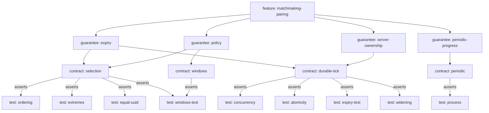

# レート差に基づく対戦選択と対局作成

このページは `python3 scripts/traceability.py render` で生成する。

元データは [crates/game-application/src/matchmaking-pairing.trace.json](../../../crates/game-application/src/matchmaking-pairing.trace.json)。
[全機能の一覧](../feature-traceability.md)。

## 対象機能

| ID | 機能 | 仕様 |
| --- | --- | --- |
| matchmaking-pairing | レート差に基づく対戦選択と対局作成 | [crates/game-application/src/matchmaking.rs](../../../crates/game-application/src/matchmaking.rs#L198) |

## 保証の成立条件と構成

1. The pure selector filters live waiting tickets, sorts deterministic anchors and checks both rating windows within one pool.
2. The durable tick transaction rechecks locked tickets and ratings after lock waits, creates a rated game and changes both tickets to permanent Playing bindings together.
3. The game-server matcher invokes tick on a one-second interval, alternates the first pool and performs a bounded batch without requiring another join.

以下の保証には、各行に示す契約が必要となる。テストの assertions は記載した事例の範囲に限られる。

| ID | アプリケーションの保証と条件 | 必要な契約 |
| --- | --- | --- |
| expiry | Expired tickets cannot pair, including when expiry occurs during rating-lock waits. | [selection](#contract-selection), [durable-tick](#contract-durable-tick) |
| periodic-progress | The actual game-server runs matching periodically so a waiting pair can become eligible without another join; each batch alternates starting pool, caps attempts at 32 and stops after two empty pools or a failure. | [periodic](#contract-periodic) |
| policy | Pairing skips an incompatible head, uses the oldest compatible anchor and nearest opponent with age/UUID/owner tie breaks, requires distinct users and one pool, and applies both widening windows. | [windows](#contract-windows), [selection](#contract-selection) |
| server-ownership | The server chooses the game and permanent Black/White bindings. Pair formation and two ticket transitions commit together; concurrent matchers have one durable winner. | [durable-tick](#contract-durable-tick) |

## 宣言した対応関係

矢印は著者が宣言した関係を示す。asserts は記載した事例への直接の assertion、exercises は処理を通る関係を示す。



## コンポーネント契約と根拠

<a id="contract-durable-tick"></a>

### durable-tick

tick serializes durable admission, locks selected tickets and rating states, rechecks compatibility after waits and atomically creates game/rating reservations and both Playing tickets.

実装位置: [crates/game-persistence/src/matchmaking.rs](../../../crates/game-persistence/src/matchmaking.rs#L385)。

- [concurrency](#test-concurrency) (asserts): Concurrent ticks produce exactly one game, one rated_game and two slots, and one user&#x27;s current participation is Playing. This test does not compare participant or side bindings.
- [atomicity](#test-atomicity) (asserts): Injected slot failure leaves zero game/rated/slot rows and both waiting; successful retry freezes original Unrated states.
- [expiry-test](#test-expiry-test) (asserts): Tickets expire while blocked on rating locks; tick returns None and creates no game.
- [widening](#test-widening) (asserts): After aging enqueue times, one/two pair while an incompatible head remains waiting.

未検証: The selected tests do not compare both ticket side bindings with the committed game&#x27;s participant bindings. The executable test checks snapshot users, but does not compare ticket-side equality.

<a id="contract-periodic"></a>

### periodic

The executable uses a one-second skipped-tick interval, alternates starting pools, tries at most 32 ticks and stops a batch on two empty pools or first failure.

実装位置: [apps/game-server/src/main.rs](../../../apps/game-server/src/main.rs#L20)。

- [process](#test-process) (asserts): Launches the actual game-server binary and observes waiting tickets become Playing with a sequence-zero snapshot containing both users, without another join.

未検証: The test ages DB timestamps instead of waiting 30 real seconds. It does not assert two-pool fairness, the 32-attempt cap, error logging/recovery or Ctrl-C shutdown.

<a id="contract-selection"></a>

### selection

Selection excludes expired waiting, same owner and other pools, orders anchors by enqueue/UUID/owner and opponents by difference/age/UUID/owner.

実装位置: [crates/game-application/src/matchmaking.rs](../../../crates/game-application/src/matchmaking.rs#L198)。

- [ordering](#test-ordering) (asserts): Checks skipped incompatible head and nearest/oldest/UUID preferences.
- [extremes](#test-extremes) (asserts): Checks exclusive expiry boundary, extreme arithmetic and pool separation.
- [equal-uuid](#test-equal-uuid) (asserts): Equal owner-scoped ticket UUIDs have deterministic owner tie breaking.
- [windows-test](#test-windows-test) (asserts): Requires both participants to have widened enough.

<a id="contract-windows"></a>

### windows

Unrated rating is effectively 1500; allowed difference starts at 100 and increases by 50 per complete 30 seconds to 400, using wide arithmetic.

実装位置: [crates/game-application/src/matchmaking.rs](../../../crates/game-application/src/matchmaking.rs#L192)。

- [windows-test](#test-windows-test) (asserts): Checks 29,999/30,000ms boundary, 400 cap, bilateral compatibility and Unrated=1500.

## 実在するテストと実行コマンド

コマンドは個別テストを厳密一致で選択する。保存層テストには TEST_DATABASE_URL と TEST_VALKEY_URL が必要な場合がある。

<a id="test-atomicity"></a>

### atomicity

テスト位置: [crates/game-persistence/tests/matchmaking.rs](../../../crates/game-persistence/tests/matchmaking.rs#L153)。

範囲: Real PostgreSQL with SeaOrmStore and application operations; no browser or RPC transport.

```sh
cargo test --locked -p game-persistence --test matchmaking pair_failure_rolls_back_and_terminal_failure_preserves_both_active_tickets -- --exact --format pretty --color never
```

<a id="test-concurrency"></a>

### concurrency

テスト位置: [crates/game-persistence/tests/matchmaking.rs](../../../crates/game-persistence/tests/matchmaking.rs#L107)。

範囲: Real PostgreSQL with SeaOrmStore and application operations; no browser or RPC transport.

```sh
cargo test --locked -p game-persistence --test matchmaking cross_pool_joins_and_multiple_matchers_have_one_durable_winner -- --exact --format pretty --color never
```

<a id="test-equal-uuid"></a>

### equal-uuid

テスト位置: [crates/game-application/src/matchmaking.rs](../../../crates/game-application/src/matchmaking.rs#L284)。

範囲: Pure selector with equal UUIDs and distinct owners.

```sh
cargo test --locked -p game-application --lib matchmaking::tests::owner_scoped_equal_uuids_have_a_stable_opponent -- --exact --format pretty --color never
```

<a id="test-expiry-test"></a>

### expiry-test

テスト位置: [crates/game-persistence/tests/matchmaking.rs](../../../crates/game-persistence/tests/matchmaking.rs#L255)。

範囲: Real PostgreSQL with SeaOrmStore and application operations; no browser or RPC transport. Explicit held rating locks and forced expiry.

```sh
cargo test --locked -p game-persistence --test matchmaking expiry_after_rating_lock_wait_prevents_match -- --exact --format pretty --color never
```

<a id="test-extremes"></a>

### extremes

テスト位置: [crates/game-application/src/matchmaking.rs](../../../crates/game-application/src/matchmaking.rs#L270)。

範囲: Pure selector boundary and isolation fixtures.

```sh
cargo test --locked -p game-application --lib matchmaking::tests::extremes_expiry_and_pool_separation -- --exact --format pretty --color never
```

<a id="test-ordering"></a>

### ordering

テスト位置: [crates/game-application/src/matchmaking.rs](../../../crates/game-application/src/matchmaking.rs#L256)。

範囲: Pure selector fixtures; no database or scheduler.

```sh
cargo test --locked -p game-application --lib matchmaking::tests::skips_unmatched_head_and_prefers_nearest_then_oldest_then_id -- --exact --format pretty --color never
```

<a id="test-process"></a>

### process

テスト位置: [apps/game-server/tests/matchmaking.rs](../../../apps/game-server/tests/matchmaking.rs#L20)。

範囲: Actual game-server process, real PostgreSQL and generated gRPC client; DB timestamps force eligibility.

```sh
cargo test --locked -p game-server --test matchmaking writer_periodic_matching_progresses_without_another_join -- --exact --format pretty --color never
```

<a id="test-widening"></a>

### widening

テスト位置: [crates/game-persistence/tests/matchmaking.rs](../../../crates/game-persistence/tests/matchmaking.rs#L309)。

範囲: Real PostgreSQL with SeaOrmStore and application operations; no browser or RPC transport. Direct tick after forced enqueue aging.

```sh
cargo test --locked -p game-persistence --test matchmaking widening_without_a_new_join_skips_an_incompatible_head -- --exact --format pretty --color never
```

<a id="test-windows-test"></a>

### windows-test

テスト位置: [crates/game-application/src/matchmaking.rs](../../../crates/game-application/src/matchmaking.rs#L247)。

範囲: Pure policy; no database or timer.

```sh
cargo test --locked -p game-application --lib matchmaking::tests::widening_is_bilateral_and_includes_boundary -- --exact --format pretty --color never
```

## 検査と根拠の限界

check はグラフ、ファイル内の一意なテキスト位置、package と target ごとのコンパイル済みテスト名、生成文書の一致を検査する。
run は check の後に共有された Cargo テストを一度ずつ実行し、厳密一致の 1 件が成功し、失敗と無視が 0 件であることを検査する。
この文書には実行済みの成功状態を保存しない。CI の workspace テスト実行結果は、その実行時点の結果となる。
位置の検査は Rust の構文解析ではなく、テスト名と指定したソース位置が同じ定義を指すことも証明しない。
宣言した関連の意味と網羅性はレビューが必要となる。検出できる関連の削除は、必須の関連数、参照先、孤立ノードの規則に違反するものに限られる。

- The process test proves periodic progress for its one-pool case; pure tests directly assert tie-break policy and do not prove production fairness or timing under load.
- Pool names do not enable clocks or time-control adjudication.
- Links and passing tests do not establish semantic completeness; changes to guarantees, evidence strength and decomposition require review.
