# マッチメイキングの参加・状態取得・継続・キャンセル

このページは `python3 scripts/traceability.py render` で生成する。

元データは [crates/game-application/src/trace/matchmaking-tickets/feature.rs](../../../crates/game-application/src/trace/matchmaking-tickets/feature.rs)。
[全機能の一覧](../feature-traceability.md)。

## 対象機能

| ID | 機能 | 仕様 |
| --- | --- | --- |
| matchmaking-tickets | マッチメイキングの参加・状態取得・継続・キャンセル | [crates/game-application/src/matchmaking.rs](../../../crates/game-application/src/matchmaking.rs#L84) |

## 保証の成立条件と構成

1. Browser current/ticket/join/heartbeat/cancel handlers authenticate the cookie and derive the owner before issuing the corresponding GameService RPC.
2. GameRpc validates typed owner, UUID, pool and heartbeat values, then delegates JoinMatchmaking, GetMatchmaking, GetMatchmakingTicket, HeartbeatMatchmaking and CancelMatchmaking to the durable repository.
3. PostgreSQL transactions serialize admission, expire stale waiting state and preserve historical tickets, refusals and cancellation tombstones; pairing is traced separately.

以下の保証には、各行に示す契約が必要となる。テストの assertions は記載した事例の範囲に限られる。

| ID | アプリケーションの保証と条件 | 必要な契約 |
| --- | --- | --- |
| browser-contract | The five browser matchmaking operations require a valid session, enforce Host and mutation Origin/same-site checks, reject caller user_id, return stable ticket/error JSON and apply no-store. OpenAPI describes all five operations. | [browser-owner](#contract-browser-owner), [browser-response](#contract-browser-response), [browser-schema](#contract-browser-schema) |
| durable-history | Current participation and historical ticket reads are owner-scoped. Exact retries retain stored outcomes; a different pool conflicts. Refusals and cancellation before join remain durable. | [admission](#contract-admission), [reads](#contract-reads), [cancel](#contract-cancel), [rpc-boundary](#contract-rpc-boundary) |
| owner-admission | An owner may request either supported rated pool, with at most one waiting or playing participation across pools. The server captures the admission rating and preserves the UUID retry identity. | [admission](#contract-admission), [rpc-boundary](#contract-rpc-boundary), [browser-owner](#contract-browser-owner) |
| waiting-lifecycle | Waiting lasts 30 seconds from admission or the latest strictly newer positive heartbeat. Duplicate/older heartbeats do not extend or revive it. Cancellation ends waiting but cannot cancel an already matched game. | [heartbeat](#contract-heartbeat), [cancel](#contract-cancel) |

## 宣言した対応関係

矢印は著者が宣言した関係を示す。asserts は記載した事例への直接の assertion、exercises は処理を通る関係を示す。

```mermaid
flowchart TD
    n0["feature: matchmaking-tickets"]
    n1["guarantee: browser-contract"]
    n2["guarantee: durable-history"]
    n3["guarantee: owner-admission"]
    n4["guarantee: waiting-lifecycle"]
    n5["contract: admission"]
    n6["contract: browser-owner"]
    n7["contract: browser-response"]
    n8["contract: browser-schema"]
    n9["contract: cancel"]
    n10["contract: heartbeat"]
    n11["contract: reads"]
    n12["contract: rpc-boundary"]
    n13["test: test-game-grpc-test-tcp-matchmaking-rpc-validates-requests-and-recovers-durable-owner-scoped-results"]
    n14["test: test-game-persistence-test-matchmaking-cancellation-racing-a-match-has-one-committed-outcome"]
    n15["test: test-game-persistence-test-matchmaking-cross-pool-joins-and-multiple-matchers-have-one-durable-winner"]
    n16["test: test-game-persistence-test-matchmaking-durable-retry-refusal-and-cancel-before-join-survive-reconnect"]
    n17["test: test-game-persistence-test-matchmaking-heartbeat-retries-do-not-extend-and-expired-waiting-never-revives"]
    n18["test: test-game-persistence-test-matchmaking-pair-failure-rolls-back-and-terminal-failure-preserves-both-active-tickets"]
    n19["test: test-game-persistence-test-ratings-admission-waits-for-application-and-freezes-the-new-committed-states"]
    n20["test: test-game-persistence-test-ratings-participation-is-global-and-refused-retries-remain-refused"]
    n21["test: test-realtime-gateway-test-services-authenticated-matchmaking-recovers-requests-and-rejects-cross-site-or-foreign-access"]
    n22["test: test-realtime-gateway-test-services-matchmaking-checks-cookie-origin-and-input-before-admission"]
    n23["test: test-realtime-gateway-test-services-matchmaking-openapi-covers-all-owner-scoped-routes"]
    n0 --> n1
    n1 --> n6
    n1 --> n7
    n1 --> n8
    n0 --> n2
    n2 --> n5
    n2 --> n11
    n2 --> n9
    n2 --> n12
    n0 --> n3
    n3 --> n5
    n3 --> n12
    n3 --> n6
    n0 --> n4
    n4 --> n10
    n4 --> n9
    n5 -->|asserts| n15
    n5 -->|asserts| n16
    n5 -->|asserts| n18
    n5 -->|unreviewed| n19
    n5 -->|unreviewed| n20
    n6 -->|asserts| n21
    n6 -->|asserts| n22
    n7 -->|asserts| n21
    n7 -->|asserts| n22
    n8 -->|asserts| n23
    n9 -->|asserts| n13
    n9 -->|asserts| n14
    n9 -->|asserts| n16
    n10 -->|asserts| n17
    n10 -->|asserts| n21
    n11 -->|asserts| n16
    n11 -->|asserts| n17
    n11 -->|asserts| n21
    n12 -->|asserts| n13
    n12 -->|exercises| n21
```



## コンポーネント契約と根拠

<a id="contract-admission"></a>

### admission

The transaction checks existing owner/UUID first, then global active participation and per-pool pending rating reservations; admitted/refused state is committed for later retries.

実装位置: [crates/game-persistence/src/matchmaking.rs](../../../crates/game-persistence/src/matchmaking.rs#L224)。

- [test-game-persistence-test-matchmaking-cross-pool-joins-and-multiple-matchers-have-one-durable-winner](#test-test-game-persistence-test-matchmaking-cross-pool-joins-and-multiple-matchers-have-one-durable-winner) (asserts): Concurrent different-pool joins produce exactly one created admission.
- [test-game-persistence-test-matchmaking-durable-retry-refusal-and-cancel-before-join-survive-reconnect](#test-test-game-persistence-test-matchmaking-durable-retry-refusal-and-cancel-before-join-survive-reconnect) (asserts): The stored already_waiting refusal is replayed after cancellation before reconnect. After reconnect, cancel-before-join tombstones remain Cancelled in both pools; changed-pool retries conflict.
- [test-game-persistence-test-matchmaking-pair-failure-rolls-back-and-terminal-failure-preserves-both-active-tickets](#test-test-game-persistence-test-matchmaking-pair-failure-rolls-back-and-terminal-failure-preserves-both-active-tickets) (asserts): After game finish the same-pool admission is rating_pending, while another pool remains available.
- [test-game-persistence-test-ratings-admission-waits-for-application-and-freezes-the-new-committed-states](#test-test-game-persistence-test-ratings-admission-waits-for-application-and-freezes-the-new-committed-states) (unreviewed): Directory ownership declares this test belongs to the contract; execution of the implementation and strength of assertions require review.
- [test-game-persistence-test-ratings-participation-is-global-and-refused-retries-remain-refused](#test-test-game-persistence-test-ratings-participation-is-global-and-refused-retries-remain-refused) (unreviewed): Directory ownership declares this test belongs to the contract; execution of the implementation and strength of assertions require review.

<a id="contract-browser-owner"></a>

### browser-owner

Browser handlers derive owner from session authentication and check exact Host, required mutation Origin and optional same-site metadata before typed admission.

実装位置: [crates/realtime-gateway/src/matchmaking.rs](../../../crates/realtime-gateway/src/matchmaking.rs#L119)。

- [test-realtime-gateway-test-services-authenticated-matchmaking-recovers-requests-and-rejects-cross-site-or-foreign-access](#test-test-realtime-gateway-test-services-authenticated-matchmaking-recovers-requests-and-rejects-cross-site-or-foreign-access) (asserts): Anonymous current is 401, foreign owner is 404 and wrong Origin/Host is 403.
- [test-realtime-gateway-test-services-matchmaking-checks-cookie-origin-and-input-before-admission](#test-test-realtime-gateway-test-services-matchmaking-checks-cookie-origin-and-input-before-admission) (asserts): Missing mutation Origin, duplicate cookie, unknown pool and forged user_id are rejected; no rejected admission leaves a ticket.

未検証: No dedicated assertion covers every malformed UUID, DELETE body rejection, saturated HTTP permit or authentication/backend timeout branch.

<a id="contract-browser-response"></a>

### browser-response

Ticket responses preserve server state and distinguish newly created, replayed, refused and already-matched cancellation outcomes; router middleware adds no-store.

実装位置: [crates/realtime-gateway/src/matchmaking.rs](../../../crates/realtime-gateway/src/matchmaking.rs#L171)。

- [test-realtime-gateway-test-services-authenticated-matchmaking-recovers-requests-and-rejects-cross-site-or-foreign-access](#test-test-realtime-gateway-test-services-authenticated-matchmaking-recovers-requests-and-rejects-cross-site-or-foreign-access) (asserts): New join is 201 with no-store, replay is 200 with identical JSON, pool conflict is 409, playing cancellation is 409 already_matched with game_id.
- [test-realtime-gateway-test-services-matchmaking-checks-cookie-origin-and-input-before-admission](#test-test-realtime-gateway-test-services-matchmaking-checks-cookie-origin-and-input-before-admission) (asserts): Missing-Origin mutation responses include no-store.

未検証: no-store is asserted for representative successes and Origin failures, not every response class; all DTO corruption and upstream error mappings lack dedicated assertions.

<a id="contract-browser-schema"></a>

### browser-schema

The generated matchmaking OpenAPI includes the five owner-scoped operations and cookie authentication alternatives.

実装位置: [crates/realtime-gateway/src/matchmaking.rs](../../../crates/realtime-gateway/src/matchmaking.rs#L344)。

- [test-realtime-gateway-test-services-matchmaking-openapi-covers-all-owner-scoped-routes](#test-test-realtime-gateway-test-services-matchmaking-openapi-covers-all-owner-scoped-routes) (asserts): All five method/path operations and both cookie schemes with alternative requirements are inspected.

<a id="contract-cancel"></a>

### cancel

Cancellation transitions a live waiting ticket or inserts an owner-scoped tombstone; matched/terminal tickets are returned without cancelling a game.

実装位置: [crates/game-persistence/src/matchmaking.rs](../../../crates/game-persistence/src/matchmaking.rs#L348)。

- [test-game-grpc-test-tcp-matchmaking-rpc-validates-requests-and-recovers-durable-owner-scoped-results](#test-test-game-grpc-test-tcp-matchmaking-rpc-validates-requests-and-recovers-durable-owner-scoped-results) (asserts): Cancel of an already Playing ticket equals its prior ticket.
- [test-game-persistence-test-matchmaking-cancellation-racing-a-match-has-one-committed-outcome](#test-test-game-persistence-test-matchmaking-cancellation-racing-a-match-has-one-committed-outcome) (asserts): Each race commits either cancellation with no game or two Playing tickets for one game.
- [test-game-persistence-test-matchmaking-durable-retry-refusal-and-cancel-before-join-survive-reconnect](#test-test-game-persistence-test-matchmaking-durable-retry-refusal-and-cancel-before-join-survive-reconnect) (asserts): Cancellation before join survives reconnect and both pool joins; cancelling an old identity leaves a newer ticket waiting.

<a id="contract-heartbeat"></a>

### heartbeat

Only an unexpired Waiting ticket with a larger sequence gets a fresh database-time expiry; all terminal states retain their stored state.

実装位置: [crates/game-persistence/src/matchmaking.rs](../../../crates/game-persistence/src/matchmaking.rs#L315)。

- [test-game-persistence-test-matchmaking-heartbeat-retries-do-not-extend-and-expired-waiting-never-revives](#test-test-game-persistence-test-matchmaking-heartbeat-retries-do-not-extend-and-expired-waiting-never-revives) (asserts): Duplicate sequence returns exactly the same ticket; a newer heartbeat after forced expiry produces Expired and does not revive admission.
- [test-realtime-gateway-test-services-authenticated-matchmaking-recovers-requests-and-rejects-cross-site-or-foreign-access](#test-test-realtime-gateway-test-services-authenticated-matchmaking-recovers-requests-and-rejects-cross-site-or-foreign-access) (asserts): HTTP rejects sequence zero and duplicate sequence one returns the same ticket.

未検証: No selected assertion enumerates all older sequences, all non-Waiting states or exact wall-clock timing boundaries.

<a id="contract-reads"></a>

### reads

Current and ticket operations expire stale state transactionally and query the authenticated owner; current returns only waiting/playing participation.

実装位置: [crates/game-persistence/src/matchmaking.rs](../../../crates/game-persistence/src/matchmaking.rs#L299)。

- [test-game-persistence-test-matchmaking-durable-retry-refusal-and-cancel-before-join-survive-reconnect](#test-test-game-persistence-test-matchmaking-durable-retry-refusal-and-cancel-before-join-survive-reconnect) (asserts): Foreign owner ticket lookup returns NotFound and old cancelled identity cannot alter a newer waiting request.
- [test-game-persistence-test-matchmaking-heartbeat-retries-do-not-extend-and-expired-waiting-never-revives](#test-test-game-persistence-test-matchmaking-heartbeat-retries-do-not-extend-and-expired-waiting-never-revives) (asserts): After forced expiry current becomes Idle.
- [test-realtime-gateway-test-services-authenticated-matchmaking-recovers-requests-and-rejects-cross-site-or-foreign-access](#test-test-realtime-gateway-test-services-authenticated-matchmaking-recovers-requests-and-rejects-cross-site-or-foreign-access) (asserts): Browser retrieves current playing game and stored refusal by ticket identity.

<a id="contract-rpc-boundary"></a>

### rpc-boundary

The five matchmaking RPC methods parse owner/UUID, validate supported pool and positive heartbeat, delegate owner-scoped operations and serialize ticket states.

実装位置: [crates/game-grpc/src/service.rs](../../../crates/game-grpc/src/service.rs#L33)。

- [test-game-grpc-test-tcp-matchmaking-rpc-validates-requests-and-recovers-durable-owner-scoped-results](#test-test-game-grpc-test-tcp-matchmaking-rpc-validates-requests-and-recovers-durable-owner-scoped-results) (asserts): Unknown/unspecified pool and nonpositive heartbeat are InvalidArgument, exact retry returns unchanged ticket with created=false, foreign owner is NotFound and playing/cancel responses preserve game identity.
- [test-realtime-gateway-test-services-authenticated-matchmaking-recovers-requests-and-rejects-cross-site-or-foreign-access](#test-test-realtime-gateway-test-services-authenticated-matchmaking-recovers-requests-and-rejects-cross-site-or-foreign-access) (exercises): All five RPCs are exercised through browser calls and return the asserted current, stored, heartbeat and cancellation outcomes.

未検証: Malformed owner/UUID cases are not enumerated for every RPC; the dedicated TCP test does not assert a successful heartbeat. Browser tests assert successful heartbeat through RPC.

## 実在するテストと実行コマンド

コマンドは個別テストを厳密一致で選択する。保存層テストには TEST_DATABASE_URL と TEST_VALKEY_URL が必要な場合がある。

<a id="test-test-game-grpc-test-tcp-matchmaking-rpc-validates-requests-and-recovers-durable-owner-scoped-results"></a>

### test-game-grpc-test-tcp-matchmaking-rpc-validates-requests-and-recovers-durable-owner-scoped-results

テスト位置: [crates/game-grpc/tests/trace/matchmaking-tickets/cancel/matchmaking_rpc_validates_requests_and_recovers_durable_owner_scoped_results.rs](../../../crates/game-grpc/tests/trace/matchmaking-tickets/cancel/matchmaking_rpc_validates_requests_and_recovers_durable_owner_scoped_results.rs#L9)。

範囲: Generated gRPC client over TCP, GameRpc, application and real PostgreSQL; test-only game seeding is fixture setup.

```sh
cargo test --locked -p game-grpc --test tcp matchmaking_rpc_validates_requests_and_recovers_durable_owner_scoped_results -- --exact --format pretty --color never
```

<a id="test-test-game-persistence-test-matchmaking-cancellation-racing-a-match-has-one-committed-outcome"></a>

### test-game-persistence-test-matchmaking-cancellation-racing-a-match-has-one-committed-outcome

テスト位置: [crates/game-persistence/tests/trace/matchmaking-tickets/cancel/cancellation_racing_a_match_has_one_committed_outcome.rs](../../../crates/game-persistence/tests/trace/matchmaking-tickets/cancel/cancellation_racing_a_match_has_one_committed_outcome.rs#L9)。

範囲: Real PostgreSQL with SeaOrmStore and application operations; no browser or RPC transport. Eight concurrent cancellation/matcher races.

```sh
cargo test --locked -p game-persistence --test matchmaking cancellation_racing_a_match_has_one_committed_outcome -- --exact --format pretty --color never
```

<a id="test-test-game-persistence-test-matchmaking-cross-pool-joins-and-multiple-matchers-have-one-durable-winner"></a>

### test-game-persistence-test-matchmaking-cross-pool-joins-and-multiple-matchers-have-one-durable-winner

テスト位置: [crates/game-persistence/tests/trace/matchmaking-pairing/durable-tick/cross_pool_joins_and_multiple_matchers_have_one_durable_winner.rs](../../../crates/game-persistence/tests/trace/matchmaking-pairing/durable-tick/cross_pool_joins_and_multiple_matchers_have_one_durable_winner.rs#L9)。

範囲: Real PostgreSQL with SeaOrmStore and application operations; no browser or RPC transport. Concurrent admission and matcher tasks.

```sh
cargo test --locked -p game-persistence --test matchmaking cross_pool_joins_and_multiple_matchers_have_one_durable_winner -- --exact --format pretty --color never
```

<a id="test-test-game-persistence-test-matchmaking-durable-retry-refusal-and-cancel-before-join-survive-reconnect"></a>

### test-game-persistence-test-matchmaking-durable-retry-refusal-and-cancel-before-join-survive-reconnect

テスト位置: [crates/game-persistence/tests/trace/matchmaking-tickets/admission/durable_retry_refusal_and_cancel_before_join_survive_reconnect.rs](../../../crates/game-persistence/tests/trace/matchmaking-tickets/admission/durable_retry_refusal_and_cancel_before_join_survive_reconnect.rs#L9)。

範囲: Real PostgreSQL with SeaOrmStore and application operations; no browser or RPC transport.

```sh
cargo test --locked -p game-persistence --test matchmaking durable_retry_refusal_and_cancel_before_join_survive_reconnect -- --exact --format pretty --color never
```

<a id="test-test-game-persistence-test-matchmaking-heartbeat-retries-do-not-extend-and-expired-waiting-never-revives"></a>

### test-game-persistence-test-matchmaking-heartbeat-retries-do-not-extend-and-expired-waiting-never-revives

テスト位置: [crates/game-persistence/tests/trace/matchmaking-tickets/heartbeat/heartbeat_retries_do_not_extend_and_expired_waiting_never_revives.rs](../../../crates/game-persistence/tests/trace/matchmaking-tickets/heartbeat/heartbeat_retries_do_not_extend_and_expired_waiting_never_revives.rs#L9)。

範囲: Real PostgreSQL with SeaOrmStore and application operations; no browser or RPC transport. Database expiry is forced.

```sh
cargo test --locked -p game-persistence --test matchmaking heartbeat_retries_do_not_extend_and_expired_waiting_never_revives -- --exact --format pretty --color never
```

<a id="test-test-game-persistence-test-matchmaking-pair-failure-rolls-back-and-terminal-failure-preserves-both-active-tickets"></a>

### test-game-persistence-test-matchmaking-pair-failure-rolls-back-and-terminal-failure-preserves-both-active-tickets

テスト位置: [crates/game-persistence/tests/trace/matchmaking-pairing/durable-tick/pair_failure_rolls_back_and_terminal_failure_preserves_both_active_tickets.rs](../../../crates/game-persistence/tests/trace/matchmaking-pairing/durable-tick/pair_failure_rolls_back_and_terminal_failure_preserves_both_active_tickets.rs#L9)。

範囲: Real PostgreSQL with SeaOrmStore and application operations; no browser or RPC transport. Injected SQL failures and post-finish rating reservation checks.

```sh
cargo test --locked -p game-persistence --test matchmaking pair_failure_rolls_back_and_terminal_failure_preserves_both_active_tickets -- --exact --format pretty --color never
```

<a id="test-test-game-persistence-test-ratings-admission-waits-for-application-and-freezes-the-new-committed-states"></a>

### test-game-persistence-test-ratings-admission-waits-for-application-and-freezes-the-new-committed-states

テスト位置: [crates/game-persistence/tests/trace/matchmaking-tickets/admission/admission_waits_for_application_and_freezes_the_new_committed_states.rs](../../../crates/game-persistence/tests/trace/matchmaking-tickets/admission/admission_waits_for_application_and_freezes_the_new_committed_states.rs#L2)。

範囲: Contract-directory membership only; runtime dependencies and assertions have not been reviewed.

```sh
cargo test --locked -p game-persistence --test ratings admission_waits_for_application_and_freezes_the_new_committed_states -- --exact --format pretty --color never
```

<a id="test-test-game-persistence-test-ratings-participation-is-global-and-refused-retries-remain-refused"></a>

### test-game-persistence-test-ratings-participation-is-global-and-refused-retries-remain-refused

テスト位置: [crates/game-persistence/tests/trace/matchmaking-tickets/admission/participation_is_global_and_refused_retries_remain_refused.rs](../../../crates/game-persistence/tests/trace/matchmaking-tickets/admission/participation_is_global_and_refused_retries_remain_refused.rs#L2)。

範囲: Contract-directory membership only; runtime dependencies and assertions have not been reviewed.

```sh
cargo test --locked -p game-persistence --test ratings participation_is_global_and_refused_retries_remain_refused -- --exact --format pretty --color never
```

<a id="test-test-realtime-gateway-test-services-authenticated-matchmaking-recovers-requests-and-rejects-cross-site-or-foreign-access"></a>

### test-realtime-gateway-test-services-authenticated-matchmaking-recovers-requests-and-rejects-cross-site-or-foreign-access

テスト位置: [crates/realtime-gateway/tests/trace/matchmaking-tickets/browser-owner/authenticated_matchmaking_recovers_requests_and_rejects_cross_site_or_foreign_access.rs](../../../crates/realtime-gateway/tests/trace/matchmaking-tickets/browser-owner/authenticated_matchmaking_recovers_requests_and_rejects_cross_site_or_foreign_access.rs#L9)。

範囲: Real HTTP/WebSocket gateway, user HTTP service, game gRPC service, PostgreSQL and Valkey; external OIDC provider is a fixture.

```sh
cargo test --locked -p realtime-gateway --test services authenticated_matchmaking_recovers_requests_and_rejects_cross_site_or_foreign_access -- --exact --format pretty --color never
```

<a id="test-test-realtime-gateway-test-services-matchmaking-checks-cookie-origin-and-input-before-admission"></a>

### test-realtime-gateway-test-services-matchmaking-checks-cookie-origin-and-input-before-admission

テスト位置: [crates/realtime-gateway/tests/trace/matchmaking-tickets/browser-owner/matchmaking_checks_cookie_origin_and_input_before_admission.rs](../../../crates/realtime-gateway/tests/trace/matchmaking-tickets/browser-owner/matchmaking_checks_cookie_origin_and_input_before_admission.rs#L9)。

範囲: Real HTTP/WebSocket gateway, user HTTP service, game gRPC service, PostgreSQL and Valkey; external OIDC provider is a fixture.

```sh
cargo test --locked -p realtime-gateway --test services matchmaking_checks_cookie_origin_and_input_before_admission -- --exact --format pretty --color never
```

<a id="test-test-realtime-gateway-test-services-matchmaking-openapi-covers-all-owner-scoped-routes"></a>

### test-realtime-gateway-test-services-matchmaking-openapi-covers-all-owner-scoped-routes

テスト位置: [crates/realtime-gateway/tests/trace/matchmaking-tickets/browser-schema/matchmaking_openapi_covers_all_owner_scoped_routes.rs](../../../crates/realtime-gateway/tests/trace/matchmaking-tickets/browser-schema/matchmaking_openapi_covers_all_owner_scoped_routes.rs#L9)。

範囲: Inspects generated OpenAPI only; no service fixture or network calls.

```sh
cargo test --locked -p realtime-gateway --test services matchmaking_openapi_covers_all_owner_scoped_routes -- --exact --format pretty --color never
```

## 検査と根拠の限界

check はグラフ、ファイル内の一意なテキスト位置、package と target ごとのコンパイル済みテスト名、生成文書の一致を検査する。
run は check の後に共有された Cargo テストを一度ずつ実行し、厳密一致の 1 件が成功し、失敗と無視が 0 件であることを検査する。
この文書には実行済みの成功状態を保存しない。CI の workspace テスト実行結果は、その実行時点の結果となる。
宣言した関連の意味と網羅性はレビューが必要となる。検出できる関連の削除は、必須の関連数、参照先、孤立ノードの規則に違反するものに限られる。

- gRPC accepts caller identity claims and does not authenticate users; authenticated owner derivation belongs to the browser gateway.
- Selected tests do not exhaust every heartbeat ordering, malformed field, no-store response class or backend failure branch.
- Links and passing tests do not establish semantic completeness; changes to guarantees, evidence strength and decomposition require review.

## ディレクトリ方式の検査範囲

Rust 宣言、通常のモジュールとリテラル include! から物理ファイルの所属、package、target、完全なテスト名と位置を抽出する。ホストのデフォルト Cargo feature 構成で workspace の lib、bin、integration test の全テスト一覧と一致させる。別 target、feature、cfg の組合せは対象外。
src/trace/<feature> と tests/trace/<feature> は新規機能も探索し、未宣言または未到達のファイルを拒否する。契約内の通常テストは unreviewed として追加する。asserts または exercises のレビュー済み根拠がない契約には gap が必要。
全 target の未分類テストは拒否する。trace ディレクトリ内の未対応の item macro と cfg は直接拒否し、外側の未対応構文が生成した実行対象テストはコンパイル済み一覧との差として拒否する。テスト補助とインフラの明示分類および理由は全機能の一覧に示す。
