# マッチメイキングの参加・状態取得・継続・キャンセル

このページは `python3 scripts/traceability.py render` で生成する。

元データは [crates/game-application/src/trace/matchmaking-tickets/feature.rs](../../../crates/game-application/src/trace/matchmaking-tickets/feature.rs)。
[全機能の一覧](../feature-traceability.md)。

## 対象機能

| ID | 機能 | 仕様 |
| --- | --- | --- |
| matchmaking-tickets | マッチメイキングの参加・状態取得・継続・キャンセル | [crates/game-application/src/matchmaking.rs](../../../crates/game-application/src/matchmaking.rs#L84) |

## 保証の成立条件と構成

1. ブラウザーの現在参加状態・チケット・参加・ハートビート・取消の各ハンドラーは、Cookie を認証し、所有者を導出してから対応する GameService RPC を呼ぶ。
2. GameRpc は型付きの所有者・UUID・プール・ハートビートを検証し、JoinMatchmaking、GetMatchmaking、GetMatchmakingTicket、HeartbeatMatchmaking、CancelMatchmaking を永続リポジトリへ委譲する。
3. PostgreSQL トランザクションは参加受け入れを直列化し、古い待機状態を失効させ、過去のチケット・拒否・取消記録を保持する。組合せ処理は別に追跡する。

以下の保証には、各行に示す契約が必要となる。テストによる検証は記載した事例の範囲に限られる。

| ID | アプリケーションの保証と条件 | 必要な契約 |
| --- | --- | --- |
| browser-contract | ブラウザーの五つの組合せ操作は有効なセッションを必須とし、Host と変更時の Origin・same-site を確認する。呼び出し元の user_id を拒否し、安定したチケット・エラー JSON を返して no-store を適用する。OpenAPI は五つすべての操作を記述する。 | [browser-owner](#contract-browser-owner), [browser-response](#contract-browser-response), [browser-schema](#contract-browser-schema) |
| durable-history | 現在の参加状態と過去のチケットの読み取りは所有者に限定する。同一の再試行は保存済み結果を保持し、プールの変更は競合する。参加拒否と参加前の取消は永続化される。 | [admission](#contract-admission), [reads](#contract-reads), [cancel](#contract-cancel), [rpc-boundary](#contract-rpc-boundary) |
| owner-admission | 所有者は対応するどちらのレーティングプールにも参加を要求できるが、プール全体で待機中または対局中の参加は一件に限られる。サーバーは参加時のレーティングを固定し、UUID による再試行の識別を保持する。 | [admission](#contract-admission), [rpc-boundary](#contract-rpc-boundary), [browser-owner](#contract-browser-owner) |
| waiting-lifecycle | 待機は、参加受け入れ時またはシーケンスが厳密に大きい最新の正のハートビートから 30 秒続く。同じか古いハートビートでは延長も復活もしない。取消は待機を終了させるが、組合せ済みの対局は取り消せない。 | [heartbeat](#contract-heartbeat), [cancel](#contract-cancel) |

## 宣言した対応関係

矢印は著者が宣言した関係を示す。「事例を直接検証」は記載した事例を直接確かめる関係、「処理を通る」は対象の処理を実行する関係を示す。「所属のみ・未レビュー」は契約ディレクトリへの配置だけで分類した関係を示す。

```mermaid
flowchart TD
    n0["機能: matchmaking-tickets"]
    n1["保証: browser-contract"]
    n2["保証: durable-history"]
    n3["保証: owner-admission"]
    n4["保証: waiting-lifecycle"]
    n5["契約: admission"]
    n6["契約: browser-owner"]
    n7["契約: browser-response"]
    n8["契約: browser-schema"]
    n9["契約: cancel"]
    n10["契約: heartbeat"]
    n11["契約: reads"]
    n12["契約: rpc-boundary"]
    n13["テスト: test-game-grpc-test-tcp-tcp-matchmaking-tickets-cancel-matchmaking-rpc-validates-requests-and-recovers-durable-owner-scoped-results"]
    n14["テスト: test-game-persistence-test-matchmaking-selection-matchmaking-pairing-durable-tick-cross-pool-joins-and-multiple-matchers-have-one-durable-winner"]
    n15["テスト: test-game-persistence-test-matchmaking-selection-matchmaking-pairing-durable-tick-pair-failure-rolls-back-and-terminal-failure-preserves-both-active-tickets"]
    n16["テスト: test-game-persistence-test-matchmaking-selection-matchmaking-tickets-admission-durable-retry-refusal-and-cancel-before-join-survive-reconnect"]
    n17["テスト: test-game-persistence-test-matchmaking-selection-matchmaking-tickets-cancel-cancellation-racing-a-match-has-one-committed-outcome"]
    n18["テスト: test-game-persistence-test-matchmaking-selection-matchmaking-tickets-heartbeat-heartbeat-retries-do-not-extend-and-expired-waiting-never-revives"]
    n19["テスト: test-game-persistence-test-ratings-ratings-matchmaking-tickets-admission-admission-waits-for-application-and-freezes-the-new-committed-states"]
    n20["テスト: test-game-persistence-test-ratings-ratings-matchmaking-tickets-admission-participation-is-global-and-refused-retries-remain-refused"]
    n21["テスト: test-realtime-gateway-test-services-services-matchmaking-tickets-browser-owner-authenticated-matchmaking-recovers-requests-and-rejects-cross-site-or-foreign-access"]
    n22["テスト: test-realtime-gateway-test-services-services-matchmaking-tickets-browser-owner-matchmaking-checks-cookie-origin-and-input-before-admission"]
    n23["テスト: test-realtime-gateway-test-services-services-matchmaking-tickets-browser-schema-matchmaking-openapi-covers-all-owner-scoped-routes"]
    n0 --> n1
    n1 --> n6
    n1 --> n7
    n1 --> n8
    n0 --> n2
    n2 --> n5
    n2 --> n11
    n2 --> n9
    n2 --> n12
    n0 --> n3
    n3 --> n5
    n3 --> n12
    n3 --> n6
    n0 --> n4
    n4 --> n10
    n4 --> n9
    n5 -->|事例を直接検証| n14
    n5 -->|事例を直接検証| n15
    n5 -->|事例を直接検証| n16
    n5 -->|所属のみ・未レビュー| n19
    n5 -->|所属のみ・未レビュー| n20
    n6 -->|事例を直接検証| n21
    n6 -->|事例を直接検証| n22
    n7 -->|事例を直接検証| n21
    n7 -->|事例を直接検証| n22
    n8 -->|事例を直接検証| n23
    n9 -->|事例を直接検証| n13
    n9 -->|事例を直接検証| n16
    n9 -->|事例を直接検証| n17
    n10 -->|事例を直接検証| n18
    n10 -->|事例を直接検証| n21
    n11 -->|事例を直接検証| n16
    n11 -->|事例を直接検証| n18
    n11 -->|事例を直接検証| n21
    n12 -->|事例を直接検証| n13
    n12 -->|処理を通る| n21
```



## コンポーネント契約と根拠

<a id="contract-admission"></a>

### admission

トランザクションは、既存の所有者と UUID、全体の有効な参加、プールごとのレーティング適用待ち予約枠の順に確認する。参加受け入れまたは拒否の状態をコミットし、後の再試行に使う。

実装位置: [crates/game-persistence/src/matchmaking.rs](../../../crates/game-persistence/src/matchmaking.rs#L224)。

- [test-game-persistence-test-matchmaking-selection-matchmaking-pairing-durable-tick-cross-pool-joins-and-multiple-matchers-have-one-durable-winner](#test-test-game-persistence-test-matchmaking-selection-matchmaking-pairing-durable-tick-cross-pool-joins-and-multiple-matchers-have-one-durable-winner) (事例を直接検証): 異なるプールへの同時参加で、参加受け入れがちょうど一件だけ作られる。
- [test-game-persistence-test-matchmaking-selection-matchmaking-pairing-durable-tick-pair-failure-rolls-back-and-terminal-failure-preserves-both-active-tickets](#test-test-game-persistence-test-matchmaking-selection-matchmaking-pairing-durable-tick-pair-failure-rolls-back-and-terminal-failure-preserves-both-active-tickets) (事例を直接検証): 対局終了後、同じプールへの参加は rating_pending となり、別のプールは引き続き利用できる。
- [test-game-persistence-test-matchmaking-selection-matchmaking-tickets-admission-durable-retry-refusal-and-cancel-before-join-survive-reconnect](#test-test-game-persistence-test-matchmaking-selection-matchmaking-tickets-admission-durable-retry-refusal-and-cancel-before-join-survive-reconnect) (事例を直接検証): 保存済みの already_waiting による拒否は、取消後も再接続前に再現される。再接続後も、参加前の取消記録は両プールで Cancelled のまま残り、プールを変えた再試行は競合する。
- [test-game-persistence-test-ratings-ratings-matchmaking-tickets-admission-admission-waits-for-application-and-freezes-the-new-committed-states](#test-test-game-persistence-test-ratings-ratings-matchmaking-tickets-admission-admission-waits-for-application-and-freezes-the-new-committed-states) (所属のみ・未レビュー): 配置先からこのテストの契約への所属を宣言している。実装を実行することと検証の十分さはレビューが必要。
- [test-game-persistence-test-ratings-ratings-matchmaking-tickets-admission-participation-is-global-and-refused-retries-remain-refused](#test-test-game-persistence-test-ratings-ratings-matchmaking-tickets-admission-participation-is-global-and-refused-retries-remain-refused) (所属のみ・未レビュー): 配置先からこのテストの契約への所属を宣言している。実装を実行することと検証の十分さはレビューが必要。

<a id="contract-browser-owner"></a>

### browser-owner

ブラウザーハンドラーは型付きの参加処理に入る前に、セッション認証から所有者を導出し、Host の完全一致、変更時に必須の Origin、任意の same-site メタデータを確認する。

実装位置: [crates/realtime-gateway/src/matchmaking.rs](../../../crates/realtime-gateway/src/matchmaking.rs#L119)。

- [test-realtime-gateway-test-services-services-matchmaking-tickets-browser-owner-authenticated-matchmaking-recovers-requests-and-rejects-cross-site-or-foreign-access](#test-test-realtime-gateway-test-services-services-matchmaking-tickets-browser-owner-authenticated-matchmaking-recovers-requests-and-rejects-cross-site-or-foreign-access) (事例を直接検証): 未認証での現在状態の取得は401、別の所有者は404、Origin・Hostの不一致は403となる。
- [test-realtime-gateway-test-services-services-matchmaking-tickets-browser-owner-matchmaking-checks-cookie-origin-and-input-before-admission](#test-test-realtime-gateway-test-services-services-matchmaking-tickets-browser-owner-matchmaking-checks-cookie-origin-and-input-before-admission) (事例を直接検証): 変更操作のOrigin欠落、Cookieの重複、未知のプール、偽のuser_idを拒否する。拒否した参加要求ではチケットを残さない。

未検証: すべての不正 UUID、DELETE 本文の拒否、HTTP 許可枠の飽和、認証や接続先のタイムアウト分岐を網羅する専用の検証はない。

<a id="contract-browser-response"></a>

### browser-response

チケット応答はサーバー状態を保持し、新規作成・再試行・拒否・組合せ済みチケットの取消を区別する。ルーターのミドルウェアが no-store を追加する。

実装位置: [crates/realtime-gateway/src/matchmaking.rs](../../../crates/realtime-gateway/src/matchmaking.rs#L171)。

- [test-realtime-gateway-test-services-services-matchmaking-tickets-browser-owner-authenticated-matchmaking-recovers-requests-and-rejects-cross-site-or-foreign-access](#test-test-realtime-gateway-test-services-services-matchmaking-tickets-browser-owner-authenticated-matchmaking-recovers-requests-and-rejects-cross-site-or-foreign-access) (事例を直接検証): 新規参加はno-store付きの201、再試行は同じJSONの200、プールの競合は409となる。対局中のキャンセルは、game_id付きの409 already_matchedとなる。
- [test-realtime-gateway-test-services-services-matchmaking-tickets-browser-owner-matchmaking-checks-cookie-origin-and-input-before-admission](#test-test-realtime-gateway-test-services-services-matchmaking-tickets-browser-owner-matchmaking-checks-cookie-origin-and-input-before-admission) (事例を直接検証): Originを欠く変更操作への応答にもno-storeを付ける。

未検証: no-store は代表的な成功と Origin の失敗で確認するが、全応答区分は扱わない。DTO のすべての破損と上流エラーの変換には、専用の検証が不足している。

<a id="contract-browser-schema"></a>

### browser-schema

生成する組合せ用 OpenAPI は、所有者に限定した五つの操作と Cookie 認証の選択肢を含む。

実装位置: [crates/realtime-gateway/src/matchmaking.rs](../../../crates/realtime-gateway/src/matchmaking.rs#L344)。

- [test-realtime-gateway-test-services-services-matchmaking-tickets-browser-schema-matchmaking-openapi-covers-all-owner-scoped-routes](#test-test-realtime-gateway-test-services-services-matchmaking-tickets-browser-schema-matchmaking-openapi-covers-all-owner-scoped-routes) (事例を直接検証): 5件すべてのメソッド・パスと、選択肢として使える2種類のCookie認証方式を検査する。

<a id="contract-cancel"></a>

### cancel

取消は有効な待機チケットを遷移させるか、所有者に属する取消記録を挿入する。組合せ済みまたは終端状態のチケットは、対局を取り消さずそのまま返す。

実装位置: [crates/game-persistence/src/matchmaking.rs](../../../crates/game-persistence/src/matchmaking.rs#L348)。

- [test-game-grpc-test-tcp-tcp-matchmaking-tickets-cancel-matchmaking-rpc-validates-requests-and-recovers-durable-owner-scoped-results](#test-test-game-grpc-test-tcp-tcp-matchmaking-tickets-cancel-matchmaking-rpc-validates-requests-and-recovers-durable-owner-scoped-results) (事例を直接検証): 既にPlaying状態のチケットをキャンセルすると、それまでのチケットと同じ値を返す。
- [test-game-persistence-test-matchmaking-selection-matchmaking-tickets-admission-durable-retry-refusal-and-cancel-before-join-survive-reconnect](#test-test-game-persistence-test-matchmaking-selection-matchmaking-tickets-admission-durable-retry-refusal-and-cancel-before-join-survive-reconnect) (事例を直接検証): 参加前の取消は再接続後も両方のプールへの参加時も残る。古い識別子を取り消しても、新しいチケットは待機を続ける。
- [test-game-persistence-test-matchmaking-selection-matchmaking-tickets-cancel-cancellation-racing-a-match-has-one-committed-outcome](#test-test-game-persistence-test-matchmaking-selection-matchmaking-tickets-cancel-cancellation-racing-a-match-has-one-committed-outcome) (事例を直接検証): 各競合では、対局を作らず取消をコミットするか、一つの対局に対応する二枚の Playing チケットをコミットする。

<a id="contract-heartbeat"></a>

### heartbeat

期限内の Waiting チケットに対する、より大きいシーケンスだけが、データベース時刻を基準に有効期限を更新する。すべての終端状態は保存済み状態を保持する。

実装位置: [crates/game-persistence/src/matchmaking.rs](../../../crates/game-persistence/src/matchmaking.rs#L315)。

- [test-game-persistence-test-matchmaking-selection-matchmaking-tickets-heartbeat-heartbeat-retries-do-not-extend-and-expired-waiting-never-revives](#test-test-game-persistence-test-matchmaking-selection-matchmaking-tickets-heartbeat-heartbeat-retries-do-not-extend-and-expired-waiting-never-revives) (事例を直接検証): 同じシーケンスでは同じチケットをそのまま返す。強制失効後の新しいハートビートは Expired となり、参加を復活させない。
- [test-realtime-gateway-test-services-services-matchmaking-tickets-browser-owner-authenticated-matchmaking-recovers-requests-and-rejects-cross-site-or-foreign-access](#test-test-realtime-gateway-test-services-services-matchmaking-tickets-browser-owner-authenticated-matchmaking-recovers-requests-and-rejects-cross-site-or-foreign-access) (事例を直接検証): HTTPでは連番0を拒否し、連番1の重複リクエストには同じチケットを返す。

未検証: 古いシーケンス、Waiting 以外の全状態、厳密な実時間の境界をすべて列挙する検証は、選択した根拠にはない。

<a id="contract-reads"></a>

### reads

現在状態とチケットの取得処理は、トランザクション内で古い状態を失効させ、認証済み所有者を対象に問い合わせる。現在状態の取得は待機中または対局中の参加だけを返す。

実装位置: [crates/game-persistence/src/matchmaking.rs](../../../crates/game-persistence/src/matchmaking.rs#L299)。

- [test-game-persistence-test-matchmaking-selection-matchmaking-tickets-admission-durable-retry-refusal-and-cancel-before-join-survive-reconnect](#test-test-game-persistence-test-matchmaking-selection-matchmaking-tickets-admission-durable-retry-refusal-and-cancel-before-join-survive-reconnect) (事例を直接検証): 別の所有者のチケット取得は NotFound となり、古い取消済み識別子では新しい待機リクエストを変更できない。
- [test-game-persistence-test-matchmaking-selection-matchmaking-tickets-heartbeat-heartbeat-retries-do-not-extend-and-expired-waiting-never-revives](#test-test-game-persistence-test-matchmaking-selection-matchmaking-tickets-heartbeat-heartbeat-retries-do-not-extend-and-expired-waiting-never-revives) (事例を直接検証): 有効期限を強制的に切らすと、現在の参加状態が Idle になる。
- [test-realtime-gateway-test-services-services-matchmaking-tickets-browser-owner-authenticated-matchmaking-recovers-requests-and-rejects-cross-site-or-foreign-access](#test-test-realtime-gateway-test-services-services-matchmaking-tickets-browser-owner-authenticated-matchmaking-recovers-requests-and-rejects-cross-site-or-foreign-access) (事例を直接検証): ブラウザーが、チケットの識別情報を使って現在の対局中の対局と保存済みの拒否結果を取得する。

<a id="contract-rpc-boundary"></a>

### rpc-boundary

五つの組合せ RPC は所有者と UUID を解析し、対応するプールと正のハートビートを検証する。所有者に限定した操作を委譲し、チケット状態を直列化する。

実装位置: [crates/game-grpc/src/service.rs](../../../crates/game-grpc/src/service.rs#L33)。

- [test-game-grpc-test-tcp-tcp-matchmaking-tickets-cancel-matchmaking-rpc-validates-requests-and-recovers-durable-owner-scoped-results](#test-test-game-grpc-test-tcp-tcp-matchmaking-tickets-cancel-matchmaking-rpc-validates-requests-and-recovers-durable-owner-scoped-results) (事例を直接検証): 未知・未指定のプールと0以下のハートビートはInvalidArgumentとなる。完全に同じ再試行はcreated=falseで変更のないチケットを返し、別の所有者にはNotFoundを返す。対局中・キャンセルの応答は対局の識別情報を保持する。
- [test-realtime-gateway-test-services-services-matchmaking-tickets-browser-owner-authenticated-matchmaking-recovers-requests-and-rejects-cross-site-or-foreign-access](#test-test-realtime-gateway-test-services-services-matchmaking-tickets-browser-owner-authenticated-matchmaking-recovers-requests-and-rejects-cross-site-or-foreign-access) (処理を通る): ブラウザーからの呼び出しで5種類すべてのRPCを通し、現在状態、保存済み状態、ハートビート、キャンセルについて検証した結果を返す。

未検証: すべての RPC で不正な所有者と UUID の事例を列挙してはいない。専用の TCP テストはハートビートの成功を検証しないが、ブラウザーテストは RPC 経由で成功するハートビートを検証する。

## 実在するテストと実行コマンド

コマンドは個別テストを厳密一致で選択する。保存層テストには TEST_DATABASE_URL と TEST_VALKEY_URL が必要な場合がある。

<a id="test-test-game-grpc-test-tcp-tcp-matchmaking-tickets-cancel-matchmaking-rpc-validates-requests-and-recovers-durable-owner-scoped-results"></a>

### test-game-grpc-test-tcp-tcp-matchmaking-tickets-cancel-matchmaking-rpc-validates-requests-and-recovers-durable-owner-scoped-results

テスト位置: [crates/game-grpc/tests/trace/matchmaking-tickets/cancel/tests.rs](../../../crates/game-grpc/tests/trace/matchmaking-tickets/cancel/tests.rs#L11)。

範囲: 生成されたgRPCクライアントをTCP経由で使い、GameRpc、アプリケーション、実際のPostgreSQLを通る。テスト専用の対局作成処理は事前準備として使う。

```sh
cargo test --locked -p game-grpc --test tcp tcp::matchmaking_tickets_cancel::matchmaking_rpc_validates_requests_and_recovers_durable_owner_scoped_results -- --exact --format pretty --color never
```

<a id="test-test-game-persistence-test-matchmaking-selection-matchmaking-pairing-durable-tick-cross-pool-joins-and-multiple-matchers-have-one-durable-winner"></a>

### test-game-persistence-test-matchmaking-selection-matchmaking-pairing-durable-tick-cross-pool-joins-and-multiple-matchers-have-one-durable-winner

テスト位置: [crates/game-persistence/tests/trace/matchmaking-pairing/durable-tick/tests.rs](../../../crates/game-persistence/tests/trace/matchmaking-pairing/durable-tick/tests.rs#L11)。

範囲: 実際の PostgreSQL、SeaOrmStore、アプリケーション操作を使う。ブラウザーや RPC 通信は通らない。参加受け入れと組合せ処理を並行実行する。

```sh
cargo test --locked -p game-persistence --test matchmaking selection::matchmaking_pairing_durable_tick::cross_pool_joins_and_multiple_matchers_have_one_durable_winner -- --exact --format pretty --color never
```

<a id="test-test-game-persistence-test-matchmaking-selection-matchmaking-pairing-durable-tick-pair-failure-rolls-back-and-terminal-failure-preserves-both-active-tickets"></a>

### test-game-persistence-test-matchmaking-selection-matchmaking-pairing-durable-tick-pair-failure-rolls-back-and-terminal-failure-preserves-both-active-tickets

テスト位置: [crates/game-persistence/tests/trace/matchmaking-pairing/durable-tick/tests.rs](../../../crates/game-persistence/tests/trace/matchmaking-pairing/durable-tick/tests.rs#L65)。

範囲: 実際の PostgreSQL、SeaOrmStore、アプリケーション操作を使う。ブラウザーや RPC 通信は通らない。SQL の失敗を注入し、終局後のレーティング予約枠を確認する。

```sh
cargo test --locked -p game-persistence --test matchmaking selection::matchmaking_pairing_durable_tick::pair_failure_rolls_back_and_terminal_failure_preserves_both_active_tickets -- --exact --format pretty --color never
```

<a id="test-test-game-persistence-test-matchmaking-selection-matchmaking-tickets-admission-durable-retry-refusal-and-cancel-before-join-survive-reconnect"></a>

### test-game-persistence-test-matchmaking-selection-matchmaking-tickets-admission-durable-retry-refusal-and-cancel-before-join-survive-reconnect

テスト位置: [crates/game-persistence/tests/trace/matchmaking-tickets/admission/selection.rs](../../../crates/game-persistence/tests/trace/matchmaking-tickets/admission/selection.rs#L11)。

範囲: 実際の PostgreSQL、SeaOrmStore、アプリケーション操作を使う。ブラウザーや RPC 通信は通らない。

```sh
cargo test --locked -p game-persistence --test matchmaking selection::matchmaking_tickets_admission::durable_retry_refusal_and_cancel_before_join_survive_reconnect -- --exact --format pretty --color never
```

<a id="test-test-game-persistence-test-matchmaking-selection-matchmaking-tickets-cancel-cancellation-racing-a-match-has-one-committed-outcome"></a>

### test-game-persistence-test-matchmaking-selection-matchmaking-tickets-cancel-cancellation-racing-a-match-has-one-committed-outcome

テスト位置: [crates/game-persistence/tests/trace/matchmaking-tickets/cancel/tests.rs](../../../crates/game-persistence/tests/trace/matchmaking-tickets/cancel/tests.rs#L11)。

範囲: 実際の PostgreSQL、SeaOrmStore、アプリケーション操作を使う。ブラウザーや RPC 通信は通らない。取消と組合せ処理を八回並行させて競合を検証する。

```sh
cargo test --locked -p game-persistence --test matchmaking selection::matchmaking_tickets_cancel::cancellation_racing_a_match_has_one_committed_outcome -- --exact --format pretty --color never
```

<a id="test-test-game-persistence-test-matchmaking-selection-matchmaking-tickets-heartbeat-heartbeat-retries-do-not-extend-and-expired-waiting-never-revives"></a>

### test-game-persistence-test-matchmaking-selection-matchmaking-tickets-heartbeat-heartbeat-retries-do-not-extend-and-expired-waiting-never-revives

テスト位置: [crates/game-persistence/tests/trace/matchmaking-tickets/heartbeat/tests.rs](../../../crates/game-persistence/tests/trace/matchmaking-tickets/heartbeat/tests.rs#L11)。

範囲: 実際の PostgreSQL、SeaOrmStore、アプリケーション操作を使う。ブラウザーや RPC 通信は通らない。データベースの有効期限を強制的に切らす。

```sh
cargo test --locked -p game-persistence --test matchmaking selection::matchmaking_tickets_heartbeat::heartbeat_retries_do_not_extend_and_expired_waiting_never_revives -- --exact --format pretty --color never
```

<a id="test-test-game-persistence-test-ratings-ratings-matchmaking-tickets-admission-admission-waits-for-application-and-freezes-the-new-committed-states"></a>

### test-game-persistence-test-ratings-ratings-matchmaking-tickets-admission-admission-waits-for-application-and-freezes-the-new-committed-states

テスト位置: [crates/game-persistence/tests/trace/matchmaking-tickets/admission/ratings.rs](../../../crates/game-persistence/tests/trace/matchmaking-tickets/admission/ratings.rs#L32)。

範囲: 契約ディレクトリへの所属のみを示す。実行時の依存関係と検証内容は未レビュー。

```sh
cargo test --locked -p game-persistence --test ratings ratings::matchmaking_tickets_admission::admission_waits_for_application_and_freezes_the_new_committed_states -- --exact --format pretty --color never
```

<a id="test-test-game-persistence-test-ratings-ratings-matchmaking-tickets-admission-participation-is-global-and-refused-retries-remain-refused"></a>

### test-game-persistence-test-ratings-ratings-matchmaking-tickets-admission-participation-is-global-and-refused-retries-remain-refused

テスト位置: [crates/game-persistence/tests/trace/matchmaking-tickets/admission/ratings.rs](../../../crates/game-persistence/tests/trace/matchmaking-tickets/admission/ratings.rs#L4)。

範囲: 契約ディレクトリへの所属のみを示す。実行時の依存関係と検証内容は未レビュー。

```sh
cargo test --locked -p game-persistence --test ratings ratings::matchmaking_tickets_admission::participation_is_global_and_refused_retries_remain_refused -- --exact --format pretty --color never
```

<a id="test-test-realtime-gateway-test-services-services-matchmaking-tickets-browser-owner-authenticated-matchmaking-recovers-requests-and-rejects-cross-site-or-foreign-access"></a>

### test-realtime-gateway-test-services-services-matchmaking-tickets-browser-owner-authenticated-matchmaking-recovers-requests-and-rejects-cross-site-or-foreign-access

テスト位置: [crates/realtime-gateway/tests/trace/matchmaking-tickets/browser-owner/tests.rs](../../../crates/realtime-gateway/tests/trace/matchmaking-tickets/browser-owner/tests.rs#L11)。

範囲: 実際のHTTP・WebSocketゲートウェイ、ユーザー用HTTPサービス、対局用gRPCサービス、PostgreSQL、Valkeyを使う。外部OIDCプロバイダーはテスト用の代替実装を使う。

```sh
cargo test --locked -p realtime-gateway --test services services::matchmaking_tickets_browser_owner::authenticated_matchmaking_recovers_requests_and_rejects_cross_site_or_foreign_access -- --exact --format pretty --color never
```

<a id="test-test-realtime-gateway-test-services-services-matchmaking-tickets-browser-owner-matchmaking-checks-cookie-origin-and-input-before-admission"></a>

### test-realtime-gateway-test-services-services-matchmaking-tickets-browser-owner-matchmaking-checks-cookie-origin-and-input-before-admission

テスト位置: [crates/realtime-gateway/tests/trace/matchmaking-tickets/browser-owner/tests.rs](../../../crates/realtime-gateway/tests/trace/matchmaking-tickets/browser-owner/tests.rs#L249)。

範囲: 実際のHTTP・WebSocketゲートウェイ、ユーザー用HTTPサービス、対局用gRPCサービス、PostgreSQL、Valkeyを使う。外部OIDCプロバイダーはテスト用の代替実装を使う。

```sh
cargo test --locked -p realtime-gateway --test services services::matchmaking_tickets_browser_owner::matchmaking_checks_cookie_origin_and_input_before_admission -- --exact --format pretty --color never
```

<a id="test-test-realtime-gateway-test-services-services-matchmaking-tickets-browser-schema-matchmaking-openapi-covers-all-owner-scoped-routes"></a>

### test-realtime-gateway-test-services-services-matchmaking-tickets-browser-schema-matchmaking-openapi-covers-all-owner-scoped-routes

テスト位置: [crates/realtime-gateway/tests/trace/matchmaking-tickets/browser-schema/tests.rs](../../../crates/realtime-gateway/tests/trace/matchmaking-tickets/browser-schema/tests.rs#L11)。

範囲: 生成されたOpenAPIだけを検査する。サービスの準備処理やネットワーク呼び出しは使わない。

```sh
cargo test --locked -p realtime-gateway --test services services::matchmaking_tickets_browser_schema::matchmaking_openapi_covers_all_owner_scoped_routes -- --exact --format pretty --color never
```

## 検査と根拠の限界

check はグラフ、ファイル内の一意なテキスト位置、パッケージとターゲットごとのコンパイル済みテスト名、生成文書の一致を検査する。
run は check の後に共有された Cargo テストを一度ずつ実行し、厳密一致の 1 件が成功し、失敗と無視が 0 件であることを検査する。
この文書には実行済みの成功状態を保存しない。CI のワークスペース全体のテスト実行結果は、その実行時点の結果となる。
宣言した関連の意味と網羅性はレビューが必要となる。検出できる関連の削除は、必須の関連数、参照先、孤立ノードの規則に違反するものに限られる。

- gRPC は呼び出し元の識別情報の申告を受け入れ、ユーザーを認証しない。認証済み所有者の導出はブラウザーゲートウェイが担う。
- 選択したテストは、ハートビートの全順序、不正な全フィールド、no-store の全応答区分、接続先の失敗の全分岐を網羅しない。
- リンクとテスト成功だけでは意味上の完全性は成立しない。保証、根拠の強さ、分割の変更にはレビューが必要となる。

## ディレクトリ方式の検査範囲

Rust 宣言、通常のモジュールと文字列リテラルの include! から物理ファイルの所属、パッケージ、ターゲット、完全なテスト名と位置を抽出する。ホスト環境で Cargo の既定の機能フラグを使い、ワークスペースのライブラリ、バイナリ、結合テストの全テスト一覧と一致させる。別のターゲット、機能フラグ、cfg の組合せは対象外。
src/trace/<feature> と tests/trace/<feature> は新規機能も探索し、未宣言または未到達のファイルを拒否する。契約内の通常テストは「所属のみ・未レビュー」として追加する。「事例を直接検証」または「処理を通る」のレビュー済み根拠がない契約には未検証事項の gap 宣言が必要。
全ターゲットの未分類テストは拒否する。trace ディレクトリ内の未対応の項目マクロと cfg は直接拒否し、外側の未対応構文が生成した実行対象テストはコンパイル済み一覧との差として拒否する。テスト実行補助と基盤の検査の明示分類および理由は全機能の一覧に示す。
