# 公開 API 仕様の取得とオフライン生成

このページは `python3 scripts/traceability.py render` で生成する。

元データは [crates/player-http/src/trace/public-api-documents/feature.rs](../../../crates/player-http/src/trace/public-api-documents/feature.rs)。
[全機能の一覧](../feature-traceability.md)。

## 対象機能

| ID | 機能 | 仕様 |
| --- | --- | --- |
| public-api-documents | 公開 API 仕様の取得とオフライン生成 | [crates/player-http/src/lib.rs](../../../crates/player-http/src/lib.rs#L29) |

## 保証の成立条件と構成

1. ユーザーサービスと公開対局サービスは、OpenApiRouter への登録からオフライン文書と、認証なしで取得できる /openapi.json の応答を生成する。
2. ゲートウェイは、所有者ごとに制限されたルートと Cookie の選択肢を含む、マッチング用の独立した OpenAPI 文書をオフラインで出力する。
3. サンプルの実行ファイルは、これらのライブラリー文書をシリアライズする。文書生成時にサービスは起動しない。

以下の保証には、各行に示す契約が必要となる。テストによる検証は記載した事例の範囲に限られる。

| ID | アプリケーションの保証と条件 | 必要な契約 |
| --- | --- | --- |
| document-commands | 三つのサンプルコマンドはサービスを起動せず、ライブラリーの OpenAPI を JSON として出力する。 | [example-exports](#contract-example-exports) |
| matchmaking-document | ゲートウェイのオフライン文書は、所有者ごとに制限された五つのマッチング操作と、本番用・開発用のセッション Cookie の選択肢を含む。 | [gateway-schema](#contract-gateway-schema) |
| offline-runtime-equality | ユーザーサービスと公開対局サービスは、リポジトリへのアクセスやユーザーの外部認証プロバイダーへの呼び出しを行わず、オフライン生成と同じ内容の /openapi.json を認証なしで公開する。 | [player-runtime](#contract-player-runtime), [user-runtime](#contract-user-runtime) |
| player-schema | 公開対局サービスの OpenAPI はサービスの識別情報を持ち、ルート、クエリーとエラーの契約、公開応答のスキーマを記述する。 | [contract-player-schema](#contract-contract-player-schema) |
| user-schema | ユーザーサービスの OpenAPI はサービスの識別情報を持ち、ルート、Cookie の選択肢、DTO、エラーのメディア型、リダイレクトのヘッダーを記述する。 | [contract-user-schema](#contract-contract-user-schema) |

## 宣言した対応関係

矢印は著者が宣言した関係を示す。「事例を直接検証」は記載した事例を直接確かめる関係、「処理を通る」は対象の処理を実行する関係を示す。「所属のみ・未レビュー」は契約ディレクトリへの配置だけで分類した関係を示す。

```mermaid
flowchart TD
    n0["機能: public-api-documents"]
    n1["保証: document-commands"]
    n2["保証: matchmaking-document"]
    n3["保証: offline-runtime-equality"]
    n4["保証: player-schema"]
    n5["保証: user-schema"]
    n6["契約: contract-player-schema"]
    n7["契約: contract-user-schema"]
    n8["契約: example-exports"]
    n9["契約: gateway-schema"]
    n10["契約: player-runtime"]
    n11["契約: user-runtime"]
    n12["テスト: test-player-http-lib-player-http-openapi-tests-public-api-documents-contract-player-schema-document-identifies-this-service-without-dependency-attribution"]
    n13["テスト: test-player-http-lib-player-http-openapi-tests-public-api-documents-contract-player-schema-paths-queries-and-error-contract-are-derived-from-routes"]
    n14["テスト: test-player-http-lib-player-http-openapi-tests-public-api-documents-contract-player-schema-response-schemas-preserve-flattened-actions-required-null-and-unsigned-integers"]
    n15["テスト: test-player-http-lib-player-http-openapi-tests-public-api-documents-player-runtime-runtime-document-equals-offline-document-without-storage-access"]
    n16["テスト: test-realtime-gateway-test-services-services-matchmaking-tickets-browser-schema-matchmaking-openapi-covers-all-owner-scoped-routes"]
    n17["テスト: test-user-http-lib-user-http-openapi-tests-account-profile-http-rename-runtime-rejection-status-and-media-match-documented-contract"]
    n18["テスト: test-user-http-lib-user-http-openapi-tests-public-api-documents-contract-user-schema-document-distinguishes-json-errors-and-framework-text-rejections"]
    n19["テスト: test-user-http-lib-user-http-openapi-tests-public-api-documents-contract-user-schema-document-has-all-routes-real-schemas-and-cookie-security-alternatives"]
    n20["テスト: test-user-http-lib-user-http-openapi-tests-public-api-documents-contract-user-schema-document-identifies-this-service-without-dependency-attribution"]
    n21["テスト: test-user-http-lib-user-http-openapi-tests-public-api-documents-user-runtime-runtime-document-equals-offline-document-without-storage-or-provider-calls"]
    n0 --> n1
    n1 --> n8
    n0 --> n2
    n2 --> n9
    n0 --> n3
    n3 --> n10
    n3 --> n11
    n0 --> n4
    n4 --> n6
    n0 --> n5
    n5 --> n7
    n6 -->|事例を直接検証| n12
    n6 -->|事例を直接検証| n13
    n6 -->|事例を直接検証| n14
    n7 -->|事例を直接検証| n17
    n7 -->|事例を直接検証| n18
    n7 -->|事例を直接検証| n19
    n7 -->|事例を直接検証| n20
    n9 -->|事例を直接検証| n16
    n10 -->|事例を直接検証| n15
    n11 -->|事例を直接検証| n21
```



## コンポーネント契約と根拠

<a id="contract-contract-player-schema"></a>

### contract-player-schema

公開対局サービスのルートから生成する OpenAPI 3.1 は、パッケージの識別情報、過不足のない HTTP メソッドとパス、クエリーとエラーの制約、公開応答の構造を持つ。

実装位置: [crates/player-http/src/lib.rs](../../../crates/player-http/src/lib.rs#L32)。

- [test-player-http-lib-player-http-openapi-tests-public-api-documents-contract-player-schema-document-identifies-this-service-without-dependency-attribution](#test-test-player-http-lib-player-http-openapi-tests-public-api-documents-contract-player-schema-document-identifies-this-service-without-dependency-attribution) (事例を直接検証): パッケージ名とバージョンを確認し、依存先由来の連絡先とライセンスがないことを確認する。
- [test-player-http-lib-player-http-openapi-tests-public-api-documents-contract-player-schema-paths-queries-and-error-contract-are-derived-from-routes](#test-test-player-http-lib-player-http-openapi-tests-public-api-documents-contract-player-schema-paths-queries-and-error-contract-are-derived-from-routes) (事例を直接検証): OpenAPI 3.1、四つのパスと HTTP メソッドの完全一致、パラメーターの制約、列挙したエラー、ローカル参照を解決できることを検証する。
- [test-player-http-lib-player-http-openapi-tests-public-api-documents-contract-player-schema-response-schemas-preserve-flattened-actions-required-null-and-unsigned-integers](#test-test-player-http-lib-player-http-openapi-tests-public-api-documents-contract-player-schema-response-schemas-preserve-flattened-actions-required-null-and-unsigned-integers) (事例を直接検証): 平坦化した操作、必須かつ null を許すカーソル、符号なし整数の境界を、実際の DTO の JSON と比較する。

<a id="contract-contract-user-schema"></a>

### contract-user-schema

ユーザーサービスのルートから生成する OpenAPI は、サービスの識別情報、過不足のない六つの操作、Cookie セキュリティ方式の選択肢、要求と応答のスキーマを持つ。

実装位置: [crates/user-http/src/lib.rs](../../../crates/user-http/src/lib.rs#L90)。

- [test-user-http-lib-user-http-openapi-tests-account-profile-http-rename-runtime-rejection-status-and-media-match-documented-contract](#test-test-user-http-lib-user-http-openapi-tests-account-profile-http-rename-runtime-rejection-status-and-media-match-documented-contract) (事例を直接検証): 実行時のフレームワークによるテキストの入力拒否と、アプリケーションによる JSON の入力拒否を、文書に記載されたステータス、メディア型、no-store と照合する。
- [test-user-http-lib-user-http-openapi-tests-public-api-documents-contract-user-schema-document-distinguishes-json-errors-and-framework-text-rejections](#test-test-user-http-lib-user-http-openapi-tests-public-api-documents-contract-user-schema-document-distinguishes-json-errors-and-framework-text-rejections) (事例を直接検証): 文書に記載された PATCH 応答のステータス集合、JSON の ErrorBody への参照、フレームワークのテキストスキーマ、コールバックのテキストによる入力拒否を直接比較する。
- [test-user-http-lib-user-http-openapi-tests-public-api-documents-contract-user-schema-document-has-all-routes-real-schemas-and-cookie-security-alternatives](#test-test-user-http-lib-user-http-openapi-tests-public-api-documents-contract-user-schema-document-has-all-routes-real-schemas-and-cookie-security-alternatives) (事例を直接検証): パスと HTTP メソッドの完全一致、Cookie の選択肢、ヘッダー、リダイレクト、DTO のフィールド、エラーの列挙値、すべてのローカル参照を検証する。
- [test-user-http-lib-user-http-openapi-tests-public-api-documents-contract-user-schema-document-identifies-this-service-without-dependency-attribution](#test-test-user-http-lib-user-http-openapi-tests-public-api-documents-contract-user-schema-document-identifies-this-service-without-dependency-attribution) (事例を直接検証): パッケージ名とバージョンを確認し、依存先由来の連絡先やライセンスの表記がないことを確認する。

未検証: 実行時の入力拒否の事例は、すべての応答種別や成功・エラーの全ヘッダーを網羅しない。スキーマの検査では外部認証プロバイダーを利用できることは確認しない。

<a id="contract-example-exports"></a>

### example-exports

公開対局、ユーザー、マッチングの各サンプルの入口は、ライブラリーの文書を整形済み JSON としてシリアライズする。

実装位置: [crates/player-http/examples/player-openapi.rs](../../../crates/player-http/examples/player-openapi.rs#L9)。


未検証: 対応付けたテストはサンプルのプロセスを起動せず、その標準出力、生成用シェルスクリプト、公開済みファイルも確認しない。同等のサンプルは crates/user-http/examples/user-openapi.rs と crates/realtime-gateway/examples/matchmaking-openapi.rs にある。

<a id="contract-gateway-schema"></a>

### gateway-schema

ゲートウェイは、注釈を付けたマッチングのパスと二つの Cookie セキュリティ方式を、オフライン OpenAPI 取得関数から出力する。

実装位置: [crates/realtime-gateway/src/matchmaking.rs](../../../crates/realtime-gateway/src/matchmaking.rs#L344)。

- [test-realtime-gateway-test-services-services-matchmaking-tickets-browser-schema-matchmaking-openapi-covers-all-owner-scoped-routes](#test-test-realtime-gateway-test-services-services-matchmaking-tickets-browser-schema-matchmaking-openapi-covers-all-owner-scoped-routes) (事例を直接検証): 生成された文書に、GET /matchmaking/me、チケットのGET・PUT・DELETE、ハートビートのPOSTと、2種類のCookie名、およびいずれかで認証するOR条件が含まれることを確認する。

未検証: このテストはゲートウェイの HTTP メソッドとパスの集合の存在を確認し、完全一致は確認しない。操作一覧の網羅性検査は、別途生成された操作と照合する。ゲートウェイに実行時の /openapi.json ルートはない。

<a id="contract-player-runtime"></a>

### player-runtime

公開対局サービスの文書ルートは、保存層を読み取らずに player_http::openapi と同じ生成済み OpenAPI を返す。

実装位置: [crates/player-http/src/lib.rs](../../../crates/player-http/src/lib.rs#L29)。

- [test-player-http-lib-player-http-openapi-tests-public-api-documents-player-runtime-runtime-document-equals-offline-document-without-storage-access](#test-test-player-http-lib-player-http-openapi-tests-public-api-documents-player-runtime-runtime-document-equals-offline-document-without-storage-access) (事例を直接検証): 認証なしのルーター応答がオフライン生成の JSON と一致し、呼び出されると panic する対局・レートのリポジトリに到達しないことを確認する。

<a id="contract-user-runtime"></a>

### user-runtime

ユーザーサービスの文書ルートは、保存層や外部認証プロバイダーを呼ばずにオフラインの OpenAPI を返し、非公開応答用のヘッダーを付ける。

実装位置: [crates/user-http/src/lib.rs](../../../crates/user-http/src/lib.rs#L45)。

- [test-user-http-lib-user-http-openapi-tests-public-api-documents-user-runtime-runtime-document-equals-offline-document-without-storage-or-provider-calls](#test-test-user-http-lib-user-http-openapi-tests-public-api-documents-user-runtime-runtime-document-equals-offline-document-without-storage-or-provider-calls) (事例を直接検証): プロセス内の HTTPS 用・開発用ルーターが、セキュリティヘッダー付きでオフライン生成と同じ JSON を返すことを確認する。リポジトリと外部認証プロバイダーは、呼ばれると panic する。

## 実在するテストと実行コマンド

コマンドは個別テストを厳密一致で選択する。保存層テストには TEST_DATABASE_URL と TEST_VALKEY_URL が必要な場合がある。

<a id="test-test-player-http-lib-player-http-openapi-tests-public-api-documents-contract-player-schema-document-identifies-this-service-without-dependency-attribution"></a>

### test-player-http-lib-player-http-openapi-tests-public-api-documents-contract-player-schema-document-identifies-this-service-without-dependency-attribution

テスト位置: [crates/player-http/src/trace/public-api-documents/contract-player-schema/tests.rs](../../../crates/player-http/src/trace/public-api-documents/contract-player-schema/tests.rs#L11)。

範囲: 公開対局サービスのオフライン OpenAPI JSON。HTTP とデータベースは使わない。

```sh
cargo test --locked -p player-http --lib openapi_tests::public_api_documents_contract_player_schema::document_identifies_this_service_without_dependency_attribution -- --exact --format pretty --color never
```

<a id="test-test-player-http-lib-player-http-openapi-tests-public-api-documents-contract-player-schema-paths-queries-and-error-contract-are-derived-from-routes"></a>

### test-player-http-lib-player-http-openapi-tests-public-api-documents-contract-player-schema-paths-queries-and-error-contract-are-derived-from-routes

テスト位置: [crates/player-http/src/trace/public-api-documents/contract-player-schema/tests.rs](../../../crates/player-http/src/trace/public-api-documents/contract-player-schema/tests.rs#L28)。

範囲: 公開対局サービスのルートとスキーマをオフラインで検証する。サービスは起動しない。

```sh
cargo test --locked -p player-http --lib openapi_tests::public_api_documents_contract_player_schema::paths_queries_and_error_contract_are_derived_from_routes -- --exact --format pretty --color never
```

<a id="test-test-player-http-lib-player-http-openapi-tests-public-api-documents-contract-player-schema-response-schemas-preserve-flattened-actions-required-null-and-unsigned-integers"></a>

### test-player-http-lib-player-http-openapi-tests-public-api-documents-contract-player-schema-response-schemas-preserve-flattened-actions-required-null-and-unsigned-integers

テスト位置: [crates/player-http/src/trace/public-api-documents/contract-player-schema/tests.rs](../../../crates/player-http/src/trace/public-api-documents/contract-player-schema/tests.rs#L133)。

範囲: 公開対局サービスの OpenAPI と実際の DTO のシリアライズ。保存層は使わない。

```sh
cargo test --locked -p player-http --lib openapi_tests::public_api_documents_contract_player_schema::response_schemas_preserve_flattened_actions_required_null_and_unsigned_integers -- --exact --format pretty --color never
```

<a id="test-test-player-http-lib-player-http-openapi-tests-public-api-documents-player-runtime-runtime-document-equals-offline-document-without-storage-access"></a>

### test-player-http-lib-player-http-openapi-tests-public-api-documents-player-runtime-runtime-document-equals-offline-document-without-storage-access

テスト位置: [crates/player-http/src/trace/public-api-documents/player-runtime/tests.rs](../../../crates/player-http/src/trace/public-api-documents/player-runtime/tests.rs#L12)。

範囲: 呼び出されると panic するリポジトリを使う、プロセス内の公開対局ルーター。

```sh
cargo test --locked -p player-http --lib openapi_tests::public_api_documents_player_runtime::runtime_document_equals_offline_document_without_storage_access -- --exact --format pretty --color never
```

<a id="test-test-realtime-gateway-test-services-services-matchmaking-tickets-browser-schema-matchmaking-openapi-covers-all-owner-scoped-routes"></a>

### test-realtime-gateway-test-services-services-matchmaking-tickets-browser-schema-matchmaking-openapi-covers-all-owner-scoped-routes

テスト位置: [crates/realtime-gateway/tests/trace/matchmaking-tickets/browser-schema/tests.rs](../../../crates/realtime-gateway/tests/trace/matchmaking-tickets/browser-schema/tests.rs#L11)。

範囲: ゲートウェイのオフラインOpenAPIだけを検証する。この同期テストでは結合テストのtargetからサービスを起動しない。

```sh
cargo test --locked -p realtime-gateway --test services services::matchmaking_tickets_browser_schema::matchmaking_openapi_covers_all_owner_scoped_routes -- --exact --format pretty --color never
```

<a id="test-test-user-http-lib-user-http-openapi-tests-account-profile-http-rename-runtime-rejection-status-and-media-match-documented-contract"></a>

### test-user-http-lib-user-http-openapi-tests-account-profile-http-rename-runtime-rejection-status-and-media-match-documented-contract

テスト位置: [crates/user-http/src/trace/account-profile/http-rename/tests.rs](../../../crates/user-http/src/trace/account-profile/http-rename/tests.rs#L11)。

範囲: プロセス内のユーザールーターで、文書に記載された一部の応答ステータスとメディア型、および no-store を確認する。

```sh
cargo test --locked -p user-http --lib openapi_tests::account_profile_http_rename::runtime_rejection_status_and_media_match_documented_contract -- --exact --format pretty --color never
```

<a id="test-test-user-http-lib-user-http-openapi-tests-public-api-documents-contract-user-schema-document-distinguishes-json-errors-and-framework-text-rejections"></a>

### test-user-http-lib-user-http-openapi-tests-public-api-documents-contract-user-schema-document-distinguishes-json-errors-and-framework-text-rejections

テスト位置: [crates/user-http/src/trace/public-api-documents/contract-user-schema/tests.rs](../../../crates/user-http/src/trace/public-api-documents/contract-user-schema/tests.rs#L164)。

範囲: HTTP、保存層、外部認証プロバイダーを使わず、ユーザーサービスの生成文書にあるステータスとメディア型を検証する。

```sh
cargo test --locked -p user-http --lib openapi_tests::public_api_documents_contract_user_schema::document_distinguishes_json_errors_and_framework_text_rejections -- --exact --format pretty --color never
```

<a id="test-test-user-http-lib-user-http-openapi-tests-public-api-documents-contract-user-schema-document-has-all-routes-real-schemas-and-cookie-security-alternatives"></a>

### test-user-http-lib-user-http-openapi-tests-public-api-documents-contract-user-schema-document-has-all-routes-real-schemas-and-cookie-security-alternatives

テスト位置: [crates/user-http/src/trace/public-api-documents/contract-user-schema/tests.rs](../../../crates/user-http/src/trace/public-api-documents/contract-user-schema/tests.rs#L28)。

範囲: ユーザーサービスのルート、スキーマ、ローカル参照をオフラインで検証する。

```sh
cargo test --locked -p user-http --lib openapi_tests::public_api_documents_contract_user_schema::document_has_all_routes_real_schemas_and_cookie_security_alternatives -- --exact --format pretty --color never
```

<a id="test-test-user-http-lib-user-http-openapi-tests-public-api-documents-contract-user-schema-document-identifies-this-service-without-dependency-attribution"></a>

### test-user-http-lib-user-http-openapi-tests-public-api-documents-contract-user-schema-document-identifies-this-service-without-dependency-attribution

テスト位置: [crates/user-http/src/trace/public-api-documents/contract-user-schema/tests.rs](../../../crates/user-http/src/trace/public-api-documents/contract-user-schema/tests.rs#L11)。

範囲: ユーザーサービスのオフライン OpenAPI JSON。外部認証プロバイダーと保存層は使わない。

```sh
cargo test --locked -p user-http --lib openapi_tests::public_api_documents_contract_user_schema::document_identifies_this_service_without_dependency_attribution -- --exact --format pretty --color never
```

<a id="test-test-user-http-lib-user-http-openapi-tests-public-api-documents-user-runtime-runtime-document-equals-offline-document-without-storage-or-provider-calls"></a>

### test-user-http-lib-user-http-openapi-tests-public-api-documents-user-runtime-runtime-document-equals-offline-document-without-storage-or-provider-calls

テスト位置: [crates/user-http/src/trace/public-api-documents/user-runtime/tests.rs](../../../crates/user-http/src/trace/public-api-documents/user-runtime/tests.rs#L11)。

範囲: 呼び出されると panic するリポジトリと外部認証プロバイダーを使う、プロセス内の HTTPS 用・開発用ユーザールーター。

```sh
cargo test --locked -p user-http --lib openapi_tests::public_api_documents_user_runtime::runtime_document_equals_offline_document_without_storage_or_provider_calls -- --exact --format pretty --color never
```

## 検査と根拠の限界

check はグラフ、ファイル内の一意なテキスト位置、パッケージとターゲットごとのコンパイル済みテスト名、生成文書の一致を検査する。
run は check の後に共有された Cargo テストを一度ずつ実行し、厳密一致の 1 件が成功し、失敗と無視が 0 件であることを検査する。
この文書には実行済みの成功状態を保存しない。CI のワークスペース全体のテスト実行結果は、その実行時点の結果となる。
宣言した関連の意味と網羅性はレビューが必要となる。検出できる関連の削除は、必須の関連数、参照先、孤立ノードの規則に違反するものに限られる。

- 生成スキーマの検証とプロセス内の応答確認だけでは、文書の公開や実際のサンプルコマンドの標準出力は確認できない。
- 実行中に文書を返すエンドポイントを持つのはユーザーサービスと公開対局サービスだけである。ゲートウェイの文書はマッチングを対象とし、WebSocket プロトコルはその OpenAPI の対象外となる。
- ソースへのリンクとテストの実行成功は、追跡できる根拠を示す。保証の意味の証明や完全な網羅性を示すものではない。

## ディレクトリ方式の検査範囲

Rust 宣言、通常のモジュールと文字列リテラルの include! から物理ファイルの所属、パッケージ、ターゲット、完全なテスト名と位置を抽出する。ホスト環境で Cargo の既定の機能フラグを使い、ワークスペースのライブラリ、バイナリ、結合テストの全テスト一覧と一致させる。別のターゲット、機能フラグ、cfg の組合せは対象外。
src/trace/<feature> と tests/trace/<feature> は新規機能も探索し、未宣言または未到達のファイルを拒否する。契約内の通常テストは「所属のみ・未レビュー」として追加する。「事例を直接検証」または「処理を通る」のレビュー済み根拠がない契約には未検証事項の gap 宣言が必要。
全ターゲットの未分類テストは拒否する。trace ディレクトリ内の未対応の項目マクロと cfg は直接拒否し、外側の未対応構文が生成した実行対象テストはコンパイル済み一覧との差として拒否する。テスト実行補助と基盤の検査の明示分類および理由は全機能の一覧に示す。
