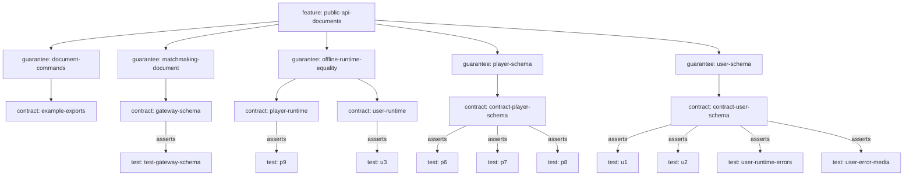

# 公開 API 仕様の取得とオフライン生成

このページは `python3 scripts/traceability.py render` で生成する。

元データは [crates/player-http/src/public-api-documents.trace.json](../../../crates/player-http/src/public-api-documents.trace.json)。
[全機能の一覧](../feature-traceability.md)。

## 対象機能

| ID | 機能 | 仕様 |
| --- | --- | --- |
| public-api-documents | 公開 API 仕様の取得とオフライン生成 | [crates/player-http/src/lib.rs](../../../crates/player-http/src/lib.rs#L29) |

## 保証の成立条件と構成

1. User and player OpenApiRouter registrations produce offline documents and their anonymous /openapi.json responses.
2. The gateway exports a separate offline matchmaking OpenAPI document with owner-scoped routes and cookie alternatives.
3. Example binaries serialize these library documents; document generation does not start the services.

以下の保証には、各行に示す契約が必要となる。テストの assertions は記載した事例の範囲に限られる。

| ID | アプリケーションの保証と条件 | 必要な契約 |
| --- | --- | --- |
| document-commands | The three example commands print library OpenAPI JSON without requiring service startup. | [example-exports](#contract-example-exports) |
| matchmaking-document | The gateway offline document includes the five owner-scoped matchmaking operations and production/development session-cookie alternatives. | [gateway-schema](#contract-gateway-schema) |
| offline-runtime-equality | User and player expose anonymous /openapi.json equal to offline generation without repository access or user identity-provider calls. | [player-runtime](#contract-player-runtime), [user-runtime](#contract-user-runtime) |
| player-schema | Player OpenAPI identifies its service and describes its routes, query/error contracts and public response schemas. | [contract-player-schema](#contract-contract-player-schema) |
| user-schema | User OpenAPI identifies its service and describes its routes, cookie alternatives, DTOs, error media and redirect headers. | [contract-user-schema](#contract-contract-user-schema) |

## 宣言した対応関係

矢印は著者が宣言した関係を示す。asserts は記載した事例への直接の assertion、exercises は処理を通る関係を示す。



## コンポーネント契約と根拠

<a id="contract-contract-player-schema"></a>

### contract-player-schema

Player route-derived OpenAPI 3.1 has package identity, exact method/path set, query/error constraints and public response shapes.

実装位置: [crates/player-http/src/lib.rs](../../../crates/player-http/src/lib.rs#L32)。

- [p6](#test-p6) (asserts): Package name/version are checked, with absent dependency-derived contact/license.
- [p7](#test-p7) (asserts): OpenAPI 3.1, exact four paths and methods, parameter constraints, enumerated errors and resolvable local refs are asserted.
- [p8](#test-p8) (asserts): Assertions compare flattened actions, required nullable cursor and unsigned integer bounds with actual DTO JSON.

<a id="contract-contract-user-schema"></a>

### contract-user-schema

User route-derived OpenAPI has service identity, the exact six operations, cookie security alternatives and request/response schemas.

実装位置: [crates/user-http/src/lib.rs](../../../crates/user-http/src/lib.rs#L90)。

- [u1](#test-u1) (asserts): Package name/version are checked, without contact/license attribution from dependencies.
- [u2](#test-u2) (asserts): Exact paths/methods, cookie alternatives, headers, redirects, DTO fields, error enums and all local references are asserted.
- [user-runtime-errors](#test-user-runtime-errors) (asserts): Runtime framework text rejections and application JSON rejections are checked against documented status/media and no-store.
- [user-error-media](#test-user-error-media) (asserts): The documented PATCH response status set, JSON ErrorBody references, framework text schemas and callback text rejection are compared directly.

未検証: The runtime rejection sample does not cover every response family or all success/error headers. The schema checks do not establish provider availability.

<a id="contract-example-exports"></a>

### example-exports

The player, user and matchmaking example entrypoints serialize their library document as pretty JSON.

実装位置: [crates/player-http/examples/player-openapi.rs](../../../crates/player-http/examples/player-openapi.rs#L1)。


未検証: No mapped test launches the example processes or checks their stdout, the shell generation script or published files. Equivalent examples are crates/user-http/examples/user-openapi.rs and crates/realtime-gateway/examples/matchmaking-openapi.rs.

<a id="contract-gateway-schema"></a>

### gateway-schema

The gateway exports annotated matchmaking paths and two cookie security schemes through its offline OpenAPI accessor.

実装位置: [crates/realtime-gateway/src/matchmaking.rs](../../../crates/realtime-gateway/src/matchmaking.rs#L344)。

- [test-gateway-schema](#test-test-gateway-schema) (asserts): The generated document contains GET /matchmaking/me, GET/PUT/DELETE ticket and POST heartbeat operations plus both cookie names and OR security alternatives.

未検証: This test checks presence rather than exact equality of the gateway method/path set. The completeness catalog separately reconciles generated operations. Gateway has no runtime /openapi.json route.

<a id="contract-player-runtime"></a>

### player-runtime

The player document route returns the same generated OpenAPI as player_http::openapi without reading storage.

実装位置: [crates/player-http/src/lib.rs](../../../crates/player-http/src/lib.rs#L29)。

- [p9](#test-p9) (asserts): Anonymous router response equals offline JSON and panic-on-use record/rating repositories remain untouched.

<a id="contract-user-runtime"></a>

### user-runtime

The user document route returns offline OpenAPI without storage or identity-provider calls and applies private response headers.

実装位置: [crates/user-http/src/lib.rs](../../../crates/user-http/src/lib.rs#L45)。

- [u3](#test-u3) (asserts): HTTPS and development in-process routers return equal offline JSON with security headers; repository and provider panic if used.

## 実在するテストと実行コマンド

コマンドは個別テストを厳密一致で選択する。保存層テストには TEST_DATABASE_URL と TEST_VALKEY_URL が必要な場合がある。

<a id="test-p6"></a>

### p6

テスト位置: [crates/player-http/src/openapi_tests.rs](../../../crates/player-http/src/openapi_tests.rs#L34)。

範囲: Offline player OpenAPI JSON, no HTTP/database.

```sh
cargo test --locked -p player-http --lib openapi_tests::document_identifies_this_service_without_dependency_attribution -- --exact --format pretty --color never
```

<a id="test-p7"></a>

### p7

テスト位置: [crates/player-http/src/openapi_tests.rs](../../../crates/player-http/src/openapi_tests.rs#L42)。

範囲: Offline player route and schema assertions, no service startup.

```sh
cargo test --locked -p player-http --lib openapi_tests::paths_queries_and_error_contract_are_derived_from_routes -- --exact --format pretty --color never
```

<a id="test-p8"></a>

### p8

テスト位置: [crates/player-http/src/openapi_tests.rs](../../../crates/player-http/src/openapi_tests.rs#L138)。

範囲: Player OpenAPI and actual DTO serialization, no storage.

```sh
cargo test --locked -p player-http --lib openapi_tests::response_schemas_preserve_flattened_actions_required_null_and_unsigned_integers -- --exact --format pretty --color never
```

<a id="test-p9"></a>

### p9

テスト位置: [crates/player-http/src/openapi_tests.rs](../../../crates/player-http/src/openapi_tests.rs#L230)。

範囲: In-process player router with panic-on-use repositories.

```sh
cargo test --locked -p player-http --lib openapi_tests::runtime_document_equals_offline_document_without_storage_access -- --exact --format pretty --color never
```

<a id="test-test-gateway-schema"></a>

### test-gateway-schema

テスト位置: [crates/realtime-gateway/tests/services.rs](../../../crates/realtime-gateway/tests/services.rs#L1213)。

範囲: Pure gateway offline OpenAPI assertions; the integration target does not start services in this synchronous case.

```sh
cargo test --locked -p realtime-gateway --test services matchmaking_openapi_covers_all_owner_scoped_routes -- --exact --format pretty --color never
```

<a id="test-u1"></a>

### u1

テスト位置: [crates/user-http/src/openapi_tests.rs](../../../crates/user-http/src/openapi_tests.rs#L36)。

範囲: Offline user OpenAPI JSON, no provider or storage.

```sh
cargo test --locked -p user-http --lib openapi_tests::document_identifies_this_service_without_dependency_attribution -- --exact --format pretty --color never
```

<a id="test-u2"></a>

### u2

テスト位置: [crates/user-http/src/openapi_tests.rs](../../../crates/user-http/src/openapi_tests.rs#L44)。

範囲: Offline user route/schema/local-reference assertions.

```sh
cargo test --locked -p user-http --lib openapi_tests::document_has_all_routes_real_schemas_and_cookie_security_alternatives -- --exact --format pretty --color never
```

<a id="test-u3"></a>

### u3

テスト位置: [crates/user-http/src/openapi_tests.rs](../../../crates/user-http/src/openapi_tests.rs#L240)。

範囲: In-process HTTPS/development user routers with panic-on-use repository and provider.

```sh
cargo test --locked -p user-http --lib openapi_tests::runtime_document_equals_offline_document_without_storage_or_provider_calls -- --exact --format pretty --color never
```

<a id="test-user-error-media"></a>

### user-error-media

テスト位置: [crates/user-http/src/openapi_tests.rs](../../../crates/user-http/src/openapi_tests.rs#L171)。

範囲: Generated user document status/media assertions without HTTP, storage or provider.

```sh
cargo test --locked -p user-http --lib openapi_tests::document_distinguishes_json_errors_and_framework_text_rejections -- --exact --format pretty --color never
```

<a id="test-user-runtime-errors"></a>

### user-runtime-errors

テスト位置: [crates/user-http/src/openapi_tests.rs](../../../crates/user-http/src/openapi_tests.rs#L264)。

範囲: In-process user router checks selected documented response status/media and no-store.

```sh
cargo test --locked -p user-http --lib openapi_tests::runtime_rejection_status_and_media_match_documented_contract -- --exact --format pretty --color never
```

## 検査と根拠の限界

check はグラフ、ファイル内の一意なテキスト位置、package と target ごとのコンパイル済みテスト名、生成文書の一致を検査する。
run は check の後に共有された Cargo テストを一度ずつ実行し、厳密一致の 1 件が成功し、失敗と無視が 0 件であることを検査する。
この文書には実行済みの成功状態を保存しない。CI の workspace テスト実行結果は、その実行時点の結果となる。
位置の検査は Rust の構文解析ではなく、テスト名と指定したソース位置が同じ定義を指すことも証明しない。
宣言した関連の意味と網羅性はレビューが必要となる。検出できる関連の削除は、必須の関連数、参照先、孤立ノードの規則に違反するものに限られる。

- Generated schema assertions and in-process responses do not prove documentation publication or real example-command stdout.
- Only user and player have runtime document endpoints. The gateway document covers matchmaking; the WebSocket protocol is outside that OpenAPI.
- Source links and successful test execution establish traceable evidence, not semantic proof or complete coverage of these guarantees.
