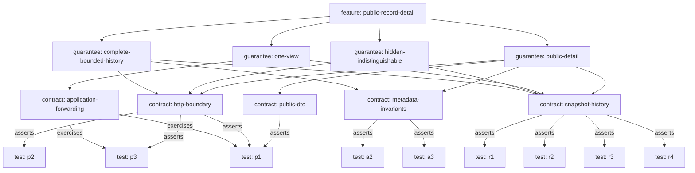

# 終了済み公開対局の履歴取得

このページは `python3 scripts/traceability.py render` で生成する。

元データは [crates/player-http/src/public-record-detail.trace.json](../../../crates/player-http/src/public-record-detail.trace.json)。
[全機能の一覧](../feature-traceability.md)。

## 対象機能

| ID | 機能 | 仕様 |
| --- | --- | --- |
| public-record-detail | 終了済み公開対局の履歴取得 | [crates/player-http/README.md](../../../crates/player-http/README.md#L44) |

## 保証の成立条件と構成

1. The HTTP adapter validates the game ID and calls GameRecords::detail under the shared request limit.
2. The PostgreSQL reader reads public completed metadata and its entire bounded journal in one repeatable-read snapshot.
3. Typed metadata and contiguous public operations become a public DTO; corruption produces an error rather than partial history.

以下の保証には、各行に示す契約が必要となる。テストの assertions は記載した事例の範囲に限られる。

| ID | アプリケーションの保証と条件 | 必要な契約 |
| --- | --- | --- |
| complete-bounded-history | History is accepted only after structural validation and at most 4096 operations. Corruption returns generic 500 without partial history, excess history returns 422, and storage unavailability returns 503. | [http-boundary](#contract-http-boundary), [metadata-invariants](#contract-metadata-invariants), [snapshot-history](#contract-snapshot-history) |
| hidden-indistinguishable | Missing, ongoing and hidden games return not_found, while malformed IDs are rejected before storage. | [http-boundary](#contract-http-boundary), [snapshot-history](#contract-snapshot-history) |
| one-view | Metadata and journal are read from one database view even if another connection changes both between reads. | [application-forwarding](#contract-application-forwarding), [snapshot-history](#contract-snapshot-history) |
| public-detail | Anonymous detail returns public completed metadata and contiguous ordered public operations, excluding command receipts, retry identifiers and internal state. | [http-boundary](#contract-http-boundary), [public-dto](#contract-public-dto), [metadata-invariants](#contract-metadata-invariants), [snapshot-history](#contract-snapshot-history) |

## 宣言した対応関係

矢印は著者が宣言した関係を示す。asserts は記載した事例への直接の assertion、exercises は処理を通る関係を示す。



## コンポーネント契約と根拠

<a id="contract-application-forwarding"></a>

### application-forwarding

GameRecords::detail passes the typed GameId to its repository and returns the result.

実装位置: [crates/game-record-application/src/lib.rs](../../../crates/game-record-application/src/lib.rs#L338)。

- [p1](#test-p1) (exercises): The real router traverses this method into the PostgreSQL reader.
- [p3](#test-p3) (exercises): Fake repository errors traverse this method before HTTP mapping.

未検証: There is no independent unchanged-forwarding test for arbitrary IDs and results.

<a id="contract-http-boundary"></a>

### http-boundary

The detail handler validates the path ID, uses the shared permit and maps repository failures to generic no-store HTTP responses.

実装位置: [crates/player-http/src/lib.rs](../../../crates/player-http/src/lib.rs#L164)。

- [p2](#test-p2) (asserts): An ID containing a decoded space returns 400 before the failing repository can return 500.
- [p3](#test-p3) (asserts): Fake corrupt, oversized and unavailable failures become 500/422/503 and fixed JSON with no-store.
- [p1](#test-p1) (asserts): Missing and ongoing real database records yield identical 404 status/body, and successful detail has no-store.

未検証: The real-router fixture does not create a hidden record; its hidden behavior is supported by the repository test and shared error mapping. Shared admission and byte limits are mapped in public-record-search.

<a id="contract-metadata-invariants"></a>

### metadata-invariants

Metadata requires distinct participants, a terminal sequence, valid storage scalar bounds and finish-count relations appropriate to moves or resignation.

実装位置: [crates/game-record-application/src/lib.rs](../../../crates/game-record-application/src/lib.rs#L224)。

- [a2](#test-a2) (asserts): Direct constructors reject listed duplicate-player, zero-sequence and inconsistent move/resignation count cases.
- [a3](#test-a3) (asserts): Direct scalar conversion assertions reject values outside PostgreSQL signed-integer storage bounds.

<a id="contract-public-dto"></a>

### public-dto

DetailDto emits metadata and ordered action DTOs without internal request, receipt, check or outbox fields.

実装位置: [crates/player-http/src/lib.rs](../../../crates/player-http/src/lib.rs#L343)。

- [p1](#test-p1) (asserts): The exact metadata key set, equality with list metadata and two ordered operations are asserted; serialized detail excludes each listed secret substring.

未検証: This assertion covers one move and one resignation, not every move, drop and terminal-result encoding.

<a id="contract-snapshot-history"></a>

### snapshot-history

The reader uses one repeatable-read transaction and validates a complete contiguous structural history before returning Detail.

実装位置: [crates/game-record-persistence/src/lib.rs](../../../crates/game-record-persistence/src/lib.rs#L309)。

- [r1](#test-r1) (asserts): Repository lookup directly asserts a hidden completed record is not found.
- [r2](#test-r2) (asserts): Eight corruption mutations and excess history are rejected rather than returning partial detail.
- [r3](#test-r3) (asserts): A second connection changes metadata and history while history reading is blocked; returned detail retains the prior consistent snapshot.
- [r4](#test-r4) (asserts): All 4096 structural operations are accepted, while 4097 are rejected without replaying board legality.

未検証: These are selected corruption mutations rather than an exhaustive matrix. Structural validation deliberately does not establish shogi move legality.

## 実在するテストと実行コマンド

コマンドは個別テストを厳密一致で選択する。保存層テストには TEST_DATABASE_URL と TEST_VALKEY_URL が必要な場合がある。

<a id="test-a2"></a>

### a2

テスト位置: [crates/game-record-application/src/lib.rs](../../../crates/game-record-application/src/lib.rs#L384)。

範囲: Pure metadata constructor cases without a database or legal game replay.

```sh
cargo test --locked -p game-record-application --lib tests::metadata_construction_requires_distinct_players_and_consistent_finish_counts -- --exact --format pretty --color never
```

<a id="test-a3"></a>

### a3

テスト位置: [crates/game-record-application/src/lib.rs](../../../crates/game-record-application/src/lib.rs#L359)。

範囲: Pure scalar storage-boundary cases.

```sh
cargo test --locked -p game-record-application --lib tests::record_scalars_reject_values_outside_storage_bounds -- --exact --format pretty --color never
```

<a id="test-p1"></a>

### p1

テスト位置: [crates/player-http/src/tests.rs](../../../crates/player-http/src/tests.rs#L24)。

範囲: Real Axum router, application service and PostgreSQL reader; asserts public serialization and missing/ongoing behavior.

```sh
cargo test --locked -p player-http --lib tests::anonymous_list_is_metadata_only_and_detail_contains_only_public_ordered_actions -- --exact --format pretty --color never
```

<a id="test-p2"></a>

### p2

テスト位置: [crates/player-http/src/tests.rs](../../../crates/player-http/src/tests.rs#L156)。

範囲: In-process router and failing fake repository; includes malformed detail ID.

```sh
cargo test --locked -p player-http --lib tests::query_boundary_rejects_bad_filters_bounds_and_cursors_before_storage -- --exact --format pretty --color never
```

<a id="test-p3"></a>

### p3

テスト位置: [crates/player-http/src/tests.rs](../../../crates/player-http/src/tests.rs#L202)。

範囲: In-process router with fake repository failures; no database.

```sh
cargo test --locked -p player-http --lib tests::bounded_detail_and_storage_errors_are_generic -- --exact --format pretty --color never
```

<a id="test-r1"></a>

### r1

テスト位置: [crates/game-persistence/tests/records.rs](../../../crates/game-persistence/tests/records.rs#L113)。

範囲: Real PostgreSQL public-record filtering and hidden-detail lookup.

```sh
cargo test --locked -p game-persistence --test records public_completed_metadata_only_filters_and_stable_keysets -- --exact --format pretty --color never
```

<a id="test-r2"></a>

### r2

テスト位置: [crates/game-persistence/tests/records.rs](../../../crates/game-persistence/tests/records.rs#L350)。

範囲: Real PostgreSQL journal/metadata corruption and oversized-history rejection.

```sh
cargo test --locked -p game-persistence --test records corrupt_and_oversized_details_fail_without_partial_history -- --exact --format pretty --color never
```

<a id="test-r3"></a>

### r3

テスト位置: [crates/game-persistence/tests/records.rs](../../../crates/game-persistence/tests/records.rs#L669)。

範囲: Concurrent real PostgreSQL mutation between reader statements tests snapshot consistency.

```sh
cargo test --locked -p game-persistence --test records detail_keeps_one_database_view_when_history_changes_between_reads -- --exact --format pretty --color never
```

<a id="test-r4"></a>

### r4

テスト位置: [crates/game-persistence/tests/records.rs](../../../crates/game-persistence/tests/records.rs#L743)。

範囲: Real PostgreSQL structural history boundary; intentionally does not replay legality.

```sh
cargo test --locked -p game-persistence --test records public_history_accepts_4096_structural_operations_without_replaying_legality -- --exact --format pretty --color never
```

## 検査と根拠の限界

check はグラフ、ファイル内の一意なテキスト位置、package と target ごとのコンパイル済みテスト名、生成文書の一致を検査する。
run は check の後に共有された Cargo テストを一度ずつ実行し、厳密一致の 1 件が成功し、失敗と無視が 0 件であることを検査する。
この文書には実行済みの成功状態を保存しない。CI の workspace テスト実行結果は、その実行時点の結果となる。
位置の検査は Rust の構文解析ではなく、テスト名と指定したソース位置が同じ定義を指すことも証明しない。
宣言した関連の意味と網羅性はレビューが必要となる。検出できる関連の削除は、必須の関連数、参照先、孤立ノードの規則に違反するものに限られる。

- No mapped test starts a player-server TCP listener. No guarantee is made that structurally readable history consists of legal shogi play.
- Shared HTTP byte/admission bounds and reader role/timeouts are mapped in public-record-search and startup-schema-isolation.
- Source links and successful test execution establish traceable evidence, not semantic proof or complete coverage of these guarantees.
