# 終了済み公開対局の履歴取得

このページは `python3 scripts/traceability.py render` で生成する。

元データは [crates/player-http/src/trace/public-record-detail/feature.rs](../../../crates/player-http/src/trace/public-record-detail/feature.rs)。
[全機能の一覧](../feature-traceability.md)。

## 対象機能

| ID | 機能 | 仕様 |
| --- | --- | --- |
| public-record-detail | 終了済み公開対局の履歴取得 | [crates/player-http/src/lib.rs](../../../crates/player-http/src/lib.rs#L164) |

## 保証の成立条件と構成

1. HTTP アダプターは対局 ID を検証し、共有のリクエスト上限の下で GameRecords::detail を呼ぶ。
2. PostgreSQL の読み取り処理は、一つの反復可能読み取りスナップショットで、公開された終了済み対局のメタデータと、上限内のジャーナル全体を取得する。
3. 型付きメタデータと連続した公開操作を公開 DTO に変換する。破損時は部分的な履歴を返さず、エラーとする。

以下の保証には、各行に示す契約が必要となる。テストによる検証は記載した事例の範囲に限られる。

| ID | アプリケーションの保証と条件 | 必要な契約 |
| --- | --- | --- |
| complete-bounded-history | 履歴は構造を検証した後、最大 4096 操作まで受け入れる。破損時は部分的な履歴を返さず、詳細を伏せた 500 を返す。履歴の上限超過には 422、保存層が利用できない場合は 503 を返す。 | [http-boundary](#contract-http-boundary), [metadata-invariants](#contract-metadata-invariants), [snapshot-history](#contract-snapshot-history) |
| hidden-indistinguishable | 存在しない対局、進行中の対局、非公開の対局には not_found を返す。不正な形式の ID は保存層へ到達する前に拒否する。 | [http-boundary](#contract-http-boundary), [snapshot-history](#contract-snapshot-history) |
| one-view | 別の接続が読み取りの間にメタデータとジャーナルの両方を変更しても、同じデータベースの読み取り時点から両方を取得する。 | [application-forwarding](#contract-application-forwarding), [snapshot-history](#contract-snapshot-history) |
| public-detail | 認証なしの詳細取得は、公開された終了済み対局のメタデータと、連続した順序付きの公開操作を返す。操作の受領記録、再試行用の識別子、内部状態は含めない。 | [http-boundary](#contract-http-boundary), [public-dto](#contract-public-dto), [metadata-invariants](#contract-metadata-invariants), [snapshot-history](#contract-snapshot-history) |

## 宣言した対応関係

矢印は著者が宣言した関係を示す。「事例を直接検証」は記載した事例を直接確かめる関係、「処理を通る」は対象の処理を実行する関係を示す。「所属のみ・未レビュー」は契約ディレクトリへの配置だけで分類した関係を示す。

```mermaid
flowchart TD
    n0["機能: public-record-detail"]
    n1["保証: complete-bounded-history"]
    n2["保証: hidden-indistinguishable"]
    n3["保証: one-view"]
    n4["保証: public-detail"]
    n5["契約: application-forwarding"]
    n6["契約: http-boundary"]
    n7["契約: metadata-invariants"]
    n8["契約: public-dto"]
    n9["契約: snapshot-history"]
    n10["テスト: test-game-persistence-test-contracts-contracts-public-record-detail-metadata-invariants-postgres-enforces-result-pairs-foreign-keys-and-distinct-participants"]
    n11["テスト: test-game-persistence-test-records-records-public-record-detail-metadata-invariants-current-schema-rejects-missing-metadata-and-inconsistent-finish-time"]
    n12["テスト: test-game-persistence-test-records-records-public-record-detail-metadata-invariants-finish-time-is-writer-utc-and-retries-preserve-it"]
    n13["テスト: test-game-persistence-test-records-records-public-record-detail-metadata-invariants-writer-metadata-is-atomic-move-count-excludes-resign-and-retry-keeps-time"]
    n14["テスト: test-game-persistence-test-records-records-public-record-detail-snapshot-history-corrupt-and-oversized-details-fail-without-partial-history"]
    n15["テスト: test-game-persistence-test-records-records-public-record-detail-snapshot-history-detail-keeps-one-database-view-when-history-changes-between-reads"]
    n16["テスト: test-game-persistence-test-records-records-public-record-detail-snapshot-history-public-completed-metadata-only-filters-and-stable-keysets"]
    n17["テスト: test-game-persistence-test-records-records-public-record-detail-snapshot-history-public-history-accepts-4096-structural-operations-without-replaying-legality"]
    n18["テスト: test-game-record-application-lib-game-record-application-tests-public-record-detail-metadata-invariants-metadata-construction-requires-distinct-players-and-consistent-finish-counts"]
    n19["テスト: test-game-record-application-lib-game-record-application-tests-public-record-detail-metadata-invariants-record-scalars-reject-values-outside-storage-bounds"]
    n20["テスト: test-player-http-lib-player-http-tests-public-record-detail-application-forwarding-anonymous-list-is-metadata-only-and-detail-contains-only-public-ordered-actions"]
    n21["テスト: test-player-http-lib-player-http-tests-public-record-detail-application-forwarding-bounded-detail-and-storage-errors-are-generic"]
    n22["テスト: test-player-http-lib-player-http-tests-public-record-detail-http-boundary-query-boundary-rejects-bad-filters-bounds-and-cursors-before-storage"]
    n0 --> n1
    n1 --> n6
    n1 --> n7
    n1 --> n9
    n0 --> n2
    n2 --> n6
    n2 --> n9
    n0 --> n3
    n3 --> n5
    n3 --> n9
    n0 --> n4
    n4 --> n6
    n4 --> n8
    n4 --> n7
    n4 --> n9
    n5 -->|処理を通る| n20
    n5 -->|処理を通る| n21
    n6 -->|事例を直接検証| n20
    n6 -->|事例を直接検証| n21
    n6 -->|事例を直接検証| n22
    n7 -->|所属のみ・未レビュー| n10
    n7 -->|所属のみ・未レビュー| n11
    n7 -->|所属のみ・未レビュー| n12
    n7 -->|所属のみ・未レビュー| n13
    n7 -->|事例を直接検証| n18
    n7 -->|事例を直接検証| n19
    n8 -->|事例を直接検証| n20
    n9 -->|事例を直接検証| n14
    n9 -->|事例を直接検証| n15
    n9 -->|事例を直接検証| n16
    n9 -->|事例を直接検証| n17
```



## コンポーネント契約と根拠

<a id="contract-application-forwarding"></a>

### application-forwarding

GameRecords::detail は型付き GameId をリポジトリに渡し、その結果を返す。

実装位置: [crates/game-record-application/src/lib.rs](../../../crates/game-record-application/src/lib.rs#L338)。

- [test-player-http-lib-player-http-tests-public-record-detail-application-forwarding-anonymous-list-is-metadata-only-and-detail-contains-only-public-ordered-actions](#test-test-player-http-lib-player-http-tests-public-record-detail-application-forwarding-anonymous-list-is-metadata-only-and-detail-contains-only-public-ordered-actions) (処理を通る): 実ルーターがこのメソッドを通り、PostgreSQL の読み取り処理に到達する。
- [test-player-http-lib-player-http-tests-public-record-detail-application-forwarding-bounded-detail-and-storage-errors-are-generic](#test-test-player-http-lib-player-http-tests-public-record-detail-application-forwarding-bounded-detail-and-storage-errors-are-generic) (処理を通る): テスト用リポジトリのエラーが、HTTP 応答へ変換される前にこのメソッドを通る。

未検証: 任意の ID と結果が変更なしで転送されることを検証する独立したテストはない。

<a id="contract-http-boundary"></a>

### http-boundary

詳細取得ハンドラーはパスの ID を検証し、共有の処理許可を使い、リポジトリの失敗を詳細を伏せた no-store 付き HTTP 応答へ変換する。

実装位置: [crates/player-http/src/lib.rs](../../../crates/player-http/src/lib.rs#L164)。

- [test-player-http-lib-player-http-tests-public-record-detail-application-forwarding-anonymous-list-is-metadata-only-and-detail-contains-only-public-ordered-actions](#test-test-player-http-lib-player-http-tests-public-record-detail-application-forwarding-anonymous-list-is-metadata-only-and-detail-contains-only-public-ordered-actions) (事例を直接検証): 実データベースで存在しない対局と進行中の対局が同じ 404 と本文を返し、詳細取得の成功応答に no-store が付くことを確認する。
- [test-player-http-lib-player-http-tests-public-record-detail-application-forwarding-bounded-detail-and-storage-errors-are-generic](#test-test-player-http-lib-player-http-tests-public-record-detail-application-forwarding-bounded-detail-and-storage-errors-are-generic) (事例を直接検証): テスト用リポジトリの破損・サイズ超過・利用不可の失敗が 500・422・503 となり、固定の JSON と no-store を返すことを確認する。
- [test-player-http-lib-player-http-tests-public-record-detail-http-boundary-query-boundary-rejects-bad-filters-bounds-and-cursors-before-storage](#test-test-player-http-lib-player-http-tests-public-record-detail-http-boundary-query-boundary-rejects-bad-filters-bounds-and-cursors-before-storage) (事例を直接検証): 復号後に空白を含む ID は、失敗を返すリポジトリが 500 を返す前に 400 となる。

未検証: 実ルーターのテスト用データには非公開の対局を作らない。非公開の場合の動作はリポジトリのテストと共有エラー変換で裏付ける。共有の受け入れ件数と応答バイト数の上限は public-record-search に対応付けている。

<a id="contract-metadata-invariants"></a>

### metadata-invariants

メタデータは、異なる参加者、終了時のシーケンス番号、保存層のスカラー値として有効な境界、および着手・投了に応じた終了時の手数と操作数の関係を要求する。

実装位置: [crates/game-record-application/src/lib.rs](../../../crates/game-record-application/src/lib.rs#L224)。

- [test-game-persistence-test-contracts-contracts-public-record-detail-metadata-invariants-postgres-enforces-result-pairs-foreign-keys-and-distinct-participants](#test-test-game-persistence-test-contracts-contracts-public-record-detail-metadata-invariants-postgres-enforces-result-pairs-foreign-keys-and-distinct-participants) (所属のみ・未レビュー): 配置先からこのテストの契約への所属を宣言している。実装を実行することと検証の十分さはレビューが必要。
- [test-game-persistence-test-records-records-public-record-detail-metadata-invariants-current-schema-rejects-missing-metadata-and-inconsistent-finish-time](#test-test-game-persistence-test-records-records-public-record-detail-metadata-invariants-current-schema-rejects-missing-metadata-and-inconsistent-finish-time) (所属のみ・未レビュー): 配置先からこのテストの契約への所属を宣言している。実装を実行することと検証の十分さはレビューが必要。
- [test-game-persistence-test-records-records-public-record-detail-metadata-invariants-finish-time-is-writer-utc-and-retries-preserve-it](#test-test-game-persistence-test-records-records-public-record-detail-metadata-invariants-finish-time-is-writer-utc-and-retries-preserve-it) (所属のみ・未レビュー): 配置先からこのテストの契約への所属を宣言している。実装を実行することと検証の十分さはレビューが必要。
- [test-game-persistence-test-records-records-public-record-detail-metadata-invariants-writer-metadata-is-atomic-move-count-excludes-resign-and-retry-keeps-time](#test-test-game-persistence-test-records-records-public-record-detail-metadata-invariants-writer-metadata-is-atomic-move-count-excludes-resign-and-retry-keeps-time) (所属のみ・未レビュー): 配置先からこのテストの契約への所属を宣言している。実装を実行することと検証の十分さはレビューが必要。
- [test-game-record-application-lib-game-record-application-tests-public-record-detail-metadata-invariants-metadata-construction-requires-distinct-players-and-consistent-finish-counts](#test-test-game-record-application-lib-game-record-application-tests-public-record-detail-metadata-invariants-metadata-construction-requires-distinct-players-and-consistent-finish-counts) (事例を直接検証): 列挙した、参加者の重複、シーケンス番号 0、着手・投了時の手数と操作数の不整合を、直接の構築で拒否することを確認する。
- [test-game-record-application-lib-game-record-application-tests-public-record-detail-metadata-invariants-record-scalars-reject-values-outside-storage-bounds](#test-test-game-record-application-lib-game-record-application-tests-public-record-detail-metadata-invariants-record-scalars-reject-values-outside-storage-bounds) (事例を直接検証): スカラー値の変換を直接検証し、PostgreSQL の符号付き整数として保存できる範囲外の値を拒否することを確認する。

<a id="contract-public-dto"></a>

### public-dto

DetailDto は内部のリクエスト、受領記録、王手、Outbox のフィールドを含めず、メタデータと順序付きの操作 DTO を出力する。

実装位置: [crates/player-http/src/lib.rs](../../../crates/player-http/src/lib.rs#L343)。

- [test-player-http-lib-player-http-tests-public-record-detail-application-forwarding-anonymous-list-is-metadata-only-and-detail-contains-only-public-ordered-actions](#test-test-player-http-lib-player-http-tests-public-record-detail-application-forwarding-anonymous-list-is-metadata-only-and-detail-contains-only-public-ordered-actions) (事例を直接検証): メタデータのキー集合の完全一致、一覧のメタデータとの一致、順序付きの二つの操作を検証する。シリアライズした詳細に、列挙した内部情報の部分文字列が含まれないことも確認する。

未検証: この検証は一つの着手と一つの投了を対象とし、すべての着手・駒打ち・終了結果のエンコードを網羅しない。

<a id="contract-snapshot-history"></a>

### snapshot-history

読み取り処理は一つの反復可能読み取りトランザクションを使い、連続した履歴全体の構造を検証してから Detail を返す。

実装位置: [crates/game-record-persistence/src/lib.rs](../../../crates/game-record-persistence/src/lib.rs#L309)。

- [test-game-persistence-test-records-records-public-record-detail-snapshot-history-corrupt-and-oversized-details-fail-without-partial-history](#test-test-game-persistence-test-records-records-public-record-detail-snapshot-history-corrupt-and-oversized-details-fail-without-partial-history) (事例を直接検証): 八種類の破損変更と上限を超える履歴を拒否し、部分的な詳細は返さない。
- [test-game-persistence-test-records-records-public-record-detail-snapshot-history-detail-keeps-one-database-view-when-history-changes-between-reads](#test-test-game-persistence-test-records-records-public-record-detail-snapshot-history-detail-keeps-one-database-view-when-history-changes-between-reads) (事例を直接検証): 履歴の読み込みが待機している間に別の接続がメタデータと履歴を変更しても、返す詳細は変更前の整合したスナップショットを保持する。
- [test-game-persistence-test-records-records-public-record-detail-snapshot-history-public-completed-metadata-only-filters-and-stable-keysets](#test-test-game-persistence-test-records-records-public-record-detail-snapshot-history-public-completed-metadata-only-filters-and-stable-keysets) (事例を直接検証): リポジトリで直接取得し、非公開の終了済み対局が見つからないことを検証する。
- [test-game-persistence-test-records-records-public-record-detail-snapshot-history-public-history-accepts-4096-structural-operations-without-replaying-legality](#test-test-game-persistence-test-records-records-public-record-detail-snapshot-history-public-history-accepts-4096-structural-operations-without-replaying-legality) (事例を直接検証): 盤面上の合法性を再現せず、構造上の操作を 4096 件までは受け入れ、4097 件は拒否する。

未検証: 破損の変更事例を選んで確認しており、すべての組み合わせは網羅しない。構造の検証では、意図的に将棋の着手の合法性は確認しない。

## 実在するテストと実行コマンド

コマンドは個別テストを厳密一致で選択する。保存層テストには TEST_DATABASE_URL と TEST_VALKEY_URL が必要な場合がある。

<a id="test-test-game-persistence-test-contracts-contracts-public-record-detail-metadata-invariants-postgres-enforces-result-pairs-foreign-keys-and-distinct-participants"></a>

### test-game-persistence-test-contracts-contracts-public-record-detail-metadata-invariants-postgres-enforces-result-pairs-foreign-keys-and-distinct-participants

テスト位置: [crates/game-persistence/tests/trace/public-record-detail/metadata-invariants/contracts.rs](../../../crates/game-persistence/tests/trace/public-record-detail/metadata-invariants/contracts.rs#L4)。

範囲: 契約ディレクトリへの所属のみを示す。実行時の依存関係と検証内容は未レビュー。

```sh
cargo test --locked -p game-persistence --test contracts contracts::public_record_detail_metadata_invariants::postgres_enforces_result_pairs_foreign_keys_and_distinct_participants -- --exact --format pretty --color never
```

<a id="test-test-game-persistence-test-records-records-public-record-detail-metadata-invariants-current-schema-rejects-missing-metadata-and-inconsistent-finish-time"></a>

### test-game-persistence-test-records-records-public-record-detail-metadata-invariants-current-schema-rejects-missing-metadata-and-inconsistent-finish-time

テスト位置: [crates/game-persistence/tests/trace/public-record-detail/metadata-invariants/records.rs](../../../crates/game-persistence/tests/trace/public-record-detail/metadata-invariants/records.rs#L61)。

範囲: 契約ディレクトリへの所属のみを示す。実行時の依存関係と検証内容は未レビュー。

```sh
cargo test --locked -p game-persistence --test records records::public_record_detail_metadata_invariants::current_schema_rejects_missing_metadata_and_inconsistent_finish_time -- --exact --format pretty --color never
```

<a id="test-test-game-persistence-test-records-records-public-record-detail-metadata-invariants-finish-time-is-writer-utc-and-retries-preserve-it"></a>

### test-game-persistence-test-records-records-public-record-detail-metadata-invariants-finish-time-is-writer-utc-and-retries-preserve-it

テスト位置: [crates/game-persistence/tests/trace/public-record-detail/metadata-invariants/records.rs](../../../crates/game-persistence/tests/trace/public-record-detail/metadata-invariants/records.rs#L83)。

範囲: 契約ディレクトリへの所属のみを示す。実行時の依存関係と検証内容は未レビュー。

```sh
cargo test --locked -p game-persistence --test records records::public_record_detail_metadata_invariants::finish_time_is_writer_utc_and_retries_preserve_it -- --exact --format pretty --color never
```

<a id="test-test-game-persistence-test-records-records-public-record-detail-metadata-invariants-writer-metadata-is-atomic-move-count-excludes-resign-and-retry-keeps-time"></a>

### test-game-persistence-test-records-records-public-record-detail-metadata-invariants-writer-metadata-is-atomic-move-count-excludes-resign-and-retry-keeps-time

テスト位置: [crates/game-persistence/tests/trace/public-record-detail/metadata-invariants/records.rs](../../../crates/game-persistence/tests/trace/public-record-detail/metadata-invariants/records.rs#L4)。

範囲: 契約ディレクトリへの所属のみを示す。実行時の依存関係と検証内容は未レビュー。

```sh
cargo test --locked -p game-persistence --test records records::public_record_detail_metadata_invariants::writer_metadata_is_atomic_move_count_excludes_resign_and_retry_keeps_time -- --exact --format pretty --color never
```

<a id="test-test-game-persistence-test-records-records-public-record-detail-snapshot-history-corrupt-and-oversized-details-fail-without-partial-history"></a>

### test-game-persistence-test-records-records-public-record-detail-snapshot-history-corrupt-and-oversized-details-fail-without-partial-history

テスト位置: [crates/game-persistence/tests/trace/public-record-detail/snapshot-history/tests.rs](../../../crates/game-persistence/tests/trace/public-record-detail/snapshot-history/tests.rs#L199)。

範囲: 実際の PostgreSQL で、履歴とメタデータの破損、および上限を超える履歴の拒否を検証する。

```sh
cargo test --locked -p game-persistence --test records records::public_record_detail_snapshot_history::corrupt_and_oversized_details_fail_without_partial_history -- --exact --format pretty --color never
```

<a id="test-test-game-persistence-test-records-records-public-record-detail-snapshot-history-detail-keeps-one-database-view-when-history-changes-between-reads"></a>

### test-game-persistence-test-records-records-public-record-detail-snapshot-history-detail-keeps-one-database-view-when-history-changes-between-reads

テスト位置: [crates/game-persistence/tests/trace/public-record-detail/snapshot-history/tests.rs](../../../crates/game-persistence/tests/trace/public-record-detail/snapshot-history/tests.rs#L244)。

範囲: 読み取り文の間で実際の PostgreSQL を並行変更し、スナップショットの整合性を検証する。

```sh
cargo test --locked -p game-persistence --test records records::public_record_detail_snapshot_history::detail_keeps_one_database_view_when_history_changes_between_reads -- --exact --format pretty --color never
```

<a id="test-test-game-persistence-test-records-records-public-record-detail-snapshot-history-public-completed-metadata-only-filters-and-stable-keysets"></a>

### test-game-persistence-test-records-records-public-record-detail-snapshot-history-public-completed-metadata-only-filters-and-stable-keysets

テスト位置: [crates/game-persistence/tests/trace/public-record-detail/snapshot-history/tests.rs](../../../crates/game-persistence/tests/trace/public-record-detail/snapshot-history/tests.rs#L11)。

範囲: 実際の PostgreSQL で、公開棋譜のフィルターと非公開詳細の検索を検証する。

```sh
cargo test --locked -p game-persistence --test records records::public_record_detail_snapshot_history::public_completed_metadata_only_filters_and_stable_keysets -- --exact --format pretty --color never
```

<a id="test-test-game-persistence-test-records-records-public-record-detail-snapshot-history-public-history-accepts-4096-structural-operations-without-replaying-legality"></a>

### test-game-persistence-test-records-records-public-record-detail-snapshot-history-public-history-accepts-4096-structural-operations-without-replaying-legality

テスト位置: [crates/game-persistence/tests/trace/public-record-detail/snapshot-history/tests.rs](../../../crates/game-persistence/tests/trace/public-record-detail/snapshot-history/tests.rs#L288)。

範囲: 実際の PostgreSQL の履歴の構造上の境界を検証する。意図的に合法性の再現は行わない。

```sh
cargo test --locked -p game-persistence --test records records::public_record_detail_snapshot_history::public_history_accepts_4096_structural_operations_without_replaying_legality -- --exact --format pretty --color never
```

<a id="test-test-game-record-application-lib-game-record-application-tests-public-record-detail-metadata-invariants-metadata-construction-requires-distinct-players-and-consistent-finish-counts"></a>

### test-game-record-application-lib-game-record-application-tests-public-record-detail-metadata-invariants-metadata-construction-requires-distinct-players-and-consistent-finish-counts

テスト位置: [crates/game-record-application/src/trace/public-record-detail/metadata-invariants/tests.rs](../../../crates/game-record-application/src/trace/public-record-detail/metadata-invariants/tests.rs#L44)。

範囲: データベースや合法な対局の再生を使わず、メタデータの構築を直接確認する。

```sh
cargo test --locked -p game-record-application --lib tests::public_record_detail_metadata_invariants::metadata_construction_requires_distinct_players_and_consistent_finish_counts -- --exact --format pretty --color never
```

<a id="test-test-game-record-application-lib-game-record-application-tests-public-record-detail-metadata-invariants-record-scalars-reject-values-outside-storage-bounds"></a>

### test-game-record-application-lib-game-record-application-tests-public-record-detail-metadata-invariants-record-scalars-reject-values-outside-storage-bounds

テスト位置: [crates/game-record-application/src/trace/public-record-detail/metadata-invariants/tests.rs](../../../crates/game-record-application/src/trace/public-record-detail/metadata-invariants/tests.rs#L11)。

範囲: 保存層のスカラー値の境界を直接確認する。

```sh
cargo test --locked -p game-record-application --lib tests::public_record_detail_metadata_invariants::record_scalars_reject_values_outside_storage_bounds -- --exact --format pretty --color never
```

<a id="test-test-player-http-lib-player-http-tests-public-record-detail-application-forwarding-anonymous-list-is-metadata-only-and-detail-contains-only-public-ordered-actions"></a>

### test-player-http-lib-player-http-tests-public-record-detail-application-forwarding-anonymous-list-is-metadata-only-and-detail-contains-only-public-ordered-actions

テスト位置: [crates/player-http/src/trace/public-record-detail/application-forwarding/tests.rs](../../../crates/player-http/src/trace/public-record-detail/application-forwarding/tests.rs#L12)。

範囲: 実 Axum ルーター、アプリケーションサービス、PostgreSQL の読み取り処理。公開用シリアライズと、対局が存在しない場合・進行中の場合の動作を検証する。

```sh
cargo test --locked -p player-http --lib tests::public_record_detail_application_forwarding::anonymous_list_is_metadata_only_and_detail_contains_only_public_ordered_actions -- --exact --format pretty --color never
```

<a id="test-test-player-http-lib-player-http-tests-public-record-detail-application-forwarding-bounded-detail-and-storage-errors-are-generic"></a>

### test-player-http-lib-player-http-tests-public-record-detail-application-forwarding-bounded-detail-and-storage-errors-are-generic

テスト位置: [crates/player-http/src/trace/public-record-detail/application-forwarding/tests.rs](../../../crates/player-http/src/trace/public-record-detail/application-forwarding/tests.rs#L153)。

範囲: リポジトリの失敗をテスト用の代替実装で再現する、プロセス内のルーター。データベースは使わない。

```sh
cargo test --locked -p player-http --lib tests::public_record_detail_application_forwarding::bounded_detail_and_storage_errors_are_generic -- --exact --format pretty --color never
```

<a id="test-test-player-http-lib-player-http-tests-public-record-detail-http-boundary-query-boundary-rejects-bad-filters-bounds-and-cursors-before-storage"></a>

### test-player-http-lib-player-http-tests-public-record-detail-http-boundary-query-boundary-rejects-bad-filters-bounds-and-cursors-before-storage

テスト位置: [crates/player-http/src/trace/public-record-detail/http-boundary/tests.rs](../../../crates/player-http/src/trace/public-record-detail/http-boundary/tests.rs#L12)。

範囲: プロセス内のルーターと、失敗を返すテスト用リポジトリ。不正な形式の詳細取得 ID も含む。

```sh
cargo test --locked -p player-http --lib tests::public_record_detail_http_boundary::query_boundary_rejects_bad_filters_bounds_and_cursors_before_storage -- --exact --format pretty --color never
```

## 検査と根拠の限界

check はグラフ、ファイル内の一意なテキスト位置、パッケージとターゲットごとのコンパイル済みテスト名、生成文書の一致を検査する。
run は check の後に共有された Cargo テストを一度ずつ実行し、厳密一致の 1 件が成功し、失敗と無視が 0 件であることを検査する。
この文書には実行済みの成功状態を保存しない。CI のワークスペース全体のテスト実行結果は、その実行時点の結果となる。
宣言した関連の意味と網羅性はレビューが必要となる。検出できる関連の削除は、必須の関連数、参照先、孤立ノードの規則に違反するものに限られる。

- 対応付けたテストは player-server の TCP リスナーを起動しない。構造上読み取れる履歴が、将棋の合法な着手で構成されていることは保証しない。
- 共有 HTTP 処理の応答バイト数と受け入れ件数の上限、および読み取りロールとタイムアウトは、public-record-search と startup-schema-isolation に対応付けている。
- ソースへのリンクとテストの実行成功は、追跡できる根拠を示す。保証の意味の証明や完全な網羅性を示すものではない。

## ディレクトリ方式の検査範囲

Rust 宣言、通常のモジュールと文字列リテラルの include! から物理ファイルの所属、パッケージ、ターゲット、完全なテスト名と位置を抽出する。ホスト環境で Cargo の既定の機能フラグを使い、ワークスペースのライブラリ、バイナリ、結合テストの全テスト一覧と一致させる。別のターゲット、機能フラグ、cfg の組合せは対象外。
src/trace/<feature> と tests/trace/<feature> は新規機能も探索し、未宣言または未到達のファイルを拒否する。契約内の通常テストは「所属のみ・未レビュー」として追加する。「事例を直接検証」または「処理を通る」のレビュー済み根拠がない契約には未検証事項の gap 宣言が必要。
全ターゲットの未分類テストは拒否する。trace ディレクトリ内の未対応の項目マクロと cfg は直接拒否し、外側の未対応構文が生成した実行対象テストはコンパイル済み一覧との差として拒否する。テスト実行補助と基盤の検査の明示分類および理由は全機能の一覧に示す。
