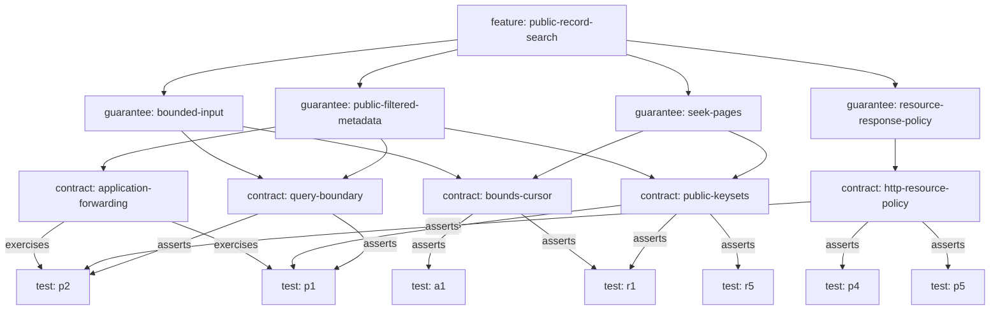

# 終了済み公開対局の検索

このページは `python3 scripts/traceability.py render` で生成する。

元データは [crates/player-http/src/public-record-search.trace.json](../../../crates/player-http/src/public-record-search.trace.json)。
[全機能の一覧](../feature-traceability.md)。

## 対象機能

| ID | 機能 | 仕様 |
| --- | --- | --- |
| public-record-search | 終了済み公開対局の検索 | [crates/player-http/README.md](../../../crates/player-http/README.md#L9) |

## 保証の成立条件と構成

1. The HTTP adapter decodes and validates filters and the cursor before acquiring shared request capacity.
2. GameRecords forwards the typed Search to the read repository, which selects public completed metadata with keyset pagination.
3. The HTTP adapter serializes metadata and the next cursor through the bounded no-store response helper.

以下の保証には、各行に示す契約が必要となる。テストの assertions は記載した事例の範囲に限られる。

| ID | アプリケーションの保証と条件 | 必要な契約 |
| --- | --- | --- |
| bounded-input | Search requires a nonnegative increasing UTC microsecond interval with inclusive start and exclusive end of at most 366 days, a limit of 1 through 100 with default 30, and valid typed filters without unknown or repeated fields. Invalid inputs return 400 before storage. | [query-boundary](#contract-query-boundary), [bounds-cursor](#contract-bounds-cursor) |
| public-filtered-metadata | Anonymous search returns metadata only from currently public completed games and combines supplied filters with AND. | [query-boundary](#contract-query-boundary), [application-forwarding](#contract-application-forwarding), [public-keysets](#contract-public-keysets) |
| resource-response-policy | Handled responses use generic errors and no-store. The shared HTTP adapter admits at most 16 active requests and rejects serialized successes above one MiB. | [http-resource-policy](#contract-http-resource-policy) |
| seek-pages | Results descend by finish time and then binary game ID. The cursor binds filters while allowing a changed page limit, and subsequent pages recheck visibility. | [bounds-cursor](#contract-bounds-cursor), [public-keysets](#contract-public-keysets) |

## 宣言した対応関係

矢印は著者が宣言した関係を示す。asserts は記載した事例への直接の assertion、exercises は処理を通る関係を示す。



## コンポーネント契約と根拠

<a id="contract-application-forwarding"></a>

### application-forwarding

GameRecords::search passes the typed Search to its RecordRepository and returns its result.

実装位置: [crates/game-record-application/src/lib.rs](../../../crates/game-record-application/src/lib.rs#L335)。

- [p1](#test-p1) (exercises): The real router traverses this application method to a real PostgreSQL reader.
- [p2](#test-p2) (exercises): The valid query traverses this method to a repository failure.

未検証: No independent test asserts unchanged forwarding of arbitrary Search values and repository results.

<a id="contract-bounds-cursor"></a>

### bounds-cursor

Search validates interval, limit and ply bounds, and decodes a cursor tied to the filter fingerprint rather than page size.

実装位置: [crates/game-record-application/src/lib.rs](../../../crates/game-record-application/src/lib.rs#L61)。

- [a1](#test-a1) (asserts): Direct cases reject bad bounds and malformed cursors, accept changed limit, preserve cursor bytes, and reject changed participant.
- [r1](#test-r1) (asserts): A repository page cursor is rejected after changing the winner filter.

未検証: The mapped cases do not mutate every fingerprint field or exhaust cursor byte and UTF-8 boundaries.

<a id="contract-http-resource-policy"></a>

### http-resource-policy

The shared adapter takes an immediate semaphore permit and respond maps errors, applies no-store, and bounds serialized JSON to one MiB.

実装位置: [crates/player-http/src/lib.rs](../../../crates/player-http/src/lib.rs#L224)。

- [p4](#test-p4) (asserts): Sixteen blocked searches enter storage, the seventeenth gets immediate 503 and no-store, and capacity returns after release.
- [p5](#test-p5) (asserts): Direct response-helper checks accept exactly one MiB and return 422 with a generic error for the next byte.
- [p2](#test-p2) (asserts): Invalid search requests assert generic 400 JSON bodies and no-store. A valid request reaching the corrupt repository asserts 500 status and no-store, without checking its body.

未検証: The size boundary uses strings rather than a maximum real page. No mixed search/detail/ratings exhaustion test is mapped.

<a id="contract-public-keysets"></a>

### public-keysets

The PostgreSQL reader filters public completed metadata, applies all requested filters, and seeks strictly after the prior finish-time and binary-ID pair.

実装位置: [crates/game-record-persistence/src/lib.rs](../../../crates/game-record-persistence/src/lib.rs#L244)。

- [r1](#test-r1) (asserts): Direct repository assertions cover individual filters, a combined case, c/b ID tie ordering followed by older a, exclusion of an unseen newer row, and omission of a newly hidden row.
- [r5](#test-r5) (asserts): Stored identifiers with encoding edge cases retain binary tie order and cursor round trips.
- [p1](#test-p1) (asserts): The anonymous real router returns only public metadata and becomes unavailable after closing the reader.

<a id="contract-query-boundary"></a>

### query-boundary

RawSearch parses typed fields and rejects invalid, unknown, or repeated query values before repository access.

実装位置: [crates/player-http/src/lib.rs](../../../crates/player-http/src/lib.rs#L100)。

- [p2](#test-p2) (asserts): Each invalid request returns 400 and invalid_query with no-store; a valid request reaches the same failing repository and returns 500.
- [p1](#test-p1) (asserts): A real router and PostgreSQL reader return the one record matching a combined participant/rule/winner/reason/ply query.

## 実在するテストと実行コマンド

コマンドは個別テストを厳密一致で選択する。保存層テストには TEST_DATABASE_URL と TEST_VALKEY_URL が必要な場合がある。

<a id="test-a1"></a>

### a1

テスト位置: [crates/game-record-application/src/lib.rs](../../../crates/game-record-application/src/lib.rs#L452)。

範囲: Pure Search/filter/cursor value checks without HTTP or PostgreSQL.

```sh
cargo test --locked -p game-record-application --lib tests::bounds_and_cursor_binding -- --exact --format pretty --color never
```

<a id="test-p1"></a>

### p1

テスト位置: [crates/player-http/src/tests.rs](../../../crates/player-http/src/tests.rs#L24)。

範囲: Real Axum router, application service and PostgreSQL reader; no player TCP listener.

```sh
cargo test --locked -p player-http --lib tests::anonymous_list_is_metadata_only_and_detail_contains_only_public_ordered_actions -- --exact --format pretty --color never
```

<a id="test-p2"></a>

### p2

テスト位置: [crates/player-http/src/tests.rs](../../../crates/player-http/src/tests.rs#L156)。

範囲: Real Axum router with a failing fake repository; invalid cases distinguish rejection before storage.

```sh
cargo test --locked -p player-http --lib tests::query_boundary_rejects_bad_filters_bounds_and_cursors_before_storage -- --exact --format pretty --color never
```

<a id="test-p4"></a>

### p4

テスト位置: [crates/player-http/src/contract_tests.rs](../../../crates/player-http/src/contract_tests.rs#L35)。

範囲: In-process Axum admission using a deliberately blocked fake repository.

```sh
cargo test --locked -p player-http --lib contract_tests::sixteen_active_requests_admit_no_seventeenth_and_release_capacity -- --exact --format pretty --color never
```

<a id="test-p5"></a>

### p5

テスト位置: [crates/player-http/src/contract_tests.rs](../../../crates/player-http/src/contract_tests.rs#L83)。

範囲: Direct shared response helper with exact serialized byte boundaries; no real record page.

```sh
cargo test --locked -p player-http --lib contract_tests::serialized_response_accepts_one_mib_and_rejects_the_next_byte -- --exact --format pretty --color never
```

<a id="test-r1"></a>

### r1

テスト位置: [crates/game-persistence/tests/records.rs](../../../crates/game-persistence/tests/records.rs#L113)。

範囲: Real PostgreSQL reader and writer fixtures exercise filters, visibility and keyset changes.

```sh
cargo test --locked -p game-persistence --test records public_completed_metadata_only_filters_and_stable_keysets -- --exact --format pretty --color never
```

<a id="test-r5"></a>

### r5

テスト位置: [crates/game-persistence/tests/records.rs](../../../crates/game-persistence/tests/records.rs#L547)。

範囲: Real PostgreSQL identifier ordering and cursor round trips.

```sh
cargo test --locked -p game-persistence --test records identifier_encoding_preserves_binary_ties_and_cursor_round_trips -- --exact --format pretty --color never
```

## 検査と根拠の限界

check はグラフ、ファイル内の一意なテキスト位置、package と target ごとのコンパイル済みテスト名、生成文書の一致を検査する。
run は check の後に共有された Cargo テストを一度ずつ実行し、厳密一致の 1 件が成功し、失敗と無視が 0 件であることを検査する。
この文書には実行済みの成功状態を保存しない。CI の workspace テスト実行結果は、その実行時点の結果となる。
位置の検査は Rust の構文解析ではなく、テスト名と指定したソース位置が同じ定義を指すことも証明しない。
宣言した関連の意味と網羅性はレビューが必要となる。検出できる関連の削除は、必須の関連数、参照先、孤立ノードの規則に違反するものに限られる。

- Pages do not promise one fixed database snapshot across requests. Cursors are filter-bound values, not authenticated tokens.
- No mapped test starts a real player-server TCP listener. Raw framework fallbacks are outside the handled-response no-store guarantee.
- Reader connection limits, database timeouts and database permissions are mapped by startup-schema-isolation.
- Source links and successful test execution establish traceable evidence, not semantic proof or complete coverage of these guarantees.
