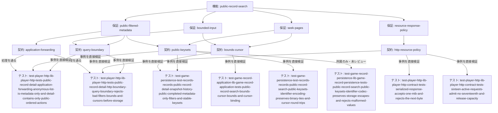

# 終了済み公開対局の検索

このページは `python3 scripts/traceability.py render` で生成する。

元データは [crates/player-http/src/trace/public-record-search/feature.rs](../../../crates/player-http/src/trace/public-record-search/feature.rs)。
[全機能の一覧](../feature-traceability.md)。

## 対象機能

| ID | 機能 | 仕様 |
| --- | --- | --- |
| public-record-search | 終了済み公開対局の検索 | [crates/player-http/src/lib.rs](../../../crates/player-http/src/lib.rs#L140) |

## 保証の成立条件と構成

1. HTTP アダプターはフィルターとカーソルを復号・検証してから、共有のリクエスト処理枠を取得する。
2. GameRecords は型付き Search を読み取り用リポジトリへ渡し、リポジトリはキーセットページングで公開済みの終了対局メタデータを選択する。
3. HTTP アダプターは、応答サイズに上限を設け no-store を付ける共有ヘルパーを通じて、メタデータと次のカーソルをシリアライズする。

以下の保証には、各行に示す契約が必要となる。テストによる検証は記載した事例の範囲に限られる。

| ID | アプリケーションの保証と条件 | 必要な契約 |
| --- | --- | --- |
| bounded-input | 検索には、非負で開始より終了が後の UTC マイクロ秒区間を指定する。開始は含み終了は含まず、区間は最大 366 日となる。取得件数は 1〜100 で既定値は 30 とし、型付きフィルターに未知フィールドや重複フィールドを認めない。不正な入力は保存層へ到達する前に 400 を返す。 | [query-boundary](#contract-query-boundary), [bounds-cursor](#contract-bounds-cursor) |
| public-filtered-metadata | 認証なしの検索は、取得時点で公開されている終了済み対局のメタデータだけを返し、指定されたフィルターを AND で組み合わせる。 | [query-boundary](#contract-query-boundary), [application-forwarding](#contract-application-forwarding), [public-keysets](#contract-public-keysets) |
| resource-response-policy | 処理対象の応答は詳細を伏せたエラーと no-store を使う。共有 HTTP アダプターは同時に最大 16 件を受け入れ、シリアライズ後の成功応答が 1 MiB を超える場合は拒否する。 | [http-resource-policy](#contract-http-resource-policy) |
| seek-pages | 結果は終了時刻、続いてバイナリー形式の対局 ID の降順に並ぶ。カーソルはフィルターに結び付き、ページの取得件数は変更できる。次のページでも公開状態を再確認する。 | [bounds-cursor](#contract-bounds-cursor), [public-keysets](#contract-public-keysets) |

## 宣言した対応関係

矢印は著者が宣言した関係を示す。「事例を直接検証」は記載した事例を直接確かめる関係、「処理を通る」は対象の処理を実行する関係を示す。「所属のみ・未レビュー」は契約ディレクトリへの配置だけで分類した関係を示す。



## コンポーネント契約と根拠

<a id="contract-application-forwarding"></a>

### application-forwarding

GameRecords::search は型付き Search を RecordRepository に渡し、その結果を返す。

実装位置: [crates/game-record-application/src/lib.rs](../../../crates/game-record-application/src/lib.rs#L335)。

- [test-player-http-lib-player-http-tests-public-record-detail-application-forwarding-anonymous-list-is-metadata-only-and-detail-contains-only-public-ordered-actions](#test-test-player-http-lib-player-http-tests-public-record-detail-application-forwarding-anonymous-list-is-metadata-only-and-detail-contains-only-public-ordered-actions) (処理を通る): 実ルーターがこのアプリケーションメソッドを通り、実 PostgreSQL の読み取り処理に到達する。
- [test-player-http-lib-player-http-tests-public-record-detail-http-boundary-query-boundary-rejects-bad-filters-bounds-and-cursors-before-storage](#test-test-player-http-lib-player-http-tests-public-record-detail-http-boundary-query-boundary-rejects-bad-filters-bounds-and-cursors-before-storage) (処理を通る): 有効なクエリーはこのメソッドを通り、リポジトリの失敗に到達する。

未検証: 任意の Search とリポジトリの結果が変更なしで転送されることを検証する独立したテストはない。

<a id="contract-bounds-cursor"></a>

### bounds-cursor

Search は期間、取得件数、手数の境界を検証する。カーソルはページの取得件数ではなく、フィルターのフィンガープリントに結び付けて復号する。

実装位置: [crates/game-record-application/src/lib.rs](../../../crates/game-record-application/src/lib.rs#L61)。

- [test-game-persistence-test-records-records-public-record-detail-snapshot-history-public-completed-metadata-only-filters-and-stable-keysets](#test-test-game-persistence-test-records-records-public-record-detail-snapshot-history-public-completed-metadata-only-filters-and-stable-keysets) (事例を直接検証): 勝者フィルターを変更すると、リポジトリのページカーソルを拒否する。
- [test-game-record-application-lib-game-record-application-tests-public-record-search-bounds-cursor-bounds-and-cursor-binding](#test-test-game-record-application-lib-game-record-application-tests-public-record-search-bounds-cursor-bounds-and-cursor-binding) (事例を直接検証): 不正な境界と不正な形式のカーソルを拒否し、取得件数の変更を受け入れ、カーソルのバイト列を維持し、参加者の変更を拒否することを直接確認する。

未検証: 対応付けた事例は、フィンガープリントの全フィールドの変更や、カーソルのバイト数と UTF-8 の全境界を網羅しない。

<a id="contract-http-resource-policy"></a>

### http-resource-policy

共有アダプターはセマフォの許可を即座に取得する。respond はエラーを変換し、no-store を付け、シリアライズした JSON を 1 MiB 以内に制限する。

実装位置: [crates/player-http/src/lib.rs](../../../crates/player-http/src/lib.rs#L224)。

- [test-player-http-lib-player-http-contract-tests-serialized-response-accepts-one-mib-and-rejects-the-next-byte](#test-test-player-http-lib-player-http-contract-tests-serialized-response-accepts-one-mib-and-rejects-the-next-byte) (事例を直接検証): 応答ヘルパーを直接呼び出し、ちょうど 1 MiB を受け入れ、その次の 1 バイトで 422 と詳細を伏せたエラーを返すことを確認する。
- [test-player-http-lib-player-http-contract-tests-sixteen-active-requests-admit-no-seventeenth-and-release-capacity](#test-test-player-http-lib-player-http-contract-tests-sixteen-active-requests-admit-no-seventeenth-and-release-capacity) (事例を直接検証): 待機させた検索は 16 件まで保存層に到達し、17 件目は即座に 503 と no-store を受け取る。待機を解除すると処理枠が再び使えることを確認する。
- [test-player-http-lib-player-http-tests-public-record-detail-http-boundary-query-boundary-rejects-bad-filters-bounds-and-cursors-before-storage](#test-test-player-http-lib-player-http-tests-public-record-detail-http-boundary-query-boundary-rejects-bad-filters-bounds-and-cursors-before-storage) (事例を直接検証): 不正な検索リクエストについて、詳細を伏せた 400 の JSON 本文と no-store を検証する。破損したリポジトリに到達する有効なリクエストについては、500 と no-store を検証し、本文は確認しない。

未検証: サイズの境界には実際の最大ページではなく文字列を使う。検索・詳細取得・レート取得を混在させて処理枠を使い切るテストは対応付けていない。

<a id="contract-public-keysets"></a>

### public-keysets

PostgreSQL の読み取り処理は、公開された終了済み対局のメタデータを対象に指定された全フィルターを適用し、直前の終了時刻とバイナリー形式の ID の組より後の結果だけを取得する。

実装位置: [crates/game-record-persistence/src/lib.rs](../../../crates/game-record-persistence/src/lib.rs#L244)。

- [test-game-persistence-test-records-records-public-record-detail-snapshot-history-public-completed-metadata-only-filters-and-stable-keysets](#test-test-game-persistence-test-records-records-public-record-detail-snapshot-history-public-completed-metadata-only-filters-and-stable-keysets) (事例を直接検証): リポジトリを直接検証し、個別フィルター、組み合わせた条件、同時刻の ID を c/b の順に並べてから古い a を返すこと、まだ見ていない新しい行の除外、新たに非公開となった行の省略を確認する。
- [test-game-persistence-test-records-records-public-record-search-public-keysets-identifier-encoding-preserves-binary-ties-and-cursor-round-trips](#test-test-game-persistence-test-records-records-public-record-search-public-keysets-identifier-encoding-preserves-binary-ties-and-cursor-round-trips) (事例を直接検証): 符号化の境界事例を含む保存済み識別子でも、同値時のバイナリー順序とカーソルの往復を保持する。
- [test-game-record-persistence-lib-game-record-persistence-tests-public-record-search-public-keysets-identifier-codec-preserves-storage-escapes-and-rejects-malformed-values](#test-test-game-record-persistence-lib-game-record-persistence-tests-public-record-search-public-keysets-identifier-codec-preserves-storage-escapes-and-rejects-malformed-values) (所属のみ・未レビュー): 配置先からこのテストの契約への所属を宣言している。実装を実行することと検証の十分さはレビューが必要。
- [test-player-http-lib-player-http-tests-public-record-detail-application-forwarding-anonymous-list-is-metadata-only-and-detail-contains-only-public-ordered-actions](#test-test-player-http-lib-player-http-tests-public-record-detail-application-forwarding-anonymous-list-is-metadata-only-and-detail-contains-only-public-ordered-actions) (事例を直接検証): 認証なしの実ルーターが公開メタデータだけを返し、読み取り処理を閉じると利用不可となることを確認する。

<a id="contract-query-boundary"></a>

### query-boundary

RawSearch はフィールドを型付きの値として解析し、リポジトリへアクセスする前に不正な値、未知の値、重複したクエリー値を拒否する。

実装位置: [crates/player-http/src/lib.rs](../../../crates/player-http/src/lib.rs#L100)。

- [test-player-http-lib-player-http-tests-public-record-detail-application-forwarding-anonymous-list-is-metadata-only-and-detail-contains-only-public-ordered-actions](#test-test-player-http-lib-player-http-tests-public-record-detail-application-forwarding-anonymous-list-is-metadata-only-and-detail-contains-only-public-ordered-actions) (事例を直接検証): 実ルーターと PostgreSQL の読み取り処理が、参加者・ルール・勝者・終了理由・手数を組み合わせたクエリーに一致する一件の対局を返すことを確認する。
- [test-player-http-lib-player-http-tests-public-record-detail-http-boundary-query-boundary-rejects-bad-filters-bounds-and-cursors-before-storage](#test-test-player-http-lib-player-http-tests-public-record-detail-http-boundary-query-boundary-rejects-bad-filters-bounds-and-cursors-before-storage) (事例を直接検証): 各不正リクエストが 400、invalid_query、no-store を返すことを確認する。有効なリクエストは同じ失敗するリポジトリへ到達して 500 を返す。

## 実在するテストと実行コマンド

コマンドは個別テストを厳密一致で選択する。保存層テストには TEST_DATABASE_URL と TEST_VALKEY_URL が必要な場合がある。

<a id="test-test-game-persistence-test-records-records-public-record-detail-snapshot-history-public-completed-metadata-only-filters-and-stable-keysets"></a>

### test-game-persistence-test-records-records-public-record-detail-snapshot-history-public-completed-metadata-only-filters-and-stable-keysets

テスト位置: [crates/game-persistence/tests/trace/public-record-detail/snapshot-history/tests.rs](../../../crates/game-persistence/tests/trace/public-record-detail/snapshot-history/tests.rs#L11)。

範囲: 実際の PostgreSQL の読み取り・書き込み用のテスト構成で、フィルター、公開範囲、キーベースのページングの変化を検証する。

```sh
cargo test --locked -p game-persistence --test records records::public_record_detail_snapshot_history::public_completed_metadata_only_filters_and_stable_keysets -- --exact --format pretty --color never
```

<a id="test-test-game-persistence-test-records-records-public-record-search-public-keysets-identifier-encoding-preserves-binary-ties-and-cursor-round-trips"></a>

### test-game-persistence-test-records-records-public-record-search-public-keysets-identifier-encoding-preserves-binary-ties-and-cursor-round-trips

テスト位置: [crates/game-persistence/tests/trace/public-record-search/public-keysets/tests.rs](../../../crates/game-persistence/tests/trace/public-record-search/public-keysets/tests.rs#L11)。

範囲: 実際の PostgreSQL で、識別子の順序とカーソルの往復を検証する。

```sh
cargo test --locked -p game-persistence --test records records::public_record_search_public_keysets::identifier_encoding_preserves_binary_ties_and_cursor_round_trips -- --exact --format pretty --color never
```

<a id="test-test-game-record-application-lib-game-record-application-tests-public-record-search-bounds-cursor-bounds-and-cursor-binding"></a>

### test-game-record-application-lib-game-record-application-tests-public-record-search-bounds-cursor-bounds-and-cursor-binding

テスト位置: [crates/game-record-application/src/trace/public-record-search/bounds-cursor/tests.rs](../../../crates/game-record-application/src/trace/public-record-search/bounds-cursor/tests.rs#L11)。

範囲: HTTP と PostgreSQL を使わず、Search・フィルター・カーソルの値を直接確認する。

```sh
cargo test --locked -p game-record-application --lib tests::public_record_search_bounds_cursor::bounds_and_cursor_binding -- --exact --format pretty --color never
```

<a id="test-test-game-record-persistence-lib-game-record-persistence-tests-public-record-search-public-keysets-identifier-codec-preserves-storage-escapes-and-rejects-malformed-values"></a>

### test-game-record-persistence-lib-game-record-persistence-tests-public-record-search-public-keysets-identifier-codec-preserves-storage-escapes-and-rejects-malformed-values

テスト位置: [crates/game-record-persistence/src/trace/public-record-search/public-keysets/tests.rs](../../../crates/game-record-persistence/src/trace/public-record-search/public-keysets/tests.rs#L4)。

範囲: 契約ディレクトリへの所属のみを示す。実行時の依存関係と検証内容は未レビュー。

```sh
cargo test --locked -p game-record-persistence --lib tests::public_record_search_public_keysets::identifier_codec_preserves_storage_escapes_and_rejects_malformed_values -- --exact --format pretty --color never
```

<a id="test-test-player-http-lib-player-http-contract-tests-serialized-response-accepts-one-mib-and-rejects-the-next-byte"></a>

### test-player-http-lib-player-http-contract-tests-serialized-response-accepts-one-mib-and-rejects-the-next-byte

テスト位置: [crates/player-http/src/trace/public-record-search/http-resource-policy/tests.rs](../../../crates/player-http/src/trace/public-record-search/http-resource-policy/tests.rs#L99)。

範囲: シリアライズ後のバイト数の境界を使い、共有応答ヘルパーを直接確認する。実際の対局ページは使わない。

```sh
cargo test --locked -p player-http --lib contract_tests::serialized_response_accepts_one_mib_and_rejects_the_next_byte -- --exact --format pretty --color never
```

<a id="test-test-player-http-lib-player-http-contract-tests-sixteen-active-requests-admit-no-seventeenth-and-release-capacity"></a>

### test-player-http-lib-player-http-contract-tests-sixteen-active-requests-admit-no-seventeenth-and-release-capacity

テスト位置: [crates/player-http/src/trace/public-record-search/http-resource-policy/tests.rs](../../../crates/player-http/src/trace/public-record-search/http-resource-policy/tests.rs#L43)。

範囲: 意図的に待機させるテスト用リポジトリを使い、プロセス内の Axum の受け入れ処理を確認する。

```sh
cargo test --locked -p player-http --lib contract_tests::sixteen_active_requests_admit_no_seventeenth_and_release_capacity -- --exact --format pretty --color never
```

<a id="test-test-player-http-lib-player-http-tests-public-record-detail-application-forwarding-anonymous-list-is-metadata-only-and-detail-contains-only-public-ordered-actions"></a>

### test-player-http-lib-player-http-tests-public-record-detail-application-forwarding-anonymous-list-is-metadata-only-and-detail-contains-only-public-ordered-actions

テスト位置: [crates/player-http/src/trace/public-record-detail/application-forwarding/tests.rs](../../../crates/player-http/src/trace/public-record-detail/application-forwarding/tests.rs#L12)。

範囲: 実 Axum ルーター、アプリケーションサービス、PostgreSQL の読み取り処理。公開対局サービスの TCP リスナーは使わない。

```sh
cargo test --locked -p player-http --lib tests::public_record_detail_application_forwarding::anonymous_list_is_metadata_only_and_detail_contains_only_public_ordered_actions -- --exact --format pretty --color never
```

<a id="test-test-player-http-lib-player-http-tests-public-record-detail-http-boundary-query-boundary-rejects-bad-filters-bounds-and-cursors-before-storage"></a>

### test-player-http-lib-player-http-tests-public-record-detail-http-boundary-query-boundary-rejects-bad-filters-bounds-and-cursors-before-storage

テスト位置: [crates/player-http/src/trace/public-record-detail/http-boundary/tests.rs](../../../crates/player-http/src/trace/public-record-detail/http-boundary/tests.rs#L12)。

範囲: 失敗を返すテスト用リポジトリを使う実 Axum ルーター。不正な事例で保存層へ到達する前の拒否を確認する。

```sh
cargo test --locked -p player-http --lib tests::public_record_detail_http_boundary::query_boundary_rejects_bad_filters_bounds_and_cursors_before_storage -- --exact --format pretty --color never
```

## 検査と根拠の限界

check はグラフ、ファイル内の一意なテキスト位置、パッケージとターゲットごとのコンパイル済みテスト名、生成文書の一致を検査する。
run は check の後に共有された Cargo テストを一度ずつ実行し、厳密一致の 1 件が成功し、失敗と無視が 0 件であることを検査する。
この文書には実行済みの成功状態を保存しない。CI のワークスペース全体のテスト実行結果は、その実行時点の結果となる。
宣言した関連の意味と網羅性はレビューが必要となる。検出できる関連の削除は、必須の関連数、参照先、孤立ノードの規則に違反するものに限られる。

- 複数のページ要求で同じデータベーススナップショットを使う保証はない。カーソルはフィルターに結び付いた値であり、認証済みのトークンではない。
- 対応付けたテストは実際の player-server の TCP リスナーを起動しない。フレームワーク自身が返す未処理ルートなどの応答は、処理対象の応答に対する no-store の保証に含まれない。
- 読み取り接続数の上限、データベースのタイムアウト、データベース権限は startup-schema-isolation に対応付けている。
- ソースへのリンクとテストの実行成功は、追跡できる根拠を示す。保証の意味の証明や完全な網羅性を示すものではない。

## ディレクトリ方式の検査範囲

Rust 宣言、通常のモジュールと文字列リテラルの include! から物理ファイルの所属、パッケージ、ターゲット、完全なテスト名と位置を抽出する。ホスト環境で Cargo の既定の機能フラグを使い、ワークスペースのライブラリ、バイナリ、結合テストの全テスト一覧と一致させる。別のターゲット、機能フラグ、cfg の組合せは対象外。
src/trace/<feature> と tests/trace/<feature> は新規機能も探索し、未宣言または未到達のファイルを拒否する。契約内の通常テストは「所属のみ・未レビュー」として追加する。「事例を直接検証」または「処理を通る」のレビュー済み根拠がない契約には未検証事項の gap 宣言が必要。
全ターゲットの未分類テストは拒否する。trace ディレクトリ内の未対応の項目マクロと cfg は直接拒否し、外側の未対応構文が生成した実行対象テストはコンパイル済み一覧との差として拒否する。テスト実行補助と基盤の検査の明示分類および理由は全機能の一覧に示す。
