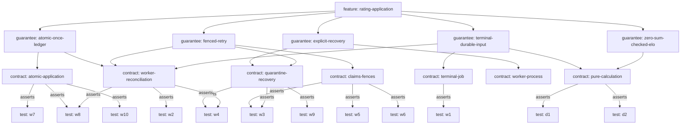

# レート更新ジョブの実行と隔離からの復旧

このページは `python3 scripts/traceability.py render` で生成する。

元データは [crates/game-application/src/rating-application.trace.json](../../../crates/game-application/src/rating-application.trace.json)。
[全機能の一覧](../feature-traceability.md)。

## 対象機能

| ID | 機能 | 仕様 |
| --- | --- | --- |
| rating-application | レート更新ジョブの実行と隔離からの復旧 | [crates/game-application/src/rating.rs](../../../crates/game-application/src/rating.rs#L235) |

## 保証の成立条件と構成

1. A rated terminal receipt atomically creates a durable rating job from immutable admission metadata and committed result, independently of the broker.
2. RatingWorker acquires a fenced lease, calculates from frozen pool-specific starts and requests atomic repository application.
3. The repository updates both players, records one application ledger, completes the job and releases only that game&#x27;s reservations in one transaction.
4. Transient failures defer with backoff; corruption or exhausted acquisition budget quarantines the still-reserved game until explicit recovery.

以下の保証には、各行に示す契約が必要となる。テストの assertions は記載した事例の範囲に限られる。

| ID | アプリケーションの保証と条件 | 必要な契約 |
| --- | --- | --- |
| atomic-once-ledger | A valid current claim updates both ratings, inserts one ledger, completes the job and releases only its own reservations atomically. Matching completed replay reconciles read-only. | [atomic-application](#contract-atomic-application), [worker-reconciliation](#contract-worker-reconciliation) |
| explicit-recovery | Explicit recovery resets a quarantined job&#x27;s acquisition budget without repairing input or changing frozen starts, ratings or reservations. The worker binary exposes polling and retry-quarantined modes. | [quarantine-recovery](#contract-quarantine-recovery), [worker-process](#contract-worker-process) |
| fenced-retry | Expired or superseded claims cannot mutate results. Attempts, lease expiry and transient backoff are durable; corruption or exhausted budget quarantines without releasing reservations. | [claims-fences](#contract-claims-fences), [worker-reconciliation](#contract-worker-reconciliation), [quarantine-recovery](#contract-quarantine-recovery) |
| terminal-durable-input | Only a durable terminal rated game produces a rating job, atomically with the accepted receipt and outbox. Calculation uses frozen pool-specific starts and the committed winner. | [terminal-job](#contract-terminal-job), [pure-calculation](#contract-pure-calculation), [worker-reconciliation](#contract-worker-reconciliation) |
| zero-sum-checked-elo | K32 Elo treats unrated players as 1500, rounds one black delta and negates it for white, and checks signed-rating and completed-game-count arithmetic. | [pure-calculation](#contract-pure-calculation) |

## 宣言した対応関係

矢印は著者が宣言した関係を示す。asserts は記載した事例への直接の assertion、exercises は処理を通る関係を示す。



## コンポーネント契約と根拠

<a id="contract-atomic-application"></a>

### atomic-application

Apply validates frozen/current state and fencing, updates both players and the application ledger/job/reservations atomically, and checks completed replay without modifying later reservations.

実装位置: [crates/game-persistence/src/rating.rs](../../../crates/game-persistence/src/rating.rs#L370)。

- [w7](#test-w7) (asserts): Completed replay neither adds a ledger nor releases a newer game&#x27;s slots.
- [w8](#test-w8) (asserts): Two real worker ticks produce independent black ratings of 1516 and 1484 in the two pools, one completed game each, two ledgers and no remaining slots.
- [w10](#test-w10) (asserts): A forced ledger-insert failure rolls back both ratings and reservations, then succeeds after repair.

<a id="contract-claims-fences"></a>

### claims-fences

The durable repository acquires eligible jobs with skip-locked behavior and checks owner, generation and live lease before processing and again when completing atomic application after state-lock waits.

実装位置: [crates/game-persistence/src/rating.rs](../../../crates/game-persistence/src/rating.rs#L276)。

- [w3](#test-w3) (asserts): Generations increase, expired/stale apply and fail return LostClaim, acquisition budget exhausts, slots remain reserved and recovery outcomes are checked.
- [w5](#test-w5) (asserts): Lease expiry while waiting for a state lock yields LostClaim, no ledger, two retained reservations and an unchanged unrated black state.
- [w6](#test-w6) (asserts): A locked job is skipped; two concurrent claims for the remaining job yield exactly one owner.

<a id="contract-pure-calculation"></a>

### pure-calculation

The pure calculator operates on validated RatingState values, computes one rounded K32 delta from effective starts, applies its negation to white and checks rating/count overflow.

実装位置: [crates/rating-domain/src/lib.rs](../../../crates/rating-domain/src/lib.rs#L110)。

- [d1](#test-d1) (asserts): Equal unrated players become 1516 and 1484 with the expected completed counts.
- [d2](#test-d2) (asserts): Listed starts/winners cover an upset, zero-sum deltas within 32, checked extreme arithmetic and invalid rating-state combinations.

未検証: These finite cases are not a mathematical proof or an exhaustive floating-point rounding portability guarantee.

<a id="contract-quarantine-recovery"></a>

### quarantine-recovery

The durable fail/recovery operations enforce transient backoff and attempt budget while retaining reservations; recovery resets quarantine without repairing state.

実装位置: [crates/game-persistence/src/rating.rs](../../../crates/game-persistence/src/rating.rs#L611)。

- [w3](#test-w3) (asserts): Expired-claim budget exhaustion retains slots; recovery and repeated/unknown recovery outcomes are directly checked.
- [w4](#test-w4) (asserts): Recovery through RatingWorker does not repair corrupt current state; repaired state is required for a later successful tick.
- [w9](#test-w9) (asserts): Transient failure cannot be reacquired before backoff and reaches quarantine at the configured attempt limit.

未検証: Recovery tests assert outcomes, increasing generations, retained reservations and the need to repair corrupt state. They do not compare a complete before/after snapshot of frozen inputs and both ratings during recovery.

<a id="contract-terminal-job"></a>

### terminal-job

The game commit atomically enqueues a job only for a terminal rated game and keeps one job under receipt replay.

実装位置: [crates/game-persistence/src/lib.rs](../../../crates/game-persistence/src/lib.rs#L388)。

- [w1](#test-w1) (asserts): A rating-job trigger failure rolls back metadata, journal and outbox; retry yields one job and casual finish yields none.

<a id="contract-worker-process"></a>

### worker-process

The worker binary parses bounded policy and poll values, starts a durable repository and runs either polling or explicit retry-quarantined mode before closing it.

実装位置: [apps/rating-worker-server/src/main.rs](../../../apps/rating-worker-server/src/main.rs#L16)。


未検証: No mapped test starts this CLI, checks actual argument/environment parsing, zero-poll rejection, Ctrl-C, poll timing or repository close on process shutdown.

<a id="contract-worker-reconciliation"></a>

### worker-reconciliation

RatingWorker routes invalid input and corrupt application to quarantine, retries an unavailable apply once to reconcile uncertain commits, and reports the repository outcome.

実装位置: [crates/game-application/src/rating.rs](../../../crates/game-application/src/rating.rs#L235)。

- [w2](#test-w2) (asserts): Injected unavailable results before and after real commits produce Applied or AlreadyApplied, then Idle, with one ledger.
- [w4](#test-w4) (asserts): A real worker quarantines corrupt current state and successful explicit retry still requires repairing that state.
- [w8](#test-w8) (asserts): Real worker application uses independent frozen starts for the two pools.

未検証: Selected error paths are asserted; there is no independent complete branch matrix or direct dedicated constructor test for WorkerId, WorkerPolicy and ClaimedRatingJob.

## 実在するテストと実行コマンド

コマンドは個別テストを厳密一致で選択する。保存層テストには TEST_DATABASE_URL と TEST_VALKEY_URL が必要な場合がある。

<a id="test-d1"></a>

### d1

テスト位置: [crates/rating-domain/src/lib.rs](../../../crates/rating-domain/src/lib.rs#L130)。

範囲: Pure Elo equal-player example, no persistence.

```sh
cargo test --locked -p rating-domain --lib tests::equal_players_gain_and_lose_sixteen -- --exact --format pretty --color never
```

<a id="test-d2"></a>

### d2

テスト位置: [crates/rating-domain/src/lib.rs](../../../crates/rating-domain/src/lib.rs#L144)。

範囲: Pure rating-state/calculation examples and arithmetic boundaries.

```sh
cargo test --locked -p rating-domain --lib tests::expected_upsets_and_extremes_are_zero_sum_and_checked -- --exact --format pretty --color never
```

<a id="test-w1"></a>

### w1

テスト位置: [crates/game-persistence/tests/ratings.rs](../../../crates/game-persistence/tests/ratings.rs#L141)。

範囲: Real PostgreSQL receipt/outbox/rating-job atomicity with trigger-injected failure.

```sh
cargo test --locked -p game-persistence --test ratings terminal_receipt_outbox_and_rating_job_commit_or_rollback_together -- --exact --format pretty --color never
```

<a id="test-w10"></a>

### w10

テスト位置: [crates/game-persistence/tests/ratings.rs](../../../crates/game-persistence/tests/ratings.rs#L646)。

範囲: Real PostgreSQL atomic-apply rollback after forced ledger insertion failure.

```sh
cargo test --locked -p game-persistence --test ratings failed_ledger_insert_rolls_back_both_ratings_and_reservations -- --exact --format pretty --color never
```

<a id="test-w2"></a>

### w2

テスト位置: [crates/game-persistence/tests/ratings.rs](../../../crates/game-persistence/tests/ratings.rs#L280)。

範囲: Real RatingWorker and PostgreSQL with unavailable-result injection around actual application commits.

```sh
cargo test --locked -p game-persistence --test ratings worker_reconciles_errors_before_and_after_a_real_application_commit -- --exact --format pretty --color never
```

<a id="test-w3"></a>

### w3

テスト位置: [crates/game-persistence/tests/ratings.rs](../../../crates/game-persistence/tests/ratings.rs#L309)。

範囲: Real PostgreSQL claims, expired/stale fences, budget and recovery; worker error routing is not the subject.

```sh
cargo test --locked -p game-persistence --test ratings expired_claims_consume_budget_quarantine_and_recover_without_releasing_slots -- --exact --format pretty --color never
```

<a id="test-w4"></a>

### w4

テスト位置: [crates/game-persistence/tests/ratings.rs](../../../crates/game-persistence/tests/ratings.rs#L386)。

範囲: Real RatingWorker/PostgreSQL corruption, quarantine, explicit recovery and repair.

```sh
cargo test --locked -p game-persistence --test ratings corrupt_current_state_quarantines_and_retry_requires_repair -- --exact --format pretty --color never
```

<a id="test-w5"></a>

### w5

テスト位置: [crates/game-persistence/tests/ratings.rs](../../../crates/game-persistence/tests/ratings.rs#L425)。

範囲: Real PostgreSQL lock wait crossing lease expiry; no CLI.

```sh
cargo test --locked -p game-persistence --test ratings lease_expiring_while_waiting_for_state_lock_rolls_back_all_mutations -- --exact --format pretty --color never
```

<a id="test-w6"></a>

### w6

テスト位置: [crates/game-persistence/tests/ratings.rs](../../../crates/game-persistence/tests/ratings.rs#L554)。

範囲: Concurrent real PostgreSQL acquisitions and a held row lock.

```sh
cargo test --locked -p game-persistence --test ratings concurrent_workers_acquire_disjoint_jobs_and_skip_a_locked_job -- --exact --format pretty --color never
```

<a id="test-w7"></a>

### w7

テスト位置: [crates/game-persistence/tests/ratings.rs](../../../crates/game-persistence/tests/ratings.rs#L185)。

範囲: Real PostgreSQL completed replay and later-game reservation preservation.

```sh
cargo test --locked -p game-persistence --test ratings completed_replay_is_read_only_and_never_releases_the_next_games_slots -- --exact --format pretty --color never
```

<a id="test-w8"></a>

### w8

テスト位置: [crates/game-persistence/tests/ratings.rs](../../../crates/game-persistence/tests/ratings.rs#L518)。

範囲: Real worker, PostgreSQL and read adapter for independent pools.

```sh
cargo test --locked -p game-persistence --test ratings both_pools_update_independently_from_their_frozen_start_states -- --exact --format pretty --color never
```

<a id="test-w9"></a>

### w9

テスト位置: [crates/game-persistence/tests/ratings.rs](../../../crates/game-persistence/tests/ratings.rs#L590)。

範囲: Real PostgreSQL transient backoff and attempt-limit behavior.

```sh
cargo test --locked -p game-persistence --test ratings transient_failure_obeys_backoff_and_quarantines_at_the_attempt_limit -- --exact --format pretty --color never
```

## 検査と根拠の限界

check はグラフ、ファイル内の一意なテキスト位置、package と target ごとのコンパイル済みテスト名、生成文書の一致を検査する。
run は check の後に共有された Cargo テストを一度ずつ実行し、厳密一致の 1 件が成功し、失敗と無視が 0 件であることを検査する。
この文書には実行済みの成功状態を保存しない。CI の workspace テスト実行結果は、その実行時点の結果となる。
位置の検査は Rust の構文解析ではなく、テスト名と指定したソース位置が同じ定義を指すことも証明しない。
宣言した関連の意味と網羅性はレビューが必要となる。検出できる関連の削除は、必須の関連数、参照先、孤立ノードの規則に違反するものに限られる。

- The worker reads durable jobs rather than broker messages. There is no automatic input repair or finite completion-time guarantee.
- Repository integration tests do not assert standalone worker CLI, polling or signal lifecycle.
- Public rating reads are mapped by user-ratings; startup schema and reader permissions are mapped by startup-schema-isolation.
- Source links and successful test execution establish traceable evidence, not semantic proof or complete coverage of these guarantees.
