# レート更新ジョブの実行と隔離からの復旧

このページは `python3 scripts/traceability.py render` で生成する。

元データは [crates/game-application/src/trace/rating-application/feature.rs](../../../crates/game-application/src/trace/rating-application/feature.rs)。
[全機能の一覧](../feature-traceability.md)。

## 対象機能

| ID | 機能 | 仕様 |
| --- | --- | --- |
| rating-application | レート更新ジョブの実行と隔離からの復旧 | [crates/game-application/src/rating.rs](../../../crates/game-application/src/rating.rs#L235) |

## 保証の成立条件と構成

1. レーティング対象対局の終局を受理すると、固定された参加時のメタデータと確定結果から永続レーティングジョブを原子的に作成する。ブローカーには依存しない。
2. RatingWorker は取得世代とリースで保護された取得権を確保し、プールごとに固定された開始状態から計算して、リポジトリに原子的な適用を要求する。
3. リポジトリは一つのトランザクションで、両者の更新、適用台帳一件の記録、ジョブ完了、その対局の予約枠だけの解放を行う。
4. 一時的な失敗は待機時間を設けて遅延させる。破損または取得回数の枠の使い切りでは、予約枠を持つ対局を明示的な復旧まで隔離する。

以下の保証には、各行に示す契約が必要となる。テストによる検証は記載した事例の範囲に限られる。

| ID | アプリケーションの保証と条件 | 必要な契約 |
| --- | --- | --- |
| atomic-once-ledger | 有効な現在の取得権に基づく適用は、両者のレーティング更新、台帳一件の挿入、ジョブ完了、その対局自身の予約枠だけの解放を原子的に行う。一致する完了済み処理の再試行は、読み取りだけで結果を照合する。 | [atomic-application](#contract-atomic-application), [worker-reconciliation](#contract-worker-reconciliation) |
| explicit-recovery | 明示的な復旧は、入力の修復や固定された開始状態・レーティング・予約枠の変更をせずに、隔離ジョブの取得回数の枠を戻す。ワーカー実行ファイルは、定期実行と retry-quarantined の両モードを提供する。 | [quarantine-recovery](#contract-quarantine-recovery), [worker-process](#contract-worker-process) |
| fenced-retry | 失効または更新済みの取得権では結果を変更できない。試行回数・リース期限・一時的失敗の待機時間を永続化し、破損や試行枠の使い切りでは予約枠を解放せず隔離する。 | [claims-fences](#contract-claims-fences), [worker-reconciliation](#contract-worker-reconciliation), [quarantine-recovery](#contract-quarantine-recovery) |
| terminal-durable-input | 永続化されたレーティング対象対局の終局だけが、受理記録と Outbox と原子的にレーティングジョブを生成する。計算にはプールごとに固定された開始状態と確定した勝者を使う。 | [terminal-job](#contract-terminal-job), [pure-calculation](#contract-pure-calculation), [worker-reconciliation](#contract-worker-reconciliation) |
| zero-sum-checked-elo | K32 Elo は未評価の両者を 1500 と扱い、先手の差分を一度だけ丸め、後手にはその符号を反転した差分を適用する。符号付きレーティングと完了対局数の算術を検査する。 | [pure-calculation](#contract-pure-calculation) |

## 宣言した対応関係

矢印は著者が宣言した関係を示す。「事例を直接検証」は記載した事例を直接確かめる関係、「処理を通る」は対象の処理を実行する関係を示す。「所属のみ・未レビュー」は契約ディレクトリへの配置だけで分類した関係を示す。

```mermaid
flowchart TD
    n0["機能: rating-application"]
    n1["保証: atomic-once-ledger"]
    n2["保証: explicit-recovery"]
    n3["保証: fenced-retry"]
    n4["保証: terminal-durable-input"]
    n5["保証: zero-sum-checked-elo"]
    n6["契約: atomic-application"]
    n7["契約: claims-fences"]
    n8["契約: pure-calculation"]
    n9["契約: quarantine-recovery"]
    n10["契約: terminal-job"]
    n11["契約: worker-process"]
    n12["契約: worker-reconciliation"]
    n13["テスト: test-game-persistence-test-ratings-ratings-rating-application-atomic-application-both-pools-update-independently-from-their-frozen-start-states"]
    n14["テスト: test-game-persistence-test-ratings-ratings-rating-application-atomic-application-completed-replay-is-read-only-and-never-releases-the-next-games-slots"]
    n15["テスト: test-game-persistence-test-ratings-ratings-rating-application-atomic-application-failed-ledger-insert-rolls-back-both-ratings-and-reservations"]
    n16["テスト: test-game-persistence-test-ratings-ratings-rating-application-claims-fences-concurrent-workers-acquire-disjoint-jobs-and-skip-a-locked-job"]
    n17["テスト: test-game-persistence-test-ratings-ratings-rating-application-claims-fences-expired-claims-consume-budget-quarantine-and-recover-without-releasing-slots"]
    n18["テスト: test-game-persistence-test-ratings-ratings-rating-application-claims-fences-lease-expiring-while-waiting-for-state-lock-rolls-back-all-mutations"]
    n19["テスト: test-game-persistence-test-ratings-ratings-rating-application-quarantine-recovery-corrupt-current-state-quarantines-and-retry-requires-repair"]
    n20["テスト: test-game-persistence-test-ratings-ratings-rating-application-quarantine-recovery-transient-failure-obeys-backoff-and-quarantines-at-the-attempt-limit"]
    n21["テスト: test-game-persistence-test-ratings-ratings-rating-application-terminal-job-terminal-receipt-outbox-and-rating-job-commit-or-rollback-together"]
    n22["テスト: test-game-persistence-test-ratings-ratings-rating-application-worker-reconciliation-worker-reconciles-errors-before-and-after-a-real-application-commit"]
    n23["テスト: test-rating-domain-lib-rating-domain-tests-equal-players-gain-and-lose-sixteen"]
    n24["テスト: test-rating-domain-lib-rating-domain-tests-expected-upsets-and-extremes-are-zero-sum-and-checked"]
    n0 --> n1
    n1 --> n6
    n1 --> n12
    n0 --> n2
    n2 --> n9
    n2 --> n11
    n0 --> n3
    n3 --> n7
    n3 --> n12
    n3 --> n9
    n0 --> n4
    n4 --> n10
    n4 --> n8
    n4 --> n12
    n0 --> n5
    n5 --> n8
    n6 -->|事例を直接検証| n13
    n6 -->|事例を直接検証| n14
    n6 -->|事例を直接検証| n15
    n7 -->|事例を直接検証| n16
    n7 -->|事例を直接検証| n17
    n7 -->|事例を直接検証| n18
    n8 -->|事例を直接検証| n23
    n8 -->|事例を直接検証| n24
    n9 -->|事例を直接検証| n17
    n9 -->|事例を直接検証| n19
    n9 -->|事例を直接検証| n20
    n10 -->|事例を直接検証| n21
    n12 -->|事例を直接検証| n13
    n12 -->|事例を直接検証| n19
    n12 -->|事例を直接検証| n22
```



## コンポーネント契約と根拠

<a id="contract-atomic-application"></a>

### atomic-application

適用処理は固定された状態・現在状態・取得権を検証し、両者と適用台帳・ジョブ・予約枠を原子的に更新する。完了済み処理の再試行では、後の予約枠を変更せず照合する。

実装位置: [crates/game-persistence/src/rating.rs](../../../crates/game-persistence/src/rating.rs#L370)。

- [test-game-persistence-test-ratings-ratings-rating-application-atomic-application-both-pools-update-independently-from-their-frozen-start-states](#test-test-game-persistence-test-ratings-ratings-rating-application-atomic-application-both-pools-update-independently-from-their-frozen-start-states) (事例を直接検証): 実際のワーカーの二回の tick により、二つのプールの先手レーティングがそれぞれ独立に 1516 と 1484 となる。各プールの完了対局数は一件、台帳は二件となり、残る参加枠はない。
- [test-game-persistence-test-ratings-ratings-rating-application-atomic-application-completed-replay-is-read-only-and-never-releases-the-next-games-slots](#test-test-game-persistence-test-ratings-ratings-rating-application-atomic-application-completed-replay-is-read-only-and-never-releases-the-next-games-slots) (事例を直接検証): 完了済み処理の再試行は台帳を追加せず、後の対局の参加枠も解放しない。
- [test-game-persistence-test-ratings-ratings-rating-application-atomic-application-failed-ledger-insert-rolls-back-both-ratings-and-reservations](#test-test-game-persistence-test-ratings-ratings-rating-application-atomic-application-failed-ledger-insert-rolls-back-both-ratings-and-reservations) (事例を直接検証): 適用台帳への挿入を強制的に失敗させると、両者のレーティングと予約枠がロールバックされ、修復後には成功する。

<a id="contract-claims-fences"></a>

### claims-fences

永続リポジトリはロック中のジョブを読み飛ばして実行可能なジョブを取得する。処理前に所有者・取得世代・有効なリースを確認し、状態のロック待ち後に原子的適用を完了する際にも再確認する。

実装位置: [crates/game-persistence/src/rating.rs](../../../crates/game-persistence/src/rating.rs#L276)。

- [test-game-persistence-test-ratings-ratings-rating-application-claims-fences-concurrent-workers-acquire-disjoint-jobs-and-skip-a-locked-job](#test-test-game-persistence-test-ratings-ratings-rating-application-claims-fences-concurrent-workers-acquire-disjoint-jobs-and-skip-a-locked-job) (事例を直接検証): ロック中のジョブを読み飛ばし、残るジョブを同時に取得しようとした二つの処理のうち、一つだけが所有権を得る。
- [test-game-persistence-test-ratings-ratings-rating-application-claims-fences-expired-claims-consume-budget-quarantine-and-recover-without-releasing-slots](#test-test-game-persistence-test-ratings-ratings-rating-application-claims-fences-expired-claims-consume-budget-quarantine-and-recover-without-releasing-slots) (事例を直接検証): 取得世代が増加し、期限切れまたは古い取得権での適用と失敗通知が LostClaim となること、取得回数の枠を使い切っても参加枠を保持すること、復旧結果を確認する。
- [test-game-persistence-test-ratings-ratings-rating-application-claims-fences-lease-expiring-while-waiting-for-state-lock-rolls-back-all-mutations](#test-test-game-persistence-test-ratings-ratings-rating-application-claims-fences-lease-expiring-while-waiting-for-state-lock-rolls-back-all-mutations) (事例を直接検証): 状態のロック待ち中にリースが切れると LostClaim となり、台帳を作らず二つの予約枠を保持し、先手の未評価状態を変更しない。

<a id="contract-pure-calculation"></a>

### pure-calculation

外部依存のない計算処理は検証済み RatingState を使い、実効開始値から丸めた K32 差分を一つ計算する。その符号を反転した値を後手へ適用し、レーティングと対局数のオーバーフローを検査する。

実装位置: [crates/rating-domain/src/lib.rs](../../../crates/rating-domain/src/lib.rs#L110)。

- [test-rating-domain-lib-rating-domain-tests-equal-players-gain-and-lose-sixteen](#test-test-rating-domain-lib-rating-domain-tests-equal-players-gain-and-lose-sixteen) (事例を直接検証): 同じ未評価状態の両者が 1516 と 1484 になり、完了対局数も期待どおりになる。
- [test-rating-domain-lib-rating-domain-tests-expected-upsets-and-extremes-are-zero-sum-and-checked](#test-test-rating-domain-lib-rating-domain-tests-expected-upsets-and-extremes-are-zero-sum-and-checked) (事例を直接検証): 列挙した開始状態と勝者で、格上への勝利、絶対値が 32 以内で総和 0 の差分、極端な値に対する検査付き算術、不正なレーティング状態の組み合わせを確認する。

未検証: これらの有限の事例は、数学的な証明でも、浮動小数点の丸めの移植性を網羅的に保証するものでもない。

<a id="contract-quarantine-recovery"></a>

### quarantine-recovery

永続層の失敗処理と復旧処理は、予約枠を保持したまま一時的失敗後の待機時間と試行回数の枠を適用する。復旧は状態を修復せず隔離を解除する。

実装位置: [crates/game-persistence/src/rating.rs](../../../crates/game-persistence/src/rating.rs#L611)。

- [test-game-persistence-test-ratings-ratings-rating-application-claims-fences-expired-claims-consume-budget-quarantine-and-recover-without-releasing-slots](#test-test-game-persistence-test-ratings-ratings-rating-application-claims-fences-expired-claims-consume-budget-quarantine-and-recover-without-releasing-slots) (事例を直接検証): 失効した取得権の試行枠を使い切っても参加枠を保持する。復旧と、復旧の繰り返しや不明な対象に対する結果を直接確認する。
- [test-game-persistence-test-ratings-ratings-rating-application-quarantine-recovery-corrupt-current-state-quarantines-and-retry-requires-repair](#test-test-game-persistence-test-ratings-ratings-rating-application-quarantine-recovery-corrupt-current-state-quarantines-and-retry-requires-repair) (事例を直接検証): RatingWorker による復旧は、破損した現在状態を修復しない。後の tick を成功させるには、状態を修復する必要がある。
- [test-game-persistence-test-ratings-ratings-rating-application-quarantine-recovery-transient-failure-obeys-backoff-and-quarantines-at-the-attempt-limit](#test-test-game-persistence-test-ratings-ratings-rating-application-quarantine-recovery-transient-failure-obeys-backoff-and-quarantines-at-the-attempt-limit) (事例を直接検証): 一時的な失敗は待機時間の終了前に再取得できず、設定した試行上限に達すると隔離される。

未検証: 復旧テストは、結果、取得世代の増加、予約枠の保持、破損状態の修復が必要なことを検証する。復旧前後で、固定入力と両者のレーティングの完全なスナップショットを比較してはいない。

<a id="contract-terminal-job"></a>

### terminal-job

対局のコミットは、レーティング対象対局の終局時にだけジョブを原子的に追加し、受理記録の再試行でもジョブを一件に保つ。

実装位置: [crates/game-persistence/src/lib.rs](../../../crates/game-persistence/src/lib.rs#L388)。

- [test-game-persistence-test-ratings-ratings-rating-application-terminal-job-terminal-receipt-outbox-and-rating-job-commit-or-rollback-together](#test-test-game-persistence-test-ratings-ratings-rating-application-terminal-job-terminal-receipt-outbox-and-rating-job-commit-or-rollback-together) (事例を直接検証): レーティングジョブのトリガーが失敗すると、メタデータ・履歴・Outbox をロールバックする。再試行ではジョブが一件となり、非レーティング対局の終局ではジョブを作らない。

<a id="contract-worker-process"></a>

### worker-process

ワーカー実行ファイルは、範囲を制限した方針とポーリング値を解析する。永続リポジトリを起動し、定期実行または明示的な retry-quarantined モードを実行してから接続を閉じる。

実装位置: [apps/rating-worker-server/src/main.rs](../../../apps/rating-worker-server/src/main.rs#L16)。


未検証: この CLI を起動し、実際の引数と環境変数の解析、ポーリング間隔 0 の拒否、Ctrl-C、定期実行の時機、プロセス停止時のリポジトリ終了を確認する対応テストはない。

<a id="contract-worker-reconciliation"></a>

### worker-reconciliation

RatingWorker は不正入力と適用時の破損を隔離する。利用不能となった適用を一度再試行して不確かなコミットを照合し、リポジトリの結果を報告する。

実装位置: [crates/game-application/src/rating.rs](../../../crates/game-application/src/rating.rs#L235)。

- [test-game-persistence-test-ratings-ratings-rating-application-atomic-application-both-pools-update-independently-from-their-frozen-start-states](#test-test-game-persistence-test-ratings-ratings-rating-application-atomic-application-both-pools-update-independently-from-their-frozen-start-states) (事例を直接検証): 実際のワーカーの適用処理は、二つのプールで独立して固定された開始状態を使う。
- [test-game-persistence-test-ratings-ratings-rating-application-quarantine-recovery-corrupt-current-state-quarantines-and-retry-requires-repair](#test-test-game-persistence-test-ratings-ratings-rating-application-quarantine-recovery-corrupt-current-state-quarantines-and-retry-requires-repair) (事例を直接検証): 実際のワーカーは破損した現在状態を隔離し、明示的な再試行を成功させるには、その状態の修復も必要となる。
- [test-game-persistence-test-ratings-ratings-rating-application-worker-reconciliation-worker-reconciles-errors-before-and-after-a-real-application-commit](#test-test-game-persistence-test-ratings-ratings-rating-application-worker-reconciliation-worker-reconciles-errors-before-and-after-a-real-application-commit) (事例を直接検証): 実際のコミットの前後で利用不能の結果を注入すると、Applied または AlreadyApplied、続いて Idle となり、台帳は一件となる。

未検証: 選択したエラー経路は検証しているが、全分岐を独立に網羅する検証や、WorkerId・WorkerPolicy・ClaimedRatingJob の専用コンストラクターテストはない。

## 実在するテストと実行コマンド

コマンドは個別テストを厳密一致で選択する。保存層テストには TEST_DATABASE_URL と TEST_VALKEY_URL が必要な場合がある。

<a id="test-test-game-persistence-test-ratings-ratings-rating-application-atomic-application-both-pools-update-independently-from-their-frozen-start-states"></a>

### test-game-persistence-test-ratings-ratings-rating-application-atomic-application-both-pools-update-independently-from-their-frozen-start-states

テスト位置: [crates/game-persistence/tests/trace/rating-application/atomic-application/tests.rs](../../../crates/game-persistence/tests/trace/rating-application/atomic-application/tests.rs#L75)。

範囲: 実際のワーカー、PostgreSQL、読み取りアダプターを使い、プールの独立性を検証する。

```sh
cargo test --locked -p game-persistence --test ratings ratings::rating_application_atomic_application::both_pools_update_independently_from_their_frozen_start_states -- --exact --format pretty --color never
```

<a id="test-test-game-persistence-test-ratings-ratings-rating-application-atomic-application-completed-replay-is-read-only-and-never-releases-the-next-games-slots"></a>

### test-game-persistence-test-ratings-ratings-rating-application-atomic-application-completed-replay-is-read-only-and-never-releases-the-next-games-slots

テスト位置: [crates/game-persistence/tests/trace/rating-application/atomic-application/tests.rs](../../../crates/game-persistence/tests/trace/rating-application/atomic-application/tests.rs#L11)。

範囲: 実際の PostgreSQL で、完了済み処理の再試行と、後の対局の予約枠の保持を検証する。

```sh
cargo test --locked -p game-persistence --test ratings ratings::rating_application_atomic_application::completed_replay_is_read_only_and_never_releases_the_next_games_slots -- --exact --format pretty --color never
```

<a id="test-test-game-persistence-test-ratings-ratings-rating-application-atomic-application-failed-ledger-insert-rolls-back-both-ratings-and-reservations"></a>

### test-game-persistence-test-ratings-ratings-rating-application-atomic-application-failed-ledger-insert-rolls-back-both-ratings-and-reservations

テスト位置: [crates/game-persistence/tests/trace/rating-application/atomic-application/tests.rs](../../../crates/game-persistence/tests/trace/rating-application/atomic-application/tests.rs#L119)。

範囲: 実際の PostgreSQL で、台帳挿入の強制失敗後に適用全体を原子的にロールバックする。

```sh
cargo test --locked -p game-persistence --test ratings ratings::rating_application_atomic_application::failed_ledger_insert_rolls_back_both_ratings_and_reservations -- --exact --format pretty --color never
```

<a id="test-test-game-persistence-test-ratings-ratings-rating-application-claims-fences-concurrent-workers-acquire-disjoint-jobs-and-skip-a-locked-job"></a>

### test-game-persistence-test-ratings-ratings-rating-application-claims-fences-concurrent-workers-acquire-disjoint-jobs-and-skip-a-locked-job

テスト位置: [crates/game-persistence/tests/trace/rating-application/claims-fences/tests.rs](../../../crates/game-persistence/tests/trace/rating-application/claims-fences/tests.rs#L147)。

範囲: 実際の PostgreSQL で、行ロックを保持した状態と同時取得を検証する。

```sh
cargo test --locked -p game-persistence --test ratings ratings::rating_application_claims_fences::concurrent_workers_acquire_disjoint_jobs_and_skip_a_locked_job -- --exact --format pretty --color never
```

<a id="test-test-game-persistence-test-ratings-ratings-rating-application-claims-fences-expired-claims-consume-budget-quarantine-and-recover-without-releasing-slots"></a>

### test-game-persistence-test-ratings-ratings-rating-application-claims-fences-expired-claims-consume-budget-quarantine-and-recover-without-releasing-slots

テスト位置: [crates/game-persistence/tests/trace/rating-application/claims-fences/tests.rs](../../../crates/game-persistence/tests/trace/rating-application/claims-fences/tests.rs#L11)。

範囲: 実際の PostgreSQL で、取得権、期限切れと古い取得権による操作の拒否、試行回数の枠、復旧を検証する。ワーカーのエラー処理経路は対象としない。

```sh
cargo test --locked -p game-persistence --test ratings ratings::rating_application_claims_fences::expired_claims_consume_budget_quarantine_and_recover_without_releasing_slots -- --exact --format pretty --color never
```

<a id="test-test-game-persistence-test-ratings-ratings-rating-application-claims-fences-lease-expiring-while-waiting-for-state-lock-rolls-back-all-mutations"></a>

### test-game-persistence-test-ratings-ratings-rating-application-claims-fences-lease-expiring-while-waiting-for-state-lock-rolls-back-all-mutations

テスト位置: [crates/game-persistence/tests/trace/rating-application/claims-fences/tests.rs](../../../crates/game-persistence/tests/trace/rating-application/claims-fences/tests.rs#L96)。

範囲: 実際の PostgreSQL で、ロック待ち中にリースが失効する場合を検証する。CLI は使わない。

```sh
cargo test --locked -p game-persistence --test ratings ratings::rating_application_claims_fences::lease_expiring_while_waiting_for_state_lock_rolls_back_all_mutations -- --exact --format pretty --color never
```

<a id="test-test-game-persistence-test-ratings-ratings-rating-application-quarantine-recovery-corrupt-current-state-quarantines-and-retry-requires-repair"></a>

### test-game-persistence-test-ratings-ratings-rating-application-quarantine-recovery-corrupt-current-state-quarantines-and-retry-requires-repair

テスト位置: [crates/game-persistence/tests/trace/rating-application/quarantine-recovery/tests.rs](../../../crates/game-persistence/tests/trace/rating-application/quarantine-recovery/tests.rs#L11)。

範囲: 実際の RatingWorker と PostgreSQL で、破損、隔離、明示的な復旧、修復を検証する。

```sh
cargo test --locked -p game-persistence --test ratings ratings::rating_application_quarantine_recovery::corrupt_current_state_quarantines_and_retry_requires_repair -- --exact --format pretty --color never
```

<a id="test-test-game-persistence-test-ratings-ratings-rating-application-quarantine-recovery-transient-failure-obeys-backoff-and-quarantines-at-the-attempt-limit"></a>

### test-game-persistence-test-ratings-ratings-rating-application-quarantine-recovery-transient-failure-obeys-backoff-and-quarantines-at-the-attempt-limit

テスト位置: [crates/game-persistence/tests/trace/rating-application/quarantine-recovery/tests.rs](../../../crates/game-persistence/tests/trace/rating-application/quarantine-recovery/tests.rs#L58)。

範囲: 実際の PostgreSQL で、一時的な失敗後の待機時間と試行回数の上限を検証する。

```sh
cargo test --locked -p game-persistence --test ratings ratings::rating_application_quarantine_recovery::transient_failure_obeys_backoff_and_quarantines_at_the_attempt_limit -- --exact --format pretty --color never
```

<a id="test-test-game-persistence-test-ratings-ratings-rating-application-terminal-job-terminal-receipt-outbox-and-rating-job-commit-or-rollback-together"></a>

### test-game-persistence-test-ratings-ratings-rating-application-terminal-job-terminal-receipt-outbox-and-rating-job-commit-or-rollback-together

テスト位置: [crates/game-persistence/tests/trace/rating-application/terminal-job/tests.rs](../../../crates/game-persistence/tests/trace/rating-application/terminal-job/tests.rs#L11)。

範囲: トリガーで失敗を注入し、実際の PostgreSQL の受理記録・Outbox・レーティングジョブの原子性を検証する。

```sh
cargo test --locked -p game-persistence --test ratings ratings::rating_application_terminal_job::terminal_receipt_outbox_and_rating_job_commit_or_rollback_together -- --exact --format pretty --color never
```

<a id="test-test-game-persistence-test-ratings-ratings-rating-application-worker-reconciliation-worker-reconciles-errors-before-and-after-a-real-application-commit"></a>

### test-game-persistence-test-ratings-ratings-rating-application-worker-reconciliation-worker-reconciles-errors-before-and-after-a-real-application-commit

テスト位置: [crates/game-persistence/tests/trace/rating-application/worker-reconciliation/tests.rs](../../../crates/game-persistence/tests/trace/rating-application/worker-reconciliation/tests.rs#L11)。

範囲: 実際の RatingWorker と PostgreSQL を使い、実際の適用コミットの前後で利用不能の結果を注入する。

```sh
cargo test --locked -p game-persistence --test ratings ratings::rating_application_worker_reconciliation::worker_reconciles_errors_before_and_after_a_real_application_commit -- --exact --format pretty --color never
```

<a id="test-test-rating-domain-lib-rating-domain-tests-equal-players-gain-and-lose-sixteen"></a>

### test-rating-domain-lib-rating-domain-tests-equal-players-gain-and-lose-sixteen

テスト位置: [crates/rating-domain/src/trace/rating-application/pure-calculation/tests.rs](../../../crates/rating-domain/src/trace/rating-application/pure-calculation/tests.rs#L10)。

範囲: 永続層を使わず、同じ強さの両者に対する Elo 計算を検証する例。

```sh
cargo test --locked -p rating-domain --lib tests::equal_players_gain_and_lose_sixteen -- --exact --format pretty --color never
```

<a id="test-test-rating-domain-lib-rating-domain-tests-expected-upsets-and-extremes-are-zero-sum-and-checked"></a>

### test-rating-domain-lib-rating-domain-tests-expected-upsets-and-extremes-are-zero-sum-and-checked

テスト位置: [crates/rating-domain/src/trace/rating-application/pure-calculation/tests.rs](../../../crates/rating-domain/src/trace/rating-application/pure-calculation/tests.rs#L33)。

範囲: 外部依存のないレーティング状態と計算の例、および算術の境界を検証する。

```sh
cargo test --locked -p rating-domain --lib tests::expected_upsets_and_extremes_are_zero_sum_and_checked -- --exact --format pretty --color never
```

## 検査と根拠の限界

check はグラフ、ファイル内の一意なテキスト位置、パッケージとターゲットごとのコンパイル済みテスト名、生成文書の一致を検査する。
run は check の後に共有された Cargo テストを一度ずつ実行し、厳密一致の 1 件が成功し、失敗と無視が 0 件であることを検査する。
この文書には実行済みの成功状態を保存しない。CI のワークスペース全体のテスト実行結果は、その実行時点の結果となる。
宣言した関連の意味と網羅性はレビューが必要となる。検出できる関連の削除は、必須の関連数、参照先、孤立ノードの規則に違反するものに限られる。

- ワーカーはブローカーメッセージではなく永続ジョブを読む。入力の自動修復や、有限時間内の完了は保証しない。
- リポジトリの結合テストでは、独立したワーカー CLI、定期実行、シグナルによるライフサイクルを検証しない。
- 公開レーティングの読み取りは user-ratings、起動時スキーマと読み取り権限は startup-schema-isolation に関連付ける。
- ソースへのリンクとテストの実行成功は、追跡できる根拠を示すものであり、これらの保証の意味上の証明や完全な網羅性を示すものではない。

## ディレクトリ方式の検査範囲

Rust 宣言、通常のモジュールと文字列リテラルの include! から物理ファイルの所属、パッケージ、ターゲット、完全なテスト名と位置を抽出する。ホスト環境で Cargo の既定の機能フラグを使い、ワークスペースのライブラリ、バイナリ、結合テストの全テスト一覧と一致させる。別のターゲット、機能フラグ、cfg の組合せは対象外。
src/trace/<feature> と tests/trace/<feature> は新規機能も探索し、未宣言または未到達のファイルを拒否する。契約内の通常テストは「所属のみ・未レビュー」として追加する。「事例を直接検証」または「処理を通る」のレビュー済み根拠がない契約には未検証事項の gap 宣言が必要。
全ターゲットの未分類テストは拒否する。trace ディレクトリ内の未対応の項目マクロと cfg は直接拒否し、外側の未対応構文が生成した実行対象テストはコンパイル済み一覧との差として拒否する。テスト実行補助と基盤の検査の明示分類および理由は全機能の一覧に示す。
