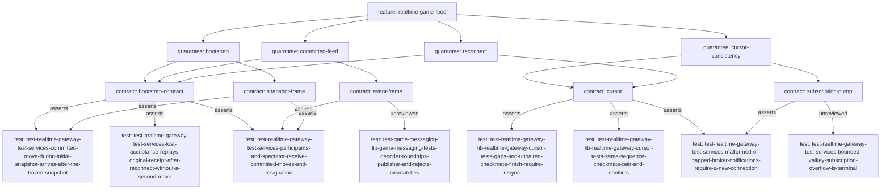

# 対局の初期局面と確定イベントのリアルタイム配信

このページは `python3 scripts/traceability.py render` で生成する。

元データは [crates/realtime-gateway/src/trace/realtime-game-feed/feature.rs](../../../crates/realtime-gateway/src/trace/realtime-game-feed/feature.rs)。
[全機能の一覧](../feature-traceability.md)。

## 対象機能

| ID | 機能 | 仕様 |
| --- | --- | --- |
| realtime-game-feed | 対局の初期局面と確定イベントのリアルタイム配信 | [crates/realtime-gateway/src/lib.rs](../../../crates/realtime-gateway/src/lib.rs#L502) |

## 保証の成立条件と構成

1. After authenticated upgrade and access checks, run_connection establishes the Valkey subscription before requesting the viewer snapshot and buffers arriving committed notifications.
2. The snapshot is queued first; a per-connection cursor ignores pre-boundary/duplicate events and accepts only consistent contiguous committed events, including the same-sequence checkmate pair.
3. The writer rechecks session/game access before each outgoing frame. Browser events omit internal command user/request IDs; gaps, malformed subscription input or overflow terminate the connection.
4. A reconnect obtains a fresh snapshot. A client may retry the original command identity to recover acceptance, while there is no durable browser event replay.

以下の保証には、各行に示す契約が必要となる。テストの assertions は記載した事例の範囲に限られる。

| ID | アプリケーションの保証と条件 | 必要な契約 |
| --- | --- | --- |
| bootstrap | A connection subscribes before freezing the viewer snapshot, sends snapshot first and then delivers later committed events without losing the subscribe/snapshot race. | [bootstrap-contract](#contract-bootstrap-contract), [snapshot-frame](#contract-snapshot-frame) |
| committed-feed | Participants and authenticated public spectators receive committed moves and final results. Event JSON exposes game/sequence/action/result and omits internal user_id/request_id. | [event-frame](#contract-event-frame), [bootstrap-contract](#contract-bootstrap-contract) |
| cursor-consistency | Exact duplicates and events at/before snapshot boundary are ignored. Gaps or conflicting same-sequence facts require a new connection; a matching mate move and finish share one sequence and deliver in order. | [cursor](#contract-cursor), [subscription-pump](#contract-subscription-pump) |
| reconnect | Reconnect uses a fresh current snapshot and can replay the original command acceptance without creating a second move/event. No durable browser replay is provided. | [bootstrap-contract](#contract-bootstrap-contract), [cursor](#contract-cursor) |

## 宣言した対応関係

矢印は著者が宣言した関係を示す。asserts は記載した事例への直接の assertion、exercises は処理を通る関係を示す。



## コンポーネント契約と根拠

<a id="contract-bootstrap-contract"></a>

### bootstrap-contract

run_connection subscribes and pumps before viewer snapshot, validates and queues snapshot first, initializes cursor at its sequence and drives queued notifications through that cursor.

実装位置: [crates/realtime-gateway/src/lib.rs](../../../crates/realtime-gateway/src/lib.rs#L502)。

- [test-realtime-gateway-test-services-committed-move-during-initial-snapshot-arrives-after-the-frozen-snapshot](#test-test-realtime-gateway-test-services-committed-move-during-initial-snapshot-arrives-after-the-frozen-snapshot) (asserts): Holds frozen seq-0 snapshot, verifies real subscriber, commits/publishes seq 1, then receives snapshot 0 followed by event 1.
- [test-realtime-gateway-test-services-lost-acceptance-replays-original-receipt-after-reconnect-without-a-second-move](#test-test-realtime-gateway-test-services-lost-acceptance-replays-original-receipt-after-reconnect-without-a-second-move) (asserts): Reconnect snapshot is seq 1 and retry returns original accepted seq 1 with one persisted event.
- [test-realtime-gateway-test-services-participants-and-spectator-receive-committed-moves-and-resignation](#test-test-realtime-gateway-test-services-participants-and-spectator-receive-committed-moves-and-resignation) (asserts): Three real WebSockets receive initial snapshot, two committed moves and resignation.

未検証: No live broker disconnect/reconnect end-to-end assertion proves every subscription-loss path; reconnect does not replay a durable event log.

<a id="contract-cursor"></a>

### cursor

ConnectionState accepts only contiguous coherent committed facts, drops exact duplicates/old boundary events and checks same-sequence mate-finish agreement.

実装位置: [crates/realtime-gateway/src/cursor.rs](../../../crates/realtime-gateway/src/cursor.rs#L38)。

- [test-realtime-gateway-lib-realtime-gateway-cursor-tests-gaps-and-unpaired-checkmate-finish-require-resync](#test-test-realtime-gateway-lib-realtime-gateway-cursor-tests-gaps-and-unpaired-checkmate-finish-require-resync) (asserts): Old boundary event ignores; unpaired mate finish and sequence gap resync.
- [test-realtime-gateway-lib-realtime-gateway-cursor-tests-same-sequence-checkmate-pair-and-conflicts](#test-test-realtime-gateway-lib-realtime-gateway-cursor-tests-same-sequence-checkmate-pair-and-conflicts) (asserts): Move then matching mate finish deliver, exact duplicates ignore and conflicting same-sequence move resyncs.
- [test-realtime-gateway-test-services-malformed-or-gapped-broker-notifications-require-a-new-connection](#test-test-realtime-gateway-test-services-malformed-or-gapped-broker-notifications-require-a-new-connection) (asserts): Real malformed schema and gapped published event terminate the WebSocket.

未検証: No real WebSocket checkmate pair assertion; direct cursor tests use synthetic committed notifications. The close helper allows either resync_required then close or immediate close.

<a id="contract-event-frame"></a>

### event-frame

event_json emits stable event identity with game/sequence/kind and move/result fields, omitting internal user and request IDs.

実装位置: [crates/realtime-gateway/src/cursor.rs](../../../crates/realtime-gateway/src/cursor.rs#L110)。

- [test-game-messaging-lib-game-messaging-tests-decoder-roundtrips-publisher-and-rejects-mismatches](#test-test-game-messaging-lib-game-messaging-tests-decoder-roundtrips-publisher-and-rejects-mismatches) (unreviewed): Directory ownership declares this test belongs to the contract; execution of the implementation and strength of assertions require review.
- [test-realtime-gateway-test-services-participants-and-spectator-receive-committed-moves-and-resignation](#test-test-realtime-gateway-test-services-participants-and-spectator-receive-committed-moves-and-resignation) (asserts): Players and spectator assert move/resignation kinds, USI/results, and absence of user_id/request_id.

未検証: No direct assertion proves the hex event_id encoding or uniqueness across all game identifiers.

<a id="contract-snapshot-frame"></a>

### snapshot-frame

snapshot_json converts viewer snapshot to string sequence, owned board/hands, turn/check/result/legal moves and permanent participant bindings, rejecting invalid upstream enum/sequence values.

実装位置: [crates/realtime-gateway/src/game.rs](../../../crates/realtime-gateway/src/game.rs#L242)。

- [test-realtime-gateway-test-services-committed-move-during-initial-snapshot-arrives-after-the-frozen-snapshot](#test-test-realtime-gateway-test-services-committed-move-during-initial-snapshot-arrives-after-the-frozen-snapshot) (asserts): Snapshot sequence zero is observed before the later move frame.
- [test-realtime-gateway-test-services-participants-and-spectator-receive-committed-moves-and-resignation](#test-test-realtime-gateway-test-services-participants-and-spectator-receive-committed-moves-and-resignation) (asserts): All connected participants and spectator receive snapshot frames with expected game_id/sequence.

未検証: Selected WebSocket assertions do not compare every board/hand field or malformed upstream conversion branch; full snapshot component values are covered in game-snapshots-access.

<a id="contract-subscription-pump"></a>

### subscription-pump

The pump forwards subscription results through a bounded queue and stops on failure or queue exhaustion; run_connection treats exhausted/lost notifications as terminal.

実装位置: [crates/realtime-gateway/src/lib.rs](../../../crates/realtime-gateway/src/lib.rs#L384)。

- [test-realtime-gateway-test-services-bounded-valkey-subscription-overflow-is-terminal](#test-test-realtime-gateway-test-services-bounded-valkey-subscription-overflow-is-terminal) (unreviewed): Directory ownership declares this test belongs to the contract; execution of the implementation and strength of assertions require review.
- [test-realtime-gateway-test-services-malformed-or-gapped-broker-notifications-require-a-new-connection](#test-test-realtime-gateway-test-services-malformed-or-gapped-broker-notifications-require-a-new-connection) (asserts): WebSocket closes on malformed schema or gap, exercising the pump and asserting the connection-level failure response.

未検証: No selected assertion directly fills the gateway pump queue. Slow-browser output backlog and writer timeout lack dedicated assertions.

## 実在するテストと実行コマンド

コマンドは個別テストを厳密一致で選択する。保存層テストには TEST_DATABASE_URL と TEST_VALKEY_URL が必要な場合がある。

<a id="test-test-game-messaging-lib-game-messaging-tests-decoder-roundtrips-publisher-and-rejects-mismatches"></a>

### test-game-messaging-lib-game-messaging-tests-decoder-roundtrips-publisher-and-rejects-mismatches

テスト位置: [crates/game-messaging/src/trace/realtime-game-feed/event-frame/decoder_roundtrips_publisher_and_rejects_mismatches.rs](../../../crates/game-messaging/src/trace/realtime-game-feed/event-frame/decoder_roundtrips_publisher_and_rejects_mismatches.rs#L2)。

範囲: Contract-directory membership only; runtime dependencies and assertions have not been reviewed.

```sh
cargo test --locked -p game-messaging --lib tests::decoder_roundtrips_publisher_and_rejects_mismatches -- --exact --format pretty --color never
```

<a id="test-test-realtime-gateway-lib-realtime-gateway-cursor-tests-gaps-and-unpaired-checkmate-finish-require-resync"></a>

### test-realtime-gateway-lib-realtime-gateway-cursor-tests-gaps-and-unpaired-checkmate-finish-require-resync

テスト位置: [crates/realtime-gateway/src/trace/realtime-game-feed/cursor/gaps_and_unpaired_checkmate_finish_require_resync.rs](../../../crates/realtime-gateway/src/trace/realtime-game-feed/cursor/gaps_and_unpaired_checkmate_finish_require_resync.rs#L9)。

範囲: Direct cursor boundary/gap fixtures; no broker or socket.

```sh
cargo test --locked -p realtime-gateway --lib cursor::tests::gaps_and_unpaired_checkmate_finish_require_resync -- --exact --format pretty --color never
```

<a id="test-test-realtime-gateway-lib-realtime-gateway-cursor-tests-same-sequence-checkmate-pair-and-conflicts"></a>

### test-realtime-gateway-lib-realtime-gateway-cursor-tests-same-sequence-checkmate-pair-and-conflicts

テスト位置: [crates/realtime-gateway/src/trace/realtime-game-feed/cursor/same_sequence_checkmate_pair_and_conflicts.rs](../../../crates/realtime-gateway/src/trace/realtime-game-feed/cursor/same_sequence_checkmate_pair_and_conflicts.rs#L9)。

範囲: Direct cursor state transitions over synthetic committed notifications; no socket or played mate.

```sh
cargo test --locked -p realtime-gateway --lib cursor::tests::same_sequence_checkmate_pair_and_conflicts -- --exact --format pretty --color never
```

<a id="test-test-realtime-gateway-test-services-bounded-valkey-subscription-overflow-is-terminal"></a>

### test-realtime-gateway-test-services-bounded-valkey-subscription-overflow-is-terminal

テスト位置: [crates/realtime-gateway/tests/trace/realtime-game-feed/subscription-pump/bounded_valkey_subscription_overflow_is_terminal.rs](../../../crates/realtime-gateway/tests/trace/realtime-game-feed/subscription-pump/bounded_valkey_subscription_overflow_is_terminal.rs#L2)。

範囲: Contract-directory membership only; runtime dependencies and assertions have not been reviewed.

```sh
cargo test --locked -p realtime-gateway --test services bounded_valkey_subscription_overflow_is_terminal -- --exact --format pretty --color never
```

<a id="test-test-realtime-gateway-test-services-committed-move-during-initial-snapshot-arrives-after-the-frozen-snapshot"></a>

### test-realtime-gateway-test-services-committed-move-during-initial-snapshot-arrives-after-the-frozen-snapshot

テスト位置: [crates/realtime-gateway/tests/trace/realtime-game-feed/bootstrap-contract/committed_move_during_initial_snapshot_arrives_after_the_frozen_snapshot.rs](../../../crates/realtime-gateway/tests/trace/realtime-game-feed/bootstrap-contract/committed_move_during_initial_snapshot_arrives_after_the_frozen_snapshot.rs#L9)。

範囲: Real HTTP/WebSocket gateway, user HTTP service, game gRPC service, PostgreSQL and Valkey; external OIDC provider is a fixture. SnapshotHold freezes initial response while a real subscriber receives a commit.

```sh
cargo test --locked -p realtime-gateway --test services committed_move_during_initial_snapshot_arrives_after_the_frozen_snapshot -- --exact --format pretty --color never
```

<a id="test-test-realtime-gateway-test-services-lost-acceptance-replays-original-receipt-after-reconnect-without-a-second-move"></a>

### test-realtime-gateway-test-services-lost-acceptance-replays-original-receipt-after-reconnect-without-a-second-move

テスト位置: [crates/realtime-gateway/tests/trace/realtime-game-feed/bootstrap-contract/lost_acceptance_replays_original_receipt_after_reconnect_without_a_second_move.rs](../../../crates/realtime-gateway/tests/trace/realtime-game-feed/bootstrap-contract/lost_acceptance_replays_original_receipt_after_reconnect_without_a_second_move.rs#L9)。

範囲: Real HTTP/WebSocket gateway, user HTTP service, game gRPC service, PostgreSQL and Valkey; external OIDC provider is a fixture. Drops connection after durable acceptance and retries original identity.

```sh
cargo test --locked -p realtime-gateway --test services lost_acceptance_replays_original_receipt_after_reconnect_without_a_second_move -- --exact --format pretty --color never
```

<a id="test-test-realtime-gateway-test-services-malformed-or-gapped-broker-notifications-require-a-new-connection"></a>

### test-realtime-gateway-test-services-malformed-or-gapped-broker-notifications-require-a-new-connection

テスト位置: [crates/realtime-gateway/tests/trace/realtime-game-feed/cursor/malformed_or_gapped_broker_notifications_require_a_new_connection.rs](../../../crates/realtime-gateway/tests/trace/realtime-game-feed/cursor/malformed_or_gapped_broker_notifications_require_a_new_connection.rs#L9)。

範囲: Real HTTP/WebSocket gateway, user HTTP service, game gRPC service, PostgreSQL and Valkey; external OIDC provider is a fixture. Publishes controlled invalid/gapped notifications directly.

```sh
cargo test --locked -p realtime-gateway --test services malformed_or_gapped_broker_notifications_require_a_new_connection -- --exact --format pretty --color never
```

<a id="test-test-realtime-gateway-test-services-participants-and-spectator-receive-committed-moves-and-resignation"></a>

### test-realtime-gateway-test-services-participants-and-spectator-receive-committed-moves-and-resignation

テスト位置: [crates/realtime-gateway/tests/trace/realtime-game-feed/bootstrap-contract/participants_and_spectator_receive_committed_moves_and_resignation.rs](../../../crates/realtime-gateway/tests/trace/realtime-game-feed/bootstrap-contract/participants_and_spectator_receive_committed_moves_and_resignation.rs#L9)。

範囲: Real HTTP/WebSocket gateway, user HTTP service, game gRPC service, PostgreSQL and Valkey; external OIDC provider is a fixture.

```sh
cargo test --locked -p realtime-gateway --test services participants_and_spectator_receive_committed_moves_and_resignation -- --exact --format pretty --color never
```

## 検査と根拠の限界

check はグラフ、ファイル内の一意なテキスト位置、package と target ごとのコンパイル済みテスト名、生成文書の一致を検査する。
run は check の後に共有された Cargo テストを一度ずつ実行し、厳密一致の 1 件が成功し、失敗と無視が 0 件であることを検査する。
この文書には実行済みの成功状態を保存しない。CI の workspace テスト実行結果は、その実行時点の結果となる。
宣言した関連の意味と網羅性はレビューが必要となる。検出できる関連の削除は、必須の関連数、参照先、孤立ノードの規則に違反するものに限られる。

- Notifications are transient. Browser reconnect receives a fresh snapshot, and acceptance recovery uses exact command retry; no durable client event replay is promised.
- A terminal connection may close before resync_required reaches the peer, as allowed by the shared close assertion.
- Outbox publication/subscriber protocol internals belong to separate messaging feature records; this graph traces consumption into browser behavior.
- Links and passing tests do not establish semantic completeness; changes to guarantees, evidence strength and decomposition require review.

## ディレクトリ方式の検査範囲

Rust 宣言、通常のモジュールとリテラル include! から物理ファイルの所属、package、target、完全なテスト名と位置を抽出する。ホストのデフォルト Cargo feature 構成で workspace の lib、bin、integration test の全テスト一覧と一致させる。別 target、feature、cfg の組合せは対象外。
src/trace/<feature> と tests/trace/<feature> は新規機能も探索し、未宣言または未到達のファイルを拒否する。契約内の通常テストは unreviewed として追加する。asserts または exercises のレビュー済み根拠がない契約には gap が必要。
全 target の未分類テストは拒否する。trace ディレクトリ内の未対応の item macro と cfg は直接拒否し、外側の未対応構文が生成した実行対象テストはコンパイル済み一覧との差として拒否する。テスト補助とインフラの明示分類および理由は全機能の一覧に示す。
