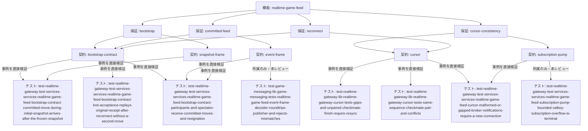

# 対局の初期局面と確定イベントのリアルタイム配信

このページは `python3 scripts/traceability.py render` で生成する。

元データは [crates/realtime-gateway/src/trace/realtime-game-feed/feature.rs](../../../crates/realtime-gateway/src/trace/realtime-game-feed/feature.rs)。
[全機能の一覧](../feature-traceability.md)。

## 対象機能

| ID | 機能 | 仕様 |
| --- | --- | --- |
| realtime-game-feed | 対局の初期局面と確定イベントのリアルタイム配信 | [crates/realtime-gateway/src/lib.rs](../../../crates/realtime-gateway/src/lib.rs#L502) |

## 保証の成立条件と構成

1. 認証済みのアップグレードとアクセス確認の後、run_connectionは閲覧者用スナップショットを要求する前にValkeyの購読を確立し、到着したコミット済み通知をバッファーに保持する。
2. 先にスナップショットを出力キューへ入れる。接続ごとのカーソルは境界以前のイベントと重複を無視し、同じ連番の詰みの組を含め、整合した連続するコミット済みイベントだけを受け入れる。
3. 書き込み処理は、各フレームを送る前にセッション・対局へのアクセスを再確認する。ブラウザー向けイベントには、内部のコマンドのユーザーID・リクエストIDを含めない。連番の欠落、不正な購読入力、上限超過で接続を終了する。
4. 再接続では最新のスナップショットを取得する。クライアントは元のコマンドの識別情報で再試行して受理結果を回復できるが、ブラウザー向けの永続的なイベント再送は行わない。

以下の保証には、各行に示す契約が必要となる。テストによる検証は記載した事例の範囲に限られる。

| ID | アプリケーションの保証と条件 | 必要な契約 |
| --- | --- | --- |
| bootstrap | 接続は閲覧者用スナップショットを確定する前に購読を開始する。先にスナップショットを送り、その後のコミット済みイベントを配信し、購読開始とスナップショット取得の競合による取りこぼしを防ぐ。 | [bootstrap-contract](#contract-bootstrap-contract), [snapshot-frame](#contract-snapshot-frame) |
| committed-feed | 参加者と認証済みの公開対局の観戦者は、コミット済みの着手と終局結果を受信する。イベントJSONは対局・連番・操作・結果を公開し、内部のuser_id・request_idを含めない。 | [event-frame](#contract-event-frame), [bootstrap-contract](#contract-bootstrap-contract) |
| cursor-consistency | 完全に同じ重複イベントとスナップショット境界以前のイベントを無視する。連番の欠落や同じ連番で競合する内容を検出すると、再接続が必要となる。対応する詰みの着手と終局イベントは同じ連番を使い、順番に配信する。 | [cursor](#contract-cursor), [subscription-pump](#contract-subscription-pump) |
| reconnect | 再接続では最新のスナップショットを取得し、2度目の着手・イベントを作らずに元のコマンド受理結果を再取得できる。ブラウザー向けの永続的なイベント再送は提供しない。 | [bootstrap-contract](#contract-bootstrap-contract), [cursor](#contract-cursor) |

## 宣言した対応関係

矢印は著者が宣言した関係を示す。「事例を直接検証」は記載した事例を直接確かめる関係、「処理を通る」は対象の処理を実行する関係を示す。「所属のみ・未レビュー」は契約ディレクトリへの配置だけで分類した関係を示す。



## コンポーネント契約と根拠

<a id="contract-bootstrap-contract"></a>

### bootstrap-contract

run_connectionは閲覧者用スナップショットの取得前に購読と通知転送を開始する。スナップショットを検証して最初にキューへ入れ、その連番でカーソルを初期化し、蓄積した通知をカーソルに通す。

実装位置: [crates/realtime-gateway/src/lib.rs](../../../crates/realtime-gateway/src/lib.rs#L502)。

- [test-realtime-gateway-test-services-services-realtime-game-feed-bootstrap-contract-committed-move-during-initial-snapshot-arrives-after-the-frozen-snapshot](#test-test-realtime-gateway-test-services-services-realtime-game-feed-bootstrap-contract-committed-move-during-initial-snapshot-arrives-after-the-frozen-snapshot) (事例を直接検証): 連番0のスナップショットを確定した状態で保留し、実際の購読者を確認する。連番1をコミット・配信した後、スナップショット0、イベント1の順に受信する。
- [test-realtime-gateway-test-services-services-realtime-game-feed-bootstrap-contract-lost-acceptance-replays-original-receipt-after-reconnect-without-a-second-move](#test-test-realtime-gateway-test-services-services-realtime-game-feed-bootstrap-contract-lost-acceptance-replays-original-receipt-after-reconnect-without-a-second-move) (事例を直接検証): 再接続時のスナップショットは連番1で、再試行は元の受理済み連番1を返し、永続化されたイベントは1件となる。
- [test-realtime-gateway-test-services-services-realtime-game-feed-bootstrap-contract-participants-and-spectator-receive-committed-moves-and-resignation](#test-test-realtime-gateway-test-services-services-realtime-game-feed-bootstrap-contract-participants-and-spectator-receive-committed-moves-and-resignation) (事例を直接検証): 実際の3本のWebSocketが、初期スナップショット、コミット済みの着手2件、投了を受信する。

未検証: 稼働中のブローカーの切断・再接続を通して、購読喪失の全経路を確認する端から端までの検証はない。再接続では永続イベントログを再送しない。

<a id="contract-cursor"></a>

### cursor

ConnectionStateは連続して整合するコミット済みの内容だけを受け入れ、完全に同じ重複と古い境界イベントを破棄し、同じ連番の詰みの着手と終局の一致を確認する。

実装位置: [crates/realtime-gateway/src/cursor.rs](../../../crates/realtime-gateway/src/cursor.rs#L38)。

- [test-realtime-gateway-lib-realtime-gateway-cursor-tests-gaps-and-unpaired-checkmate-finish-require-resync](#test-test-realtime-gateway-lib-realtime-gateway-cursor-tests-gaps-and-unpaired-checkmate-finish-require-resync) (事例を直接検証): 古い境界イベントは無視し、対応する着手がない詰みの終局と連番の欠落では再同期を求める。
- [test-realtime-gateway-lib-realtime-gateway-cursor-tests-same-sequence-checkmate-pair-and-conflicts](#test-test-realtime-gateway-lib-realtime-gateway-cursor-tests-same-sequence-checkmate-pair-and-conflicts) (事例を直接検証): 着手と対応する詰みの終局を順に配信し、完全に同じ重複を無視し、同じ連番で競合する着手では再同期を求める。
- [test-realtime-gateway-test-services-services-realtime-game-feed-cursor-malformed-or-gapped-broker-notifications-require-a-new-connection](#test-test-realtime-gateway-test-services-services-realtime-game-feed-cursor-malformed-or-gapped-broker-notifications-require-a-new-connection) (事例を直接検証): 実際に配信した不正なスキーマと連番が欠落したイベントによって、WebSocketが終了する。

未検証: 実際のWebSocketで詰みの組を検証するテストはない。カーソルの直接テストは人工的なコミット済み通知を使う。接続終了用の補助処理は、resync_requiredの後の切断と即時切断のどちらも許可する。

<a id="contract-event-frame"></a>

### event-frame

event_jsonは、対局・連番・種別と着手・結果のフィールドを持つ安定したイベント識別情報を出力し、内部のユーザーIDとリクエストIDを含めない。

実装位置: [crates/realtime-gateway/src/cursor.rs](../../../crates/realtime-gateway/src/cursor.rs#L110)。

- [test-game-messaging-lib-game-messaging-tests-realtime-game-feed-event-frame-decoder-roundtrips-publisher-and-rejects-mismatches](#test-test-game-messaging-lib-game-messaging-tests-realtime-game-feed-event-frame-decoder-roundtrips-publisher-and-rejects-mismatches) (所属のみ・未レビュー): 配置先からこのテストの契約への所属を宣言している。実装を実行することと検証の十分さはレビューが必要。
- [test-realtime-gateway-test-services-services-realtime-game-feed-bootstrap-contract-participants-and-spectator-receive-committed-moves-and-resignation](#test-test-realtime-gateway-test-services-services-realtime-game-feed-bootstrap-contract-participants-and-spectator-receive-committed-moves-and-resignation) (事例を直接検証): 対局者と観戦者が、着手・投了の種別、USI・結果、user_id・request_idが含まれないことを検証する。

未検証: event_idの16進エンコードや、すべての対局識別子に対する一意性を証明する直接の検証はない。

<a id="contract-snapshot-frame"></a>

### snapshot-frame

snapshot_jsonは閲覧者用スナップショットを、文字列の連番、所有権を持つ盤面・持ち駒、手番・王手・結果・合法手、固定された参加者の割り当てに変換する。上流の不正な列挙値・連番は拒否する。

実装位置: [crates/realtime-gateway/src/game.rs](../../../crates/realtime-gateway/src/game.rs#L242)。

- [test-realtime-gateway-test-services-services-realtime-game-feed-bootstrap-contract-committed-move-during-initial-snapshot-arrives-after-the-frozen-snapshot](#test-test-realtime-gateway-test-services-services-realtime-game-feed-bootstrap-contract-committed-move-during-initial-snapshot-arrives-after-the-frozen-snapshot) (事例を直接検証): 後続の着手フレームより先に、連番0のスナップショットを受信する。
- [test-realtime-gateway-test-services-services-realtime-game-feed-bootstrap-contract-participants-and-spectator-receive-committed-moves-and-resignation](#test-test-realtime-gateway-test-services-services-realtime-game-feed-bootstrap-contract-participants-and-spectator-receive-committed-moves-and-resignation) (事例を直接検証): 接続した参加者全員と観戦者が、期待したgame_id・連番を持つスナップショットフレームを受信する。

未検証: 選択したWebSocketの検証では、盤面・持ち駒の全フィールドや、上流の不正な値を変換する全分岐を比較しない。スナップショットを構成する値全体はgame-snapshots-accessで扱う。

<a id="contract-subscription-pump"></a>

### subscription-pump

通知の転送処理は、上限付きキューを通して購読結果を渡し、障害やキューの枯渇で停止する。run_connectionは通知の枯渇・欠落を接続終了の条件として扱う。

実装位置: [crates/realtime-gateway/src/lib.rs](../../../crates/realtime-gateway/src/lib.rs#L384)。

- [test-realtime-gateway-test-services-services-realtime-game-feed-cursor-malformed-or-gapped-broker-notifications-require-a-new-connection](#test-test-realtime-gateway-test-services-services-realtime-game-feed-cursor-malformed-or-gapped-broker-notifications-require-a-new-connection) (事例を直接検証): 不正なスキーマや連番の欠落でWebSocketが閉じることを確認する。通知の転送処理を通し、接続単位の障害応答を検証する。
- [test-realtime-gateway-test-services-services-realtime-game-feed-subscription-pump-bounded-valkey-subscription-overflow-is-terminal](#test-test-realtime-gateway-test-services-services-realtime-game-feed-subscription-pump-bounded-valkey-subscription-overflow-is-terminal) (所属のみ・未レビュー): 配置先からこのテストの契約への所属を宣言している。実装を実行することと検証の十分さはレビューが必要。

未検証: 選択した検証には、ゲートウェイの通知転送キューを直接満杯にするものはない。遅いブラウザーによる送信待ちの蓄積と書き込みのタイムアウトにも専用の検証はない。

## 実在するテストと実行コマンド

コマンドは個別テストを厳密一致で選択する。保存層テストには TEST_DATABASE_URL と TEST_VALKEY_URL が必要な場合がある。

<a id="test-test-game-messaging-lib-game-messaging-tests-realtime-game-feed-event-frame-decoder-roundtrips-publisher-and-rejects-mismatches"></a>

### test-game-messaging-lib-game-messaging-tests-realtime-game-feed-event-frame-decoder-roundtrips-publisher-and-rejects-mismatches

テスト位置: [crates/game-messaging/src/trace/realtime-game-feed/event-frame/tests.rs](../../../crates/game-messaging/src/trace/realtime-game-feed/event-frame/tests.rs#L4)。

範囲: 契約ディレクトリへの所属のみを示す。実行時の依存関係と検証内容は未レビュー。

```sh
cargo test --locked -p game-messaging --lib tests::realtime_game_feed_event_frame::decoder_roundtrips_publisher_and_rejects_mismatches -- --exact --format pretty --color never
```

<a id="test-test-realtime-gateway-lib-realtime-gateway-cursor-tests-gaps-and-unpaired-checkmate-finish-require-resync"></a>

### test-realtime-gateway-lib-realtime-gateway-cursor-tests-gaps-and-unpaired-checkmate-finish-require-resync

テスト位置: [crates/realtime-gateway/src/trace/realtime-game-feed/cursor/tests.rs](../../../crates/realtime-gateway/src/trace/realtime-game-feed/cursor/tests.rs#L61)。

範囲: カーソルの境界・連番欠落を直接検証するテスト用データ。ブローカーやソケットは使わない。

```sh
cargo test --locked -p realtime-gateway --lib cursor::tests::gaps_and_unpaired_checkmate_finish_require_resync -- --exact --format pretty --color never
```

<a id="test-test-realtime-gateway-lib-realtime-gateway-cursor-tests-same-sequence-checkmate-pair-and-conflicts"></a>

### test-realtime-gateway-lib-realtime-gateway-cursor-tests-same-sequence-checkmate-pair-and-conflicts

テスト位置: [crates/realtime-gateway/src/trace/realtime-game-feed/cursor/tests.rs](../../../crates/realtime-gateway/src/trace/realtime-game-feed/cursor/tests.rs#L21)。

範囲: 人工的なコミット済み通知を使ったカーソルの状態遷移の直接検証。ソケットも、詰みに至る実際の手順も使わない。

```sh
cargo test --locked -p realtime-gateway --lib cursor::tests::same_sequence_checkmate_pair_and_conflicts -- --exact --format pretty --color never
```

<a id="test-test-realtime-gateway-test-services-services-realtime-game-feed-bootstrap-contract-committed-move-during-initial-snapshot-arrives-after-the-frozen-snapshot"></a>

### test-realtime-gateway-test-services-services-realtime-game-feed-bootstrap-contract-committed-move-during-initial-snapshot-arrives-after-the-frozen-snapshot

テスト位置: [crates/realtime-gateway/tests/trace/realtime-game-feed/bootstrap-contract/tests.rs](../../../crates/realtime-gateway/tests/trace/realtime-game-feed/bootstrap-contract/tests.rs#L11)。

範囲: 実際のHTTP・WebSocketゲートウェイ、ユーザー用HTTPサービス、対局用gRPCサービス、PostgreSQL、Valkeyを使う。外部OIDCプロバイダーはテスト用の代替実装を使う。 実際の購読者がコミットを受信する間、SnapshotHoldで初期応答を保留する。

```sh
cargo test --locked -p realtime-gateway --test services services::realtime_game_feed_bootstrap_contract::committed_move_during_initial_snapshot_arrives_after_the_frozen_snapshot -- --exact --format pretty --color never
```

<a id="test-test-realtime-gateway-test-services-services-realtime-game-feed-bootstrap-contract-lost-acceptance-replays-original-receipt-after-reconnect-without-a-second-move"></a>

### test-realtime-gateway-test-services-services-realtime-game-feed-bootstrap-contract-lost-acceptance-replays-original-receipt-after-reconnect-without-a-second-move

テスト位置: [crates/realtime-gateway/tests/trace/realtime-game-feed/bootstrap-contract/tests.rs](../../../crates/realtime-gateway/tests/trace/realtime-game-feed/bootstrap-contract/tests.rs#L127)。

範囲: 実際のHTTP・WebSocketゲートウェイ、ユーザー用HTTPサービス、対局用gRPCサービス、PostgreSQL、Valkeyを使う。外部OIDCプロバイダーはテスト用の代替実装を使う。 永続化された受理の後に接続を切り、元の識別情報で再試行する。

```sh
cargo test --locked -p realtime-gateway --test services services::realtime_game_feed_bootstrap_contract::lost_acceptance_replays_original_receipt_after_reconnect_without_a_second_move -- --exact --format pretty --color never
```

<a id="test-test-realtime-gateway-test-services-services-realtime-game-feed-bootstrap-contract-participants-and-spectator-receive-committed-moves-and-resignation"></a>

### test-realtime-gateway-test-services-services-realtime-game-feed-bootstrap-contract-participants-and-spectator-receive-committed-moves-and-resignation

テスト位置: [crates/realtime-gateway/tests/trace/realtime-game-feed/bootstrap-contract/tests.rs](../../../crates/realtime-gateway/tests/trace/realtime-game-feed/bootstrap-contract/tests.rs#L69)。

範囲: 実際のHTTP・WebSocketゲートウェイ、ユーザー用HTTPサービス、対局用gRPCサービス、PostgreSQL、Valkeyを使う。外部OIDCプロバイダーはテスト用の代替実装を使う。

```sh
cargo test --locked -p realtime-gateway --test services services::realtime_game_feed_bootstrap_contract::participants_and_spectator_receive_committed_moves_and_resignation -- --exact --format pretty --color never
```

<a id="test-test-realtime-gateway-test-services-services-realtime-game-feed-cursor-malformed-or-gapped-broker-notifications-require-a-new-connection"></a>

### test-realtime-gateway-test-services-services-realtime-game-feed-cursor-malformed-or-gapped-broker-notifications-require-a-new-connection

テスト位置: [crates/realtime-gateway/tests/trace/realtime-game-feed/cursor/tests.rs](../../../crates/realtime-gateway/tests/trace/realtime-game-feed/cursor/tests.rs#L11)。

範囲: 実際のHTTP・WebSocketゲートウェイ、ユーザー用HTTPサービス、対局用gRPCサービス、PostgreSQL、Valkeyを使う。外部OIDCプロバイダーはテスト用の代替実装を使う。 不正な通知や連番が欠落した通知を、制御した内容で直接配信する。

```sh
cargo test --locked -p realtime-gateway --test services services::realtime_game_feed_cursor::malformed_or_gapped_broker_notifications_require_a_new_connection -- --exact --format pretty --color never
```

<a id="test-test-realtime-gateway-test-services-services-realtime-game-feed-subscription-pump-bounded-valkey-subscription-overflow-is-terminal"></a>

### test-realtime-gateway-test-services-services-realtime-game-feed-subscription-pump-bounded-valkey-subscription-overflow-is-terminal

テスト位置: [crates/realtime-gateway/tests/trace/realtime-game-feed/subscription-pump/tests.rs](../../../crates/realtime-gateway/tests/trace/realtime-game-feed/subscription-pump/tests.rs#L4)。

範囲: 契約ディレクトリへの所属のみを示す。実行時の依存関係と検証内容は未レビュー。

```sh
cargo test --locked -p realtime-gateway --test services services::realtime_game_feed_subscription_pump::bounded_valkey_subscription_overflow_is_terminal -- --exact --format pretty --color never
```

## 検査と根拠の限界

check はグラフ、ファイル内の一意なテキスト位置、パッケージとターゲットごとのコンパイル済みテスト名、生成文書の一致を検査する。
run は check の後に共有された Cargo テストを一度ずつ実行し、厳密一致の 1 件が成功し、失敗と無視が 0 件であることを検査する。
この文書には実行済みの成功状態を保存しない。CI のワークスペース全体のテスト実行結果は、その実行時点の結果となる。
宣言した関連の意味と網羅性はレビューが必要となる。検出できる関連の削除は、必須の関連数、参照先、孤立ノードの規則に違反するものに限られる。

- 通知は一時的なものとする。ブラウザーの再接続では最新のスナップショットを取得し、受理結果は完全に同じコマンドの再試行で回復する。クライアント向けの永続的なイベント再送は保証しない。
- 共通の接続終了の検証が許すとおり、終了する接続では相手にresync_requiredが届く前に切断する場合がある。
- Outboxの配信と購読プロトコルの内部処理は、別のメッセージング機能の定義で扱う。このグラフでは、通知の消費からブラウザーの動作までを対応付ける。
- リンクの存在やテストの成功は、意味上の網羅性を証明しない。保証、根拠の強さ、機能の分割を変更する場合はレビューが必要となる。

## ディレクトリ方式の検査範囲

Rust 宣言、通常のモジュールと文字列リテラルの include! から物理ファイルの所属、パッケージ、ターゲット、完全なテスト名と位置を抽出する。ホスト環境で Cargo の既定の機能フラグを使い、ワークスペースのライブラリ、バイナリ、結合テストの全テスト一覧と一致させる。別のターゲット、機能フラグ、cfg の組合せは対象外。
src/trace/<feature> と tests/trace/<feature> は新規機能も探索し、未宣言または未到達のファイルを拒否する。契約内の通常テストは「所属のみ・未レビュー」として追加する。「事例を直接検証」または「処理を通る」のレビュー済み根拠がない契約には未検証事項の gap 宣言が必要。
全ターゲットの未分類テストは拒否する。trace ディレクトリ内の未対応の項目マクロと cfg は直接拒否し、外側の未対応構文が生成した実行対象テストはコンパイル済み一覧との差として拒否する。テスト実行補助と基盤の検査の明示分類および理由は全機能の一覧に示す。
