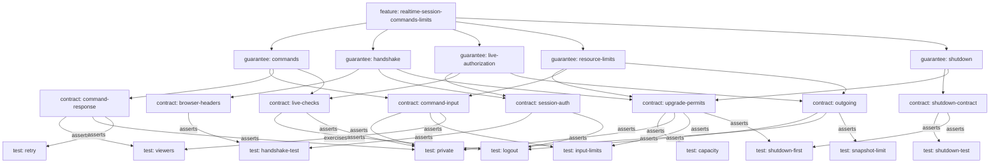

# WebSocket の認証・対局操作・資源制限

このページは `python3 scripts/traceability.py render` で生成する。

元データは [crates/realtime-gateway/src/realtime-session-commands-limits.trace.json](../../../crates/realtime-gateway/src/realtime-session-commands-limits.trace.json)。
[全機能の一覧](../feature-traceability.md)。

## 対象機能

| ID | 機能 | 仕様 |
| --- | --- | --- |
| realtime-session-commands-limits | WebSocket の認証・対局操作・資源制限 | [crates/realtime-gateway/src/lib.rs](../../../crates/realtime-gateway/src/lib.rs#L293) |

## 保証の成立条件と構成

1. Upgrade validates exact browser Origin/Host, optional same-site metadata and one supported shogi.realtime.v1 offer, then checks the session cookie with the user service and game access with GameService.
2. The reader validates strict move/resign JSON and canonical decimal sequence; one in-flight permit and bounded queues limit command work. The gateway supplies the authenticated user to the upstream command.
3. The command worker and writer recheck session/access before actions and outgoing frames; acceptance/errors become stable browser frames and uncertain outcomes require exact retry.
4. Connection/user permits, input byte/rate limits, snapshot/buffer bounds and timed upstream/output operations constrain connection work. Gateway shutdown rejects upgrades and closes active sockets.

以下の保証には、各行に示す契約が必要となる。テストの assertions は記載した事例の範囲に限られる。

| ID | アプリケーションの保証と条件 | 必要な契約 |
| --- | --- | --- |
| commands | Only strict move/resign commands are accepted; no caller user/side claim is accepted. expected_seq is a canonical decimal string through i64::MAX and the gateway supplies authenticated identity. Accepted and rejected commands use stable response codes; uncertain outcomes become outcome_unknown. | [command-input](#contract-command-input), [command-response](#contract-command-response), [live-checks](#contract-live-checks) |
| handshake | Upgrade requires exact Origin/Host, optional same-origin fetch metadata, exactly one supported subprotocol offer and one valid session cookie. Session authentication and game access precede upgrade. | [browser-headers](#contract-browser-headers), [session-auth](#contract-session-auth), [upgrade-permits](#contract-upgrade-permits) |
| live-authorization | Session and game access are rechecked before command dispatch and each outgoing frame. Logout/expiry or privacy loss closes the connection before further permitted delivery. | [session-auth](#contract-session-auth), [live-checks](#contract-live-checks), [outgoing](#contract-outgoing) |
| resource-limits | Total and per-user connections, input frame/message bytes/rate, one in-flight command, bounded notification/output queues, snapshot size and upstream/output deadlines constrain connection work. | [upgrade-permits](#contract-upgrade-permits), [command-input](#contract-command-input), [outgoing](#contract-outgoing) |
| shutdown | Gateway shutdown prevents new upgrades and closes existing connections, including shutdown before the first connection. Capacity is released after disconnect. | [shutdown-contract](#contract-shutdown-contract), [upgrade-permits](#contract-upgrade-permits) |

## 宣言した対応関係

矢印は著者が宣言した関係を示す。asserts は記載した事例への直接の assertion、exercises は処理を通る関係を示す。



## コンポーネント契約と根拠

<a id="contract-browser-headers"></a>

### browser-headers

browser_headers requires one exact Origin and Host, permits absent fetch-site or same-origin only and finds exactly one supported shogi.realtime.v1 offer.

実装位置: [crates/realtime-gateway/src/lib.rs](../../../crates/realtime-gateway/src/lib.rs#L271)。

- [handshake-test](#test-handshake-test) (asserts): Missing/evil/duplicate Origin, cross-site metadata and absent/wrong protocol reject with 403.

未検証: Not every Host, duplicate protocol and header normalization combination is explicitly asserted by this selected test.

<a id="contract-command-input"></a>

### command-input

The reader enforces frame/rate limits, strict command parsing, one in-flight command permit and a bounded queue. Parser rejects unknown fields and noncanonical decimal sequences/USI.

実装位置: [crates/realtime-gateway/src/lib.rs](../../../crates/realtime-gateway/src/lib.rs#L401)。

- [private](#test-private) (asserts): Forged user_id returns invalid_input with sequence still zero; spectator move/resign return not_participant.
- [input-limits](#test-input-limits) (asserts): Input byte limit 128 and rate one terminate abusive sockets while durable sequence remains zero.
- [viewers](#test-viewers) (exercises): Valid participant move and resign commands dispatch and return matching acceptance.

未検証: No parser table enumerates malformed decimal strings, oversized numeric values or all unknown fields. No dedicated busy/in-flight permit or command queue/output-overflow assertion.

<a id="contract-command-response"></a>

### command-response

command_reply maps acceptance and gRPC codes to accepted, invalid_input, not_participant, request_conflict, stale_seq/actual_seq, rejected or outcome_unknown; inaccessible/corrupt/internal upstream outcomes close.

実装位置: [crates/realtime-gateway/src/game.rs](../../../crates/realtime-gateway/src/game.rs#L179)。

- [viewers](#test-viewers) (asserts): Accepted request identity and sequence match participant commands.
- [private](#test-private) (asserts): Outsider move/resign produce not_participant.
- [retry](#test-retry) (asserts): Retry after reconnect returns original accepted sequence without duplicate event.

未検証: No selected gateway test directly asserts stale_seq metadata, request_conflict, rejected, outcome_unknown or all upstream status/invalid-result close mappings.

<a id="contract-live-checks"></a>

### live-checks

command_worker rechecks session and current game access before invoking upstream command using session.user.

実装位置: [crates/realtime-gateway/src/lib.rs](../../../crates/realtime-gateway/src/lib.rs#L472)。

- [logout](#test-logout) (asserts): Logout before sending move closes and leaves durable sequence zero.
- [private](#test-private) (asserts): Spectator cannot mutate or supply a participant identity.

未検証: No independent recheck-before-response race assertion or timed upstream mutation outcome test.

<a id="contract-outgoing"></a>

### outgoing

writer rechecks session/access before every frame and bounds send/close waits; bootstrap rejects a snapshot exceeding configured bytes and uses bounded output/notification channels.

実装位置: [crates/realtime-gateway/src/lib.rs](../../../crates/realtime-gateway/src/lib.rs#L347)。

- [logout](#test-logout) (asserts): Expired viewer closes before published resignation delivery.
- [private](#test-private) (asserts): Privacy revoked for existing spectator closes on the next event.
- [snapshot-limit](#test-snapshot-limit) (asserts): Snapshot bytes limit one closes without sending a partial position.

未検証: No slow-browser backlog, output write deadline, exhausted notification queue or snapshot upstream-timeout assertion. Snapshot limit is enforced in run_connection, which this evidence exercises.

<a id="contract-session-auth"></a>

### session-auth

AuthClient requires one correctly shaped cookie, calls the user service with response size/time limits and recheck requires the returned user to remain the session user.

実装位置: [crates/realtime-gateway/src/auth.rs](../../../crates/realtime-gateway/src/auth.rs#L87)。

- [handshake-test](#test-handshake-test) (asserts): Missing/duplicate/invalid/unknown session cookies reject upgrade with 401.
- [logout](#test-logout) (asserts): Actual logout before a command and expiry before a notification close sockets; subsequent upgrades are 401.

未検証: No dedicated assertion covers auth service outage/redirect/oversized profile, returned user mismatch or every cookie encoding branch.

<a id="contract-shutdown-contract"></a>

### shutdown-contract

shutdown stores a persistent stop signal; active connections watch it and upgrade refuses new work. wait_closed bounds waiting for all total permits.

実装位置: [crates/realtime-gateway/src/lib.rs](../../../crates/realtime-gateway/src/lib.rs#L228)。

- [shutdown-test](#test-shutdown-test) (asserts): Active socket closes and later upgrade returns 503.
- [shutdown-first](#test-shutdown-first) (asserts): The first upgrade after shutdown is rejected 503.

未検証: Tests exercise router/library shutdown, not actual executable Ctrl-C, configuration validation or its ten-second drain deadline; wait_closed deadline exhaustion is not separately asserted.

<a id="contract-upgrade-permits"></a>

### upgrade-permits

Upgrade authenticates/access-checks, checks shutdown before/after upstream calls, acquires total and per-user permits and configures frame/message limits; disconnect Drop releases capacity.

実装位置: [crates/realtime-gateway/src/lib.rs](../../../crates/realtime-gateway/src/lib.rs#L293)。

- [capacity](#test-capacity) (asserts): Total two/per-user one rejects excess with 429, and reconnect succeeds after disconnect.
- [private](#test-private) (asserts): Private outsider and absent game yield indistinguishable 404 upgrade status/body.
- [input-limits](#test-input-limits) (asserts): Oversized frames close without committing.
- [shutdown-first](#test-shutdown-first) (asserts): Shutdown before any connection makes first upgrade 503.

未検証: No dedicated race assertion covers shutdown during an upstream handshake. Capacity tests do not exhaust every in-flight handshake state.

## 実在するテストと実行コマンド

コマンドは個別テストを厳密一致で選択する。保存層テストには TEST_DATABASE_URL と TEST_VALKEY_URL が必要な場合がある。

<a id="test-capacity"></a>

### capacity

テスト位置: [crates/realtime-gateway/tests/services.rs](../../../crates/realtime-gateway/tests/services.rs#L902)。

範囲: Real HTTP/WebSocket gateway, user HTTP service, game gRPC service, PostgreSQL and Valkey; external OIDC provider is a fixture. Custom total/per-user limits.

```sh
cargo test --locked -p realtime-gateway --test services connection_and_user_limits_release_capacity_after_disconnect -- --exact --format pretty --color never
```

<a id="test-handshake-test"></a>

### handshake-test

テスト位置: [crates/realtime-gateway/tests/services.rs](../../../crates/realtime-gateway/tests/services.rs#L707)。

範囲: Real HTTP/WebSocket gateway, user HTTP service, game gRPC service, PostgreSQL and Valkey; external OIDC provider is a fixture.

```sh
cargo test --locked -p realtime-gateway --test services handshake_requires_exact_origin_unique_session_and_supported_subprotocol -- --exact --format pretty --color never
```

<a id="test-input-limits"></a>

### input-limits

テスト位置: [crates/realtime-gateway/tests/services.rs](../../../crates/realtime-gateway/tests/services.rs#L931)。

範囲: Real HTTP/WebSocket gateway, user HTTP service, game gRPC service, PostgreSQL and Valkey; external OIDC provider is a fixture. Custom input/rate limits and durable snapshot assertion.

```sh
cargo test --locked -p realtime-gateway --test services oversized_frames_and_input_rate_close_without_committing_commands -- --exact --format pretty --color never
```

<a id="test-logout"></a>

### logout

テスト位置: [crates/realtime-gateway/tests/services.rs](../../../crates/realtime-gateway/tests/services.rs#L764)。

範囲: Real HTTP/WebSocket gateway, user HTTP service, game gRPC service, PostgreSQL and Valkey; external OIDC provider is a fixture. Real account logout and forced session expiry.

```sh
cargo test --locked -p realtime-gateway --test services logout_closes_before_command_and_expiry_closes_before_notification -- --exact --format pretty --color never
```

<a id="test-private"></a>

### private

テスト位置: [crates/realtime-gateway/tests/services.rs](../../../crates/realtime-gateway/tests/services.rs#L621)。

範囲: Real HTTP/WebSocket gateway, user HTTP service, game gRPC service, PostgreSQL and Valkey; external OIDC provider is a fixture.

```sh
cargo test --locked -p realtime-gateway --test services private_games_are_hidden_and_spectators_cannot_mutate_or_spoof_a_participant -- --exact --format pretty --color never
```

<a id="test-retry"></a>

### retry

テスト位置: [crates/realtime-gateway/tests/services.rs](../../../crates/realtime-gateway/tests/services.rs#L590)。

範囲: Real HTTP/WebSocket gateway, user HTTP service, game gRPC service, PostgreSQL and Valkey; external OIDC provider is a fixture.

```sh
cargo test --locked -p realtime-gateway --test services lost_acceptance_replays_original_receipt_after_reconnect_without_a_second_move -- --exact --format pretty --color never
```

<a id="test-shutdown-first"></a>

### shutdown-first

テスト位置: [crates/realtime-gateway/tests/services.rs](../../../crates/realtime-gateway/tests/services.rs#L873)。

範囲: Real HTTP/WebSocket gateway, user HTTP service, game gRPC service, PostgreSQL and Valkey; external OIDC provider is a fixture. Calls Gateway::shutdown before any connection.

```sh
cargo test --locked -p realtime-gateway --test services shutdown_before_any_connection_refuses_the_first_upgrade -- --exact --format pretty --color never
```

<a id="test-shutdown-test"></a>

### shutdown-test

テスト位置: [crates/realtime-gateway/tests/services.rs](../../../crates/realtime-gateway/tests/services.rs#L859)。

範囲: Real HTTP/WebSocket gateway, user HTTP service, game gRPC service, PostgreSQL and Valkey; external OIDC provider is a fixture. Calls Gateway::shutdown directly.

```sh
cargo test --locked -p realtime-gateway --test services shutdown_closes_active_connections_and_refuses_new_upgrades -- --exact --format pretty --color never
```

<a id="test-snapshot-limit"></a>

### snapshot-limit

テスト位置: [crates/realtime-gateway/tests/services.rs](../../../crates/realtime-gateway/tests/services.rs#L971)。

範囲: Real HTTP/WebSocket gateway, user HTTP service, game gRPC service, PostgreSQL and Valkey; external OIDC provider is a fixture. Snapshot bytes limit one.

```sh
cargo test --locked -p realtime-gateway --test services snapshot_size_limit_closes_without_sending_a_partial_position -- --exact --format pretty --color never
```

<a id="test-viewers"></a>

### viewers

テスト位置: [crates/realtime-gateway/tests/services.rs](../../../crates/realtime-gateway/tests/services.rs#L540)。

範囲: Real HTTP/WebSocket gateway, user HTTP service, game gRPC service, PostgreSQL and Valkey; external OIDC provider is a fixture.

```sh
cargo test --locked -p realtime-gateway --test services participants_and_spectator_receive_committed_moves_and_resignation -- --exact --format pretty --color never
```

## 検査と根拠の限界

check はグラフ、ファイル内の一意なテキスト位置、package と target ごとのコンパイル済みテスト名、生成文書の一致を検査する。
run は check の後に共有された Cargo テストを一度ずつ実行し、厳密一致の 1 件が成功し、失敗と無視が 0 件であることを検査する。
この文書には実行済みの成功状態を保存しない。CI の workspace テスト実行結果は、その実行時点の結果となる。
位置の検査は Rust の構文解析ではなく、テスト名と指定したソース位置が同じ定義を指すことも証明しない。
宣言した関連の意味と網羅性はレビューが必要となる。検出できる関連の削除は、必須の関連数、参照先、孤立ノードの規則に違反するものに限られる。

- The gateway authenticates browser identity; the upstream trusted gRPC service itself accepts claims. Session/access checks bound disclosure at checked operations, not a globally atomic cross-service authorization snapshot.
- Resource bounds cover configured queues/permits and deadlines; selected tests do not prove every overload or timeout branch. There is no separate handshake/input semaphore beyond the implemented connection and in-flight command permits.
- Executable startup/configuration/signal behavior is owned by the runtime feature record and is not established by these library router tests.
- Links and passing tests do not establish semantic completeness; changes to guarantees, evidence strength and decomposition require review.
