# WebSocket の認証・対局操作・資源制限

このページは `python3 scripts/traceability.py render` で生成する。

元データは [crates/realtime-gateway/src/trace/realtime-session-commands-limits/feature.rs](../../../crates/realtime-gateway/src/trace/realtime-session-commands-limits/feature.rs)。
[全機能の一覧](../feature-traceability.md)。

## 対象機能

| ID | 機能 | 仕様 |
| --- | --- | --- |
| realtime-session-commands-limits | WebSocket の認証・対局操作・資源制限 | [crates/realtime-gateway/src/lib.rs](../../../crates/realtime-gateway/src/lib.rs#L293) |

## 保証の成立条件と構成

1. アップグレードでは、ブラウザーのOriginとHostの完全一致、指定される場合の同一サイトのメタデータ、shogi.realtime.v1の提示が1件であることを検証する。その後、ユーザーサービスでセッションCookieを確認し、GameServiceで対局へのアクセスを確認する。
2. 読み取り処理は厳密に定義された着手・投了JSONと正規形の10進連番を検証する。同時実行枠1件と上限付きキューでコマンドの処理量を制限する。ゲートウェイが認証済みユーザーを上流へのコマンドに補う。
3. コマンド処理と書き込み処理は、操作前とフレーム送信前にセッション・アクセスを再確認する。受理結果とエラーを安定したブラウザー向けフレームに変換し、結果が不確かな場合は完全に同じ内容での再試行を必要とする。
4. 接続・ユーザーごとの枠、入力バイト数・頻度、スナップショット・バッファーの上限、上流処理・出力の期限で接続の処理量を制限する。ゲートウェイの停止時はアップグレードを拒否し、稼働中のソケットを閉じる。

以下の保証には、各行に示す契約が必要となる。テストによる検証は記載した事例の範囲に限られる。

| ID | アプリケーションの保証と条件 | 必要な契約 |
| --- | --- | --- |
| commands | 厳密に定義された着手・投了コマンドだけを受け入れ、呼び出し元によるユーザーや先後の指定を受け入れない。expected_seqはi64::MAXまでの正規形の10進文字列とし、ゲートウェイが認証済みの識別情報を補う。受理・拒否には安定した応答コードを使い、結果が不確かな場合はoutcome_unknownとする。 | [command-input](#contract-command-input), [command-response](#contract-command-response), [live-checks](#contract-live-checks) |
| handshake | 接続のアップグレードには、OriginとHostの完全一致、指定される場合は同一オリジンのFetchメタデータ、対応するサブプロトコルの提示がちょうど1件、有効なセッションCookieがちょうど1件必要となる。アップグレード前にセッション認証と対局へのアクセスを確認する。 | [browser-headers](#contract-browser-headers), [session-auth](#contract-session-auth), [upgrade-permits](#contract-upgrade-permits) |
| live-authorization | コマンドの送信前と各フレームの送信前に、セッションと対局へのアクセスを再確認する。ログアウト・期限切れ・公開範囲の変更でアクセスを失った場合は、以後の配信前に接続を閉じる。 | [session-auth](#contract-session-auth), [live-checks](#contract-live-checks), [outgoing](#contract-outgoing) |
| resource-limits | 接続全体・ユーザーごとの接続数、入力フレーム・メッセージのバイト数と頻度、同時実行コマンド1件、上限付きの通知・出力キュー、スナップショットのサイズ、上流処理・出力の期限で接続の処理量を制限する。 | [upgrade-permits](#contract-upgrade-permits), [command-input](#contract-command-input), [outgoing](#contract-outgoing) |
| shutdown | ゲートウェイの停止は、新たなアップグレードを拒否して既存接続を閉じる。最初の接続前に停止した場合も同様とする。切断後は接続枠を解放する。 | [shutdown-contract](#contract-shutdown-contract), [upgrade-permits](#contract-upgrade-permits) |

## 宣言した対応関係

矢印は著者が宣言した関係を示す。「事例を直接検証」は記載した事例を直接確かめる関係、「処理を通る」は対象の処理を実行する関係を示す。「所属のみ・未レビュー」は契約ディレクトリへの配置だけで分類した関係を示す。

```mermaid
flowchart TD
    n0["機能: realtime-session-commands-limits"]
    n1["保証: commands"]
    n2["保証: handshake"]
    n3["保証: live-authorization"]
    n4["保証: resource-limits"]
    n5["保証: shutdown"]
    n6["契約: browser-headers"]
    n7["契約: command-input"]
    n8["契約: command-response"]
    n9["契約: live-checks"]
    n10["契約: outgoing"]
    n11["契約: session-auth"]
    n12["契約: shutdown-contract"]
    n13["契約: upgrade-permits"]
    n14["テスト: test-realtime-gateway-test-services-services-account-session-realtime-authentication-handshake-requires-exact-origin-unique-session-and-supported-subprotocol"]
    n15["テスト: test-realtime-gateway-test-services-services-account-session-realtime-authentication-logout-closes-before-command-and-expiry-closes-before-notification"]
    n16["テスト: test-realtime-gateway-test-services-services-game-snapshots-access-access-policy-private-games-are-hidden-and-spectators-cannot-mutate-or-spoof-a-participant"]
    n17["テスト: test-realtime-gateway-test-services-services-realtime-game-feed-bootstrap-contract-lost-acceptance-replays-original-receipt-after-reconnect-without-a-second-move"]
    n18["テスト: test-realtime-gateway-test-services-services-realtime-game-feed-bootstrap-contract-participants-and-spectator-receive-committed-moves-and-resignation"]
    n19["テスト: test-realtime-gateway-test-services-services-realtime-session-commands-limits-command-input-oversized-frames-and-input-rate-close-without-committing-commands"]
    n20["テスト: test-realtime-gateway-test-services-services-realtime-session-commands-limits-outgoing-snapshot-size-limit-closes-without-sending-a-partial-position"]
    n21["テスト: test-realtime-gateway-test-services-services-realtime-session-commands-limits-shutdown-contract-shutdown-before-any-connection-refuses-the-first-upgrade"]
    n22["テスト: test-realtime-gateway-test-services-services-realtime-session-commands-limits-shutdown-contract-shutdown-closes-active-connections-and-refuses-new-upgrades"]
    n23["テスト: test-realtime-gateway-test-services-services-realtime-session-commands-limits-upgrade-permits-connection-and-user-limits-release-capacity-after-disconnect"]
    n0 --> n1
    n1 --> n7
    n1 --> n8
    n1 --> n9
    n0 --> n2
    n2 --> n6
    n2 --> n11
    n2 --> n13
    n0 --> n3
    n3 --> n11
    n3 --> n9
    n3 --> n10
    n0 --> n4
    n4 --> n13
    n4 --> n7
    n4 --> n10
    n0 --> n5
    n5 --> n12
    n5 --> n13
    n6 -->|事例を直接検証| n14
    n7 -->|事例を直接検証| n16
    n7 -->|処理を通る| n18
    n7 -->|事例を直接検証| n19
    n8 -->|事例を直接検証| n16
    n8 -->|事例を直接検証| n17
    n8 -->|事例を直接検証| n18
    n9 -->|事例を直接検証| n15
    n9 -->|事例を直接検証| n16
    n10 -->|事例を直接検証| n15
    n10 -->|事例を直接検証| n16
    n10 -->|事例を直接検証| n20
    n11 -->|事例を直接検証| n14
    n11 -->|事例を直接検証| n15
    n12 -->|事例を直接検証| n21
    n12 -->|事例を直接検証| n22
    n13 -->|事例を直接検証| n16
    n13 -->|事例を直接検証| n19
    n13 -->|事例を直接検証| n21
    n13 -->|事例を直接検証| n23
```



## コンポーネント契約と根拠

<a id="contract-browser-headers"></a>

### browser-headers

browser_headersはOriginとHostがそれぞれ1件で完全一致することを求める。fetch-siteの欠落またはsame-originだけを許可し、対応するshogi.realtime.v1の提示をちょうど1件検出する。

実装位置: [crates/realtime-gateway/src/lib.rs](../../../crates/realtime-gateway/src/lib.rs#L271)。

- [test-realtime-gateway-test-services-services-account-session-realtime-authentication-handshake-requires-exact-origin-unique-session-and-supported-subprotocol](#test-test-realtime-gateway-test-services-services-account-session-realtime-authentication-handshake-requires-exact-origin-unique-session-and-supported-subprotocol) (事例を直接検証): Originの欠落・不正なオリジン・重複、クロスサイトのメタデータ、プロトコルの欠落・不一致を403で拒否する。

未検証: 選択したテストでは、Host、サブプロトコルの重複、ヘッダーの正規化のすべての組み合わせを明示的には検証しない。

<a id="contract-command-input"></a>

### command-input

読み取り処理は、フレーム・頻度の上限、厳密なコマンド解析、同時実行コマンド枠1件、上限付きキューを適用する。解析処理は、未知のフィールドと、正規形でない10進連番・USIを拒否する。

実装位置: [crates/realtime-gateway/src/lib.rs](../../../crates/realtime-gateway/src/lib.rs#L401)。

- [test-realtime-gateway-test-services-services-game-snapshots-access-access-policy-private-games-are-hidden-and-spectators-cannot-mutate-or-spoof-a-participant](#test-test-realtime-gateway-test-services-services-game-snapshots-access-access-policy-private-games-are-hidden-and-spectators-cannot-mutate-or-spoof-a-participant) (事例を直接検証): 偽のuser_idはinvalid_inputとなり、連番は0のままとなる。観戦者の着手・投了はnot_participantとなる。
- [test-realtime-gateway-test-services-services-realtime-game-feed-bootstrap-contract-participants-and-spectator-receive-committed-moves-and-resignation](#test-test-realtime-gateway-test-services-services-realtime-game-feed-bootstrap-contract-participants-and-spectator-receive-committed-moves-and-resignation) (処理を通る): 有効な参加者の着手・投了コマンドが送られ、一致する受理結果を返す。
- [test-realtime-gateway-test-services-services-realtime-session-commands-limits-command-input-oversized-frames-and-input-rate-close-without-committing-commands](#test-test-realtime-gateway-test-services-services-realtime-session-commands-limits-command-input-oversized-frames-and-input-rate-close-without-committing-commands) (事例を直接検証): 入力バイト数の上限128と頻度の上限1で、過剰な入力を送るソケットを終了する。永続化された連番は0のままとなる。

未検証: 不正な10進文字列、範囲外の数値、未知の全フィールドを列挙する解析テストはない。処理中・同時実行枠、コマンドキュー・出力の上限超過を個別に検証するテストもない。

<a id="contract-command-response"></a>

### command-response

command_replyは受理結果とgRPCのコードを、accepted、invalid_input、not_participant、request_conflict、stale_seq・actual_seq、rejected、outcome_unknownへ対応付ける。上流のアクセス不可・破損・内部エラーでは接続を閉じる。

実装位置: [crates/realtime-gateway/src/game.rs](../../../crates/realtime-gateway/src/game.rs#L179)。

- [test-realtime-gateway-test-services-services-game-snapshots-access-access-policy-private-games-are-hidden-and-spectators-cannot-mutate-or-spoof-a-participant](#test-test-realtime-gateway-test-services-services-game-snapshots-access-access-policy-private-games-are-hidden-and-spectators-cannot-mutate-or-spoof-a-participant) (事例を直接検証): 参加者以外の着手・投了はnot_participantとなる。
- [test-realtime-gateway-test-services-services-realtime-game-feed-bootstrap-contract-lost-acceptance-replays-original-receipt-after-reconnect-without-a-second-move](#test-test-realtime-gateway-test-services-services-realtime-game-feed-bootstrap-contract-lost-acceptance-replays-original-receipt-after-reconnect-without-a-second-move) (事例を直接検証): 再接続後の再試行は、イベントを重複させずに元の受理済み連番を返す。
- [test-realtime-gateway-test-services-services-realtime-game-feed-bootstrap-contract-participants-and-spectator-receive-committed-moves-and-resignation](#test-test-realtime-gateway-test-services-services-realtime-game-feed-bootstrap-contract-participants-and-spectator-receive-committed-moves-and-resignation) (事例を直接検証): 受理されたリクエストの識別情報と連番が、参加者のコマンドに一致する。

未検証: 選択したゲートウェイのテストには、stale_seqのメタデータ、request_conflict、rejected、outcome_unknown、上流の全ステータス・不正な結果から接続終了への対応を直接検証するものはない。

<a id="contract-live-checks"></a>

### live-checks

command_workerは、session.userを使って上流のコマンドを呼ぶ前に、セッションと現在の対局へのアクセスを再確認する。

実装位置: [crates/realtime-gateway/src/lib.rs](../../../crates/realtime-gateway/src/lib.rs#L472)。

- [test-realtime-gateway-test-services-services-account-session-realtime-authentication-logout-closes-before-command-and-expiry-closes-before-notification](#test-test-realtime-gateway-test-services-services-account-session-realtime-authentication-logout-closes-before-command-and-expiry-closes-before-notification) (事例を直接検証): 着手の送信前にログアウトすると接続が閉じ、永続化された連番は0のままとなる。
- [test-realtime-gateway-test-services-services-game-snapshots-access-access-policy-private-games-are-hidden-and-spectators-cannot-mutate-or-spoof-a-participant](#test-test-realtime-gateway-test-services-services-game-snapshots-access-access-policy-private-games-are-hidden-and-spectators-cannot-mutate-or-spoof-a-participant) (事例を直接検証): 観戦者は対局を変更できず、参加者の識別情報を指定することもできない。

未検証: 応答前の再確認に関する競合を独立して検証するテストや、上流の変更処理の期限と結果を確認するテストはない。

<a id="contract-outgoing"></a>

### outgoing

書き込み処理は各フレームの前にセッション・アクセスを再確認し、送信・切断の待機時間を制限する。初期化時は、設定されたバイト数を超えるスナップショットを拒否し、上限付きの出力・通知チャネルを使う。

実装位置: [crates/realtime-gateway/src/lib.rs](../../../crates/realtime-gateway/src/lib.rs#L347)。

- [test-realtime-gateway-test-services-services-account-session-realtime-authentication-logout-closes-before-command-and-expiry-closes-before-notification](#test-test-realtime-gateway-test-services-services-account-session-realtime-authentication-logout-closes-before-command-and-expiry-closes-before-notification) (事例を直接検証): セッションが期限切れになった閲覧者への接続は、配信された投了イベントを届ける前に閉じる。
- [test-realtime-gateway-test-services-services-game-snapshots-access-access-policy-private-games-are-hidden-and-spectators-cannot-mutate-or-spoof-a-participant](#test-test-realtime-gateway-test-services-services-game-snapshots-access-access-policy-private-games-are-hidden-and-spectators-cannot-mutate-or-spoof-a-participant) (事例を直接検証): 既存の観戦者への公開を取り消すと、次のイベントで接続を閉じる。
- [test-realtime-gateway-test-services-services-realtime-session-commands-limits-outgoing-snapshot-size-limit-closes-without-sending-a-partial-position](#test-test-realtime-gateway-test-services-services-realtime-session-commands-limits-outgoing-snapshot-size-limit-closes-without-sending-a-partial-position) (事例を直接検証): スナップショットのバイト数の上限を1にすると、不完全な局面を送らずに接続を閉じる。

未検証: 遅いブラウザーによる送信待ちの蓄積、出力書き込みの期限切れ、通知キューの枯渇、スナップショットの上流呼び出しのタイムアウトを検証するテストはない。スナップショットの上限は、この根拠が処理を通すrun_connectionで適用する。

<a id="contract-session-auth"></a>

### session-auth

AuthClientは正しい形式のCookieを1件だけ受け入れ、応答サイズと所要時間を制限してユーザーサービスを呼ぶ。再確認では、返されたユーザーがセッションのユーザーと同じであることを求める。

実装位置: [crates/realtime-gateway/src/auth.rs](../../../crates/realtime-gateway/src/auth.rs#L87)。

- [test-realtime-gateway-test-services-services-account-session-realtime-authentication-handshake-requires-exact-origin-unique-session-and-supported-subprotocol](#test-test-realtime-gateway-test-services-services-account-session-realtime-authentication-handshake-requires-exact-origin-unique-session-and-supported-subprotocol) (事例を直接検証): セッションCookieの欠落・重複・不正・未知の値を401で拒否し、アップグレードしない。
- [test-realtime-gateway-test-services-services-account-session-realtime-authentication-logout-closes-before-command-and-expiry-closes-before-notification](#test-test-realtime-gateway-test-services-services-account-session-realtime-authentication-logout-closes-before-command-and-expiry-closes-before-notification) (事例を直接検証): コマンド前の実際のログアウトと通知前の期限切れでソケットを閉じ、その後のアップグレードは401となる。

未検証: 認証サービスの停止・リダイレクト・過大なプロフィール、返されたユーザーの不一致、Cookieのエンコードの全分岐を扱う専用の検証はない。

<a id="contract-shutdown-contract"></a>

### shutdown-contract

shutdownは持続する停止通知を保存する。稼働中の接続はその通知を監視し、アップグレードは新たな処理を拒否する。wait_closedは接続全体の枠が解放されるまでの待機時間を制限する。

実装位置: [crates/realtime-gateway/src/lib.rs](../../../crates/realtime-gateway/src/lib.rs#L228)。

- [test-realtime-gateway-test-services-services-realtime-session-commands-limits-shutdown-contract-shutdown-before-any-connection-refuses-the-first-upgrade](#test-test-realtime-gateway-test-services-services-realtime-session-commands-limits-shutdown-contract-shutdown-before-any-connection-refuses-the-first-upgrade) (事例を直接検証): 停止後の最初のアップグレードを503で拒否する。
- [test-realtime-gateway-test-services-services-realtime-session-commands-limits-shutdown-contract-shutdown-closes-active-connections-and-refuses-new-upgrades](#test-test-realtime-gateway-test-services-services-realtime-session-commands-limits-shutdown-contract-shutdown-closes-active-connections-and-refuses-new-upgrades) (事例を直接検証): 接続中のソケットが閉じ、その後のアップグレードが503を返す。

未検証: テストはルーター・ライブラリーの停止処理を通す。実行ファイルへのCtrl-C、設定の検証、10秒の終了待機期限は確認しない。wait_closedの待機期限切れも個別には検証しない。

<a id="contract-upgrade-permits"></a>

### upgrade-permits

アップグレードでは認証・アクセス確認を行い、上流の呼び出しの前後で停止状態を確認する。接続全体とユーザーごとの枠を取得し、フレーム・メッセージの上限を設定する。切断時のDropで枠を解放する。

実装位置: [crates/realtime-gateway/src/lib.rs](../../../crates/realtime-gateway/src/lib.rs#L293)。

- [test-realtime-gateway-test-services-services-game-snapshots-access-access-policy-private-games-are-hidden-and-spectators-cannot-mutate-or-spoof-a-participant](#test-test-realtime-gateway-test-services-services-game-snapshots-access-access-policy-private-games-are-hidden-and-spectators-cannot-mutate-or-spoof-a-participant) (事例を直接検証): 非公開対局の参加者以外と存在しない対局には、区別できない404のアップグレード応答ステータスと本文を返す。
- [test-realtime-gateway-test-services-services-realtime-session-commands-limits-command-input-oversized-frames-and-input-rate-close-without-committing-commands](#test-test-realtime-gateway-test-services-services-realtime-session-commands-limits-command-input-oversized-frames-and-input-rate-close-without-committing-commands) (事例を直接検証): 過大なフレームでは、コミットせずに接続を閉じる。
- [test-realtime-gateway-test-services-services-realtime-session-commands-limits-shutdown-contract-shutdown-before-any-connection-refuses-the-first-upgrade](#test-test-realtime-gateway-test-services-services-realtime-session-commands-limits-shutdown-contract-shutdown-before-any-connection-refuses-the-first-upgrade) (事例を直接検証): 接続を一度も確立する前に停止すると、最初のアップグレードが503となる。
- [test-realtime-gateway-test-services-services-realtime-session-commands-limits-upgrade-permits-connection-and-user-limits-release-capacity-after-disconnect](#test-test-realtime-gateway-test-services-services-realtime-session-commands-limits-upgrade-permits-connection-and-user-limits-release-capacity-after-disconnect) (事例を直接検証): 接続全体の上限2・ユーザーごとの上限1を超える接続を429で拒否し、切断後は再接続できる。

未検証: 上流とのハンドシェイク中の停止を扱う専用の競合検証はない。接続枠のテストは、処理中のハンドシェイクの全状態を網羅しない。

## 実在するテストと実行コマンド

コマンドは個別テストを厳密一致で選択する。保存層テストには TEST_DATABASE_URL と TEST_VALKEY_URL が必要な場合がある。

<a id="test-test-realtime-gateway-test-services-services-account-session-realtime-authentication-handshake-requires-exact-origin-unique-session-and-supported-subprotocol"></a>

### test-realtime-gateway-test-services-services-account-session-realtime-authentication-handshake-requires-exact-origin-unique-session-and-supported-subprotocol

テスト位置: [crates/realtime-gateway/tests/trace/account-session/realtime-authentication/tests.rs](../../../crates/realtime-gateway/tests/trace/account-session/realtime-authentication/tests.rs#L11)。

範囲: 実際のHTTP・WebSocketゲートウェイ、ユーザー用HTTPサービス、対局用gRPCサービス、PostgreSQL、Valkeyを使う。外部OIDCプロバイダーはテスト用の代替実装を使う。

```sh
cargo test --locked -p realtime-gateway --test services services::account_session_realtime_authentication::handshake_requires_exact_origin_unique_session_and_supported_subprotocol -- --exact --format pretty --color never
```

<a id="test-test-realtime-gateway-test-services-services-account-session-realtime-authentication-logout-closes-before-command-and-expiry-closes-before-notification"></a>

### test-realtime-gateway-test-services-services-account-session-realtime-authentication-logout-closes-before-command-and-expiry-closes-before-notification

テスト位置: [crates/realtime-gateway/tests/trace/account-session/realtime-authentication/tests.rs](../../../crates/realtime-gateway/tests/trace/account-session/realtime-authentication/tests.rs#L76)。

範囲: 実際のHTTP・WebSocketゲートウェイ、ユーザー用HTTPサービス、対局用gRPCサービス、PostgreSQL、Valkeyを使う。外部OIDCプロバイダーはテスト用の代替実装を使う。 実際のアカウントのログアウトと、セッションの強制的な期限切れを使う。

```sh
cargo test --locked -p realtime-gateway --test services services::account_session_realtime_authentication::logout_closes_before_command_and_expiry_closes_before_notification -- --exact --format pretty --color never
```

<a id="test-test-realtime-gateway-test-services-services-game-snapshots-access-access-policy-private-games-are-hidden-and-spectators-cannot-mutate-or-spoof-a-participant"></a>

### test-realtime-gateway-test-services-services-game-snapshots-access-access-policy-private-games-are-hidden-and-spectators-cannot-mutate-or-spoof-a-participant

テスト位置: [crates/realtime-gateway/tests/trace/game-snapshots-access/access-policy/tests.rs](../../../crates/realtime-gateway/tests/trace/game-snapshots-access/access-policy/tests.rs#L11)。

範囲: 実際のHTTP・WebSocketゲートウェイ、ユーザー用HTTPサービス、対局用gRPCサービス、PostgreSQL、Valkeyを使う。外部OIDCプロバイダーはテスト用の代替実装を使う。

```sh
cargo test --locked -p realtime-gateway --test services services::game_snapshots_access_access_policy::private_games_are_hidden_and_spectators_cannot_mutate_or_spoof_a_participant -- --exact --format pretty --color never
```

<a id="test-test-realtime-gateway-test-services-services-realtime-game-feed-bootstrap-contract-lost-acceptance-replays-original-receipt-after-reconnect-without-a-second-move"></a>

### test-realtime-gateway-test-services-services-realtime-game-feed-bootstrap-contract-lost-acceptance-replays-original-receipt-after-reconnect-without-a-second-move

テスト位置: [crates/realtime-gateway/tests/trace/realtime-game-feed/bootstrap-contract/tests.rs](../../../crates/realtime-gateway/tests/trace/realtime-game-feed/bootstrap-contract/tests.rs#L127)。

範囲: 実際のHTTP・WebSocketゲートウェイ、ユーザー用HTTPサービス、対局用gRPCサービス、PostgreSQL、Valkeyを使う。外部OIDCプロバイダーはテスト用の代替実装を使う。

```sh
cargo test --locked -p realtime-gateway --test services services::realtime_game_feed_bootstrap_contract::lost_acceptance_replays_original_receipt_after_reconnect_without_a_second_move -- --exact --format pretty --color never
```

<a id="test-test-realtime-gateway-test-services-services-realtime-game-feed-bootstrap-contract-participants-and-spectator-receive-committed-moves-and-resignation"></a>

### test-realtime-gateway-test-services-services-realtime-game-feed-bootstrap-contract-participants-and-spectator-receive-committed-moves-and-resignation

テスト位置: [crates/realtime-gateway/tests/trace/realtime-game-feed/bootstrap-contract/tests.rs](../../../crates/realtime-gateway/tests/trace/realtime-game-feed/bootstrap-contract/tests.rs#L69)。

範囲: 実際のHTTP・WebSocketゲートウェイ、ユーザー用HTTPサービス、対局用gRPCサービス、PostgreSQL、Valkeyを使う。外部OIDCプロバイダーはテスト用の代替実装を使う。

```sh
cargo test --locked -p realtime-gateway --test services services::realtime_game_feed_bootstrap_contract::participants_and_spectator_receive_committed_moves_and_resignation -- --exact --format pretty --color never
```

<a id="test-test-realtime-gateway-test-services-services-realtime-session-commands-limits-command-input-oversized-frames-and-input-rate-close-without-committing-commands"></a>

### test-realtime-gateway-test-services-services-realtime-session-commands-limits-command-input-oversized-frames-and-input-rate-close-without-committing-commands

テスト位置: [crates/realtime-gateway/tests/trace/realtime-session-commands-limits/command-input/tests.rs](../../../crates/realtime-gateway/tests/trace/realtime-session-commands-limits/command-input/tests.rs#L11)。

範囲: 実際のHTTP・WebSocketゲートウェイ、ユーザー用HTTPサービス、対局用gRPCサービス、PostgreSQL、Valkeyを使う。外部OIDCプロバイダーはテスト用の代替実装を使う。 入力・頻度の上限を変更し、永続化されたスナップショットを検証する。

```sh
cargo test --locked -p realtime-gateway --test services services::realtime_session_commands_limits_command_input::oversized_frames_and_input_rate_close_without_committing_commands -- --exact --format pretty --color never
```

<a id="test-test-realtime-gateway-test-services-services-realtime-session-commands-limits-outgoing-snapshot-size-limit-closes-without-sending-a-partial-position"></a>

### test-realtime-gateway-test-services-services-realtime-session-commands-limits-outgoing-snapshot-size-limit-closes-without-sending-a-partial-position

テスト位置: [crates/realtime-gateway/tests/trace/realtime-session-commands-limits/outgoing/tests.rs](../../../crates/realtime-gateway/tests/trace/realtime-session-commands-limits/outgoing/tests.rs#L11)。

範囲: 実際のHTTP・WebSocketゲートウェイ、ユーザー用HTTPサービス、対局用gRPCサービス、PostgreSQL、Valkeyを使う。外部OIDCプロバイダーはテスト用の代替実装を使う。 スナップショットのバイト数の上限を1にする。

```sh
cargo test --locked -p realtime-gateway --test services services::realtime_session_commands_limits_outgoing::snapshot_size_limit_closes_without_sending_a_partial_position -- --exact --format pretty --color never
```

<a id="test-test-realtime-gateway-test-services-services-realtime-session-commands-limits-shutdown-contract-shutdown-before-any-connection-refuses-the-first-upgrade"></a>

### test-realtime-gateway-test-services-services-realtime-session-commands-limits-shutdown-contract-shutdown-before-any-connection-refuses-the-first-upgrade

テスト位置: [crates/realtime-gateway/tests/trace/realtime-session-commands-limits/shutdown-contract/tests.rs](../../../crates/realtime-gateway/tests/trace/realtime-session-commands-limits/shutdown-contract/tests.rs#L33)。

範囲: 実際のHTTP・WebSocketゲートウェイ、ユーザー用HTTPサービス、対局用gRPCサービス、PostgreSQL、Valkeyを使う。外部OIDCプロバイダーはテスト用の代替実装を使う。 一度も接続を確立する前にGateway::shutdownを呼ぶ。

```sh
cargo test --locked -p realtime-gateway --test services services::realtime_session_commands_limits_shutdown_contract::shutdown_before_any_connection_refuses_the_first_upgrade -- --exact --format pretty --color never
```

<a id="test-test-realtime-gateway-test-services-services-realtime-session-commands-limits-shutdown-contract-shutdown-closes-active-connections-and-refuses-new-upgrades"></a>

### test-realtime-gateway-test-services-services-realtime-session-commands-limits-shutdown-contract-shutdown-closes-active-connections-and-refuses-new-upgrades

テスト位置: [crates/realtime-gateway/tests/trace/realtime-session-commands-limits/shutdown-contract/tests.rs](../../../crates/realtime-gateway/tests/trace/realtime-session-commands-limits/shutdown-contract/tests.rs#L11)。

範囲: 実際のHTTP・WebSocketゲートウェイ、ユーザー用HTTPサービス、対局用gRPCサービス、PostgreSQL、Valkeyを使う。外部OIDCプロバイダーはテスト用の代替実装を使う。 Gateway::shutdownを直接呼ぶ。

```sh
cargo test --locked -p realtime-gateway --test services services::realtime_session_commands_limits_shutdown_contract::shutdown_closes_active_connections_and_refuses_new_upgrades -- --exact --format pretty --color never
```

<a id="test-test-realtime-gateway-test-services-services-realtime-session-commands-limits-upgrade-permits-connection-and-user-limits-release-capacity-after-disconnect"></a>

### test-realtime-gateway-test-services-services-realtime-session-commands-limits-upgrade-permits-connection-and-user-limits-release-capacity-after-disconnect

テスト位置: [crates/realtime-gateway/tests/trace/realtime-session-commands-limits/upgrade-permits/tests.rs](../../../crates/realtime-gateway/tests/trace/realtime-session-commands-limits/upgrade-permits/tests.rs#L11)。

範囲: 実際のHTTP・WebSocketゲートウェイ、ユーザー用HTTPサービス、対局用gRPCサービス、PostgreSQL、Valkeyを使う。外部OIDCプロバイダーはテスト用の代替実装を使う。 接続全体・ユーザーごとの上限を変更する。

```sh
cargo test --locked -p realtime-gateway --test services services::realtime_session_commands_limits_upgrade_permits::connection_and_user_limits_release_capacity_after_disconnect -- --exact --format pretty --color never
```

## 検査と根拠の限界

check はグラフ、ファイル内の一意なテキスト位置、パッケージとターゲットごとのコンパイル済みテスト名、生成文書の一致を検査する。
run は check の後に共有された Cargo テストを一度ずつ実行し、厳密一致の 1 件が成功し、失敗と無視が 0 件であることを検査する。
この文書には実行済みの成功状態を保存しない。CI のワークスペース全体のテスト実行結果は、その実行時点の結果となる。
宣言した関連の意味と網羅性はレビューが必要となる。検出できる関連の削除は、必須の関連数、参照先、孤立ノードの規則に違反するものに限られる。

- ゲートウェイがブラウザーの識別情報を認証する。信頼される上流のgRPCサービス自体は、渡された識別情報を受け入れる。セッション・アクセスの確認は、確認を行う各操作での情報開示を制限するものであり、サービス間で認可状態のスナップショットを一括して確定するものではない。
- リソースの上限は、設定されたキュー・枠と期限に適用される。選択したテストは、過負荷やタイムアウトの全分岐を証明するものではない。実装済みの接続枠と同時実行コマンド枠に加えて、ハンドシェイク・入力用の独立したセマフォを設けてはいない。
- 実行ファイルの起動・設定・シグナル処理は、実行時プロセスの機能定義で扱う。これらのライブラリールーターのテストでは確認しない。
- リンクの存在やテストの成功は、意味上の網羅性を証明しない。保証、根拠の強さ、機能の分割を変更する場合はレビューが必要となる。

## ディレクトリ方式の検査範囲

Rust 宣言、通常のモジュールと文字列リテラルの include! から物理ファイルの所属、パッケージ、ターゲット、完全なテスト名と位置を抽出する。ホスト環境で Cargo の既定の機能フラグを使い、ワークスペースのライブラリ、バイナリ、結合テストの全テスト一覧と一致させる。別のターゲット、機能フラグ、cfg の組合せは対象外。
src/trace/<feature> と tests/trace/<feature> は新規機能も探索し、未宣言または未到達のファイルを拒否する。契約内の通常テストは「所属のみ・未レビュー」として追加する。「事例を直接検証」または「処理を通る」のレビュー済み根拠がない契約には未検証事項の gap 宣言が必要。
全ターゲットの未分類テストは拒否する。trace ディレクトリ内の未対応の項目マクロと cfg は直接拒否し、外側の未対応構文が生成した実行対象テストはコンパイル済み一覧との差として拒否する。テスト実行補助と基盤の検査の明示分類および理由は全機能の一覧に示す。
