# サービスの起動設定・スキーマ互換性・DB 分離

このページは `python3 scripts/traceability.py render` で生成する。

元データは [crates/game-persistence/src/trace/startup-schema-isolation/feature.rs](../../../crates/game-persistence/src/trace/startup-schema-isolation/feature.rs)。
[全機能の一覧](../feature-traceability.md)。

## 対象機能

| ID | 機能 | 仕様 |
| --- | --- | --- |
| startup-schema-isolation | サービスの起動設定・スキーマ互換性・DB 分離 | [crates/game-persistence/src/schema.rs](../../../crates/game-persistence/src/schema.rs#L26) |

## 保証の成立条件と構成

1. 実行ファイルの設定は、アプリケーション起動前にアカウント・対局データベース、ブラウザーのオリジン、サービスの接続先を選ぶ。
2. アカウント永続層は自身のスキーマを初期化または検証する。対局の書き込みプロセスとワーカーは、空の対局データベースを初期化するか、スキーマのバージョンが 7 であることを検証する。
3. 公開読み取り処理は互換性のある対局スキーマが既に存在することを必須とし、独立した SELECT 専用の認証情報で、有界な読み取り専用接続プールを使う。
4. Compose と初期化 SQL は、独立したアカウントストレージと認証情報を持たないゲートウェイを用意する。実行時の配置検査は、Cargo 以外の別の検査群で行う。

以下の保証には、各行に示す契約が必要となる。テストによる検証は記載した事例の範囲に限られる。

| ID | アプリケーションの保証と条件 | 必要な契約 |
| --- | --- | --- |
| account-schema | アカウント永続層は空のデータベースを初期化し、互換性のあるスキーマとデータを保持する。検証した非互換スキーマや台帳定義には処理を進めず失敗する。 | [contract-account-schema](#contract-contract-account-schema) |
| bounded-public-reader | 公開読み取り処理はスキーマを作成せず、バージョン 7 を必須とする。接続は四つまでとし、取得・文実行・ロックの待ち時間を二秒に制限する。公開テーブルに限定した独立の SELECT 専用ロールに依存する。 | [reader-boundary](#contract-reader-boundary), [reader-permissions](#contract-reader-permissions) |
| browser-config | BrowserConfig は余分な要素のない HTTPS オリジンを必須とする。HTTP はループバックを使う開発モードを明示した場合だけ許可し、Google の正確なコールバック URL を導出する。 | [contract-browser-config](#contract-contract-browser-config) |
| deployment-process-config | サービス設定はアカウントと対局のストレージを分離し、公開読み取りプロセスに独立した認証情報を与え、ゲートウェイにはデータベース認証情報を与えない。アカウントは設定の検証、ストレージ接続、プロバイダー情報取得の後に待ち受ける。対局と読み取りの起動処理は、アドレスを解析し、互換ストレージに接続してから要求を受け付ける。 | [process-config](#contract-process-config), [account-environment](#contract-account-environment), [game-process](#contract-game-process), [reader-process](#contract-reader-process) |
| game-schema | 対局の起動処理は空のデータベースにだけバージョン 7 のスキーマを初期化し、必須定義やバージョンの非互換を、検証対象のスキーマとデータを移行も削除もせず拒否する。 | [contract-game-schema](#contract-contract-game-schema) |

## 宣言した対応関係

矢印は著者が宣言した関係を示す。「事例を直接検証」は記載した事例を直接確かめる関係、「処理を通る」は対象の処理を実行する関係を示す。「所属のみ・未レビュー」は契約ディレクトリへの配置だけで分類した関係を示す。

```mermaid
flowchart TD
    n0["機能: startup-schema-isolation"]
    n1["保証: account-schema"]
    n2["保証: bounded-public-reader"]
    n3["保証: browser-config"]
    n4["保証: deployment-process-config"]
    n5["保証: game-schema"]
    n6["契約: account-environment"]
    n7["契約: contract-account-schema"]
    n8["契約: contract-browser-config"]
    n9["契約: contract-game-schema"]
    n10["契約: game-process"]
    n11["契約: process-config"]
    n12["契約: reader-boundary"]
    n13["契約: reader-permissions"]
    n14["契約: reader-process"]
    n15["テスト: test-game-persistence-test-contracts-contracts-startup-schema-isolation-contract-game-schema-a-missing-schema-ledger-is-not-recreated-for-existing-game-tables"]
    n16["テスト: test-game-persistence-test-contracts-contracts-startup-schema-isolation-contract-game-schema-an-existing-empty-schema-ledger-is-rejected-without-modification"]
    n17["テスト: test-game-persistence-test-contracts-contracts-startup-schema-isolation-contract-game-schema-failed-bootstrap-rolls-back-the-entire-schema"]
    n18["テスト: test-game-persistence-test-contracts-contracts-startup-schema-isolation-contract-game-schema-fresh-game-database-has-no-account-tables"]
    n19["テスト: test-game-persistence-test-contracts-contracts-startup-schema-isolation-contract-game-schema-incompatible-or-incomplete-existing-schema-is-not-modified"]
    n20["テスト: test-game-persistence-test-contracts-contracts-startup-schema-isolation-contract-game-schema-schema-bootstrap-is-serialized-and-future-versions-are-rejected"]
    n21["テスト: test-game-persistence-test-contracts-contracts-startup-schema-isolation-contract-game-schema-unrelated-tables-require-a-current-application-schema"]
    n22["テスト: test-game-persistence-test-outbox-outbox-startup-schema-isolation-contract-game-schema-malformed-ledgers-and-orphaned-outbox-tables-fail-closed"]
    n23["テスト: test-game-persistence-test-ratings-ratings-startup-schema-isolation-reader-permissions-actual-reader-role-can-read-only-the-public-rating-table"]
    n24["テスト: test-game-persistence-test-records-records-startup-schema-isolation-contract-game-schema-current-schema-remains-readable-and-writable-with-query-builders"]
    n25["テスト: test-game-persistence-test-records-records-startup-schema-isolation-contract-game-schema-fresh-builder-schema-matches-the-current-schema-fixture"]
    n26["テスト: test-game-persistence-test-records-records-startup-schema-isolation-reader-boundary-reader-does-not-create-or-accept-wrong-schema"]
    n27["テスト: test-game-persistence-test-schema-contract-schema-contract-changed-required-schema-is-rejected-without-modifying-schema-or-data"]
    n28["テスト: test-game-persistence-test-schema-contract-schema-contract-current-schema-with-unrelated-tables-and-additional-indexes-is-accepted-unchanged"]
    n29["テスト: test-game-persistence-test-schema-contract-schema-contract-version-five-is-rejected-without-migration-or-deletion"]
    n30["テスト: test-game-persistence-test-schema-contract-schema-contract-version-six-is-rejected-unchanged"]
    n31["テスト: test-game-record-persistence-lib-game-record-persistence-tests-startup-schema-isolation-reader-boundary-fifth-reader-connection-times-out-until-one-of-four-is-released"]
    n32["テスト: test-game-record-persistence-lib-game-record-persistence-tests-startup-schema-isolation-reader-boundary-statement-timeout-interrupts-real-database-work-and-connection-recovers"]
    n33["テスト: test-game-record-persistence-lib-game-record-persistence-tests-startup-schema-isolation-reader-permissions-database-role-denies-writes-even-when-read-only-mode-is-disabled"]
    n34["テスト: test-user-http-lib-user-http-tests-startup-schema-isolation-contract-browser-config-configuration-fails-closed"]
    n35["テスト: test-user-persistence-lib-user-persistence-tests-account-profile-existing-identity-existing-schema-and-data-survive-builder-refactor"]
    n36["テスト: test-user-persistence-lib-user-persistence-tests-startup-schema-isolation-contract-account-schema-missing-ledger-or-changed-indexes-fail-closed"]
    n37["テスト: test-user-persistence-lib-user-persistence-tests-startup-schema-isolation-contract-account-schema-schema-constraints-and-ledger-are-checked-on-reopen"]
    n0 --> n1
    n1 --> n7
    n0 --> n2
    n2 --> n12
    n2 --> n13
    n0 --> n3
    n3 --> n8
    n0 --> n4
    n4 --> n11
    n4 --> n6
    n4 --> n10
    n4 --> n14
    n0 --> n5
    n5 --> n9
    n7 -->|事例を直接検証| n35
    n7 -->|事例を直接検証| n36
    n7 -->|所属のみ・未レビュー| n37
    n8 -->|事例を直接検証| n34
    n9 -->|所属のみ・未レビュー| n15
    n9 -->|所属のみ・未レビュー| n16
    n9 -->|所属のみ・未レビュー| n17
    n9 -->|所属のみ・未レビュー| n18
    n9 -->|所属のみ・未レビュー| n19
    n9 -->|所属のみ・未レビュー| n20
    n9 -->|所属のみ・未レビュー| n21
    n9 -->|事例を直接検証| n22
    n9 -->|所属のみ・未レビュー| n24
    n9 -->|事例を直接検証| n25
    n9 -->|事例を直接検証| n27
    n9 -->|事例を直接検証| n28
    n9 -->|事例を直接検証| n29
    n9 -->|事例を直接検証| n30
    n12 -->|事例を直接検証| n26
    n12 -->|事例を直接検証| n31
    n12 -->|事例を直接検証| n32
    n13 -->|事例を直接検証| n23
    n13 -->|事例を直接検証| n33
```



## コンポーネント契約と根拠

<a id="contract-account-environment"></a>

### account-environment

ServerConfig::from_env は空でない公開オリジン、PostgreSQL URL、Google 認証情報を必須とする。セッション有効期間を 60 秒から 2592000 秒に制限し、待ち受けアドレスを解析し、開発用フラグは true/false だけを受け入れる。

実装位置: [crates/user-http/src/config.rs](../../../crates/user-http/src/config.rs#L64)。


未検証: BrowserConfig のコンストラクターテストは from_env を呼ばない。必須の環境変数、不正な URL プレフィックス、セッション有効期間の境界、待ち受けアドレスの解析、開発用フラグの解析と既定値を、環境を書き換えて検証する対応テストはない。

<a id="contract-contract-account-schema"></a>

### contract-account-schema

PostgresAccounts::connect はスキーマの初期化と検証を直列化し、互換データを保持したまま、必須アカウント定義や台帳の欠落・変更を拒否する。

実装位置: [crates/user-persistence/src/lib.rs](../../../crates/user-persistence/src/lib.rs#L210)。

- [test-user-persistence-lib-user-persistence-tests-account-profile-existing-identity-existing-schema-and-data-survive-builder-refactor](#test-test-user-persistence-lib-user-persistence-tests-account-profile-existing-identity-existing-schema-and-data-survive-builder-refactor) (事例を直接検証): 既存のバージョン 1 のテスト用スキーマと本人識別情報・セッションが、接続、ログイン、切断、再接続の後も維持されることを確認する。
- [test-user-persistence-lib-user-persistence-tests-startup-schema-isolation-contract-account-schema-missing-ledger-or-changed-indexes-fail-closed](#test-test-user-persistence-lib-user-persistence-tests-startup-schema-isolation-contract-account-schema-missing-ledger-or-changed-indexes-fail-closed) (事例を直接検証): 台帳の空状態・欠落、索引の欠落、NULL を許すフィールド、外部キー、バージョン制約に対する選択した変更のいずれでも、再接続が Corrupt となることを確認する。
- [test-user-persistence-lib-user-persistence-tests-startup-schema-isolation-contract-account-schema-schema-constraints-and-ledger-are-checked-on-reopen](#test-test-user-persistence-lib-user-persistence-tests-startup-schema-isolation-contract-account-schema-schema-constraints-and-ledger-are-checked-on-reopen) (所属のみ・未レビュー): 配置先からこのテストの契約への所属を宣言している。実装を実行することと検証の十分さはレビューが必要。

未検証: 選択した変更操作は、考えられるすべての DDL の差異ではない。アカウント実行時の処理、プロバイダー情報の取得、シグナル停止は、永続層の事例では検証しない。

<a id="contract-contract-browser-config"></a>

### contract-browser-config

BrowserConfig はスキーム、ループバックの明示指定、認証情報、パス、クエリー、フラグメントを検証し、正規化したオリジンから callback_url を導出する。

実装位置: [crates/user-http/src/config.rs](../../../crates/user-http/src/config.rs#L14)。

- [test-user-http-lib-user-http-tests-startup-schema-isolation-contract-browser-config-configuration-fails-closed](#test-test-user-http-lib-user-http-tests-startup-schema-isolation-contract-browser-config-configuration-fails-closed) (事例を直接検証): HTTPS と、明示的に指定した localhost・IPv6 ループバックでの開発用設定を受け入れること、安全でない Origin を拒否すること、HTTPS のコールバック URL が一致することを直接確認する。

未検証: ServerConfig::from_env の必須条件、PostgreSQL URL の検証、セッション TTL、待ち受けアドレスの解析、不正な開発用フラグは、このコンストラクターテストでは直接確認していない。

<a id="contract-contract-game-schema"></a>

### contract-game-schema

書き込み側の初期化処理は、アドバイザリートランザクションロックの下で、空のスキーマを作成し、必須定義の指紋とバージョン 7 を確認する。既存の読み取り用ロールに四つの公開テーブルの権限を付与する。

実装位置: [crates/game-persistence/src/schema.rs](../../../crates/game-persistence/src/schema.rs#L26)。

- [test-game-persistence-test-contracts-contracts-startup-schema-isolation-contract-game-schema-a-missing-schema-ledger-is-not-recreated-for-existing-game-tables](#test-test-game-persistence-test-contracts-contracts-startup-schema-isolation-contract-game-schema-a-missing-schema-ledger-is-not-recreated-for-existing-game-tables) (所属のみ・未レビュー): 配置先からこのテストの契約への所属を宣言している。実装を実行することと検証の十分さはレビューが必要。
- [test-game-persistence-test-contracts-contracts-startup-schema-isolation-contract-game-schema-an-existing-empty-schema-ledger-is-rejected-without-modification](#test-test-game-persistence-test-contracts-contracts-startup-schema-isolation-contract-game-schema-an-existing-empty-schema-ledger-is-rejected-without-modification) (所属のみ・未レビュー): 配置先からこのテストの契約への所属を宣言している。実装を実行することと検証の十分さはレビューが必要。
- [test-game-persistence-test-contracts-contracts-startup-schema-isolation-contract-game-schema-failed-bootstrap-rolls-back-the-entire-schema](#test-test-game-persistence-test-contracts-contracts-startup-schema-isolation-contract-game-schema-failed-bootstrap-rolls-back-the-entire-schema) (所属のみ・未レビュー): 配置先からこのテストの契約への所属を宣言している。実装を実行することと検証の十分さはレビューが必要。
- [test-game-persistence-test-contracts-contracts-startup-schema-isolation-contract-game-schema-fresh-game-database-has-no-account-tables](#test-test-game-persistence-test-contracts-contracts-startup-schema-isolation-contract-game-schema-fresh-game-database-has-no-account-tables) (所属のみ・未レビュー): 配置先からこのテストの契約への所属を宣言している。実装を実行することと検証の十分さはレビューが必要。
- [test-game-persistence-test-contracts-contracts-startup-schema-isolation-contract-game-schema-incompatible-or-incomplete-existing-schema-is-not-modified](#test-test-game-persistence-test-contracts-contracts-startup-schema-isolation-contract-game-schema-incompatible-or-incomplete-existing-schema-is-not-modified) (所属のみ・未レビュー): 配置先からこのテストの契約への所属を宣言している。実装を実行することと検証の十分さはレビューが必要。
- [test-game-persistence-test-contracts-contracts-startup-schema-isolation-contract-game-schema-schema-bootstrap-is-serialized-and-future-versions-are-rejected](#test-test-game-persistence-test-contracts-contracts-startup-schema-isolation-contract-game-schema-schema-bootstrap-is-serialized-and-future-versions-are-rejected) (所属のみ・未レビュー): 配置先からこのテストの契約への所属を宣言している。実装を実行することと検証の十分さはレビューが必要。
- [test-game-persistence-test-contracts-contracts-startup-schema-isolation-contract-game-schema-unrelated-tables-require-a-current-application-schema](#test-test-game-persistence-test-contracts-contracts-startup-schema-isolation-contract-game-schema-unrelated-tables-require-a-current-application-schema) (所属のみ・未レビュー): 配置先からこのテストの契約への所属を宣言している。実装を実行することと検証の十分さはレビューが必要。
- [test-game-persistence-test-outbox-outbox-startup-schema-isolation-contract-game-schema-malformed-ledgers-and-orphaned-outbox-tables-fail-closed](#test-test-game-persistence-test-outbox-outbox-startup-schema-isolation-contract-game-schema-malformed-ledgers-and-orphaned-outbox-tables-fail-closed) (事例を直接検証): 不正なバージョン台帳の定義や、他の必要な表がない Outbox テーブルにより、書き込みプロセスの起動は Corrupt を返す。
- [test-game-persistence-test-records-records-startup-schema-isolation-contract-game-schema-current-schema-remains-readable-and-writable-with-query-builders](#test-test-game-persistence-test-records-records-startup-schema-isolation-contract-game-schema-current-schema-remains-readable-and-writable-with-query-builders) (所属のみ・未レビュー): 配置先からこのテストの契約への所属を宣言している。実装を実行することと検証の十分さはレビューが必要。
- [test-game-persistence-test-records-records-startup-schema-isolation-contract-game-schema-fresh-builder-schema-matches-the-current-schema-fixture](#test-test-game-persistence-test-records-records-startup-schema-isolation-contract-game-schema-fresh-builder-schema-matches-the-current-schema-fixture) (事例を直接検証): 新規作成したスキーマのカタログが、現在のスキーマのテスト用データと一致する。
- [test-game-persistence-test-schema-contract-schema-contract-changed-required-schema-is-rejected-without-modifying-schema-or-data](#test-test-game-persistence-test-schema-contract-schema-contract-changed-required-schema-is-rejected-without-modifying-schema-or-data) (事例を直接検証): 必須定義を変更する十五種類の操作を拒否し、変更前後のスキーマとデータのスナップショットが等しいままとなる。
- [test-game-persistence-test-schema-contract-schema-contract-current-schema-with-unrelated-tables-and-additional-indexes-is-accepted-unchanged](#test-test-game-persistence-test-schema-contract-schema-contract-current-schema-with-unrelated-tables-and-additional-indexes-is-accepted-unchanged) (事例を直接検証): 無関係なテーブルと追加・改名したインデックスは、変更せず受け入れる。
- [test-game-persistence-test-schema-contract-schema-contract-version-five-is-rejected-without-migration-or-deletion](#test-test-game-persistence-test-schema-contract-schema-contract-version-five-is-rejected-without-migration-or-deletion) (事例を直接検証): バージョン 5 のテスト用スキーマを、移行も削除もせず拒否する。
- [test-game-persistence-test-schema-contract-schema-contract-version-six-is-rejected-unchanged](#test-test-game-persistence-test-schema-contract-schema-contract-version-six-is-rejected-unchanged) (事例を直接検証): バージョン 6 のテスト用スキーマを拒否し、その前後でスキーマとデータのスナップショットが等しいままとなる。

未検証: 検証したスキーマとデータのスナップショットが保存されても、すべての SQL 副作用がないことは示さない。書き込み側の検証は一時的な期待スキーマを作り、読み取り役に SELECT を付与する場合がある。読み取り側の列の検証方針は、書き込み側の部分集合の検証より厳しい。

<a id="contract-game-process"></a>

### game-process

対局実行ファイルは、最初の引数、GAME_SERVER_ADDR、ループバックの既定値の順にアドレスを選ぶ。gRPC の要求を受け付ける前に書き込みスキーマへ接続し、サーバー停止後に組合せ処理へ停止を通知する。

実装位置: [apps/game-server/src/main.rs](../../../apps/game-server/src/main.rs#L7)。


未検証: この実行ファイルを起動し、アドレスの優先順位、不正な設定、依存先の失敗、Ctrl-C、組合せ処理の終了を検証する対応テストはない。組合せ処理の振る舞いは matchmaking に属し、書き込みアダプターのテストはプロセスのライフサイクルを証明しない。

<a id="contract-process-config"></a>

### process-config

アカウント起動処理は ServerConfig を読み込み、ストアへ接続し、Google の接続情報を取得してから待ち受ける。Compose はアカウント専用ストレージ、独立した読み取りプロセス、データベース認証情報を持たないゲートウェイを接続する。

実装位置: [apps/user-server/src/main.rs](../../../apps/user-server/src/main.rs#L6)。


未検証: すべてのサービスを起動し、ServerConfig::from_env、実際の Google 情報取得の可用性、Ctrl-C と接続終了、アプリケーションの準備完了を検証する対応 Rust テストはない。既存の python3 scripts/test-deployment.py は Docker と PostgreSQL を使い、Compose の配置構成、ループバックへの公開、オリジンによる経路選択、読み取り権限、アカウントストレージへのアクセス拒否を検査する。この Cargo 以外のコマンドは traceability run の実行対象に含まれない。

<a id="contract-reader-boundary"></a>

### reader-boundary

PostgresGameRecords::connect は既存スキーマを初期化せず検証し、接続プールを四つに制限する。トランザクションを読み取り専用に設定し、接続取得・文実行・ロックのタイムアウトを二秒にする。

実装位置: [crates/game-record-persistence/src/lib.rs](../../../crates/game-record-persistence/src/lib.rs#L56)。

- [test-game-persistence-test-records-records-startup-schema-isolation-reader-boundary-reader-does-not-create-or-accept-wrong-schema](#test-test-game-persistence-test-records-records-startup-schema-isolation-reader-boundary-reader-does-not-create-or-accept-wrong-schema) (事例を直接検証): 空のデータベースは空のままであり、誤ったスキーマや不完全なスキーマを拒否する。
- [test-game-record-persistence-lib-game-record-persistence-tests-startup-schema-isolation-reader-boundary-fifth-reader-connection-times-out-until-one-of-four-is-released](#test-test-game-record-persistence-lib-game-record-persistence-tests-startup-schema-isolation-reader-boundary-fifth-reader-connection-times-out-until-one-of-four-is-released) (事例を直接検証): 四つの接続を保持すると、五つ目の取得はタイムアウトするまで待機する。接続を解放すると再び取得できることを確認する。
- [test-game-record-persistence-lib-game-record-persistence-tests-startup-schema-isolation-reader-boundary-statement-timeout-interrupts-real-database-work-and-connection-recovers](#test-test-game-record-persistence-lib-game-record-persistence-tests-startup-schema-isolation-reader-boundary-statement-timeout-interrupts-real-database-work-and-connection-recovers) (事例を直接検証): 実際のタイムアウト設定を確認し、pg_sleep が SQLSTATE 57014 で中断され、その接続が復旧することを確認する。

未検証: lock_timeout の設定は確認しているが、実際にロック待ちでタイムアウトする別の事例は対応付けられていない。

<a id="contract-reader-permissions"></a>

### reader-permissions

用意した shogi_reader ロールは schema_version、games、journal、rating_states を SELECT できる。レーティング・組合せの内部情報にはアクセスできず、既定の読み取り専用設定を無効にしても書き込めない。

実装位置: [scripts/init-postgres.sql](../../../scripts/init-postgres.sql#L2)。

- [test-game-persistence-test-ratings-ratings-startup-schema-isolation-reader-permissions-actual-reader-role-can-read-only-the-public-rating-table](#test-test-game-persistence-test-ratings-ratings-startup-schema-isolation-reader-permissions-actual-reader-role-can-read-only-the-public-rating-table) (事例を直接検証): 実際の読み取りプロセスは四つの公開テーブルを SELECT でき、内部のレーティング・組合せテーブルへのアクセスを拒否され、rating_states を更新できない。
- [test-game-record-persistence-lib-game-record-persistence-tests-startup-schema-isolation-reader-permissions-database-role-denies-writes-even-when-read-only-mode-is-disabled](#test-test-game-record-persistence-lib-game-record-persistence-tests-startup-schema-isolation-reader-permissions-database-role-denies-writes-even-when-read-only-mode-is-disabled) (事例を直接検証): default_transaction_read_only を無効にして書き込みを試みると、実際の読み取りロールが insufficient_privilege を受け取ることを確認する。

未検証: これらの検証は、テストで用意したロールを使う。任意の本番環境における認証情報の所有権や権限方針を証明するものではない。

<a id="contract-reader-process"></a>

### reader-process

公開読み取り実行ファイルは PLAYER_BIND_ADDR を解析し、待ち受け前に検証付き読み取りアダプターで PLAYER_GAME_DATABASE_URL へ接続する。その読み取り処理を棋譜とレーティングで共有し、Ctrl-C による正常停止後に接続を閉じる。

実装位置: [apps/player-server/src/main.rs](../../../apps/player-server/src/main.rs#L6)。


未検証: この実行ファイルを起動し、環境変数の既定値、待ち受けアドレスの解析、待ち受け前のスキーマ拒否、Ctrl-C、読み取り接続の終了を確認する対応テストはない。プロセス内 HTTP とデータベースアダプターのテストでは、この実行ファイルの接続構成を検証しない。

## 実在するテストと実行コマンド

コマンドは個別テストを厳密一致で選択する。保存層テストには TEST_DATABASE_URL と TEST_VALKEY_URL が必要な場合がある。

<a id="test-test-game-persistence-test-contracts-contracts-startup-schema-isolation-contract-game-schema-a-missing-schema-ledger-is-not-recreated-for-existing-game-tables"></a>

### test-game-persistence-test-contracts-contracts-startup-schema-isolation-contract-game-schema-a-missing-schema-ledger-is-not-recreated-for-existing-game-tables

テスト位置: [crates/game-persistence/tests/trace/startup-schema-isolation/contract-game-schema/contracts.rs](../../../crates/game-persistence/tests/trace/startup-schema-isolation/contract-game-schema/contracts.rs#L65)。

範囲: 契約ディレクトリへの所属のみを示す。実行時の依存関係と検証内容は未レビュー。

```sh
cargo test --locked -p game-persistence --test contracts contracts::startup_schema_isolation_contract_game_schema::a_missing_schema_ledger_is_not_recreated_for_existing_game_tables -- --exact --format pretty --color never
```

<a id="test-test-game-persistence-test-contracts-contracts-startup-schema-isolation-contract-game-schema-an-existing-empty-schema-ledger-is-rejected-without-modification"></a>

### test-game-persistence-test-contracts-contracts-startup-schema-isolation-contract-game-schema-an-existing-empty-schema-ledger-is-rejected-without-modification

テスト位置: [crates/game-persistence/tests/trace/startup-schema-isolation/contract-game-schema/contracts.rs](../../../crates/game-persistence/tests/trace/startup-schema-isolation/contract-game-schema/contracts.rs#L26)。

範囲: 契約ディレクトリへの所属のみを示す。実行時の依存関係と検証内容は未レビュー。

```sh
cargo test --locked -p game-persistence --test contracts contracts::startup_schema_isolation_contract_game_schema::an_existing_empty_schema_ledger_is_rejected_without_modification -- --exact --format pretty --color never
```

<a id="test-test-game-persistence-test-contracts-contracts-startup-schema-isolation-contract-game-schema-failed-bootstrap-rolls-back-the-entire-schema"></a>

### test-game-persistence-test-contracts-contracts-startup-schema-isolation-contract-game-schema-failed-bootstrap-rolls-back-the-entire-schema

テスト位置: [crates/game-persistence/tests/trace/startup-schema-isolation/contract-game-schema/contracts.rs](../../../crates/game-persistence/tests/trace/startup-schema-isolation/contract-game-schema/contracts.rs#L110)。

範囲: 契約ディレクトリへの所属のみを示す。実行時の依存関係と検証内容は未レビュー。

```sh
cargo test --locked -p game-persistence --test contracts contracts::startup_schema_isolation_contract_game_schema::failed_bootstrap_rolls_back_the_entire_schema -- --exact --format pretty --color never
```

<a id="test-test-game-persistence-test-contracts-contracts-startup-schema-isolation-contract-game-schema-fresh-game-database-has-no-account-tables"></a>

### test-game-persistence-test-contracts-contracts-startup-schema-isolation-contract-game-schema-fresh-game-database-has-no-account-tables

テスト位置: [crates/game-persistence/tests/trace/startup-schema-isolation/contract-game-schema/contracts.rs](../../../crates/game-persistence/tests/trace/startup-schema-isolation/contract-game-schema/contracts.rs#L94)。

範囲: 契約ディレクトリへの所属のみを示す。実行時の依存関係と検証内容は未レビュー。

```sh
cargo test --locked -p game-persistence --test contracts contracts::startup_schema_isolation_contract_game_schema::fresh_game_database_has_no_account_tables -- --exact --format pretty --color never
```

<a id="test-test-game-persistence-test-contracts-contracts-startup-schema-isolation-contract-game-schema-incompatible-or-incomplete-existing-schema-is-not-modified"></a>

### test-game-persistence-test-contracts-contracts-startup-schema-isolation-contract-game-schema-incompatible-or-incomplete-existing-schema-is-not-modified

テスト位置: [crates/game-persistence/tests/trace/startup-schema-isolation/contract-game-schema/contracts.rs](../../../crates/game-persistence/tests/trace/startup-schema-isolation/contract-game-schema/contracts.rs#L141)。

範囲: 契約ディレクトリへの所属のみを示す。実行時の依存関係と検証内容は未レビュー。

```sh
cargo test --locked -p game-persistence --test contracts contracts::startup_schema_isolation_contract_game_schema::incompatible_or_incomplete_existing_schema_is_not_modified -- --exact --format pretty --color never
```

<a id="test-test-game-persistence-test-contracts-contracts-startup-schema-isolation-contract-game-schema-schema-bootstrap-is-serialized-and-future-versions-are-rejected"></a>

### test-game-persistence-test-contracts-contracts-startup-schema-isolation-contract-game-schema-schema-bootstrap-is-serialized-and-future-versions-are-rejected

テスト位置: [crates/game-persistence/tests/trace/startup-schema-isolation/contract-game-schema/contracts.rs](../../../crates/game-persistence/tests/trace/startup-schema-isolation/contract-game-schema/contracts.rs#L4)。

範囲: 契約ディレクトリへの所属のみを示す。実行時の依存関係と検証内容は未レビュー。

```sh
cargo test --locked -p game-persistence --test contracts contracts::startup_schema_isolation_contract_game_schema::schema_bootstrap_is_serialized_and_future_versions_are_rejected -- --exact --format pretty --color never
```

<a id="test-test-game-persistence-test-contracts-contracts-startup-schema-isolation-contract-game-schema-unrelated-tables-require-a-current-application-schema"></a>

### test-game-persistence-test-contracts-contracts-startup-schema-isolation-contract-game-schema-unrelated-tables-require-a-current-application-schema

テスト位置: [crates/game-persistence/tests/trace/startup-schema-isolation/contract-game-schema/contracts.rs](../../../crates/game-persistence/tests/trace/startup-schema-isolation/contract-game-schema/contracts.rs#L178)。

範囲: 契約ディレクトリへの所属のみを示す。実行時の依存関係と検証内容は未レビュー。

```sh
cargo test --locked -p game-persistence --test contracts contracts::startup_schema_isolation_contract_game_schema::unrelated_tables_require_a_current_application_schema -- --exact --format pretty --color never
```

<a id="test-test-game-persistence-test-outbox-outbox-startup-schema-isolation-contract-game-schema-malformed-ledgers-and-orphaned-outbox-tables-fail-closed"></a>

### test-game-persistence-test-outbox-outbox-startup-schema-isolation-contract-game-schema-malformed-ledgers-and-orphaned-outbox-tables-fail-closed

テスト位置: [crates/game-persistence/tests/trace/startup-schema-isolation/contract-game-schema/outbox.rs](../../../crates/game-persistence/tests/trace/startup-schema-isolation/contract-game-schema/outbox.rs#L11)。

範囲: 実際の PostgreSQL で、選択した不正な台帳と、他の必要な表がない Outbox スキーマを、書き込み側の起動時に拒否することを検証する。

```sh
cargo test --locked -p game-persistence --test outbox outbox::startup_schema_isolation_contract_game_schema::malformed_ledgers_and_orphaned_outbox_tables_fail_closed -- --exact --format pretty --color never
```

<a id="test-test-game-persistence-test-ratings-ratings-startup-schema-isolation-reader-permissions-actual-reader-role-can-read-only-the-public-rating-table"></a>

### test-game-persistence-test-ratings-ratings-startup-schema-isolation-reader-permissions-actual-reader-role-can-read-only-the-public-rating-table

テスト位置: [crates/game-persistence/tests/trace/startup-schema-isolation/reader-permissions/tests.rs](../../../crates/game-persistence/tests/trace/startup-schema-isolation/reader-permissions/tests.rs#L11)。

範囲: 実際の PostgreSQL で、公開読み取り用の権限と、内部テーブルへのアクセスおよび更新の拒否を検証する。

```sh
cargo test --locked -p game-persistence --test ratings ratings::startup_schema_isolation_reader_permissions::actual_reader_role_can_read_only_the_public_rating_table -- --exact --format pretty --color never
```

<a id="test-test-game-persistence-test-records-records-startup-schema-isolation-contract-game-schema-current-schema-remains-readable-and-writable-with-query-builders"></a>

### test-game-persistence-test-records-records-startup-schema-isolation-contract-game-schema-current-schema-remains-readable-and-writable-with-query-builders

テスト位置: [crates/game-persistence/tests/trace/startup-schema-isolation/contract-game-schema/records.rs](../../../crates/game-persistence/tests/trace/startup-schema-isolation/contract-game-schema/records.rs#L4)。

範囲: 契約ディレクトリへの所属のみを示す。実行時の依存関係と検証内容は未レビュー。

```sh
cargo test --locked -p game-persistence --test records records::startup_schema_isolation_contract_game_schema::current_schema_remains_readable_and_writable_with_query_builders -- --exact --format pretty --color never
```

<a id="test-test-game-persistence-test-records-records-startup-schema-isolation-contract-game-schema-fresh-builder-schema-matches-the-current-schema-fixture"></a>

### test-game-persistence-test-records-records-startup-schema-isolation-contract-game-schema-fresh-builder-schema-matches-the-current-schema-fixture

テスト位置: [crates/game-persistence/tests/trace/startup-schema-isolation/contract-game-schema/records.rs](../../../crates/game-persistence/tests/trace/startup-schema-isolation/contract-game-schema/records.rs#L53)。

範囲: 実際の PostgreSQL で、新規スキーマのカタログを現在のテスト用スキーマと比較する。

```sh
cargo test --locked -p game-persistence --test records records::startup_schema_isolation_contract_game_schema::fresh_builder_schema_matches_the_current_schema_fixture -- --exact --format pretty --color never
```

<a id="test-test-game-persistence-test-records-records-startup-schema-isolation-reader-boundary-reader-does-not-create-or-accept-wrong-schema"></a>

### test-game-persistence-test-records-records-startup-schema-isolation-reader-boundary-reader-does-not-create-or-accept-wrong-schema

テスト位置: [crates/game-persistence/tests/trace/startup-schema-isolation/reader-boundary/tests.rs](../../../crates/game-persistence/tests/trace/startup-schema-isolation/reader-boundary/tests.rs#L11)。

範囲: 実際の PostgreSQL で、初期化を行わず、空・誤り・不完全な読み取り用スキーマを検証する。

```sh
cargo test --locked -p game-persistence --test records records::startup_schema_isolation_reader_boundary::reader_does_not_create_or_accept_wrong_schema -- --exact --format pretty --color never
```

<a id="test-test-game-persistence-test-schema-contract-schema-contract-changed-required-schema-is-rejected-without-modifying-schema-or-data"></a>

### test-game-persistence-test-schema-contract-schema-contract-changed-required-schema-is-rejected-without-modifying-schema-or-data

テスト位置: [crates/game-persistence/tests/trace/startup-schema-isolation/contract-game-schema/schema_contract.rs](../../../crates/game-persistence/tests/trace/startup-schema-isolation/contract-game-schema/schema_contract.rs#L46)。

範囲: 実際の PostgreSQL で、対局の必須スキーマを十五種類変更し、その前後のスナップショットを確認する。

```sh
cargo test --locked -p game-persistence --test schema_contract schema_contract::changed_required_schema_is_rejected_without_modifying_schema_or_data -- --exact --format pretty --color never
```

<a id="test-test-game-persistence-test-schema-contract-schema-contract-current-schema-with-unrelated-tables-and-additional-indexes-is-accepted-unchanged"></a>

### test-game-persistence-test-schema-contract-schema-contract-current-schema-with-unrelated-tables-and-additional-indexes-is-accepted-unchanged

テスト位置: [crates/game-persistence/tests/trace/startup-schema-isolation/contract-game-schema/schema_contract.rs](../../../crates/game-persistence/tests/trace/startup-schema-isolation/contract-game-schema/schema_contract.rs#L100)。

範囲: 実際の PostgreSQL で、互換性のある追加オブジェクトと、変更されないスナップショットを検証する。

```sh
cargo test --locked -p game-persistence --test schema_contract schema_contract::current_schema_with_unrelated_tables_and_additional_indexes_is_accepted_unchanged -- --exact --format pretty --color never
```

<a id="test-test-game-persistence-test-schema-contract-schema-contract-version-five-is-rejected-without-migration-or-deletion"></a>

### test-game-persistence-test-schema-contract-schema-contract-version-five-is-rejected-without-migration-or-deletion

テスト位置: [crates/game-persistence/tests/trace/startup-schema-isolation/contract-game-schema/schema_contract.rs](../../../crates/game-persistence/tests/trace/startup-schema-isolation/contract-game-schema/schema_contract.rs#L137)。

範囲: 実際の PostgreSQL で、バージョン 5 のテスト用スキーマを移行も削除もせず拒否することを検証する。

```sh
cargo test --locked -p game-persistence --test schema_contract schema_contract::version_five_is_rejected_without_migration_or_deletion -- --exact --format pretty --color never
```

<a id="test-test-game-persistence-test-schema-contract-schema-contract-version-six-is-rejected-unchanged"></a>

### test-game-persistence-test-schema-contract-schema-contract-version-six-is-rejected-unchanged

テスト位置: [crates/game-persistence/tests/trace/startup-schema-isolation/contract-game-schema/schema_contract.rs](../../../crates/game-persistence/tests/trace/startup-schema-isolation/contract-game-schema/schema_contract.rs#L161)。

範囲: 実際の PostgreSQL で、バージョン 6 のテスト用スキーマを拒否し、スキーマとデータのスナップショットを保持することを検証する。

```sh
cargo test --locked -p game-persistence --test schema_contract schema_contract::version_six_is_rejected_unchanged -- --exact --format pretty --color never
```

<a id="test-test-game-record-persistence-lib-game-record-persistence-tests-startup-schema-isolation-reader-boundary-fifth-reader-connection-times-out-until-one-of-four-is-released"></a>

### test-game-record-persistence-lib-game-record-persistence-tests-startup-schema-isolation-reader-boundary-fifth-reader-connection-times-out-until-one-of-four-is-released

テスト位置: [crates/game-record-persistence/src/trace/startup-schema-isolation/reader-boundary/tests.rs](../../../crates/game-record-persistence/src/trace/startup-schema-isolation/reader-boundary/tests.rs#L11)。

範囲: 実 PostgreSQL の読み取り接続プールを使い切った状態で、接続取得と復旧を確認する。

```sh
cargo test --locked -p game-record-persistence --lib tests::startup_schema_isolation_reader_boundary::fifth_reader_connection_times_out_until_one_of_four_is_released -- --exact --format pretty --color never
```

<a id="test-test-game-record-persistence-lib-game-record-persistence-tests-startup-schema-isolation-reader-boundary-statement-timeout-interrupts-real-database-work-and-connection-recovers"></a>

### test-game-record-persistence-lib-game-record-persistence-tests-startup-schema-isolation-reader-boundary-statement-timeout-interrupts-real-database-work-and-connection-recovers

テスト位置: [crates/game-record-persistence/src/trace/startup-schema-isolation/reader-boundary/tests.rs](../../../crates/game-record-persistence/src/trace/startup-schema-isolation/reader-boundary/tests.rs#L50)。

範囲: 実 PostgreSQL のタイムアウト設定と、時間を要する処理の中断・復旧を確認する。

```sh
cargo test --locked -p game-record-persistence --lib tests::startup_schema_isolation_reader_boundary::statement_timeout_interrupts_real_database_work_and_connection_recovers -- --exact --format pretty --color never
```

<a id="test-test-game-record-persistence-lib-game-record-persistence-tests-startup-schema-isolation-reader-permissions-database-role-denies-writes-even-when-read-only-mode-is-disabled"></a>

### test-game-record-persistence-lib-game-record-persistence-tests-startup-schema-isolation-reader-permissions-database-role-denies-writes-even-when-read-only-mode-is-disabled

テスト位置: [crates/game-record-persistence/src/trace/startup-schema-isolation/reader-permissions/tests.rs](../../../crates/game-record-persistence/src/trace/startup-schema-isolation/reader-permissions/tests.rs#L11)。

範囲: 読み取り専用セッションの既定値を無効にした、SELECT だけを許可する実 PostgreSQL ロール。

```sh
cargo test --locked -p game-record-persistence --lib tests::startup_schema_isolation_reader_permissions::database_role_denies_writes_even_when_read_only_mode_is_disabled -- --exact --format pretty --color never
```

<a id="test-test-user-http-lib-user-http-tests-startup-schema-isolation-contract-browser-config-configuration-fails-closed"></a>

### test-user-http-lib-user-http-tests-startup-schema-isolation-contract-browser-config-configuration-fails-closed

テスト位置: [crates/user-http/src/trace/startup-schema-isolation/contract-browser-config/tests.rs](../../../crates/user-http/src/trace/startup-schema-isolation/contract-browser-config/tests.rs#L11)。

範囲: BrowserConfig の値を直接検証する。環境変数の変更、Google へのリクエスト、プロセスの起動は行わない。

```sh
cargo test --locked -p user-http --lib tests::startup_schema_isolation_contract_browser_config::configuration_fails_closed -- --exact --format pretty --color never
```

<a id="test-test-user-persistence-lib-user-persistence-tests-account-profile-existing-identity-existing-schema-and-data-survive-builder-refactor"></a>

### test-user-persistence-lib-user-persistence-tests-account-profile-existing-identity-existing-schema-and-data-survive-builder-refactor

テスト位置: [crates/user-persistence/src/trace/account-profile/existing-identity/tests.rs](../../../crates/user-persistence/src/trace/account-profile/existing-identity/tests.rs#L11)。

範囲: 実 PostgreSQL のバージョン 1 のテスト用スキーマ、既存の本人識別情報とセッションを使い、接続・切断・再接続を確認する。

```sh
cargo test --locked -p user-persistence --lib tests::account_profile_existing_identity::existing_schema_and_data_survive_builder_refactor -- --exact --format pretty --color never
```

<a id="test-test-user-persistence-lib-user-persistence-tests-startup-schema-isolation-contract-account-schema-missing-ledger-or-changed-indexes-fail-closed"></a>

### test-user-persistence-lib-user-persistence-tests-startup-schema-isolation-contract-account-schema-missing-ledger-or-changed-indexes-fail-closed

テスト位置: [crates/user-persistence/src/trace/startup-schema-isolation/contract-account-schema/tests.rs](../../../crates/user-persistence/src/trace/startup-schema-isolation/contract-account-schema/tests.rs#L11)。

範囲: 実 PostgreSQL で、選択したスキーマ・台帳の変更と、再接続の拒否を確認する。

```sh
cargo test --locked -p user-persistence --lib tests::startup_schema_isolation_contract_account_schema::missing_ledger_or_changed_indexes_fail_closed -- --exact --format pretty --color never
```

<a id="test-test-user-persistence-lib-user-persistence-tests-startup-schema-isolation-contract-account-schema-schema-constraints-and-ledger-are-checked-on-reopen"></a>

### test-user-persistence-lib-user-persistence-tests-startup-schema-isolation-contract-account-schema-schema-constraints-and-ledger-are-checked-on-reopen

テスト位置: [crates/user-persistence/src/trace/startup-schema-isolation/contract-account-schema/tests.rs](../../../crates/user-persistence/src/trace/startup-schema-isolation/contract-account-schema/tests.rs#L36)。

範囲: 契約ディレクトリへの所属のみを示す。実行時の依存関係と検証内容は未レビュー。

```sh
cargo test --locked -p user-persistence --lib tests::startup_schema_isolation_contract_account_schema::schema_constraints_and_ledger_are_checked_on_reopen -- --exact --format pretty --color never
```

## 検査と根拠の限界

check はグラフ、ファイル内の一意なテキスト位置、パッケージとターゲットごとのコンパイル済みテスト名、生成文書の一致を検査する。
run は check の後に共有された Cargo テストを一度ずつ実行し、厳密一致の 1 件が成功し、失敗と無視が 0 件であることを検査する。
この文書には実行済みの成功状態を保存しない。CI のワークスペース全体のテスト実行結果は、その実行時点の結果となる。
宣言した関連の意味と網羅性はレビューが必要となる。検出できる関連の削除は、必須の関連数、参照先、孤立ノードの規則に違反するものに限られる。

- 配置構成と読み取り用データベースの分離には、既存の python3 scripts/test-deployment.py による自動検査がある。この対応グラフが関連付けるのは Cargo テストだけであり、その Docker ベースのコマンドを実行したり置き換えたりはしない。
- アプリケーションのヘルス確認用エンドポイントはない。Compose の PostgreSQL と Valkey の疎通検査は、アプリケーションの準備完了を示すものではない。
- CLI と環境変数の解析、外部 Google サービスの可用性、起動失敗の伝播、六つすべてのアプリケーション実行ファイルのシグナル停止と接続終了は、実行時テストの不足を明示したソース上の契約として残る。
- イベントとレーティングのループの実行時所有権・設定は durable-event-dispatch と rating-application でも記述する。プロセスが常に依存先へ接続できると保証する起動テストは、対応付けられていない。
- ソースへのリンクとテストの実行成功は、追跡できる根拠を示すものであり、これらの保証の意味上の証明や完全な網羅性を示すものではない。

## ディレクトリ方式の検査範囲

Rust 宣言、通常のモジュールと文字列リテラルの include! から物理ファイルの所属、パッケージ、ターゲット、完全なテスト名と位置を抽出する。ホスト環境で Cargo の既定の機能フラグを使い、ワークスペースのライブラリ、バイナリ、結合テストの全テスト一覧と一致させる。別のターゲット、機能フラグ、cfg の組合せは対象外。
src/trace/<feature> と tests/trace/<feature> は新規機能も探索し、未宣言または未到達のファイルを拒否する。契約内の通常テストは「所属のみ・未レビュー」として追加する。「事例を直接検証」または「処理を通る」のレビュー済み根拠がない契約には未検証事項の gap 宣言が必要。
全ターゲットの未分類テストは拒否する。trace ディレクトリ内の未対応の項目マクロと cfg は直接拒否し、外側の未対応構文が生成した実行対象テストはコンパイル済み一覧との差として拒否する。テスト実行補助と基盤の検査の明示分類および理由は全機能の一覧に示す。
