# サービスの起動設定・スキーマ互換性・DB 分離

このページは `python3 scripts/traceability.py render` で生成する。

元データは [crates/game-persistence/src/trace/startup-schema-isolation/feature.rs](../../../crates/game-persistence/src/trace/startup-schema-isolation/feature.rs)。
[全機能の一覧](../feature-traceability.md)。

## 対象機能

| ID | 機能 | 仕様 |
| --- | --- | --- |
| startup-schema-isolation | サービスの起動設定・スキーマ互換性・DB 分離 | [crates/game-persistence/src/schema.rs](../../../crates/game-persistence/src/schema.rs#L26) |

## 保証の成立条件と構成

1. Executable configuration selects account/game databases, browser origins and service endpoints before application startup.
2. Account persistence initializes or validates its own schema; game writers and workers initialize empty game databases or validate schema version seven.
3. The public reader requires an existing compatible game schema and uses a bounded read-only pool under separate SELECT-only credentials.
4. Compose and initialization SQL provide separate account storage and a credential-free gateway; runtime deployment checks are a separate non-Cargo suite.

以下の保証には、各行に示す契約が必要となる。テストの assertions は記載した事例の範囲に限られる。

| ID | アプリケーションの保証と条件 | 必要な契約 |
| --- | --- | --- |
| account-schema | Account persistence initializes an empty database, preserves compatible schema/data, and fails closed on tested incompatible schema and ledger definitions. | [contract-account-schema](#contract-contract-account-schema) |
| bounded-public-reader | The public reader creates no schema, requires version seven, admits four database connections with two-second acquisition/statement/lock limits, and relies on a separate SELECT-only role restricted to public tables. | [reader-boundary](#contract-reader-boundary), [reader-permissions](#contract-reader-permissions) |
| browser-config | BrowserConfig requires a clean HTTPS origin, with HTTP available only through explicit loopback development mode, and derives the exact Google callback URL. | [contract-browser-config](#contract-contract-browser-config) |
| deployment-process-config | Configured services separate account and game storage, give the public reader separate credentials, and give the gateway no database credentials. Account startup validates configuration, connects storage and discovers its provider before listening; game and reader startup parse their addresses and connect compatible storage before serving. | [process-config](#contract-process-config), [account-environment](#contract-account-environment), [game-process](#contract-game-process), [reader-process](#contract-reader-process) |
| game-schema | Game startup initializes schema version seven only in an empty database and rejects incompatible required definitions or version without migration or deletion of tested schema/data. | [contract-game-schema](#contract-contract-game-schema) |

## 宣言した対応関係

矢印は著者が宣言した関係を示す。asserts は記載した事例への直接の assertion、exercises は処理を通る関係を示す。

```mermaid
flowchart TD
    n0["feature: startup-schema-isolation"]
    n1["guarantee: account-schema"]
    n2["guarantee: bounded-public-reader"]
    n3["guarantee: browser-config"]
    n4["guarantee: deployment-process-config"]
    n5["guarantee: game-schema"]
    n6["contract: account-environment"]
    n7["contract: contract-account-schema"]
    n8["contract: contract-browser-config"]
    n9["contract: contract-game-schema"]
    n10["contract: game-process"]
    n11["contract: process-config"]
    n12["contract: reader-boundary"]
    n13["contract: reader-permissions"]
    n14["contract: reader-process"]
    n15["test: test-game-persistence-test-contracts-a-missing-schema-ledger-is-not-recreated-for-existing-game-tables"]
    n16["test: test-game-persistence-test-contracts-an-existing-empty-schema-ledger-is-rejected-without-modification"]
    n17["test: test-game-persistence-test-contracts-failed-bootstrap-rolls-back-the-entire-schema"]
    n18["test: test-game-persistence-test-contracts-fresh-game-database-has-no-account-tables"]
    n19["test: test-game-persistence-test-contracts-incompatible-or-incomplete-existing-schema-is-not-modified"]
    n20["test: test-game-persistence-test-contracts-schema-bootstrap-is-serialized-and-future-versions-are-rejected"]
    n21["test: test-game-persistence-test-contracts-unrelated-tables-require-a-current-application-schema"]
    n22["test: test-game-persistence-test-outbox-malformed-ledgers-and-orphaned-outbox-tables-fail-closed"]
    n23["test: test-game-persistence-test-ratings-actual-reader-role-can-read-only-the-public-rating-table"]
    n24["test: test-game-persistence-test-records-current-schema-remains-readable-and-writable-with-query-builders"]
    n25["test: test-game-persistence-test-records-fresh-builder-schema-matches-the-current-schema-fixture"]
    n26["test: test-game-persistence-test-records-reader-does-not-create-or-accept-wrong-schema"]
    n27["test: test-game-persistence-test-schema-contract-changed-required-schema-is-rejected-without-modifying-schema-or-data"]
    n28["test: test-game-persistence-test-schema-contract-current-schema-with-unrelated-tables-and-additional-indexes-is-accepted-unchanged"]
    n29["test: test-game-persistence-test-schema-contract-version-five-is-rejected-without-migration-or-deletion"]
    n30["test: test-game-persistence-test-schema-contract-version-six-is-rejected-unchanged"]
    n31["test: test-game-record-persistence-lib-game-record-persistence-tests-database-role-denies-writes-even-when-read-only-mode-is-disabled"]
    n32["test: test-game-record-persistence-lib-game-record-persistence-tests-fifth-reader-connection-times-out-until-one-of-four-is-released"]
    n33["test: test-game-record-persistence-lib-game-record-persistence-tests-statement-timeout-interrupts-real-database-work-and-connection-recovers"]
    n34["test: test-user-http-lib-user-http-tests-configuration-fails-closed"]
    n35["test: test-user-persistence-lib-user-persistence-tests-existing-schema-and-data-survive-builder-refactor"]
    n36["test: test-user-persistence-lib-user-persistence-tests-missing-ledger-or-changed-indexes-fail-closed"]
    n37["test: test-user-persistence-lib-user-persistence-tests-schema-constraints-and-ledger-are-checked-on-reopen"]
    n0 --> n1
    n1 --> n7
    n0 --> n2
    n2 --> n12
    n2 --> n13
    n0 --> n3
    n3 --> n8
    n0 --> n4
    n4 --> n11
    n4 --> n6
    n4 --> n10
    n4 --> n14
    n0 --> n5
    n5 --> n9
    n7 -->|asserts| n35
    n7 -->|asserts| n36
    n7 -->|unreviewed| n37
    n8 -->|asserts| n34
    n9 -->|unreviewed| n15
    n9 -->|unreviewed| n16
    n9 -->|unreviewed| n17
    n9 -->|unreviewed| n18
    n9 -->|unreviewed| n19
    n9 -->|unreviewed| n20
    n9 -->|unreviewed| n21
    n9 -->|asserts| n22
    n9 -->|unreviewed| n24
    n9 -->|asserts| n25
    n9 -->|asserts| n27
    n9 -->|asserts| n28
    n9 -->|asserts| n29
    n9 -->|asserts| n30
    n12 -->|asserts| n26
    n12 -->|asserts| n32
    n12 -->|asserts| n33
    n13 -->|asserts| n23
    n13 -->|asserts| n31
```



## コンポーネント契約と根拠

<a id="contract-account-environment"></a>

### account-environment

ServerConfig::from_env requires nonempty public origin, PostgreSQL URL and Google credentials, bounds session lifetime to 60 through 2592000 seconds, parses the bind address and accepts only true/false development flags.

実装位置: [crates/user-http/src/config.rs](../../../crates/user-http/src/config.rs#L64)。


未検証: BrowserConfig constructor tests do not call from_env. No mapped test mutates the environment to assert required variables, invalid URL prefixes, session lifetime bounds, bind parsing, development-flag parsing or defaults.

<a id="contract-contract-account-schema"></a>

### contract-account-schema

PostgresAccounts::connect serializes schema initialization/validation and rejects missing or changed required account definitions and ledger while preserving compatible data.

実装位置: [crates/user-persistence/src/lib.rs](../../../crates/user-persistence/src/lib.rs#L210)。

- [test-user-persistence-lib-user-persistence-tests-existing-schema-and-data-survive-builder-refactor](#test-test-user-persistence-lib-user-persistence-tests-existing-schema-and-data-survive-builder-refactor) (asserts): A preexisting version-one fixture and identity/session survive connect, login, close and reopen.
- [test-user-persistence-lib-user-persistence-tests-missing-ledger-or-changed-indexes-fail-closed](#test-test-user-persistence-lib-user-persistence-tests-missing-ledger-or-changed-indexes-fail-closed) (asserts): Selected empty/missing ledger, missing index, nullable field, foreign key and version-check mutations all make reopen return Corrupt.
- [test-user-persistence-lib-user-persistence-tests-schema-constraints-and-ledger-are-checked-on-reopen](#test-test-user-persistence-lib-user-persistence-tests-schema-constraints-and-ledger-are-checked-on-reopen) (unreviewed): Directory ownership declares this test belongs to the contract; execution of the implementation and strength of assertions require review.

未検証: These selected mutations are not every DDL drift. Account runtime/provider startup and signal shutdown are not tested by persistence cases.

<a id="contract-contract-browser-config"></a>

### contract-browser-config

BrowserConfig validates scheme, loopback opt-in, credentials, path, query and fragment and derives callback_url from the normalized origin.

実装位置: [crates/user-http/src/config.rs](../../../crates/user-http/src/config.rs#L14)。

- [test-user-http-lib-user-http-tests-configuration-fails-closed](#test-test-user-http-lib-user-http-tests-configuration-fails-closed) (asserts): Direct cases accept HTTPS and explicit localhost/IPv6 loopback development, reject unsafe origins and compare the HTTPS callback URL.

未検証: ServerConfig::from_env requirements, PostgreSQL URL validation, session TTL, bind parsing and invalid development flags are not directly asserted by this constructor test.

<a id="contract-contract-game-schema"></a>

### contract-game-schema

The writer initializer creates an empty schema, checks the required fingerprint and version seven under an advisory transaction lock, and grants four public tables to an existing reader role.

実装位置: [crates/game-persistence/src/schema.rs](../../../crates/game-persistence/src/schema.rs#L26)。

- [test-game-persistence-test-contracts-a-missing-schema-ledger-is-not-recreated-for-existing-game-tables](#test-test-game-persistence-test-contracts-a-missing-schema-ledger-is-not-recreated-for-existing-game-tables) (unreviewed): Directory ownership declares this test belongs to the contract; execution of the implementation and strength of assertions require review.
- [test-game-persistence-test-contracts-an-existing-empty-schema-ledger-is-rejected-without-modification](#test-test-game-persistence-test-contracts-an-existing-empty-schema-ledger-is-rejected-without-modification) (unreviewed): Directory ownership declares this test belongs to the contract; execution of the implementation and strength of assertions require review.
- [test-game-persistence-test-contracts-failed-bootstrap-rolls-back-the-entire-schema](#test-test-game-persistence-test-contracts-failed-bootstrap-rolls-back-the-entire-schema) (unreviewed): Directory ownership declares this test belongs to the contract; execution of the implementation and strength of assertions require review.
- [test-game-persistence-test-contracts-fresh-game-database-has-no-account-tables](#test-test-game-persistence-test-contracts-fresh-game-database-has-no-account-tables) (unreviewed): Directory ownership declares this test belongs to the contract; execution of the implementation and strength of assertions require review.
- [test-game-persistence-test-contracts-incompatible-or-incomplete-existing-schema-is-not-modified](#test-test-game-persistence-test-contracts-incompatible-or-incomplete-existing-schema-is-not-modified) (unreviewed): Directory ownership declares this test belongs to the contract; execution of the implementation and strength of assertions require review.
- [test-game-persistence-test-contracts-schema-bootstrap-is-serialized-and-future-versions-are-rejected](#test-test-game-persistence-test-contracts-schema-bootstrap-is-serialized-and-future-versions-are-rejected) (unreviewed): Directory ownership declares this test belongs to the contract; execution of the implementation and strength of assertions require review.
- [test-game-persistence-test-contracts-unrelated-tables-require-a-current-application-schema](#test-test-game-persistence-test-contracts-unrelated-tables-require-a-current-application-schema) (unreviewed): Directory ownership declares this test belongs to the contract; execution of the implementation and strength of assertions require review.
- [test-game-persistence-test-outbox-malformed-ledgers-and-orphaned-outbox-tables-fail-closed](#test-test-game-persistence-test-outbox-malformed-ledgers-and-orphaned-outbox-tables-fail-closed) (asserts): Malformed version-ledger definitions and an orphaned outbox table cause writer startup to return Corrupt.
- [test-game-persistence-test-records-current-schema-remains-readable-and-writable-with-query-builders](#test-test-game-persistence-test-records-current-schema-remains-readable-and-writable-with-query-builders) (unreviewed): Directory ownership declares this test belongs to the contract; execution of the implementation and strength of assertions require review.
- [test-game-persistence-test-records-fresh-builder-schema-matches-the-current-schema-fixture](#test-test-game-persistence-test-records-fresh-builder-schema-matches-the-current-schema-fixture) (asserts): A newly built schema matches the current schema fixture catalog.
- [test-game-persistence-test-schema-contract-changed-required-schema-is-rejected-without-modifying-schema-or-data](#test-test-game-persistence-test-schema-contract-changed-required-schema-is-rejected-without-modifying-schema-or-data) (asserts): Fifteen required-definition mutations are rejected while before/after schema and data snapshots remain equal.
- [test-game-persistence-test-schema-contract-current-schema-with-unrelated-tables-and-additional-indexes-is-accepted-unchanged](#test-test-game-persistence-test-schema-contract-current-schema-with-unrelated-tables-and-additional-indexes-is-accepted-unchanged) (asserts): Unrelated tables and additional/renamed indexes are accepted unchanged.
- [test-game-persistence-test-schema-contract-version-five-is-rejected-without-migration-or-deletion](#test-test-game-persistence-test-schema-contract-version-five-is-rejected-without-migration-or-deletion) (asserts): A version-five fixture is rejected without migration or deletion.
- [test-game-persistence-test-schema-contract-version-six-is-rejected-unchanged](#test-test-game-persistence-test-schema-contract-version-six-is-rejected-unchanged) (asserts): A version-six fixture is rejected and its before/after schema/data snapshot remains equal.

未検証: Preserved tested schema/data snapshots do not imply absence of all SQL effects. Writer validation creates a temporary expected schema and can grant reader SELECT; the reader has a stricter column policy than the writer subset check.

<a id="contract-game-process"></a>

### game-process

The game binary chooses its address from the first argument, GAME_SERVER_ADDR or loopback default, connects the writer schema before serving gRPC, and signals its matcher to stop after server shutdown.

実装位置: [apps/game-server/src/main.rs](../../../apps/game-server/src/main.rs#L7)。


未検証: No mapped test starts this binary to assert address precedence, malformed configuration, dependency failure, Ctrl-C or matcher teardown. Matcher behavior belongs to matchmaking; writer adapter tests do not prove process lifecycle.

<a id="contract-process-config"></a>

### process-config

Account startup loads ServerConfig, connects its store, discovers Google and then binds. Compose wires separate account storage, a distinct reader and a gateway without database credentials.

実装位置: [apps/user-server/src/main.rs](../../../apps/user-server/src/main.rs#L6)。


未検証: No mapped Rust test launches every service or asserts ServerConfig::from_env, actual Google discovery availability, Ctrl-C/close or application readiness. Existing python3 scripts/test-deployment.py checks Compose topology, loopback exposure, origin routing, reader permissions and denied account access with Docker/PostgreSQL; this non-Cargo command remains outside traceability run selectors.

<a id="contract-reader-boundary"></a>

### reader-boundary

PostgresGameRecords::connect validates an existing schema without initialization, limits its pool to four, and sets read-only transactions plus two-second acquire, statement and lock timeouts.

実装位置: [crates/game-record-persistence/src/lib.rs](../../../crates/game-record-persistence/src/lib.rs#L56)。

- [test-game-persistence-test-records-reader-does-not-create-or-accept-wrong-schema](#test-test-game-persistence-test-records-reader-does-not-create-or-accept-wrong-schema) (asserts): An empty database stays empty and wrong/incomplete schemas are rejected.
- [test-game-record-persistence-lib-game-record-persistence-tests-fifth-reader-connection-times-out-until-one-of-four-is-released](#test-test-game-record-persistence-lib-game-record-persistence-tests-fifth-reader-connection-times-out-until-one-of-four-is-released) (asserts): Four held connections prevent a fifth until acquisition timeout; releasing a connection restores acquisition.
- [test-game-record-persistence-lib-game-record-persistence-tests-statement-timeout-interrupts-real-database-work-and-connection-recovers](#test-test-game-record-persistence-lib-game-record-persistence-tests-statement-timeout-interrupts-real-database-work-and-connection-recovers) (asserts): Actual timeout settings are checked, pg_sleep is cancelled with SQLSTATE 57014 and the connection recovers.

未検証: The lock_timeout setting is asserted, but a separate real lock-wait timeout scenario is not mapped.

<a id="contract-reader-permissions"></a>

### reader-permissions

The provisioned shogi_reader role can SELECT schema_version, games, journal and rating_states, cannot access rating/matchmaking internals and cannot write even when default read-only is disabled.

実装位置: [scripts/init-postgres.sql](../../../scripts/init-postgres.sql#L2)。

- [test-game-persistence-test-ratings-actual-reader-role-can-read-only-the-public-rating-table](#test-test-game-persistence-test-ratings-actual-reader-role-can-read-only-the-public-rating-table) (asserts): The actual reader selects the four public tables, is denied internal rating/matchmaking tables and cannot update rating_states.
- [test-game-record-persistence-lib-game-record-persistence-tests-database-role-denies-writes-even-when-read-only-mode-is-disabled](#test-test-game-record-persistence-lib-game-record-persistence-tests-database-role-denies-writes-even-when-read-only-mode-is-disabled) (asserts): The actual reader role receives insufficient_privilege after disabling default_transaction_read_only and attempting a write.

未検証: These assertions use the test provisioned role. They do not prove arbitrary production credential ownership or permission policy.

<a id="contract-reader-process"></a>

### reader-process

The public reader binary parses PLAYER_BIND_ADDR, connects PLAYER_GAME_DATABASE_URL through the validating read adapter before binding, shares that reader between records and ratings, and closes it after graceful Ctrl-C shutdown.

実装位置: [apps/player-server/src/main.rs](../../../apps/player-server/src/main.rs#L6)。


未検証: No mapped test starts this binary to assert environment defaults, bind parsing, rejected schema before listening, Ctrl-C or reader close. In-process HTTP and database adapter tests do not assert this executable wiring.

## 実在するテストと実行コマンド

コマンドは個別テストを厳密一致で選択する。保存層テストには TEST_DATABASE_URL と TEST_VALKEY_URL が必要な場合がある。

<a id="test-test-game-persistence-test-contracts-a-missing-schema-ledger-is-not-recreated-for-existing-game-tables"></a>

### test-game-persistence-test-contracts-a-missing-schema-ledger-is-not-recreated-for-existing-game-tables

テスト位置: [crates/game-persistence/tests/trace/startup-schema-isolation/contract-game-schema/a_missing_schema_ledger_is_not_recreated_for_existing_game_tables.rs](../../../crates/game-persistence/tests/trace/startup-schema-isolation/contract-game-schema/a_missing_schema_ledger_is_not_recreated_for_existing_game_tables.rs#L2)。

範囲: Contract-directory membership only; runtime dependencies and assertions have not been reviewed.

```sh
cargo test --locked -p game-persistence --test contracts a_missing_schema_ledger_is_not_recreated_for_existing_game_tables -- --exact --format pretty --color never
```

<a id="test-test-game-persistence-test-contracts-an-existing-empty-schema-ledger-is-rejected-without-modification"></a>

### test-game-persistence-test-contracts-an-existing-empty-schema-ledger-is-rejected-without-modification

テスト位置: [crates/game-persistence/tests/trace/startup-schema-isolation/contract-game-schema/an_existing_empty_schema_ledger_is_rejected_without_modification.rs](../../../crates/game-persistence/tests/trace/startup-schema-isolation/contract-game-schema/an_existing_empty_schema_ledger_is_rejected_without_modification.rs#L2)。

範囲: Contract-directory membership only; runtime dependencies and assertions have not been reviewed.

```sh
cargo test --locked -p game-persistence --test contracts an_existing_empty_schema_ledger_is_rejected_without_modification -- --exact --format pretty --color never
```

<a id="test-test-game-persistence-test-contracts-failed-bootstrap-rolls-back-the-entire-schema"></a>

### test-game-persistence-test-contracts-failed-bootstrap-rolls-back-the-entire-schema

テスト位置: [crates/game-persistence/tests/trace/startup-schema-isolation/contract-game-schema/failed_bootstrap_rolls_back_the_entire_schema.rs](../../../crates/game-persistence/tests/trace/startup-schema-isolation/contract-game-schema/failed_bootstrap_rolls_back_the_entire_schema.rs#L2)。

範囲: Contract-directory membership only; runtime dependencies and assertions have not been reviewed.

```sh
cargo test --locked -p game-persistence --test contracts failed_bootstrap_rolls_back_the_entire_schema -- --exact --format pretty --color never
```

<a id="test-test-game-persistence-test-contracts-fresh-game-database-has-no-account-tables"></a>

### test-game-persistence-test-contracts-fresh-game-database-has-no-account-tables

テスト位置: [crates/game-persistence/tests/trace/startup-schema-isolation/contract-game-schema/fresh_game_database_has_no_account_tables.rs](../../../crates/game-persistence/tests/trace/startup-schema-isolation/contract-game-schema/fresh_game_database_has_no_account_tables.rs#L2)。

範囲: Contract-directory membership only; runtime dependencies and assertions have not been reviewed.

```sh
cargo test --locked -p game-persistence --test contracts fresh_game_database_has_no_account_tables -- --exact --format pretty --color never
```

<a id="test-test-game-persistence-test-contracts-incompatible-or-incomplete-existing-schema-is-not-modified"></a>

### test-game-persistence-test-contracts-incompatible-or-incomplete-existing-schema-is-not-modified

テスト位置: [crates/game-persistence/tests/trace/startup-schema-isolation/contract-game-schema/incompatible_or_incomplete_existing_schema_is_not_modified.rs](../../../crates/game-persistence/tests/trace/startup-schema-isolation/contract-game-schema/incompatible_or_incomplete_existing_schema_is_not_modified.rs#L2)。

範囲: Contract-directory membership only; runtime dependencies and assertions have not been reviewed.

```sh
cargo test --locked -p game-persistence --test contracts incompatible_or_incomplete_existing_schema_is_not_modified -- --exact --format pretty --color never
```

<a id="test-test-game-persistence-test-contracts-schema-bootstrap-is-serialized-and-future-versions-are-rejected"></a>

### test-game-persistence-test-contracts-schema-bootstrap-is-serialized-and-future-versions-are-rejected

テスト位置: [crates/game-persistence/tests/trace/startup-schema-isolation/contract-game-schema/schema_bootstrap_is_serialized_and_future_versions_are_rejected.rs](../../../crates/game-persistence/tests/trace/startup-schema-isolation/contract-game-schema/schema_bootstrap_is_serialized_and_future_versions_are_rejected.rs#L2)。

範囲: Contract-directory membership only; runtime dependencies and assertions have not been reviewed.

```sh
cargo test --locked -p game-persistence --test contracts schema_bootstrap_is_serialized_and_future_versions_are_rejected -- --exact --format pretty --color never
```

<a id="test-test-game-persistence-test-contracts-unrelated-tables-require-a-current-application-schema"></a>

### test-game-persistence-test-contracts-unrelated-tables-require-a-current-application-schema

テスト位置: [crates/game-persistence/tests/trace/startup-schema-isolation/contract-game-schema/unrelated_tables_require_a_current_application_schema.rs](../../../crates/game-persistence/tests/trace/startup-schema-isolation/contract-game-schema/unrelated_tables_require_a_current_application_schema.rs#L2)。

範囲: Contract-directory membership only; runtime dependencies and assertions have not been reviewed.

```sh
cargo test --locked -p game-persistence --test contracts unrelated_tables_require_a_current_application_schema -- --exact --format pretty --color never
```

<a id="test-test-game-persistence-test-outbox-malformed-ledgers-and-orphaned-outbox-tables-fail-closed"></a>

### test-game-persistence-test-outbox-malformed-ledgers-and-orphaned-outbox-tables-fail-closed

テスト位置: [crates/game-persistence/tests/trace/startup-schema-isolation/contract-game-schema/malformed_ledgers_and_orphaned_outbox_tables_fail_closed.rs](../../../crates/game-persistence/tests/trace/startup-schema-isolation/contract-game-schema/malformed_ledgers_and_orphaned_outbox_tables_fail_closed.rs#L9)。

範囲: Real PostgreSQL writer startup rejects selected malformed ledgers and orphaned outbox schema.

```sh
cargo test --locked -p game-persistence --test outbox malformed_ledgers_and_orphaned_outbox_tables_fail_closed -- --exact --format pretty --color never
```

<a id="test-test-game-persistence-test-ratings-actual-reader-role-can-read-only-the-public-rating-table"></a>

### test-game-persistence-test-ratings-actual-reader-role-can-read-only-the-public-rating-table

テスト位置: [crates/game-persistence/tests/trace/startup-schema-isolation/reader-permissions/actual_reader_role_can_read_only_the_public_rating_table.rs](../../../crates/game-persistence/tests/trace/startup-schema-isolation/reader-permissions/actual_reader_role_can_read_only_the_public_rating_table.rs#L9)。

範囲: Real PostgreSQL public reader privileges and denied internal tables/update.

```sh
cargo test --locked -p game-persistence --test ratings actual_reader_role_can_read_only_the_public_rating_table -- --exact --format pretty --color never
```

<a id="test-test-game-persistence-test-records-current-schema-remains-readable-and-writable-with-query-builders"></a>

### test-game-persistence-test-records-current-schema-remains-readable-and-writable-with-query-builders

テスト位置: [crates/game-persistence/tests/trace/startup-schema-isolation/contract-game-schema/current_schema_remains_readable_and_writable_with_query_builders.rs](../../../crates/game-persistence/tests/trace/startup-schema-isolation/contract-game-schema/current_schema_remains_readable_and_writable_with_query_builders.rs#L2)。

範囲: Contract-directory membership only; runtime dependencies and assertions have not been reviewed.

```sh
cargo test --locked -p game-persistence --test records current_schema_remains_readable_and_writable_with_query_builders -- --exact --format pretty --color never
```

<a id="test-test-game-persistence-test-records-fresh-builder-schema-matches-the-current-schema-fixture"></a>

### test-game-persistence-test-records-fresh-builder-schema-matches-the-current-schema-fixture

テスト位置: [crates/game-persistence/tests/trace/startup-schema-isolation/contract-game-schema/fresh_builder_schema_matches_the_current_schema_fixture.rs](../../../crates/game-persistence/tests/trace/startup-schema-isolation/contract-game-schema/fresh_builder_schema_matches_the_current_schema_fixture.rs#L9)。

範囲: Real PostgreSQL fresh schema catalog compared with the current fixture.

```sh
cargo test --locked -p game-persistence --test records fresh_builder_schema_matches_the_current_schema_fixture -- --exact --format pretty --color never
```

<a id="test-test-game-persistence-test-records-reader-does-not-create-or-accept-wrong-schema"></a>

### test-game-persistence-test-records-reader-does-not-create-or-accept-wrong-schema

テスト位置: [crates/game-persistence/tests/trace/startup-schema-isolation/reader-boundary/reader_does_not_create_or_accept_wrong_schema.rs](../../../crates/game-persistence/tests/trace/startup-schema-isolation/reader-boundary/reader_does_not_create_or_accept_wrong_schema.rs#L9)。

範囲: Real PostgreSQL empty/wrong/incomplete reader schema with no initialization.

```sh
cargo test --locked -p game-persistence --test records reader_does_not_create_or_accept_wrong_schema -- --exact --format pretty --color never
```

<a id="test-test-game-persistence-test-schema-contract-changed-required-schema-is-rejected-without-modifying-schema-or-data"></a>

### test-game-persistence-test-schema-contract-changed-required-schema-is-rejected-without-modifying-schema-or-data

テスト位置: [crates/game-persistence/tests/trace/startup-schema-isolation/contract-game-schema/changed_required_schema_is_rejected_without_modifying_schema_or_data.rs](../../../crates/game-persistence/tests/trace/startup-schema-isolation/contract-game-schema/changed_required_schema_is_rejected_without_modifying_schema_or_data.rs#L9)。

範囲: Real PostgreSQL fifteen required game-schema mutations with before/after snapshots.

```sh
cargo test --locked -p game-persistence --test schema_contract changed_required_schema_is_rejected_without_modifying_schema_or_data -- --exact --format pretty --color never
```

<a id="test-test-game-persistence-test-schema-contract-current-schema-with-unrelated-tables-and-additional-indexes-is-accepted-unchanged"></a>

### test-game-persistence-test-schema-contract-current-schema-with-unrelated-tables-and-additional-indexes-is-accepted-unchanged

テスト位置: [crates/game-persistence/tests/trace/startup-schema-isolation/contract-game-schema/current_schema_with_unrelated_tables_and_additional_indexes_is_accepted_unchanged.rs](../../../crates/game-persistence/tests/trace/startup-schema-isolation/contract-game-schema/current_schema_with_unrelated_tables_and_additional_indexes_is_accepted_unchanged.rs#L9)。

範囲: Real PostgreSQL compatible additional objects and unchanged snapshots.

```sh
cargo test --locked -p game-persistence --test schema_contract current_schema_with_unrelated_tables_and_additional_indexes_is_accepted_unchanged -- --exact --format pretty --color never
```

<a id="test-test-game-persistence-test-schema-contract-version-five-is-rejected-without-migration-or-deletion"></a>

### test-game-persistence-test-schema-contract-version-five-is-rejected-without-migration-or-deletion

テスト位置: [crates/game-persistence/tests/trace/startup-schema-isolation/contract-game-schema/version_five_is_rejected_without_migration_or_deletion.rs](../../../crates/game-persistence/tests/trace/startup-schema-isolation/contract-game-schema/version_five_is_rejected_without_migration_or_deletion.rs#L9)。

範囲: Real PostgreSQL version-five schema fixture rejected without migration/deletion.

```sh
cargo test --locked -p game-persistence --test schema_contract version_five_is_rejected_without_migration_or_deletion -- --exact --format pretty --color never
```

<a id="test-test-game-persistence-test-schema-contract-version-six-is-rejected-unchanged"></a>

### test-game-persistence-test-schema-contract-version-six-is-rejected-unchanged

テスト位置: [crates/game-persistence/tests/trace/startup-schema-isolation/contract-game-schema/version_six_is_rejected_unchanged.rs](../../../crates/game-persistence/tests/trace/startup-schema-isolation/contract-game-schema/version_six_is_rejected_unchanged.rs#L9)。

範囲: Real PostgreSQL version-six fixture rejection with unchanged schema/data snapshot.

```sh
cargo test --locked -p game-persistence --test schema_contract version_six_is_rejected_unchanged -- --exact --format pretty --color never
```

<a id="test-test-game-record-persistence-lib-game-record-persistence-tests-database-role-denies-writes-even-when-read-only-mode-is-disabled"></a>

### test-game-record-persistence-lib-game-record-persistence-tests-database-role-denies-writes-even-when-read-only-mode-is-disabled

テスト位置: [crates/game-record-persistence/src/trace/startup-schema-isolation/reader-permissions/database_role_denies_writes_even_when_read_only_mode_is_disabled.rs](../../../crates/game-record-persistence/src/trace/startup-schema-isolation/reader-permissions/database_role_denies_writes_even_when_read_only_mode_is_disabled.rs#L9)。

範囲: Real SELECT-only PostgreSQL role after disabling read-only session default.

```sh
cargo test --locked -p game-record-persistence --lib tests::database_role_denies_writes_even_when_read_only_mode_is_disabled -- --exact --format pretty --color never
```

<a id="test-test-game-record-persistence-lib-game-record-persistence-tests-fifth-reader-connection-times-out-until-one-of-four-is-released"></a>

### test-game-record-persistence-lib-game-record-persistence-tests-fifth-reader-connection-times-out-until-one-of-four-is-released

テスト位置: [crates/game-record-persistence/src/trace/startup-schema-isolation/reader-boundary/fifth_reader_connection_times_out_until_one_of_four_is_released.rs](../../../crates/game-record-persistence/src/trace/startup-schema-isolation/reader-boundary/fifth_reader_connection_times_out_until_one_of_four_is_released.rs#L9)。

範囲: Real PostgreSQL reader pool acquisition saturation and recovery.

```sh
cargo test --locked -p game-record-persistence --lib tests::fifth_reader_connection_times_out_until_one_of_four_is_released -- --exact --format pretty --color never
```

<a id="test-test-game-record-persistence-lib-game-record-persistence-tests-statement-timeout-interrupts-real-database-work-and-connection-recovers"></a>

### test-game-record-persistence-lib-game-record-persistence-tests-statement-timeout-interrupts-real-database-work-and-connection-recovers

テスト位置: [crates/game-record-persistence/src/trace/startup-schema-isolation/reader-boundary/statement_timeout_interrupts_real_database_work_and_connection_recovers.rs](../../../crates/game-record-persistence/src/trace/startup-schema-isolation/reader-boundary/statement_timeout_interrupts_real_database_work_and_connection_recovers.rs#L9)。

範囲: Real PostgreSQL timeout settings and timed work cancellation/recovery.

```sh
cargo test --locked -p game-record-persistence --lib tests::statement_timeout_interrupts_real_database_work_and_connection_recovers -- --exact --format pretty --color never
```

<a id="test-test-user-http-lib-user-http-tests-configuration-fails-closed"></a>

### test-user-http-lib-user-http-tests-configuration-fails-closed

テスト位置: [crates/user-http/src/trace/startup-schema-isolation/contract-browser-config/configuration_fails_closed.rs](../../../crates/user-http/src/trace/startup-schema-isolation/contract-browser-config/configuration_fails_closed.rs#L9)。

範囲: Pure BrowserConfig validation; no environment mutation, Google request or process startup.

```sh
cargo test --locked -p user-http --lib tests::configuration_fails_closed -- --exact --format pretty --color never
```

<a id="test-test-user-persistence-lib-user-persistence-tests-existing-schema-and-data-survive-builder-refactor"></a>

### test-user-persistence-lib-user-persistence-tests-existing-schema-and-data-survive-builder-refactor

テスト位置: [crates/user-persistence/src/trace/account-profile/existing-identity/existing_schema_and_data_survive_builder_refactor.rs](../../../crates/user-persistence/src/trace/account-profile/existing-identity/existing_schema_and_data_survive_builder_refactor.rs#L9)。

範囲: Real PostgreSQL version-one fixture, existing identity/session, connect/close/reopen.

```sh
cargo test --locked -p user-persistence --lib tests::existing_schema_and_data_survive_builder_refactor -- --exact --format pretty --color never
```

<a id="test-test-user-persistence-lib-user-persistence-tests-missing-ledger-or-changed-indexes-fail-closed"></a>

### test-user-persistence-lib-user-persistence-tests-missing-ledger-or-changed-indexes-fail-closed

テスト位置: [crates/user-persistence/src/trace/startup-schema-isolation/contract-account-schema/missing_ledger_or_changed_indexes_fail_closed.rs](../../../crates/user-persistence/src/trace/startup-schema-isolation/contract-account-schema/missing_ledger_or_changed_indexes_fail_closed.rs#L9)。

範囲: Real PostgreSQL selected schema/ledger mutations and rejected reopen.

```sh
cargo test --locked -p user-persistence --lib tests::missing_ledger_or_changed_indexes_fail_closed -- --exact --format pretty --color never
```

<a id="test-test-user-persistence-lib-user-persistence-tests-schema-constraints-and-ledger-are-checked-on-reopen"></a>

### test-user-persistence-lib-user-persistence-tests-schema-constraints-and-ledger-are-checked-on-reopen

テスト位置: [crates/user-persistence/src/trace/startup-schema-isolation/contract-account-schema/schema_constraints_and_ledger_are_checked_on_reopen.rs](../../../crates/user-persistence/src/trace/startup-schema-isolation/contract-account-schema/schema_constraints_and_ledger_are_checked_on_reopen.rs#L2)。

範囲: Contract-directory membership only; runtime dependencies and assertions have not been reviewed.

```sh
cargo test --locked -p user-persistence --lib tests::schema_constraints_and_ledger_are_checked_on_reopen -- --exact --format pretty --color never
```

## 検査と根拠の限界

check はグラフ、ファイル内の一意なテキスト位置、package と target ごとのコンパイル済みテスト名、生成文書の一致を検査する。
run は check の後に共有された Cargo テストを一度ずつ実行し、厳密一致の 1 件が成功し、失敗と無視が 0 件であることを検査する。
この文書には実行済みの成功状態を保存しない。CI の workspace テスト実行結果は、その実行時点の結果となる。
宣言した関連の意味と網羅性はレビューが必要となる。検出できる関連の削除は、必須の関連数、参照先、孤立ノードの規則に違反するものに限られる。

- Deployment topology and reader database isolation do have existing automated checks in python3 scripts/test-deployment.py. This trace graph maps only Cargo tests; it does not execute or replace that Docker-based command.
- There is no application health endpoint. Compose PostgreSQL/Valkey probes do not establish application readiness.
- CLI/environment parsing, external Google availability, startup failure propagation and graceful signal/close behavior across all six application binaries remain source-level contracts with explicit runtime test gaps.
- Runtime ownership/configuration for event and rating loops is also documented by durable-event-dispatch and rating-application. No mapped startup test guarantees a process can always connect to its dependencies.
- Source links and successful test execution establish traceable evidence, not semantic proof or complete coverage of these guarantees.

## ディレクトリ方式の検査範囲

Rust 宣言、通常のモジュールとリテラル include! から物理ファイルの所属、package、target、完全なテスト名と位置を抽出する。ホストのデフォルト Cargo feature 構成で workspace の lib、bin、integration test の全テスト一覧と一致させる。別 target、feature、cfg の組合せは対象外。
src/trace/<feature> と tests/trace/<feature> は新規機能も探索し、未宣言または未到達のファイルを拒否する。契約内の通常テストは unreviewed として追加する。asserts または exercises のレビュー済み根拠がない契約には gap が必要。
全 target の未分類テストは拒否する。trace ディレクトリ内の未対応の item macro と cfg は直接拒否し、外側の未対応構文が生成した実行対象テストはコンパイル済み一覧との差として拒否する。テスト補助とインフラの明示分類および理由は全機能の一覧に示す。
