# ユーザー別の確定済みレート取得

このページは `python3 scripts/traceability.py render` で生成する。

元データは [crates/player-http/src/trace/user-ratings/feature.rs](../../../crates/player-http/src/trace/user-ratings/feature.rs)。
[全機能の一覧](../feature-traceability.md)。

## 対象機能

| ID | 機能 | 仕様 |
| --- | --- | --- |
| user-ratings | ユーザー別の確定済みレート取得 | [crates/player-http/src/lib.rs](../../../crates/player-http/src/lib.rs#L182) |

## 保証の成立条件と構成

1. HTTP アダプターは ID を検証し、処理枠を取得して UserRatings::get を呼ぶ。
2. アプリケーション層は型付き ID を RatingRepository に渡す。
3. PostgreSQL 読み取り側が確定済み状態を読み、型の検証を通した結果を HTTP が JSON に変換する。

以下の保証には、各行に示す契約が必要となる。テストによる検証は記載した事例の範囲に限られる。

| ID | アプリケーションの保証と条件 | 必要な契約 |
| --- | --- | --- |
| committed-snapshot | 読み取りに成功するとプール別の確定済みレートを返す。アカウントの存在や未処理対局の適用完了は保証しない。 | [http-pools](#contract-http-pools), [application-forwarding](#contract-application-forwarding), [postgres-snapshot](#contract-postgres-snapshot) |
| explicit-pools | 読み取りに成功すると両プールを返す。適用済み対局のないプールは rating が null、completed_rated_games が 0 となる。構文上有効な未知のユーザーにも認証なしで応答する。 | [http-pools](#contract-http-pools), [application-forwarding](#contract-application-forwarding), [postgres-snapshot](#contract-postgres-snapshot), [rating-state](#contract-rating-state) |
| invalid-user | 不正なユーザー ID は保存層を呼ぶ前に 400 で拒否する。 | [http-input](#contract-http-input), [user-id](#contract-user-id) |
| no-store | ハンドラーが処理したレスポンスに Cache-Control: no-store を付ける。 | [http-cache](#contract-http-cache) |
| openapi-shape | OpenAPI は認証不要のレート取得、200・400・503 の応答、両プールと必須かつ null 許容の rating を記述する。 | [http-openapi](#contract-http-openapi) |
| unavailable | 保存層の失敗や HTTP 処理枠の不足は 503 と error: unavailable を返す。 | [http-unavailable](#contract-http-unavailable) |

## 宣言した対応関係

矢印は著者が宣言した関係を示す。「事例を直接検証」は記載した事例を直接確かめる関係、「処理を通る」は対象の処理を実行する関係を示す。「所属のみ・未レビュー」は契約ディレクトリへの配置だけで分類した関係を示す。

```mermaid
flowchart TD
    n0["機能: user-ratings"]
    n1["保証: committed-snapshot"]
    n2["保証: explicit-pools"]
    n3["保証: invalid-user"]
    n4["保証: no-store"]
    n5["保証: openapi-shape"]
    n6["保証: unavailable"]
    n7["契約: application-forwarding"]
    n8["契約: http-cache"]
    n9["契約: http-input"]
    n10["契約: http-openapi"]
    n11["契約: http-pools"]
    n12["契約: http-unavailable"]
    n13["契約: postgres-snapshot"]
    n14["契約: rating-state"]
    n15["契約: user-id"]
    n16["テスト: test-game-persistence-test-ratings-ratings-rating-application-atomic-application-both-pools-update-independently-from-their-frozen-start-states"]
    n17["テスト: test-game-persistence-test-ratings-ratings-rating-application-atomic-application-completed-replay-is-read-only-and-never-releases-the-next-games-slots"]
    n18["テスト: test-player-http-lib-player-http-rating-tests-user-ratings-application-forwarding-anonymous-unknown-user-has-two-explicit-null-pools-and-zero-counts"]
    n19["テスト: test-player-http-lib-player-http-rating-tests-user-ratings-application-forwarding-committed-values-are-pool-specific-and-storage-failures-are-503"]
    n20["テスト: test-player-http-lib-player-http-rating-tests-user-ratings-http-input-invalid-user-ids-are-rejected-before-storage"]
    n21["テスト: test-player-http-lib-player-http-rating-tests-user-ratings-http-openapi-rating-openapi-contains-required-null-rating-and-both-named-pools"]
    n22["テスト: test-rating-domain-lib-rating-domain-tests-expected-upsets-and-extremes-are-zero-sum-and-checked"]
    n23["テスト: test-user-id-lib-user-id-tests-preserves-valid-identifiers-and-rejects-byte-and-whitespace-boundaries"]
    n0 --> n1
    n1 --> n11
    n1 --> n7
    n1 --> n13
    n0 --> n2
    n2 --> n11
    n2 --> n7
    n2 --> n13
    n2 --> n14
    n0 --> n3
    n3 --> n9
    n3 --> n15
    n0 --> n4
    n4 --> n8
    n0 --> n5
    n5 --> n10
    n0 --> n6
    n6 --> n12
    n7 -->|処理を通る| n18
    n7 -->|処理を通る| n19
    n8 -->|事例を直接検証| n18
    n8 -->|事例を直接検証| n19
    n9 -->|事例を直接検証| n20
    n10 -->|事例を直接検証| n21
    n11 -->|事例を直接検証| n18
    n11 -->|事例を直接検証| n19
    n12 -->|事例を直接検証| n19
    n13 -->|事例を直接検証| n16
    n13 -->|事例を直接検証| n17
    n14 -->|処理を通る| n18
    n14 -->|処理を通る| n19
    n14 -->|事例を直接検証| n22
    n15 -->|事例を直接検証| n23
```



## コンポーネント契約と根拠

<a id="contract-application-forwarding"></a>

### application-forwarding

UserRatings::get は型付きユーザー ID を RatingRepository に渡し、その結果を返す。

実装位置: [crates/game-record-application/src/ratings.rs](../../../crates/game-record-application/src/ratings.rs#L24)。

- [test-player-http-lib-player-http-rating-tests-user-ratings-application-forwarding-anonymous-unknown-user-has-two-explicit-null-pools-and-zero-counts](#test-test-player-http-lib-player-http-rating-tests-user-ratings-application-forwarding-anonymous-unknown-user-has-two-explicit-null-pools-and-zero-counts) (処理を通る): 実ルーターから UserRatings::get を通り、偽 repository は受けた ID が unknown であることを確認する。
- [test-player-http-lib-player-http-rating-tests-user-ratings-application-forwarding-committed-values-are-pool-specific-and-storage-failures-are-503](#test-test-player-http-lib-player-http-rating-tests-user-ratings-application-forwarding-committed-values-are-pool-specific-and-storage-failures-are-503) (処理を通る): 成功値と 2 種類の失敗がアプリケーション層を通る。HTTP は失敗を同じ 503 に変換する。

未検証: 任意の ID と結果の無変更転送を独立して確認するテストはない。HTTP の失敗変換では元の失敗種別の保持を確認できない。

<a id="contract-http-cache"></a>

### http-cache

respond は応答の Cache-Control ヘッダーを no-store にする。

実装位置: [crates/player-http/src/lib.rs](../../../crates/player-http/src/lib.rs#L224)。

- [test-player-http-lib-player-http-rating-tests-user-ratings-application-forwarding-anonymous-unknown-user-has-two-explicit-null-pools-and-zero-counts](#test-test-player-http-lib-player-http-rating-tests-user-ratings-application-forwarding-anonymous-unknown-user-has-two-explicit-null-pools-and-zero-counts) (事例を直接検証): 成功応答で共有ヘルパーが no-store を確認する。
- [test-player-http-lib-player-http-rating-tests-user-ratings-application-forwarding-committed-values-are-pool-specific-and-storage-failures-are-503](#test-test-player-http-lib-player-http-rating-tests-user-ratings-application-forwarding-committed-values-are-pool-specific-and-storage-failures-are-503) (事例を直接検証): 成功と保存層の 2 種類の失敗で、共有ヘルパーが no-store を確認する。

未検証: 登録した不正 ID テストは 400 の Cache-Control を確認しない。

<a id="contract-http-input"></a>

### http-input

レート取得ハンドラーは Path の復号と UserId の検証が成功するまで repository を呼ばない。

実装位置: [crates/player-http/src/lib.rs](../../../crates/player-http/src/lib.rs#L182)。

- [test-player-http-lib-player-http-rating-tests-user-ratings-http-input-invalid-user-ids-are-rejected-before-storage](#test-test-player-http-lib-player-http-rating-tests-user-ratings-http-input-invalid-user-ids-are-rejected-before-storage) (事例を直接検証): 空白・全角空白・不正 UTF-8 のパスを 400 で拒否し、呼ばれると panic する repository に到達しない。

未検証: このテストには ID の全長境界や、すべての不正なパスの列挙はない。

<a id="contract-http-openapi"></a>

### http-openapi

公開 OpenAPI にレート取得と、両プール・必須フィールド・null 許容 rating のスキーマを含める。

実装位置: [crates/player-http/src/lib.rs](../../../crates/player-http/src/lib.rs#L32)。

- [test-player-http-lib-player-http-rating-tests-user-ratings-http-openapi-rating-openapi-contains-required-null-rating-and-both-named-pools](#test-test-player-http-lib-player-http-rating-tests-user-ratings-http-openapi-rating-openapi-contains-required-null-rating-and-both-named-pools) (事例を直接検証): レート取得のパラメーター、応答、認証設定、両プール、必須フィールド、rating の integer と null を OpenAPI JSON で比較する。

<a id="contract-http-pools"></a>

### http-pools

HTTP アダプターは UserRatingSnapshot の両プールを JSON に変換し、未評価の null と 0 を保持する。

実装位置: [crates/player-http/src/lib.rs](../../../crates/player-http/src/lib.rs#L216)。

- [test-player-http-lib-player-http-rating-tests-user-ratings-application-forwarding-anonymous-unknown-user-has-two-explicit-null-pools-and-zero-counts](#test-test-player-http-lib-player-http-rating-tests-user-ratings-application-forwarding-anonymous-unknown-user-has-two-explicit-null-pools-and-zero-counts) (事例を直接検証): 認証情報なしの未知ユーザーへの 200 応答と、両プールの null・0 を JSON 全体で比較する。
- [test-player-http-lib-player-http-rating-tests-user-ratings-application-forwarding-committed-values-are-pool-specific-and-storage-failures-are-503](#test-test-player-http-lib-player-http-rating-tests-user-ratings-application-forwarding-committed-values-are-pool-specific-and-storage-failures-are-503) (事例を直接検証): 片方に 1516、もう片方に null を持つ応答を確認する。

<a id="contract-http-unavailable"></a>

### http-unavailable

レート取得ハンドラーは処理枠取得の失敗と repository の全失敗を Unavailable に変換し、503 を返す。

実装位置: [crates/player-http/src/lib.rs](../../../crates/player-http/src/lib.rs#L182)。

- [test-player-http-lib-player-http-rating-tests-user-ratings-application-forwarding-committed-values-are-pool-specific-and-storage-failures-are-503](#test-test-player-http-lib-player-http-rating-tests-user-ratings-application-forwarding-committed-values-are-pool-specific-and-storage-failures-are-503) (事例を直接検証): 偽 repository の Error::Unavailable と Error::Corrupt の双方で 503 と同一の JSON エラーを比較する。

未検証: 処理枠が尽きたレート取得の応答を確認するテストは登録していない。

<a id="contract-postgres-snapshot"></a>

### postgres-snapshot

PostgreSQL 読み取り側は指定ユーザーの確定済み rating_states を読み、存在しないプールを Unrated とし、保存値を RatingState で検証する。

実装位置: [crates/game-record-persistence/src/ratings.rs](../../../crates/game-record-persistence/src/ratings.rs#L10)。

- [test-game-persistence-test-ratings-ratings-rating-application-atomic-application-both-pools-update-independently-from-their-frozen-start-states](#test-test-game-persistence-test-ratings-ratings-rating-application-atomic-application-both-pools-update-independently-from-their-frozen-start-states) (事例を直接検証): 実 DB から同じユーザーの両プールに異なる確定値 1516 と 1484、対局数 1 を確認する。
- [test-game-persistence-test-ratings-ratings-rating-application-atomic-application-completed-replay-is-read-only-and-never-releases-the-next-games-slots](#test-test-game-persistence-test-ratings-ratings-rating-application-atomic-application-completed-replay-is-read-only-and-never-releases-the-next-games-slots) (事例を直接検証): 実 DB から black の確定済み 1516・1、未適用プールの Unrated、unknown の ten_minute_30 の Unrated を確認する。

未検証: 読み取り側での破損値拒否、別ユーザーの値が混ざらないこと、未知ユーザーの両プールの初期値を個別に確認する assertion はない。

<a id="contract-rating-state"></a>

### rating-state

RatingState は未評価を null・0、評価済みを整数レートと正の適用済み対局数として表現する。

実装位置: [crates/rating-domain/src/lib.rs](../../../crates/rating-domain/src/lib.rs#L35)。

- [test-player-http-lib-player-http-rating-tests-user-ratings-application-forwarding-anonymous-unknown-user-has-two-explicit-null-pools-and-zero-counts](#test-test-player-http-lib-player-http-rating-tests-user-ratings-application-forwarding-anonymous-unknown-user-has-two-explicit-null-pools-and-zero-counts) (処理を通る): 既定の Unrated を HTTP に変換する。
- [test-player-http-lib-player-http-rating-tests-user-ratings-application-forwarding-committed-values-are-pool-specific-and-storage-failures-are-503](#test-test-player-http-lib-player-http-rating-tests-user-ratings-application-forwarding-committed-values-are-pool-specific-and-storage-failures-are-503) (処理を通る): RatingState::from_parts(Some(1516), 1) による評価済み状態を使う。
- [test-rating-domain-lib-rating-domain-tests-expected-upsets-and-extremes-are-zero-sum-and-checked](#test-test-rating-domain-lib-rating-domain-tests-expected-upsets-and-extremes-are-zero-sum-and-checked) (事例を直接検証): Some(1500) と対局数 0、および None と対局数 1 の組み合わせを拒否することを確認する。

未検証: 不正な組み合わせの全列挙や読み取り側の破損値拒否は、この機能のテストでは確認していない。ドメイン全体のテスト一覧は対象外。

<a id="contract-user-id"></a>

### user-id

UserId は 1〜128 UTF-8 バイトで Unicode 空白を含まない ID を保持する。

実装位置: [crates/user-id/src/lib.rs](../../../crates/user-id/src/lib.rs#L16)。

- [test-user-id-lib-user-id-tests-preserves-valid-identifiers-and-rejects-byte-and-whitespace-boundaries](#test-test-user-id-lib-user-id-tests-preserves-valid-identifiers-and-rejects-byte-and-whitespace-boundaries) (事例を直接検証): 有効な ASCII・日本語・128 バイトの保持と、空文字・空白・129 バイト・多バイト長超過の拒否を確認する。

## 実在するテストと実行コマンド

コマンドは個別テストを厳密一致で選択する。保存層テストには TEST_DATABASE_URL と TEST_VALKEY_URL が必要な場合がある。

<a id="test-test-game-persistence-test-ratings-ratings-rating-application-atomic-application-both-pools-update-independently-from-their-frozen-start-states"></a>

### test-game-persistence-test-ratings-ratings-rating-application-atomic-application-both-pools-update-independently-from-their-frozen-start-states

テスト位置: [crates/game-persistence/tests/trace/rating-application/atomic-application/tests.rs](../../../crates/game-persistence/tests/trace/rating-application/atomic-application/tests.rs#L75)。

範囲: 実 PostgreSQL と PostgresGameRecords。両プールのワーカー適用後の読み取り。HTTP は通らない。

```sh
cargo test --locked -p game-persistence --test ratings ratings::rating_application_atomic_application::both_pools_update_independently_from_their_frozen_start_states -- --exact --format pretty --color never
```

<a id="test-test-game-persistence-test-ratings-ratings-rating-application-atomic-application-completed-replay-is-read-only-and-never-releases-the-next-games-slots"></a>

### test-game-persistence-test-ratings-ratings-rating-application-atomic-application-completed-replay-is-read-only-and-never-releases-the-next-games-slots

テスト位置: [crates/game-persistence/tests/trace/rating-application/atomic-application/tests.rs](../../../crates/game-persistence/tests/trace/rating-application/atomic-application/tests.rs#L11)。

範囲: 実 PostgreSQL と PostgresGameRecords。ワーカー適用後の読み取り。HTTP は通らない。

```sh
cargo test --locked -p game-persistence --test ratings ratings::rating_application_atomic_application::completed_replay_is_read_only_and_never_releases_the_next_games_slots -- --exact --format pretty --color never
```

<a id="test-test-player-http-lib-player-http-rating-tests-user-ratings-application-forwarding-anonymous-unknown-user-has-two-explicit-null-pools-and-zero-counts"></a>

### test-player-http-lib-player-http-rating-tests-user-ratings-application-forwarding-anonymous-unknown-user-has-two-explicit-null-pools-and-zero-counts

テスト位置: [crates/player-http/src/trace/user-ratings/application-forwarding/tests.rs](../../../crates/player-http/src/trace/user-ratings/application-forwarding/tests.rs#L11)。

範囲: 実 Axum ルーターとアプリケーション層。偽 RatingRepository を使い、DB は使わない。

```sh
cargo test --locked -p player-http --lib rating_tests::user_ratings_application_forwarding::anonymous_unknown_user_has_two_explicit_null_pools_and_zero_counts -- --exact --format pretty --color never
```

<a id="test-test-player-http-lib-player-http-rating-tests-user-ratings-application-forwarding-committed-values-are-pool-specific-and-storage-failures-are-503"></a>

### test-player-http-lib-player-http-rating-tests-user-ratings-application-forwarding-committed-values-are-pool-specific-and-storage-failures-are-503

テスト位置: [crates/player-http/src/trace/user-ratings/application-forwarding/tests.rs](../../../crates/player-http/src/trace/user-ratings/application-forwarding/tests.rs#L29)。

範囲: 実 Axum ルーターとアプリケーション層。偽 repository の固定値と失敗を使用する。

```sh
cargo test --locked -p player-http --lib rating_tests::user_ratings_application_forwarding::committed_values_are_pool_specific_and_storage_failures_are_503 -- --exact --format pretty --color never
```

<a id="test-test-player-http-lib-player-http-rating-tests-user-ratings-http-input-invalid-user-ids-are-rejected-before-storage"></a>

### test-player-http-lib-player-http-rating-tests-user-ratings-http-input-invalid-user-ids-are-rejected-before-storage

テスト位置: [crates/player-http/src/trace/user-ratings/http-input/tests.rs](../../../crates/player-http/src/trace/user-ratings/http-input/tests.rs#L12)。

範囲: 実 Axum ルーター。呼び出されると panic する偽 repository を使用する。

```sh
cargo test --locked -p player-http --lib rating_tests::user_ratings_http_input::invalid_user_ids_are_rejected_before_storage -- --exact --format pretty --color never
```

<a id="test-test-player-http-lib-player-http-rating-tests-user-ratings-http-openapi-rating-openapi-contains-required-null-rating-and-both-named-pools"></a>

### test-player-http-lib-player-http-rating-tests-user-ratings-http-openapi-rating-openapi-contains-required-null-rating-and-both-named-pools

テスト位置: [crates/player-http/src/trace/user-ratings/http-openapi/tests.rs](../../../crates/player-http/src/trace/user-ratings/http-openapi/tests.rs#L11)。

範囲: 実 OpenAPI 生成結果。HTTP 通信と DB は使わない。

```sh
cargo test --locked -p player-http --lib rating_tests::user_ratings_http_openapi::rating_openapi_contains_required_null_rating_and_both_named_pools -- --exact --format pretty --color never
```

<a id="test-test-rating-domain-lib-rating-domain-tests-expected-upsets-and-extremes-are-zero-sum-and-checked"></a>

### test-rating-domain-lib-rating-domain-tests-expected-upsets-and-extremes-are-zero-sum-and-checked

テスト位置: [crates/rating-domain/src/trace/rating-application/pure-calculation/tests.rs](../../../crates/rating-domain/src/trace/rating-application/pure-calculation/tests.rs#L33)。

範囲: RatingState の不正な組み合わせ 2 例と計算の境界を直接確認する。DB と HTTP は通らない。

```sh
cargo test --locked -p rating-domain --lib tests::expected_upsets_and_extremes_are_zero_sum_and_checked -- --exact --format pretty --color never
```

<a id="test-test-user-id-lib-user-id-tests-preserves-valid-identifiers-and-rejects-byte-and-whitespace-boundaries"></a>

### test-user-id-lib-user-id-tests-preserves-valid-identifiers-and-rejects-byte-and-whitespace-boundaries

テスト位置: [crates/user-id/src/trace/account-profile/user-id/tests.rs](../../../crates/user-id/src/trace/account-profile/user-id/tests.rs#L10)。

範囲: UserId の有効値の保持と長さ・空白の境界を直接確認する。HTTP パスの復号は通らない。

```sh
cargo test --locked -p user-id --lib tests::preserves_valid_identifiers_and_rejects_byte_and_whitespace_boundaries -- --exact --format pretty --color never
```

## 検査と根拠の限界

check はグラフ、ファイル内の一意なテキスト位置、パッケージとターゲットごとのコンパイル済みテスト名、生成文書の一致を検査する。
run は check の後に共有された Cargo テストを一度ずつ実行し、厳密一致の 1 件が成功し、失敗と無視が 0 件であることを検査する。
この文書には実行済みの成功状態を保存しない。CI のワークスペース全体のテスト実行結果は、その実行時点の結果となる。
宣言した関連の意味と網羅性はレビューが必要となる。検出できる関連の削除は、必須の関連数、参照先、孤立ノードの規則に違反するものに限られる。

- 実 PostgreSQL から HTTP レスポンスまでを通すレート取得の end-to-end テストはない。
- リンクの成立とテストの成功は、宣言した保証の意味や網羅性の証明ではない。
- 保証や契約そのものを削除した変更、孤立を残さない関連の削除、根拠の過大評価はレビューで確認する。
- この機能はレート取得を扱う。レート計算、ワーカー、書き込み権限は機能一覧の別の対応表で扱う。

## ディレクトリ方式の検査範囲

Rust 宣言、通常のモジュールと文字列リテラルの include! から物理ファイルの所属、パッケージ、ターゲット、完全なテスト名と位置を抽出する。ホスト環境で Cargo の既定の機能フラグを使い、ワークスペースのライブラリ、バイナリ、結合テストの全テスト一覧と一致させる。別のターゲット、機能フラグ、cfg の組合せは対象外。
src/trace/<feature> と tests/trace/<feature> は新規機能も探索し、未宣言または未到達のファイルを拒否する。契約内の通常テストは「所属のみ・未レビュー」として追加する。「事例を直接検証」または「処理を通る」のレビュー済み根拠がない契約には未検証事項の gap 宣言が必要。
全ターゲットの未分類テストは拒否する。trace ディレクトリ内の未対応の項目マクロと cfg は直接拒否し、外側の未対応構文が生成した実行対象テストはコンパイル済み一覧との差として拒否する。テスト実行補助と基盤の検査の明示分類および理由は全機能の一覧に示す。
